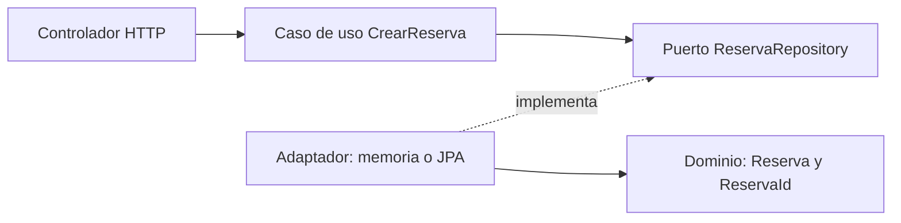
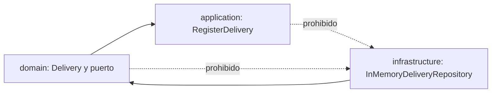
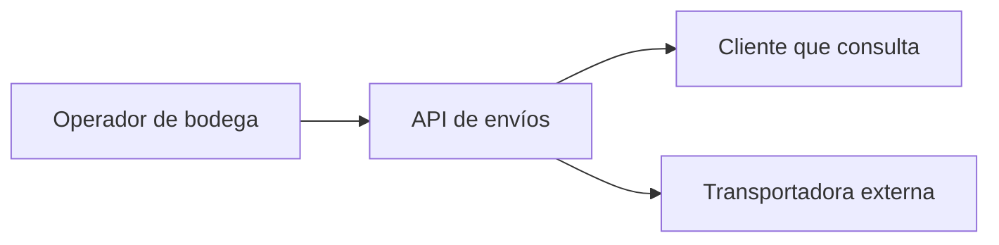
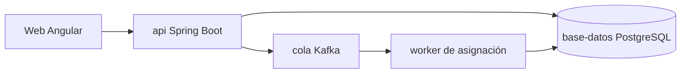
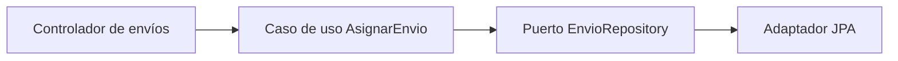
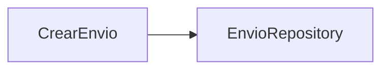
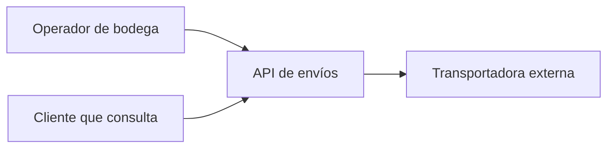
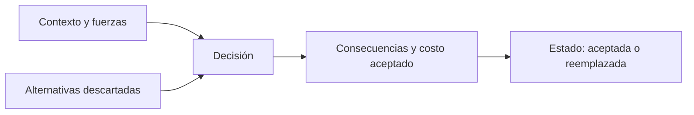

# Módulo 15: Arquitectura: hexagonal, Clean, C4, ADR y Spring Modulith

## Aprende construyendo

Cada Tema parte de una carpeta vacía, produce un artefacto concreto y lo verifica con un comando real. El recorrido va de dentro hacia afuera: puertos y adaptadores (Temas 1–3), cómo documentar y decidir la arquitectura (Temas 4–5) y cómo verificar los límites dentro de un mismo proceso con Spring Modulith (Temas 6–9). Un módulo de Modulith es una frontera lógica, no un microservicio; la decisión de separar servicios se estudia en el curso [Microservicios](/curso/microservices/0).

### Tema 1: Hexagonal: puertos que hablan el idioma del dominio · Avanzado · 35 min

Al finalizar vas a separar una regla de negocio de su infraestructura con un puerto que devuelve tipos del dominio, y a compilar el caso de uso sin Spring ni JPA en el classpath.

**Conocimiento previo:** JDK 25, `javac`/`java` en el `PATH`, y el Módulo 15 (Clean Architecture y DDD táctico). Comprueba `javac -version`.

**¿Por qué es importante?** Un puerto que devuelve `Page<ReservaEntity>` obliga al dominio a depender de Spring Data: el test del caso de uso levanta el contexto de Spring, tarda segundos y falla cuando cambia la versión de JPA. El síntoma aparece cuando alguien intenta probar una regla de negocio y descubre que necesita una base de datos.

En el proyecto integrador, las reglas de asignación de envíos deben probarse sin infraestructura. Un puerto que habla el idioma del negocio es lo que hace posible esa prueba.

**Preparación reproducible:** desde la raíz del repositorio copia `examples/spring-architecture-rutaflow` a una carpeta nueva y entra. JDK 25 y Node.js 24 LTS o superior. Los comandos siguientes parten de esa carpeta.

```bash
cp -R examples/spring-architecture-rutaflow practica-arquitectura
cd practica-arquitectura
```

#### Subtema 1.1 · Ejecuta el ejemplo completo y reconoce sus límites · 12 min

**Contexto:** El puerto conserva lenguaje del dominio; el adaptador en memoria satisface el contrato sin Spring.

**Hazlo tú:** Desde una carpeta vacía:

```bash
mkdir arquitectura-hexagonal && cd arquitectura-hexagonal
mkdir src
```

Crea `src/Hexagonal.java` con este contenido completo:

```java
import java.util.ArrayList;
import java.util.List;
import java.util.Optional;

public final class Hexagonal {
    record ReservaId(String valor) {
        ReservaId {
            if (valor == null || valor.isBlank()) throw new IllegalArgumentException("id requerido");
        }
    }

    record Reserva(ReservaId id, String vehiculo, int dias) {
        Reserva {
            if (dias <= 0) throw new IllegalArgumentException("dias debe ser positivo");
        }
    }

    // Puerto: declara lo que la aplicación necesita, con tipos del dominio.
    interface ReservaRepository {
        void guardar(Reserva reserva);
        Optional<Reserva> buscar(ReservaId id);
    }

    static final class CrearReserva {
        private final ReservaRepository repositorio;
        CrearReserva(ReservaRepository repositorio) { this.repositorio = repositorio; }

        Reserva ejecutar(ReservaId id, String vehiculo, int dias) {
            Reserva reserva = new Reserva(id, vehiculo, dias);
            repositorio.guardar(reserva);
            return reserva;
        }
    }

    static final class EnMemoria implements ReservaRepository {
        private final List<Reserva> datos = new ArrayList<>();

        public void guardar(Reserva reserva) { datos.add(reserva); }

        public Optional<Reserva> buscar(ReservaId id) {
            return datos.stream().filter(reserva -> reserva.id().equals(id)).findFirst();
        }
    }

    public static void main(String[] args) {
        ReservaRepository repositorio = new EnMemoria();
        Reserva creada = new CrearReserva(repositorio).ejecutar(new ReservaId("RES-1"), "camion-1", 3);
        Reserva recuperada = repositorio.buscar(creada.id()).orElseThrow();
        System.out.println("reserva=" + recuperada.id().valor() + " vehiculo=" + recuperada.vehiculo());
    }
}
```

Compila y ejecuta sin ninguna dependencia externa:

```bash
javac -d out src/Hexagonal.java
java -cp out Hexagonal
```

**Resultado esperado:** `reserva=RES-1 vehiculo=camion-1`. El programa no menciona Spring, JPA ni una base de datos: el adaptador es una lista en memoria y el caso de uso no lo sabe.

**Fallo deliberado:** cambia el puerto para que devuelva una entidad de Spring Data:

```java
interface ReservaRepository {
    org.springframework.data.domain.Page<ReservaEntity> buscar(
        org.springframework.data.domain.Pageable pageable);
}
```

Al compilar, `javac` responde:

```text
Hexagonal.java:19: error: package org.springframework.data.domain does not exist
```

El diagnóstico es que el dominio ahora depende de un framework. No falta una dependencia (este laboratorio compila con `javac`, sin Maven ni Gradle): el problema es de dirección. Corrige el puerto para devolver `Reserva` y comprueba que `javac` vuelve a compilar sin Spring.

**Conceptos clave:** puerto, adaptador, dirección de dependencias, tipos del dominio.

**Entiende:** La arquitectura hexagonal separa tres zonas: el **dominio** (tipos y reglas), la **aplicación** (casos de uso que coordinan) y los **adaptadores** (HTTP, JPA, colas). El puerto es una interfaz declarada por la aplicación y hablada en tipos del dominio; el adaptador la implementa traduciendo desde su tecnología.

**Analogía:** un enchufe no sabe qué aparato se conecta. El puerto fija la forma (dos patas, 220 V) y el adaptador es el cable del aparato concreto. Si el enchufe exigiera un tipo de cable propietario, cambiar de aparato obligaría a cambiar la pared.

**Diagrama:**



**Cierra:** Conserva salida y error por introducir Spring; explica quién decide la regla y quién guarda datos.

#### Subtema 1.2 · Amplía una consulta del puerto sin filtrar infraestructura · 10 min

**Contexto:** El caso de uso necesita consultar reservas por vehículo y conservar tipos propios.

**Hazlo tú:** En `src/Hexagonal.java`, añade al puerto `List<Reserva> buscarPorVehiculo(String vehiculo)` e impleméntalo filtrando la lista de `EnMemoria`.

```bash
javac -d out src/Hexagonal.java
java -cp out Hexagonal
```

**Resultado esperado:** La compilación conserva cero dependencias Spring y el main sigue mostrando RES-1.

**Fallo deliberado:** Devuelve un `Page<Reserva>` de Spring Data en el puerto. **Diagnóstico:** javac no encuentra Spring: se introdujo un contrato de infraestructura en el dominio. Restaura List<Reserva>.

**Entiende:** Un puerto expresa necesidades del caso de uso, no reproduce cada operación de la base. La paginación puede usar un tipo propio si el negocio la necesita.

**Cierra:** Guarda firma e implementación y explica por qué no agregaste Spring al classpath.

#### Subtema 1.3 · Transfiere la regla a una cancelación independiente · 10 min

**Contexto:** Crear y cancelar comparten almacenamiento, pero tienen reglas diferentes.

**Hazlo tú:** Crea `src/CancelarReserva.java` con un caso de uso que busque por ID, distinga ausente/cancelada y guarde una transición válida. Añade un main de prueba con dos cancelaciones del mismo ID.

```bash
javac -d out src/Hexagonal.java src/CancelarReserva.java
java -cp out CancelarReserva
```

**Resultado esperado:** Tu main imprime una cancelación aceptada y un resultado explícito para la repetida; define primero ese contrato.

**Fallo deliberado:** Devuelve null en el adaptador para una reserva ausente y úsala sin comprobar el resultado. **Diagnóstico:** un NullPointerException indica que el caso de uso no convirtió ausencia en una decisión del dominio; comprueba la ausencia antes de acceder.

**Entiende:** No hay una única política universal para repetir cancelación: rechazo o resultado idempotente deben declararse. No añadas un framework para evitar decidirla.

**Cierra:** Conserva tu archivo, salida y decisión para la cancelación repetida. Ese ejercicio es tu evidencia, no un test publicado ya aprobado.

**Hito del tema:** guarda el artefacto ejecutado, su salida, un fallo diagnosticado y la decisión que trasladarías al proyecto integrador. El ejercicio independiente requiere tu implementación; no se declara resuelto por leerlo.

Siguiente paso: documentar el sistema completo con C4. **Evidencia de aprendizaje:** entrega `Hexagonal.java`, la salida `reserva=RES-1 vehiculo=camion-1` y el error de compilación con Spring junto con su diagnóstico.

**Errores comunes:** devolver entidades JPA desde el puerto; inyectar `Pageable` en el dominio; poner la lógica de negocio en el adaptador; crear un puerto por cada método del repositorio.

**Límites y decisión de uso:** hexagonal no significa una carpeta por capa ni un puerto por tabla. Si el sistema es un CRUD sin reglas, la separación añade ceremonia sin beneficio. En el proyecto integrador se justifica donde hay reglas que deben probarse sin infraestructura.

**Fuente oficial:** [Hexagonal Architecture (Alistair Cockburn)](https://alistair.cockburn.us/hexagonal-architecture/) y [Spring Data JPA](https://docs.spring.io/spring-data/jpa/reference/).

### Tema 2: Arquitectura hexagonal verificada con ArchUnit · Avanzado · 35 min

**Objetivo observable:** agregar una regla ejecutable que bloquee dependencias desde `domain` y `application` hacia `infrastructure`.

**¿Por qué es importante?** El dominio conserva las reglas del negocio; si importa una clase de base de datos o un framework, cambiar esa infraestructura puede arrastrar cambios al negocio. ArchUnit convierte la frontera en un test que muestra qué clase la cruzó.

**Antes de empezar:** entender puertos y adaptadores (Módulo 15, Tema 1, «Hexagonal: puertos que hablan el idioma del dominio»; puedes leerlo antes de este tema). El ejemplo `examples/archunit-hexagonal-rutaflow/` usa Java 25, ArchUnit 1.5.1 y JUnit; no necesita Spring ni Docker.

```bash
cd examples/archunit-hexagonal-rutaflow
./mvnw -q test
```



#### Subtema 2.1: Ubica el puerto y el adaptador · 8 min

**Contexto:** El puerto expresa qué necesita el caso de uso; el adaptador decide cómo guardar.

**Hazlo tú:** Desde `examples/archunit-hexagonal-rutaflow/`, abre `src/main/java/academia/rutaflow/hexagonal/domain/DeliveryRepository.java`, `application/RegisterDelivery.java` e `infrastructure/InMemoryDeliveryRepository.java`. Sigue el tipo que inyecta el caso de uso y la interfaz que implementa el adaptador.

Archivo concreto para esta comprobación: `examples/archunit-hexagonal-rutaflow/src/main/java/academia/rutaflow/hexagonal/application/RegisterDelivery.java`.


Para comprobar «Ubica el puerto y el adaptador», consulta: `examples/archunit-hexagonal-rutaflow/src/test/java/academia/rutaflow/hexagonal/HexagonalArchitectureTest.java`. Desde `examples/archunit-hexagonal-rutaflow` repite la comprobación:

```bash
./mvnw -q test
```

**Resultado esperado:** `RegisterDelivery` depende de `DeliveryRepository`; no conoce el mapa de `InMemoryDeliveryRepository`.

**Fallo deliberado:** En `RegisterDelivery`, cambia temporalmente el tipo del campo y del parámetro del constructor de `DeliveryRepository` a `InMemoryDeliveryRepository`. **Diagnóstico:** Ejecuta la suite: compila, pero ArchUnit rechaza la dependencia application→infrastructure. Restaura el puerto en ambos lugares y confirma los tests verdes.

**Entiende:** El puerto es el enchufe acordado; el adaptador es el aparato conectado. El negocio describe el enchufe, no el fabricante.

**Cierra:** Anota la ruta del puerto y la ruta de su implementación.

#### Subtema 2.2: Escribe la regla sobre el bytecode · 8 min

**Contexto:** ArchUnit importa las clases compiladas del paquete y comprueba las relaciones que quedaron en el bytecode.

**Hazlo tú:** Desde `examples/archunit-hexagonal-rutaflow/`, abre `src/test/java/academia/rutaflow/hexagonal/HexagonalArchitectureTest.java`. Lee la regla y ejecútala:

```java
ArchRule rule = noClasses().that().resideInAPackage("..domain..")
    .should().dependOnClassesThat().resideInAPackage("..infrastructure..");

rule.check(project);
```

**Resultado esperado:** La regla pasa con las clases actuales y se examina el mismo paquete `academia.rutaflow.hexagonal`.

**Fallo deliberado:** Añade temporalmente a `domain/Delivery.java` un método que devuelva `InMemoryDeliveryRepository`. **Diagnóstico:** Corre `./mvnw -q -Dtest=HexagonalArchitectureTest#dominioNoDependeDeDetallesDeInfraestructura test`: el fallo señala el tipo de retorno. Quita método e import y ejecuta la suite completa.

**Entiende:** La regla mira referencias de bytecode, por ejemplo tipos de campo, retorno, herencia y llamadas. Una cadena con el nombre de una clase usada vía reflexión no es necesariamente una dependencia de bytecode detectada por esta regla.

**Cierra:** Conserva el mensaje de ArchUnit que nombra `Delivery` y `InMemoryDeliveryRepository`.

#### Subtema 2.3: Protege también el caso de uso · 8 min

**Contexto:** Prohibir la fuga desde el dominio no basta si application importa la base concreta directamente.

**Hazlo tú:** Abre `examples/archunit-hexagonal-rutaflow/src/test/java/academia/rutaflow/hexagonal/HexagonalArchitectureTest.java`, sigue `aplicacionNoDependeDeDetallesDeInfraestructura` y compara el nombre de paquetes con la primera regla.

**Práctica guiada.** Cambia el puerto de `RegisterDelivery` por el adaptador concreto, ejecuta solo esta regla y vuelve a inyectar la interfaz cuando veas la infracción.

Archivo concreto para esta comprobación: `examples/archunit-hexagonal-rutaflow/src/test/java/academia/rutaflow/hexagonal/HexagonalArchitectureTest.java`.


Para comprobar «Protege también el caso de uso», consulta: `examples/archunit-hexagonal-rutaflow/src/test/java/academia/rutaflow/hexagonal/HexagonalArchitectureTest.java`. Desde `examples/archunit-hexagonal-rutaflow` repite la comprobación:

```bash
./mvnw -q test
```

**Resultado esperado:** Los dos tests pasan: ni `domain` ni `application` tienen dependencia hacia `infrastructure`.

**Fallo deliberado:** Cambia `RegisterDelivery` para declarar una referencia a `InMemoryDeliveryRepository`; corre solo `aplicacionNoDependeDeDetallesDeInfraestructura`. **Diagnóstico:** ArchUnit marca esa referencia. Restaura la dependencia por interfaz.

**Entiende:** Una regla es tan completa como los paquetes que incluye. Su límite es lo que ArchUnit importó y los tipos de dependencia que la regla detecta. Si aparece un nuevo paquete como `adapter`, decide y documenta qué lado de la frontera ocupa antes de ampliar el patrón.

**Cierra:** Guarda el reporte verde de las dos reglas.

#### Subtema 2.4: Decide qué reglas merece mantener · 8 min

**Contexto:** Una regla demasiado general puede bloquear decisiones válidas; una regla ausente deja la frontera a la memoria del equipo.

**Hazlo tú:** Desde `examples/archunit-hexagonal-rutaflow/`, lee `src/test/java/academia/rutaflow/hexagonal/HexagonalArchitectureTest.java`, busca `adaptersDeInfraestructuraSeIdentificanComoRepository` y ejecuta `./mvnw -q test`. La regla de ejemplo comprueba el sufijo del adaptador; registra qué paquetes y clases quedan dentro de su alcance.

**Resultado esperado:** La regla nueva pasa con el adaptador actual y explica su alcance en el nombre o comentario.

**Fallo deliberado:** Renombra temporalmente el archivo/clase `InMemoryDeliveryRepository` a `InMemoryDeliveryStore` sin actualizar la regla. **Diagnóstico:** Ejecuta `adaptersDeInfraestructuraSeIdentificanComoRepository`: falla al encontrar `InMemoryDeliveryStore`. Restaura el nombre y corre la suite completa.

**Entiende:** ArchUnit valida estructura de clases, no calidad del modelo completo ni comportamiento de negocio. Mantén el alcance visible y revisa excepciones en vez de ampliar los patrones hasta que todo pase.

**Cierra:** Evidencia: suite verde restaurada y explicación de una regla útil para el proyecto integrador.

**Transferencia al proyecto integrador:** protege con ArchUnit las capas de una ruta real (controller → caso de uso → puerto → adapter). La prueba actual solo cubre un ejemplo mínimo en memoria; no inspecciona el microservicio del Módulo 20.

**Fuentes oficiales:** [ArchUnit User Guide](https://www.archunit.org/userguide/html/000_Index.html), [ArchUnit Getting Started](https://www.archunit.org/getting-started).

### Tema 3: Clean Architecture y DDD táctico: caso de uso antes que framework · Experto · 35 min

#### Subtema 3.1: Haz que el agregado proteja la regla · 8 min

**Contexto:** Un envío sin destino puede asignarse; uno ya asignado no debe cambiar de destino por una segunda petición.

**¿Por qué es importante?** Si la regla vive solo en el controller, una tarea programada o un nuevo endpoint podría saltársela. El agregado protege el cambio desde cualquier entrada.

**Hazlo tú:** Abre `examples/spring-clean-architecture-rutaflow/src/main/java/academia/rutaflow/clean/domain/Delivery.java` y sigue `assignTo`. El agregado usa los value objects `DeliveryId` y `Destination`.

```java
public Delivery assignTo(Destination nextDestination) {
    if (status != DeliveryStatus.CREATED) {
        throw new DeliveryAlreadyAssigned();
    }
    return new Delivery(id, nextDestination, DeliveryStatus.ASSIGNED);
}
```

Ejecuta desde `examples/spring-clean-architecture-rutaflow/`:

```bash
./mvnw -q -Dtest=AssignDeliveryTest#domainRuleRejectsAssigningADestinationTwice test
```

**Resultado esperado:** La primera asignación crea el destino; la siguiente se rechaza y deja intacta la regla del dominio.

**Fallo deliberado:** Quita la comprobación de estado en `assignTo`. **Diagnóstico:** La prueba falla porque el mismo envío acepta una segunda asignación. Restáurala y corre el test de nuevo.

**Entiende:** El agregado `Delivery` es dueño de su estado y de las reglas para cambiarlo. No necesita conocer HTTP, Spring ni una base de datos.

**Cierra:** Escribe qué otra transición debería controlar este agregado y desde qué estado sería válida.

#### Subtema 3.2: Conecta el caso de uso a un puerto · 8 min

**Contexto:** El caso de uso coordina una acción y pide guardar el resultado mediante una interfaz; el adaptador decide dónde se guarda.

**Hazlo tú:** Abre `application/AssignDelivery.java` y `application/DeliveryRepository.java` dentro de `examples/spring-clean-architecture-rutaflow/`:

```text
web ──> caso de uso ──> puerto de repositorio
                           ▲
                    adaptador de datos
              dominio usado por el caso de uso
```

Ejecuta:

```bash
./mvnw -q -Dtest=AssignDeliveryTest,ArchitectureBoundariesTest test
```

**Resultado esperado:** La prueba de aplicación funciona con un repositorio falso sin iniciar Spring; ArchUnit confirma que el dominio no importa Spring/web y que application no depende de infrastructure/web.

**Fallo deliberado:** En `AssignDelivery`, agrega temporalmente un campo `private InMemoryDeliveryRepository forbiddenDependency;` y su import. **Diagnóstico:** Corre `./mvnw -q -Dtest=ArchitectureBoundariesTest#applicationDoesNotDependOnInfrastructureOrWebAdapters test`: ArchUnit señala el campo que cruzó la frontera. Quita el campo/import y repite la prueba.

**Entiende:** El caso de uso conoce el puerto; el adaptador implementa el puerto. Esto permite cambiar el repositorio sin reescribir la regla de negocio.

**Cierra:** Explica qué clase reemplazarías para guardar los envíos en PostgreSQL.

#### Subtema 3.3: Usa Spring como adaptador HTTP · 8 min

**Contexto:** El controller traduce una petición web y llama al caso de uso; no contiene la regla para asignar dos veces.

**Hazlo tú:** Abre `web/DeliveryController.java` y `src/test/java/academia/rutaflow/clean/web/DeliveryHttpTest.java` dentro de `examples/spring-clean-architecture-rutaflow/`. Ejecuta:

```bash
./mvnw -q -Dtest=DeliveryHttpTest test
```

**Resultado esperado:** El primer `POST /api/deliveries/D-HTTP-1/assignment` devuelve `201` y `ASSIGNED`; repetir el ID devuelve `409`. El controller traduce la excepción del dominio a una respuesta HTTP.

**Fallo deliberado:** Cambia temporalmente `HttpStatus.CONFLICT` por `HttpStatus.OK`. **Diagnóstico:** La prueba de repetición falla porque un envío ya asignado debe producir un conflicto. Restaura `CONFLICT`.

**Entiende:** El controller es un adaptador de entrada: sabe de HTTP y de la forma de la respuesta. La entidad de persistencia y el dominio no se envían directamente como contrato externo.

**Cierra:** Dibuja la ruta de una petición hasta la regla del agregado y de vuelta a la respuesta.

#### Subtema 3.4: Comprueba el corte vertical y sus límites · 8 min

**Contexto:** El recorrido completo combina un agregado, un caso de uso, un puerto, un adaptador y un endpoint; una estructura de carpetas por sí sola no garantiza esa dirección.

**Hazlo tú:** Lee `examples/spring-clean-architecture-rutaflow/README.md` y ejecuta:

```bash
./mvnw -q test
```

Para iniciar la app y probar el endpoint manualmente, sigue los comandos del README.

**Resultado esperado:** Pasan seis pruebas: dos de dominio/aplicación, dos de límites ArchUnit y dos HTTP con el contexto Spring.

**Fallo deliberado:** En `DeliveryController`, reemplaza temporalmente la llamada a `assignDelivery.execute(...)` por `Delivery.create(new DeliveryId(id)).assignTo(new Destination(request.destination()))`. **Diagnóstico:** Ejecuta `DeliveryHttpTest`: la segunda petición vuelve a crear el envío y devuelve `201` en lugar de `409`. Restaura la llamada al caso de uso.

**Entiende:** Este laboratorio usa memoria y se vacía al reiniciar; no incluye JPA, seguridad ni persistencia. Para proyectos pequeños, conserva estos límites dentro de un monolito modular; añade servicios separados solo cuando propiedad de datos, escala o equipos lo justifiquen.

**Cierra:** **Proyecto integrador:** en la API de envíos del Módulo 20, identifica agregado e invariantes, caso de uso, puerto, adaptadores HTTP/JPA y reglas de dependencia. Migra el repositorio sin cambiar la regla de asignación.

**Fuente:** [Martin Fowler — DDD Aggregate](https://martinfowler.com/bliki/DDD_Aggregate.html), [Spring Boot Reference](https://docs.spring.io/spring-boot/reference/). La demo prueba un recorrido local; no certifica el diseño completo ni su rendimiento.

#### Ejercicio original RutaFlow · referencia opcional

Este ejercicio corto en Java puro conserva el diseño original sin iniciar
Spring. La ruta principal anterior amplía el recorrido con Spring Boot, prueba
HTTP y verifica las fronteras con ArchUnit.

Archivo: `examples/rutaflow-material/clean-architecture/Main.java` (`Main.java`):

```java
import java.util.ArrayList;
import java.util.List;

record ShipmentId(String value) {
    ShipmentId {
        if (value == null || value.isBlank()) throw new IllegalArgumentException("id requerido");
    }
}

record Shipment(ShipmentId id, String status) {
    Shipment {
        if (status == null || status.isBlank()) throw new IllegalArgumentException("estado requerido");
    }
}

interface ShipmentRepository {
    void save(Shipment shipment);
    Shipment find(ShipmentId id);
}

final class InMemoryShipmentRepository implements ShipmentRepository {
    private final List<Shipment> values = new ArrayList<>();

    @Override public void save(Shipment shipment) { values.removeIf(value -> value.id().equals(shipment.id())); values.add(shipment); }
    @Override public Shipment find(ShipmentId id) { return values.stream().filter(value -> value.id().equals(id)).findFirst().orElse(null); }
}

final class CreateShipment {
    private final ShipmentRepository repository;

    CreateShipment(ShipmentRepository repository) { this.repository = repository; }

    Shipment execute(String id) {
        Shipment shipment = new Shipment(new ShipmentId(id), "CREATED");
        repository.save(shipment);
        return shipment;
    }
}

public class Main {
    public static void main(String[] args) {
        ShipmentRepository repository = new InMemoryShipmentRepository();
        CreateShipment useCase = new CreateShipment(repository);
        Shipment shipment = useCase.execute("ENV-42");
        if (!"CREATED".equals(repository.find(shipment.id()).status())) throw new AssertionError("estado incorrecto");
        System.out.println("shipment=" + shipment.id().value() + " status=" + shipment.status());
    }
}
```

Archivo: `examples/rutaflow-material/clean-architecture/test.sh` (`test.sh`):

```bash
#!/usr/bin/env bash
set -euo pipefail
build_dir="$(mktemp -d)"
trap 'rm -rf "$build_dir"' EXIT
javac -d "$build_dir" Main.java
java -cp "$build_dir" Main
```

### Tema 4: C4: contexto, contenedores, componentes y código · Avanzado · 35 min

Al finalizar vas a dibujar los cuatro niveles C4 de una API de envíos, a enlazar cada relación con el código que la implementa y a validar el documento con un script que falla si un contenedor del sistema no aparece.

**Conocimiento previo:** Tema 1 de este módulo; Node.js 24 LTS o superior (`node --version`).

**¿Por qué es importante?** Un diagrama que nadie puede contrastar se convierte en decoración. En el proyecto integrador, el diagrama de contenedores se usa para decidir dónde vive la cola y quién escribe en la base; si el diagrama muestra un worker que el código no tiene, la decisión se toma sobre una ficción.

C4 resuelve el problema de escala: no se dibuja todo en un solo nivel. Cada nivel responde una pregunta distinta y no repite la anterior.

**Preparación reproducible:** desde la raíz del repositorio copia `examples/spring-architecture-rutaflow` a una carpeta nueva y entra. JDK 25 y Node.js 24 LTS o superior. Los comandos siguientes parten de esa carpeta.

```bash
cp -R examples/spring-architecture-rutaflow practica-arquitectura
cd practica-arquitectura
```

#### Subtema 4.1 · Ejecuta el ejemplo completo y reconoce sus límites · 12 min

**Contexto:** Los cuatro niveles describen un diseño propuesto: no hay api, worker y broker ejecutados por este laboratorio.

**Hazlo tú:** Desde una carpeta vacía:

```bash
mkdir c4-envios && cd c4-envios
mkdir -p docs/c4
```

Crea `validar-c4.mjs` y `docs/c4/envios.md`. El validador primero, para que el documento tenga una prueba:

```javascript
// Comprueba que el C4 tenga los cuatro niveles y los contenedores propuestos.
import { readFile } from 'node:fs/promises';

const texto = await readFile('docs/c4/envios.md', 'utf8');
const contenedores = ['api', 'worker', 'base-datos', 'cola'];
const faltantes = contenedores.filter((nombre) => !texto.toLowerCase().includes(nombre));
if (faltantes.length) {
  console.error(`Faltan contenedores en el C4: ${faltantes.join(', ')}`);
  process.exit(1);
}

const niveles = ['Contexto', 'Contenedores', 'Componentes', 'Código'];
const sinNivel = niveles.filter((nivel) => !texto.includes(`## ${nivel}`));
if (sinNivel.length) {
  console.error(`Faltan niveles: ${sinNivel.join(', ')}`);
  process.exit(1);
}

const relaciones = (texto.match(/-->/g) ?? []).length;
if (relaciones < 12) {
  console.error(`Se esperaban al menos 12 relaciones y hay ${relaciones}`);
  process.exit(1);
}

console.log(`C4 OK: ${niveles.length} niveles y ${relaciones} relaciones`);
```

Crea `docs/c4/envios.md` con el título `# API de envíos — C4` y cuatro secciones (`## Contexto`, `## Contenedores`, `## Componentes`, `## Código`). Cada sección lleva su diagrama; estos son los cuatro, en orden:









Verifica:

```bash
node validar-c4.mjs
```

**Resultado esperado:** `C4 OK: 4 niveles y 12 relaciones`. El número es el de flechas del documento; el validador informa el real y falla si baja de doce.

**Fallo deliberado:** elimina la línea `Cola --> Worker["worker de asignación"]` y ejecuta otra vez. El validador responde `Se esperaban al menos 12 relaciones y hay 11`. Si además borras el nodo del worker, responde `Faltan contenedores en el C4: worker`. El diagnóstico es una diferencia de forma documental: el validador detecta la ausencia, no la corrige. Vuelve a añadir el worker y su relación.

**Conceptos clave:** nivel C4, contenedor, relación verificable, documento versionado.

**Entiende:** Los cuatro niveles son: **contexto** (el sistema y sus usuarios), **contenedores** (aplicaciones, colas y bases que se despliegan por separado), **componentes** (piezas dentro de un contenedor) y **código** (clases y relaciones). Cada flecha debe corresponder a una llamada o dependencia real.

**Analogía:** es un mapa de escalas. El contexto es el mapa del país, los contenedores son las ciudades, los componentes son los barrios y el código son las calles. Un mapa de país con calles es ilegible; un mapa de calles que pretende explicar el país, también.

**Diagrama:**



**Cierra:** Conserva la salida de validación e identifica una relación que sigue siendo un supuesto explícito.

#### Subtema 4.2 · Contrasta un contenedor con el código que existiría · 10 min

**Contexto:** El ejemplo C4 muestra un sistema propuesto; contar flechas no demuestra su implementación.

**Hazlo tú:** Abre `docs/c4/envios.md` del laboratorio y crea `docs/c4/evidencia.md` con una fila para api, worker, base-datos y cola. Marca cada uno como supuesto o enlaza una clase/configuración real del integrador.

```bash
node validar-c4.mjs
```

**Resultado esperado:** El formato sigue válido; la tabla separa propuesta y código existente. El lab arquitectónico no ejecuta esos cuatro procesos.

**Fallo deliberado:** Quita el nivel Contenedores y ejecuta el validador. **Diagnóstico:** falla la comprobación de niveles aunque existan palabras como api o worker en otras secciones; restaura el encabezado.

**Entiende:** C4 permite varias escalas. Una relación debe tener propósito, dirección y evidencia; la heurística textual no verifica esos tres aspectos.

**Cierra:** Señala una flecha todavía hipotética y qué archivo necesitas para respaldarla.

#### Subtema 4.3 · Añade una relación solo después de justificarla · 10 min

**Contexto:** Una modificación del producto puede exigir otro componente; el documento debe evolucionar con la implementación.

**Hazlo tú:** En `docs/c4/envios.md`, añade el caso de uso CancelarEnvio al nivel Código y su relación con EnvioRepository. Anota en `docs/c4/evidencia.md` que es una propuesta hasta implementarse.

```bash
node validar-c4.mjs
```

**Resultado esperado:** El contador aumenta de 12 a 13 relaciones; eso mide texto, no calidad.

**Fallo deliberado:** Añade la misma flecha dos veces para simular más cobertura. **Diagnóstico:** el contador puede pasar igualmente: el validador no detecta duplicados ni demuestra relaciones reales. Retira la repetición y contrasta el diseño manualmente.

**Entiende:** La revisión humana debe resolver semántica y correspondencia con código. En una arquitectura real no añadas un worker solo porque el ejemplo lo mencione.

**Cierra:** Como ejercicio independiente, relaciona una clase real del integrador con su nivel C4 y anota el archivo exacto. Conserva diseño y evidencia juntos.

**Hito del tema:** guarda el artefacto ejecutado, su salida, un fallo diagnosticado y la decisión que trasladarías al proyecto integrador. El ejercicio independiente requiere tu implementación; no se declara resuelto por leerlo.

Siguiente paso: registrar por qué se eligió esta arquitectura. **Evidencia de aprendizaje:** entrega `docs/c4/envios.md`, `validar-c4.mjs` y la salida del validador antes y después de romper el diagrama.

**Errores comunes:** mezclar niveles en un solo dibujo; dibujar un contenedor que no existe; usar C4 como sustituto de un ADR; no versionar el diagrama junto al código.

**Límites y decisión de uso:** C4 documenta estructura, no decisiones ni comportamiento en tiempo de ejecución. Para una decisión que cambia el costo futuro, el artefacto correcto es un ADR. En el proyecto integrador, C4 responde «qué hay» y el ADR responde «por qué».

**Fuente oficial:** [C4 model](https://c4model.com/) y [Diagramas como código con Mermaid](https://mermaid.js.org/syntax/flowchart.html).

### Tema 5: ADR: decisiones con contexto, alternativas y consecuencias · Experto · 35 min

Al finalizar vas a escribir tres Architecture Decision Records con contexto, alternativas, consecuencias y estado, y a validarlos con un script que falla si falta una sección o si no se consideró ninguna alternativa.

**Conocimiento previo:** Temas 1 y 2; Node.js 24 LTS o superior.

**¿Por qué es importante?** Dentro de un año, alguien preguntará por qué la asignación va por Kafka y no por una llamada directa. Sin un ADR, la respuesta se pierde y la decisión se revierte por moda. En el proyecto integrador, la elección de cola, base de datos y estrategia de reintentos debe poder revisarse sin depender de la memoria del equipo.

Un ADR no es un documento de diseño: es la memoria de una decisión concreta, con las alternativas que se descartaron y el costo que se aceptó.

**Preparación reproducible:** desde la raíz del repositorio copia `examples/spring-architecture-rutaflow` a una carpeta nueva y entra. JDK 25 y Node.js 24 LTS o superior. Los comandos siguientes parten de esa carpeta.

```bash
cp -R examples/spring-architecture-rutaflow practica-arquitectura
cd practica-arquitectura
```

#### Subtema 5.1 · Ejecuta el ejemplo completo y reconoce sus límites · 12 min

**Contexto:** Los tres ADR del laboratorio permiten revisar una decisión con sus razones y alternativas.

**Hazlo tú:** Desde una carpeta vacía:

```bash
mkdir adr-envios && cd adr-envios
mkdir -p docs/adr
```

Crea `validar-adr.mjs` y tres ADR. Empieza por el validador:

```javascript
// Verifica que cada ADR tenga las secciones y al menos dos alternativas.
import { readdir, readFile } from 'node:fs/promises';

const archivos = (await readdir('docs/adr'))
  .filter((nombre) => /^\d{4}-.+\.md$/.test(nombre))
  .sort();
if (archivos.length < 3) {
  console.error(`Se esperaban 3 ADR y hay ${archivos.length}`);
  process.exit(1);
}

const secciones = ['## Contexto', '## Decisión', '## Alternativas', '## Consecuencias', '## Estado'];
for (const archivo of archivos) {
  const texto = await readFile(`docs/adr/${archivo}`, 'utf8');
  const faltan = secciones.filter((seccion) => !texto.includes(seccion));
  if (faltan.length) {
    console.error(`${archivo}: faltan ${faltan.join(', ')}`);
    process.exit(1);
  }
  const alternativas = (texto.match(/^- \*\*/gm) ?? []).length;
  if (alternativas < 2) {
    console.error(`${archivo}: se esperaban al menos 2 alternativas y hay ${alternativas}`);
    process.exit(1);
  }
}

console.log(`ADR OK: ${archivos.length} decisiones con contexto, alternativas y consecuencias`);
```

Crea `docs/adr/0001-postgresql-en-lugar-de-mongodb.md`:

```markdown
# 0001 — PostgreSQL para el estado de envíos

## Contexto

El estado de un envío cambia con reglas de negocio (transiciones válidas) y se consulta por
identificador y por fecha. El equipo ya opera PostgreSQL en local y necesita transacciones.

## Decisión

Usar PostgreSQL como base de datos del estado de envíos.

## Alternativas

- **MongoDB:** documentos flexibles, pero sin transacciones multi-documento simples en nuestro caso de uso.
- **SQLite:** suficiente para una demo, no para varias instancias concurrentes.

## Consecuencias

Se gana consistencia transaccional y consultas por fecha con índices. Se paga operación de
migraciones y un esquema que exige revisar cada cambio.

## Estado

Aceptada el 2026-10-30.
```

Crea `docs/adr/0002-kafka-para-asignacion.md` y `docs/adr/0003-reintentos-con-outbox.md` con la misma estructura y al menos dos alternativas cada uno. Verifica:

```bash
node validar-adr.mjs
```

**Resultado esperado:** `ADR OK: 3 decisiones con contexto, alternativas y consecuencias`.

**Fallo deliberado:** borra la sección `## Alternativas` del ADR `0003`. El validador responde `0003-reintentos-con-outbox.md: faltan ## Alternativas`. El diagnóstico es que un ADR sin alternativas no permite revisar la decisión: parece una orden, no una elección. Vuelve a añadir la sección con dos opciones reales.

**Conceptos clave:** contexto, decisión, alternativas, consecuencias, estado del ADR.

**Entiende:** Un ADR tiene cinco partes: **contexto** (la fuerza que obliga a decidir), **decisión** (qué se eligió), **alternativas** (qué se descartó y por qué), **consecuencias** (qué se gana y qué se paga) y **estado** (propuesta, aceptada, reemplazada). El estado importa: una decisión reemplazada sigue siendo historia útil.

**Analogía:** es el acta de una reunión técnica. No describe la oficina ni el organigrama; registra qué se decidió, quién lo propuso, qué otras opciones había y qué se aceptó perder. Sin acta, la reunión se repite cada seis meses.

**Diagrama:**



**Cierra:** Conserva los tres archivos y distingue una decisión propuesta de una aceptada por un equipo.

#### Subtema 5.2 · Compara alternativas con condiciones concretas · 10 min

**Contexto:** Una alternativa descartada sin motivo no permite revisar la decisión.

**Hazlo tú:** Abre `docs/adr/0002-kafka-para-asignacion.md` y `0003-reintentos-con-outbox.md`. Para cada opción identifica requisito, coste operativo y una condición que haría cambiar de elección.

```bash
node validar-adr.mjs
```

**Resultado esperado:** Hay tres ADR con secciones; los nuevos se mantienen como propuestas didácticas.

**Fallo deliberado:** Borra ## Alternativas de 0003 y ejecuta el comando. **Diagnóstico:** el validador informa la sección ausente; restaura el contenido con opciones reales.

**Entiende:** Validar estructura no evalúa si Kafka o outbox son la decisión adecuada. PostgreSQL, MongoDB y SQLite deben compararse según el caso y operación, sin prohibiciones universales inventadas.

**Cierra:** Guarda una condición medible que obligaría a revisar la decisión de mensajería.

#### Subtema 5.3 · Reemplaza una decisión conservando el historial · 10 min

**Contexto:** El equipo necesita saber qué estuvo vigente y por qué cambió.

**Hazlo tú:** Crea `docs/adr/0004-revision-de-asignacion.md` con contexto, decisión, dos alternativas, consecuencias y estado. En 0002 escribe Reemplazada por 0004 y enlaza el archivo desde README.md.

```bash
node validar-adr.mjs
```

**Resultado esperado:** El validador registra cuatro decisiones sin borrar 0002; revisa manualmente que el enlace exista.

**Fallo deliberado:** Borra ## Consecuencias del nuevo ADR. **Diagnóstico:** falta el coste aceptado y el validador falla por sección ausente; restaura el análisis.

**Entiende:** Un ADR conserva razones, no es una orden irreversible ni una certificación de diseño. La fecha de ejemplo no acredita aprobación de un equipo real.

**Cierra:** Como ejercicio independiente, escribe un ADR de caché o autorización del proyecto integrador con evidencia y alternativa descartada; entrega el enlace y explica qué lo haría revocable.

**Hito del tema:** guarda el artefacto ejecutado, su salida, un fallo diagnosticado y la decisión que trasladarías al proyecto integrador. El ejercicio independiente requiere tu implementación; no se declara resuelto por leerlo.

Siguiente paso: aplicar el mismo criterio a cada nueva decisión del proyecto. **Evidencia de aprendizaje:** entrega los tres ADR, `validar-adr.mjs` y la salida del validador con el fallo de `0003` y su corrección.

**Errores comunes:** escribir un ADR después de implementar sin registrar las alternativas; copiar el mismo texto en los tres; dejar el estado «propuesta» para siempre; usar el ADR para describir la arquitectura completa.

**Límites y decisión de uso:** un ADR documenta una decisión, no garantiza que sea buena. Si la decisión es reversible y barata, el registro puede ser una línea en el commit; el ADR se justifica cuando el costo de revertir es alto. En el proyecto integrador se escribe para las decisiones que alguien querrá cuestionar dentro de un año.

**Fuente oficial:** [Architecture Decision Records (AWS Prescriptive Guidance)](https://docs.aws.amazon.com/prescriptive-guidance/latest/architectural-decision-records/adr-process.html) y [ADR en Martin Fowler](https://martinfowler.com/bliki/ArchitectureDecisionRecord.html).

### Tema 6: módulos y límites entre paquetes · Avanzado · 30 min

**Meta:** detectar una dependencia de un módulo hacia una clase interna de otro.

**¿Por qué es importante?** Separar carpetas no impide acoplamiento; una verificación repetible hace visible la dependencia prohibida.

**Prerrequisitos:** M15 T1, paquetes Java, imports y JUnit. Duración: 30–40 min.

**Preparación:** JDK 25 y el repositorio. Desde su raíz copia `examples/spring-modulith-rutaflow` a una carpeta nueva, entra y ejecuta el wrapper incluido:

```bash
cp -R examples/spring-modulith-rutaflow practica-m23-t1
cd practica-m23-t1
./mvnw -q test
```

**Analogía:** los módulos son habitaciones con puertas públicas; un import a internals atraviesa una pared. Esa comparación no decide por sí sola qué API es conveniente.

#### Subtema 6.1 · Reconoce la frontera verificable · 10 min

**Contexto:** Los paquetes inmediatos de la aplicación definen capacidades de negocio.

**Hazlo tú:** Abre `src/main/java/academia/rutaflow/modulith/RutaFlowModulithApplication.java` y `src/test/java/academia/rutaflow/modulith/ArquitecturaModularTest.java`. Sigue ApplicationModules.of y verify.

```bash
./mvnw -q -Dtest=ArquitecturaModularTest test
```

**Resultado esperado:** La prueba no encuentra ciclos ni accesos a internals en el laboratorio actual.

**Fallo deliberado:** En NotificacionListener.java, añade un campo con tipo academia.rutaflow.modulith.pedidos.internal.PedidoInterno.

**Diagnóstico:** Java permite el tipo público, pero Modulith detecta que otro módulo accede al paquete interno; elimina el campo.

**Entiende:** verify comprueba relaciones estáticas del modelo modular. No verifica autorización, transacciones distribuidas ni corrección de negocio.

**Cierra:** Guarda la dependencia rechazada y el resultado correcto tras retirarla.

#### Subtema 6.2 · Publica contratos pequeños · 10 min

**Contexto:** Notificaciones necesita saber que un pedido se creó, sin leer su dirección privada.

**Hazlo tú:** Abre `src/main/java/academia/rutaflow/modulith/pedidos/PedidoCreado.java` y compáralo con `pedidos/internal/PedidoInterno.java`. El evento solo contiene pedidoId.

```bash
./mvnw -q -Dtest=ArquitecturaModularTest,PedidosModuleTest test
```

**Resultado esperado:** El evento público se puede referenciar y el módulo Pedidos publica RF-205.

**Fallo deliberado:** Importa PedidoInterno desde el listener para extraer direccionPrivada.

**Diagnóstico:** la prueba de frontera rechaza el acoplamiento aunque el código compile; vuelve a usar PedidoCreado.

**Entiende:** Un contrato de evento debe contener lo que el consumidor necesita y permitir evolución. Público en Java no significa API pública del módulo.

**Cierra:** Anota qué dato privado quedó fuera y por qué no es necesario para el aviso.

#### Subtema 6.3 · Comprueba antes de mover paquetes · 10 min

**Contexto:** Cambiar el paquete de una clase puede cambiar su visibilidad modular.

**Hazlo tú:** En `src/test/java/academia/rutaflow/modulith/ArquitecturaModularTest.java`, lee qué clase raíz delimita el análisis. Ejecuta desde la carpeta copiada.

```bash
./mvnw -q test
```

**Resultado esperado:** Arquitectura y pruebas de eventos pasan con la estructura actual.

**Fallo deliberado:** Mueve PedidoCreado al paquete internal y cambia el import del listener para que compile.

**Diagnóstico:** el consumidor ya depende de un interno; verify falla. Restaura el paquete público original.

**Entiende:** Una refactorización de paquetes puede alterar el contrato aunque el IDE actualice imports. Comprueba arquitectura y consumidores juntos.

**Cierra:** Guarda los paquetes públicos y los internos en una nota de tu proyecto.

**Práctica independiente:** En una copia añade un módulo facturacion que use solo PedidoCreado. Escribe un test de frontera y luego un acceso interno deliberado; conserva el contraste. No lo presentes como servicio desplegado.

**Hito del tema:** conserva el resultado ejecutado, el fallo diagnosticado y restaurado, una explicación propia del mecanismo y tu ejercicio independiente. En el proyecto integrador RutaFlow aplica la decisión solo cuando puedas justificar su alcance. La suite del laboratorio no acredita un despliegue productivo ni la resolución de tu ejercicio.

**Fuente primaria:** [Spring Modulith: fundamentos](https://docs.spring.io/spring-modulith/reference/fundamentals.html)

### Tema 7: eventos entre módulos sin importar implementación · Avanzado · 30 min

**Meta:** publicar un hecho de negocio y observar su reacción local después del commit.

**¿Por qué es importante?** Invocar directamente internals de otro módulo oculta el contrato y acopla cambios.

**Prerrequisitos:** M8 T2 y M15 T6. Duración: 30–40 min.

**Preparación:** JDK 25 y el repositorio. Desde su raíz copia `examples/spring-modulith-rutaflow` a una carpeta nueva, entra y ejecuta el wrapper incluido:

```bash
cp -R examples/spring-modulith-rutaflow practica-m23-t2
cd practica-m23-t2
./mvnw -q test
```

**Analogía:** el evento es un aviso acordado entre oficinas; publicar el aviso no equivale a confirmar su recepción durable.

#### Subtema 7.1 · Publica desde el servicio · 10 min

**Contexto:** PedidosService declara una operación transaccional que publica PedidoCreado.

**Hazlo tú:** Abre `src/main/java/academia/rutaflow/modulith/pedidos/PedidosService.java` y `src/test/java/academia/rutaflow/modulith/pedidos/PedidosModuleTest.java`. Sigue crear hasta publishEvent.

```bash
./mvnw -q -Dtest=PedidosModuleTest test
```

**Resultado esperado:** PublishedEvents contiene un PedidoCreado con RF-205.

**Fallo deliberado:** Quita events.publishEvent de crear.

**Diagnóstico:** el conjunto de eventos observado queda vacío y falla la cantidad esperada; restaura publicación.

**Entiende:** PublishedEvents observa eventos del contexto de test; no demuestra que Kafka, RabbitMQ o una app móvil recibieran datos.

**Cierra:** Conserva ID y cantidad del evento observado.

#### Subtema 7.2 · Reacciona mediante el contrato · 10 min

**Contexto:** El listener consume PedidoCreado y actualiza la bandeja local.

**Hazlo tú:** Abre `src/main/java/academia/rutaflow/modulith/notificaciones/NotificacionListener.java` y `src/test/java/academia/rutaflow/modulith/notificaciones/NotificacionesModuleTest.java`. Sigue ApplicationModuleListener hasta agregar.

```bash
./mvnw -q -Dtest=NotificacionesModuleTest test
```

**Resultado esperado:** La bandeja llega a contener Pedido recibido: RF-204 antes del timeout de prueba.

**Fallo deliberado:** Omite bandeja.agregar en el listener.

**Diagnóstico:** la espera termina sin el aviso esperado; restaura la llamada. El timeout del test evita una espera infinita, no define un SLA.

**Entiende:** ApplicationModuleListener combina manejo transaccional y asíncrono. El registro de publicaciones ayuda a gestionar pendientes; no convierte un efecto externo en transacción distribuida.

**Cierra:** Guarda el aviso y explica la diferencia entre publicar y consumir.

#### Subtema 7.3 · Separa registro y efecto durable · 10 min

**Contexto:** El laboratorio registra publicaciones con JDBC en H2, pero la bandeja y la base de test son locales.

**Hazlo tú:** Abre `src/test/resources/application.yml` y `src/main/java/academia/rutaflow/modulith/notificaciones/BandejaNotificaciones.java`. Identifica qué se perdería al reiniciar.

```bash
./mvnw -q -Dtest=NotificacionesModuleTest test
```

**Resultado esperado:** La reacción local pasa; no se produce una prueba de reinicio ni de recuperación entre procesos.

**Fallo deliberado:** Escribe en tu evidencia que este test prueba un broker externo.

**Diagnóstico:** no existe conexión a broker en el test ni configuración de ese transporte; corrige la afirmación y distingue H2 de un almacén persistente externo.

**Entiende:** Para probar recuperación debes conservar una base relacional real, provocar publicación pendiente, reiniciar y observar reintento con idempotencia del efecto. Esa prueba no está implementada aquí.

**Cierra:** Enumera lo demostrado y el experimento que aún necesita infraestructura persistente.

**Práctica independiente:** Añade un segundo evento autorizado y un listener de prueba. Comprueba que el aviso aparece una vez en el caso normal; estudia por separado replay y deduplicación antes de prometer exactamente una vez.

**Hito del tema:** conserva el resultado ejecutado, el fallo diagnosticado y restaurado, una explicación propia del mecanismo y tu ejercicio independiente. En el proyecto integrador RutaFlow aplica la decisión solo cuando puedas justificar su alcance. La suite del laboratorio no acredita un despliegue productivo ni la resolución de tu ejercicio.

**Fuente primaria:** [Spring Modulith: eventos](https://docs.spring.io/spring-modulith/reference/events.html)

### Tema 8: documentación generada y mapa de dependencias · Avanzado · 30 min

**Meta:** generar PlantUML y fichas Asciidoc desde el modelo modular y contrastar una relación con un import.

**¿Por qué es importante?** Una documentación manual puede divergir del código; la generación reduce ese desfase sin validar todas las decisiones.

**Prerrequisitos:** M15 T4 y M15 T6. Duración: 30–40 min.

**Preparación:** JDK 25 y el repositorio. Desde su raíz copia `examples/spring-modulith-rutaflow` a una carpeta nueva, entra y ejecuta el wrapper incluido:

```bash
cp -R examples/spring-modulith-rutaflow practica-m23-t3
cd practica-m23-t3
./mvnw -q test
```

**Analogía:** el mapa generado es una fotografía de los paquetes analizados, no del despliegue completo ni de su tráfico.

#### Subtema 8.1 · Genera documentos reproducibles · 10 min

**Contexto:** Documenter usa el mismo ApplicationModules que analiza las fronteras.

**Hazlo tú:** Abre `src/test/java/academia/rutaflow/modulith/DocumentacionModularTest.java`. Sigue new Documenter(modules).writeDocumentation().

```bash
./mvnw -q -Dtest=DocumentacionModularTest test
```

**Resultado esperado:** target/spring-modulith-docs contiene archivos .puml y .adoc; el test comprueba que existen ambos formatos.

**Fallo deliberado:** Comenta writeDocumentation, elimina solo target/spring-modulith-docs y repite.

**Diagnóstico:** faltan los archivos generados; la prueba falla. Restaura la generación; conservar salidas anteriores habría ocultado este fallo.

**Entiende:** Crear PlantUML no equivale a renderizar PNG ni publicar una página. El test verifica archivos, no legibilidad de una imagen.

**Cierra:** Guarda nombres y fecha de generación y señala que no se renderizó una imagen aquí.

#### Subtema 8.2 · Contrasta una relación con código · 10 min

**Contexto:** Notificaciones depende del contrato de Pedidos para interpretar PedidoCreado.

**Hazlo tú:** Abre un .puml bajo `target/spring-modulith-docs` y contrasta la dependencia con el import de `src/main/java/academia/rutaflow/modulith/notificaciones/NotificacionListener.java`.

```bash
./mvnw -q -Dtest=ArquitecturaModularTest,DocumentacionModularTest test
```

**Resultado esperado:** La relación del mapa tiene un import rastreable y la verificación modular sigue pasando.

**Fallo deliberado:** Dibuja manualmente una dependencia Pedidos hacia Notificaciones sin cambiar el código.

**Diagnóstico:** el mapa editado ya no es una salida fiel de Documenter; regenera y contrasta los archivos en lugar de tratar la edición como evidencia.

**Entiende:** El diagrama describe módulos y relaciones estáticas; no demuestra dónde corre cada módulo ni si una llamada ocurrió durante un incidente.

**Cierra:** Escribe archivo origen, símbolo importado y relación que lo representa.

#### Subtema 8.3 · Versiona la explicación junto al mapa · 10 min

**Contexto:** Un artefacto de build puede regenerarse; las decisiones y límites también deben conservarse.

**Hazlo tú:** Crea `docs/mapa-modular.md` en la copia y enlaza generación, módulos, import respaldado y límites. Revisa `README.md` del laboratorio.

```bash
./mvnw -q -Dtest=DocumentacionModularTest test
```

**Resultado esperado:** La guía indica cómo reconstruir el mapa y no promete descubrir infraestructura externa.

**Fallo deliberado:** Afirma que el mapa prueba recuperación del broker Kafka.

**Diagnóstico:** el modelo inspecciona paquetes Java y aquí no analiza ningún despliegue Kafka; elimina esa conclusión.

**Entiende:** Acompaña documentación generada con contexto de operación y ADR. Un enlace a un archivo temporal de target puede romperse si no se publica el artefacto.

**Cierra:** Conserva comando, relación respaldada y ubicación donde publicarías el resultado.

**Práctica independiente:** Agrega un módulo nuevo a la copia, genera de nuevo y compara dependencias y canvas. Documenta una relación esperada y comprueba su import; no añadas flechas para mejorar apariencia.

**Hito del tema:** conserva el resultado ejecutado, el fallo diagnosticado y restaurado, una explicación propia del mecanismo y tu ejercicio independiente. En el proyecto integrador RutaFlow aplica la decisión solo cuando puedas justificar su alcance. La suite del laboratorio no acredita un despliegue productivo ni la resolución de tu ejercicio.

**Fuente primaria:** [Spring Modulith: Documenter](https://docs.spring.io/spring-modulith/reference/documentation.html)

### Tema 9: pruebas de integración por módulo · Avanzado · 30 min

**Meta:** distinguir un test modular acotado del contexto completo y localizar qué evidencia produce cada uno.

**¿Por qué es importante?** Ampliar todo test a la aplicación completa puede esconder dependencias que deberían ser explícitas.

**Prerrequisitos:** M6 y M15 T6–T3. Duración: 30–40 min.

**Preparación:** JDK 25 y el repositorio. Desde su raíz copia `examples/spring-modulith-rutaflow` a una carpeta nueva, entra y ejecuta el wrapper incluido:

```bash
cp -R examples/spring-modulith-rutaflow practica-m23-t4
cd practica-m23-t4
./mvnw -q test
```

**Analogía:** un ensayo de una oficina comprueba su trabajo; un ensayo conjunto comprueba el intercambio entre oficinas. Ninguno ensaya automáticamente toda la red.

#### Subtema 9.1 · Ejecuta solo Pedidos · 10 min

**Contexto:** ApplicationModuleTest limita el contexto al módulo donde vive la prueba.

**Hazlo tú:** Abre `src/test/java/academia/rutaflow/modulith/pedidos/PedidosModuleTest.java` y ubica su paquete y anotación.

```bash
./mvnw -q -Dtest=PedidosModuleTest test
```

**Resultado esperado:** Pedidos publica un evento sin necesitar cargar la bandeja de Notificaciones como colaborador del servicio.

**Fallo deliberado:** Inyecta BandejaNotificaciones en el test modular sin ampliar el alcance.

**Diagnóstico:** el contexto acotado no ofrece ese bean de otro módulo; restaura el test y explica la dependencia que intentaste introducir.

**Entiende:** El aislamiento modular ayuda a detectar acoplamiento. Un mock externo puede satisfacer una dependencia explícita, pero entonces no prueba su implementación real.

**Cierra:** Guarda anotación, módulo cargado y colaboración que no participó.

#### Subtema 9.2 · Contrasta con el test del flujo · 10 min

**Contexto:** NotificacionesModuleTest usa SpringBootTest para observar la reacción entre dos módulos reales.

**Hazlo tú:** Abre `src/test/java/academia/rutaflow/modulith/notificaciones/NotificacionesModuleTest.java` y compáralo con el test anterior.

```bash
./mvnw -q -Dtest=PedidosModuleTest,NotificacionesModuleTest test
```

**Resultado esperado:** Ambos pasan, con evidencias distintas: publicación en un módulo y aviso en un contexto más amplio.

**Fallo deliberado:** Sustituye SpringBootTest por ApplicationModuleTest en el test de Notificaciones manteniendo la inyección de PedidosService.

**Diagnóstico:** el alcance cambia y el bean externo puede faltar; no amplíes silenciosamente el test para ocultar ese cambio. Restaura la configuración inicial.

**Entiende:** Spring Modulith ofrece Scenario para expresar estímulo y espera en otros escenarios. Este laboratorio usa PublishedEvents y Awaitility; no declara ejecutada una prueba Scenario que no existe.

**Cierra:** Escribe por qué este flujo exige ambos módulos y qué transporte sigue fuera.

#### Subtema 9.3 · Cierra la matriz de alcance · 10 min

**Contexto:** La suite junta frontera, publicación, reacción y generación documental.

**Hazlo tú:** Abre `pom.xml` y los cuatro tests bajo `src/test/java/academia/rutaflow/modulith/`. Ejecuta una suite limpia.

```bash
./mvnw -q clean test
```

**Resultado esperado:** Cuatro pruebas correctas, incluida DocumentacionModularTest; el registro JDBC usa H2 de test.

**Fallo deliberado:** Quita la publicación del evento y ejecuta la suite.

**Diagnóstico:** las pruebas de publicación/reacción fallan aunque la frontera estática pueda seguir válida; restaura y repite.

**Entiende:** Una prueba de arquitectura y una de comportamiento responden preguntas distintas. Ninguna mide todavía recuperación tras caída de proceso o autorización de usuario.

**Cierra:** Conserva conteos, pruebas seleccionadas y límites sin presentar cuatro tests como todas las garantías del sistema.

**Práctica independiente:** Escribe una prueba modular de una regla nueva y otra del flujo entre módulos. Declara en cada una qué dependencia es real, cuál simulada y si existe transporte externo.

**Hito del tema:** conserva el resultado ejecutado, el fallo diagnosticado y restaurado, una explicación propia del mecanismo y tu ejercicio independiente. En el proyecto integrador RutaFlow aplica la decisión solo cuando puedas justificar su alcance. La suite del laboratorio no acredita un despliegue productivo ni la resolución de tu ejercicio.

**Fuente primaria:** [Spring Modulith: pruebas modulares](https://docs.spring.io/spring-modulith/reference/testing.html)
