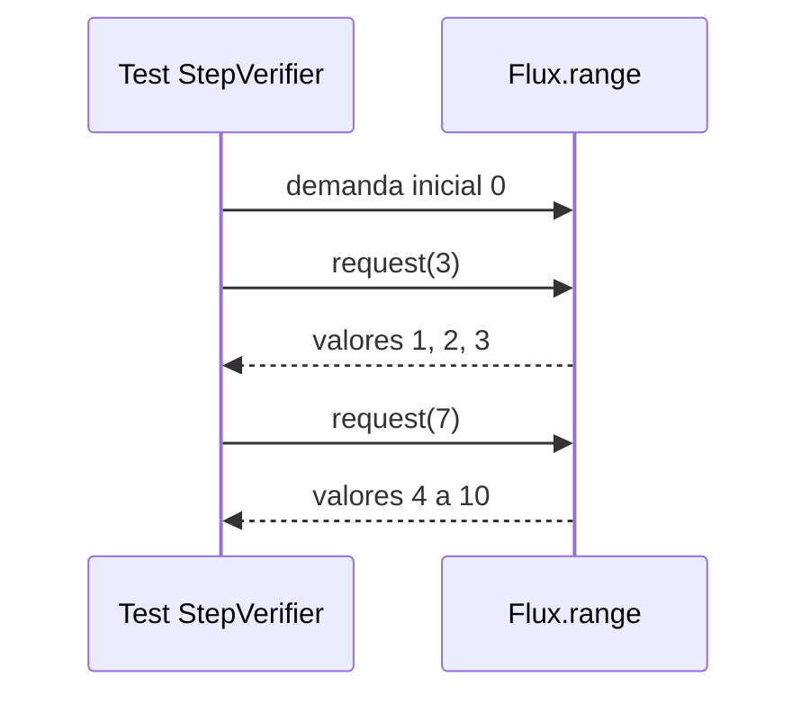
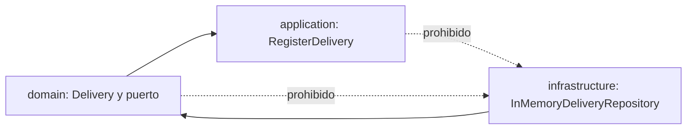
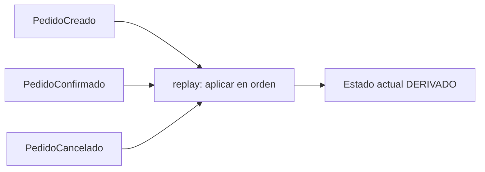

# Módulo 15: Spring Master: hexagonal, reactivo y microservicios


## Aprende construyendo

Este módulo cierra el nivel "master" del track con ocho temas avanzados: backpressure medido con `reactor-test`, reutilización de contenedores Testcontainers, reglas con ArchUnit, Bulkhead y RateLimiter con Resilience4j, una saga con compensación, event sourcing con replay, recuperación de compensaciones fallidas y Clean Architecture con DDD táctico. Cada tema debe enlazar sus herramientas y pruebas reales; el inventario de herramientas no sustituye evidencia de ejecución.

### Tema 1: Backpressure real en WebFlux con reactor-test

**Objetivo observable:** usar `StepVerifier` para pedir elementos por tandas y comprobar los valores emitidos y las solicitudes que llegan al origen.

**¿Por qué es importante?** Si el consumidor va más lento que el productor, Reactive Streams deja que solicite la cantidad que puede procesar. Los operadores pueden guardar elementos o cambiar las tandas de demanda; por eso la posición donde medimos importa.

**Antes de empezar:** conocer `Flux` y una prueba básica de `StepVerifier` (Módulo 9). Continúa en el ejemplo existente `examples/spring-reactor-rutaflow/`, que ya incluye `reactor-test`.

```bash
cd examples/spring-reactor-rutaflow
./mvnw -q -Dtest=BackpressureDemandTest test
```



#### Subtema 15.1.1: Empieza con cero solicitudes · 8 min

**Contexto.** `Flux.range(1, 10)` produce diez enteros. Para ver cuándo llegan, `StepVerifier` puede suscribirse con una demanda inicial de cero.

**Hazlo tú.** Abre `src/test/java/academia/rutaflow/reactor/BackpressureDemandTest.java`. Encuentra `StepVerifier.create(source, 0)` y la lista `received`. Corre el comando del laboratorio.

**Resultado esperado.** El test confirma que la lista sigue vacía justo después de la suscripción; los valores aparecen solo después de `thenRequest`.

**Fallo deliberado.** Cambia `create(source, 0)` por `create(source)`. Ejecuta `emiteTresYDespuesSieteSoloCuandoElSuscriptorLosSolicita`: llegan los diez valores antes de la comprobación de lista vacía. Restaura `0`.

**Entiende.** La demanda es un pedido de elementos, como pedir tres piezas de una línea de armado. El productor no debe enviar más valores que los pedidos por esa suscripción.

**Cierra.** Describe qué cambio observable produjo quitar la demanda inicial controlada.

#### Subtema 15.1.2: Solicita tres y luego siete · 8 min

**Contexto.** La prueba observa tanto lo recibido como las llamadas de demanda al `Flux`.

**Hazlo tú.** Lee el tramo del test y predice qué valores aparecen tras cada pedido:

```java
StepVerifier.create(source, 0)
    .thenRequest(3).expectNext(1, 2, 3)
    .thenRequest(7).expectNext(4, 5, 6, 7, 8, 9, 10)
    .verifyComplete();

assertThat(upstreamRequests).containsExactly(3L, 7L);
```

Ejecuta la prueba y compara tu predicción con `upstreamRequests`.

**Resultado esperado.** El consumidor ve los diez valores en orden en dos grupos, y `doOnRequest` registra exactamente `3` y `7` en ese punto del flujo.

**Fallo deliberado.** Cambia el segundo `.thenRequest(7)` a `.thenRequest(6)`. `verifyComplete` falla porque queda un elemento sin solicitar. Restaura la cantidad y corre la prueba verde.

**Entiende.** `thenRequest(n)` aumenta la demanda acumulada; no reinicia el pedido anterior. `doOnRequest` registra la solicitud que llega a esa ubicación del publisher.

**Cierra.** Guarda el resultado JUnit y los dos valores registrados por la lista.

#### Subtema 15.1.3: Mira la demanda sin límite · 8 min

**Contexto.** Si no configuras demanda inicial, `StepVerifier.create(source)` solicita demanda ilimitada para recorrer la secuencia y terminarla.

**Hazlo tú.** Ejecuta `stepVerifierSinParametroInicialSolicitaDemandaIlimitada` y lee la lista capturada por `doOnRequest`.

**Resultado esperado.** El test registra `Long.MAX_VALUE`, que Reactor puede tratar como demanda efectivamente ilimitada, y consume los tres valores finitos.

**Fallo deliberado.** Cambia `StepVerifier.create(source)` en ese test por `StepVerifier.create(source, 0).thenRequest(3)`. La aserción de demanda ilimitada falla porque el origen vio `3`, no `Long.MAX_VALUE`. Restaura el valor por defecto y corre la suite.

**Entiende.** **Límite:** esta prueba mide `Flux.range`, no demuestra por sí sola cuánto almacena cada operador ni que un endpoint WebFlux vaya a soportar cualquier carga. `flatMap`, `buffer` y otros operadores pueden cambiar la demanda hacia arriba.

**Cierra.** Explica por qué “usa WebFlux” no equivale a “memoria ilimitada protegida”.

#### Subtema 15.1.4: Observa cómo `limitRate` cambia las tandas · 10 min

**Contexto.** El consumidor sigue viendo lo que solicitó, pero `limitRate` agrupa las peticiones que llegan al origen.

**Hazlo tú.** En `limitRateAgrupaLoQueSolicitaAlOrigen`, encuentra `.limitRate(4, 0)` y revisa dónde se puso `doOnRequest`:

```java
Flux<Integer> source = Flux.range(1, 10)
    .doOnRequest(upstreamRequests::add)
    .limitRate(4, 0);
```

Ejecuta `./mvnw -q -Dtest=BackpressureDemandTest test`.

**Resultado esperado.** StepVerifier conserva los valores y su orden; la lista del origen registra tandas `4`, `4`, `4`, incluida la solicitud final de dos elementos que Reactor completa al tamaño de tanda configurado.

**Fallo deliberado.** Cambia temporalmente el tamaño a `2` y corre el test: la expectativa deja de coincidir; `doOnRequest` observó `[2, 2, 2, 2, 2, 2]` en vez de `[4, 4, 4]`. Restaura el `4` original y confirma los tests verdes.

**Entiende.** Los operadores pueden transformar demanda entre suscriptor y origen. Para evaluar el proyecto integrador, coloca la medición en el límite que quieres comprender y prueba con el operador real de tu cadena.

**Cierra.** Evidencia: reporte verde de `BackpressureDemandTest`, captura de demandas `3/7` y `4/4/4`, y explicación del cambio con `limitRate`.

**Transferencia al proyecto integrador:** si una ruta WebFlux procesa un flujo grande, prueba la cadena real con demanda limitada y revisa operadores que almacenan o solicitan elementos por adelantado; no uses este ejemplo como prueba de carga del servicio.

**Fuentes oficiales:** [Project Reactor: testing](https://projectreactor.io/docs/core/release/reference/testing.html), [Project Reactor: backpressure y operadores](https://projectreactor.io/docs/core/release/reference/subscribe-backpressure.html) y [Reactive Streams: reglas de demanda](https://github.com/reactive-streams/reactive-streams-jvm).

### Tema 2: Contenedores Testcontainers reutilizados entre clases

**Objetivo observable:** hacer que dos clases JUnit consulten el mismo PostgreSQL Testcontainers dentro de una ejecución de pruebas y comparar el ID real observado por cada una.

**¿Por qué es importante?** Crear contenedores cuesta tiempo. Un singleton puede evitar arranques repetidos cuando varias clases necesitan la misma base; también significa que esas pruebas comparten estado y ciclo de vida.

**Antes de empezar:** conocer Testcontainers básico (Módulo 6). El laboratorio `examples/testcontainers-singleton-rutaflow/` usa Testcontainers 2.0.5, dos clases JUnit y Postgres. Solo ejecuta `SELECT 1`, no comparte filas modificadas.

**Comando:** desde esa carpeta, Docker compatible ejecuta `./mvnw -q test`. En macOS con Podman, sigue los comandos exactos del README para apuntar al socket local y desactivar Ryuk rootless.

```bash
cd examples/testcontainers-singleton-rutaflow
./mvnw -q test
```

#### Subtema 15.2.1: Arranca el singleton una sola vez · 8 min

**Contexto.** `@Container` estático comparte el contenedor entre métodos de una clase. El patrón singleton manual permite compartirlo entre varias clases que heredan una base común.

**Hazlo tú.** Abre `src/test/java/academia/rutaflow/containers/SharedPostgres.java`. Encuentra el campo estático y el bloque de arranque:

```java
static final PostgreSQLContainer POSTGRES = new PostgreSQLContainer("postgres:16-alpine");

static {
    POSTGRES.start();
}
```

**Resultado esperado.** El contenedor comienza al cargar la clase base y las dos clases lectoras heredan la misma referencia.

**Fallo deliberado.** Quita temporalmente `POSTGRES.start()` y ejecuta la suite. Las dos clases fallan con `Mapped port can only be obtained after the container is started`. Restaura el bloque y vuelve a probar.

**Entiende.** Una sola cocina prepara comida para dos mesas; ambas dependen de que esa cocina exista. El cierre ocurre cuando termina la JVM de tests.

**Cierra.** Señala por qué esta base no lleva las anotaciones `@Testcontainers` y `@Container`.

#### Subtema 15.2.2: Comprueba la base desde cada clase · 8 min

**Contexto.** Que un ID exista no confirma que PostgreSQL acepte consultas. Cada clase ejecuta una consulta pequeña y guarda el ID que observó.

**Hazlo tú.** Abre `FirstRepositoryTest.java` y `SecondRepositoryTest.java`; ambas llaman al método heredado `queryAndRecordContainerId()`.

```java
try (Connection connection = DriverManager.getConnection(
        POSTGRES.getJdbcUrl(), POSTGRES.getUsername(), POSTGRES.getPassword());
     Statement statement = connection.createStatement();
     ResultSet result = statement.executeQuery("SELECT 1")) {
    assertThat(result.next()).isTrue();
    assertThat(result.getInt(1)).isEqualTo(1);
}
```

Corre `./mvnw -q test` y compara las dos líneas `usa containerId=`.

**Resultado esperado.** Ambas consultas pasan y muestran el mismo ID de contenedor. Al terminar la segunda clase, el `@AfterAll` heredado verifica la igualdad sin depender del orden de las clases.

**Fallo deliberado.** Cambia una de las consultas de `SELECT 1` a `SELECT columna_que_no_existe`. Solo la clase que ejecuta esa consulta falla. Restaura `SELECT 1` y corre la suite completa.

**Entiende.** El ID igual en ambos logs es la evidencia de que las clases accedieron al mismo contenedor en esa JVM. No mide cuánto tiempo se ahorró.

**Cierra.** Guarda el reporte JUnit y los IDs iguales de la ejecución actual.

#### Subtema 15.2.3: Aísla los datos compartidos · 8 min

**Contexto.** Las clases comparten la base junto con el contenedor. Una prueba que inserta filas puede alterar lo que observa la siguiente.

**Hazlo tú.** Lee `junit-platform.properties` y confirma que el paralelismo de Jupiter está apagado. Inspecciona las dos pruebas: usan `SELECT 1` y no cambian filas.

**Resultado esperado.** Las dos clases pasan en secuencia y no necesitan limpiar datos.

**Fallo deliberado.** En `SharedPostgres.queryAndRecordContainerId`, guarda temporalmente el texto `id-falso` en lugar del ID real para `SecondRepositoryTest`. La consulta todavía pasa, pero la comprobación `@AfterAll` falla al encontrar IDs distintos. Restaura el ID real y confirma la suite verde.

**Entiende.** **Límite:** singleton no significa base limpia por clase. Si cambias datos, limpia cada prueba con claves únicas, transacciones realmente aisladas o esquemas por clase.

**Cierra.** Escribe qué limpieza necesitaría tu caso de prueba si insertara una entrega.

#### Subtema 15.2.4: Decide si conviene compartir · 8 min

**Contexto.** El singleton comparte el ciclo de vida dentro de una JVM; el modo `withReuse(true)` trata de conservar contenedores entre ejecuciones locales y tiene una configuración diferente.

**Hazlo tú.** Lee el README del laboratorio y la guía oficial de ciclo manual. Busca las diferencias entre `@Container` estático por clase, el singleton manual entre clases y la reutilización persistente local.

**Resultado esperado.** Puedes decir qué alcance comparte cada patrón y cuándo debes limpiar filas o evitar forks paralelos.

**Fallo deliberado.** Ejecuta cada clase por separado con `./mvnw -q -Dtest=FirstRepositoryTest test` y luego `./mvnw -q -Dtest=SecondRepositoryTest test`. Los IDs cambian porque son dos ejecuciones/JVM distintas; el singleton solo comparte dentro de la ejecución conjunta. Después vuelve a correr `./mvnw -q test` para comprobar un ID compartido.

**Entiende.** Usa singleton si has medido que el arranque repetido domina el tiempo de pruebas y puedes aislar estado. Para pocas clases, conserva el ciclo de vida administrado por JUnit.

**Cierra.** Evidencia: ambas consultas verdes, dos IDs reales iguales y una razón concreta para usar o no el patrón en el proyecto integrador.

**Transferencia al proyecto integrador:** úsalo solo si varias suites comparten el mismo servicio externo y cada prueba conserva aislamiento de datos. La prueba actual no demuestra ahorro de tiempo; mide tu pipeline antes de decidir.

**Fuentes oficiales:** [Testcontainers: ciclo manual y singleton](https://java.testcontainers.org/test_framework_integration/manual_lifecycle_control/), [integración JUnit 5](https://java.testcontainers.org/test_framework_integration/junit_5/) y [configuración Podman](https://java.testcontainers.org/supported_docker_environment/).

### Tema 3: Arquitectura hexagonal verificada con ArchUnit

**Objetivo observable:** agregar una regla ejecutable que bloquee dependencias desde `domain` y `application` hacia `infrastructure`.

**¿Por qué es importante?** El dominio conserva las reglas del negocio; si importa una clase de base de datos o un framework, cambiar esa infraestructura puede arrastrar cambios al negocio. ArchUnit convierte la frontera en un test que muestra qué clase la cruzó.

**Antes de empezar:** entender puertos y adaptadores (Módulo 10, Tema 6). El ejemplo `examples/archunit-hexagonal-rutaflow/` usa Java 25, ArchUnit 1.5.1 y JUnit; no necesita Spring ni Docker.

```bash
cd examples/archunit-hexagonal-rutaflow
./mvnw -q test
```



#### Subtema 15.3.1: Ubica el puerto y el adaptador · 8 min

**Contexto.** El puerto expresa qué necesita el caso de uso; el adaptador decide cómo guardar.

**Hazlo tú.** Desde `examples/archunit-hexagonal-rutaflow/`, abre `src/main/java/academia/rutaflow/hexagonal/domain/DeliveryRepository.java`, `application/RegisterDelivery.java` e `infrastructure/InMemoryDeliveryRepository.java`. Sigue el tipo que inyecta el caso de uso y la interfaz que implementa el adaptador.

**Resultado esperado.** `RegisterDelivery` depende de `DeliveryRepository`; no conoce el mapa de `InMemoryDeliveryRepository`.

**Fallo deliberado.** En `RegisterDelivery`, cambia temporalmente el tipo del campo y del parámetro del constructor de `DeliveryRepository` a `InMemoryDeliveryRepository`. Ejecuta la suite: compila, pero ArchUnit rechaza la dependencia application→infrastructure. Restaura el puerto en ambos lugares y confirma los tests verdes.

**Entiende.** El puerto es el enchufe acordado; el adaptador es el aparato conectado. El negocio describe el enchufe, no el fabricante.

**Cierra.** Anota la ruta del puerto y la ruta de su implementación.

#### Subtema 15.3.2: Escribe la regla sobre el bytecode · 8 min

**Contexto.** ArchUnit importa las clases compiladas del paquete y comprueba las relaciones que quedaron en el bytecode.

**Hazlo tú.** Desde `examples/archunit-hexagonal-rutaflow/`, abre `src/test/java/academia/rutaflow/hexagonal/HexagonalArchitectureTest.java`. Lee la regla y ejecútala:

```java
ArchRule rule = noClasses().that().resideInAPackage("..domain..")
    .should().dependOnClassesThat().resideInAPackage("..infrastructure..");

rule.check(project);
```

**Resultado esperado.** La regla pasa con las clases actuales y se examina el mismo paquete `academia.rutaflow.hexagonal`.

**Fallo deliberado.** Añade temporalmente a `domain/Delivery.java` un método que devuelva `InMemoryDeliveryRepository`. Corre `./mvnw -q -Dtest=HexagonalArchitectureTest#dominioNoDependeDeDetallesDeInfraestructura test`: el fallo señala el tipo de retorno. Quita método e import y ejecuta la suite completa.

**Entiende.** La regla mira referencias de bytecode, por ejemplo tipos de campo, retorno, herencia y llamadas. Una cadena con el nombre de una clase usada vía reflexión no es necesariamente una dependencia de bytecode detectada por esta regla.

**Cierra.** Conserva el mensaje de ArchUnit que nombra `Delivery` y `InMemoryDeliveryRepository`.

#### Subtema 15.3.3: Protege también el caso de uso · 8 min

**Contexto.** Prohibir la fuga desde el dominio no basta si application importa la base concreta directamente.

**Hazlo tú.** Abre `examples/archunit-hexagonal-rutaflow/src/test/java/academia/rutaflow/hexagonal/HexagonalArchitectureTest.java`, sigue `aplicacionNoDependeDeDetallesDeInfraestructura` y compara el nombre de paquetes con la primera regla.

**Práctica guiada.** Cambia el puerto de `RegisterDelivery` por el adaptador concreto, ejecuta solo esta regla y vuelve a inyectar la interfaz cuando veas la infracción.

**Resultado esperado.** Los dos tests pasan: ni `domain` ni `application` tienen dependencia hacia `infrastructure`.

**Fallo deliberado.** Cambia `RegisterDelivery` para declarar una referencia a `InMemoryDeliveryRepository`; corre solo `aplicacionNoDependeDeDetallesDeInfraestructura`. ArchUnit marca esa referencia. Restaura la dependencia por interfaz.

**Entiende.** Una regla es tan completa como los paquetes que incluye. Su límite es lo que ArchUnit importó y los tipos de dependencia que la regla detecta. Si aparece un nuevo paquete como `adapter`, decide y documenta qué lado de la frontera ocupa antes de ampliar el patrón.

**Cierra.** Guarda el reporte verde de las dos reglas.

#### Subtema 15.3.4: Decide qué reglas merece mantener · 8 min

**Contexto.** Una regla demasiado general puede bloquear decisiones válidas; una regla ausente deja la frontera a la memoria del equipo.

**Hazlo tú.** Desde `examples/archunit-hexagonal-rutaflow/`, lee `src/test/java/academia/rutaflow/hexagonal/HexagonalArchitectureTest.java`, busca `adaptersDeInfraestructuraSeIdentificanComoRepository` y ejecuta `./mvnw -q test`. La regla de ejemplo comprueba el sufijo del adaptador; registra qué paquetes y clases quedan dentro de su alcance.

**Resultado esperado.** La regla nueva pasa con el adaptador actual y explica su alcance en el nombre o comentario.

**Fallo deliberado.** Renombra temporalmente el archivo/clase `InMemoryDeliveryRepository` a `InMemoryDeliveryStore` sin actualizar la regla. Ejecuta `adaptersDeInfraestructuraSeIdentificanComoRepository`: falla al encontrar `InMemoryDeliveryStore`. Restaura el nombre y corre la suite completa.

**Entiende.** ArchUnit valida estructura de clases, no calidad del modelo completo ni comportamiento de negocio. Mantén el alcance visible y revisa excepciones en vez de ampliar los patrones hasta que todo pase.

**Cierra.** Evidencia: suite verde restaurada y explicación de una regla útil para el proyecto integrador.

**Transferencia al proyecto integrador:** protege con ArchUnit las capas de una ruta real (controller → caso de uso → puerto → adapter). La prueba actual solo cubre un ejemplo mínimo en memoria; no inspecciona el microservicio del Módulo 12.

**Fuentes oficiales:** [ArchUnit User Guide](https://www.archunit.org/userguide/html/000_Index.html), [ArchUnit Getting Started](https://www.archunit.org/getting-started).

### Tema 4: Bulkhead y RateLimiter de Resilience4j

#### Subtema 15.4.1: Separa concurrencia de ritmo · 8 min

**Contexto.** El `CircuitBreaker` del Módulo 10 reacciona a fallos. El Bulkhead limita cuántas llamadas están dentro al mismo tiempo; el RateLimiter cuenta permisos durante un período.

**¿Por qué es importante?** Una dependencia lenta o una ráfaga pueden agotar recursos o saturar un servicio externo. Estos límites hacen explícita la protección, siempre que las llamadas pasen por ellos y que la configuración refleje la capacidad medida.

```text
2 llamadas activas ──> [Bulkhead: 2 espacios] ──> la tercera se rechaza
2 permisos / período ──> [RateLimiter: 2] ─────> la tercera se rechaza
```

**Hazlo tú.** Abre `examples/spring-resilience-rutaflow/README.md` y `src/test/java/academia/rutaflow/resilience/BulkheadRateLimiterBehaviorTest.java`. En una hoja, dibuja dos llamadas ocupando los dos espacios del Bulkhead y tres solicitudes que compiten por dos permisos del RateLimiter.

**Resultado esperado.** El primer límite depende de cuántas llamadas siguen activas; el segundo, de cuántos permisos quedan en el período. La tercera llamada de cada ejemplo se rechaza por una razón distinta.

**Fallo deliberado.** Cambia `maxConcurrentCalls(2)` por `maxConcurrentCalls(3)` y ejecuta `./mvnw -q -Dtest=BulkheadRateLimiterBehaviorTest#semaphoreBulkheadRechazaUnaTerceraLlamadaMientrasDosSiguenDentro test` desde `examples/spring-resilience-rutaflow/`. El test debe fallar porque hay un espacio disponible para la tercera llamada. Restaura el límite a 2 y corre la prueba de nuevo.

**Entiende.** El Bulkhead de semáforo regula el acceso; no crea un grupo aislado de hilos. Resilience4j también ofrece `ThreadPoolBulkhead`, que sí usa un pool y una cola limitada. No prometas que estas primitivas aíslan toda la aplicación.

**Cierra.** Anota qué recurso proteges y qué tipo de rechazo puede observar quien llama.

#### Subtema 15.4.2: Mantén la llamada dentro del Bulkhead · 8 min

**Contexto.** Configurar el objeto no cambia una llamada por sí solo: hay que ejecutar la operación a través de la decoración.

**Hazlo tú.** En `examples/spring-resilience-rutaflow/src/test/java/academia/rutaflow/resilience/BulkheadRateLimiterBehaviorTest.java`, sigue `Bulkhead.of`, `decorateRunnable`, los dos `CountDownLatch` y `getAvailableConcurrentCalls()`. Ejecuta desde la carpeta del laboratorio:

```bash
./mvnw -q -Dtest=BulkheadRateLimiterBehaviorTest#semaphoreBulkheadRechazaUnaTerceraLlamadaMientrasDosSiguenDentro test
```

**Resultado esperado.** El test espera a que dos tareas reales entren, observa cero espacios disponibles y comprueba `BulkheadFullException` en la tercera; luego libera ambas tareas y termina sin dejar hilos ocupados.

**Fallo deliberado.** Quita `Bulkhead.decorateRunnable(bulkhead, ...)` de la tercera llamada y ejecútala directamente. El rechazo desaparece y la prueba falla. Restaura la decoración y repite el comando.

**Entiende.** El límite solo cubre el código que atraviesa este Bulkhead. Si una ruta alternativa llama directo al servicio externo, esta protección no la alcanza.

**Cierra.** Explica en una frase dónde debe colocarse la llamada protegida en el servicio de tu proyecto.

#### Subtema 15.4.3: Cuenta permisos por período · 8 min

**Contexto.** El RateLimiter renueva un número de permisos al empezar cada período. Con espera cero, una llamada sin permiso se rechaza en vez de quedarse esperando.

**Hazlo tú.** Abre `examples/spring-resilience-rutaflow/src/test/java/academia/rutaflow/resilience/BulkheadRateLimiterBehaviorTest.java` y localiza `rateLimiterEntregaDosPermisosYRechazaElTerceroEnElMismoPeriodo`. Ejecuta:

```bash
./mvnw -q -Dtest=BulkheadRateLimiterBehaviorTest#rateLimiterEntregaDosPermisosYRechazaElTerceroEnElMismoPeriodo test
```

**Resultado esperado.** Las dos primeras llamadas reciben `true`, la tercera `false`; la ventana de una hora mantiene el ejemplo determinista sin depender de que el reloj avance durante la prueba.

**Fallo deliberado.** Cambia `limitForPeriod(2)` a `limitForPeriod(3)`. El test falla porque la tercera solicitud también consigue permiso. Restablece el límite y ejecútalo otra vez.

**Entiende.** El contador pertenece a esta instancia local del RateLimiter. Varias réplicas de un servicio tienen sus propios contadores; esto no implementa por sí solo una cuota global de cliente.

**Cierra.** Describe qué debería ocurrir en tu API cuando el permiso se agota: responder con límite excedido o esperar un tiempo acotado.

#### Subtema 15.4.4: Decide el límite y observa sus fronteras · 8 min

**Contexto.** Un límite elegido sin medir la dependencia puede rechazar tráfico útil o dejar pasar más carga de la que soporta.

**Hazlo tú.** Revisa `examples/spring-resilience-rutaflow/pom.xml`, `README.md` y los dos tests nuevos. Ejecuta la suite completa:

```bash
./mvnw -q clean test
```

**Resultado esperado.** Pasan las pruebas de CircuitBreaker ya existentes y las dos nuevas de concurrencia y tasa. El proyecto usa Resilience4j 2.4.0; ambos límites son locales al proceso y el ejemplo no llama a un proveedor real.

**Fallo deliberado.** Cambia `timeoutDuration(Duration.ZERO)` del RateLimiter por `Duration.ofSeconds(1)` y deja el período largo. La tercera llamada puede esperar hasta agotar el segundo; registra esa diferencia de comportamiento y restaura cero para conservar una suite rápida y determinista.

**Entiende.** El número correcto sale de medir capacidad, tiempos y política de rechazo. Un RateLimiter por instancia no equivale a una cuota compartida; el Bulkhead de semáforo no equivale a un pool separado. Aplicar ambos a la misma operación también requiere decidir cuál debe rechazar primero.

**Cierra.** Evidencia: resultado verde de la suite, configuración final elegida y límite explícito del laboratorio. Para el microservicio del Módulo 12, primero registra latencia y tasa observada; luego dimensiona y prueba el límite con su tráfico real.

**Proyecto integrador:** en el cliente HTTP del servicio de pedidos del Módulo 12, identifica una dependencia lenta y documenta un límite de concurrencia inicial y una tasa por instancia. Añade pruebas equivalentes antes de habilitar esos límites; los valores del laboratorio no se deben copiar como capacidad de producción.

**Fuentes oficiales:** [Resilience4j Bulkhead](https://resilience4j.readme.io/docs/bulkhead), [Resilience4j RateLimiter](https://resilience4j.readme.io/docs/ratelimiter).

### Tema 5: Saga con compensación real

#### Subtema 15.5.1: Dibuja los pasos del pedido · 8 min

**Contexto.** Una compra puede necesitar reservar inventario, cobrar y confirmar el envío. Cada paso cambia un estado distinto y no existe un botón universal de deshacer para todos.

**¿Por qué es importante?** Si un paso posterior falla, dejar activos los cambios anteriores puede producir cobros sin envío o inventario bloqueado. La compensación da una acción explícita para esos efectos parciales.

**Hazlo tú.** Abre `examples/spring-saga-rutaflow/README.md` y revisa el recorrido antes de abrir el código:

```text
┌────────────────────┐  ┌──────────────┐  ┌────────────────┐
│ Reservar inventario├─>│ Cobrar pago  ├─>│ Confirmar envío│
└─────────┬──────────┘  └──────┬───────┘  └────────────────┘
          ↑                    ↑
   Liberar reserva       Devolver pago
```

**Resultado esperado.** Si falla el envío, el dinero y la reserva se revierten en orden inverso: primero se devuelve el cobro, luego se libera el inventario.

**Fallo deliberado.** Cambia el dibujo para devolver primero el inventario. Luego compáralo con la prueba del siguiente subtema y explica por qué el orden inverso mantiene disponibles las dependencias necesarias para deshacer el paso anterior.

**Entiende.** Una compensación es una acción nueva que intenta corregir un efecto previo; no borra el historial ni garantiza que el mundo vuelva exactamente al estado anterior.

**Cierra.** Nombra un efecto que se pueda compensar y otro que quizá no (por ejemplo, una notificación ya leída).

#### Subtema 15.5.2: Ejecuta y compensa en orden inverso · 8 min

**Contexto.** El orquestador registra una compensación solo después de que termina cada paso. Cuando falla un paso, recorre esas acciones completadas desde la última hacia la primera.

**Hazlo tú.** Abre `examples/spring-saga-rutaflow/src/main/java/academia/rutaflow/saga/OrderSaga.java` y `src/test/java/academia/rutaflow/saga/OrderSagaTest.java`. Ejecuta desde `examples/spring-saga-rutaflow/`:

```bash
./mvnw -q -Dtest=OrderSagaTest#ifShippingFailsItRefundsAndReleasesInReverseOrder test
```

**Resultado esperado.** La prueba fuerza un fallo del envío, comprueba que el pago vuelve y la reserva se libera; el registro contiene `devolver pago` antes de `liberar inventario`.

**Fallo deliberado.** Cambia el recorrido inverso por uno que compense desde la primera acción hasta la última. Ejecuta la misma prueba: falla porque las acciones observadas ya no están en el orden esperado. Restaura el recorrido inverso y repite el comando.

**Entiende.** Un paso que falla no se añade a la lista de compensaciones completadas. Por eso no se intenta cancelar un envío que nunca se confirmó.

**Cierra.** Dibuja el estado final del inventario y el pago después de la compensación; ambos deben quedar sin efecto para ese pedido.

#### Subtema 15.5.3: Compara fallo y éxito · 8 min

**Contexto.** Una compensación solo se ejecuta si un paso posterior falla. Si todos terminan bien, los cambios permanecen.

**Hazlo tú.** En `examples/spring-saga-rutaflow/src/test/java/academia/rutaflow/saga/OrderSagaTest.java`, lee `ifAllParticipantsSucceedItKeepsTheOrderEffects` y ejecuta:

```bash
./mvnw -q test
```

**Resultado esperado.** En éxito, la reserva, el cobro y el envío quedan registrados, y no aparecen acciones de compensación. En fallo, la prueba anterior verifica las acciones inversas y el estado restaurado.

**Fallo deliberado.** Mueve la compensación de inventario al camino de éxito en `OrderSaga.place`. El test del caso exitoso falla porque la reserva desaparece. Restaura la compensación dentro del bloque de fallo.

**Entiende.** Las pruebas inspeccionan el estado de tres participantes en memoria y el orden del registro; eso permite comprobar la regla del ejemplo sin depender de una interpretación del log.

**Cierra.** Explica qué resultado debería guardar tu servicio: pedido confirmado, pedido rechazado o recuperación pendiente.

#### Subtema 15.5.4: Delimita la demo y planea la recuperación · 8 min

**Contexto.** La saga de este laboratorio corre en una sola JVM con participantes locales. Una caída del proceso borraría el estado y la lista de acciones.

**Hazlo tú.** Revisa el límite al final de `examples/spring-saga-rutaflow/README.md` y compara este orquestador síncrono con el Módulo 13 y el próximo M15 T7.

**Resultado esperado.** Puedes señalar qué falta para coordinar microservicios reales: persistir el estado, comunicar comandos/eventos de forma fiable, definir idempotencia y reintentar compensaciones fallidas.

**Fallo deliberado.** Imagina que el cobro fue aceptado por el proveedor, pero la respuesta se perdió antes de que el orquestador lo registrara. Anota por qué repetir el cobro puede duplicarlo y qué clave o consulta de idempotencia necesitaría la integración.

**Entiende.** Esta implementación demuestra el orden de orquestación y compensación; no es una transacción distribuida ni un sistema durable. Una saga no ofrece aislamiento ACID y puede requerir mecanismos adicionales para evitar estados intermedios visibles.

**Cierra.** **Proyecto integrador:** para el pedido del Módulo 12, enumera los servicios participantes, el estado que cambia cada uno y la acción compensatoria concreta. No copies este almacenamiento en memoria como solución de producción.

**Fuentes:** [Microservices.io — Saga](https://microservices.io/patterns/data/saga.html). La referencia describe tanto coordinación por orquestación como coreografía y destaca que las compensaciones se diseñan explícitamente; este laboratorio solo ejercita la variante orquestada local.

### Tema 6: Event Sourcing con replay real

#### Paso 1 · Objetivo y preparación

Al finalizar podrás reconstruir el estado completo de un agregado reproduciendo (replay) una lista real de eventos de dominio, confirmando que el estado reconstruido coincide exactamente con el esperado tras aplicar cada evento en orden.

**Conocimiento previo:** Módulo 13 de este track (transactional outbox).

#### Paso 2 · Contexto y caso real

**¿Por qué es importante?** En vez de almacenar solo el estado actual de un pedido (que pierde el historial de cómo llegó a ese estado), Event Sourcing almacena la secuencia completa de eventos que ocurrieron; el estado actual se DERIVA reproduciendo esos eventos, nunca se almacena directamente como la fuente de verdad.

#### Paso 3 · Teoría con analogía

**Conceptos clave:** evento de dominio inmutable, replay, estado derivado.

Cada evento (`PedidoCreado`, `PedidoConfirmado`, `PedidoCancelado`) es un hecho inmutable ya ocurrido; el estado actual del agregado se reconstruye aplicando cada evento, en orden, sobre un estado inicial vacío. Esto es distinto del outbox (Módulo 13), que usa eventos para NOTIFICAR a otros servicios sobre un cambio ya persistido de forma convencional — Event Sourcing usa los eventos MISMOS como la fuente de verdad del estado.

**Analogía:** el estado actual de una cuenta bancaria NO se almacena directamente; se deriva reproduciendo cada depósito y retiro desde el inicio de la cuenta — el saldo es una consecuencia calculada del historial completo, no un número guardado independientemente.

**Diagrama:**



#### Paso 4 · Demostración guiada desde cero

Parte de una carpeta vacía y crea `src/main/java/io/academia/master/eventsourcing/EventoPedido.java`:

```bash
mkdir demo-event-sourcing
cd demo-event-sourcing
curl -fsSL https://start.spring.io/starter.zip -d dependencies=web -d javaVersion=25 -o app.zip
unzip app.zip
mkdir -p src/main/java/io/academia/master/eventsourcing
mkdir -p src/test/java/io/academia/master/eventsourcing
```

```java
// src/main/java/io/academia/master/eventsourcing/EventoPedido.java
package io.academia.master.eventsourcing;

public sealed interface EventoPedido {
    record PedidoCreado(String id) implements EventoPedido {}
    record PedidoConfirmado() implements EventoPedido {}
    record PedidoCancelado(String motivo) implements EventoPedido {}
}
```

```java
// src/main/java/io/academia/master/eventsourcing/EstadoPedido.java
package io.academia.master.eventsourcing;

import java.util.List;

public record EstadoPedido(String id, String estado, String motivoCancelacion) {

    public static EstadoPedido reconstruirDesde(List<EventoPedido> eventos) {
        EstadoPedido estado = new EstadoPedido(null, "INEXISTENTE", null);
        for (EventoPedido evento : eventos) {
            estado = aplicar(estado, evento);
        }
        return estado;
    }

    private static EstadoPedido aplicar(EstadoPedido actual, EventoPedido evento) {
        return switch (evento) {
            case EventoPedido.PedidoCreado e -> new EstadoPedido(e.id(), "CREADO", null);
            case EventoPedido.PedidoConfirmado e -> new EstadoPedido(actual.id(), "CONFIRMADO", null);
            case EventoPedido.PedidoCancelado e -> new EstadoPedido(actual.id(), "CANCELADO", e.motivo());
        };
    }
}
```

Confirma con un test real que el replay reconstruye exactamente el estado esperado:

```java
// src/test/java/io/academia/master/eventsourcing/ReplayTest.java
package io.academia.master.eventsourcing;

import org.junit.jupiter.api.Test;

import java.util.List;

import static org.assertj.core.api.Assertions.assertThat;

class ReplayTest {

    @Test
    void reproducirTresEventosEnOrdenReconstruyeElEstadoFinalCorrecto() {
        List<EventoPedido> eventos = List.of(
            new EventoPedido.PedidoCreado("PED-001"),
            new EventoPedido.PedidoConfirmado(),
            new EventoPedido.PedidoCancelado("cliente se arrepintió")
        );

        EstadoPedido estadoFinal = EstadoPedido.reconstruirDesde(eventos);

        assertThat(estadoFinal.id()).isEqualTo("PED-001");
        assertThat(estadoFinal.estado()).isEqualTo("CANCELADO");
        assertThat(estadoFinal.motivoCancelacion()).isEqualTo("cliente se arrepintió");
    }

    @Test
    void reproducirSoloDosEventosDejaElEstadoEnConfirmadoSinCancelar() {
        List<EventoPedido> eventos = List.of(
            new EventoPedido.PedidoCreado("PED-002"),
            new EventoPedido.PedidoConfirmado()
        );

        EstadoPedido estadoFinal = EstadoPedido.reconstruirDesde(eventos);

        assertThat(estadoFinal.estado()).isEqualTo("CONFIRMADO"); // el estado se detiene exactamente donde termina el historial
    }
}
```

```bash
./mvnw test -Dtest=ReplayTest
```

**Resultado esperado:** `BUILD SUCCESS` con ambos tests en verde: el primero confirma que reproducir TRES eventos reales en orden reconstruye un estado final `CANCELADO` con el motivo correcto; el segundo confirma que reproducir solo DOS eventos (un historial parcial real) deja el estado en `CONFIRMADO`, exactamente donde el historial termina — el estado es una consecuencia calculada del historial, no un valor almacenado independientemente.

**Fallo deliberado:** en la lista de eventos del primer test, invierte el orden colocando `PedidoCancelado` ANTES que `PedidoConfirmado` y ejecuta de nuevo. El test FALLA (o produce un estado final distinto al esperado: `CONFIRMADO` en vez de `CANCELADO`, porque el evento aplicado en último lugar es el que determina el estado final) — diagnostica confirmando que el orden de los eventos en el replay es tan significativo como su contenido: el mismo conjunto de eventos en un orden distinto reconstruye un estado distinto, exactamente como en la realidad del negocio (confirmar antes de cancelar no es lo mismo que cancelar antes de confirmar). Restaura el orden correcto antes de continuar.

#### Paso 5 · Práctica guiada — repetición progresiva

1. Agrega un cuarto tipo de evento (`PedidoReabierto`) y confirma con un test que el `switch` exhaustivo (gracias a `sealed interface`) obliga al compilador a manejar el caso nuevo, evitando un caso olvidado silenciosamente.
2. Escribe un test que confirme que reconstruir con una lista de eventos VACÍA devuelve el estado inicial `INEXISTENTE`, sin lanzar ninguna excepción.
3. Documenta, en un comentario, la diferencia entre Event Sourcing (los eventos SON el estado, reconstruido por replay) y el transactional outbox del Módulo 13 (los eventos NOTIFICAN un cambio que ya se persistió convencionalmente en otra forma).
4. Escribe de memoria (sin mirar) un `sealed interface` de eventos y una función de replay que reconstruya el estado aplicando cada evento en orden. Compara después contra el patrón del Paso 4.

**Pista:** un `sealed interface` con un `switch` sin rama `default` obliga al compilador de Java a verificar que TODOS los casos posibles están manejados — agregar un nuevo tipo de evento sin actualizar la función `aplicar(...)` produce un error de COMPILACIÓN, no un bug silencioso descubierto en producción.

#### Paso 6 · Práctica independiente

**Completa el código:** rellena el espacio con el método estático que reconstruye el estado reproduciendo una lista de eventos:

```java
EstadoPedido estadoFinal = EstadoPedido.____(eventos);
```

**Reto de memoria sin mirar:** cierra este documento y escribe, solo de memoria, un `sealed interface` de eventos de dominio y una función de replay que los reduzca a un estado final. Compara después contra el patrón del Paso 4.

#### Paso 7 · Cierre y evidencia

Ya reconstruyes el estado de un agregado reproduciendo su historial completo de eventos, confirmando que el orden y el contenido de esos eventos determinan exactamente el resultado. Este era el último tema del módulo y del track; el siguiente paso natural es aplicar estas seis técnicas combinadas sobre un proyecto propio de tamaño real. **Evidencia:** entrega el resultado de `ReplayTest` en verde, y el estado final distinto que produce el fallo deliberado al invertir el orden de los eventos. Fuentes oficiales: [Martin Fowler — Event Sourcing](https://martinfowler.com/eaaDev/EventSourcing.html).

**Errores comunes:** confundir Event Sourcing con simplemente "usar eventos" (como el outbox), cuando la diferencia real es si el estado se DERIVA del historial o se almacena convencionalmente; olvidar que el orden de aplicación de eventos es semánticamente significativo.

**Cuándo no usarlo:** para un agregado con un historial de cambios irrelevante para el negocio (donde solo el estado actual importa, nunca cómo se llegó a él), Event Sourcing agrega una complejidad de reconstrucción que un simple `UPDATE` convencional no tendría.

**Transferencia al proyecto integrador «microservicio productivo»:** Modela el ciclo de vida de un envío (`EnvioCreado`, `EnvioRecogido`, `EnvioEntregado`, `EnvioDevuelto`) como eventos de dominio, y reconstruye el estado de auditoría de un envío disputado reproduciendo su historial completo, en vez de confiar solo en el último estado guardado.

## Trazabilidad de la auditoría original

- **Spring WebFlux**: cubierto mediante fundamento, laboratorio y evidencia del capítulo.
- **Testing Avanzado**: cubierto mediante fundamento, laboratorio y evidencia del capítulo.
- **Arquitectura Hexagonal**: cubierto mediante fundamento, laboratorio y evidencia del capítulo.
- **Microservicios Avanzado**: cubierto mediante fundamento, laboratorio y evidencia del capítulo.
- **Spring Cloud Avanzado**: cubierto mediante fundamento, laboratorio y evidencia del capítulo.


## Aplicación del material de referencia

### Tema 7: Compensación que falla: conservar trabajo pendiente y reintentar sin duplicar

#### Paso 1 · Objetivo y preparación
Al finalizar recuperarás una compensación después de un fallo y un reinicio sin aplicar dos veces su efecto. **Prerrequisitos:** saga del tema anterior, transacciones locales, idempotencia y SQLite/Python 3. Es un ejemplo independiente desde carpeta vacía: aísla el participante antes de conectarlo a Kafka u otro coordinador.

#### Paso 2 · Contexto y caso real
Reservaste inventario y el pago fue rechazado. La liberación de inventario también puede fallar. **¿Por qué es importante?** Devolver «saga terminada» tras capturar la primera excepción oculta trabajo todavía pendiente. El proyecto integrador necesita un estado observable y una acción de recuperación.

#### Paso 3 · Teoría, modelo mental y analogía
Compensar es ejecutar una nueva acción de negocio; no retrocede el tiempo. Se necesita una identidad de operación estable para que un reintento no libere dos veces. En este participante local, el efecto y su marca se guardan en una transacción de SQLite. Un coordinador distribuido además debe persistir qué pidió, qué recibió y qué sigue pendiente.

**Analogía:** devolver un paquete requiere registrar que la devolución ocurrió, no solo enviar una orden y olvidarla. El límite es que múltiples bases y un broker no comparten la transacción SQLite de este ejercicio. No se demuestra atomicidad entre Kafka y una base de datos.

#### Paso 4 · Demostración guiada desde cero
```bash
cp -R examples/rutaflow-material/sagas ejemplo-compensacion
cd ejemplo-compensacion
python3 -m unittest test_compensacion.py
python3 compensacion.py
```
Para crear el ejemplo manualmente, guarda estos archivos juntos, sin el prefijo `sagas/`:

Crea `sagas/compensacion.py` con este contenido completo:
```python
import sqlite3


def iniciar(db):
    db.executescript('''CREATE TABLE IF NOT EXISTS stock(id TEXT PRIMARY KEY, cantidad INTEGER);
    CREATE TABLE IF NOT EXISTS compensaciones(id TEXT PRIMARY KEY, estado TEXT);
    INSERT OR IGNORE INTO stock VALUES ('reserva-42', 9);
    INSERT OR IGNORE INTO compensaciones VALUES ('liberar-42', 'PENDIENTE');''')


def compensar(db, falla=False):
    estado = db.execute("SELECT estado FROM compensaciones WHERE id='liberar-42'").fetchone()[0]
    if estado == 'HECHA':
        return
    if falla:
        raise ConnectionError('Inventario temporalmente no disponible')
    # El efecto y su marcador son atómicos EN ESTA base local del participante.
    with db:
        db.execute("UPDATE stock SET cantidad=cantidad+1 WHERE id='reserva-42'")
        db.execute("UPDATE compensaciones SET estado='HECHA' WHERE id='liberar-42'")


if __name__ == '__main__':
    with sqlite3.connect('saga.db') as db:
        iniciar(db)
        try:
            compensar(db, falla=True)
        except ConnectionError:
            print('Compensación pendiente; requiere reintento')
        compensar(db)
        compensar(db)
        print('Stock final:', db.execute('SELECT cantidad FROM stock').fetchone()[0])
```

Crea `sagas/test_compensacion.py` con este contenido completo:
```python
import sqlite3
import tempfile
from pathlib import Path
import unittest
from compensacion import iniciar, compensar

class CompensacionTest(unittest.TestCase):
    def test_reinicio_y_reintento_no_duplican_efecto(self):
        with tempfile.TemporaryDirectory() as tmp:
            path=Path(tmp)/'saga.db'
            with sqlite3.connect(path) as db:
                iniciar(db)
                with self.assertRaises(ConnectionError): compensar(db, falla=True)
                self.assertEqual('PENDIENTE', db.execute('SELECT estado FROM compensaciones').fetchone()[0])
            with sqlite3.connect(path) as db:
                compensar(db)
                compensar(db)
                self.assertEqual(10, db.execute('SELECT cantidad FROM stock').fetchone()[0])
                self.assertEqual('HECHA', db.execute('SELECT estado FROM compensaciones').fetchone()[0])
if __name__=='__main__':unittest.main()
```

**Resultado esperado:** una prueba correcta; al ejecutar el programa por primera vez aparece compensación pendiente y stock final 10. Explica cada bloque: el identificador `liberar-42` conserva la operación, el fallo mantiene PENDIENTE, el reinicio abre el mismo archivo y el segundo intento comprueba HECHA antes de repetir el efecto. La prueba utiliza una base temporal y verifica la cantidad final, no solo una lista de mensajes.

#### Paso 5 · Práctica guiada
**Fallo deliberado:** elimina la salida temprana cuando el estado es HECHA. Repite la prueba: el stock sube otra vez y falla la expectativa 10. **Pista:** reintentar requiere reconocer el mismo comando; no generes un ID nuevo por cada intento.

#### Paso 6 · Práctica independiente
Añade contador de intentos, próximo instante permitido y estado de revisión manual tras un límite. Después diseña outbox/inbox para notificar la compensación confirmada sin perder el evento ni duplicar su efecto. No uses un sleep ilimitado dentro de una transacción.

#### Paso 7 · Cierre y evidencia
**Evidencia de aprendizaje:** fallo, estado persistido antes del reinicio, recuperación y cantidad final. El siguiente paso es probar dos participantes y reentrega real de mensajes. **Errores comunes:** confundir compensación con rollback global, marcar HECHA antes del efecto y reintentar sin observabilidad ni límite. **Límites y decisión de uso:** esta muestra serial no prueba concurrencia entre múltiples consumidores; una variante concurrente necesita bloqueo o transición condicional y pruebas de carreras.

**Fuente oficial:** [patrón Saga](https://microservices.io/patterns/data/saga.html).

### Tema 8: Clean Architecture y DDD táctico: caso de uso antes que framework

#### Paso 1 · Objetivo y preparación

Al finalizar separarás una regla de negocio en entidad, caso de uso, puerto y
adaptador, y podrás explicar dónde entra Spring Boot, JPA y H2 sin convertirlos
en el centro del dominio. **Prerrequisitos:** Módulo 3 (persistencia), Módulo 10
Tema 7 (contextos delimitados e invariantes) y Java 21 o superior. El ejemplo
independiente se compila con `javac`; no necesita levantar Spring para demostrar
la dirección de dependencias.

#### Paso 2 · Contexto y caso real

La captura de referencia anuncia cinco incrementos: entidades DDD táctico,
casos de uso/interactors y boundaries, adaptadores de interfaz, frameworks y
drivers, y un código completo que llega hasta la API. La secuencia es útil si se
conserva el límite: una entidad protege una regla; el caso de uso coordina; un
puerto expresa lo que necesita; un adaptador conecta la tecnología; Spring Boot
es un driver de entrada o infraestructura, no el dueño de la regla.

**¿Por qué es importante?** Un controlador que crea directamente un repositorio
JPA mezcla HTTP, transacción y negocio. Puede funcionar en una demo y volverse
difícil de probar o migrar cuando cambia la base de datos. Clean Architecture
no significa multiplicar carpetas: significa que el dominio no importa
frameworks y que la dirección de dependencias apunta hacia la regla.

#### Paso 3 · Teoría, modelo mental y analogía

Usa cuatro anillos prácticos:

1. **Dominio:** entidad, value object y agregado con invariantes.
2. **Aplicación:** caso de uso/interactor que recibe una orden y usa puertos.
3. **Adaptadores:** controlador, presenter y repositorio que traducen formatos.
4. **Frameworks y drivers:** Spring Boot, JPA, H2, HTTP, mensajería y sistema
   operativo.

**Analogía:** el dominio es la receta y sus restricciones; el caso de uso es
la persona que coordina la preparación; los puertos son enchufes con una forma
estable; los adaptadores son los cables concretos; Spring es la cocina. Cambiar
la cocina no debe cambiar la receta. El límite es que una arquitectura limpia no
garantiza buen modelado: una entidad anémica o un caso de uso que solo reenvía
llamadas sigue siendo diseño débil aunque tenga muchos paquetes.

**Dirección de dependencias:** `┌─ HTTP/Spring → adaptador → caso de uso → puerto ← adaptador memoria/JPA ─┐`<br>`└─ dominio dentro del caso de uso; no importa Spring ───────────────────────┘`. La flecha indica quién conoce la interfaz, no necesariamente quién invoca en tiempo de ejecución.

#### Paso 4 · Demostración guiada desde cero

Desde una carpeta vacía crea `Main.java` y `test.sh` con el contenido completo de abajo:

```bash
mkdir ejemplo-clean-architecture
cd ejemplo-clean-architecture
```

`Main.java` contiene las capas mínimas sin importar Spring:

```java
import java.util.ArrayList;
import java.util.List;

record ShipmentId(String value) {
    ShipmentId {
        if (value == null || value.isBlank()) throw new IllegalArgumentException("id requerido");
    }
}

record Shipment(ShipmentId id, String status) {
    Shipment {
        if (status == null || status.isBlank()) throw new IllegalArgumentException("estado requerido");
    }
}

interface ShipmentRepository {
    void save(Shipment shipment);
    Shipment find(ShipmentId id);
}

final class InMemoryShipmentRepository implements ShipmentRepository {
    private final List<Shipment> values = new ArrayList<>();

    @Override public void save(Shipment shipment) { values.removeIf(value -> value.id().equals(shipment.id())); values.add(shipment); }
    @Override public Shipment find(ShipmentId id) { return values.stream().filter(value -> value.id().equals(id)).findFirst().orElse(null); }
}

final class CreateShipment {
    private final ShipmentRepository repository;

    CreateShipment(ShipmentRepository repository) { this.repository = repository; }

    Shipment execute(String id) {
        Shipment shipment = new Shipment(new ShipmentId(id), "CREATED");
        repository.save(shipment);
        return shipment;
    }
}

public class Main {
    public static void main(String[] args) {
        ShipmentRepository repository = new InMemoryShipmentRepository();
        CreateShipment useCase = new CreateShipment(repository);
        Shipment shipment = useCase.execute("ENV-42");
        if (!"CREATED".equals(repository.find(shipment.id()).status())) throw new AssertionError("estado incorrecto");
        System.out.println("shipment=" + shipment.id().value() + " status=" + shipment.status());
    }
}
```

Crea `test.sh` con estas cuatro líneas y ejecútalo:

```bash
cat > test.sh <<'SCRIPT'
#!/usr/bin/env bash
set -euo pipefail
rm -rf build && mkdir -p build && javac -d build Main.java && java -cp build Main
SCRIPT
bash test.sh
```

**Resultado esperado:** `shipment=ENV-42 status=CREATED`. `ShipmentId` y
`Shipment` representan el dominio; `CreateShipment` es el interactor;
`ShipmentRepository` es el boundary; `InMemoryShipmentRepository` es un
adaptador de prueba. En una aplicación Spring, un `@RestController` convertiría
HTTP en la entrada del caso de uso y un adaptador JPA implementaría el puerto,
pero ninguna de esas clases aparece en el dominio.

#### Paso 5 · Práctica guiada

**Fallo deliberado:** importa una anotación de Spring en `Shipment` o cambia el
caso de uso para recibir `EntityManager`. Compila de nuevo y explica qué
dependencia cruzó el límite. Después cambia el repositorio en memoria por un
adaptador falso que registre llamadas sin modificar `CreateShipment`.

**Pista:** el caso de uso debe depender de `ShipmentRepository`, no de la clase
que lo implementa. Si para probar la regla necesitas levantar H2, la frontera
está demasiado adentro.

#### Paso 6 · Práctica independiente

1. Añade una transición `CANCELLED` que solo pueda ocurrir desde `CREATED`.
2. Escribe un test puro que falle al cancelar dos veces.
3. Diseña un `CreateShipmentController` que traduzca una petición HTTP a la
   orden del caso de uso, sin devolver la entidad de persistencia directamente.
4. Enumera qué parte cambiaría al pasar de H2 a PostgreSQL y qué parte debería
   permanecer intacta.

#### Paso 7 · Cierre y evidencia

**Evidencia de aprendizaje:** entrega la compilación con `bash test.sh`, el diagrama de la
dirección de dependencias, test de la transición inválida y una tabla que
separe dominio, aplicación, adaptadores y drivers. **Transferencia al proyecto integrador RutaFlow:** implementa la asignación de un envío como caso de uso
Java, conserva el dominio independiente de Spring y agrega el adaptador REST
solo después de que la prueba pura pase. El siguiente paso es revisar
la regla con ArchUnit en el Tema 3 y conectar el caso de uso a una API REST sin
exponer entidades JPA.

**Errores comunes:** llamar Clean Architecture a una estructura de carpetas sin
reglas verificables, poner lógica en controllers, compartir entidades JPA entre
contextos, crear interfaces para cada clase sin una razón y usar `@Data` en
entidades con relaciones. **Límites y decisión de uso:** este laboratorio
demuestra dirección de dependencias y no reemplaza pruebas de integración,
transacciones reales, migraciones Flyway ni seguridad de la API.

**Fuente oficial:** [Spring Boot reference](https://docs.spring.io/spring-boot/reference/) y [DDD Aggregate de Martin Fowler](https://martinfowler.com/bliki/DDD_Aggregate.html).
