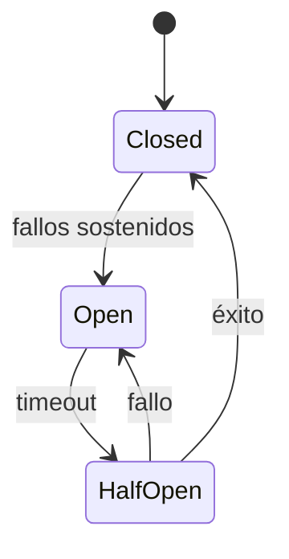

# Módulo 16: Spring Cloud y microservicios

Spring Cloud aporta patrones para sistemas distribuidos: discovery, config, gateway, resiliencia y observabilidad. Estos patrones agregan poder y complejidad; úsalos cuando el problema sea realmente distribuido.

**Entorno de referencia verificado (2026-05-22):** JDK 27.0.1.0.2, Spring Boot 3.5.0, Spring Cloud compatible (verificar BOM).

## Aprende construyendo

### Tema 1: Service discovery y configuración centralizada · Avanzado · 45 min

Caso guía: servicios que escalan dinámicamente y necesitan config compartida.

#### Discovery

**Definición formal.** Mecanismo donde servicios se registran y descubren sin IPs hardcodeadas (Eureka/Consul/Kubernetes DNS).

#### Config centralizada

**Definición formal.** Config externa gestionada en servidor/config repo; los clientes la obtienen al arrancar o refrescan.

**Error común.** Centralizar secretos sin cifrado/control. Corrección: secret manager, cifrado, least privilege.

### Tema 2: API Gateway y composición · Avanzado · 45 min

Caso guía: un punto de entrada para auth, rate limit y routing.

#### Gateway

**Definición formal.** Componente de borde que enruta requests a servicios internos y aplica cross-cutting concerns.

**Error común.** Poner lógica de negocio pesada en gateway. Corrección: gateway fino, dominio en servicios.

### Tema 3: Resiliencia distribuida · Avanzado · 45 min

Caso guía: servicio downstream lento.

#### Circuit breaker, timeout, retry, bulkhead

**Definición formal.** Patrones para contener fallos: timeout limita espera, retry reintenta transitorios, circuit breaker abre ante fallos sostenidos, bulkhead aísla recursos.

**Error común.** Retries sin timeout ni presupuesto. Corrección: budgets, backoff, idempotencia.

### Tema 4: Observabilidad distribuida · Avanzado · 45 min

Caso guía: una request cruza 4 servicios; necesitas rastrearla.

#### Tracing, métricas, logs correlacionados

**Definición formal.** Tres pilares: logs, métricas y traces. En distribuido, `traceId`/`spanId` correlacionan eventos.

**Error común.** Logs sin correlation id. Corrección: propagación de contexto (OpenTelemetry/Micrometer Tracing).

## Cierre

Spring Cloud ayuda en sistemas distribuidos, pero no convierte un mal diseño en microservicios buenos. Primero límites, después infraestructura.

## Checklist

- Uso discovery/config solo si aporta.
- Mantengo gateway fino.
- Aplico resiliencia con budgets.
- Correlaciono logs/métricas/traces.
