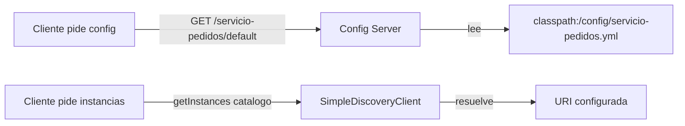
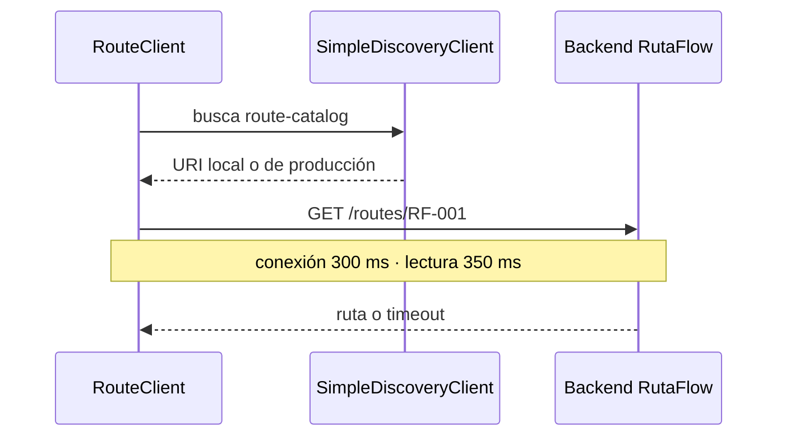
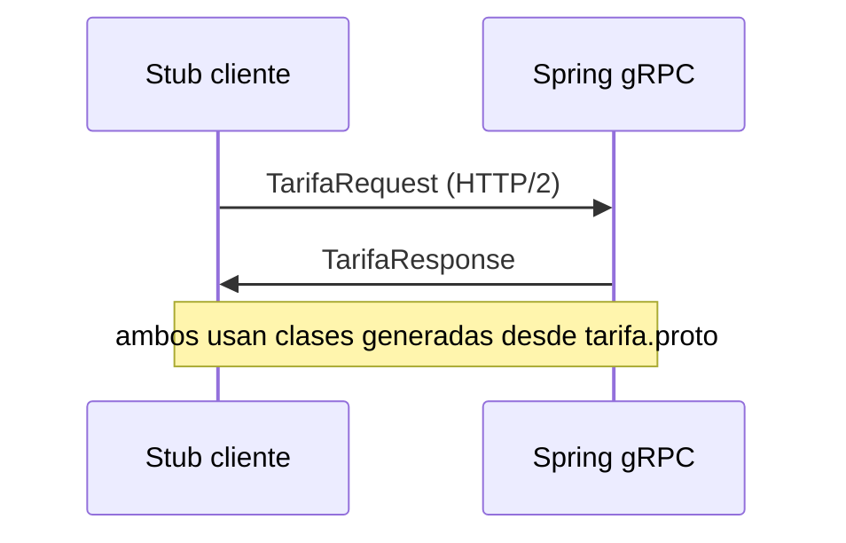
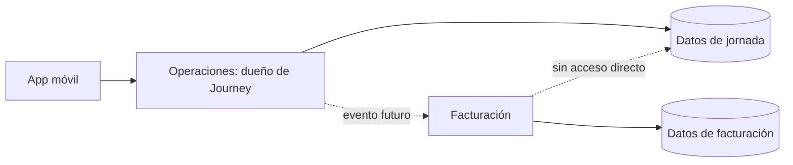
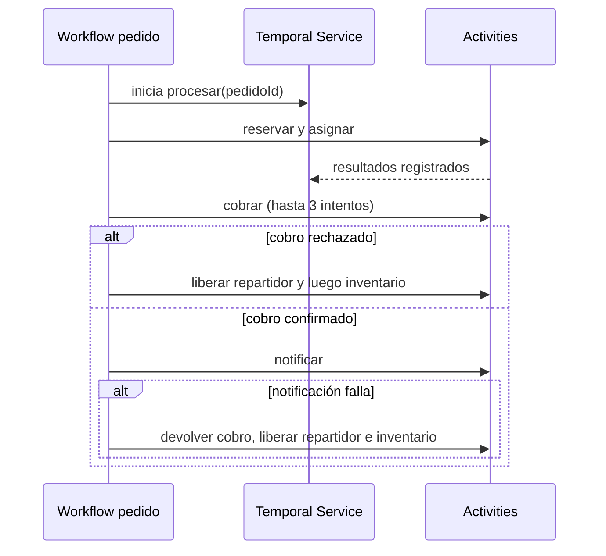

# Módulo 16: Microservicios con Spring Cloud

## Aprende construyendo

Cada tema demuestra un patrón de Spring Cloud con verificación real: config server nativo servido por HTTP, `SimpleDiscoveryClient` real de Spring Cloud Commons, Gateway enrutando de verdad contra un backend embebido, un `CircuitBreaker` de Resilience4j abriéndose por conteo real de fallos, seguridad de recurso probada con el post-processor oficial de `spring-security-test`, y un deadline HTTP real medido en milisegundos. Continúa sobre el proyecto `demo-cloud`.


### Tema 1: Config Server y service discovery · Intermedio · 35 min

<details open>
<summary><strong>Capa 1 — Lectura</strong></summary>

#### ► DE QUÉ TRATA
Este tema te guía por config server y service discovery con foco en comprensión antes de implementación.

#### ► LA IDEA EN UNA FRASE
**Entender config server y service discovery te permite tomar mejores decisiones técnicas.**

#### ► POR QUÉ EXISTE ESTO
Resuelve un problema real de diseño o implementación y evita decisiones a ciegas.

#### ► LA ANALOGÍA
Piensa en config server y service discovery como una herramienta de taller: útil cuando conoces su propósito y sus límites.
**Dónde se rompe la analogía:** en software, los efectos dependen del contexto, la escala y los trade-offs.

#### ► CÓMO FUNCIONA


#### ► LO QUE PUEDE SALIR MAL
| Síntoma | Causa probable | Arreglo |
|---|---|---|
| Config Server y service discovery se aplica pero el resultado no mejora | Se usó sin medir el problema real | Mide antes y compara contra la alternativa simple |
| Aparece complejidad inesperada | Se adoptó la técnica sin comprender sus trade-offs | Vuelve a la sección de trade-offs y reduce el alcance |
| Falla en un caso límite | Se asumió un contexto que no se cumple | Prueba el caso límite y documenta cuándo NO usarlo |

#### ► TRADE-OFFS
| Opción | Cuándo usarla | Cuándo NO usarla |
|---|---|---|
| Usar Config Server y service discovery | Cuando el problema coincide con su propósito y el beneficio es observable | Cuando agrega complejidad sin resolver un problema real |
| Alternativa más simple | Cuando el contexto es pequeño, estable o fácil de razonar | Cuando ya demostró no escalar o no cumplir el requisito |
| Postergar la decisión | Cuando falta evidencia del problema | Cuando el costo de esperar es mayor que el costo de probar |

#### ► CUÁNDO NO USAR ESTO
No uses config server y service discovery por defecto. Aplícalo cuando el problema lo justifique y puedas verificar el beneficio; si una alternativa más simple resuelve igual, prefiérela.

#### ► DE VUELTA A LA ANALOGÍA
Volviendo a la analogía: config server y service discovery funciona como el modelo inicial, pero recuerda dónde se rompe: en producción importan la evidencia, la escala y el costo de equivocarte.

#### ► LO QUE DEBES RECORDAR
- Config Server y service discovery existe para resolver un problema específico.
- Mide antes de adoptar complejidad.
- Conoce el caso donde NO usarlo.
- Verifica con evidencia observable.

#### ► PREGUNTAS PARA PENSAR
1. ¿Qué problema concreto resuelve config server y service discovery en tu contexto?
2. ¿Cómo sabrías que config server y service discovery no está funcionando bien?
3. ¿Qué alternativa más simple considerarías antes de usar config server y service discovery?

</details>

<details>
<summary><strong>Capa 2 — Construcción</strong></summary>

#### Código y verificación
```bash
./mvnw -q clean test
```

```yaml
server:
  port: 8888
spring:
  application:
    name: config-server
  cloud:
    config:
      server:
        native:
          search-locations: classpath:/config
  profiles:
    active: native
```

```yaml
pedidos:
  descuento-maximo: 15
```

```java
package com.example.democonfigserver;

import org.springframework.boot.SpringApplication;
import org.springframework.boot.autoconfigure.SpringBootApplication;
import org.springframework.cloud.config.server.EnableConfigServer;

@EnableConfigServer
@SpringBootApplication
public class DemoConfigServerApplication {
    public static void main(String[] args) {
        SpringApplication.run(DemoConfigServerApplication.class, args);
    }
}
```

```bash
./mvnw spring-boot:run
```

```bash
curl -i http://localhost:8888/servicio-pedidos/default
```

</details>

### Tema 2: Spring Cloud Gateway · Intermedio · 35 min

<details open>
<summary><strong>Capa 1 — Lectura</strong></summary>

#### ► DE QUÉ TRATA
Este tema te guía por spring cloud gateway con foco en comprensión antes de implementación.

#### ► LA IDEA EN UNA FRASE
**Entender spring cloud gateway te permite tomar mejores decisiones técnicas.**

#### ► POR QUÉ EXISTE ESTO
Resuelve un problema real de diseño o implementación y evita decisiones a ciegas.

#### ► LA ANALOGÍA
Piensa en spring cloud gateway como una herramienta de taller: útil cuando conoces su propósito y sus límites.
**Dónde se rompe la analogía:** en software, los efectos dependen del contexto, la escala y los trade-offs.

#### ► CÓMO FUNCIONA
1. Identifica el problema que spring cloud gateway resuelve.
2. Observa sus componentes y relaciones.
3. Aplica la opción más simple que funcione.
4. Verifica el resultado y los límites.

#### ► LO QUE PUEDE SALIR MAL
| Síntoma | Causa probable | Arreglo |
|---|---|---|
| Spring Cloud Gateway se aplica pero el resultado no mejora | Se usó sin medir el problema real | Mide antes y compara contra la alternativa simple |
| Aparece complejidad inesperada | Se adoptó la técnica sin comprender sus trade-offs | Vuelve a la sección de trade-offs y reduce el alcance |
| Falla en un caso límite | Se asumió un contexto que no se cumple | Prueba el caso límite y documenta cuándo NO usarlo |

#### ► TRADE-OFFS
| Opción | Cuándo usarla | Cuándo NO usarla |
|---|---|---|
| Usar Spring Cloud Gateway | Cuando el problema coincide con su propósito y el beneficio es observable | Cuando agrega complejidad sin resolver un problema real |
| Alternativa más simple | Cuando el contexto es pequeño, estable o fácil de razonar | Cuando ya demostró no escalar o no cumplir el requisito |
| Postergar la decisión | Cuando falta evidencia del problema | Cuando el costo de esperar es mayor que el costo de probar |

#### ► CUÁNDO NO USAR ESTO
No uses spring cloud gateway por defecto. Aplícalo cuando el problema lo justifique y puedas verificar el beneficio; si una alternativa más simple resuelve igual, prefiérela.

#### ► DE VUELTA A LA ANALOGÍA
Volviendo a la analogía: spring cloud gateway funciona como el modelo inicial, pero recuerda dónde se rompe: en producción importan la evidencia, la escala y el costo de equivocarte.

#### ► LO QUE DEBES RECORDAR
- Spring Cloud Gateway existe para resolver un problema específico.
- Mide antes de adoptar complejidad.
- Conoce el caso donde NO usarlo.
- Verifica con evidencia observable.

#### ► PREGUNTAS PARA PENSAR
1. ¿Qué problema concreto resuelve spring cloud gateway en tu contexto?
2. ¿Cómo sabrías que spring cloud gateway no está funcionando bien?
3. ¿Qué alternativa más simple considerarías antes de usar spring cloud gateway?

</details>

<details>
<summary><strong>Capa 2 — Construcción</strong></summary>

#### Código y verificación
```yaml
server:
  port: 8080
spring:
  cloud:
    gateway:
      server:
        webflux:
          routes:
            - id: pedidos
              uri: http://localhost:8081
              predicates:
                - Path=/api/pedidos/**
```

```python
from http.server import BaseHTTPRequestHandler, HTTPServer

class Pedidos(BaseHTTPRequestHandler):
    def do_GET(self):
        print("Ruta recibida:", self.path)
        self.send_response(200)
        self.send_header("Content-Type", "application/json")
        self.end_headers()
        self.wfile.write(b'{"id":1,"estado":"EN_RUTA"}')

HTTPServer(("localhost", 8081), Pedidos).serve_forever()
```

```yaml
              filters:
                - StripPrefix=1
```

```python
        if self.path != "/pedidos/1":
            self.send_error(404)
            return
```

```bash
curl -i http://localhost:8080/api/pedidos/1
```

</details>

### Tema 3: Circuit breaker con Resilience4j · Intermedio · 30 min

<details open>
<summary><strong>Capa 1 — Lectura</strong></summary>

#### ► DE QUÉ TRATA
Este tema te guía por circuit breaker con resilience4j con foco en comprensión antes de implementación.

#### ► LA IDEA EN UNA FRASE
**Entender circuit breaker con resilience4j te permite tomar mejores decisiones técnicas.**

#### ► POR QUÉ EXISTE ESTO
Resuelve un problema real de diseño o implementación y evita decisiones a ciegas.

#### ► LA ANALOGÍA
Piensa en circuit breaker con resilience4j como una herramienta de taller: útil cuando conoces su propósito y sus límites.
**Dónde se rompe la analogía:** en software, los efectos dependen del contexto, la escala y los trade-offs.

#### ► CÓMO FUNCIONA
1. Identifica el problema que circuit breaker con resilience4j resuelve.
2. Observa sus componentes y relaciones.
3. Aplica la opción más simple que funcione.
4. Verifica el resultado y los límites.

#### ► LO QUE PUEDE SALIR MAL
| Síntoma | Causa probable | Arreglo |
|---|---|---|
| Circuit breaker con Resilience4j se aplica pero el resultado no mejora | Se usó sin medir el problema real | Mide antes y compara contra la alternativa simple |
| Aparece complejidad inesperada | Se adoptó la técnica sin comprender sus trade-offs | Vuelve a la sección de trade-offs y reduce el alcance |
| Falla en un caso límite | Se asumió un contexto que no se cumple | Prueba el caso límite y documenta cuándo NO usarlo |

#### ► TRADE-OFFS
| Opción | Cuándo usarla | Cuándo NO usarla |
|---|---|---|
| Usar Circuit breaker con Resilience4j | Cuando el problema coincide con su propósito y el beneficio es observable | Cuando agrega complejidad sin resolver un problema real |
| Alternativa más simple | Cuando el contexto es pequeño, estable o fácil de razonar | Cuando ya demostró no escalar o no cumplir el requisito |
| Postergar la decisión | Cuando falta evidencia del problema | Cuando el costo de esperar es mayor que el costo de probar |

#### ► CUÁNDO NO USAR ESTO
No uses circuit breaker con resilience4j por defecto. Aplícalo cuando el problema lo justifique y puedas verificar el beneficio; si una alternativa más simple resuelve igual, prefiérela.

#### ► DE VUELTA A LA ANALOGÍA
Volviendo a la analogía: circuit breaker con resilience4j funciona como el modelo inicial, pero recuerda dónde se rompe: en producción importan la evidencia, la escala y el costo de equivocarte.

#### ► LO QUE DEBES RECORDAR
- Circuit breaker con Resilience4j existe para resolver un problema específico.
- Mide antes de adoptar complejidad.
- Conoce el caso donde NO usarlo.
- Verifica con evidencia observable.

#### ► PREGUNTAS PARA PENSAR
1. ¿Qué problema concreto resuelve circuit breaker con resilience4j en tu contexto?
2. ¿Cómo sabrías que circuit breaker con resilience4j no está funcionando bien?
3. ¿Qué alternativa más simple considerarías antes de usar circuit breaker con resilience4j?

</details>

<details>
<summary><strong>Capa 2 — Construcción</strong></summary>

#### Código y verificación
```bash
./mvnw -Dtest=CircuitBreakerBehaviorTest#abreDespuesDeCuatroFallosYBloqueaLaQuintaLlamada test
```

```bash
./mvnw -Dtest=CircuitBreakerBehaviorTest#openImpideLaQuintaPeticionHttpAlBackend test
```

```bash
./mvnw -Dtest=CircuitBreakerBehaviorTest#vuelveACerradoCuandoLasDosLlamadasDePruebaTienenExito test
```

</details>

### Tema 4: Bulkhead y RateLimiter de Resilience4j · Avanzado · 35 min

<details open>
<summary><strong>Capa 1 — Lectura</strong></summary>

#### ► DE QUÉ TRATA
Este tema te guía por bulkhead y ratelimiter de resilience4j con foco en comprensión antes de implementación.

#### ► LA IDEA EN UNA FRASE
**Entender bulkhead y ratelimiter de resilience4j te permite tomar mejores decisiones técnicas.**

#### ► POR QUÉ EXISTE ESTO
Resuelve un problema real de diseño o implementación y evita decisiones a ciegas.

#### ► LA ANALOGÍA
Piensa en bulkhead y ratelimiter de resilience4j como una herramienta de taller: útil cuando conoces su propósito y sus límites.
**Dónde se rompe la analogía:** en software, los efectos dependen del contexto, la escala y los trade-offs.

#### ► CÓMO FUNCIONA
1. Identifica el problema que bulkhead y ratelimiter de resilience4j resuelve.
2. Observa sus componentes y relaciones.
3. Aplica la opción más simple que funcione.
4. Verifica el resultado y los límites.

#### ► LO QUE PUEDE SALIR MAL
| Síntoma | Causa probable | Arreglo |
|---|---|---|
| Bulkhead y RateLimiter de Resilience4j se aplica pero el resultado no mejora | Se usó sin medir el problema real | Mide antes y compara contra la alternativa simple |
| Aparece complejidad inesperada | Se adoptó la técnica sin comprender sus trade-offs | Vuelve a la sección de trade-offs y reduce el alcance |
| Falla en un caso límite | Se asumió un contexto que no se cumple | Prueba el caso límite y documenta cuándo NO usarlo |

#### ► TRADE-OFFS
| Opción | Cuándo usarla | Cuándo NO usarla |
|---|---|---|
| Usar Bulkhead y RateLimiter de Resilience4j | Cuando el problema coincide con su propósito y el beneficio es observable | Cuando agrega complejidad sin resolver un problema real |
| Alternativa más simple | Cuando el contexto es pequeño, estable o fácil de razonar | Cuando ya demostró no escalar o no cumplir el requisito |
| Postergar la decisión | Cuando falta evidencia del problema | Cuando el costo de esperar es mayor que el costo de probar |

#### ► CUÁNDO NO USAR ESTO
No uses bulkhead y ratelimiter de resilience4j por defecto. Aplícalo cuando el problema lo justifique y puedas verificar el beneficio; si una alternativa más simple resuelve igual, prefiérela.

#### ► DE VUELTA A LA ANALOGÍA
Volviendo a la analogía: bulkhead y ratelimiter de resilience4j funciona como el modelo inicial, pero recuerda dónde se rompe: en producción importan la evidencia, la escala y el costo de equivocarte.

#### ► LO QUE DEBES RECORDAR
- Bulkhead y RateLimiter de Resilience4j existe para resolver un problema específico.
- Mide antes de adoptar complejidad.
- Conoce el caso donde NO usarlo.
- Verifica con evidencia observable.

#### ► PREGUNTAS PARA PENSAR
1. ¿Qué problema concreto resuelve bulkhead y ratelimiter de resilience4j en tu contexto?
2. ¿Cómo sabrías que bulkhead y ratelimiter de resilience4j no está funcionando bien?
3. ¿Qué alternativa más simple considerarías antes de usar bulkhead y ratelimiter de resilience4j?

</details>

<details>
<summary><strong>Capa 2 — Construcción</strong></summary>

#### Código y verificación
```text
2 llamadas activas ──> [Bulkhead: 2 espacios] ──> la tercera se rechaza
2 permisos / período ──> [RateLimiter: 2] ─────> la tercera se rechaza
```

```bash
./mvnw -q -Dtest=BulkheadRateLimiterBehaviorTest#semaphoreBulkheadRechazaUnaTerceraLlamadaMientrasDosSiguenDentro test
```

```bash
./mvnw -q -Dtest=BulkheadRateLimiterBehaviorTest#rateLimiterEntregaDosPermisosYRechazaElTerceroEnElMismoPeriodo test
```

```bash
./mvnw -q clean test
```

</details>

### Tema 5: OAuth2/OIDC, Keycloak y Token Relay sin perder la frontera de autorización · Avanzado · 45 min

<details open>
<summary><strong>Capa 1 — Lectura</strong></summary>

#### ► DE QUÉ TRATA
Este tema te guía por oauth2/oidc, keycloak y token relay sin perder la frontera de autorización con foco en comprensión antes de implementación.

#### ► LA IDEA EN UNA FRASE
**Entender oauth2/oidc, keycloak y token relay sin perder la frontera de autorización te permite tomar mejores decisiones técnicas.**

#### ► POR QUÉ EXISTE ESTO
Resuelve un problema real de diseño o implementación y evita decisiones a ciegas.

#### ► LA ANALOGÍA
Piensa en oauth2/oidc, keycloak y token relay sin perder la frontera de autorización como una herramienta de taller: útil cuando conoces su propósito y sus límites.
**Dónde se rompe la analogía:** en software, los efectos dependen del contexto, la escala y los trade-offs.

#### ► CÓMO FUNCIONA
1. Identifica el problema que oauth2/oidc, keycloak y token relay sin perder la frontera de autorización resuelve.
2. Observa sus componentes y relaciones.
3. Aplica la opción más simple que funcione.
4. Verifica el resultado y los límites.

#### ► LO QUE PUEDE SALIR MAL
| Síntoma | Causa probable | Arreglo |
|---|---|---|
| OAuth2/OIDC, Keycloak y Token Relay sin perder la frontera de autorización se aplica pero el resultado no mejora | Se usó sin medir el problema real | Mide antes y compara contra la alternativa simple |
| Aparece complejidad inesperada | Se adoptó la técnica sin comprender sus trade-offs | Vuelve a la sección de trade-offs y reduce el alcance |
| Falla en un caso límite | Se asumió un contexto que no se cumple | Prueba el caso límite y documenta cuándo NO usarlo |

#### ► TRADE-OFFS
| Opción | Cuándo usarla | Cuándo NO usarla |
|---|---|---|
| Usar OAuth2/OIDC, Keycloak y Token Relay sin perder la frontera de autorización | Cuando el problema coincide con su propósito y el beneficio es observable | Cuando agrega complejidad sin resolver un problema real |
| Alternativa más simple | Cuando el contexto es pequeño, estable o fácil de razonar | Cuando ya demostró no escalar o no cumplir el requisito |
| Postergar la decisión | Cuando falta evidencia del problema | Cuando el costo de esperar es mayor que el costo de probar |

#### ► CUÁNDO NO USAR ESTO
No uses oauth2/oidc, keycloak y token relay sin perder la frontera de autorización por defecto. Aplícalo cuando el problema lo justifique y puedas verificar el beneficio; si una alternativa más simple resuelve igual, prefiérela.

#### ► DE VUELTA A LA ANALOGÍA
Volviendo a la analogía: oauth2/oidc, keycloak y token relay sin perder la frontera de autorización funciona como el modelo inicial, pero recuerda dónde se rompe: en producción importan la evidencia, la escala y el costo de equivocarte.

#### ► LO QUE DEBES RECORDAR
- OAuth2/OIDC, Keycloak y Token Relay sin perder la frontera de autorización existe para resolver un problema específico.
- Mide antes de adoptar complejidad.
- Conoce el caso donde NO usarlo.
- Verifica con evidencia observable.

#### ► PREGUNTAS PARA PENSAR
1. ¿Qué problema concreto resuelve oauth2/oidc, keycloak y token relay sin perder la frontera de autorización en tu contexto?
2. ¿Cómo sabrías que oauth2/oidc, keycloak y token relay sin perder la frontera de autorización no está funcionando bien?
3. ¿Qué alternativa más simple considerarías antes de usar oauth2/oidc, keycloak y token relay sin perder la frontera de autorización?

</details>

<details>
<summary><strong>Capa 2 — Construcción</strong></summary>

#### Código y verificación
```bash
./mvnw -q clean test
```

```bash
./mvnw -q -Dtest=ApiSecurityTest#tokenSinRolDeEscrituraRecibe403 test
./mvnw -q -Dtest=ApiSecurityTest#rolDeEscrituraPermiteGuardarUbicacion test
```

```bash
./mvnw -q -Dtest=ApiSecurityTest#tokenSoloLeePedidosDeSuSubject test
```

```bash
./mvnw spring-boot:run
```

</details>

### Tema 6: HTTP Interfaces, deadlines y descubrimiento según el entorno · Avanzado · 40 min

<details open>
<summary><strong>Capa 1 — Lectura</strong></summary>

#### ► DE QUÉ TRATA
Este tema te guía por http interfaces, deadlines y descubrimiento según el entorno con foco en comprensión antes de implementación.

#### ► LA IDEA EN UNA FRASE
**Entender http interfaces, deadlines y descubrimiento según el entorno te permite tomar mejores decisiones técnicas.**

#### ► POR QUÉ EXISTE ESTO
Resuelve un problema real de diseño o implementación y evita decisiones a ciegas.

#### ► LA ANALOGÍA
Piensa en http interfaces, deadlines y descubrimiento según el entorno como una herramienta de taller: útil cuando conoces su propósito y sus límites.
**Dónde se rompe la analogía:** en software, los efectos dependen del contexto, la escala y los trade-offs.

#### ► CÓMO FUNCIONA


#### ► LO QUE PUEDE SALIR MAL
| Síntoma | Causa probable | Arreglo |
|---|---|---|
| HTTP Interfaces, deadlines y descubrimiento según el entorno se aplica pero el resultado no mejora | Se usó sin medir el problema real | Mide antes y compara contra la alternativa simple |
| Aparece complejidad inesperada | Se adoptó la técnica sin comprender sus trade-offs | Vuelve a la sección de trade-offs y reduce el alcance |
| Falla en un caso límite | Se asumió un contexto que no se cumple | Prueba el caso límite y documenta cuándo NO usarlo |

#### ► TRADE-OFFS
| Opción | Cuándo usarla | Cuándo NO usarla |
|---|---|---|
| Usar HTTP Interfaces, deadlines y descubrimiento según el entorno | Cuando el problema coincide con su propósito y el beneficio es observable | Cuando agrega complejidad sin resolver un problema real |
| Alternativa más simple | Cuando el contexto es pequeño, estable o fácil de razonar | Cuando ya demostró no escalar o no cumplir el requisito |
| Postergar la decisión | Cuando falta evidencia del problema | Cuando el costo de esperar es mayor que el costo de probar |

#### ► CUÁNDO NO USAR ESTO
No uses http interfaces, deadlines y descubrimiento según el entorno por defecto. Aplícalo cuando el problema lo justifique y puedas verificar el beneficio; si una alternativa más simple resuelve igual, prefiérela.

#### ► DE VUELTA A LA ANALOGÍA
Volviendo a la analogía: http interfaces, deadlines y descubrimiento según el entorno funciona como el modelo inicial, pero recuerda dónde se rompe: en producción importan la evidencia, la escala y el costo de equivocarte.

#### ► LO QUE DEBES RECORDAR
- HTTP Interfaces, deadlines y descubrimiento según el entorno existe para resolver un problema específico.
- Mide antes de adoptar complejidad.
- Conoce el caso donde NO usarlo.
- Verifica con evidencia observable.

#### ► PREGUNTAS PARA PENSAR
1. ¿Qué problema concreto resuelve http interfaces, deadlines y descubrimiento según el entorno en tu contexto?
2. ¿Cómo sabrías que http interfaces, deadlines y descubrimiento según el entorno no está funcionando bien?
3. ¿Qué alternativa más simple considerarías antes de usar http interfaces, deadlines y descubrimiento según el entorno?

</details>

<details>
<summary><strong>Capa 2 — Construcción</strong></summary>

#### Código y verificación


```bash
./mvnw -q -Dtest=RouteClientDeadlineTest#interfaceHttpLlegaAlServicioEncontradoPorElNombre test
```

```java
@HttpExchange("/routes")
public interface RouteClient {
    @GetExchange("/{id}")
    String find(@PathVariable("id") String id);
}
```

```bash
./mvnw -q -Dtest=RouteClientDeadlineTest#timeoutDeLecturaCortaLaRespuestaLenta test
```

```java
HttpClientSettings.defaults()
    .withTimeouts(Duration.ofMillis(300), Duration.ofMillis(350));
```

```bash
./mvnw -q test
```

</details>

### Tema 7: Spring gRPC, contrato HTTP/2 y evolución segura · Avanzado · 40 min

<details open>
<summary><strong>Capa 1 — Lectura</strong></summary>

#### ► DE QUÉ TRATA
Este tema te guía por spring grpc, contrato http/2 y evolución segura con foco en comprensión antes de implementación.

#### ► LA IDEA EN UNA FRASE
**Entender spring grpc, contrato http/2 y evolución segura te permite tomar mejores decisiones técnicas.**

#### ► POR QUÉ EXISTE ESTO
Resuelve un problema real de diseño o implementación y evita decisiones a ciegas.

#### ► LA ANALOGÍA
Piensa en spring grpc, contrato http/2 y evolución segura como una herramienta de taller: útil cuando conoces su propósito y sus límites.
**Dónde se rompe la analogía:** en software, los efectos dependen del contexto, la escala y los trade-offs.

#### ► CÓMO FUNCIONA


#### ► LO QUE PUEDE SALIR MAL
| Síntoma | Causa probable | Arreglo |
|---|---|---|
| Spring gRPC, contrato HTTP/2 y evolución segura se aplica pero el resultado no mejora | Se usó sin medir el problema real | Mide antes y compara contra la alternativa simple |
| Aparece complejidad inesperada | Se adoptó la técnica sin comprender sus trade-offs | Vuelve a la sección de trade-offs y reduce el alcance |
| Falla en un caso límite | Se asumió un contexto que no se cumple | Prueba el caso límite y documenta cuándo NO usarlo |

#### ► TRADE-OFFS
| Opción | Cuándo usarla | Cuándo NO usarla |
|---|---|---|
| Usar Spring gRPC, contrato HTTP/2 y evolución segura | Cuando el problema coincide con su propósito y el beneficio es observable | Cuando agrega complejidad sin resolver un problema real |
| Alternativa más simple | Cuando el contexto es pequeño, estable o fácil de razonar | Cuando ya demostró no escalar o no cumplir el requisito |
| Postergar la decisión | Cuando falta evidencia del problema | Cuando el costo de esperar es mayor que el costo de probar |

#### ► CUÁNDO NO USAR ESTO
No uses spring grpc, contrato http/2 y evolución segura por defecto. Aplícalo cuando el problema lo justifique y puedas verificar el beneficio; si una alternativa más simple resuelve igual, prefiérela.

#### ► DE VUELTA A LA ANALOGÍA
Volviendo a la analogía: spring grpc, contrato http/2 y evolución segura funciona como el modelo inicial, pero recuerda dónde se rompe: en producción importan la evidencia, la escala y el costo de equivocarte.

#### ► LO QUE DEBES RECORDAR
- Spring gRPC, contrato HTTP/2 y evolución segura existe para resolver un problema específico.
- Mide antes de adoptar complejidad.
- Conoce el caso donde NO usarlo.
- Verifica con evidencia observable.

#### ► PREGUNTAS PARA PENSAR
1. ¿Qué problema concreto resuelve spring grpc, contrato http/2 y evolución segura en tu contexto?
2. ¿Cómo sabrías que spring grpc, contrato http/2 y evolución segura no está funcionando bien?
3. ¿Qué alternativa más simple considerarías antes de usar spring grpc, contrato http/2 y evolución segura?

</details>

<details>
<summary><strong>Capa 2 — Construcción</strong></summary>

#### Código y verificación


```bash
./mvnw -q generate-sources
```

```protobuf
service TarifaService {
  rpc Calcular (TarifaRequest) returns (TarifaResponse);
}
message TarifaRequest { double distancia_km = 1; }
message TarifaResponse { double monto = 1; }
```

```java
@GrpcService
class TarifaServiceImpl extends TarifaServiceGrpc.TarifaServiceImplBase {
    public void calcular(TarifaRequest req, StreamObserver<TarifaResponse> out) {
        out.onNext(TarifaResponse.newBuilder().setMonto(req.getDistanciaKm() * 1500).build());
        out.onCompleted();
    }
}
```

```bash
./mvnw -q -Dtest=TarifaGrpcTest test
```

```bash
./mvnw -q test
```

</details>

### Tema 8: DDD para decidir límites y propiedad de datos · Avanzado · 35 min

<details open>
<summary><strong>Capa 1 — Lectura</strong></summary>

#### ► DE QUÉ TRATA
Este tema te guía por ddd para decidir límites y propiedad de datos con foco en comprensión antes de implementación.

#### ► LA IDEA EN UNA FRASE
**Entender ddd para decidir límites y propiedad de datos te permite tomar mejores decisiones técnicas.**

#### ► POR QUÉ EXISTE ESTO
Resuelve un problema real de diseño o implementación y evita decisiones a ciegas.

#### ► LA ANALOGÍA
Piensa en ddd para decidir límites y propiedad de datos como una herramienta de taller: útil cuando conoces su propósito y sus límites.
**Dónde se rompe la analogía:** en software, los efectos dependen del contexto, la escala y los trade-offs.

#### ► CÓMO FUNCIONA


#### ► LO QUE PUEDE SALIR MAL
| Síntoma | Causa probable | Arreglo |
|---|---|---|
| DDD para decidir límites y propiedad de datos se aplica pero el resultado no mejora | Se usó sin medir el problema real | Mide antes y compara contra la alternativa simple |
| Aparece complejidad inesperada | Se adoptó la técnica sin comprender sus trade-offs | Vuelve a la sección de trade-offs y reduce el alcance |
| Falla en un caso límite | Se asumió un contexto que no se cumple | Prueba el caso límite y documenta cuándo NO usarlo |

#### ► TRADE-OFFS
| Opción | Cuándo usarla | Cuándo NO usarla |
|---|---|---|
| Usar DDD para decidir límites y propiedad de datos | Cuando el problema coincide con su propósito y el beneficio es observable | Cuando agrega complejidad sin resolver un problema real |
| Alternativa más simple | Cuando el contexto es pequeño, estable o fácil de razonar | Cuando ya demostró no escalar o no cumplir el requisito |
| Postergar la decisión | Cuando falta evidencia del problema | Cuando el costo de esperar es mayor que el costo de probar |

#### ► CUÁNDO NO USAR ESTO
No uses ddd para decidir límites y propiedad de datos por defecto. Aplícalo cuando el problema lo justifique y puedas verificar el beneficio; si una alternativa más simple resuelve igual, prefiérela.

#### ► DE VUELTA A LA ANALOGÍA
Volviendo a la analogía: ddd para decidir límites y propiedad de datos funciona como el modelo inicial, pero recuerda dónde se rompe: en producción importan la evidencia, la escala y el costo de equivocarte.

#### ► LO QUE DEBES RECORDAR
- DDD para decidir límites y propiedad de datos existe para resolver un problema específico.
- Mide antes de adoptar complejidad.
- Conoce el caso donde NO usarlo.
- Verifica con evidencia observable.

#### ► PREGUNTAS PARA PENSAR
1. ¿Qué problema concreto resuelve ddd para decidir límites y propiedad de datos en tu contexto?
2. ¿Cómo sabrías que ddd para decidir límites y propiedad de datos no está funcionando bien?
3. ¿Qué alternativa más simple considerarías antes de usar ddd para decidir límites y propiedad de datos?

</details>

<details>
<summary><strong>Capa 2 — Construcción</strong></summary>

#### Código y verificación


```java
public void record(Position position) {
    if (status == JourneyStatus.CLOSED) throw new JourneyAlreadyClosed();
    positions.add(Objects.requireNonNull(position));
}
```

```bash
./mvnw -q -Dtest=JourneyTest#unaJornadaCerradaRechazaNuevasPosiciones test
```

```bash
./mvnw -q test
```

```bash
./mvnw -q -Dtest=JourneyTest#laListaExpuestaNoPermiteModificarElAgregado test
```

```bash
./mvnw -q clean test
```

</details>

### Tema 9: Orquestar pedidos con Temporal y Spring Boot · Avanzado · 45 min

<details open>
<summary><strong>Capa 1 — Lectura</strong></summary>

#### ► DE QUÉ TRATA
Este tema te guía por orquestar pedidos con temporal y spring boot con foco en comprensión antes de implementación.

#### ► LA IDEA EN UNA FRASE
**Entender orquestar pedidos con temporal y spring boot te permite tomar mejores decisiones técnicas.**

#### ► POR QUÉ EXISTE ESTO
Resuelve un problema real de diseño o implementación y evita decisiones a ciegas.

#### ► LA ANALOGÍA
Piensa en orquestar pedidos con temporal y spring boot como una herramienta de taller: útil cuando conoces su propósito y sus límites.
**Dónde se rompe la analogía:** en software, los efectos dependen del contexto, la escala y los trade-offs.

#### ► CÓMO FUNCIONA


#### ► LO QUE PUEDE SALIR MAL
| Síntoma | Causa probable | Arreglo |
|---|---|---|
| Orquestar pedidos con Temporal y Spring Boot se aplica pero el resultado no mejora | Se usó sin medir el problema real | Mide antes y compara contra la alternativa simple |
| Aparece complejidad inesperada | Se adoptó la técnica sin comprender sus trade-offs | Vuelve a la sección de trade-offs y reduce el alcance |
| Falla en un caso límite | Se asumió un contexto que no se cumple | Prueba el caso límite y documenta cuándo NO usarlo |

#### ► TRADE-OFFS
| Opción | Cuándo usarla | Cuándo NO usarla |
|---|---|---|
| Usar Orquestar pedidos con Temporal y Spring Boot | Cuando el problema coincide con su propósito y el beneficio es observable | Cuando agrega complejidad sin resolver un problema real |
| Alternativa más simple | Cuando el contexto es pequeño, estable o fácil de razonar | Cuando ya demostró no escalar o no cumplir el requisito |
| Postergar la decisión | Cuando falta evidencia del problema | Cuando el costo de esperar es mayor que el costo de probar |

#### ► CUÁNDO NO USAR ESTO
No uses orquestar pedidos con temporal y spring boot por defecto. Aplícalo cuando el problema lo justifique y puedas verificar el beneficio; si una alternativa más simple resuelve igual, prefiérela.

#### ► DE VUELTA A LA ANALOGÍA
Volviendo a la analogía: orquestar pedidos con temporal y spring boot funciona como el modelo inicial, pero recuerda dónde se rompe: en producción importan la evidencia, la escala y el costo de equivocarte.

#### ► LO QUE DEBES RECORDAR
- Orquestar pedidos con Temporal y Spring Boot existe para resolver un problema específico.
- Mide antes de adoptar complejidad.
- Conoce el caso donde NO usarlo.
- Verifica con evidencia observable.

#### ► PREGUNTAS PARA PENSAR
1. ¿Qué problema concreto resuelve orquestar pedidos con temporal y spring boot en tu contexto?
2. ¿Cómo sabrías que orquestar pedidos con temporal y spring boot no está funcionando bien?
3. ¿Qué alternativa más simple considerarías antes de usar orquestar pedidos con temporal y spring boot?

</details>

<details>
<summary><strong>Capa 2 — Construcción</strong></summary>

#### Código de referencia / ejecutable
**1. Contexto**

Una Task Queue es la cola lógica donde Temporal entrega trabajo. En esta integración, `workers` en las anotaciones identifica el nombre del Worker configurado; el `task-queue` del YAML determina qué cola atiende.

**2. Hazlo tú**

Revisa `PedidoWorkflowImpl.java`, `PedidoActivitiesImpl.java` y `src/main/resources/application.yml`. La configuración ejecutable del Worker es:

```yaml
spring:
  temporal:
    connection:
      target: local
    workers-auto-discovery:
      packages:
        - academia.rutaflow.temporal
    workers:
      - name: pedidos
        task-queue: pedidos
```

Las implementaciones marcan el mismo Worker, `@WorkflowImpl(workers = "pedidos")` y `@ActivityImpl(workers = "pedidos")`; la Activity es además un bean `@Component`. Para correr la aplicación completa necesitas un Temporal Server en `localhost:7233`.

**Resultado esperado:** al iniciar el Worker aparecen registros del Workflow y las Activities en la cola `pedidos`.

**Fallo deliberado:** quita `workers` del YAML y ejecuta `./mvnw test`. Spring indica que no encuentra el Worker llamado `pedidos`. **Diagnóstico:** la anotación referencia un nombre que debe estar definido como Worker; restaura la configuración y vuelve a ejecutar.

**3. Entiende**

Auto-discovery encuentra implementaciones dentro de los paquetes indicados; las anotaciones las relacionan con un Worker. Auto-discovery no crea el servidor de Temporal ni sustituye la definición de su cola.

**4. Cierra**

Escribe en una línea qué valor debe coincidir entre anotaciones y `name`, y qué valor configura la cola que escucha.

</details>

### Tema 10: Spring Cloud Bus para propagar cambios de configuración · Avanzado · 40 min

<details open>
<summary><strong>Capa 1 — Lectura</strong></summary>

#### ► DE QUÉ TRATA
Este tema te guía por spring cloud bus para propagar cambios de configuración con foco en comprensión antes de implementación.

#### ► LA IDEA EN UNA FRASE
**Entender spring cloud bus para propagar cambios de configuración te permite tomar mejores decisiones técnicas.**

#### ► POR QUÉ EXISTE ESTO
Resuelve un problema real de diseño o implementación y evita decisiones a ciegas.

#### ► LA ANALOGÍA
Piensa en spring cloud bus para propagar cambios de configuración como una herramienta de taller: útil cuando conoces su propósito y sus límites.
**Dónde se rompe la analogía:** en software, los efectos dependen del contexto, la escala y los trade-offs.

#### ► CÓMO FUNCIONA
1. Identifica el problema que spring cloud bus para propagar cambios de configuración resuelve.
2. Observa sus componentes y relaciones.
3. Aplica la opción más simple que funcione.
4. Verifica el resultado y los límites.

#### ► LO QUE PUEDE SALIR MAL
| Síntoma | Causa probable | Arreglo |
|---|---|---|
| Spring Cloud Bus para propagar cambios de configuración se aplica pero el resultado no mejora | Se usó sin medir el problema real | Mide antes y compara contra la alternativa simple |
| Aparece complejidad inesperada | Se adoptó la técnica sin comprender sus trade-offs | Vuelve a la sección de trade-offs y reduce el alcance |
| Falla en un caso límite | Se asumió un contexto que no se cumple | Prueba el caso límite y documenta cuándo NO usarlo |

#### ► TRADE-OFFS
| Opción | Cuándo usarla | Cuándo NO usarla |
|---|---|---|
| Usar Spring Cloud Bus para propagar cambios de configuración | Cuando el problema coincide con su propósito y el beneficio es observable | Cuando agrega complejidad sin resolver un problema real |
| Alternativa más simple | Cuando el contexto es pequeño, estable o fácil de razonar | Cuando ya demostró no escalar o no cumplir el requisito |
| Postergar la decisión | Cuando falta evidencia del problema | Cuando el costo de esperar es mayor que el costo de probar |

#### ► CUÁNDO NO USAR ESTO
No uses spring cloud bus para propagar cambios de configuración por defecto. Aplícalo cuando el problema lo justifique y puedas verificar el beneficio; si una alternativa más simple resuelve igual, prefiérela.

#### ► DE VUELTA A LA ANALOGÍA
Volviendo a la analogía: spring cloud bus para propagar cambios de configuración funciona como el modelo inicial, pero recuerda dónde se rompe: en producción importan la evidencia, la escala y el costo de equivocarte.

#### ► LO QUE DEBES RECORDAR
- Spring Cloud Bus para propagar cambios de configuración existe para resolver un problema específico.
- Mide antes de adoptar complejidad.
- Conoce el caso donde NO usarlo.
- Verifica con evidencia observable.

#### ► PREGUNTAS PARA PENSAR
1. ¿Qué problema concreto resuelve spring cloud bus para propagar cambios de configuración en tu contexto?
2. ¿Cómo sabrías que spring cloud bus para propagar cambios de configuración no está funcionando bien?
3. ¿Qué alternativa más simple considerarías antes de usar spring cloud bus para propagar cambios de configuración?

</details>

<details>
<summary><strong>Capa 2 — Construcción</strong></summary>

#### Código y verificación
```bash
docker compose up -d
docker compose ps
```

```bash
./mvnw spring-boot:run -Dspring-boot.run.arguments='--server.port=8081'
```

```bash
./mvnw spring-boot:run -Dspring-boot.run.arguments='--server.port=8082'
```

```bash
curl -s http://localhost:8081/config
curl -s http://localhost:8082/config
```

```bash
curl -i -X POST http://localhost:8081/actuator/busenv \
  -H 'Content-Type: application/json' \
  -d '{"name":"ruta.max-pedidos","value":"9"}'
curl -i -X POST http://localhost:8081/actuator/busrefresh
curl -s http://localhost:8081/config
curl -s http://localhost:8082/config
```

```bash
./scripts/verify-bus.sh
```

</details>

### Tema 11: Micrometer Tracing entre servicios · Avanzado · 45 min

<details open>
<summary><strong>Capa 1 — Lectura</strong></summary>

#### ► DE QUÉ TRATA
Este tema te guía por micrometer tracing entre servicios con foco en comprensión antes de implementación.

#### ► LA IDEA EN UNA FRASE
**Entender micrometer tracing entre servicios te permite tomar mejores decisiones técnicas.**

#### ► POR QUÉ EXISTE ESTO
Resuelve un problema real de diseño o implementación y evita decisiones a ciegas.

#### ► LA ANALOGÍA
Piensa en micrometer tracing entre servicios como una herramienta de taller: útil cuando conoces su propósito y sus límites.
**Dónde se rompe la analogía:** en software, los efectos dependen del contexto, la escala y los trade-offs.

#### ► CÓMO FUNCIONA
1. Identifica el problema que micrometer tracing entre servicios resuelve.
2. Observa sus componentes y relaciones.
3. Aplica la opción más simple que funcione.
4. Verifica el resultado y los límites.

#### ► LO QUE PUEDE SALIR MAL
| Síntoma | Causa probable | Arreglo |
|---|---|---|
| Micrometer Tracing entre servicios se aplica pero el resultado no mejora | Se usó sin medir el problema real | Mide antes y compara contra la alternativa simple |
| Aparece complejidad inesperada | Se adoptó la técnica sin comprender sus trade-offs | Vuelve a la sección de trade-offs y reduce el alcance |
| Falla en un caso límite | Se asumió un contexto que no se cumple | Prueba el caso límite y documenta cuándo NO usarlo |

#### ► TRADE-OFFS
| Opción | Cuándo usarla | Cuándo NO usarla |
|---|---|---|
| Usar Micrometer Tracing entre servicios | Cuando el problema coincide con su propósito y el beneficio es observable | Cuando agrega complejidad sin resolver un problema real |
| Alternativa más simple | Cuando el contexto es pequeño, estable o fácil de razonar | Cuando ya demostró no escalar o no cumplir el requisito |
| Postergar la decisión | Cuando falta evidencia del problema | Cuando el costo de esperar es mayor que el costo de probar |

#### ► CUÁNDO NO USAR ESTO
No uses micrometer tracing entre servicios por defecto. Aplícalo cuando el problema lo justifique y puedas verificar el beneficio; si una alternativa más simple resuelve igual, prefiérela.

#### ► DE VUELTA A LA ANALOGÍA
Volviendo a la analogía: micrometer tracing entre servicios funciona como el modelo inicial, pero recuerda dónde se rompe: en producción importan la evidencia, la escala y el costo de equivocarte.

#### ► LO QUE DEBES RECORDAR
- Micrometer Tracing entre servicios existe para resolver un problema específico.
- Mide antes de adoptar complejidad.
- Conoce el caso donde NO usarlo.
- Verifica con evidencia observable.

#### ► PREGUNTAS PARA PENSAR
1. ¿Qué problema concreto resuelve micrometer tracing entre servicios en tu contexto?
2. ¿Cómo sabrías que micrometer tracing entre servicios no está funcionando bien?
3. ¿Qué alternativa más simple considerarías antes de usar micrometer tracing entre servicios?

</details>

<details>
<summary><strong>Capa 2 — Construcción</strong></summary>

#### Código y verificación
```bash
docker compose up -d
curl -I http://localhost:16686/
```

```bash
./mvnw -q clean package
```

```bash
java -jar target/spring-tracing-rutaflow-0.1.0.jar --spring.application.name=inventario --rutaflow.role=inventory --server.port=8082 --rutaflow.inventory-url=http://localhost:8082
```

```bash
java -jar target/spring-tracing-rutaflow-0.1.0.jar --spring.application.name=entregas --rutaflow.role=delivery --server.port=8081 --rutaflow.inventory-url=http://localhost:8082
```

```bash
curl -s http://localhost:8081/deliveries/RF-314
```

```java
this.inventory = builder.baseUrl(inventoryUrl).build();
inventory.get().uri("/inventory/RF-314").retrieve().body(InventoryResponse.class);
```

</details>

### Tema 12: Contract testing entre productor y consumidor · Avanzado · 40 min

<details open>
<summary><strong>Capa 1 — Lectura</strong></summary>

#### ► DE QUÉ TRATA
Este tema te guía por contract testing entre productor y consumidor con foco en comprensión antes de implementación.

#### ► LA IDEA EN UNA FRASE
**Entender contract testing entre productor y consumidor te permite tomar mejores decisiones técnicas.**

#### ► POR QUÉ EXISTE ESTO
Resuelve un problema real de diseño o implementación y evita decisiones a ciegas.

#### ► LA ANALOGÍA
Piensa en contract testing entre productor y consumidor como una herramienta de taller: útil cuando conoces su propósito y sus límites.
**Dónde se rompe la analogía:** en software, los efectos dependen del contexto, la escala y los trade-offs.

#### ► CÓMO FUNCIONA
1. Identifica el problema que contract testing entre productor y consumidor resuelve.
2. Observa sus componentes y relaciones.
3. Aplica la opción más simple que funcione.
4. Verifica el resultado y los límites.

#### ► LO QUE PUEDE SALIR MAL
| Síntoma | Causa probable | Arreglo |
|---|---|---|
| Contract testing entre productor y consumidor se aplica pero el resultado no mejora | Se usó sin medir el problema real | Mide antes y compara contra la alternativa simple |
| Aparece complejidad inesperada | Se adoptó la técnica sin comprender sus trade-offs | Vuelve a la sección de trade-offs y reduce el alcance |
| Falla en un caso límite | Se asumió un contexto que no se cumple | Prueba el caso límite y documenta cuándo NO usarlo |

#### ► TRADE-OFFS
| Opción | Cuándo usarla | Cuándo NO usarla |
|---|---|---|
| Usar Contract testing entre productor y consumidor | Cuando el problema coincide con su propósito y el beneficio es observable | Cuando agrega complejidad sin resolver un problema real |
| Alternativa más simple | Cuando el contexto es pequeño, estable o fácil de razonar | Cuando ya demostró no escalar o no cumplir el requisito |
| Postergar la decisión | Cuando falta evidencia del problema | Cuando el costo de esperar es mayor que el costo de probar |

#### ► CUÁNDO NO USAR ESTO
No uses contract testing entre productor y consumidor por defecto. Aplícalo cuando el problema lo justifique y puedas verificar el beneficio; si una alternativa más simple resuelve igual, prefiérela.

#### ► DE VUELTA A LA ANALOGÍA
Volviendo a la analogía: contract testing entre productor y consumidor funciona como el modelo inicial, pero recuerda dónde se rompe: en producción importan la evidencia, la escala y el costo de equivocarte.

#### ► LO QUE DEBES RECORDAR
- Contract testing entre productor y consumidor existe para resolver un problema específico.
- Mide antes de adoptar complejidad.
- Conoce el caso donde NO usarlo.
- Verifica con evidencia observable.

#### ► PREGUNTAS PARA PENSAR
1. ¿Qué problema concreto resuelve contract testing entre productor y consumidor en tu contexto?
2. ¿Cómo sabrías que contract testing entre productor y consumidor no está funcionando bien?
3. ¿Qué alternativa más simple considerarías antes de usar contract testing entre productor y consumidor?

</details>

<details>
<summary><strong>Capa 2 — Construcción</strong></summary>

#### Código y verificación
```groovy
request { method GET(); urlPath("/drivers/DR-7") }
response {
    status OK()
    headers { contentType(applicationJson()) }
    body([driverId: "DR-7", available: true])
}
```

```bash
./mvnw -pl conductor-producer -am test
```

```bash
./mvnw -pl conductor-producer -am test
```

```bash
./scripts/verify-contracts.sh
```

```java
return builder.clone().baseUrl("http://localhost:" + port).build()
    .get().uri("/drivers/{driverId}", driverId)
    .retrieve().body(DriverAvailability.class);
```

```bash
./mvnw -pl conductor-producer -am test
```

</details>
