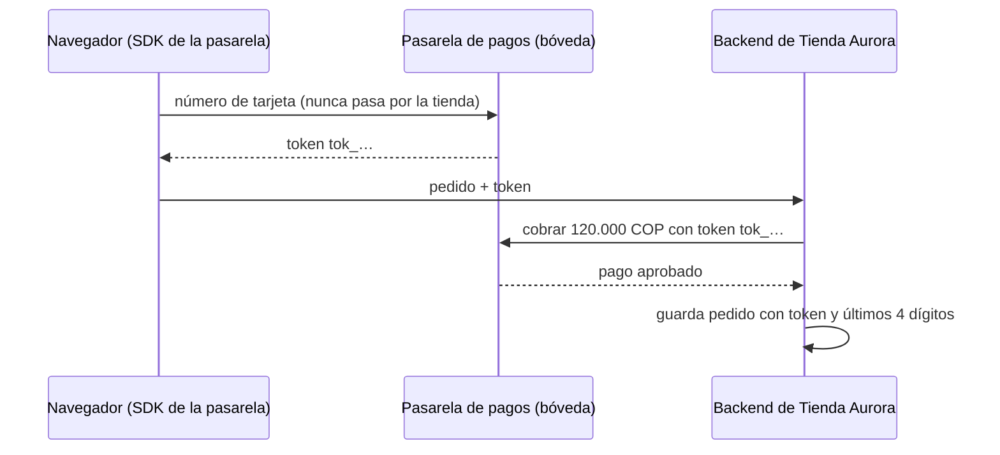

# Módulo 16: Seguridad avanzada

Este módulo profundiza la seguridad para escenarios enterprise: OIDC/OAuth2, autorización por recurso/método, SAML y hardening de secretos/configuración. La seguridad debe ser comprobable y por capas.

**Entorno de referencia verificado (2026-05-22):** JDK 27.0.1.0.2, Spring Boot 3.5.0, Spring Security 6.x.

## Aprende construyendo

### Tema 1: OIDC/OAuth2 con Spring Security · Avanzado · 45 min

Caso guía: app delega login a un Identity Provider.

#### OAuth2/OIDC

**Definición formal.** OAuth2 es un framework de autorización; OpenID Connect agrega identidad sobre OAuth2. Spring Security soporta client y resource server.

**Error común.** Confundir access token con ID token. Corrección: usar cada token según su propósito y validar claims.

**Nota de verificación.** Requiere IdP (Keycloak/Auth0/etc.); lab con Docker factible.

### Tema 2: Autorización por recurso/método · Avanzado · 45 min

Caso guía: solo dueño o admin puede ver una guía.

#### Method security

**Definición formal.** Autorización declarativa en métodos (`@PreAuthorize`) o por reglas de request.

**Ejemplo mínimo.**

```java
@PreAuthorize("hasRole('ADMIN') or @authz.esDueno(#id, authentication)")
public GuiaDto get(String id) { ... }
```

**Error común.** Chequear rol en UI pero no en backend. Corrección: autorización en servidor.

### Tema 3: SAML y escenarios enterprise · Avanzado · 40 min

Caso guía: integración SSO legacy corporativo.

#### SAML

**Definición formal.** Protocolo XML para federación de identidad/SSO enterprise. Spring Security soporta SAML2 service provider.

**Error común.** Tratar SAML como “solo config”; requiere entender certificados, metadata y assertions. Corrección: validar metadata, expiración, firmas y clock skew.

### Tema 4: Hardening y secretos · Avanzado · 35 min

Caso guía: credencial DB en `application.yml` commiteada.

#### Secret management

**Definición formal.** Gestión de secretos mediante vault/secret manager/env inyectado, con rotación y mínimo privilegio.

**Reglas.** No commitear secretos; no loguearlos; rotarlos; usar TLS; limitar Actuator.

**Error común.** Poner secretos en repo “privado”. Corrección: secret manager + scanning + rotación.

### Tema 5: Tokenización de datos de tarjeta · Avanzado · 35 min

## Motivación

Si Tienda Aurora guarda números de tarjeta en su base de datos, un solo ataque los expone todos. Además, todo el sistema que los toca entra en el alcance de la auditoría PCI DSS, el estándar de seguridad de la industria de tarjetas, con controles caros en cada servidor. La tokenización reduce ese riesgo y ese alcance.

## Concepto

**Tokenizar** es reemplazar el número real de la tarjeta (PAN, *Primary Account Number*) por un **token**: un valor sin relación matemática con el original, que solo tiene sentido para quien guarda la tabla de equivalencias, la **bóveda**. Si alguien roba el token, no le sirve: no se puede convertir de vuelta sin acceso a la bóveda.

No es lo mismo que **cifrar**. Un dato cifrado se descifra con la clave, y quien la robe recupera todos los datos. Un token aleatorio no se «descifra»: hay que consultar la bóveda, que está aislada y auditada.

En la práctica, la bóveda **no la construyes tú**. La pasarela de pagos (Stripe, Adyen, Mercado Pago, Wompi) tokeniza la tarjeta en el navegador o en la app con su SDK, y tu backend solo recibe el token. Apple Pay y Google Pay usan el mismo principio con tokens de red.

## Ejemplo mínimo

Para ver la idea, una bóveda de juguete en memoria:

**Archivo:** `Tokenizacion.java`

```java
import java.security.SecureRandom;
import java.util.HashMap;
import java.util.HexFormat;
import java.util.Map;

public class Tokenizacion {

    /** Bóveda: el único componente que guarda números de tarjeta reales. */
    static class Boveda {
        private final Map<String, String> tarjetaPorToken = new HashMap<>();
        private final SecureRandom azar = new SecureRandom();

        String tokenizar(String numeroTarjeta) {
            byte[] bytes = new byte[12];
            azar.nextBytes(bytes);                      // aleatorio: no se deriva de la tarjeta
            String token = "tok_" + HexFormat.of().formatHex(bytes);
            tarjetaPorToken.put(token, numeroTarjeta);
            return token;
        }

        /** Solo el procesador de pagos, dentro del perímetro seguro, puede hacer esto. */
        String recuperar(String token) {
            String tarjeta = tarjetaPorToken.get(token);
            if (tarjeta == null) throw new IllegalArgumentException("token desconocido");
            return tarjeta;
        }
    }

    record PedidoGuardado(String id, String tokenTarjeta, String ultimos4) {}

    public static void main(String[] args) {
        var boveda = new Boveda();
        String tarjeta = "4111111111111111";            // tarjeta de prueba, no real

        String token = boveda.tokenizar(tarjeta);
        var pedido = new PedidoGuardado("P-1", token, tarjeta.substring(12));

        System.out.println("La tienda guarda: " + pedido.id() + ", token de "
                + pedido.tokenTarjeta().length() + " caracteres, tarjeta ****" + pedido.ultimos4());
        System.out.println("¿El token contiene la tarjeta? " + pedido.tokenTarjeta().contains(tarjeta));
        System.out.println("La bóveda la recupera: " + boveda.recuperar(token).equals(tarjeta));
    }
}
```

```text
$ java Tokenizacion.java
La tienda guarda: P-1, token de 28 caracteres, tarjeta ****1111
¿El token contiene la tarjeta? false
La bóveda la recupera: true
```

## Cómo funciona por dentro



La tienda nunca ve el número completo, así que su base de datos no tiene nada valioso que robar y el alcance de PCI DSS se reduce a lo mínimo.

## Reglas y casos límite

- **Nunca registres el número en logs, ni siquiera en desarrollo.** Mostrar los últimos 4 dígitos está permitido; el número completo, no.
- **El token debe ser aleatorio** (`SecureRandom`), no un hash del número: un hash de 16 dígitos se puede revertir por fuerza bruta en minutos.
- **Tokens de un solo uso o reutilizables.** Las pasarelas distinguen el token temporal de un pago del que guarda una tarjeta para compras futuras. Este último requiere el consentimiento del cliente.

## Compruébalo

1. ¿Por qué un SHA-256 del número de tarjeta no sirve como token? Calcula cuántos números posibles hay si conoces el BIN (6 dígitos) y el último dígito de control.
2. En el diagrama, ¿qué componentes quedan dentro del alcance PCI DSS y cuáles fuera?

## Cierre

Seguridad avanzada es identidad, autorización fina y hardening continuo. No hay una casilla única que marque “seguro”.

## Checklist

- Valido tokens/claims correctamente.
- Autorizo en backend por recurso/método.
- Manejo secretos fuera del repo.
- Hardening de endpoints y TLS.
