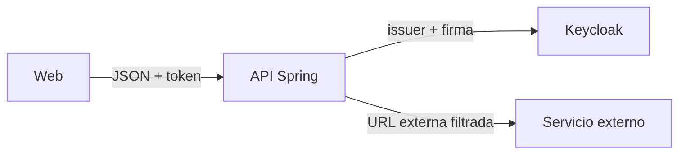
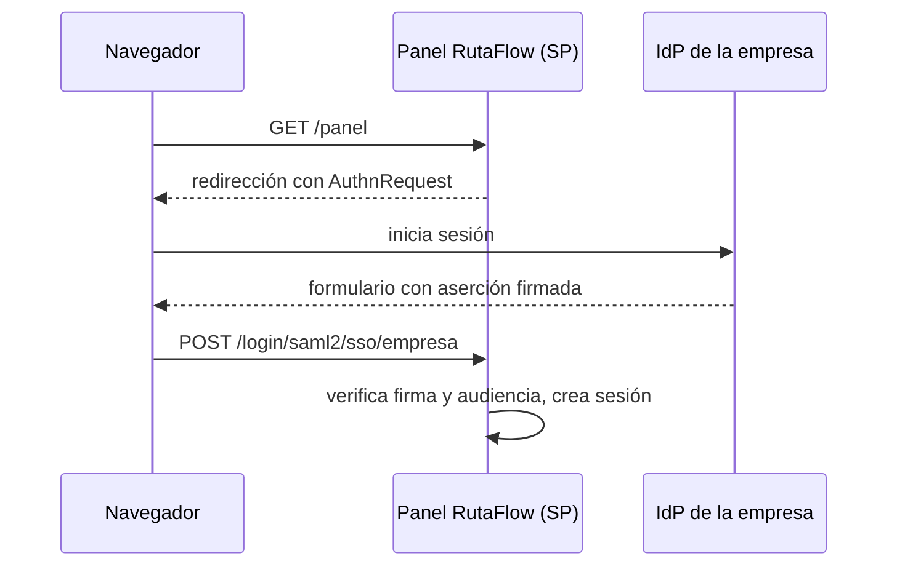

# Módulo 18: Autenticación y backend seguro con Spring Security

## Aprende construyendo

El resultado será una API Spring Boot que autentica requests con un proveedor OAuth 2.0/OIDC, autoriza por scope/rol y valida entradas. No se implementa una firma JWT artesanal: el laboratorio usa Spring Security Resource Server para validar tokens emitidos por un issuer de confianza.


### Dos ejemplos: primero visible, luego real

<details open>
<summary><strong>Capa 1 — Lectura</strong></summary>

#### ► DE QUÉ TRATA
Este tema te guía por dos ejemplos: primero visible, luego real con foco en comprensión antes de implementación.

#### ► LA IDEA EN UNA FRASE
**Entender dos ejemplos: primero visible, luego real te permite tomar mejores decisiones técnicas.**

#### ► POR QUÉ EXISTE ESTO
Resuelve un problema real de diseño o implementación y evita decisiones a ciegas.

#### ► LA ANALOGÍA
Piensa en dos ejemplos: primero visible, luego real como una herramienta de taller: útil cuando conoces su propósito y sus límites.
**Dónde se rompe la analogía:** en software, los efectos dependen del contexto, la escala y los trade-offs.

#### ► CÓMO FUNCIONA
1. Identifica el problema que dos ejemplos: primero visible, luego real resuelve.
2. Observa sus componentes y relaciones.
3. Aplica la opción más simple que funcione.
4. Verifica el resultado y los límites.

#### ► LO QUE PUEDE SALIR MAL
| Síntoma | Causa probable | Arreglo |
|---|---|---|
| Dos ejemplos: primero visible, luego real se aplica pero el resultado no mejora | Se usó sin medir el problema real | Mide antes y compara contra la alternativa simple |
| Aparece complejidad inesperada | Se adoptó la técnica sin comprender sus trade-offs | Vuelve a la sección de trade-offs y reduce el alcance |
| Falla en un caso límite | Se asumió un contexto que no se cumple | Prueba el caso límite y documenta cuándo NO usarlo |

#### ► TRADE-OFFS
| Opción | Cuándo usarla | Cuándo NO usarla |
|---|---|---|
| Usar Dos ejemplos: primero visible, luego real | Cuando el problema coincide con su propósito y el beneficio es observable | Cuando agrega complejidad sin resolver un problema real |
| Alternativa más simple | Cuando el contexto es pequeño, estable o fácil de razonar | Cuando ya demostró no escalar o no cumplir el requisito |
| Postergar la decisión | Cuando falta evidencia del problema | Cuando el costo de esperar es mayor que el costo de probar |

#### ► CUÁNDO NO USAR ESTO
No uses dos ejemplos: primero visible, luego real por defecto. Aplícalo cuando el problema lo justifique y puedas verificar el beneficio; si una alternativa más simple resuelve igual, prefiérela.

#### ► DE VUELTA A LA ANALOGÍA
Volviendo a la analogía: dos ejemplos: primero visible, luego real funciona como el modelo inicial, pero recuerda dónde se rompe: en producción importan la evidencia, la escala y el costo de equivocarte.

#### ► LO QUE DEBES RECORDAR
- Dos ejemplos: primero visible, luego real existe para resolver un problema específico.
- Mide antes de adoptar complejidad.
- Conoce el caso donde NO usarlo.
- Verifica con evidencia observable.

#### ► PREGUNTAS PARA PENSAR
1. ¿Qué problema concreto resuelve dos ejemplos: primero visible, luego real en tu contexto?
2. ¿Cómo sabrías que dos ejemplos: primero visible, luego real no está funcionando bien?
3. ¿Qué alternativa más simple considerarías antes de usar dos ejemplos: primero visible, luego real?

</details>

<details>
<summary><strong>Capa 2 — Construcción</strong></summary>

#### Nota de construcción
Este tema es principalmente conceptual en esta versión. La verificación se realiza con las preguntas de comprensión y el criterio de cuándo NO usar dos ejemplos: primero visible, luego real.

</details>

### Tema 1: SecurityFilterChain y autorización · Avanzado · 35 min

<details open>
<summary><strong>Capa 1 — Lectura</strong></summary>

#### ► DE QUÉ TRATA
Este tema te guía por securityfilterchain y autorización con foco en comprensión antes de implementación.

#### ► LA IDEA EN UNA FRASE
**Entender securityfilterchain y autorización te permite tomar mejores decisiones técnicas.**

#### ► POR QUÉ EXISTE ESTO
Resuelve un problema real de diseño o implementación y evita decisiones a ciegas.

#### ► LA ANALOGÍA
Piensa en securityfilterchain y autorización como una herramienta de taller: útil cuando conoces su propósito y sus límites.
**Dónde se rompe la analogía:** en software, los efectos dependen del contexto, la escala y los trade-offs.

#### ► CÓMO FUNCIONA
1. Identifica el problema que securityfilterchain y autorización resuelve.
2. Observa sus componentes y relaciones.
3. Aplica la opción más simple que funcione.
4. Verifica el resultado y los límites.

#### ► LO QUE PUEDE SALIR MAL
| Síntoma | Causa probable | Arreglo |
|---|---|---|
| SecurityFilterChain y autorización se aplica pero el resultado no mejora | Se usó sin medir el problema real | Mide antes y compara contra la alternativa simple |
| Aparece complejidad inesperada | Se adoptó la técnica sin comprender sus trade-offs | Vuelve a la sección de trade-offs y reduce el alcance |
| Falla en un caso límite | Se asumió un contexto que no se cumple | Prueba el caso límite y documenta cuándo NO usarlo |

#### ► TRADE-OFFS
| Opción | Cuándo usarla | Cuándo NO usarla |
|---|---|---|
| Usar SecurityFilterChain y autorización | Cuando el problema coincide con su propósito y el beneficio es observable | Cuando agrega complejidad sin resolver un problema real |
| Alternativa más simple | Cuando el contexto es pequeño, estable o fácil de razonar | Cuando ya demostró no escalar o no cumplir el requisito |
| Postergar la decisión | Cuando falta evidencia del problema | Cuando el costo de esperar es mayor que el costo de probar |

#### ► CUÁNDO NO USAR ESTO
No uses securityfilterchain y autorización por defecto. Aplícalo cuando el problema lo justifique y puedas verificar el beneficio; si una alternativa más simple resuelve igual, prefiérela.

#### ► DE VUELTA A LA ANALOGÍA
Volviendo a la analogía: securityfilterchain y autorización funciona como el modelo inicial, pero recuerda dónde se rompe: en producción importan la evidencia, la escala y el costo de equivocarte.

#### ► LO QUE DEBES RECORDAR
- SecurityFilterChain y autorización existe para resolver un problema específico.
- Mide antes de adoptar complejidad.
- Conoce el caso donde NO usarlo.
- Verifica con evidencia observable.

#### ► PREGUNTAS PARA PENSAR
1. ¿Qué problema concreto resuelve securityfilterchain y autorización en tu contexto?
2. ¿Cómo sabrías que securityfilterchain y autorización no está funcionando bien?
3. ¿Qué alternativa más simple considerarías antes de usar securityfilterchain y autorización?

</details>

<details>
<summary><strong>Capa 2 — Construcción</strong></summary>

#### Código y verificación
```java
.requestMatchers(HttpMethod.POST, "/api/ubicaciones/**")
    .hasAuthority("ROLE_location:write")
.requestMatchers(HttpMethod.GET, "/api/pedidos/**").authenticated()
.anyRequest().denyAll()
```

```bash
./mvnw -Dtest=ApiSecurityTest#sinBearerTokenRecibe401 test
```

```bash
./mvnw -Dtest=ApiSecurityTest#rolDeEscrituraPermiteGuardarUbicacion test
```

```bash
./mvnw -Dtest=ApiSecurityTest#sinBearerTokenRecibe401+tokenSinRolDeEscrituraRecibe403 test
```

```bash
./mvnw -Dtest=ApiSecurityTest#tokenSoloLeePedidosDeSuSubject test
```

</details>

### Tema 2: DTO validation, CORS, JWT/OIDC y clientes HTTP · Avanzado · 40 min

<details open>
<summary><strong>Capa 1 — Lectura</strong></summary>

#### ► DE QUÉ TRATA
Este tema te guía por dto validation, cors, jwt/oidc y clientes http con foco en comprensión antes de implementación.

#### ► LA IDEA EN UNA FRASE
**Entender dto validation, cors, jwt/oidc y clientes http te permite tomar mejores decisiones técnicas.**

#### ► POR QUÉ EXISTE ESTO
Resuelve un problema real de diseño o implementación y evita decisiones a ciegas.

#### ► LA ANALOGÍA
Piensa en dto validation, cors, jwt/oidc y clientes http como una herramienta de taller: útil cuando conoces su propósito y sus límites.
**Dónde se rompe la analogía:** en software, los efectos dependen del contexto, la escala y los trade-offs.

#### ► CÓMO FUNCIONA


#### ► LO QUE PUEDE SALIR MAL
| Síntoma | Causa probable | Arreglo |
|---|---|---|
| DTO validation, CORS, JWT/OIDC y clientes HTTP se aplica pero el resultado no mejora | Se usó sin medir el problema real | Mide antes y compara contra la alternativa simple |
| Aparece complejidad inesperada | Se adoptó la técnica sin comprender sus trade-offs | Vuelve a la sección de trade-offs y reduce el alcance |
| Falla en un caso límite | Se asumió un contexto que no se cumple | Prueba el caso límite y documenta cuándo NO usarlo |

#### ► TRADE-OFFS
| Opción | Cuándo usarla | Cuándo NO usarla |
|---|---|---|
| Usar DTO validation, CORS, JWT/OIDC y clientes HTTP | Cuando el problema coincide con su propósito y el beneficio es observable | Cuando agrega complejidad sin resolver un problema real |
| Alternativa más simple | Cuando el contexto es pequeño, estable o fácil de razonar | Cuando ya demostró no escalar o no cumplir el requisito |
| Postergar la decisión | Cuando falta evidencia del problema | Cuando el costo de esperar es mayor que el costo de probar |

#### ► CUÁNDO NO USAR ESTO
No uses dto validation, cors, jwt/oidc y clientes http por defecto. Aplícalo cuando el problema lo justifique y puedas verificar el beneficio; si una alternativa más simple resuelve igual, prefiérela.

#### ► DE VUELTA A LA ANALOGÍA
Volviendo a la analogía: dto validation, cors, jwt/oidc y clientes http funciona como el modelo inicial, pero recuerda dónde se rompe: en producción importan la evidencia, la escala y el costo de equivocarte.

#### ► LO QUE DEBES RECORDAR
- DTO validation, CORS, JWT/OIDC y clientes HTTP existe para resolver un problema específico.
- Mide antes de adoptar complejidad.
- Conoce el caso donde NO usarlo.
- Verifica con evidencia observable.

#### ► PREGUNTAS PARA PENSAR
1. ¿Qué problema concreto resuelve dto validation, cors, jwt/oidc y clientes http en tu contexto?
2. ¿Cómo sabrías que dto validation, cors, jwt/oidc y clientes http no está funcionando bien?
3. ¿Qué alternativa más simple considerarías antes de usar dto validation, cors, jwt/oidc y clientes http?

</details>

<details>
<summary><strong>Capa 2 — Construcción</strong></summary>

#### Código y verificación


```java
public record CrearEntregaRequest(@NotBlank @Size(max = 200) String destinatario) {}
```

```bash
./scripts/verify-integration.sh
```

```bash
./mvnw -Dtest=ApiSecurityTest#corsPermiteOrigenLocalDeclaradoYRechazaOtroOrigen test
```

```bash
docker compose up -d
curl -fsS http://localhost:8081/realms/rutaflow/.well-known/openid-configuration
```

```bash
./mvnw test
```

</details>

### Tema 3: SAML 2.0 con Spring Security: iniciar sesión con el proveedor de identidad de una empresa · Avanzado · 45 min

<details open>
<summary><strong>Capa 1 — Lectura</strong></summary>

#### ► DE QUÉ TRATA
Usa Spring Boot 4.1.2 con JDK 25 en academia-spring (paquete com.example.demo) y agrega spring-boot-starter-security-saml2: desde Spring Boot 4.0 la autoconfiguración de SAML vive en ese starter, que incluye Spring Security y spring-security-saml2-service-provider. Necesitas un I…

#### ► LA IDEA EN UNA FRASE
**Usa Spring Boot 4.1.2 con JDK 25 en academia-spring (paquete com.example.demo) y agrega spring-boot-starter-security-saml2: desde Spring Boot 4.0 la autoconfiguración de SAML vive en ese starter, que incluye Spring Security y spring-security-saml2-service-provider.**

#### ► POR QUÉ EXISTE ESTO
Resuelve un problema real de diseño o implementación y evita decisiones a ciegas.

#### ► LA ANALOGÍA
**Conceptos clave:** SAML 2.0, proveedor de identidad (IdP), proveedor de servicio (SP), aserción firmada, metadatos, ACS (*Assertion Consumer Service*), `Saml2AuthenticatedPrincipal`.

En SAML hay dos partes:

- El **IdP** autentica al usuario y emite una **aserción**: un XML firmado que dice quién es y sus atributos (correo, grupos).
- El **SP** (tu aplicación) confía en el IdP, verifica la firma y crea la sesión.

El intercambio usa el navegador: el SP redirige al IdP, el usuario inicia sesión allá y el IdP envía la aserción por POST a la URL **ACS** del SP (`/login/saml2/sso/{registrationId}`).

Para configurarlo, el SP necesita los **metadatos** del IdP (su URL, su certificado). Spring Security los descarga de `metadata-uri`. El IdP necesita los del SP, que Spring publica en `/saml2/service-provider-metadata/{registrationId}`.

| SAML | OIDC |
|---|---|
| XML firmado, habitual en empresas | JSON y JWT, habitual en apps modernas |
| flujo por el navegador | también para APIs y móviles |

**Analogía:** la aserción SAML es una carta de recomendación sellada por la empresa: el panel no conoce al empleado, pero sí reconoce el sello. La analogía falla en que el sello caduca en minutos y la carta sirve para un solo destinatario.

**Límite de uso:** SAML no sirve para proteger APIs llamadas por apps móviles: para eso usa OIDC y tokens. Valida siempre la firma y la audiencia; nunca desactives esas verificaciones para «probar».



**Dónde se rompe la analogía:** el modelo simplifica la realidad; en producción influyen escala, fallos, costo y contexto.

#### ► CÓMO FUNCIONA


#### ► LO QUE PUEDE SALIR MAL
| Síntoma | Causa probable | Arreglo |
|---|---|---|
| SAML 2.0 con Spring Security: iniciar sesión con el proveedor de identidad de una empresa se aplica pero el resultado no mejora | Se usó sin medir el problema real | Mide antes y compara contra la alternativa simple |
| Aparece complejidad inesperada | Se adoptó la técnica sin comprender sus trade-offs | Vuelve a la sección de trade-offs y reduce el alcance |
| Falla en un caso límite | Se asumió un contexto que no se cumple | Prueba el caso límite y documenta cuándo NO usarlo |

#### ► TRADE-OFFS
| Opción | Cuándo usarla | Cuándo NO usarla |
|---|---|---|
| Usar SAML 2.0 con Spring Security: iniciar sesión con el proveedor de identidad de una empresa | Cuando el problema coincide con su propósito y el beneficio es observable | Cuando agrega complejidad sin resolver un problema real |
| Alternativa más simple | Cuando el contexto es pequeño, estable o fácil de razonar | Cuando ya demostró no escalar o no cumplir el requisito |
| Postergar la decisión | Cuando falta evidencia del problema | Cuando el costo de esperar es mayor que el costo de probar |

#### ► CUÁNDO NO USAR ESTO
No uses saml 2.0 con spring security: iniciar sesión con el proveedor de identidad de una empresa por defecto. Aplícalo cuando el problema lo justifique y puedas verificar el beneficio; si una alternativa más simple resuelve igual, prefiérela.

#### ► DE VUELTA A LA ANALOGÍA
Volviendo a la analogía: saml 2.0 con spring security: iniciar sesión con el proveedor de identidad de una empresa funciona como el modelo inicial, pero recuerda dónde se rompe: en producción importan la evidencia, la escala y el costo de equivocarte.

#### ► LO QUE DEBES RECORDAR
- SAML 2.0 con Spring Security: iniciar sesión con el proveedor de identidad de una empresa existe para resolver un problema específico.
- Mide antes de adoptar complejidad.
- Conoce el caso donde NO usarlo.
- Verifica con evidencia observable.

#### ► PREGUNTAS PARA PENSAR
1. ¿Qué problema concreto resuelve saml 2.0 con spring security: iniciar sesión con el proveedor de identidad de una empresa en tu contexto?
2. ¿Cómo sabrías que saml 2.0 con spring security: iniciar sesión con el proveedor de identidad de una empresa no está funcionando bien?
3. ¿Qué alternativa más simple considerarías antes de usar saml 2.0 con spring security: iniciar sesión con el proveedor de identidad de una empresa?

</details>

<details>
<summary><strong>Capa 2 — Construcción</strong></summary>

#### Código y verificación


```yaml
spring:
  security:
    saml2:
      relyingparty:
        registration:
          empresa:
            assertingparty:
              metadata-uri: http://localhost:8180/realms/rutaflow/protocol/saml/descriptor
            entity-id: rutaflow-panel
```

```java
package com.example.demo.seguridad;

import static org.springframework.security.config.Customizer.withDefaults;

import org.springframework.context.annotation.Bean;
import org.springframework.context.annotation.Configuration;
import org.springframework.security.config.annotation.web.builders.HttpSecurity;
import org.springframework.security.web.SecurityFilterChain;

@Configuration
class SamlConfig {
    @Bean
    SecurityFilterChain panel(HttpSecurity http) throws Exception {
        return http
            .authorizeHttpRequests(a -> a.anyRequest().authenticated())
            .saml2Login(withDefaults())   // redirige al IdP y recibe la aserción
            .saml2Metadata(withDefaults()) // publica los metadatos del SP
            .build();
    }
}
```

```java
package com.example.demo.seguridad;

import java.util.Map;
import org.springframework.security.core.annotation.AuthenticationPrincipal;
import org.springframework.security.saml2.provider.service.authentication.Saml2AuthenticatedPrincipal;
import org.springframework.web.bind.annotation.GetMapping;
import org.springframework.web.bind.annotation.RestController;

@RestController
class YoController {
    @GetMapping("/yo")
    Map<String, Object> yo(@AuthenticationPrincipal Saml2AuthenticatedPrincipal usuario) {
        return Map.of(
            "nombre", usuario.getName(),
            "correo", String.valueOf(usuario.getFirstAttribute("email")),
            "idp", usuario.getRelyingPartyRegistrationId());
    }
}
```

```bash
./mvnw spring-boot:run
curl -s localhost:8080/saml2/service-provider-metadata/empresa | head -c 300
# en el navegador: http://localhost:8080/yo  -> redirige a Keycloak -> vuelve con la sesión
```

```text
/saml2/service-provider-metadata/empresa devuelve XML que empieza con <md:EntityDescriptor ... entityID="rutaflow-panel">.
Al abrir /yo sin sesión, el navegador va a la página de inicio de sesión de Keycloak.
Después de iniciar sesión, /yo devuelve {"nombre":"operadora1","correo":"operadora1@empresa.co","idp":"empresa"}.
```

</details>
