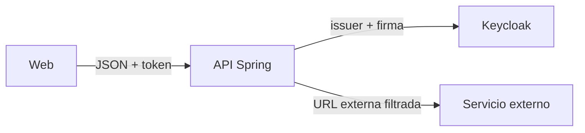

# Módulo 18: Autenticación y backend seguro con Spring Security

## Aprende construyendo

El resultado será una API Spring Boot que autentica requests con un proveedor OAuth 2.0/OIDC, autoriza por scope/rol y valida entradas. No se implementa una firma JWT artesanal: el laboratorio usa Spring Security Resource Server para validar tokens emitidos por un issuer de confianza.

### Dos ejemplos: primero visible, luego real

- **Ejemplo sencillo:** `/health` es público; `/api/envios` requiere identidad y `/api/admin/tarifas` exige autoridad admin. Prueba los resultados 200, 401 y 403 con MockMvc.
- **Caso RutaFlow:** dos usuarios del mismo rol consultan `/api/envios/{id}`. Solo el propietario o un permiso explícito del tenant puede ver ese envío; agrega pruebas para dueño, otro usuario, token expirado y solicitud sin credencial.

El rol permite entrar a una clase de operación; la comprobación de propiedad autoriza el objeto concreto. El caso aplicado no se considera listo solo porque el token tenga firma válida.

### Tema 1: SecurityFilterChain y autorización

**Meta:** crear reglas de acceso explícitas, convertir roles del JWT en authorities de Spring y comprobar que el rol general no sustituye la autorización sobre el pedido concreto.

**¿Por qué es importante?** Una firma válida solo demuestra quién emitió el token. Todavía hay que decidir qué acción puede hacer la persona y sobre qué recurso.

**Evidencia final:** pruebas HTTP para token ausente, token sin rol, escritura permitida y lectura de pedido propio frente a pedido ajeno.

#### Subtema 18.1 · Define qué rutas acepta el filtro · 8 min

**Contexto:** cuando aparece un endpoint nuevo, no debe quedar accesible por accidente. El laboratorio da acceso solo a las rutas que nombra y niega las demás.

**Hazlo tú:** abre `examples/spring-security-keycloak-rutaflow/src/main/java/academia/rutaflow/security/ApiSecurity.java`. Observa las reglas:

```java
.requestMatchers(HttpMethod.POST, "/api/ubicaciones/**")
    .hasAuthority("ROLE_location:write")
.requestMatchers(HttpMethod.GET, "/api/pedidos/**").authenticated()
.anyRequest().denyAll()
```

Desde `examples/spring-security-keycloak-rutaflow`, ejecuta la prueba sin token:

```bash
./mvnw -Dtest=ApiSecurityTest#sinBearerTokenRecibe401 test
```

**Resultado esperado:** `GET /api/pedidos/p-ana` devuelve 401 si no presentas bearer token.

**Fallo deliberado:** cambia temporalmente el patrón GET de `"/api/pedidos/**"` a `"/api/pedidos-falsos/**"` y ejecuta `./mvnw -Dtest=ApiSecurityTest#tokenSoloLeePedidosDeSuSubject test`. **Diagnóstico:** la ruta propia cae en `denyAll` y Ana recibe 403 en vez de 200. Restaura el patrón.

**Entiende:** `SecurityFilterChain` hace pasar la petición por las reglas configuradas. `anyRequest().denyAll()` niega rutas que no se declararon; no agrega una ruta pública.

**Cierra:** di qué regla protege GET y qué regla niega una ruta no descrita.

#### Subtema 18.2 · Traduce un rol del JWT a una autoridad · 8 min

**Contexto:** Keycloak pone los roles del realm dentro de `realm_access.roles`; Spring Security necesita saber cómo convertirlos a authorities para que `hasAuthority` pueda compararlos.

**Hazlo tú:** revisa `realmRoleAuthorities()` en `examples/spring-security-keycloak-rutaflow/src/main/java/academia/rutaflow/security/ApiSecurity.java`. Sigue el prefijo `ROLE_` y ejecuta la prueba:

```bash
./mvnw -Dtest=ApiSecurityTest#rolDeEscrituraPermiteGuardarUbicacion test
```

**Resultado esperado:** el token de prueba de Ana incluye `location:write`, se convierte a `ROLE_location:write` y el POST devuelve 200.

**Fallo deliberado:** cambia el prefijo `ROLE_` por `SCOPE_`. **Diagnóstico:** la authority ya no coincide con `hasAuthority("ROLE_location:write")` y el POST de Ana recibe 403. Restaura `ROLE_`.

**Entiende:** `JwtAuthenticationConverter` convierte claims en permisos que consume Spring. Los nombres y prefijos deben coincidir exactamente entre conversor y regla.

**Cierra:** escribe la transformación del claim hasta el texto que verifica `hasAuthority`.

#### Subtema 18.3 · Distingue identidad de permiso · 8 min

**Contexto:** una persona puede estar identificada correctamente y aun así no tener permiso para una acción.

**Hazlo tú:** desde `examples/spring-security-keycloak-rutaflow`, compara los dos tests de `ApiSecurityTest.java`:

```bash
./mvnw -Dtest=ApiSecurityTest#sinBearerTokenRecibe401+tokenSinRolDeEscrituraRecibe403 test
```

**Resultado esperado:** la petición sin token da 401; el token válido de Luis, que carece de `location:write`, da 403. Ana, con el rol correcto, puede pasar el filtro.

**Fallo deliberado:** cambia `hasAuthority("ROLE_location:write")` por `hasAuthority("ROLE_admin")` y ejecuta `rolDeEscrituraPermiteGuardarUbicacion`. **Diagnóstico:** el token sí autentica a Ana, pero no contiene `ROLE_admin`, así que el test recibe 403. Restaura la regla.

**Entiende:** 401 significa que la petición no tiene autenticación válida; 403 significa que se identificó al usuario y la política le negó la acción. No trates los dos resultados como sinónimos.

**Cierra:** explica cuál de las dos respuestas corresponde a token ausente y cuál a rol insuficiente.

#### Subtema 18.4 · Autoriza el pedido que pertenece a la persona · 10 min

**Contexto:** un rol puede permitir consultar pedidos, pero no revela si la persona puede consultar cualquier pedido. La propiedad del recurso es una comprobación separada.

**Hazlo tú:** abre `examples/spring-security-keycloak-rutaflow/src/main/java/academia/rutaflow/security/RutaflowApiController.java` y sigue `jwt.getSubject()` hasta `PedidoOwnership.requireOwner`. Ejecuta:

```bash
./mvnw -Dtest=ApiSecurityTest#tokenSoloLeePedidosDeSuSubject test
```

**Resultado esperado:** Ana recibe 200 para `p-ana` y 403 para `p-luis`; ambos pedidos requieren una identidad válida.

**Fallo deliberado:** comenta `pedidoOwnership.requireOwner(jwt.getSubject(), id)`. **Diagnóstico:** la prueba deja de recibir 403 al solicitar el pedido ajeno. Restaura la verificación de propietario.

**Entiende:** el filtro decide si la identidad puede entrar a la operación; el servicio de dominio decide si esa identidad puede ver ese pedido específico. Un rol general no reemplaza esa comprobación.

**Cierra:** en el proyecto integrador de RutaFlow, prueba dueño, otra persona y recurso inexistente. Anota qué autoridad permite entrar y qué dato del dominio demuestra la propiedad.

Las pruebas anteriores usan un `JwtDecoder` simulado: comprueban reglas y ownership, no la firma ni la expiración del token. Para probar el issuer real, el laboratorio incluye Keycloak y su realm local; sigue `examples/spring-security-keycloak-rutaflow/README.md` y ejecuta el recorrido con Docker.

**Fuentes primarias:** [Spring Security: autorización de peticiones HTTP](https://docs.spring.io/spring-security/reference/servlet/authorization/authorize-http-requests.html); [Spring Security: Resource Server JWT](https://docs.spring.io/spring-security/reference/servlet/oauth2/resource-server/jwt.html).
### Tema 2: DTO validation, CORS, JWT/OIDC y clientes HTTP

**Meta:** validar datos antes de guardar, limitar qué páginas web leen la API, confiar en un emisor OIDC identificado y filtrar destinos de llamadas HTTP salientes.

**¿Por qué es importante?** Cada frontera recibe datos o identidad de otra parte. Revisar solo el JWT no valida el cuerpo, CORS no autentica, y una llamada saliente también puede alcanzar servicios internos si sigue una URL sin control.

**Evidencia final:** tests de petición inválida, preflight CORS permitido/rechazado, configuración del issuer documentada y bloqueo de direcciones locales del cliente.



**Límite:** CORS decide qué páginas pueden leer respuestas desde el navegador; no valida identidad. El filtro IP limita destinos resueltos, pero no sustituye una lista de hosts permitidos.

#### Subtema 18.5 · Valida la petición en la entrada · 8 min

**Contexto:** una entrega con destinatario vacío no debe llegar al servicio ni quedar guardada en PostgreSQL.

**Hazlo tú:** abre `examples/spring-boot-integrador-rutaflow/src/main/java/academia/rutaflow/integrador/entrega/CrearEntregaRequest.java`:

```java
public record CrearEntregaRequest(@NotBlank @Size(max = 200) String destinatario) {}
```

Abre `EntregaController.java` y comprueba que el body lleva `@Valid`. Ejecuta desde `examples/spring-boot-integrador-rutaflow`:

```bash
./scripts/verify-integration.sh
```

**Resultado esperado:** pasan 7 pruebas con PostgreSQL efímero; destinatario en blanco responde 400 y el conteo de entregas no aumenta.

**Fallo deliberado:** quita `@Valid` del `@RequestBody` y repite. **Diagnóstico:** el test deja de recibir 400 y la solicitud vacía alcanza el resto del flujo. Restaura `@Valid`.

**Entiende:** las anotaciones describen qué valores son válidos; `@Valid` pide a Spring MVC comprobarlas antes de invocar el método. Si la entrada no cumple, no guardes una entidad y luego intentes corregirla.

**Cierra:** anota qué regla rechaza el destinatario y cuál test comprueba que no se persiste. Lleva el mismo contrato al proyecto integrador RutaFlow.

#### Subtema 18.6 · Configura CORS para el origen necesario · 8 min

**Contexto:** una aplicación web de desarrollo necesita leer respuestas desde `localhost:4200`; no por eso cualquier sitio debe poder leer la API.

**Hazlo tú:** abre `examples/spring-security-keycloak-rutaflow/src/main/java/academia/rutaflow/security/ApiSecurity.java`. La `CorsConfigurationSource` permite un origen, métodos y headers concretos; `ApiSecurityTest` manda una solicitud preflight:

```bash
cd examples/spring-security-keycloak-rutaflow
./mvnw -Dtest=ApiSecurityTest#corsPermiteOrigenLocalDeclaradoYRechazaOtroOrigen test
```

**Resultado esperado:** el preflight de `http://localhost:4200` recibe `Access-Control-Allow-Origin`; `https://sitio-ajeno.example` recibe 403. El header de credenciales no aparece.

**Fallo deliberado:** cambia el origen permitido a `https://sitio-ajeno.example` y ejecuta el mismo test. **Diagnóstico:** el navegador de desarrollo ya no aparece en `Access-Control-Allow-Origin`, y el test encuentra el origen equivocado. Restaura `http://localhost:4200`.

**Entiende:** CORS es una regla del navegador sobre qué origen puede leer una respuesta. No es una barrera para `curl`, no reemplaza autenticación y las solicitudes preflight deben procesarse antes de exigir credenciales.

**Cierra:** explica por qué permites un origen y mantienes `allowCredentials=false` en este laboratorio.

#### Subtema 18.7 · Confía en el issuer OIDC, no en un JWT decodificado · 10 min

**Contexto:** base64 permite leer un payload, pero no verificar quién firmó el JWT ni si sigue vigente. El Resource Server debe consultar las claves del emisor que tu aplicación decidió confiar.

**Hazlo tú:** abre `examples/spring-security-keycloak-rutaflow/src/main/resources/application.yml`. Localiza `issuer-uri`; debe coincidir exactamente con el `iss` de los tokens del realm. Para recorrer la configuración real, sigue `examples/spring-security-keycloak-rutaflow/README.md`:

```bash
cd examples/spring-security-keycloak-rutaflow
docker compose up -d
curl -fsS http://localhost:8081/realms/rutaflow/.well-known/openid-configuration
```

**Resultado esperado:** el documento OIDC publica issuer y `jwks_uri` del realm `rutaflow`. Con un token real de ese issuer, las rutas respetan rol y propietario; al terminar, apaga el servicio con `docker compose down`.

**Fallo deliberado:** cambia temporalmente `issuer-uri` a `http://localhost:8081/realms/otro` y llama con un token de `rutaflow`. **Diagnóstico:** el token no coincide con el issuer configurado y la API responde 401. Restaura la URI.

**Entiende:** `issuer-uri` señala quién emite tokens de confianza. Spring Resource Server descubre las claves públicas y valida firma, expiración e issuer. Los tests `ApiSecurityTest` usan un decoder simulado para probar permisos; por sí solos no verifican firma, expiración ni conexión con Keycloak.

**Cierra:** apunta el issuer y `jwks_uri` de la salida local y distingue esa comprobación del test con token simulado.

#### Subtema 18.8 · Bloquea destinos internos en el cliente saliente · 10 min

**Contexto:** un endpoint que recibe una URL puede ser usado para pedir datos a servicios locales, a rangos privados o al endpoint de metadata. Controla el destino antes de abrir la conexión.

**Hazlo tú:** abre `examples/spring-ssrf/src/main/java/com/academia/SafeClient.java`. Observa timeout, redirecciones deshabilitadas y `InetAddressFilter.externalAddresses()`. Ejecuta desde `examples/spring-ssrf`:

```bash
./mvnw test
```

**Resultado esperado:** pasan tres pruebas: loopback se bloquea antes de llegar al servidor local, se filtran `169.254.169.254` y rangos internos, y un redirect no alcanza su destino. Un servidor efímero permitido sirve de control positivo.

**Fallo deliberado:** quita `.withInetAddressFilter(allowedAddresses)` de `SafeClient.create` y ejecuta `blocksBeforeRequestAndControlReallyReachesServer`. **Diagnóstico:** la petición local llega al servidor y el test ve un hit en vez de `FilteredHostException`. Restaura el filtro.

**Entiende:** el filtro restringe direcciones IP de llamadas que salen de este proceso. No reemplaza una allowlist de hosts ni controles de red; no reintentes escrituras sin clave de idempotencia.

**Cierra:** para el cliente de geocodificación de RutaFlow, registra hosts permitidos, timeout, política de redirect y la prueba que impide llegar a una IP interna.

**Fuentes primarias:** [Spring Framework MVC Validation](https://docs.spring.io/spring-framework/reference/web/webmvc/mvc-controller/ann-validation.html); [CORS en Spring Security](https://docs.spring.io/spring-security/reference/servlet/integrations/cors.html); [Spring Security Resource Server JWT](https://docs.spring.io/spring-security/reference/servlet/oauth2/resource-server/jwt.html); [Spring Boot HTTP clients y filtros de direcciones](https://docs.spring.io/spring-boot/reference/io/rest-client.html).
