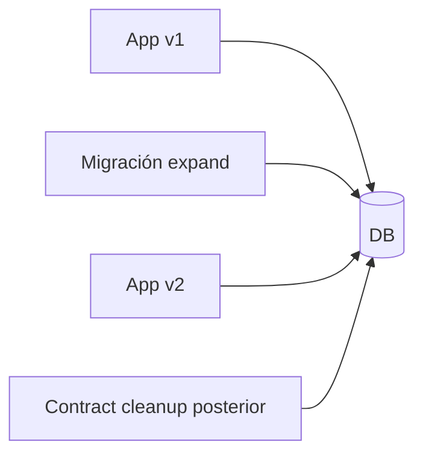

# Módulo 19: Despliegue y runtime moderno

Desplegar Spring Boot requiere empaquetar, configurar, observar y migrar de forma segura. Este módulo cubre jars, imágenes OCI, config/secretos y migraciones en despliegue.

**Entorno de referencia verificado (2026-05-22):** JDK 27.0.1.0.2, Maven 3.10.0, Docker 29.9.3, Spring Boot 3.5.0.

## Aprende construyendo

### Tema 1: Jar ejecutable y capas · Intermedio · 35 min

Caso guía: generar artefacto ejecutable para servidor.

#### Boot jar

**Definición formal.** Jar ejecutable con dependencias y launcher de Spring Boot. Las capas permiten optimizar imágenes Docker.

**Ejemplo mínimo.**

```bash
mvn -q -DskipTests package
java -jar target/app.jar
```

**Error común.** Empaquetar con config local hardcodeada. Corrección: externalizar config.

### Tema 2: Imagen OCI con Buildpacks/Jib · Avanzado · 40 min

Caso guía: crear imagen reproducible.

#### Buildpacks/Jib

**Definición formal.** Buildpacks generan imagen OCI sin Dockerfile manual; Jib construye imagen Java optimizada desde Maven/Gradle.

**Ejemplo mínimo.**

```bash
mvn -q spring-boot:build-image
```

**Error común.** Imagen gigante y no reproducible. Corrección: capas, base image confiable, versiones fijadas.

**Nota de verificación.** Docker disponible; build puede ser pesado.

### Tema 3: Config, secretos y migraciones en despliegue · Avanzado · 40 min

Caso guía: desplegar v2 con nueva columna.

#### Despliegue seguro

**Definición formal.** Separar config por entorno, inyectar secretos en runtime, aplicar migraciones compatibles hacia adelante (expand/contract).



**Error común.** Migración destructiva al mismo tiempo que deploy. Corrección: expand/contract, backward compatibility.

## Cierre

El runtime moderno es empaquetado reproducible + config externa + migraciones seguras + observabilidad.

## Checklist

- Empaqueto jar/imagen reproducible.
- Externalizo config y secretos.
- Uso migraciones expand/contract.
- Observo health/metrics/logs en deploy.
