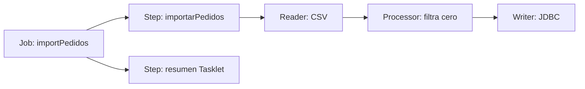

# Módulo 19: Spring Batch — jobs, chunks y procesamiento masivo

## Aprende construyendo

Construirás un job que importa pedidos desde CSV, valida y transforma cada fila, y persiste resultados por lotes. Después ensayarás reinicio y políticas de error con datos deliberadamente inválidos. El objetivo es procesamiento reanudable, observable y acotado en memoria.

### Dos ejemplos: primero visible, luego real

- **Ejemplo sencillo:** importa tres filas CSV con chunk de dos; una fila inválida se registra y la escritura del chunk falla o confirma completa.
- **Caso RutaFlow:** reconcilia cientos de miles de tarifas con archivo identificado por checksum y `JobParameters` estables. Guarda rechazados para conciliación, registra leídos/escritos/omitidos, y reinicia la misma instancia tras una caída sin duplicar registros por la clave natural.

Compara los límites de transacción y el consumo de memoria con más de un chunk. No confundas `skip` con una salida silenciosa: cada fila excluida necesita causa y evidencia.

### Tema 1: Job, Step, Tasklet y chunk processing

**Meta:** importar un CSV pequeño, filtrar una fila, guardar las válidas y reconocer qué trabajo hace cada parte de Spring Batch.

**Caso visible:** tres pedidos entran; los dos con importe positivo se guardan. El job termina mostrando el total.

**¿Por qué es importante?** un archivo grande se procesa por partes; si algo falla, el sistema puede conservar el trabajo confirmado y reanudarlo con control.

**Modelo mental:** el Job es una receta con etapas; cada Step ejecuta una tarea concreta, y cada chunk funciona como una caja que se confirma antes de llenar la siguiente.

**Límite:** Batch encaja con archivos y lotes; para responder de inmediato a una petición pequeña, usa un flujo HTTP normal.



#### Subtema 19.1 · Separa el Job del trabajo de cada Step · 8 min

**Contexto:** `Job` representa el proceso completo; un `Step` es una etapa. Un `Tasklet` sirve para una acción breve, como imprimir el resumen al terminar.

**Hazlo tú:** abre `examples/spring-batch-rutaflow/src/main/java/academia/rutaflow/batch/ImportJobConfig.java`. Compara `importPedidosStep`, que procesa registros, con `resumenStep`, que consulta cuántos quedaron. Mira cómo `importPedidosJob` los conecta con `.start(...).next(...)`.

```bash
cd examples/spring-batch-rutaflow
./mvnw -q test
```

**Resultado esperado:** el log contiene `Pedidos importados: 2` y la prueba termina en verde.

**Fallo deliberado:** quita `.next(resumenStep)` y ejecuta otra vez. **Diagnóstico:** se guardan pedidos, pero el paso de resumen no corre y no aparece su línea. Restáuralo.

**Entiende:** el job ordena las etapas; no procesa cada fila por sí solo. Reserva Tasklet para tareas pequeñas, no para cargar el CSV entero en memoria.

**Cierra:** señala en el código qué bean es Job y cuáles son Steps; registra cuál usarías para preparar un archivo de tarifas del proyecto integrador RutaFlow.

#### Subtema 19.2 · Lee filas y transforma una a la vez · 8 min

**Contexto:** `pedidos.csv` trae una fila por pedido. El reader crea un objeto; el processor decide qué pasa a la escritura.

**Hazlo tú:** abre `src/main/resources/pedidos.csv`, luego `ImportJobConfig.java`. Sigue `pedidosReader()` hasta `positiveAmountsOnly()`:

```java
return pedido.importe().signum() > 0 ? pedido : null;
```

`null` significa “filtrar esta fila”. Ejecuta `./mvnw -q test` desde `examples/spring-batch-rutaflow`.

**Resultado esperado:** `RF-1002` queda fuera por importe cero; el reader continúa con `RF-1003`.

**Fallo deliberado:** cambia el processor para que siempre devuelva `pedido`. **Diagnóstico:** la prueba encuentra tres filas, incluida la de importe cero. Restaura la condición.

**Entiende:** una fila filtrada no es lo mismo que un error. En importaciones reales guarda el motivo del rechazo para poder conciliarlo.

**Cierra:** agrega al CSV una tarifa válida para el proyecto integrador RutaFlow y predice qué filas quedarán antes de ejecutar.

#### Subtema 19.3 · Confirma filas en grupos pequeños · 10 min

**Contexto:** el writer guarda en JDBC los registros que el processor dejó pasar. El tamaño del chunk marca cuántos elementos se procesan antes de confirmar el grupo.

**Hazlo tú:** en `ImportJobConfig.java`, localiza el step y su configuración actual:

```java
.<PedidoImportado, PedidoImportado>chunk(2)
.reader(pedidosReader)
.processor(positiveAmountsOnly)
.writer(pedidosWriter)
```

El writer usa parámetros SQL para guardar referencia e importe. Corre `./mvnw -q clean test`.

**Resultado esperado:** la consulta de la prueba devuelve dos registros; el test cubre escritura real sobre H2.

**Fallo deliberado:** cambia el nombre `:referencia` del SQL a `:codigo`. **Diagnóstico:** el parámetro ya no coincide con el record y la ejecución falla al escribir. Restáuralo.

**Entiende:** un chunk de dos acota el grupo de trabajo y el commit. No asumas que el tamaño óptimo es dos: mídelo con filas, base de datos y costo de recuperación reales. Este lab usa H2 y no mide producción.

**Cierra:** apunta qué parte cambia al ajustar el tamaño de chunk y conserva el test como evidencia del proyecto integrador RutaFlow.

#### Subtema 19.4 · Ejecuta el job y comprueba sus datos · 8 min

**Contexto:** una línea “job completado” no demuestra que los resultados sean correctos. Comprueba filas concretas en la base.

**Hazlo tú:** ejecuta desde `examples/spring-batch-rutaflow`:

```bash
./mvnw -q clean test
```

Lee `ImportJobTest.java`: consulta `pedido_importado` y compara referencias e importes esperados. Para ver el job arrancar desde consola, usa `./mvnw spring-boot:run`; Spring Boot ejecuta el único Job configurado al iniciar.

**Resultado esperado:** `RF-1001` y `RF-1003` quedan guardados; `RF-1002` no aparece; el paso final imprime el conteo.

**Fallo deliberado:** comenta la llamada `.processor(positiveAmountsOnly)`. **Diagnóstico:** la fila de importe cero también llega a la tabla y la prueba falla. Devuelve el processor.

**Entiende:** el job exitoso, los datos escritos y la regla de filtrado son evidencias distintas. No ejecutes este ejemplo como una petición HTTP pequeña: está diseñado para archivos y procesamiento por lotes.

**Cierra:** conserva el test, el CSV de muestra y una tabla con leídas, filtradas y escritas para extender el proyecto integrador RutaFlow.

**Fuentes primarias:** [Spring Batch: procesamiento por chunks](https://docs.spring.io/spring-batch/reference/step/chunk-oriented-processing.html); [Spring Batch: configurar un Job](https://docs.spring.io/spring-batch/reference/job/configuring-job.html); [Spring Batch: Tasklet](https://docs.spring.io/spring-batch/reference/step/tasklet.html); [Spring Boot: Spring Batch y ejecución automática](https://docs.spring.io/spring-boot/reference/io/spring-batch.html).

### Tema 2: Reinicio, JobParameters, retry, skip y listeners

#### Paso 1 · Objetivo y preparación

Al finalizar podrás reanudar un job fallido desde su estado guardado, distinguir errores recuperables de registros inválidos y auditar el resultado del lote.
**Conocimiento previo:** haber seguido el tema anterior de este módulo y tener instalado el entorno del stack.
#### Paso 2 · Contexto y caso real

El job procesó 80 000 filas cuando el sistema perdió conectividad. Reiniciar desde cero puede duplicar efectos; saltar silenciosamente cualquier error hace que la conciliación sea imposible.

**¿Por qué es importante?** Un lote reanudable evita repetir todo el trabajo y permite conciliar resultados cuando un proceso falla a mitad de camino.

#### Paso 3 · Teoría y modelo mental

Una instancia de job se identifica por nombre y parámetros de identificación; sus ejecuciones registran estado y contexto. La reanudación requiere que reader/writer y efectos externos sean compatibles con reinicio. `skip` aplica a datos no recuperables dentro de un límite y debe registrar la fila; `retry` aplica a fallos transitorios con límite/backoff. No clasifiques toda excepción como retryable.

El listener observa inicio/fin para métricas, pero no reemplaza transacciones ni manejo de errores. Un efecto externo debe tener idempotencia para no duplicarse si el job reinicia después de enviarlo.
**Analogía:** reiniciar un batch es como retomar una serie donde la dejaste, no desde el capítulo uno: los `JobParameters` son el marcador que recuerda dónde ibas. `retry` es volver a intentar una escena que salió mal; `skip` es saltarse un fotograma dañado para no frenar toda la reproducción; y los `listeners` son las notas al margen que registran qué pasó en cada tramo.
#### Paso 4 · Demostración guiada
**Crea** el archivo `src/main/java/academia/batch/ImportJobConfig.java` y pega en él el código mostrado a continuación; guárdalo antes de ejecutarlo.


En `src/main/java/academia/batch/ImportJobConfig.java`, limita el retry a fallos transitorios y el skip a errores de parseo que el negocio permita excluir:

```java
return new StepBuilder("importarPedidos", jobRepository)
    .<PedidoImportado, PedidoImportado>chunk(2, transactionManager)
    .reader(reader)
    .processor(processor)
    .writer(writer)
    .faultTolerant()
    .retry(TransientDataAccessException.class)
    .retryLimit(3)
    .skip(FlatFileParseException.class)
    .skipLimit(5)
    .listener(importMetricsListener)
    .build();
```

**Ejecuta el ejemplo** (genera el proyecto con Spring Initializr, pega el código y corre las pruebas):

```bash
curl -fsSL https://start.spring.io/starter.zip -d dependencies=web -d javaVersion=25 -o app.zip && unzip -o app.zip
./mvnw test
```
Equivalencias Maven/Gradle en el Módulo 1.


Ejecuta el job con `JobParameters` que incluyan `inputFile=pedidos.csv` y `runDate=2026-10-13`; configura el test para forzar una falla tras el primer chunk y volver a lanzar **la misma instancia lógica**. Ejecuta `./mvnw test -Dtest=ImportJobRestartTest`.

**Resultado esperado:** el primer chunk confirmado no se duplica, el job completa al reanudarse y el listener reporta filas omitidas explícitamente. **Fallo deliberado:** genera un `run.id` nuevo para el segundo intento; observarás una nueva instancia que vuelve a iniciar el archivo. Compara con el reinicio de la misma instancia y explica la diferencia.

#### Paso 5 · Práctica guiada

Añade retry acotado para un error temporal de base y skip para una fila con campo inválido; registra referencia y causa sin almacenar datos sensibles. Falla una escritura después de un efecto externo y demuestra por qué un envío de email o evento necesita outbox/idempotencia.
**Pista:** simula el efecto externo (marca como "enviado" un email o publica un evento) y luego fuerza que la escritura del chunk falle justo después; al reanudar el job, si el email se reenvía o el evento se publica otra vez, ese es el caso exacto que necesita outbox o una clave de idempotencia en el efecto externo, no solo una transacción de base de datos.
#### Paso 6 · Práctica independiente

Diseña un plan para un lote de un millón de filas: chunk size, paginación, restart, deduplicación, archivo de errores y métricas. Como extensión, particiona por rangos disjuntos y programa el job con un scheduler; verifica que dos workers no reclamen el mismo rango.

#### Paso 7 · Cierre y evidencia

Entrega test de fallo y reinicio, parámetros exactos, conteos y política documentada de retry/skip para el proyecto integrador de RutaFlow: el lote de liquidación debe poder reanudarse sin duplicar pagos. **Cuándo no usarlo:** no llames `skip` a errores de infraestructura ni configures retry infinito; no ejecutes jobs simultáneos con parámetros que colisionan. **Evidencia:** log del primer fallo, reanudación y resultado final conciliado. Referencia: [Spring Batch Reference](https://docs.spring.io/spring-batch/reference/).
Como **siguiente** paso, lleva lo aprendido al próximo tema y conéctalo con el proyecto integrador del track.
**Errores comunes:** generar un `run.id` o parámetro distinto en cada reintento pensando que "empezar limpio" es más seguro, cuando en realidad eso crea una nueva instancia de job que vuelve a procesar el archivo desde cero, y marcar con `skip` errores de infraestructura (como una pérdida de conectividad) que en realidad necesitan `retry`, descartando filas que sí eran recuperables.
**Fuente oficial:** [documentación de Spring Boot](https://docs.spring.io/spring-boot/index.html).
