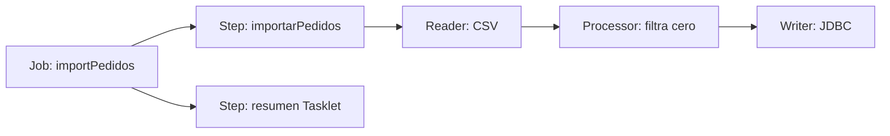
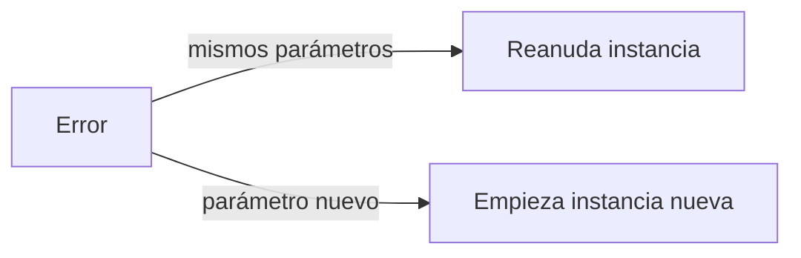

# Módulo 19: Spring Batch — jobs, chunks y procesamiento masivo

## Aprende construyendo

Construirás un job que importa pedidos desde CSV, valida y transforma cada fila, y persiste resultados por lotes. Después ensayarás reinicio y políticas de error con datos deliberadamente inválidos. El objetivo es procesamiento reanudable, observable y acotado en memoria.

### Dos ejemplos: primero visible, luego real

- **Ejemplo sencillo:** importa tres filas CSV con chunk de dos; una fila inválida se registra y la escritura del chunk falla o confirma completa.
- **Caso RutaFlow:** reconcilia cientos de miles de tarifas con archivo identificado por checksum y `JobParameters` estables. Guarda rechazados para conciliación, registra leídos/escritos/omitidos, y reinicia la misma instancia tras una caída sin duplicar registros por la clave natural.

Compara los límites de transacción y el consumo de memoria con más de un chunk. No confundas `skip` con una salida silenciosa: cada fila excluida necesita causa y evidencia.

### Tema 1: Job, Step, Tasklet y chunk processing

**Meta:** importar un CSV pequeño, filtrar una fila, guardar las válidas y reconocer qué trabajo hace cada parte de Spring Batch.

**Caso visible:** cuatro filas entran; dos pedidos válidos se guardan, una tarifa cero se filtra y una fila mal formada se registra como rechazo.

**¿Por qué es importante?** un archivo grande se procesa por partes; si algo falla, el sistema puede conservar el trabajo confirmado y reanudarlo con control.

**Modelo mental:** el Job es una receta con etapas; cada Step ejecuta una tarea concreta, y cada chunk funciona como una caja que se confirma antes de llenar la siguiente.

**Límite:** Batch encaja con archivos y lotes; para responder de inmediato a una petición pequeña, usa un flujo HTTP normal.



#### Subtema 19.1 · Separa el Job del trabajo de cada Step · 8 min

**Contexto:** `Job` representa el proceso completo; un `Step` es una etapa. Un `Tasklet` sirve para una acción breve, como imprimir el resumen al terminar.

**Hazlo tú:** abre `examples/spring-batch-rutaflow/src/main/java/academia/rutaflow/batch/ImportJobConfig.java`. Compara `importPedidosStep`, que procesa registros, con `resumenStep`, que consulta cuántos quedaron. Mira cómo `importPedidosJob` los conecta con `.start(...).next(...)`.

```bash
cd examples/spring-batch-rutaflow
./mvnw -q test
```

**Resultado esperado:** el log contiene `Pedidos importados: 2` y la prueba termina en verde.

**Fallo deliberado:** quita `.next(resumenStep)` y ejecuta otra vez. **Diagnóstico:** se guardan pedidos, pero el paso de resumen no corre y no aparece su línea. Restáuralo.

**Entiende:** el job ordena las etapas; no procesa cada fila por sí solo. Reserva Tasklet para tareas pequeñas, no para cargar el CSV entero en memoria.

**Cierra:** señala en el código qué bean es Job y cuáles son Steps; registra cuál usarías para preparar un archivo de tarifas del proyecto integrador RutaFlow.

#### Subtema 19.2 · Lee filas y transforma una a la vez · 8 min

**Contexto:** `pedidos.csv` trae una fila por pedido. El reader crea un objeto; el processor decide qué pasa a la escritura.

**Hazlo tú:** abre `src/main/resources/pedidos.csv`, luego `ImportJobConfig.java`. Sigue `pedidosReader()` hasta `positiveAmountsOnly()`:

```java
return pedido.importe().signum() > 0 ? pedido : null;
```

`null` significa “filtrar esta fila”. Ejecuta `./mvnw -q test` desde `examples/spring-batch-rutaflow`.

**Resultado esperado:** `RF-1002` queda fuera por importe cero; el reader continúa con `RF-1003`.

**Fallo deliberado:** cambia el processor para que siempre devuelva `pedido`. **Diagnóstico:** la prueba encuentra tres filas, incluida la de importe cero. Restaura la condición.

**Entiende:** una fila filtrada no es lo mismo que un error. En importaciones reales guarda el motivo del rechazo para poder conciliarlo.

**Cierra:** agrega al CSV una tarifa válida para el proyecto integrador RutaFlow y predice qué filas quedarán antes de ejecutar.

#### Subtema 19.3 · Confirma filas en grupos pequeños · 10 min

**Contexto:** el writer guarda en JDBC los registros que el processor dejó pasar. El tamaño del chunk marca cuántos elementos se procesan antes de confirmar el grupo.

**Hazlo tú:** en `ImportJobConfig.java`, localiza el step y su configuración actual:

```java
.<PedidoImportado, PedidoImportado>chunk(2)
.reader(pedidosReader)
.processor(positiveAmountsOnly)
.writer(pedidosWriter)
```

El writer usa parámetros SQL para guardar referencia e importe. Corre `./mvnw -q clean test`.

**Resultado esperado:** la consulta de la prueba devuelve dos registros; el test cubre escritura real sobre H2.

**Fallo deliberado:** cambia el nombre `:referencia` del SQL a `:codigo`. **Diagnóstico:** el parámetro ya no coincide con el record y la ejecución falla al escribir. Restáuralo.

**Entiende:** un chunk de dos acota el grupo de trabajo y el commit. No asumas que el tamaño óptimo es dos: mídelo con filas, base de datos y costo de recuperación reales. Este lab usa H2 y no mide producción.

**Cierra:** apunta qué parte cambia al ajustar el tamaño de chunk y conserva el test como evidencia del proyecto integrador RutaFlow.

#### Subtema 19.4 · Ejecuta el job y comprueba sus datos · 8 min

**Contexto:** una línea “job completado” no demuestra que los resultados sean correctos. Comprueba filas concretas en la base.

**Hazlo tú:** ejecuta desde `examples/spring-batch-rutaflow`:

```bash
./mvnw -q clean test
```

Lee `ImportJobTest.java`: consulta `pedido_importado` y compara referencias e importes esperados. Para ver el job arrancar desde consola, usa `./mvnw spring-boot:run`; Spring Boot ejecuta el único Job configurado al iniciar.

**Resultado esperado:** `RF-1001` y `RF-1003` quedan guardados; `RF-1002` se filtra; la fila mal formada se registra y el paso final imprime el conteo.

**Fallo deliberado:** comenta la llamada `.processor(positiveAmountsOnly)`. **Diagnóstico:** la fila de importe cero también llega a la tabla y la prueba falla. Devuelve el processor.

**Entiende:** el job exitoso, los datos escritos y la regla de filtrado son evidencias distintas. No ejecutes este ejemplo como una petición HTTP pequeña: está diseñado para archivos y procesamiento por lotes.

**Cierra:** conserva el test, el CSV de muestra y una tabla con leídas, filtradas y escritas para extender el proyecto integrador RutaFlow.

**Fuentes primarias:** [Spring Batch: procesamiento por chunks](https://docs.spring.io/spring-batch/reference/step/chunk-oriented-processing.html); [Spring Batch: configurar un Job](https://docs.spring.io/spring-batch/reference/job/configuring-job.html); [Spring Batch: Tasklet](https://docs.spring.io/spring-batch/reference/step/tasklet.html); [Spring Boot: Spring Batch y ejecución automática](https://docs.spring.io/spring-boot/reference/io/spring-batch.html).

### Tema 2: Reinicio, JobParameters, retry, skip y listeners

**Meta:** reconocer una ejecución lógica, reanudar el job con sus parámetros y separar fallas temporales de filas que no se pueden procesar.

**Caso visible:** un lote guarda su primer chunk y falla en el segundo. El mismo identificador permite reiniciar; un identificador nuevo crea otra instancia y vuelve a leer el archivo.

**¿Por qué es importante?** al procesar miles de registros, recuperar el trabajo y explicar los rechazados evita duplicar pagos o perder filas sin causa.

**Modelo mental:** un checkpoint es el separador que marca hasta dónde llegó el lote; los parámetros identificadores dicen si retomas ese trabajo o comienzas uno nuevo.



**Práctica:** fuerza una falla, compara ambos lanzamientos y consulta filas guardadas, referencias rechazadas y estado final.

#### Subtema 19.5 · Reanuda la misma instancia del Job · 10 min

**Contexto:** si un proceso cae tras confirmar un chunk, no vuelvas a iniciar el trabajo a ciegas.

**Hazlo tú:** abre `examples/spring-batch-rutaflow/src/test/java/academia/rutaflow/batch/RestartJobTest.java`. Ejecuta:

```bash
cd examples/spring-batch-rutaflow
./mvnw -q -Dtest=RestartJobTest#mismaInstanciaReanudaTrasElPrimerChunkConfirmadoSinDuplicarlo test
```

El test lanza el mismo Job con los mismos `JobParameters`; el writer provoca un fallo una vez y vuelve a ejecutarlo. El fixture usa H2 `MERGE` por referencia para hacer idempotente la escritura.

**Resultado esperado:** primera ejecución `FAILED`; la reanudación `COMPLETED`; la tabla final contiene las cuatro referencias sin duplicados.

**Fallo deliberado:** cambia el parámetro `run` entre los dos lanzamientos. **Diagnóstico:** ya no es la misma instancia; la segunda ejecución empieza el archivo como un trabajo nuevo. Vuelve a usar el mismo valor.

**Entiende:** el `JobRepository` guarda estado para reanudar. Aun así, un chunk o un efecto externo puede repetirse; idempotencia es la protección ante la repetición.

**Cierra:** registra estado de ambas ejecuciones y explica por qué una llamada de pago o email necesita protección adicional en el proyecto RutaFlow.

#### Subtema 19.6 · Usa parámetros estables para identificar el lote · 8 min

**Contexto:** el nombre del archivo identifica la entrada; un `run` nuevo puede representar intencionalmente una nueva ejecución lógica.

**Hazlo tú:** en el mismo test, compara `parametroIdentificadorNuevoCreaOtraInstanciaDesdeElPrincipio`. Corre `./mvnw -q -Dtest=RestartJobTest test`.

```java
var params = new JobParametersBuilder()
    .addString("inputFile", "restart-pedidos.csv")
    .addLong("run", run)
    .toJobParameters();
```

**Resultado esperado:** con el mismo valor se puede relanzar la ejecución fallida; con otro valor se crea una instancia distinta. Los registros del ejemplo usan una clave natural y `MERGE`, así que no duplican filas visibles.

**Fallo deliberado:** genera un `run` aleatorio para cada reintento. **Diagnóstico:** Spring Batch interpreta cada intento como un lote nuevo y pierde la continuidad del checkpoint. Restaura el identificador.

**Entiende:** no uses hora actual como parámetro identificador si quieres reanudar el mismo lote. Guarda una referencia estable del archivo, como nombre y checksum.

**Cierra:** elige qué campos identifican cada archivo de tarifas de RutaFlow y cuáles son solo etiquetas de ejecución.

#### Subtema 19.7 · Distingue retry de skip · 10 min

**Contexto:** una caída temporal de base de datos puede recuperarse; un importe que no se puede leer requiere rechazo explícito.

**Hazlo tú:** abre `ImportJobConfig.java`. Busca `faultTolerant`, `retry`, `retryLimit`, `skip` y `skipLimit`:

```java
.faultTolerant()
.retry(TransientDataAccessException.class).retryLimit(2)
.skip(FlatFileParseException.class).skipLimit(2)
```

Corre `./mvnw -q clean test`. El writer del ejemplo falla una vez de manera controlada; la cuarta línea del CSV trae un importe inválido.

**Resultado esperado:** el writer vuelve a intentar el error temporal; la fila mal formada se excluye y la prueba encuentra una causa en `batch_rechazo`.

**Fallo deliberado:** elimina `.skip(...)` y ejecuta `ImportJobTest`. **Diagnóstico:** el error de lectura detiene el Job. Restaura el límite de skip.

**Entiende:** limita reintentos y skips. Reintenta solo fallas transitorias; no conviertas una caída permanente en un ciclo infinito ni descartes errores de infraestructura como si fueran datos malos.

**Cierra:** propone qué errores de una importación de tarifas reintentar y cuáles enviar a conciliación.

#### Subtema 19.8 · Deja rastro sin guardar datos sensibles · 8 min

**Contexto:** “leí 500 mil y escribí 499 mil” no explica qué pasó con la diferencia.

**Hazlo tú:** sigue el bean `rechazoAudit` y el test de importación. Ejecuta `./mvnw -q -Dtest=ImportJobTest test`; comprueba el total importado, el total rechazado y los intentos del writer.

**Resultado esperado:** dos pedidos escritos, una fila inválida auditada y un fallo temporal recuperado. El importe cero se cuenta como filtrado por regla de negocio, no como parse error.

**Fallo deliberado:** elimina el listener de skip. **Diagnóstico:** la prueba no encuentra causa registrada aunque el job complete. Restáuralo.

**Entiende:** registra referencia y causa útil, no datos personales completos. Los efectos externos como publicar evento o enviar dinero no quedan cubiertos por la transacción del chunk; usa outbox o idempotency key.

**Cierra:** prepara una conciliación de leídas, filtradas, rechazadas y escritas para el proyecto integrador RutaFlow. La prueba con H2 no mide millones de filas ni garantiza el comportamiento de PostgreSQL en producción.

**Fuentes primarias:** [Spring Batch: reiniciar un Job](https://docs.spring.io/spring-batch/reference/job/configuring-job.html); [Spring Batch: retry](https://docs.spring.io/spring-batch/reference/step/chunk-oriented-processing/retry-logic.html); [Spring Batch: skip](https://docs.spring.io/spring-batch/reference/step/chunk-oriented-processing/configuring-skip.html); [Spring Batch: listeners](https://docs.spring.io/spring-batch/reference/step/chunk-oriented-processing/intercepting-execution.html); [Spring Boot: reiniciar jobs fallidos](https://docs.spring.io/spring-boot/how-to/batch.html).
