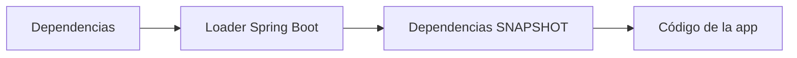
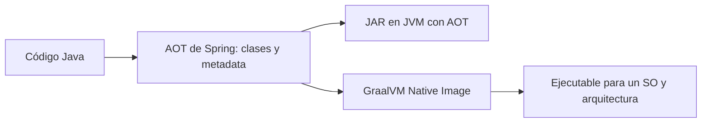
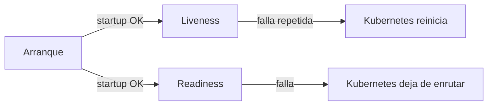
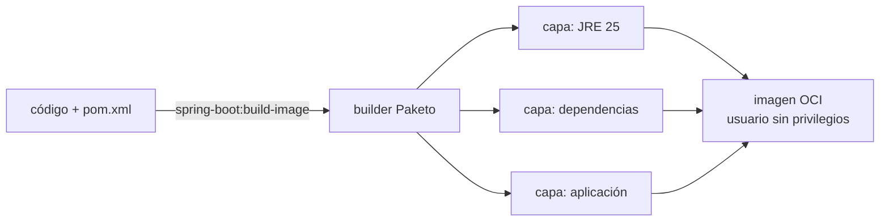

# Módulo 19: Empaquetado y despliegue

## Aprende construyendo

Cada tema se verifica con mecanismos reales y ejecutables sin depender de un daemon de Docker disponible en este entorno: el modo `layertools` embebido en el propio JAR de Spring Boot, la meta de Maven `spring-boot:process-aot` (que ejecuta de verdad el motor de AOT de Spring, sin necesitar un compilador nativo de GraalVM instalado), y los endpoints reales de Actuator agrupados por probes de Kubernetes. Continúa sobre `demo-cloud` (Módulo 16) o un proyecto nuevo.


### Tema 1: Fat JAR vs capas de Docker · Intermedio · 40 min

<details open>
<summary><strong>Capa 1 — Lectura</strong></summary>

#### ► DE QUÉ TRATA
Este tema te guía por fat jar vs capas de docker con foco en comprensión antes de implementación.

#### ► LA IDEA EN UNA FRASE
**Entender fat jar vs capas de docker te permite tomar mejores decisiones técnicas.**

#### ► POR QUÉ EXISTE ESTO
Resuelve un problema real de diseño o implementación y evita decisiones a ciegas.

#### ► LA ANALOGÍA
Piensa en fat jar vs capas de docker como una herramienta de taller: útil cuando conoces su propósito y sus límites.
**Dónde se rompe la analogía:** en software, los efectos dependen del contexto, la escala y los trade-offs.

#### ► CÓMO FUNCIONA


#### ► LO QUE PUEDE SALIR MAL
| Síntoma | Causa probable | Arreglo |
|---|---|---|
| Fat JAR vs capas de Docker se aplica pero el resultado no mejora | Se usó sin medir el problema real | Mide antes y compara contra la alternativa simple |
| Aparece complejidad inesperada | Se adoptó la técnica sin comprender sus trade-offs | Vuelve a la sección de trade-offs y reduce el alcance |
| Falla en un caso límite | Se asumió un contexto que no se cumple | Prueba el caso límite y documenta cuándo NO usarlo |

#### ► TRADE-OFFS
| Opción | Cuándo usarla | Cuándo NO usarla |
|---|---|---|
| Usar Fat JAR vs capas de Docker | Cuando el problema coincide con su propósito y el beneficio es observable | Cuando agrega complejidad sin resolver un problema real |
| Alternativa más simple | Cuando el contexto es pequeño, estable o fácil de razonar | Cuando ya demostró no escalar o no cumplir el requisito |
| Postergar la decisión | Cuando falta evidencia del problema | Cuando el costo de esperar es mayor que el costo de probar |

#### ► CUÁNDO NO USAR ESTO
No uses fat jar vs capas de docker por defecto. Aplícalo cuando el problema lo justifique y puedas verificar el beneficio; si una alternativa más simple resuelve igual, prefiérela.

#### ► DE VUELTA A LA ANALOGÍA
Volviendo a la analogía: fat jar vs capas de docker funciona como el modelo inicial, pero recuerda dónde se rompe: en producción importan la evidencia, la escala y el costo de equivocarte.

#### ► LO QUE DEBES RECORDAR
- Fat JAR vs capas de Docker existe para resolver un problema específico.
- Mide antes de adoptar complejidad.
- Conoce el caso donde NO usarlo.
- Verifica con evidencia observable.

#### ► PREGUNTAS PARA PENSAR
1. ¿Qué problema concreto resuelve fat jar vs capas de docker en tu contexto?
2. ¿Cómo sabrías que fat jar vs capas de docker no está funcionando bien?
3. ¿Qué alternativa más simple considerarías antes de usar fat jar vs capas de docker?

</details>

<details>
<summary><strong>Capa 2 — Construcción</strong></summary>

#### Código y verificación


```bash
./mvnw clean package
jar tf target/spring-boot-layered-jar-rutaflow-0.1.0-SNAPSHOT.jar | head -20
```

```bash
java -Djarmode=tools -jar target/spring-boot-layered-jar-rutaflow-0.1.0-SNAPSHOT.jar list-layers
```

```bash
java -Djarmode=tools -jar target/spring-boot-layered-jar-rutaflow-0.1.0-SNAPSHOT.jar extract --layers --destination target/extracted
```

```dockerfile
COPY --from=builder /builder/extracted/dependencies/ ./
COPY --from=builder /builder/extracted/spring-boot-loader/ ./
COPY --from=builder /builder/extracted/snapshot-dependencies/ ./
COPY --from=builder /builder/extracted/application/ ./
```

```bash
podman build -t rutaflow-capas:local .
podman run --rm -p 8080:8080 rutaflow-capas:local
```

</details>

### Tema 2: GraalVM native image · Avanzado · 45 min

<details open>
<summary><strong>Capa 1 — Lectura</strong></summary>

#### ► DE QUÉ TRATA
Este tema te guía por graalvm native image con foco en comprensión antes de implementación.

#### ► LA IDEA EN UNA FRASE
**Entender graalvm native image te permite tomar mejores decisiones técnicas.**

#### ► POR QUÉ EXISTE ESTO
Resuelve un problema real de diseño o implementación y evita decisiones a ciegas.

#### ► LA ANALOGÍA
Piensa en graalvm native image como una herramienta de taller: útil cuando conoces su propósito y sus límites.
**Dónde se rompe la analogía:** en software, los efectos dependen del contexto, la escala y los trade-offs.

#### ► CÓMO FUNCIONA


#### ► LO QUE PUEDE SALIR MAL
| Síntoma | Causa probable | Arreglo |
|---|---|---|
| GraalVM native image se aplica pero el resultado no mejora | Se usó sin medir el problema real | Mide antes y compara contra la alternativa simple |
| Aparece complejidad inesperada | Se adoptó la técnica sin comprender sus trade-offs | Vuelve a la sección de trade-offs y reduce el alcance |
| Falla en un caso límite | Se asumió un contexto que no se cumple | Prueba el caso límite y documenta cuándo NO usarlo |

#### ► TRADE-OFFS
| Opción | Cuándo usarla | Cuándo NO usarla |
|---|---|---|
| Usar GraalVM native image | Cuando el problema coincide con su propósito y el beneficio es observable | Cuando agrega complejidad sin resolver un problema real |
| Alternativa más simple | Cuando el contexto es pequeño, estable o fácil de razonar | Cuando ya demostró no escalar o no cumplir el requisito |
| Postergar la decisión | Cuando falta evidencia del problema | Cuando el costo de esperar es mayor que el costo de probar |

#### ► CUÁNDO NO USAR ESTO
No uses graalvm native image por defecto. Aplícalo cuando el problema lo justifique y puedas verificar el beneficio; si una alternativa más simple resuelve igual, prefiérela.

#### ► DE VUELTA A LA ANALOGÍA
Volviendo a la analogía: graalvm native image funciona como el modelo inicial, pero recuerda dónde se rompe: en producción importan la evidencia, la escala y el costo de equivocarte.

#### ► LO QUE DEBES RECORDAR
- GraalVM native image existe para resolver un problema específico.
- Mide antes de adoptar complejidad.
- Conoce el caso donde NO usarlo.
- Verifica con evidencia observable.

#### ► PREGUNTAS PARA PENSAR
1. ¿Qué problema concreto resuelve graalvm native image en tu contexto?
2. ¿Cómo sabrías que graalvm native image no está funcionando bien?
3. ¿Qué alternativa más simple considerarías antes de usar graalvm native image?

</details>

<details>
<summary><strong>Capa 2 — Construcción</strong></summary>

#### Código y verificación


```bash
./scripts/verify-aot.sh
```

```java
public class MensajeHints implements RuntimeHintsRegistrar {
    @Override
    public void registerHints(RuntimeHints hints, ClassLoader loader) {
        hints.resources().registerPattern("mensajes/*.txt");
    }
}
```

```bash
./mvnw -Pnative native:compile
```

```bash
podman run --rm -v "$PWD:/workspace:Z" -w /workspace ghcr.io/graalvm/native-image-community:25 ./mvnw -Pnative native:compile
```

```bash
du -h target/spring-boot-native-rutaflow target/spring-boot-native-rutaflow-0.1.0-SNAPSHOT.jar
```

</details>

### Tema 3: Health checks para Kubernetes · Avanzado · 40 min

<details open>
<summary><strong>Capa 1 — Lectura</strong></summary>

#### ► DE QUÉ TRATA
Este tema te guía por health checks para kubernetes con foco en comprensión antes de implementación.

#### ► LA IDEA EN UNA FRASE
**Entender health checks para kubernetes te permite tomar mejores decisiones técnicas.**

#### ► POR QUÉ EXISTE ESTO
Resuelve un problema real de diseño o implementación y evita decisiones a ciegas.

#### ► LA ANALOGÍA
Piensa en health checks para kubernetes como una herramienta de taller: útil cuando conoces su propósito y sus límites.
**Dónde se rompe la analogía:** en software, los efectos dependen del contexto, la escala y los trade-offs.

#### ► CÓMO FUNCIONA


#### ► LO QUE PUEDE SALIR MAL
| Síntoma | Causa probable | Arreglo |
|---|---|---|
| Health checks para Kubernetes se aplica pero el resultado no mejora | Se usó sin medir el problema real | Mide antes y compara contra la alternativa simple |
| Aparece complejidad inesperada | Se adoptó la técnica sin comprender sus trade-offs | Vuelve a la sección de trade-offs y reduce el alcance |
| Falla en un caso límite | Se asumió un contexto que no se cumple | Prueba el caso límite y documenta cuándo NO usarlo |

#### ► TRADE-OFFS
| Opción | Cuándo usarla | Cuándo NO usarla |
|---|---|---|
| Usar Health checks para Kubernetes | Cuando el problema coincide con su propósito y el beneficio es observable | Cuando agrega complejidad sin resolver un problema real |
| Alternativa más simple | Cuando el contexto es pequeño, estable o fácil de razonar | Cuando ya demostró no escalar o no cumplir el requisito |
| Postergar la decisión | Cuando falta evidencia del problema | Cuando el costo de esperar es mayor que el costo de probar |

#### ► CUÁNDO NO USAR ESTO
No uses health checks para kubernetes por defecto. Aplícalo cuando el problema lo justifique y puedas verificar el beneficio; si una alternativa más simple resuelve igual, prefiérela.

#### ► DE VUELTA A LA ANALOGÍA
Volviendo a la analogía: health checks para kubernetes funciona como el modelo inicial, pero recuerda dónde se rompe: en producción importan la evidencia, la escala y el costo de equivocarte.

#### ► LO QUE DEBES RECORDAR
- Health checks para Kubernetes existe para resolver un problema específico.
- Mide antes de adoptar complejidad.
- Conoce el caso donde NO usarlo.
- Verifica con evidencia observable.

#### ► PREGUNTAS PARA PENSAR
1. ¿Qué problema concreto resuelve health checks para kubernetes en tu contexto?
2. ¿Cómo sabrías que health checks para kubernetes no está funcionando bien?
3. ¿Qué alternativa más simple considerarías antes de usar health checks para kubernetes?

</details>

<details>
<summary><strong>Capa 2 — Construcción</strong></summary>

#### Código y verificación


```properties
management.endpoint.health.probes.enabled=true
management.endpoints.web.exposure.include=health
```

```bash
./mvnw -q test
```

```java
AvailabilityChangeEvent.publish(events, this, ReadinessState.REFUSING_TRAFFIC);
http.perform(get("/actuator/health/readiness"))
    .andExpect(status().isServiceUnavailable())
    .andExpect(jsonPath("$.status").value("OUT_OF_SERVICE"));
```

```bash
./mvnw -q -Dtest=ProbeEndpointsTest test
```

```yaml
startupProbe:
  httpGet: { path: /actuator/health/liveness, port: http }
  periodSeconds: 10
  failureThreshold: 30
livenessProbe:
  httpGet: { path: /actuator/health/liveness, port: http }
  periodSeconds: 10
  failureThreshold: 3
readinessProbe:
  httpGet: { path: /actuator/health/readiness, port: http }
  periodSeconds: 5
  failureThreshold: 2
```

</details>

### Tema 4: Imágenes OCI con Buildpacks: spring-boot:build-image sin Dockerfile · Avanzado · 40 min

<details open>
<summary><strong>Capa 1 — Lectura</strong></summary>

#### ► DE QUÉ TRATA
Usa Spring Boot 4.1.2 con JDK 25 en academia-spring y Docker en ejecución. La primera vez se descargan las imágenes del builder de Paketo, así que necesitas red.

#### ► LA IDEA EN UNA FRASE
**Usa Spring Boot 4.1.2 con JDK 25 en academia-spring y Docker en ejecución.**

#### ► POR QUÉ EXISTE ESTO
Resuelve un problema real de diseño o implementación y evita decisiones a ciegas.

#### ► LA ANALOGÍA
Piensa en imágenes oci con buildpacks: spring-boot:build-image sin dockerfile como una herramienta de taller: útil cuando conoces su propósito y sus límites.
**Dónde se rompe la analogía:** en software, los efectos dependen del contexto, la escala y los trade-offs.

#### ► CÓMO FUNCIONA


#### ► LO QUE PUEDE SALIR MAL
| Síntoma | Causa probable | Arreglo |
|---|---|---|
| Imágenes OCI con Buildpacks: spring-boot:build-image sin Dockerfile se aplica pero el resultado no mejora | Se usó sin medir el problema real | Mide antes y compara contra la alternativa simple |
| Aparece complejidad inesperada | Se adoptó la técnica sin comprender sus trade-offs | Vuelve a la sección de trade-offs y reduce el alcance |
| Falla en un caso límite | Se asumió un contexto que no se cumple | Prueba el caso límite y documenta cuándo NO usarlo |

#### ► TRADE-OFFS
| Opción | Cuándo usarla | Cuándo NO usarla |
|---|---|---|
| Usar Imágenes OCI con Buildpacks: spring-boot:build-image sin Dockerfile | Cuando el problema coincide con su propósito y el beneficio es observable | Cuando agrega complejidad sin resolver un problema real |
| Alternativa más simple | Cuando el contexto es pequeño, estable o fácil de razonar | Cuando ya demostró no escalar o no cumplir el requisito |
| Postergar la decisión | Cuando falta evidencia del problema | Cuando el costo de esperar es mayor que el costo de probar |

#### ► CUÁNDO NO USAR ESTO
No uses imágenes oci con buildpacks: spring-boot:build-image sin dockerfile por defecto. Aplícalo cuando el problema lo justifique y puedas verificar el beneficio; si una alternativa más simple resuelve igual, prefiérela.

#### ► DE VUELTA A LA ANALOGÍA
Volviendo a la analogía: imágenes oci con buildpacks: spring-boot:build-image sin dockerfile funciona como el modelo inicial, pero recuerda dónde se rompe: en producción importan la evidencia, la escala y el costo de equivocarte.

#### ► LO QUE DEBES RECORDAR
- Imágenes OCI con Buildpacks: spring-boot:build-image sin Dockerfile existe para resolver un problema específico.
- Mide antes de adoptar complejidad.
- Conoce el caso donde NO usarlo.
- Verifica con evidencia observable.

#### ► PREGUNTAS PARA PENSAR
1. ¿Qué problema concreto resuelve imágenes oci con buildpacks: spring-boot:build-image sin dockerfile en tu contexto?
2. ¿Cómo sabrías que imágenes oci con buildpacks: spring-boot:build-image sin dockerfile no está funcionando bien?
3. ¿Qué alternativa más simple considerarías antes de usar imágenes oci con buildpacks: spring-boot:build-image sin dockerfile?

</details>

<details>
<summary><strong>Capa 2 — Construcción</strong></summary>

#### Código y verificación


```xml
<!-- Dentro de <build><plugins> -->
<plugin>
  <groupId>org.springframework.boot</groupId>
  <artifactId>spring-boot-maven-plugin</artifactId>
  <configuration>
    <image>
      <name>rutaflow/asignacion:${project.version}</name>
      <env>
        <BP_JVM_VERSION>25</BP_JVM_VERSION>
      </env>
    </image>
  </configuration>
</plugin>
```

```bash
./mvnw spring-boot:build-image
docker run --rm -p 8080:8080 -m 512m rutaflow/asignacion:0.0.1-SNAPSHOT
docker inspect rutaflow/asignacion:0.0.1-SNAPSHOT --format '{{.Config.User}}'
```

```text
[INFO] Successfully built image 'docker.io/rutaflow/asignacion:0.0.1-SNAPSHOT'
Al arrancar: «Calculating JVM memory based on ... available memory» seguido del banner de Spring Boot.
docker inspect imprime un usuario no root (por ejemplo, 1002:1000 o cnb).
```

</details>
