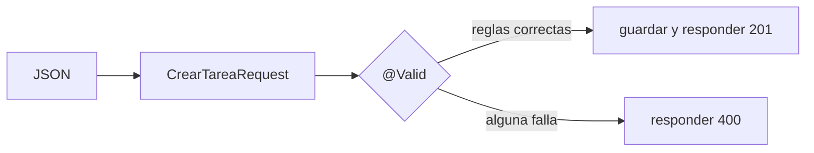
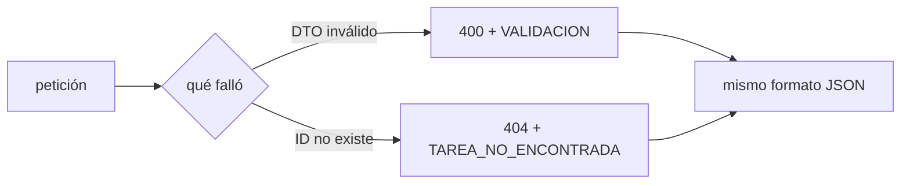
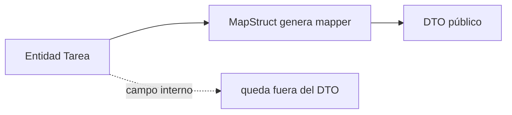
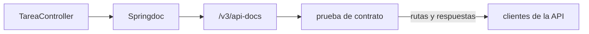
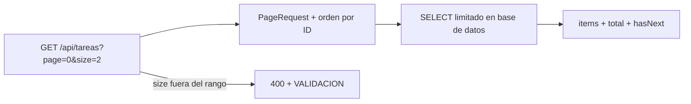

# Módulo 2: REST APIs con Spring Web

Cada tema separa el contrato HTTP (DTOs) de la persistencia interna (entidades), automatiza la validación de entrada y centraliza el manejo de errores — las tres piezas que hacen que una API REST sea predecible para quien la consume.


## Aprende construyendo

### Tema 1: Por qué DTOs en vez de entidades directamente

La API recibirá una tarea y devolverá una confirmación. La entidad representa cómo guardamos el dato; el DTO (objeto de transferencia) define qué mandamos por HTTP. Necesitas clases Java, constructores y una ruta REST.

**¿Por qué es importante?** Una base de datos puede tener códigos internos que el cliente no debe ver. Si el JSON se arma desde la entidad, cada campo nuevo puede pasar a formar parte del contrato sin que lo hayas decidido.

#### Subtema 1.1: Crea una entidad y guárdala en H2 · 10 min

**1. Contexto**

Primero tendrás una tabla pequeña en una base de datos en memoria. H2 permite practicar sin instalar ni configurar un servidor de base de datos.

**2. Hazlo tú**

Desde una carpeta vacía, genera con [Spring Initializr](https://start.spring.io/) un proyecto Maven con Java 25 y capacidades `web`, `data-jpa` y `h2`. Crea `src/main/java/com/example/demo/Tarea.java`:

```java
package com.example.demo;

import jakarta.persistence.Column;
import jakarta.persistence.Entity;
import jakarta.persistence.GeneratedValue;
import jakarta.persistence.GenerationType;
import jakarta.persistence.Id;
import jakarta.persistence.Table;

@Entity
@Table(name = "tareas")
public class Tarea {
    @Id
    @GeneratedValue(strategy = GenerationType.IDENTITY)
    private Long id;

    private String titulo;
    private int prioridad;

    @Column(name = "ubicacion_interna")
    private String ubicacionInterna;

    protected Tarea() {
    }

    public Tarea(String titulo, int prioridad, String ubicacionInterna) {
        this.titulo = titulo;
        this.prioridad = prioridad;
        this.ubicacionInterna = ubicacionInterna;
    }

    public Long getId() { return id; }
    public String getTitulo() { return titulo; }
    public int getPrioridad() { return prioridad; }
    public String getUbicacionInterna() { return ubicacionInterna; }
}
```

Crea `src/main/java/com/example/demo/TareaRepository.java`:

```java
package com.example.demo;

import org.springframework.data.jpa.repository.JpaRepository;

public interface TareaRepository extends JpaRepository<Tarea, Long> {
}
```

Añade a `src/main/resources/application.yml`:

```yaml
spring:
  jpa:
    hibernate:
      ddl-auto: create-drop
```

Desde la carpeta del proyecto, ejecuta `./mvnw test`.

**Resultado esperado:** Maven termina en `BUILD SUCCESS`; Spring encuentra el identificador `id` y configura una base H2 en memoria. `create-drop` crea las tablas al iniciar y las elimina al cerrar: no guardes aquí datos que quieras conservar.

**Fallo deliberado:** quita `@Id` y ejecuta las pruebas. **Diagnóstico:** Hibernate indica que la entidad necesita un identificador; restaura la anotación en `id`.

**3. Entiende**

`@Entity` declara una clase que JPA guarda. `TareaRepository` aprovecha operaciones de Spring Data JPA, como guardar y buscar, sin que escribas SQL para este primer ejemplo.

**4. Cierra**

Conserva entidad y repositorio. Anota cuáles campos sirven al sistema y cuál describe una ubicación interna.

#### Subtema 1.2: Devuelve solo el contrato público · 15 min

**1. Contexto**

El cliente necesita un identificador, título y prioridad. No necesita conocer `ubicacionInterna` ni la forma de la tabla.

**2. Hazlo tú**

Crea `src/main/java/com/example/demo/CrearTareaRequest.java`:

```java
package com.example.demo;

public record CrearTareaRequest(String titulo, int prioridad) {
}
```

Crea `src/main/java/com/example/demo/TareaDTO.java`:

```java
package com.example.demo;

public record TareaDTO(Long id, String titulo, int prioridad) {
    public static TareaDTO from(Tarea tarea) {
        return new TareaDTO(
                tarea.getId(),
                tarea.getTitulo(),
                tarea.getPrioridad());
    }
}
```

Crea `src/main/java/com/example/demo/ServicioTareas.java`:

```java
package com.example.demo;

import org.springframework.stereotype.Service;

@Service
public class ServicioTareas {
    private final TareaRepository repository;

    public ServicioTareas(TareaRepository repository) {
        this.repository = repository;
    }

    public TareaDTO crear(CrearTareaRequest request) {
        Tarea tarea = new Tarea(
                request.titulo(), request.prioridad(), "BODEGA-A");
        return TareaDTO.from(repository.save(tarea));
    }
}
```

Crea `src/main/java/com/example/demo/TareaController.java`:

```java
package com.example.demo;

import org.springframework.http.HttpStatus;
import org.springframework.http.ResponseEntity;
import org.springframework.web.bind.annotation.PostMapping;
import org.springframework.web.bind.annotation.RequestBody;
import org.springframework.web.bind.annotation.RequestMapping;
import org.springframework.web.bind.annotation.RestController;

@RestController
@RequestMapping("/api/tareas")
public class TareaController {
    private final ServicioTareas servicio;

    public TareaController(ServicioTareas servicio) {
        this.servicio = servicio;
    }

    @PostMapping
    public ResponseEntity<TareaDTO> crear(
            @RequestBody CrearTareaRequest request) {
        return ResponseEntity.status(HttpStatus.CREATED)
                .body(servicio.crear(request));
    }
}
```

Arranca la aplicación con `./mvnw spring-boot:run`. En otra terminal envía:

```bash
curl -i -X POST http://localhost:8080/api/tareas \
  -H 'Content-Type: application/json' \
  -d '{"titulo":"Entregar paquete","prioridad":1}'
```

**Resultado esperado:** recibes `201 Created` con JSON que incluye `id`, `titulo` y `prioridad`; no incluye `ubicacionInterna`.

**Fallo deliberado:** cambia el tipo de retorno del controller a `Tarea` y devuelve la entidad guardada. **Diagnóstico:** la respuesta JSON ahora incluye `ubicacionInterna`; vuelve a devolver `TareaDTO` para controlar los campos públicos.

**3. Entiende**

`CrearTareaRequest` describe lo que recibimos y `TareaDTO` lo que devolvemos. `TareaDTO.from` realiza la traducción en un lugar visible. La entidad no pasa por la respuesta HTTP.

**4. Cierra**

Guarda la respuesta completa y marca qué campos son parte del contrato. En el último paso comprobarás que añadir un campo interno no cambia el JSON.

#### Subtema 1.3: Cambia el modelo interno sin cambiar la API · 10 min

**1. Contexto**

El sistema puede reorganizar sus datos sin pedir a cada cliente HTTP que cambie al mismo tiempo.

**2. Hazlo tú**

Cambia en `src/main/java/com/example/demo/ServicioTareas.java` el valor interno de `"BODEGA-A"` a `"PASILLO-3"`. Vuelve a crear una tarea con el mismo `curl` del subtema anterior.

**Resultado esperado:** la respuesta conserva los campos `id`, `titulo` y `prioridad`; el cambio interno no aparece.

**Fallo deliberado:** agrega `ubicacionInterna` como componente a `TareaDTO` y pásalo desde `TareaDTO.from`. **Diagnóstico:** el JSON expone ahora un dato interno; quítalo del contrato de salida.

**3. Entiende**

El DTO mantiene estable la frontera HTTP aunque cambie la entidad. En este ejercicio no hay relaciones JPA; los errores por serializar relaciones `LAZY` dependen de cómo se carguen y de la configuración de persistencia, y se revisan más adelante con esas relaciones.

**4. Cierra**

**Práctica independiente:** añade un campo interno a `Tarea` sin modificar `TareaDTO`; crea otra tarea y comprueba que el JSON no cambia. En el proyecto integrador, trata cada cambio de DTO como un cambio del contrato que debe revisar quien consuma la API.

**Límite:** un DTO extra es útil cuando necesitas controlar nombres, validación o campos expuestos. Un proxy sin transformación ni modelo de persistencia puede reenviar el cuerpo recibido si ese cuerpo ya es el contrato correcto.

**Fuentes primarias:** [Spring MVC y cuerpos de petición](https://docs.spring.io/spring-framework/reference/web/webmvc/mvc-controller/ann-methods/requestbody.html), [bases SQL y H2 en Spring Boot](https://docs.spring.io/spring-boot/reference/data/sql.html), [conceptos de repositorio en Spring Data](https://docs.spring.io/spring-data/jpa/reference/repositories/core-concepts.html).

### Tema 2: Validación con Bean Validation y ResponseEntity

Una petición HTTP puede estar bien escrita como JSON y aun así pedir algo inválido. En este tema agregarás validación al `POST` de tareas y usarás `ResponseEntity` para que el resultado indique qué ocurrió.

**¿Por qué es importante?** Sin validación, datos imposibles llegan a la lógica y pueden guardarse; un código HTTP incorrecto confunde al cliente sobre el resultado.

**Resultado del tema:** un título vacío o una prioridad menor que 1 recibe `400`; crear una tarea recibe `201`; consultar una tarea existente o inexistente recibe `200` o `404`.

**Modelo mental:** el DTO es la puerta de entrada; `@Valid` revisa las reglas antes de que el controller guarde la tarea.



#### Subtema 2.1: Rechaza datos inválidos antes de guardar · 10 min

**1. Contexto**

El controller del Tema 1 recibe `CrearTareaRequest`, pero todavía acepta un título vacío y prioridad cero. Agrega la dependencia de validación al mismo proyecto.

**2. Hazlo tú**

En `pom.xml`, dentro de `<dependencies>`, añade:

```xml
<dependency>
    <groupId>org.springframework.boot</groupId>
    <artifactId>spring-boot-starter-validation</artifactId>
</dependency>
```

Reemplaza `src/main/java/com/example/demo/CrearTareaRequest.java` por:

```java
package com.example.demo;

import jakarta.validation.constraints.Min;
import jakarta.validation.constraints.NotBlank;

public record CrearTareaRequest(
        @NotBlank String titulo,
        @Min(1) int prioridad) {
}
```

En `src/main/java/com/example/demo/TareaController.java`, importa `jakarta.validation.Valid` y añade `@Valid` al parámetro del `POST`:

```java
@PostMapping
public ResponseEntity<TareaDTO> crear(
        @Valid @RequestBody CrearTareaRequest request) {
    return ResponseEntity.status(HttpStatus.CREATED)
            .body(servicio.crear(request));
}
```

Desde la carpeta del proyecto ejecuta `./mvnw test` y luego `./mvnw spring-boot:run`. En otra terminal prueba una petición válida y otra inválida:

```bash
curl -i -X POST http://localhost:8080/api/tareas \\
  -H 'Content-Type: application/json'   -d '{"titulo":"Entregar paquete","prioridad":1}'

curl -i -X POST http://localhost:8080/api/tareas \\
  -H 'Content-Type: application/json'   -d '{"titulo":"   ","prioridad":0}'
```

**Resultado esperado:** la primera petición responde `201 Created`; la segunda responde `400 Bad Request` y no entra al método `crear`. El cuerpo de error predeterminado puede variar según la configuración; en el Tema 3 definirás un formato propio.

**Fallo deliberado:** quita `@Valid` y repite la petición inválida. **Diagnóstico:** las anotaciones describen reglas, pero no se aplican a este parámetro si Spring no inicia la validación; vuelve a poner `@Valid`.

**3. Entiende**

`@NotBlank` rechaza `null`, `""` y texto compuesto solo por espacios. `@Min(1)` rechaza números menores que 1. `@Valid` pide validar el cuerpo convertido a `CrearTareaRequest` antes de ejecutar el método.

**4. Cierra**

Guarda los dos estados HTTP que observaste y explica qué campo hizo fallar la segunda petición. No dependas del texto del error: su formato aún es responsabilidad del siguiente tema.

#### Subtema 2.2: Devuelve 200 o 404 según exista la tarea · 15 min

**1. Contexto**

El código `200` significa que la consulta encontró y devolvió una tarea. `404` significa que el identificador no existe. Un cliente puede decidir qué mostrar mirando el estado, sin interpretar frases internas del servidor.

**2. Hazlo tú**

En `src/main/java/com/example/demo/ServicioTareas.java`, importa `java.util.Optional` y añade este método a la clase:

```java
public Optional<TareaDTO> buscar(Long id) {
    return repository.findById(id).map(TareaDTO::from);
}
```

En `src/main/java/com/example/demo/TareaController.java`, añade `GetMapping` y `PathVariable` a los imports y agrega este método:

```java
@GetMapping("/{id}")
public ResponseEntity<TareaDTO> buscar(@PathVariable Long id) {
    return servicio.buscar(id)
            .map(ResponseEntity::ok)
            .orElseGet(() -> ResponseEntity.notFound().build());
}
```

Reinicia la aplicación. Primero crea una tarea con el `curl` válido del subtema anterior; después consulta el identificador que aparece en su respuesta y luego uno que no exista:

```bash
curl -i http://localhost:8080/api/tareas/1
curl -i http://localhost:8080/api/tareas/999
```

**Resultado esperado:** la tarea existente responde `200 OK` con el DTO; el identificador ausente responde `404 Not Found` sin cuerpo. Si el ID generado no es `1`, usa el que devolvió tu petición `POST`.

**Fallo deliberado:** cambia `ResponseEntity.notFound().build()` por `ResponseEntity.ok().build()`. **Diagnóstico:** el recurso ausente ahora se anuncia como encontrado (`200`); restaura `404` para que el estado describa el resultado real.

**3. Entiende**

`Optional<TareaDTO>` representa “hay un valor o no hay valor”. `map(ResponseEntity::ok)` convierte el valor encontrado en una respuesta `200`; `orElseGet` crea la respuesta `404` cuando está vacío. El DTO evita que esta ruta vuelva a exponer la entidad.

**4. Cierra**

Registra ambos comandos y códigos de respuesta. Di en una frase qué decisión puede tomar el cliente con cada código.

#### Subtema 2.3: Comprueba las reglas con casos límite · 10 min

**1. Contexto**

Probar solo un ejemplo válido no muestra si las reglas cubren el límite ni si la validación sigue activa.

**2. Hazlo tú**

Envía tres `POST` al mismo endpoint: título `"Preparar ruta"` con prioridad `1`, título vacío con prioridad `2`, y título `"Preparar ruta"` con prioridad `0`. Anota el código de cada respuesta. Después restaura cualquier cambio deliberado y vuelve a ejecutar `./mvnw test`.

**Resultado esperado:** solo el primer `POST` crea una tarea (`201`); los otros dos reciben `400`. La ejecución termina en `BUILD SUCCESS`.

**Fallo deliberado:** elimina `@Min(1)` y vuelve a enviar prioridad `0`. **Diagnóstico:** esa petición pasa la regla restante porque `@NotBlank` solo revisa `titulo`; restaura `@Min(1)`.

**3. Entiende**

La validación del DTO protege la frontera de entrada. El código `400` informa que el cliente debe corregir su petición; `201`, `200` y `404` describen resultados distintos. El texto detallado de los errores y la respuesta consistente entre endpoints se agregan con `@RestControllerAdvice` en el Tema 3.

**4. Cierra**

**Evidencia:** conserva los estados HTTP de los tres casos y explica cuál regla se activó. Para practicar por tu cuenta, agrega `@Max(5)` a prioridad y comprueba que `6` se rechaza; todavía no cambies el formato de error.

**Práctica independiente:** agrega `@Max(5)` a `prioridad` en `CrearTareaRequest`, envía prioridad `6` con `curl` y registra el estado HTTP. Explica por qué el controller no crea la tarea.

**Transferencia al proyecto integrador:** aplica estas restricciones a cada DTO de creación de envíos y usa `201` solo cuando la creación se complete; documenta cualquier regla de negocio adicional junto a su prueba.

**Fuentes primarias:** [Spring MVC: validación de argumentos](https://docs.spring.io/spring-framework/reference/web/webmvc/mvc-controller/ann-validation.html), [Jakarta Bean Validation](https://jakarta.ee/specifications/bean-validation/).

### Tema 3: Manejo centralizado de errores con @ControllerAdvice

El Tema 2 ya distingue éxito de error, pero la validación y una tarea ausente todavía producen cuerpos distintos. Harás que ambos errores compartan una forma simple y útil para quien llama la API.

**¿Por qué es importante?** Un formato de error constante permite que el cliente muestre una corrección clara sin conocer detalles del servidor.

**Resultado del tema:** errores de validación responden `400` y tareas inexistentes `404`; ambos devuelven JSON con `codigo`, `mensaje` y `campos`.

**Modelo mental:** la excepción explica qué falló; `@RestControllerAdvice` la traduce a una respuesta HTTP que entiende el cliente.



#### Subtema 3.1: Da un formato útil al error de validación · 15 min

**1. Contexto**

La validación del Tema 2 ya devuelve `400`, pero el cliente también debe saber qué campo corregir. Usa mensajes definidos por la API para que no dependan del idioma predeterminado del proveedor de validación.

**2. Hazlo tú**

En `src/main/java/com/example/demo/CrearTareaRequest.java`, escribe mensajes explícitos:

```java
package com.example.demo;

import jakarta.validation.constraints.Min;
import jakarta.validation.constraints.NotBlank;

public record CrearTareaRequest(
        @NotBlank(message = "Escribe un título.")
        String titulo,
        @Min(value = 1, message = "La prioridad mínima es 1.")
        int prioridad) {
}
```

Crea `src/main/java/com/example/demo/ApiError.java`:

```java
package com.example.demo;

import java.util.Map;

public record ApiError(
        String codigo,
        String mensaje,
        Map<String, String> campos) {
}
```

Crea `src/main/java/com/example/demo/GlobalExceptionHandler.java`:

```java
package com.example.demo;

import java.util.LinkedHashMap;
import java.util.Map;
import org.springframework.http.ResponseEntity;
import org.springframework.web.bind.MethodArgumentNotValidException;
import org.springframework.web.bind.annotation.ExceptionHandler;
import org.springframework.web.bind.annotation.RestControllerAdvice;

@RestControllerAdvice
public class GlobalExceptionHandler {
    @ExceptionHandler(MethodArgumentNotValidException.class)
    public ResponseEntity<ApiError> manejarValidacion(
            MethodArgumentNotValidException ex) {
        Map<String, String> campos = new LinkedHashMap<>();
        ex.getBindingResult().getFieldErrors().forEach(error ->
                campos.putIfAbsent(error.getField(), error.getDefaultMessage()));

        ApiError cuerpo = new ApiError(
                "VALIDACION",
                "Revisa los campos indicados.",
                campos);
        return ResponseEntity.badRequest().body(cuerpo);
    }
}
```

Desde la carpeta del proyecto ejecuta `./mvnw test`, inicia la app con `./mvnw spring-boot:run` y envía:

```bash
curl -i -X POST http://localhost:8080/api/tareas   -H 'Content-Type: application/json'   -d '{"titulo":"   ","prioridad":0}'
```

**Resultado esperado:** recibes `400 Bad Request` y un JSON con `"codigo":"VALIDACION"` y `campos` que identifica `titulo` y `prioridad`. El formato ya es parte del contrato de esta API.

**Fallo deliberado:** cambia el texto de `"VALIDACION"` por `"ERROR"` y repite el comando. **Diagnóstico:** el estado seguirá en 400, pero quien consume la API perderá un código estable para distinguir errores; restaura `"VALIDACION"`.

**3. Entiende**

`@RestControllerAdvice` registra manejadores para los controllers y también convierte sus resultados a cuerpo HTTP. `@ExceptionHandler` elige un método según el tipo de excepción. Aquí las reglas detalladas vienen de los errores de campo; el mensaje general es breve.

**4. Cierra**

Guarda la respuesta real y señala qué valor debe corregir la persona. El mismo formato se reutilizará para el error de búsqueda.

#### Subtema 3.2: Convierte un ID ausente en 404 con el mismo formato · 15 min

**1. Contexto**

Si `buscar(id)` encuentra nada, el servicio necesita comunicar esa condición al borde HTTP. Una excepción con nombre explica el motivo mejor que un `null`.

**2. Hazlo tú**

Crea `src/main/java/com/example/demo/TareaNoEncontradaException.java`:

```java
package com.example.demo;

public class TareaNoEncontradaException extends RuntimeException {
    public TareaNoEncontradaException(Long id) {
        super("No existe la tarea " + id + ".");
    }
}
```

En `src/main/java/com/example/demo/ServicioTareas.java`, cambia `buscar` para que devuelva una tarea o lance la excepción:

```java
public TareaDTO buscar(Long id) {
    return repository.findById(id)
            .map(TareaDTO::from)
            .orElseThrow(() -> new TareaNoEncontradaException(id));
}
```

En `src/main/java/com/example/demo/TareaController.java`, reemplaza el método GET anterior por:

```java
@GetMapping("/{id}")
public ResponseEntity<TareaDTO> buscar(@PathVariable Long id) {
    return ResponseEntity.ok(servicio.buscar(id));
}
```

En `GlobalExceptionHandler`, importa `java.util.Map` y añade este método:

```java
@ExceptionHandler(TareaNoEncontradaException.class)
public ResponseEntity<ApiError> manejarTareaAusente(
        TareaNoEncontradaException ex) {
    ApiError cuerpo = new ApiError(
            "TAREA_NO_ENCONTRADA", ex.getMessage(), Map.of());
    return ResponseEntity.status(404).body(cuerpo);
}
```

Ejecuta `./mvnw test` y consulta `curl -i http://localhost:8080/api/tareas/999`.

**Resultado esperado:** recibes `404 Not Found` con `codigo` igual a `TAREA_NO_ENCONTRADA`, un mensaje entendible y `campos` vacío. `400` y `404` ahora comparten los mismos tres nombres de campo JSON.

**Fallo deliberado:** cambia el handler a `ResponseEntity.ok(cuerpo)`. **Diagnóstico:** el texto dice que la tarea no existe mientras HTTP anuncia `200 OK`; restaura `404`.

**3. Entiende**

El servicio lanza una excepción que nombra la situación; el handler la traduce a HTTP. El controller queda corto porque no necesita construir el error a mano. El cuerpo mantiene la misma estructura y el código distingue el motivo.

**4. Cierra**

Compara las respuestas de `POST` inválido y `GET` inexistente. Registra sus códigos HTTP, valores de `codigo` y campos presentes.

#### Subtema 3.3: Sigue el error desde la petición hasta la respuesta · 10 min

**1. Contexto**

Cuando cambia una respuesta de error, comprueba estado y cuerpo: uno puede ser correcto mientras el otro rompe el contrato.

**2. Hazlo tú**

Con el servidor en marcha, ejecuta los siguientes comandos y compara la estructura JSON:

```bash
curl -i http://localhost:8080/api/tareas/999
curl -i -X POST http://localhost:8080/api/tareas   -H 'Content-Type: application/json'   -d '{"titulo":"","prioridad":0}'
```

Después quita temporalmente `@RestControllerAdvice` de `GlobalExceptionHandler`, reinicia y vuelve a pedir el ID inexistente. Restaura la anotación y vuelve a ejecutar `./mvnw test`.

**Resultado esperado:** con el manejador activo, los dos errores incluyen `codigo`, `mensaje` y `campos`. Sin él, el error de validación conserva su estado `400` pero vuelve al formato predeterminado; la excepción de búsqueda ya no produce nuestro `404` estructurado. Observa el código y cuerpo reales del servidor antes de anotarlos.

**Fallo deliberado:** captura `Exception.class` y responde `200` con el mensaje de excepción. **Diagnóstico:** se pierden los estados específicos y se puede filtrar información interna; elimina ese handler general y conserva manejadores por caso que no expongan trazas.

**3. Entiende**

No devuelvas `ex.getStackTrace()` ni mensajes de base de datos a la API. Si el proyecto necesita formato estándar para varias aplicaciones, evalúa RFC 9457 `ProblemDetail`; para este ejercicio, el DTO pequeño deja visibles las piezas del contrato. **Límite:** este manejador sirve para errores previstos; no conviertas fallos inesperados del programa en errores `400`.

**4. Cierra**

**Práctica independiente:** agrega un error `TAREA_DUPLICADA` y define su estado y mensaje sin cambiar el formato. Prueba una petición y registra evidencia del estado y del cuerpo.

**Transferencia al proyecto integrador:** aplica el mismo esquema a errores previstos del servicio de envíos; documenta los códigos estables y deja detalles internos en los logs del servidor, no en la respuesta pública.

**Fuentes primarias:** [Spring MVC: manejadores de excepción](https://docs.spring.io/spring-framework/reference/web/webmvc/mvc-controller/ann-exceptionhandler.html), [Spring MVC: validación de argumentos](https://docs.spring.io/spring-framework/reference/web/webmvc/mvc-controller/ann-validation.html), [RFC 9457: Problem Details](https://www.rfc-editor.org/rfc/rfc9457).


### Tema 4: Lombok y MapStruct sin exponer datos internos

Ya tienes una entidad, un DTO y una API. En este tema reducirás los métodos repetidos y harás el mapeo con código Java que se genera al compilar.

**¿Por qué es importante?** Menos código repetido ayuda a ver la regla importante: qué datos salen de la aplicación. El DTO sigue siendo el contrato público.

**Modelo mental:** Lombok genera métodos de una clase; MapStruct genera una clase mapper a partir de una interfaz.



#### Subtema 4.1: Genera getters durante la compilación · 10 min

**1. Contexto**

`Tarea` repite getters escritos a mano. Lombok puede generarlos al compilar; con JDK 23 o posterior hay que registrar el procesador en Maven de forma explícita.

**2. Hazlo tú**

En `pom.xml`, añade la versión a `<properties>`:

```xml
<lombok.version>1.18.48</lombok.version>
```

Dentro de `<dependencies>` añade:

```xml
<dependency>
    <groupId>org.projectlombok</groupId>
    <artifactId>lombok</artifactId>
    <version>${lombok.version}</version>
    <scope>provided</scope>
</dependency>
```

Dentro de `<build><plugins>` añade la configuración al plugin Maven Compiler. Si ya existe ese plugin, agrega solo `<configuration>`:

```xml
<plugin>
    <groupId>org.apache.maven.plugins</groupId>
    <artifactId>maven-compiler-plugin</artifactId>
    <configuration>
        <annotationProcessorPaths>
            <path>
                <groupId>org.projectlombok</groupId>
                <artifactId>lombok</artifactId>
                <version>${lombok.version}</version>
            </path>
        </annotationProcessorPaths>
    </configuration>
</plugin>
```

En `src/main/java/com/example/demo/Tarea.java` importa `lombok.Getter`, pon `@Getter` sobre la clase y borra solo los cuatro métodos `get...`. Conserva los campos, `@Entity` y los constructores.

$ ./mvnw clean test

**Resultado esperado:** termina en `BUILD SUCCESS`. El servicio y JPA todavía pueden llamar a `getId()`, `getTitulo()` y los demás métodos: Lombok los genera al compilar.

**Fallo deliberado:** quita el path del procesador y ejecuta `./mvnw clean test`. **Diagnóstico:** el compilador no encuentra los getters; en JDK 23+ una dependencia por sí sola no registra automáticamente el procesador. Restáuralo.

**3. Entiende**

`@Getter` crea getters para los campos de la clase. `provided` deja Lombok disponible para compilar sin incluirlo como dependencia de ejecución de la aplicación. No uses `@Data` o `@ToString` a ciegas en entidades: pueden generar setters amplios o imprimir campos internos en logs.

**4. Cierra**

Confirma que desaparecieron los getters escritos a mano y que `clean test` pasa. Más adelante compararás un DTO manual con el mapper generado.

#### Subtema 4.2: Genera el mapeo con MapStruct · 15 min

**1. Contexto**

`TareaDTO.from` copia cada campo con código manual. MapStruct genera esa implementación durante la compilación y Spring puede inyectarla como un bean.

**2. Hazlo tú**

En `pom.xml`, añade esta propiedad:

```xml
<mapstruct.version>1.6.3</mapstruct.version>
```

Dentro de `<dependencies>` añade:

```xml
<dependency>
    <groupId>org.mapstruct</groupId>
    <artifactId>mapstruct</artifactId>
    <version>${mapstruct.version}</version>
</dependency>
```

Conserva el procesador Lombok del subtema anterior y agrega estos dos paths al mismo `<annotationProcessorPaths>`:

```xml
<path>
    <groupId>org.projectlombok</groupId>
    <artifactId>lombok-mapstruct-binding</artifactId>
    <version>0.2.0</version>
</path>
<path>
    <groupId>org.mapstruct</groupId>
    <artifactId>mapstruct-processor</artifactId>
    <version>${mapstruct.version}</version>
</path>
```

Reemplaza `src/main/java/com/example/demo/TareaDTO.java` por:

```java
package com.example.demo;

public record TareaDTO(Long id, String titulo, int prioridad) {
}
```

Crea `src/main/java/com/example/demo/TareaMapper.java`:

```java
package com.example.demo;

import org.mapstruct.BeanMapping;
import org.mapstruct.Mapper;
import org.mapstruct.Mapping;
import org.mapstruct.ReportingPolicy;

@Mapper(
        componentModel = "spring",
        unmappedTargetPolicy = ReportingPolicy.ERROR)
public interface TareaMapper {
    @BeanMapping(ignoreUnmappedSourceProperties = "ubicacionInterna")
    @Mapping(target = "id", source = "id")
    @Mapping(target = "titulo", source = "titulo")
    @Mapping(target = "prioridad", source = "prioridad")
    TareaDTO toDto(Tarea tarea);
}
```

Reemplaza `ServicioTareas.java` por esta versión que recibe el mapper por constructor:

```java
package com.example.demo;

import org.springframework.stereotype.Service;

@Service
public class ServicioTareas {
    private final TareaRepository repository;
    private final TareaMapper mapper;

    public ServicioTareas(TareaRepository repository, TareaMapper mapper) {
        this.repository = repository;
        this.mapper = mapper;
    }

    public TareaDTO crear(CrearTareaRequest request) {
        Tarea tarea = new Tarea(
                request.titulo(), request.prioridad(), "BODEGA-A");
        return mapper.toDto(repository.save(tarea));
    }

    public TareaDTO buscar(Long id) {
        return repository.findById(id)
                .map(mapper::toDto)
                .orElseThrow(() -> new TareaNoEncontradaException(id));
    }
}
```

Ejecuta `./mvnw clean test`, inicia la aplicación y crea una tarea con el `curl` del Tema 1.

**Resultado esperado:** la app inicia y responde `201` con `id`, `titulo` y `prioridad`, sin `ubicacionInterna`. Maven genera `target/generated-sources/annotations/com/example/demo/TareaMapperImpl.java`; abre el archivo y observa las llamadas a getters y el `new TareaDTO(...)`. No escribiste esa clase a mano.

**Fallo deliberado:** cambia `target` del mapeo de `titulo` a `nombre` y compila. **Diagnóstico:** no existe una propiedad `nombre` en `TareaDTO`; MapStruct falla al compilar. Restaura `titulo`.

**3. Entiende**

`componentModel = "spring"` registra el mapper para inyección por constructor. Las tres anotaciones `@Mapping` traducen nombres del modelo al DTO; el código generado es Java ordinario, no una conversión por reflexión en cada llamada.

**4. Cierra**

Abre la clase generada y encuentra dónde se copian los tres campos. Comprueba que la entidad aún tiene el dato interno y el DTO no.

#### Subtema 4.3: Haz que cada campo interno nuevo exija una decisión · 10 min

**1. Contexto**

El mapper omite `ubicacionInterna` de forma intencional. Configura una regla para que un campo nuevo de la entidad no pase inadvertido en la revisión.

**2. Hazlo tú**

En `TareaMapper.java`, amplía `@Mapper` y declara que un campo de origen sin decisión debe detener la compilación:

Reemplaza en `TareaMapper.java` la anotación `@Mapper` por esta versión; conserva debajo el método `toDto` y su `@BeanMapping`:

```java
@Mapper(
        componentModel = "spring",
        unmappedTargetPolicy = ReportingPolicy.ERROR,
        unmappedSourcePolicy = ReportingPolicy.ERROR)
```

Ejecuta `./mvnw clean test`; después añade temporalmente `private String notaInterna;` a `Tarea` y ejecuta el mismo comando.

**Resultado esperado:** sin el campo nuevo, la compilación pasa. Con `notaInterna`, MapStruct falla indicando que una propiedad de origen no está mapeada. No se filtró en el JSON; el build te obliga a decidir qué hacer con el campo.

**Fallo deliberado:** silencia el diagnóstico con `unmappedSourcePolicy = ReportingPolicy.IGNORE`. **Diagnóstico:** el build vuelve a pasar aunque nadie revisó el dato nuevo. Restaura `ERROR` y decide de forma explícita si el campo se mapea o se omite con `ignoreUnmappedSourceProperties`.

**3. Entiende**

`unmappedTargetPolicy = ERROR` detiene el build si el DTO tiene una propiedad sin origen. `unmappedSourcePolicy = ERROR` hace lo mismo con una propiedad de entidad no contemplada. El mapper documenta una decisión técnica, pero no reemplaza la revisión del DTO como contrato público.

**4. Cierra**

**Práctica independiente:** agrega `private String notaInterna;` de forma permanente a `Tarea.java` y reemplaza la anotación en `TareaMapper.java` por:

```java
@BeanMapping(ignoreUnmappedSourceProperties = {
        "ubicacionInterna", "notaInterna"})
```

Después ejecuta `./mvnw clean test` y el `curl` del Tema 1; comprueba que el JSON sigue sin incluir esos campos.

**Límite:** Lombok y MapStruct son opcionales. Para una clase pequeña, getters escritos a mano y un método `from` suelen ser más fáciles de leer; adopta procesadores si el equipo puede configurar y revisar el código generado.

**Transferencia al proyecto integrador:** conserva el DTO como lista explícita de datos públicos. Antes de añadir un campo de respuesta, identifica el consumidor y actualiza la prueba de contrato.

**Fuentes primarias:** [Lombok: configuración Maven](https://projectlombok.org/setup/maven), [MapStruct 1.6.3: guía de referencia](https://mapstruct.org/documentation/stable/reference/pdf/mapstruct-reference-guide.pdf), [MapStruct: preguntas sobre Lombok](https://mapstruct.org/faq/).

### Tema 5: OpenAPI con springdoc: el contrato como prueba

La API de tareas ya responde con códigos y errores propios. Ahora publicarás ese contrato en OpenAPI y escribirás una prueba que detecte si deja de documentar una respuesta.

**¿Por qué es importante?** Quien integra una API necesita saber qué ruta llamar, qué enviar y cómo se verá cada resultado antes de conectar otra aplicación.

**Modelo mental:** Springdoc lee controllers y anotaciones para dibujar el contrato HTTP; una prueba compara ese documento con lo que el equipo espera ofrecer.



#### Subtema 5.1: Publica el contrato de tu API · 10 min

**1. Contexto**

No crearás otro backend. Añadirás documentación automática al mismo proyecto de tareas con sus DTOs y respuestas reales.

**2. Hazlo tú**

En `pom.xml`, dentro de `<dependencies>` añade el starter de Spring MVC:

```xml
<dependency>
    <groupId>org.springdoc</groupId>
    <artifactId>springdoc-openapi-starter-webmvc-ui</artifactId>
    <version>3.2.0</version>
</dependency>
```

Desde la raíz del proyecto ejecuta:

    ./mvnw test

Inicia la app con `./mvnw spring-boot:run`. En otra terminal consulta el documento y la interfaz:

```bash
curl -sS http://localhost:8080/v3/api-docs
```

Abre `http://localhost:8080/swagger-ui/index.html` en el navegador.

**Resultado esperado:** la ruta `/v3/api-docs` devuelve JSON OpenAPI con las rutas `/api/tareas` y `/api/tareas/{id}`. Swagger UI muestra esas operaciones; los estados y detalles todavía pueden ser escasos.

**Fallo deliberado:** quita temporalmente la dependencia de springdoc, reinicia y consulta `/v3/api-docs`. **Diagnóstico:** el endpoint devuelve `404` porque la dependencia ya no registra su documentación; restaura el starter `springdoc-openapi-starter-webmvc-ui`.

**3. Entiende**

Springdoc inspecciona mappings y tipos de respuesta al iniciar la aplicación. El documento inicial se infiere del código; las anotaciones que añadas después hacen explícitas las descripciones y los estados relevantes.

**4. Cierra**

Guarda la salida de `/v3/api-docs` y localiza allí ambas rutas. En el paso siguiente documentarás sus respuestas previstas.

#### Subtema 5.2: Describe éxito y errores en cada endpoint · 15 min

**1. Contexto**

Los métodos ya devuelven `201`, `200`, `400` y `404`. Añade descripciones para que quien consulte el contrato sepa qué significan.

**2. Hazlo tú**

Reemplaza `src/main/java/com/example/demo/TareaController.java` por:

```java
package com.example.demo;

import io.swagger.v3.oas.annotations.Operation;
import io.swagger.v3.oas.annotations.responses.ApiResponse;
import io.swagger.v3.oas.annotations.responses.ApiResponses;
import io.swagger.v3.oas.annotations.media.Content;
import io.swagger.v3.oas.annotations.media.Schema;
import io.swagger.v3.oas.annotations.tags.Tag;
import jakarta.validation.Valid;
import org.springframework.http.HttpStatus;
import org.springframework.http.ResponseEntity;
import org.springframework.web.bind.annotation.GetMapping;
import org.springframework.web.bind.annotation.PathVariable;
import org.springframework.web.bind.annotation.PostMapping;
import org.springframework.web.bind.annotation.RequestBody;
import org.springframework.web.bind.annotation.RequestMapping;
import org.springframework.web.bind.annotation.RestController;

@RestController
@RequestMapping("/api/tareas")
@Tag(name = "Tareas", description = "Crear y consultar tareas")
public class TareaController {
    private final ServicioTareas servicio;

    public TareaController(ServicioTareas servicio) {
        this.servicio = servicio;
    }

    @PostMapping
    @Operation(summary = "Crear una tarea")
    @ApiResponses({
            @ApiResponse(responseCode = "201", description = "Tarea creada"),
            @ApiResponse(responseCode = "400", description = "Datos inválidos",
                    content = @Content(schema = @Schema(implementation = ApiError.class)))})
    public ResponseEntity<TareaDTO> crear(
            @Valid @RequestBody CrearTareaRequest request) {
        return ResponseEntity.status(HttpStatus.CREATED)
                .body(servicio.crear(request));
    }

    @GetMapping("/{id}")
    @Operation(summary = "Consultar una tarea por ID")
    @ApiResponses({
            @ApiResponse(responseCode = "200", description = "Tarea encontrada"),
            @ApiResponse(responseCode = "404", description = "Tarea inexistente",
                    content = @Content(schema = @Schema(implementation = ApiError.class)))})
    public ResponseEntity<TareaDTO> buscar(@PathVariable Long id) {
        return ResponseEntity.ok(servicio.buscar(id));
    }
}
```

Arranca la aplicación y vuelve a pedir `/v3/api-docs`. Busca `/api/tareas`, `Crear una tarea` y las respuestas `201` y `400`. Después busca `/api/tareas/{id}`, `Consultar una tarea por ID` y las respuestas `200` y `404`.

**Resultado esperado:** el documento presenta ambas operaciones con sus códigos y descripciones. Las anotaciones describen el comportamiento existente; no cambian la lógica del servicio.

**Fallo deliberado:** cambia la descripción de respuesta de `404` por `200` y vuelve a consultar el documento. **Diagnóstico:** OpenAPI ya no coincide con el handler que devuelve `TAREA_NO_ENCONTRADA`; restaura la descripción `404`.

**3. Entiende**

`@Operation` describe una operación; `@ApiResponse` describe un resultado HTTP; `@Tag` agrupa rutas. El tipo Java ya informa los esquemas de entrada y salida; no copies manualmente el JSON si springdoc puede inferirlo.

**4. Cierra**

Compara cada descripción con el controller y `GlobalExceptionHandler`. Si no corresponde al comportamiento, corrige la anotación o la implementación antes de publicar.

#### Subtema 5.3: Evita cambios silenciosos con una prueba · 15 min

**1. Contexto**

Abrir la interfaz permite explorar la API, pero una persona puede olvidarse de revisar el contrato después de editar una ruta. Una prueba automatizada marca esa diferencia en cada cambio.

**2. Hazlo tú**

Crea `src/test/java/com/example/demo/ContratoOpenApiTest.java`:

```java
package com.example.demo;

import org.junit.jupiter.api.Test;
import org.springframework.beans.factory.annotation.Value;
import org.springframework.boot.test.context.SpringBootTest;

import java.net.URI;
import java.net.http.HttpClient;
import java.net.http.HttpRequest;
import java.net.http.HttpResponse;

import static org.assertj.core.api.Assertions.assertThat;

@SpringBootTest(webEnvironment = SpringBootTest.WebEnvironment.RANDOM_PORT)
class ContratoOpenApiTest {
    @Value("${local.server.port}")
    int puerto;

    @Test
    void publicaLasRutasYRespuestasQueUsaElBackend() throws Exception {
        HttpRequest request = HttpRequest.newBuilder(
                URI.create("http://localhost:" + puerto + "/v3/api-docs"))
                .GET()
                .build();

        HttpResponse<String> response = HttpClient.newHttpClient().send(
                request, HttpResponse.BodyHandlers.ofString());
        String contrato = response.body();

        assertThat(response.statusCode()).isEqualTo(200);
        assertThat(contrato)
                .contains("/api/tareas")
                .contains("/api/tareas/{id}")
                .contains("Crear una tarea")
                .contains("Consultar una tarea por ID")
                .contains("Tarea inexistente")
                .contains("Datos inválidos")
                .contains("ApiError")
                .contains("\"200\"")
                .contains("\"201\"")
                .contains("\"400\"")
                .contains("\"404\"");
    }
}
```

Desde la raíz ejecuta `./mvnw test`.

**Resultado esperado:** Maven termina en `BUILD SUCCESS` y `ContratoOpenApiTest` pasa tras levantar la app en un puerto aleatorio. El tiempo de prueba puede variar.

**Fallo deliberado:** elimina la anotación `@ApiResponse(responseCode = "404", description = "Tarea inexistente")` de `buscar` y ejecuta otra vez `./mvnw test`. **Diagnóstico:** la prueba falla porque falta `Tarea inexistente`; el controller aún devuelve `404`, pero el contrato ya no lo dice. Restaura la anotación.

**3. Entiende**

La prueba lee el documento publicado por la aplicación real, no un archivo de ejemplo. Comprueba rutas y mensajes elegidos por el equipo; no asegura que cada descripción sea completa ni que clientes externos ya estén de acuerdo.

**4. Cierra**

**Práctica independiente:** agrega esta comprobación a `ContratoOpenApiTest.java` para verificar el comportamiento HTTP:

```java
HttpResponse<String> respuestaAusente = HttpClient.newHttpClient().send(
        HttpRequest.newBuilder(URI.create(
                "http://localhost:" + puerto + "/api/tareas/999")).GET().build(),
        HttpResponse.BodyHandlers.ofString());
assertThat(respuestaAusente.statusCode()).isEqualTo(404);
```

Compara la prueba de HTTP con `ContratoOpenApiTest`: una revisa lo que hace el servidor y otra lo que publica el contrato.

**Límite:** una prueba de texto simple ayuda a comenzar; en una API con muchas operaciones, analiza el JSON como estructura o compara una especificación revisada para evitar coincidencias accidentales.

**Transferencia al proyecto integrador:** publica el OpenAPI del backend de envíos y ejecuta la prueba en CI antes de liberar cambios de ruta.

**Fuentes primarias:** [Springdoc: compatibilidad con Spring Boot y guía de uso](https://springdoc.org/), [OpenAPI Specification](https://spec.openapis.org/oas/latest.html).

### Tema 6: Paginación HTTP con validación y un límite de recursos explícito

La ruta de tareas aún no permite pedir pocos resultados. Conectarás una página del navegador a una consulta paginada de Spring Data y limitarás el tamaño de cada petición.

**¿Por qué es importante?** El servidor debe limitar cuánto consulta y envía; el cliente necesita saber si quedan más resultados.

**Modelo mental:** page indica qué lote pedir; size cuántas filas puede traer ese lote. La base de datos recibe el límite.



#### Subtema 6.1: Devuelve una página desde JPA · 15 min

**1. Contexto**

TareaRepository hereda findAll(Pageable) de JpaRepository. Con eso, la base de datos selecciona las filas de la página; no cargues toda la tabla y la cortes en Java.

**2. Hazlo tú**

Crea src/main/java/com/example/demo/PaginaTareasDTO.java:

```java
package com.example.demo;

import java.util.List;
import org.springframework.data.domain.Page;

public record PaginaTareasDTO(
        List<TareaDTO> items,
        int page,
        int size,
        long totalElements,
        int totalPages,
        boolean hasNext) {
    public static PaginaTareasDTO from(Page<TareaDTO> resultado) {
        return new PaginaTareasDTO(
                resultado.getContent(),
                resultado.getNumber(),
                resultado.getSize(),
                resultado.getTotalElements(),
                resultado.getTotalPages(),
                resultado.hasNext());
    }
}
```

Añade este método a src/main/java/com/example/demo/ServicioTareas.java:

```java
public Page<TareaDTO> listar(int page, int size) {
    var pageable = PageRequest.of(
            page, size, Sort.by(Sort.Direction.ASC, "id"));
    return repository.findAll(pageable).map(mapper::toDto);
}
```

Importa Page, PageRequest y Sort desde org.springframework.data.domain.

En src/main/java/com/example/demo/TareaController.java, importa Page y agrega este método:

```java
@GetMapping
@Operation(summary = "Listar tareas por página")
@ApiResponses({
        @ApiResponse(responseCode = "200", description = "Página de tareas"),
        @ApiResponse(responseCode = "400", description = "Parámetros inválidos",
                content = @Content(schema = @Schema(implementation = ApiError.class)))})
public ResponseEntity<PaginaTareasDTO> listar(
        @RequestParam(defaultValue = "0") int page,
        @RequestParam(defaultValue = "20") int size) {
    Page<TareaDTO> resultado = servicio.listar(page, size);
    return ResponseEntity.ok(PaginaTareasDTO.from(resultado));
}
```

Desde la carpeta del proyecto ejecuta:

    ./mvnw test

Inicia la aplicación y crea tres tareas distintas con el POST del Tema 1. Después pide dos páginas:

```bash
curl -i 'http://localhost:8080/api/tareas?page=0&size=2'
curl -i 'http://localhost:8080/api/tareas?page=1&size=2'
```

**Resultado esperado:** la primera respuesta incluye dos tareas, page: 0, size: 2 y hasNext: true; la segunda contiene la siguiente tarea y hasNext: false. Ambas incluyen el total. Las páginas ordenan por id ascendente.

**Fallo deliberado:** quita Sort.by(Sort.Direction.ASC, "id") y repite ambas peticiones. **Diagnóstico:** una consulta sin orden no garantiza el mismo orden entre peticiones; restaura el desempate por id.

**3. Entiende**

PageRequest convierte página, tamaño y orden en un Pageable. repository.findAll(pageable) pide una página al repositorio y Page.map convierte cada entidad en DTO. La respuesta propia evita exponer directamente la forma interna de Page.

**4. Cierra**

Guarda los dos cuerpos JSON y comprueba que sus items no se repiten. Anota qué campo indica si el servidor tiene otra página.

#### Subtema 6.2: Rechaza tamaños fuera del contrato · 15 min

**1. Contexto**

Una página de un millón de filas puede consumir memoria y ancho de banda. Define un tamaño entre 1 y 50 y permite como máximo 1000 páginas por offset.

**2. Hazlo tú**

En el método listar de src/main/java/com/example/demo/TareaController.java, añade las restricciones del framework a los parámetros:

```java
public ResponseEntity<PaginaTareasDTO> listar(
        @RequestParam(defaultValue = "0") @Min(0) @Max(1000) int page,
        @RequestParam(defaultValue = "20") @Min(1) @Max(50) int size) {
    Page<TareaDTO> resultado = servicio.listar(page, size);
    return ResponseEntity.ok(PaginaTareasDTO.from(resultado));
}
```

Importa jakarta.validation.constraints.Min y Max. No agregues @Validated a la clase: Spring MVC valida directamente los parámetros de controller. En src/main/java/com/example/demo/GlobalExceptionHandler.java, importa org.springframework.web.method.annotation.HandlerMethodValidationException y añade este handler:

```java
@ExceptionHandler(HandlerMethodValidationException.class)
public ResponseEntity<ApiError> manejarParametroInvalido(
        HandlerMethodValidationException ex) {
    ApiError cuerpo = new ApiError(
            "VALIDACION",
            "Usa page entre 0 y 1000, y size entre 1 y 50.",
            Map.of());
    return ResponseEntity.badRequest().body(cuerpo);
}
```

Ejecuta ./mvnw test y prueba:

```bash
curl -i 'http://localhost:8080/api/tareas?page=0&size=2'
curl -i 'http://localhost:8080/api/tareas?size=0'
curl -i 'http://localhost:8080/api/tareas?size=51'
```

**Resultado esperado:** tamaño 2 responde 200; 0 y 51 responden 400 con codigo: VALIDACION. El método del controller no recibe los parámetros inválidos.

En ContratoOpenApiTest.java, añade dos comprobaciones para que el contrato incluya la ruta y el error:

```java
.contains("Listar tareas por página")
.contains("Parámetros inválidos");
```

Ejecuta ./mvnw test y confirma que la prueba OpenAPI sigue pasando.

**Fallo deliberado:** cambia @Min(0) de page a @Min(1) y pide page=0. **Diagnóstico:** la página inicial deja de estar permitida y responde 400; restaura @Min(0).

**3. Entiende**

Spring MVC lanza HandlerMethodValidationException cuando falla la validación de parámetros del método. El handler devuelve el mismo formato ApiError que los errores del cuerpo. Un DTO de entrada y parámetros de query son dos puntos distintos de la API, aunque ambos tengan reglas.

**4. Cierra**

Registra los tres estados HTTP. Comprueba que OpenAPI incluye la ruta de lista; añade la descripción del error 400 si tu documento no la muestra.

#### Subtema 6.3: Comprueba el límite y el costo del paginado · 10 min

**1. Contexto**

El paginado reduce filas por respuesta, pero Page también calcula el total para devolver totalElements y totalPages. Esa cuenta puede costar en tablas grandes.

**2. Hazlo tú**

Activa temporalmente el registro SQL en src/main/resources/application.yml:

```yaml
logging:
  level:
    org.hibernate.SQL: DEBUG
```

Pide page=0&size=2 y observa la consulta SELECT con límite/offset y la consulta de recuento. La sintaxis exacta depende del motor. Desactiva el registro después para no llenar la consola en cada inicio.

**Resultado esperado:** el repositorio pide una cantidad acotada de filas y el recuento de elementos. No se imprime primero toda la tabla para cortar la lista en memoria.

**Fallo deliberado:** cambia el tamaño máximo de 50 a 5000 y vuelve a pedir size=51. **Diagnóstico:** la entrada ya no se rechaza, aunque el contrato promete el límite 50; restaura @Max(50) y ejecuta ./mvnw test.

**3. Entiende**

Page es útil si la interfaz necesita total y número de páginas. Para una lista que solo necesita “hay más”, Slice puede evitar contar todas las filas. La paginación por offset puede desplazarse si se insertan datos entre solicitudes; en recorridos grandes o cambiantes, evalúa paginación por cursor.

**4. Cierra**

**Práctica independiente:** cambia el orden por titulo y id, prueba dos páginas y explica por qué un segundo campo único estabiliza empates.

**Transferencia al proyecto integrador:** pagina el listado de envíos con límites explícitos, orden estable y DTO de respuesta; registra cuándo el total de resultados es necesario para la interfaz.

**Fuentes primarias:** [Spring Data: repositorios y paginación](https://docs.spring.io/spring-data/commons/reference/repositories/core-concepts.html), [Spring Data: uso de Pageable y Page](https://docs.spring.io/spring-data/commons/reference/repositories/query-methods-details.html), [Spring MVC: validación de parámetros](https://docs.spring.io/spring-framework/reference/web/webmvc/mvc-controller/ann-validation.html).
