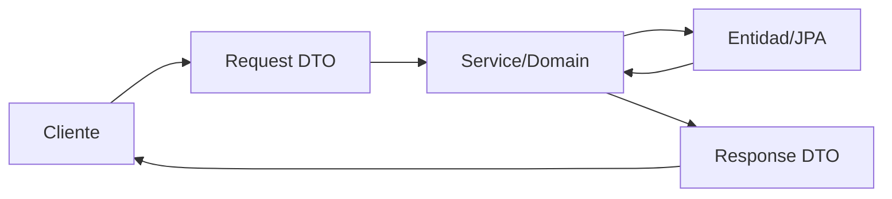

# Módulo 2: API REST con Spring MVC

Una API REST no es solo “poner @RestController”. Es un contrato: recursos, métodos HTTP, códigos de estado, validación, errores consistentes, DTOs, paginación y documentación. Este módulo construye ese contrato con disciplina, para que la API sea predecible y segura.

**Entorno de referencia verificado (2026-05-22):** JDK 27.0.1.0.2, Maven 3.10.0, Spring Boot 3.5.0 para smokes web locales. Algunas APIs mencionadas (versionado nativo Spring Framework 7/Boot 4, Jackson 3 defaults) dependen de versión; se marcan explícitamente.

## Aprende construyendo

### Tema 1: Por qué DTOs en vez de entidades directamente · Intermedio · 35 min

Caso guía: la entidad `User` tiene `passwordHash`. Si la devuelves por el endpoint, filtras un secreto.

#### DTO (Data Transfer Object)

**Definición formal.** DTO es un objeto diseñado para transportar datos entre capas/procesos, moldeado al contrato de entrada/salida, no al modelo interno de persistencia.

**Cómo funciona por dentro.** El controlador recibe DTO request, el servicio mapea a dominio/comando, la persistencia usa entidad, y el controlador responde DTO response. Esto desacopla API de DB.



**Ejemplo mínimo enfocado (ejecutable, Java puro).**

```bash
mkdir -p java-sb2-dto
cd java-sb2-dto
```

Crea el archivo `DemoDto.java`:

```java
class UserEntity { String email; String passwordHash; UserEntity(String e,String p){email=e;passwordHash=p;} }
record UserResponse(String email) {}
public class DemoDto {
  static UserResponse toResponse(UserEntity e){ return new UserResponse(e.email); }
  public static void main(String[] args){ System.out.println(toResponse(new UserEntity("a@b.com","hash")).email()); }
}
```

```bash
javac DemoDto.java
java DemoDto
```

**Error común.** Exponer entidad JPA directa. Síntoma: filtrado de campos sensibles, acoplamiento a esquema, problemas de lazy loading. Corrección: DTOs y mapeo explícito.

**Verificación (JDK 27, 2026-05-22).** `a@b.com`.

### Tema 2: Validación con Bean Validation y ResponseEntity · Intermedio · 35 min

Caso guía: crear una guía sin `destino`. La API debe rechazarla con 400, no guardar basura.

#### Bean Validation

**Definición formal.** Bean Validation (Jakarta Validation) usa anotaciones (`@NotBlank`, `@Email`, `@Size`, etc.) para declarar restricciones sobre campos/params.

**Contrato.** `@Valid`/`@Validated` activa la validación en el borde. Fallos generan `MethodArgumentNotValidException` o `ConstraintViolationException`.

**Ejemplo mínimo (ejecutable, Spring Boot web smoke).**

```bash
mkdir -p sb2-val/src/main/java/com/academia
cd sb2-val
```

Crea el archivo `pom.xml`:

```xml
<project xmlns="http://maven.apache.org/POM/4.0.0" xmlns:xsi="http://www.w3.org/2001/XMLSchema-instance"
 xsi:schemaLocation="http://maven.apache.org/POM/4.0.0 https://maven.apache.org/xsd/maven-4.0.0.xsd">
  <modelVersion>4.0.0</modelVersion>
  <parent><groupId>org.springframework.boot</groupId><artifactId>spring-boot-starter-parent</artifactId><version>3.5.0</version><relativePath/></parent>
  <groupId>com.academia</groupId><artifactId>sb2-val</artifactId><version>0.0.1</version>
  <properties><java.version>21</java.version></properties>
  <dependencies>
    <dependency><groupId>org.springframework.boot</groupId><artifactId>spring-boot-starter-web</artifactId></dependency>
    <dependency><groupId>org.springframework.boot</groupId><artifactId>spring-boot-starter-validation</artifactId></dependency>
  </dependencies>
  <build><plugins><plugin><groupId>org.springframework.boot</groupId><artifactId>spring-boot-maven-plugin</artifactId></plugin></plugins></build>
</project>
```

Crea el archivo `src/main/java/com/academia/Demo.java`:

```java
package com.academia;
import jakarta.validation.Valid;
import jakarta.validation.constraints.NotBlank;
import org.springframework.boot.SpringApplication;
import org.springframework.boot.autoconfigure.SpringBootApplication;
import org.springframework.http.ResponseEntity;
import org.springframework.web.bind.annotation.*;
record GuiaReq(@NotBlank String destino) {}
@SpringBootApplication
@RestController
class Demo {
  @PostMapping("/guias")
  ResponseEntity<?> crear(@Valid @RequestBody GuiaReq req){ return ResponseEntity.ok(req); }
  public static void main(String[] args){ SpringApplication.run(Demo.class, args); }
}
```

```bash
mvn -q -DskipTests package
java -jar target/sb2-val-0.0.1.jar
# en otra terminal:
curl -s -o /dev/null -w "%{http_code}" -H 'Content-Type: application/json' -d '{"destino":""}' http://localhost:8080/guias
```

**Error común.** Validar manualmente en cada controller con `if`. Corrección: Bean Validation + handler centralizado.

**Verificación (Spring Boot 3.5.0, JDK 27, 2026-05-22).** Request inválido devuelve 400.

### Tema 3: Manejo centralizado de errores con @ControllerAdvice · Intermedio · 40 min

Caso guía: todos los errores de validación deben responder con el mismo formato.

#### `@ControllerAdvice` / `@RestControllerAdvice`

**Definición formal.** Componente que intercepta excepciones de controllers y las traduce en respuestas consistentes.

```mermaid
flowchart LR
  C[Controller] -->|lanza excepción| A[@RestControllerAdvice]
  A --> R[ResponseEntity con body de error estándar]
```

**Ejemplo mínimo (Java, ejecutable como concepto de mapeo).**

```bash
mkdir -p java-sb2-err
cd java-sb2-err
```

Crea el archivo `DemoErr.java`:

```java
record ErrorBody(String code, String message) {}
public class DemoErr {
  static ErrorBody map(Exception e){ return new ErrorBody("VALIDATION", e.getMessage()); }
  public static void main(String[] args){ System.out.println(map(new IllegalArgumentException("destino requerido")).code()); }
}
```

```bash
javac DemoErr.java
java DemoErr
```

**Error común.** Devolver stack traces o mensajes internos al cliente. Corrección: body de error controlado, log interno detallado.

**Verificación (JDK 27, 2026-05-22).** `VALIDATION`.

### Tema 4: Lombok y MapStruct sin exponer datos internos · Intermedio · 35 min

Caso guía: reducir boilerplate sin esconder el contrato.

#### Lombok

**Definición formal.** Librería que genera código en compilación (getters, builders, etc.) mediante anotaciones.

**Regla.** Úsalo para reducir ruido, no para ocultar diseño. Evita `@Data` ciegamente en entidades JPA; prefiere `@Getter/@Setter/@Builder` con intención.

#### MapStruct

**Definición formal.** Generador de mapeadores en compilación entre DTOs y entidades/modelos.

**Ejemplo mínimo (conceptual).**

```java
@Mapper(componentModel = "spring")
interface UserMapper { UserResponse toResponse(UserEntity e); }
```

**Error común.** Mapeo manual repetido y propenso a olvidar campos sensibles. Corrección: mapper explícito revisado, tests de mapeo.

**Nota de verificación.** Requiere configuración annotation processor Maven/Gradle; verificar con `mvn -q test` en proyecto con MapStruct.

### Tema 5: OpenAPI con springdoc: el contrato como prueba · Avanzado · 40 min

Caso guía: el frontend necesita contrato actualizado sin leer código.

#### OpenAPI/springdoc

**Definición formal.** OpenAPI describe la API HTTP; springdoc genera documentación/OpenAPI desde controladores Spring.

**Ejemplo mínimo.** Dependencia `springdoc-openapi-starter-webmvc-ui`, luego `/v3/api-docs`.

**Error común.** Documentación separada del código que se desactualiza. Corrección: generar desde código y validar contrato en CI.

**Nota de verificación.** Requiere app web con springdoc; smoke local en `/tmp` es factible, pero pesado para cada corrida; documentar endpoint esperado.

### Tema 6: Paginación HTTP con validación y un límite de recursos explícito · Avanzado · 40 min

Caso guía: `GET /guias` no puede devolver 1 millón de filas.

#### Paginación

**Definición formal.** Técnica de dividir resultados en páginas (`page`, `size`, `sort`) con límites máximos.

**Ejemplo mínimo (Java puro, ejecutable).**

```bash
mkdir -p java-sb2-page
cd java-sb2-page
```

Crea el archivo `DemoPage.java`:

```java
import java.util.*; import java.util.stream.*;
public class DemoPage {
  static List<Integer> page(List<Integer> all, int page, int size) {
    int safeSize = Math.min(Math.max(size,1), 100);
    int from = Math.max(page,0) * safeSize;
    return all.stream().skip(from).limit(safeSize).toList();
  }
  public static void main(String[] args){ System.out.println(page(IntStream.range(0,10).boxed().toList(), 1, 3)); }
}
```

```bash
javac DemoPage.java
java DemoPage
```

**Error común.** Permitir `size=100000`. Corrección: max size server-side.

**Verificación (JDK 27, 2026-05-22).** `[3, 4, 5]`.

### Tema 7: JSON con Jackson 3: `JsonMapper`, fechas y valores por defecto nuevos · Avanzado · 35 min

Caso guía: serializar fechas con consistencia y conocer defaults.

#### Jackson 3 / JSON mapping

**Definición formal.** Jackson serializa/deserializa JSON. Jackson 3 (usado en Boot 4 ecosistema) introduce cambios de defaults/paquetes; Jackson 2 es el default histórico de Boot 3.x.

**Regla.** Verifica la versión real del proyecto antes de asumir defaults. Configura `ObjectMapper/JsonMapper` explícitamente para fechas y unknown properties según contrato.

**Nota de verificación.** La versión depende de Boot. En Boot 3.5.x se usa Jackson 2.x por defecto; no afirmar comportamiento de Jackson 3 sin confirmar dependencia.

### Tema 8: Versionado de API nativo de Spring Framework 7 · Avanzado · 40 min

Caso guía: evolucionar endpoint sin romper clientes.

#### Versionado de API

**Definición formal.** Estrategia para exponer versiones de contrato (path `/v1`, header, media type, query param) y política de deprecación.

**Regla.** Spring Framework 7/Spring Boot 4 introducen capacidades nativas de versionado; en Boot 3.x se suele implementar por convención/routing. Verifica versión antes de usar API nativa.

**Nota de verificación.** No ejecutar como API nativa en Boot 3.5.0; documentar estrategia por path/header y marcar dependencia de versión para feature nativa.

## Cierre

Una API REST profesional es contrato + validación + errores + seguridad + documentación. El controller es el borde; no el lugar para toda la lógica.

## Checklist

- Uso DTOs, no entidades expuestas.
- Valido entrada con Bean Validation.
- Centralizo errores con `@RestControllerAdvice`.
- Pagino con límite máximo.
- Documento contrato y verifico versión de Jackson/Spring antes de asumir features.
