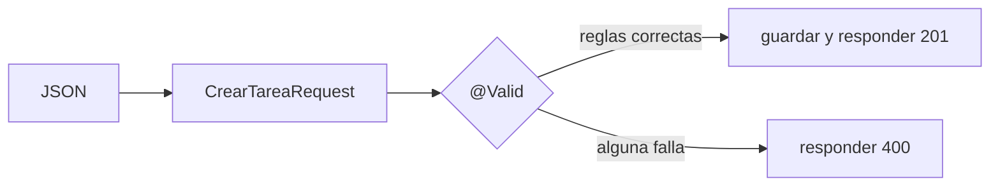
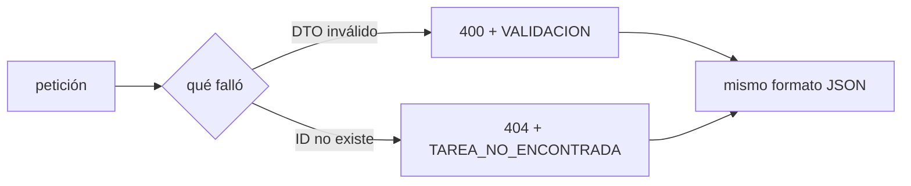
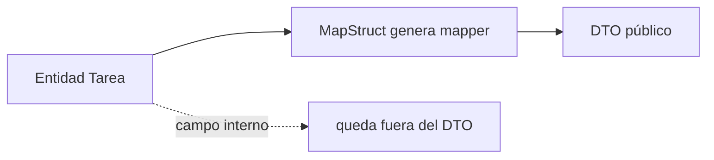
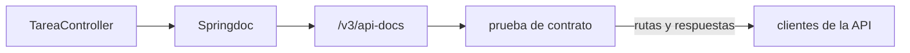
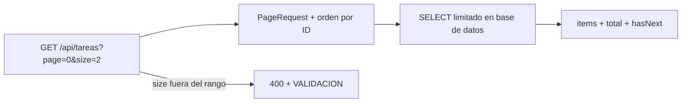
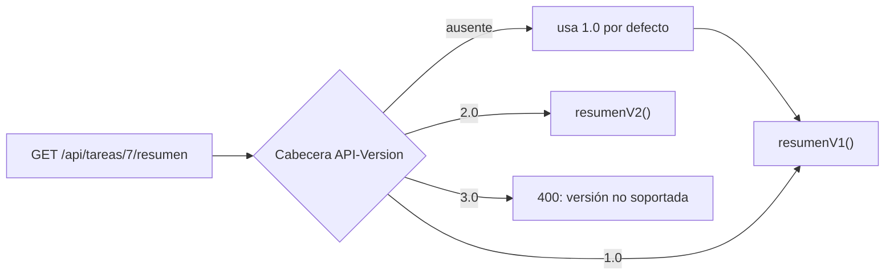

# Módulo 2: REST APIs con Spring Web

Cada tema separa el contrato HTTP (DTOs) de la persistencia interna (entidades), automatiza la validación de entrada y centraliza el manejo de errores — las tres piezas que hacen que una API REST sea predecible para quien la consume.

**Referencia ejecutable al terminar los módulos 2 y 4–7:** en la raíz del repositorio, abre `README.md`. Incluye el estado final y pruebas; algunas clases incorporan cambios de módulos posteriores. Construye primero las prácticas de este módulo y usa la referencia para comparar y diagnosticar.

## Aprende construyendo


### Tema 1: Por qué DTOs en vez de entidades directamente · Intermedio · 35 min

<details open>
<summary><strong>Capa 1 — Lectura</strong></summary>

#### ► DE QUÉ TRATA
Este tema te guía por por qué dtos en vez de entidades directamente con foco en comprensión antes de implementación.

#### ► LA IDEA EN UNA FRASE
**Entender por qué dtos en vez de entidades directamente te permite tomar mejores decisiones técnicas.**

#### ► POR QUÉ EXISTE ESTO
Resuelve un problema real de diseño o implementación y evita decisiones a ciegas.

#### ► LA ANALOGÍA
Piensa en por qué dtos en vez de entidades directamente como una herramienta de taller: útil cuando conoces su propósito y sus límites.
**Dónde se rompe la analogía:** en software, los efectos dependen del contexto, la escala y los trade-offs.

#### ► CÓMO FUNCIONA
1. Identifica el problema que por qué dtos en vez de entidades directamente resuelve.
2. Observa sus componentes y relaciones.
3. Aplica la opción más simple que funcione.
4. Verifica el resultado y los límites.

#### ► LO QUE PUEDE SALIR MAL
| Síntoma | Causa probable | Arreglo |
|---|---|---|
| Por qué DTOs en vez de entidades directamente se aplica pero el resultado no mejora | Se usó sin medir el problema real | Mide antes y compara contra la alternativa simple |
| Aparece complejidad inesperada | Se adoptó la técnica sin comprender sus trade-offs | Vuelve a la sección de trade-offs y reduce el alcance |
| Falla en un caso límite | Se asumió un contexto que no se cumple | Prueba el caso límite y documenta cuándo NO usarlo |

#### ► TRADE-OFFS
| Opción | Cuándo usarla | Cuándo NO usarla |
|---|---|---|
| Usar Por qué DTOs en vez de entidades directamente | Cuando el problema coincide con su propósito y el beneficio es observable | Cuando agrega complejidad sin resolver un problema real |
| Alternativa más simple | Cuando el contexto es pequeño, estable o fácil de razonar | Cuando ya demostró no escalar o no cumplir el requisito |
| Postergar la decisión | Cuando falta evidencia del problema | Cuando el costo de esperar es mayor que el costo de probar |

#### ► CUÁNDO NO USAR ESTO
No uses por qué dtos en vez de entidades directamente por defecto. Aplícalo cuando el problema lo justifique y puedas verificar el beneficio; si una alternativa más simple resuelve igual, prefiérela.

#### ► DE VUELTA A LA ANALOGÍA
Volviendo a la analogía: por qué dtos en vez de entidades directamente funciona como el modelo inicial, pero recuerda dónde se rompe: en producción importan la evidencia, la escala y el costo de equivocarte.

#### ► LO QUE DEBES RECORDAR
- Por qué DTOs en vez de entidades directamente existe para resolver un problema específico.
- Mide antes de adoptar complejidad.
- Conoce el caso donde NO usarlo.
- Verifica con evidencia observable.

#### ► PREGUNTAS PARA PENSAR
1. ¿Qué problema concreto resuelve por qué dtos en vez de entidades directamente en tu contexto?
2. ¿Cómo sabrías que por qué dtos en vez de entidades directamente no está funcionando bien?
3. ¿Qué alternativa más simple considerarías antes de usar por qué dtos en vez de entidades directamente?

</details>

<details>
<summary><strong>Capa 2 — Construcción</strong></summary>

#### Código y verificación
```xml
<dependency>
    <groupId>org.springframework.boot</groupId>
    <artifactId>spring-boot-starter-data-jpa</artifactId>
</dependency>
<dependency>
    <groupId>com.h2database</groupId>
    <artifactId>h2</artifactId>
    <scope>runtime</scope>
</dependency>
```

```java
package com.example.demo;

import jakarta.persistence.Column;
import jakarta.persistence.Entity;
import jakarta.persistence.GeneratedValue;
import jakarta.persistence.GenerationType;
import jakarta.persistence.Id;
import jakarta.persistence.Table;

@Entity
@Table(name = "tareas")
public class Tarea {
    @Id
    @GeneratedValue(strategy = GenerationType.IDENTITY)
    private Long id;

    private String titulo;
    private int prioridad;

    @Column(name = "ubicacion_interna")
    private String ubicacionInterna;

    protected Tarea() {
    }

    public Tarea(String titulo, int prioridad, String ubicacionInterna) {
        this.titulo = titulo;
        this.prioridad = prioridad;
        this.ubicacionInterna = ubicacionInterna;
    }

    public Long getId() { return id; }
    public String getTitulo() { return titulo; }
    public int getPrioridad() { return prioridad; }
    public String getUbicacionInterna() { return ubicacionInterna; }
}
```

```java
package com.example.demo;

import org.springframework.data.jpa.repository.JpaRepository;

public interface TareaRepository extends JpaRepository<Tarea, Long> {
}
```

```yaml
spring:
  jpa:
    hibernate:
      ddl-auto: create-drop
```

```java
package com.example.demo;

public record CrearTareaRequest(String titulo, int prioridad) {
}
```

```java
package com.example.demo;

public record TareaDTO(Long id, String titulo, int prioridad) {
    public static TareaDTO from(Tarea tarea) {
        return new TareaDTO(
                tarea.getId(),
                tarea.getTitulo(),
                tarea.getPrioridad());
    }
}
```

</details>

### Tema 2: Validación con Bean Validation y ResponseEntity · Intermedio · 35 min

<details open>
<summary><strong>Capa 1 — Lectura</strong></summary>

#### ► DE QUÉ TRATA
Este tema te guía por validación con bean validation y responseentity con foco en comprensión antes de implementación.

#### ► LA IDEA EN UNA FRASE
**Entender validación con bean validation y responseentity te permite tomar mejores decisiones técnicas.**

#### ► POR QUÉ EXISTE ESTO
Resuelve un problema real de diseño o implementación y evita decisiones a ciegas.

#### ► LA ANALOGÍA
Piensa en validación con bean validation y responseentity como una herramienta de taller: útil cuando conoces su propósito y sus límites.
**Dónde se rompe la analogía:** en software, los efectos dependen del contexto, la escala y los trade-offs.

#### ► CÓMO FUNCIONA


#### ► LO QUE PUEDE SALIR MAL
| Síntoma | Causa probable | Arreglo |
|---|---|---|
| Validación con Bean Validation y ResponseEntity se aplica pero el resultado no mejora | Se usó sin medir el problema real | Mide antes y compara contra la alternativa simple |
| Aparece complejidad inesperada | Se adoptó la técnica sin comprender sus trade-offs | Vuelve a la sección de trade-offs y reduce el alcance |
| Falla en un caso límite | Se asumió un contexto que no se cumple | Prueba el caso límite y documenta cuándo NO usarlo |

#### ► TRADE-OFFS
| Opción | Cuándo usarla | Cuándo NO usarla |
|---|---|---|
| Usar Validación con Bean Validation y ResponseEntity | Cuando el problema coincide con su propósito y el beneficio es observable | Cuando agrega complejidad sin resolver un problema real |
| Alternativa más simple | Cuando el contexto es pequeño, estable o fácil de razonar | Cuando ya demostró no escalar o no cumplir el requisito |
| Postergar la decisión | Cuando falta evidencia del problema | Cuando el costo de esperar es mayor que el costo de probar |

#### ► CUÁNDO NO USAR ESTO
No uses validación con bean validation y responseentity por defecto. Aplícalo cuando el problema lo justifique y puedas verificar el beneficio; si una alternativa más simple resuelve igual, prefiérela.

#### ► DE VUELTA A LA ANALOGÍA
Volviendo a la analogía: validación con bean validation y responseentity funciona como el modelo inicial, pero recuerda dónde se rompe: en producción importan la evidencia, la escala y el costo de equivocarte.

#### ► LO QUE DEBES RECORDAR
- Validación con Bean Validation y ResponseEntity existe para resolver un problema específico.
- Mide antes de adoptar complejidad.
- Conoce el caso donde NO usarlo.
- Verifica con evidencia observable.

#### ► PREGUNTAS PARA PENSAR
1. ¿Qué problema concreto resuelve validación con bean validation y responseentity en tu contexto?
2. ¿Cómo sabrías que validación con bean validation y responseentity no está funcionando bien?
3. ¿Qué alternativa más simple considerarías antes de usar validación con bean validation y responseentity?

</details>

<details>
<summary><strong>Capa 2 — Construcción</strong></summary>

#### Código y verificación


```xml
<dependency>
    <groupId>org.springframework.boot</groupId>
    <artifactId>spring-boot-starter-validation</artifactId>
</dependency>
```

```java
package com.example.demo;

import jakarta.validation.constraints.Min;
import jakarta.validation.constraints.NotBlank;

public record CrearTareaRequest(
        @NotBlank String titulo,
        @Min(1) int prioridad) {
}
```

```java
@PostMapping
public ResponseEntity<TareaDTO> crear(
        @Valid @RequestBody CrearTareaRequest request) {
    return ResponseEntity.status(HttpStatus.CREATED)
            .body(servicio.crear(request));
}
```

```bash
curl -i -X POST http://localhost:8080/api/tareas \
  -H 'Content-Type: application/json'   -d '{"titulo":"Entregar paquete","prioridad":1}'

curl -i -X POST http://localhost:8080/api/tareas \
  -H 'Content-Type: application/json'   -d '{"titulo":"   ","prioridad":0}'
```

```java
public Optional<TareaDTO> buscar(Long id) {
    return repository.findById(id).map(TareaDTO::from);
}
```

</details>

### Tema 3: Manejo centralizado de errores con @ControllerAdvice · Intermedio · 40 min

<details open>
<summary><strong>Capa 1 — Lectura</strong></summary>

#### ► DE QUÉ TRATA
Este tema te guía por manejo centralizado de errores con @controlleradvice con foco en comprensión antes de implementación.

#### ► LA IDEA EN UNA FRASE
**Entender manejo centralizado de errores con @controlleradvice te permite tomar mejores decisiones técnicas.**

#### ► POR QUÉ EXISTE ESTO
Resuelve un problema real de diseño o implementación y evita decisiones a ciegas.

#### ► LA ANALOGÍA
Piensa en manejo centralizado de errores con @controlleradvice como una herramienta de taller: útil cuando conoces su propósito y sus límites.
**Dónde se rompe la analogía:** en software, los efectos dependen del contexto, la escala y los trade-offs.

#### ► CÓMO FUNCIONA


#### ► LO QUE PUEDE SALIR MAL
| Síntoma | Causa probable | Arreglo |
|---|---|---|
| Manejo centralizado de errores con @ControllerAdvice se aplica pero el resultado no mejora | Se usó sin medir el problema real | Mide antes y compara contra la alternativa simple |
| Aparece complejidad inesperada | Se adoptó la técnica sin comprender sus trade-offs | Vuelve a la sección de trade-offs y reduce el alcance |
| Falla en un caso límite | Se asumió un contexto que no se cumple | Prueba el caso límite y documenta cuándo NO usarlo |

#### ► TRADE-OFFS
| Opción | Cuándo usarla | Cuándo NO usarla |
|---|---|---|
| Usar Manejo centralizado de errores con @ControllerAdvice | Cuando el problema coincide con su propósito y el beneficio es observable | Cuando agrega complejidad sin resolver un problema real |
| Alternativa más simple | Cuando el contexto es pequeño, estable o fácil de razonar | Cuando ya demostró no escalar o no cumplir el requisito |
| Postergar la decisión | Cuando falta evidencia del problema | Cuando el costo de esperar es mayor que el costo de probar |

#### ► CUÁNDO NO USAR ESTO
No uses manejo centralizado de errores con @controlleradvice por defecto. Aplícalo cuando el problema lo justifique y puedas verificar el beneficio; si una alternativa más simple resuelve igual, prefiérela.

#### ► DE VUELTA A LA ANALOGÍA
Volviendo a la analogía: manejo centralizado de errores con @controlleradvice funciona como el modelo inicial, pero recuerda dónde se rompe: en producción importan la evidencia, la escala y el costo de equivocarte.

#### ► LO QUE DEBES RECORDAR
- Manejo centralizado de errores con @ControllerAdvice existe para resolver un problema específico.
- Mide antes de adoptar complejidad.
- Conoce el caso donde NO usarlo.
- Verifica con evidencia observable.

#### ► PREGUNTAS PARA PENSAR
1. ¿Qué problema concreto resuelve manejo centralizado de errores con @controlleradvice en tu contexto?
2. ¿Cómo sabrías que manejo centralizado de errores con @controlleradvice no está funcionando bien?
3. ¿Qué alternativa más simple considerarías antes de usar manejo centralizado de errores con @controlleradvice?

</details>

<details>
<summary><strong>Capa 2 — Construcción</strong></summary>

#### Código y verificación


```java
package com.example.demo;

import jakarta.validation.constraints.Min;
import jakarta.validation.constraints.NotBlank;

public record CrearTareaRequest(
        @NotBlank(message = "Escribe un título.")
        String titulo,
        @Min(value = 1, message = "La prioridad mínima es 1.")
        int prioridad) {
}
```

```java
package com.example.demo;

import java.util.Map;

public record ApiError(
        String codigo,
        String mensaje,
        Map<String, String> campos) {
}
```

```java
package com.example.demo;

import java.util.LinkedHashMap;
import java.util.Map;
import org.springframework.http.ResponseEntity;
import org.springframework.web.bind.MethodArgumentNotValidException;
import org.springframework.web.bind.annotation.ExceptionHandler;
import org.springframework.web.bind.annotation.RestControllerAdvice;

@RestControllerAdvice
public class GlobalExceptionHandler {
    @ExceptionHandler(MethodArgumentNotValidException.class)
    public ResponseEntity<ApiError> manejarValidacion(
            MethodArgumentNotValidException ex) {
        Map<String, String> campos = new LinkedHashMap<>();
        ex.getBindingResult().getFieldErrors().forEach(error ->
                campos.putIfAbsent(error.getField(), error.getDefaultMessage()));

        ApiError cuerpo = new ApiError(
                "VALIDACION",
                "Revisa los campos indicados.",
                campos);
        return ResponseEntity.badRequest().body(cuerpo);
    }
}
```

```bash
curl -i -X POST http://localhost:8080/api/tareas   -H 'Content-Type: application/json'   -d '{"titulo":"   ","prioridad":0}'
```

```java
package com.example.demo;

public class TareaNoEncontradaException extends RuntimeException {
    public TareaNoEncontradaException(Long id) {
        super("No existe la tarea " + id + ".");
    }
}
```

</details>

### Tema 4: Lombok y MapStruct sin exponer datos internos · Intermedio · 35 min

<details open>
<summary><strong>Capa 1 — Lectura</strong></summary>

#### ► DE QUÉ TRATA
Este tema te guía por lombok y mapstruct sin exponer datos internos con foco en comprensión antes de implementación.

#### ► LA IDEA EN UNA FRASE
**Entender lombok y mapstruct sin exponer datos internos te permite tomar mejores decisiones técnicas.**

#### ► POR QUÉ EXISTE ESTO
Resuelve un problema real de diseño o implementación y evita decisiones a ciegas.

#### ► LA ANALOGÍA
Piensa en lombok y mapstruct sin exponer datos internos como una herramienta de taller: útil cuando conoces su propósito y sus límites.
**Dónde se rompe la analogía:** en software, los efectos dependen del contexto, la escala y los trade-offs.

#### ► CÓMO FUNCIONA


#### ► LO QUE PUEDE SALIR MAL
| Síntoma | Causa probable | Arreglo |
|---|---|---|
| Lombok y MapStruct sin exponer datos internos se aplica pero el resultado no mejora | Se usó sin medir el problema real | Mide antes y compara contra la alternativa simple |
| Aparece complejidad inesperada | Se adoptó la técnica sin comprender sus trade-offs | Vuelve a la sección de trade-offs y reduce el alcance |
| Falla en un caso límite | Se asumió un contexto que no se cumple | Prueba el caso límite y documenta cuándo NO usarlo |

#### ► TRADE-OFFS
| Opción | Cuándo usarla | Cuándo NO usarla |
|---|---|---|
| Usar Lombok y MapStruct sin exponer datos internos | Cuando el problema coincide con su propósito y el beneficio es observable | Cuando agrega complejidad sin resolver un problema real |
| Alternativa más simple | Cuando el contexto es pequeño, estable o fácil de razonar | Cuando ya demostró no escalar o no cumplir el requisito |
| Postergar la decisión | Cuando falta evidencia del problema | Cuando el costo de esperar es mayor que el costo de probar |

#### ► CUÁNDO NO USAR ESTO
No uses lombok y mapstruct sin exponer datos internos por defecto. Aplícalo cuando el problema lo justifique y puedas verificar el beneficio; si una alternativa más simple resuelve igual, prefiérela.

#### ► DE VUELTA A LA ANALOGÍA
Volviendo a la analogía: lombok y mapstruct sin exponer datos internos funciona como el modelo inicial, pero recuerda dónde se rompe: en producción importan la evidencia, la escala y el costo de equivocarte.

#### ► LO QUE DEBES RECORDAR
- Lombok y MapStruct sin exponer datos internos existe para resolver un problema específico.
- Mide antes de adoptar complejidad.
- Conoce el caso donde NO usarlo.
- Verifica con evidencia observable.

#### ► PREGUNTAS PARA PENSAR
1. ¿Qué problema concreto resuelve lombok y mapstruct sin exponer datos internos en tu contexto?
2. ¿Cómo sabrías que lombok y mapstruct sin exponer datos internos no está funcionando bien?
3. ¿Qué alternativa más simple considerarías antes de usar lombok y mapstruct sin exponer datos internos?

</details>

<details>
<summary><strong>Capa 2 — Construcción</strong></summary>

#### Código y verificación


```xml
<lombok.version>1.18.48</lombok.version>
```

```xml
<dependency>
    <groupId>org.projectlombok</groupId>
    <artifactId>lombok</artifactId>
    <version>${lombok.version}</version>
    <scope>provided</scope>
</dependency>
```

```xml
<plugin>
    <groupId>org.apache.maven.plugins</groupId>
    <artifactId>maven-compiler-plugin</artifactId>
    <configuration>
        <annotationProcessorPaths>
            <path>
                <groupId>org.projectlombok</groupId>
                <artifactId>lombok</artifactId>
                <version>${lombok.version}</version>
            </path>
        </annotationProcessorPaths>
    </configuration>
</plugin>
```

```xml
<mapstruct.version>1.6.3</mapstruct.version>
```

```xml
<dependency>
    <groupId>org.mapstruct</groupId>
    <artifactId>mapstruct</artifactId>
    <version>${mapstruct.version}</version>
</dependency>
```

</details>

### Tema 5: OpenAPI con springdoc: el contrato como prueba · Avanzado · 40 min

<details open>
<summary><strong>Capa 1 — Lectura</strong></summary>

#### ► DE QUÉ TRATA
Este tema te guía por openapi con springdoc: el contrato como prueba con foco en comprensión antes de implementación.

#### ► LA IDEA EN UNA FRASE
**Entender openapi con springdoc: el contrato como prueba te permite tomar mejores decisiones técnicas.**

#### ► POR QUÉ EXISTE ESTO
Resuelve un problema real de diseño o implementación y evita decisiones a ciegas.

#### ► LA ANALOGÍA
Piensa en openapi con springdoc: el contrato como prueba como una herramienta de taller: útil cuando conoces su propósito y sus límites.
**Dónde se rompe la analogía:** en software, los efectos dependen del contexto, la escala y los trade-offs.

#### ► CÓMO FUNCIONA


#### ► LO QUE PUEDE SALIR MAL
| Síntoma | Causa probable | Arreglo |
|---|---|---|
| OpenAPI con springdoc: el contrato como prueba se aplica pero el resultado no mejora | Se usó sin medir el problema real | Mide antes y compara contra la alternativa simple |
| Aparece complejidad inesperada | Se adoptó la técnica sin comprender sus trade-offs | Vuelve a la sección de trade-offs y reduce el alcance |
| Falla en un caso límite | Se asumió un contexto que no se cumple | Prueba el caso límite y documenta cuándo NO usarlo |

#### ► TRADE-OFFS
| Opción | Cuándo usarla | Cuándo NO usarla |
|---|---|---|
| Usar OpenAPI con springdoc: el contrato como prueba | Cuando el problema coincide con su propósito y el beneficio es observable | Cuando agrega complejidad sin resolver un problema real |
| Alternativa más simple | Cuando el contexto es pequeño, estable o fácil de razonar | Cuando ya demostró no escalar o no cumplir el requisito |
| Postergar la decisión | Cuando falta evidencia del problema | Cuando el costo de esperar es mayor que el costo de probar |

#### ► CUÁNDO NO USAR ESTO
No uses openapi con springdoc: el contrato como prueba por defecto. Aplícalo cuando el problema lo justifique y puedas verificar el beneficio; si una alternativa más simple resuelve igual, prefiérela.

#### ► DE VUELTA A LA ANALOGÍA
Volviendo a la analogía: openapi con springdoc: el contrato como prueba funciona como el modelo inicial, pero recuerda dónde se rompe: en producción importan la evidencia, la escala y el costo de equivocarte.

#### ► LO QUE DEBES RECORDAR
- OpenAPI con springdoc: el contrato como prueba existe para resolver un problema específico.
- Mide antes de adoptar complejidad.
- Conoce el caso donde NO usarlo.
- Verifica con evidencia observable.

#### ► PREGUNTAS PARA PENSAR
1. ¿Qué problema concreto resuelve openapi con springdoc: el contrato como prueba en tu contexto?
2. ¿Cómo sabrías que openapi con springdoc: el contrato como prueba no está funcionando bien?
3. ¿Qué alternativa más simple considerarías antes de usar openapi con springdoc: el contrato como prueba?

</details>

<details>
<summary><strong>Capa 2 — Construcción</strong></summary>

#### Código y verificación


```xml
<dependency>
    <groupId>org.springdoc</groupId>
    <artifactId>springdoc-openapi-starter-webmvc-ui</artifactId>
    <version>3.2.0</version>
</dependency>
```

```bash
./mvnw test
```

```bash
curl -sS http://localhost:8080/v3/api-docs
```

```java
package com.example.demo;

import io.swagger.v3.oas.annotations.Operation;
import io.swagger.v3.oas.annotations.responses.ApiResponse;
import io.swagger.v3.oas.annotations.responses.ApiResponses;
import io.swagger.v3.oas.annotations.media.Content;
import io.swagger.v3.oas.annotations.media.Schema;
import io.swagger.v3.oas.annotations.tags.Tag;
import jakarta.validation.Valid;
import org.springframework.http.HttpStatus;
import org.springframework.http.ResponseEntity;
import org.springframework.web.bind.annotation.GetMapping;
import org.springframework.web.bind.annotation.PathVariable;
import org.springframework.web.bind.annotation.PostMapping;
import org.springframework.web.bind.annotation.RequestBody;
import org.springframework.web.bind.annotation.RequestMapping;
import org.springframework.web.bind.annotation.RestController;

@RestController
@RequestMapping("/api/tareas")
@Tag(name = "Tareas", description = "Crear y consultar tareas")
public class TareaController {
    private final ServicioTareas servicio;

    public TareaController(ServicioTareas servicio) {
        this.servicio = servicio;
    }

    @PostMapping
    @Operation(summary = "Crear una tarea")
    @ApiResponses({
            @ApiResponse(responseCode = "201", description = "Tarea creada"),
            @ApiResponse(responseCode = "400", description = "Datos inválidos",
                    content = @Content(schema = @Schema(implementation = ApiError.class)))})
    public ResponseEntity<TareaDTO> crear(
            @Valid @RequestBody CrearTareaRequest request) {
        return ResponseEntity.status(HttpStatus.CREATED)
                .body(servicio.crear(request));
    }

    @GetMapping("/{id}")
    @Operation(summary = "Consultar una tarea por ID")
    @ApiResponses({
            @ApiResponse(responseCode = "200", description = "Tarea encontrada"),
            @ApiResponse(responseCode = "404", description = "Tarea inexistente",
                    content = @Content(schema = @Schema(implementation = ApiError.class)))})
    public ResponseEntity<TareaDTO> buscar(@PathVariable Long id) {
        return ResponseEntity.ok(servicio.buscar(id));
    }
}
```

```java
package com.example.demo;

import org.junit.jupiter.api.Test;
import org.springframework.beans.factory.annotation.Value;
import org.springframework.boot.test.context.SpringBootTest;

import java.net.URI;
import java.net.http.HttpClient;
import java.net.http.HttpRequest;
import java.net.http.HttpResponse;

import static org.assertj.core.api.Assertions.assertThat;

@SpringBootTest(webEnvironment = SpringBootTest.WebEnvironment.RANDOM_PORT)
class ContratoOpenApiTest {
    @Value("${local.server.port}")
    int puerto;

    @Test
    void publicaLasRutasYRespuestasQueUsaElBackend() throws Exception {
        HttpRequest request = HttpRequest.newBuilder(
                URI.create("http://localhost:" + puerto + "/v3/api-docs"))
                .GET()
                .build();

        HttpResponse<String> response = HttpClient.newHttpClient().send(
                request, HttpResponse.BodyHandlers.ofString());
        String contrato = response.body();

        assertThat(response.statusCode()).isEqualTo(200);
        assertThat(contrato)
                .contains("/api/tareas")
                .contains("/api/tareas/{id}")
                .contains("Crear una tarea")
                .contains("Consultar una tarea por ID")
                .contains("Tarea inexistente")
                .contains("Datos inválidos")
                .contains("ApiError")
                .contains("\"200\"")
                .contains("\"201\"")
                .contains("\"400\"")
                .contains("\"404\"");
    }
}
```

</details>

### Tema 6: Paginación HTTP con validación y un límite de recursos explícito · Avanzado · 40 min

<details open>
<summary><strong>Capa 1 — Lectura</strong></summary>

#### ► DE QUÉ TRATA
Este tema te guía por paginación http con validación y un límite de recursos explícito con foco en comprensión antes de implementación.

#### ► LA IDEA EN UNA FRASE
**Entender paginación http con validación y un límite de recursos explícito te permite tomar mejores decisiones técnicas.**

#### ► POR QUÉ EXISTE ESTO
Resuelve un problema real de diseño o implementación y evita decisiones a ciegas.

#### ► LA ANALOGÍA
Piensa en paginación http con validación y un límite de recursos explícito como una herramienta de taller: útil cuando conoces su propósito y sus límites.
**Dónde se rompe la analogía:** en software, los efectos dependen del contexto, la escala y los trade-offs.

#### ► CÓMO FUNCIONA


#### ► LO QUE PUEDE SALIR MAL
| Síntoma | Causa probable | Arreglo |
|---|---|---|
| Paginación HTTP con validación y un límite de recursos explícito se aplica pero el resultado no mejora | Se usó sin medir el problema real | Mide antes y compara contra la alternativa simple |
| Aparece complejidad inesperada | Se adoptó la técnica sin comprender sus trade-offs | Vuelve a la sección de trade-offs y reduce el alcance |
| Falla en un caso límite | Se asumió un contexto que no se cumple | Prueba el caso límite y documenta cuándo NO usarlo |

#### ► TRADE-OFFS
| Opción | Cuándo usarla | Cuándo NO usarla |
|---|---|---|
| Usar Paginación HTTP con validación y un límite de recursos explícito | Cuando el problema coincide con su propósito y el beneficio es observable | Cuando agrega complejidad sin resolver un problema real |
| Alternativa más simple | Cuando el contexto es pequeño, estable o fácil de razonar | Cuando ya demostró no escalar o no cumplir el requisito |
| Postergar la decisión | Cuando falta evidencia del problema | Cuando el costo de esperar es mayor que el costo de probar |

#### ► CUÁNDO NO USAR ESTO
No uses paginación http con validación y un límite de recursos explícito por defecto. Aplícalo cuando el problema lo justifique y puedas verificar el beneficio; si una alternativa más simple resuelve igual, prefiérela.

#### ► DE VUELTA A LA ANALOGÍA
Volviendo a la analogía: paginación http con validación y un límite de recursos explícito funciona como el modelo inicial, pero recuerda dónde se rompe: en producción importan la evidencia, la escala y el costo de equivocarte.

#### ► LO QUE DEBES RECORDAR
- Paginación HTTP con validación y un límite de recursos explícito existe para resolver un problema específico.
- Mide antes de adoptar complejidad.
- Conoce el caso donde NO usarlo.
- Verifica con evidencia observable.

#### ► PREGUNTAS PARA PENSAR
1. ¿Qué problema concreto resuelve paginación http con validación y un límite de recursos explícito en tu contexto?
2. ¿Cómo sabrías que paginación http con validación y un límite de recursos explícito no está funcionando bien?
3. ¿Qué alternativa más simple considerarías antes de usar paginación http con validación y un límite de recursos explícito?

</details>

<details>
<summary><strong>Capa 2 — Construcción</strong></summary>

#### Código y verificación


```java
package com.example.demo;

import java.util.List;
import org.springframework.data.domain.Page;

public record PaginaTareasDTO(
        List<TareaDTO> items,
        int page,
        int size,
        long totalElements,
        int totalPages,
        boolean hasNext) {
    public static PaginaTareasDTO from(Page<TareaDTO> resultado) {
        return new PaginaTareasDTO(
                resultado.getContent(),
                resultado.getNumber(),
                resultado.getSize(),
                resultado.getTotalElements(),
                resultado.getTotalPages(),
                resultado.hasNext());
    }
}
```

```java
public Page<TareaDTO> listar(int page, int size) {
    var pageable = PageRequest.of(
            page, size, Sort.by(Sort.Direction.ASC, "id"));
    return repository.findAll(pageable).map(mapper::toDto);
}
```

```java
@GetMapping
@Operation(summary = "Listar tareas por página")
@ApiResponses({
        @ApiResponse(responseCode = "200", description = "Página de tareas"),
        @ApiResponse(responseCode = "400", description = "Parámetros inválidos",
                content = @Content(schema = @Schema(implementation = ApiError.class)))})
public ResponseEntity<PaginaTareasDTO> listar(
        @RequestParam(defaultValue = "0") int page,
        @RequestParam(defaultValue = "20") int size) {
    Page<TareaDTO> resultado = servicio.listar(page, size);
    return ResponseEntity.ok(PaginaTareasDTO.from(resultado));
}
```

```bash
./mvnw test
```

```bash
curl -i 'http://localhost:8080/api/tareas?page=0&size=2'
curl -i 'http://localhost:8080/api/tareas?page=1&size=2'
```

</details>

### Tema 7: JSON con Jackson 3: `JsonMapper`, fechas y valores por defecto nuevos · Avanzado · 35 min

<details open>
<summary><strong>Capa 1 — Lectura</strong></summary>

#### ► DE QUÉ TRATA
Este tema te guía por json con jackson 3: `jsonmapper`, fechas y valores por defecto nuevos con foco en comprensión antes de implementación.

#### ► LA IDEA EN UNA FRASE
**Entender json con jackson 3: `jsonmapper`, fechas y valores por defecto nuevos te permite tomar mejores decisiones técnicas.**

#### ► POR QUÉ EXISTE ESTO
Resuelve un problema real de diseño o implementación y evita decisiones a ciegas.

#### ► LA ANALOGÍA
Piensa en json con jackson 3: `jsonmapper`, fechas y valores por defecto nuevos como una herramienta de taller: útil cuando conoces su propósito y sus límites.
**Dónde se rompe la analogía:** en software, los efectos dependen del contexto, la escala y los trade-offs.

#### ► CÓMO FUNCIONA
1. Identifica el problema que json con jackson 3: `jsonmapper`, fechas y valores por defecto nuevos resuelve.
2. Observa sus componentes y relaciones.
3. Aplica la opción más simple que funcione.
4. Verifica el resultado y los límites.

#### ► LO QUE PUEDE SALIR MAL
| Síntoma | Causa probable | Arreglo |
|---|---|---|
| JSON con Jackson 3: `JsonMapper`, fechas y valores por defecto nuevos se aplica pero el resultado no mejora | Se usó sin medir el problema real | Mide antes y compara contra la alternativa simple |
| Aparece complejidad inesperada | Se adoptó la técnica sin comprender sus trade-offs | Vuelve a la sección de trade-offs y reduce el alcance |
| Falla en un caso límite | Se asumió un contexto que no se cumple | Prueba el caso límite y documenta cuándo NO usarlo |

#### ► TRADE-OFFS
| Opción | Cuándo usarla | Cuándo NO usarla |
|---|---|---|
| Usar JSON con Jackson 3: `JsonMapper`, fechas y valores por defecto nuevos | Cuando el problema coincide con su propósito y el beneficio es observable | Cuando agrega complejidad sin resolver un problema real |
| Alternativa más simple | Cuando el contexto es pequeño, estable o fácil de razonar | Cuando ya demostró no escalar o no cumplir el requisito |
| Postergar la decisión | Cuando falta evidencia del problema | Cuando el costo de esperar es mayor que el costo de probar |

#### ► CUÁNDO NO USAR ESTO
No uses json con jackson 3: `jsonmapper`, fechas y valores por defecto nuevos por defecto. Aplícalo cuando el problema lo justifique y puedas verificar el beneficio; si una alternativa más simple resuelve igual, prefiérela.

#### ► DE VUELTA A LA ANALOGÍA
Volviendo a la analogía: json con jackson 3: `jsonmapper`, fechas y valores por defecto nuevos funciona como el modelo inicial, pero recuerda dónde se rompe: en producción importan la evidencia, la escala y el costo de equivocarte.

#### ► LO QUE DEBES RECORDAR
- JSON con Jackson 3: `JsonMapper`, fechas y valores por defecto nuevos existe para resolver un problema específico.
- Mide antes de adoptar complejidad.
- Conoce el caso donde NO usarlo.
- Verifica con evidencia observable.

#### ► PREGUNTAS PARA PENSAR
1. ¿Qué problema concreto resuelve json con jackson 3: `jsonmapper`, fechas y valores por defecto nuevos en tu contexto?
2. ¿Cómo sabrías que json con jackson 3: `jsonmapper`, fechas y valores por defecto nuevos no está funcionando bien?
3. ¿Qué alternativa más simple considerarías antes de usar json con jackson 3: `jsonmapper`, fechas y valores por defecto nuevos?

</details>

<details>
<summary><strong>Capa 2 — Construcción</strong></summary>

#### Código y verificación
```java
package com.example.demo;

import static org.junit.jupiter.api.Assertions.assertEquals;
import static org.junit.jupiter.api.Assertions.assertThrows;
import static org.junit.jupiter.api.Assertions.assertTrue;

import org.junit.jupiter.api.Test;
import tools.jackson.databind.exc.MismatchedInputException;
import tools.jackson.databind.json.JsonMapper;

class JacksonTresTest {
    private final JsonMapper mapper = JsonMapper.builder().build();

    @Test
    void escribeYLeeUnRecordSinExcepcionesChecked() {
        String json = mapper.writeValueAsString(new TareaDTO(7L, "Revisar ruta", 2));
        assertTrue(json.contains("\"titulo\":\"Revisar ruta\""));

        TareaDTO leido = mapper.readValue(json, TareaDTO.class);
        assertEquals(new TareaDTO(7L, "Revisar ruta", 2), leido);
    }

    @Test
    void unNullEnUnPrimitivoYaNoSeConvierteEnCero() {
        String json = "{\"titulo\":\"Sin prioridad\",\"prioridad\":null}";
        assertThrows(MismatchedInputException.class,
            () -> mapper.readValue(json, CrearTareaRequest.class));
    }
}
```

```java
package com.example.demo;

import java.time.Instant;

public record EventoTarea(long tareaId, String tipo, Instant ocurrido) { }
```

```java
@Test
void instantSaleComoTextoIso8601() {
    var evento = new EventoTarea(7L, "CREADA", java.time.Instant.parse("2026-11-18T10:15:30Z"));
    String json = mapper.writeValueAsString(evento);
    assertTrue(json.contains("\"ocurrido\":\"2026-11-18T10:15:30Z\""), json);
    assertEquals(evento, mapper.readValue(json, EventoTarea.class));
}

@Test
void fechaConFormatoLocalSeRechaza() {
    String json = "{\"tareaId\":7,\"tipo\":\"CREADA\",\"ocurrido\":\"18/11/2026\"}";
    assertThrows(tools.jackson.core.JacksonException.class,
        () -> mapper.readValue(json, EventoTarea.class));
}
```

```java
package com.example.demo;

import static org.junit.jupiter.api.Assertions.assertFalse;

import com.fasterxml.jackson.annotation.JsonInclude;
import org.junit.jupiter.api.Test;
import org.springframework.beans.factory.annotation.Autowired;
import org.springframework.boot.test.context.SpringBootTest;
import tools.jackson.databind.json.JsonMapper;

@SpringBootTest
class JsonMapperDeBootTest {
    @Autowired JsonMapper mapper;

    @JsonInclude(JsonInclude.Include.NON_NULL)
    record ResumenTarea(Long id, String titulo, String nota) { }

    @Test
    void omiteCamposNulosMarcadosConJsonInclude() {
        String json = mapper.writeValueAsString(new ResumenTarea(1L, "Revisar", null));
        assertFalse(json.contains("nota"), json);
    }
}
```

```java
import tools.jackson.databind.DeserializationFeature;
import tools.jackson.databind.exc.UnrecognizedPropertyException;

@Test
void contratoEstrictoRechazaPropiedadesDesconocidas() {
    JsonMapper estricto = JsonMapper.builder()
        .enable(DeserializationFeature.FAIL_ON_UNKNOWN_PROPERTIES)
        .build();
    String json = "{\"titulo\":\"Ruta\",\"prioridad\":3,\"color\":\"rojo\"}";
    assertThrows(UnrecognizedPropertyException.class,
        () -> estricto.readValue(json, CrearTareaRequest.class));
}
```

</details>

### Tema 8: Versionado de API nativo de Spring Framework 7 · Avanzado · 40 min

<details open>
<summary><strong>Capa 1 — Lectura</strong></summary>

#### ► DE QUÉ TRATA
Este tema te guía por versionado de api nativo de spring framework 7 con foco en comprensión antes de implementación.

#### ► LA IDEA EN UNA FRASE
**Entender versionado de api nativo de spring framework 7 te permite tomar mejores decisiones técnicas.**

#### ► POR QUÉ EXISTE ESTO
Resuelve un problema real de diseño o implementación y evita decisiones a ciegas.

#### ► LA ANALOGÍA
Piensa en versionado de api nativo de spring framework 7 como una herramienta de taller: útil cuando conoces su propósito y sus límites.
**Dónde se rompe la analogía:** en software, los efectos dependen del contexto, la escala y los trade-offs.

#### ► CÓMO FUNCIONA


#### ► LO QUE PUEDE SALIR MAL
| Síntoma | Causa probable | Arreglo |
|---|---|---|
| Versionado de API nativo de Spring Framework 7 se aplica pero el resultado no mejora | Se usó sin medir el problema real | Mide antes y compara contra la alternativa simple |
| Aparece complejidad inesperada | Se adoptó la técnica sin comprender sus trade-offs | Vuelve a la sección de trade-offs y reduce el alcance |
| Falla en un caso límite | Se asumió un contexto que no se cumple | Prueba el caso límite y documenta cuándo NO usarlo |

#### ► TRADE-OFFS
| Opción | Cuándo usarla | Cuándo NO usarla |
|---|---|---|
| Usar Versionado de API nativo de Spring Framework 7 | Cuando el problema coincide con su propósito y el beneficio es observable | Cuando agrega complejidad sin resolver un problema real |
| Alternativa más simple | Cuando el contexto es pequeño, estable o fácil de razonar | Cuando ya demostró no escalar o no cumplir el requisito |
| Postergar la decisión | Cuando falta evidencia del problema | Cuando el costo de esperar es mayor que el costo de probar |

#### ► CUÁNDO NO USAR ESTO
No uses versionado de api nativo de spring framework 7 por defecto. Aplícalo cuando el problema lo justifique y puedas verificar el beneficio; si una alternativa más simple resuelve igual, prefiérela.

#### ► DE VUELTA A LA ANALOGÍA
Volviendo a la analogía: versionado de api nativo de spring framework 7 funciona como el modelo inicial, pero recuerda dónde se rompe: en producción importan la evidencia, la escala y el costo de equivocarte.

#### ► LO QUE DEBES RECORDAR
- Versionado de API nativo de Spring Framework 7 existe para resolver un problema específico.
- Mide antes de adoptar complejidad.
- Conoce el caso donde NO usarlo.
- Verifica con evidencia observable.

#### ► PREGUNTAS PARA PENSAR
1. ¿Qué problema concreto resuelve versionado de api nativo de spring framework 7 en tu contexto?
2. ¿Cómo sabrías que versionado de api nativo de spring framework 7 no está funcionando bien?
3. ¿Qué alternativa más simple considerarías antes de usar versionado de api nativo de spring framework 7?

</details>

<details>
<summary><strong>Capa 2 — Construcción</strong></summary>

#### Código y verificación


```properties
spring.mvc.apiversion.use.header=API-Version
spring.mvc.apiversion.default=1.0
```

```java
// ResumenTareaV1.java
package com.example.demo;

public record ResumenTareaV1(Long id, String titulo) { }
```

```java
// ResumenTareaV2.java
package com.example.demo;

public record ResumenTareaV2(Long id, String titulo, int prioridad) { }
```

```java
package com.example.demo;

import org.springframework.web.bind.annotation.GetMapping;
import org.springframework.web.bind.annotation.PathVariable;
import org.springframework.web.bind.annotation.RequestMapping;
import org.springframework.web.bind.annotation.RestController;

@RestController
@RequestMapping("/api/tareas")
public class ResumenTareaController {
    private final ServicioTareas servicio;

    public ResumenTareaController(ServicioTareas servicio) { this.servicio = servicio; }

    @GetMapping(path = "/{id}/resumen", version = "1.0")
    public ResumenTareaV1 resumenV1(@PathVariable Long id) {
        TareaDTO t = servicio.buscar(id);
        return new ResumenTareaV1(t.id(), t.titulo());
    }

    @GetMapping(path = "/{id}/resumen", version = "2.0")
    public ResumenTareaV2 resumenV2(@PathVariable Long id) {
        TareaDTO t = servicio.buscar(id);
        return new ResumenTareaV2(t.id(), t.titulo(), t.prioridad());
    }
}
```

```bash
curl -s http://localhost:8080/api/tareas/1/resumen
curl -s -H 'API-Version: 2.0' http://localhost:8080/api/tareas/1/resumen
```

</details>
