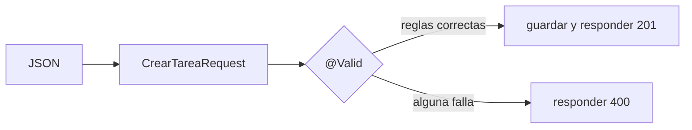
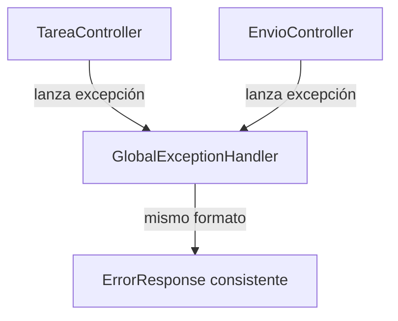
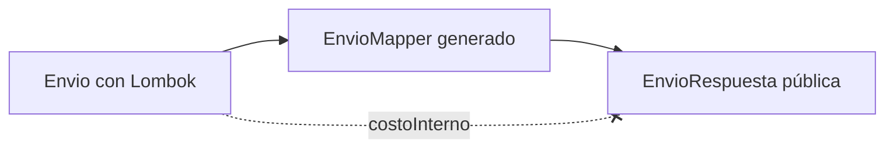
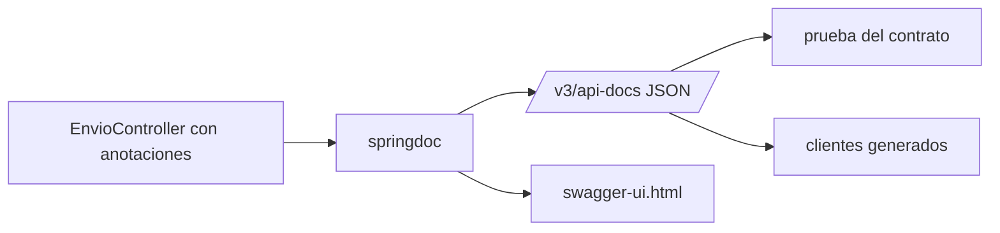

# Módulo 2: REST APIs con Spring Web

Cada tema separa el contrato HTTP (DTOs) de la persistencia interna (entidades), automatiza la validación de entrada y centraliza el manejo de errores — las tres piezas que hacen que una API REST sea predecible para quien la consume.


## Aprende construyendo

### Tema 1: Por qué DTOs en vez de entidades directamente

La API recibirá una tarea y devolverá una confirmación. La entidad representa cómo guardamos el dato; el DTO (objeto de transferencia) define qué mandamos por HTTP. Necesitas clases Java, constructores y una ruta REST.

**¿Por qué es importante?** Una base de datos puede tener códigos internos que el cliente no debe ver. Si el JSON se arma desde la entidad, cada campo nuevo puede pasar a formar parte del contrato sin que lo hayas decidido.

#### Subtema 1.1: Crea una entidad y guárdala en H2 · 10 min

**1. Contexto**

Primero tendrás una tabla pequeña en una base de datos en memoria. H2 permite practicar sin instalar ni configurar un servidor de base de datos.

**2. Hazlo tú**

Desde una carpeta vacía, genera con [Spring Initializr](https://start.spring.io/) un proyecto Maven con Java 25 y capacidades `web`, `data-jpa` y `h2`. Crea `src/main/java/com/example/demo/Tarea.java`:

```java
package com.example.demo;

import jakarta.persistence.Column;
import jakarta.persistence.Entity;
import jakarta.persistence.GeneratedValue;
import jakarta.persistence.GenerationType;
import jakarta.persistence.Id;
import jakarta.persistence.Table;

@Entity
@Table(name = "tareas")
public class Tarea {
    @Id
    @GeneratedValue(strategy = GenerationType.IDENTITY)
    private Long id;

    private String titulo;
    private int prioridad;

    @Column(name = "ubicacion_interna")
    private String ubicacionInterna;

    protected Tarea() {
    }

    public Tarea(String titulo, int prioridad, String ubicacionInterna) {
        this.titulo = titulo;
        this.prioridad = prioridad;
        this.ubicacionInterna = ubicacionInterna;
    }

    public Long getId() { return id; }
    public String getTitulo() { return titulo; }
    public int getPrioridad() { return prioridad; }
    public String getUbicacionInterna() { return ubicacionInterna; }
}
```

Crea `src/main/java/com/example/demo/TareaRepository.java`:

```java
package com.example.demo;

import org.springframework.data.jpa.repository.JpaRepository;

public interface TareaRepository extends JpaRepository<Tarea, Long> {
}
```

Añade a `src/main/resources/application.yml`:

```yaml
spring:
  jpa:
    hibernate:
      ddl-auto: create-drop
```

Desde la carpeta del proyecto, ejecuta `./mvnw test`.

**Resultado esperado:** Maven termina en `BUILD SUCCESS`; Spring encuentra el identificador `id` y configura una base H2 en memoria. `create-drop` crea las tablas al iniciar y las elimina al cerrar: no guardes aquí datos que quieras conservar.

**Fallo deliberado:** quita `@Id` y ejecuta las pruebas. **Diagnóstico:** Hibernate indica que la entidad necesita un identificador; restaura la anotación en `id`.

**3. Entiende**

`@Entity` declara una clase que JPA guarda. `TareaRepository` aprovecha operaciones de Spring Data JPA, como guardar y buscar, sin que escribas SQL para este primer ejemplo.

**4. Cierra**

Conserva entidad y repositorio. Anota cuáles campos sirven al sistema y cuál describe una ubicación interna.

#### Subtema 1.2: Devuelve solo el contrato público · 15 min

**1. Contexto**

El cliente necesita un identificador, título y prioridad. No necesita conocer `ubicacionInterna` ni la forma de la tabla.

**2. Hazlo tú**

Crea `src/main/java/com/example/demo/CrearTareaRequest.java`:

```java
package com.example.demo;

public record CrearTareaRequest(String titulo, int prioridad) {
}
```

Crea `src/main/java/com/example/demo/TareaDTO.java`:

```java
package com.example.demo;

public record TareaDTO(Long id, String titulo, int prioridad) {
    public static TareaDTO from(Tarea tarea) {
        return new TareaDTO(
                tarea.getId(),
                tarea.getTitulo(),
                tarea.getPrioridad());
    }
}
```

Crea `src/main/java/com/example/demo/ServicioTareas.java`:

```java
package com.example.demo;

import org.springframework.stereotype.Service;

@Service
public class ServicioTareas {
    private final TareaRepository repository;

    public ServicioTareas(TareaRepository repository) {
        this.repository = repository;
    }

    public TareaDTO crear(CrearTareaRequest request) {
        Tarea tarea = new Tarea(
                request.titulo(), request.prioridad(), "BODEGA-A");
        return TareaDTO.from(repository.save(tarea));
    }
}
```

Crea `src/main/java/com/example/demo/TareaController.java`:

```java
package com.example.demo;

import org.springframework.http.HttpStatus;
import org.springframework.http.ResponseEntity;
import org.springframework.web.bind.annotation.PostMapping;
import org.springframework.web.bind.annotation.RequestBody;
import org.springframework.web.bind.annotation.RequestMapping;
import org.springframework.web.bind.annotation.RestController;

@RestController
@RequestMapping("/api/tareas")
public class TareaController {
    private final ServicioTareas servicio;

    public TareaController(ServicioTareas servicio) {
        this.servicio = servicio;
    }

    @PostMapping
    public ResponseEntity<TareaDTO> crear(
            @RequestBody CrearTareaRequest request) {
        return ResponseEntity.status(HttpStatus.CREATED)
                .body(servicio.crear(request));
    }
}
```

Arranca la aplicación con `./mvnw spring-boot:run`. En otra terminal envía:

```bash
curl -i -X POST http://localhost:8080/api/tareas \
  -H 'Content-Type: application/json' \
  -d '{"titulo":"Entregar paquete","prioridad":1}'
```

**Resultado esperado:** recibes `201 Created` con JSON que incluye `id`, `titulo` y `prioridad`; no incluye `ubicacionInterna`.

**Fallo deliberado:** cambia el tipo de retorno del controller a `Tarea` y devuelve la entidad guardada. **Diagnóstico:** la respuesta JSON ahora incluye `ubicacionInterna`; vuelve a devolver `TareaDTO` para controlar los campos públicos.

**3. Entiende**

`CrearTareaRequest` describe lo que recibimos y `TareaDTO` lo que devolvemos. `TareaDTO.from` realiza la traducción en un lugar visible. La entidad no pasa por la respuesta HTTP.

**4. Cierra**

Guarda la respuesta completa y marca qué campos son parte del contrato. En el último paso comprobarás que añadir un campo interno no cambia el JSON.

#### Subtema 1.3: Cambia el modelo interno sin cambiar la API · 10 min

**1. Contexto**

El sistema puede reorganizar sus datos sin pedir a cada cliente HTTP que cambie al mismo tiempo.

**2. Hazlo tú**

Cambia en `src/main/java/com/example/demo/ServicioTareas.java` el valor interno de `"BODEGA-A"` a `"PASILLO-3"`. Vuelve a crear una tarea con el mismo `curl` del subtema anterior.

**Resultado esperado:** la respuesta conserva los campos `id`, `titulo` y `prioridad`; el cambio interno no aparece.

**Fallo deliberado:** agrega `ubicacionInterna` como componente a `TareaDTO` y pásalo desde `TareaDTO.from`. **Diagnóstico:** el JSON expone ahora un dato interno; quítalo del contrato de salida.

**3. Entiende**

El DTO mantiene estable la frontera HTTP aunque cambie la entidad. En este ejercicio no hay relaciones JPA; los errores por serializar relaciones `LAZY` dependen de cómo se carguen y de la configuración de persistencia, y se revisan más adelante con esas relaciones.

**4. Cierra**

**Práctica independiente:** añade un campo interno a `Tarea` sin modificar `TareaDTO`; crea otra tarea y comprueba que el JSON no cambia. En el proyecto integrador, trata cada cambio de DTO como un cambio del contrato que debe revisar quien consuma la API.

**Límite:** un DTO extra es útil cuando necesitas controlar nombres, validación o campos expuestos. Un proxy sin transformación ni modelo de persistencia puede reenviar el cuerpo recibido si ese cuerpo ya es el contrato correcto.

**Fuentes primarias:** [Spring MVC y cuerpos de petición](https://docs.spring.io/spring-framework/reference/web/webmvc/mvc-controller/ann-methods/requestbody.html), [bases SQL y H2 en Spring Boot](https://docs.spring.io/spring-boot/reference/data/sql.html), [conceptos de repositorio en Spring Data](https://docs.spring.io/spring-data/jpa/reference/repositories/core-concepts.html).

### Tema 2: Validación con Bean Validation y ResponseEntity

Una petición HTTP puede estar bien escrita como JSON y aun así pedir algo inválido. En este tema agregarás validación al `POST` de tareas y usarás `ResponseEntity` para que el resultado indique qué ocurrió.

**¿Por qué es importante?** Sin validación, datos imposibles llegan a la lógica y pueden guardarse; un código HTTP incorrecto confunde al cliente sobre el resultado.

**Resultado del tema:** un título vacío o una prioridad menor que 1 recibe `400`; crear una tarea recibe `201`; consultar una tarea existente o inexistente recibe `200` o `404`.

**Modelo mental:** el DTO es la puerta de entrada; `@Valid` revisa las reglas antes de que el controller guarde la tarea.



#### Subtema 2.1: Rechaza datos inválidos antes de guardar · 10 min

**1. Contexto**

El controller del Tema 1 recibe `CrearTareaRequest`, pero todavía acepta un título vacío y prioridad cero. Agrega la dependencia de validación al mismo proyecto.

**2. Hazlo tú**

En `pom.xml`, dentro de `<dependencies>`, añade:

```xml
<dependency>
    <groupId>org.springframework.boot</groupId>
    <artifactId>spring-boot-starter-validation</artifactId>
</dependency>
```

Reemplaza `src/main/java/com/example/demo/CrearTareaRequest.java` por:

```java
package com.example.demo;

import jakarta.validation.constraints.Min;
import jakarta.validation.constraints.NotBlank;

public record CrearTareaRequest(
        @NotBlank String titulo,
        @Min(1) int prioridad) {
}
```

En `src/main/java/com/example/demo/TareaController.java`, importa `jakarta.validation.Valid` y añade `@Valid` al parámetro del `POST`:

```java
@PostMapping
public ResponseEntity<TareaDTO> crear(
        @Valid @RequestBody CrearTareaRequest request) {
    return ResponseEntity.status(HttpStatus.CREATED)
            .body(servicio.crear(request));
}
```

Desde la carpeta del proyecto ejecuta `./mvnw test` y luego `./mvnw spring-boot:run`. En otra terminal prueba una petición válida y otra inválida:

```bash
curl -i -X POST http://localhost:8080/api/tareas \\
  -H 'Content-Type: application/json'   -d '{"titulo":"Entregar paquete","prioridad":1}'

curl -i -X POST http://localhost:8080/api/tareas \\
  -H 'Content-Type: application/json'   -d '{"titulo":"   ","prioridad":0}'
```

**Resultado esperado:** la primera petición responde `201 Created`; la segunda responde `400 Bad Request` y no entra al método `crear`. El cuerpo de error predeterminado puede variar según la configuración; en el Tema 3 definirás un formato propio.

**Fallo deliberado:** quita `@Valid` y repite la petición inválida. **Diagnóstico:** las anotaciones describen reglas, pero no se aplican a este parámetro si Spring no inicia la validación; vuelve a poner `@Valid`.

**3. Entiende**

`@NotBlank` rechaza `null`, `""` y texto compuesto solo por espacios. `@Min(1)` rechaza números menores que 1. `@Valid` pide validar el cuerpo convertido a `CrearTareaRequest` antes de ejecutar el método.

**4. Cierra**

Guarda los dos estados HTTP que observaste y explica qué campo hizo fallar la segunda petición. No dependas del texto del error: su formato aún es responsabilidad del siguiente tema.

#### Subtema 2.2: Devuelve 200 o 404 según exista la tarea · 15 min

**1. Contexto**

El código `200` significa que la consulta encontró y devolvió una tarea. `404` significa que el identificador no existe. Un cliente puede decidir qué mostrar mirando el estado, sin interpretar frases internas del servidor.

**2. Hazlo tú**

En `src/main/java/com/example/demo/ServicioTareas.java`, importa `java.util.Optional` y añade este método a la clase:

```java
public Optional<TareaDTO> buscar(Long id) {
    return repository.findById(id).map(TareaDTO::from);
}
```

En `src/main/java/com/example/demo/TareaController.java`, añade `GetMapping` y `PathVariable` a los imports y agrega este método:

```java
@GetMapping("/{id}")
public ResponseEntity<TareaDTO> buscar(@PathVariable Long id) {
    return servicio.buscar(id)
            .map(ResponseEntity::ok)
            .orElseGet(() -> ResponseEntity.notFound().build());
}
```

Reinicia la aplicación. Primero crea una tarea con el `curl` válido del subtema anterior; después consulta el identificador que aparece en su respuesta y luego uno que no exista:

```bash
curl -i http://localhost:8080/api/tareas/1
curl -i http://localhost:8080/api/tareas/999
```

**Resultado esperado:** la tarea existente responde `200 OK` con el DTO; el identificador ausente responde `404 Not Found` sin cuerpo. Si el ID generado no es `1`, usa el que devolvió tu petición `POST`.

**Fallo deliberado:** cambia `ResponseEntity.notFound().build()` por `ResponseEntity.ok().build()`. **Diagnóstico:** el recurso ausente ahora se anuncia como encontrado (`200`); restaura `404` para que el estado describa el resultado real.

**3. Entiende**

`Optional<TareaDTO>` representa “hay un valor o no hay valor”. `map(ResponseEntity::ok)` convierte el valor encontrado en una respuesta `200`; `orElseGet` crea la respuesta `404` cuando está vacío. El DTO evita que esta ruta vuelva a exponer la entidad.

**4. Cierra**

Registra ambos comandos y códigos de respuesta. Di en una frase qué decisión puede tomar el cliente con cada código.

#### Subtema 2.3: Comprueba las reglas con casos límite · 10 min

**1. Contexto**

Probar solo un ejemplo válido no muestra si las reglas cubren el límite ni si la validación sigue activa.

**2. Hazlo tú**

Envía tres `POST` al mismo endpoint: título `"Preparar ruta"` con prioridad `1`, título vacío con prioridad `2`, y título `"Preparar ruta"` con prioridad `0`. Anota el código de cada respuesta. Después restaura cualquier cambio deliberado y vuelve a ejecutar `./mvnw test`.

**Resultado esperado:** solo el primer `POST` crea una tarea (`201`); los otros dos reciben `400`. La ejecución termina en `BUILD SUCCESS`.

**Fallo deliberado:** elimina `@Min(1)` y vuelve a enviar prioridad `0`. **Diagnóstico:** esa petición pasa la regla restante porque `@NotBlank` solo revisa `titulo`; restaura `@Min(1)`.

**3. Entiende**

La validación del DTO protege la frontera de entrada. El código `400` informa que el cliente debe corregir su petición; `201`, `200` y `404` describen resultados distintos. El texto detallado de los errores y la respuesta consistente entre endpoints se agregan con `@RestControllerAdvice` en el Tema 3.

**4. Cierra**

**Evidencia:** conserva los estados HTTP de los tres casos y explica cuál regla se activó. Para practicar por tu cuenta, agrega `@Max(5)` a prioridad y comprueba que `6` se rechaza; todavía no cambies el formato de error.

**Práctica independiente:** agrega `@Max(5)` a `prioridad` en `CrearTareaRequest`, envía prioridad `6` con `curl` y registra el estado HTTP. Explica por qué el controller no crea la tarea.

**Transferencia al proyecto integrador:** aplica estas restricciones a cada DTO de creación de envíos y usa `201` solo cuando la creación se complete; documenta cualquier regla de negocio adicional junto a su prueba.

**Fuentes primarias:** [Spring MVC: validación de argumentos](https://docs.spring.io/spring-framework/reference/web/webmvc/mvc-controller/ann-validation.html), [Jakarta Bean Validation](https://jakarta.ee/specifications/bean-validation/).

### Tema 3: Manejo centralizado de errores con @ControllerAdvice

#### Paso 1 · Objetivo y preparación

Al finalizar podrás centralizar el manejo de excepciones de toda una API en un único lugar, sin repetir try/catch en cada controller.

**Conocimiento previo:** Tema 2 de este módulo.

#### Paso 2 · Contexto y caso real

**¿Por qué es importante?** Sin manejo centralizado, cada controller de una API con decenas de endpoints tendría que repetir su propia lógica de traducción de excepciones a respuestas HTTP, arriesgando formatos de error inconsistentes entre distintos endpoints de la misma API.

#### Paso 3 · Teoría con analogía

**Conceptos clave:** `@RestControllerAdvice`, `@ExceptionHandler`, formato de error consistente.

`@RestControllerAdvice` centraliza en una única clase el manejo de excepciones específicas que pueden ocurrir en cualquier controller de la aplicación, mapeando cada tipo de excepción a una respuesta HTTP consistente mediante métodos anotados con `@ExceptionHandler`, en vez de que cada controller individual envuelva su propia lógica en bloques `try`/`catch` repetidos. Este enfoque garantiza que todos los controllers compartan exactamente el mismo formato de respuesta de error, reduciendo la duplicación de lógica de manejo de errores.

**Analogía:** `@ControllerAdvice` es como un departamento central de atención de reclamos que procesa de forma consistente cualquier tipo de problema reportado desde cualquier sucursal de una empresa, en vez de que cada sucursal improvise su propio procedimiento particular.

**Diagrama:**



#### Paso 4 · Demostración guiada desde cero

Desde una carpeta vacía (o continuando en `ejemplo-spring-m2`, generado con `mvn` en el Tema 1), crea `src/main/java/com/example/demo/GlobalExceptionHandler.java`:

```java
package com.example.demo;

import org.springframework.http.ResponseEntity;
import org.springframework.web.bind.MethodArgumentNotValidException;
import org.springframework.web.bind.annotation.ExceptionHandler;
import org.springframework.web.bind.annotation.RestControllerAdvice;

@RestControllerAdvice
public class GlobalExceptionHandler {

    @ExceptionHandler(MethodArgumentNotValidException.class)
    public ResponseEntity<ErrorResponse> manejarValidacion(MethodArgumentNotValidException ex) {
        return ResponseEntity.badRequest().body(new ErrorResponse(ex.getMessage()));
    }

    @ExceptionHandler(RecursoNoEncontradoException.class)
    public ResponseEntity<ErrorResponse> manejarNoEncontrado(RecursoNoEncontradoException ex) {
        return ResponseEntity.status(404).body(new ErrorResponse(ex.getMessage()));
    }
}
```

**Explicación línea por línea:** `@RestControllerAdvice` marca la clase como manejador global aplicado a todos los controllers; cada método `@ExceptionHandler(Tipo.class)` intercepta ese tipo de excepción específico lanzado desde cualquier controller y lo traduce a una respuesta HTTP con un formato (`ErrorResponse`) consistente en toda la API.

Ejecuta las pruebas reales confirmando que ambos tipos de error usan el mismo formato:

```bash
# ejecuta las pruebas Java con Maven que verifican el formato de error consistente
cd ejemplo-spring-m2
./mvnw test
```

**Resultado esperado:** tanto un error de validación (`400`) como un recurso no encontrado (`404`) devuelven un cuerpo JSON con exactamente la misma estructura de `ErrorResponse`, confirmando que el formato de error es consistente en toda la API sin que cada controller lo implemente por separado.

**Fallo deliberado:** elimina `GlobalExceptionHandler` y deja que `RecursoNoEncontradoException` se propague sin manejar. Spring devuelve su página de error genérica por defecto (`500 Internal Server Error` con un cuerpo que no sigue el formato `ErrorResponse` de la API) — diagnostica confirmando que sin un `@ExceptionHandler` explícito para cada excepción de negocio, el cliente recibe una respuesta inconsistente con el resto del contrato de la API.

#### Paso 5 · Práctica guiada — repetición progresiva

1. Agrega un tercer `@ExceptionHandler` para una excepción de negocio nueva y confirma que reutiliza el mismo `ErrorResponse`.
2. Elimina temporalmente el handler de `RecursoNoEncontradoException` y documenta la respuesta genérica real que Spring produce en su lugar.
3. Compara cuántas líneas de código requeriría manejar el mismo error con `try`/`catch` repetido en tres controllers distintos, frente a un único handler centralizado.
4. Escribe de memoria (sin mirar) una clase `@RestControllerAdvice` con dos `@ExceptionHandler` que devuelvan el mismo formato de error.

**Pista:** cada `@ExceptionHandler` maneja un tipo de excepción específico — si una excepción no tiene un handler correspondiente, cae en el comportamiento genérico de Spring, no en un handler por defecto tuyo.

#### Paso 6 · Práctica independiente

**Completa el código:** rellena el espacio para que la clase intercepte excepciones de todos los controllers:

```java
@____
public class GlobalExceptionHandler {
    @ExceptionHandler(RecursoNoEncontradoException.class)
    public ResponseEntity<ErrorResponse> manejarNoEncontrado(RecursoNoEncontradoException ex) { ... }
}
```

**Reto de memoria sin mirar:** cierra este documento y escribe, solo de memoria, un `@RestControllerAdvice` con handlers para una excepción de validación y una de recurso no encontrado. Compara después contra el patrón del Paso 4.

#### Paso 7 · Cierre y evidencia

Ya centralizas el manejo de excepciones de toda una API en un único lugar, con un formato de error consistente y sin repetir try/catch en cada controller. Esto cierra el ciclo básico de una API REST con Spring Web; el siguiente módulo persiste datos reales con JPA. **Evidencia:** entrega el resultado con el `ErrorResponse` consistente entre un error `400` y un `404`, y la respuesta genérica real al quitar el handler correspondiente. Fuentes oficiales: [Spring — Exception Handling](https://docs.spring.io/spring-framework/reference/web/webmvc/mvc-controller/ann-exceptionhandler.html).

**Errores comunes:** repetir try/catch en cada controller para el mismo tipo de error, en vez de centralizarlo; capturar `Exception` genérico sin distinguir el tipo real, filtrando detalles internos (stack traces) hacia el cliente.

**Cuándo no usarlo:** para un endpoint verdaderamente único que necesita un manejo de error muy específico y no reutilizable en ningún otro lugar de la API, un `try`/`catch` local puntual puede ser más simple que agregar un handler global de un solo uso.

---

El manejo centralizado de errores de este tema es el que unifica las respuestas de error del proyecto integrador de este track (microservicio productivo, Módulo 12).

### Tema 4: Lombok y MapStruct sin exponer datos internos

#### Paso 1 · Objetivo y preparación
Al finalizar podrás reducir código repetitivo con Lombok, generar el mapeo entre modelo y DTO con MapStruct en tiempo de compilación, y hacer que el compilador falle si un campo del DTO queda sin mapear. Prerrequisito: Tema 1 de este módulo (DTOs).

#### Paso 2 · Contexto y caso real
El backend de entregas tenía clases de 200 líneas de getters y setters, y mapeos manuales donde un campo nuevo se olvidaba con frecuencia. Además, un `toString()` generado imprimía el costo interno en los logs. Lombok y MapStruct son estándar de facto en proyectos Spring empresariales: un caso real que encontrarás en casi cualquier código existente.

#### Paso 3 · Teoría, modelo mental y analogía
**Lombok** es un procesador de anotaciones: `@Getter`, `@Setter`, `@Builder` o `@ToString` generan código en el bytecode al compilar. **MapStruct** genera la implementación de una interfaz `@Mapper` con código Java normal (sin reflexión); `componentModel = "spring"` la registra como bean y `unmappedTargetPolicy = ERROR` convierte un campo sin mapear en error de compilación. Como ambos son procesadores de anotaciones, Lombok debe correr primero: de eso se encarga `lombok-mapstruct-binding`.

**Analogía:** Lombok es el molde que fabrica las piezas repetidas; MapStruct es la plantilla de traspaso que dice qué dato del formulario interno va en qué casilla del formulario público.

**Diagrama:**



#### Paso 4 · Demostración guiada desde cero
**Ejemplo independiente (desde cero):** este tema se reproduce en una **carpeta vacía**, como **proyecto nuevo**, sin estado de otros temas.

```bash
mkdir lombok-mapstruct && cd lombok-mapstruct
curl -fsSL https://start.spring.io/starter.zip -d dependencies=web,lombok -d javaVersion=25 -o app.zip
unzip -q app.zip
```

Crea `pom.xml (agrega estos fragmentos)`:

```xml
<!-- 1) Dentro de <dependencies>: -->
<dependency>
  <groupId>org.mapstruct</groupId>
  <artifactId>mapstruct</artifactId>
  <version>1.6.3</version>
</dependency>

<!-- 2) En maven-compiler-plugin, dentro de <annotationProcessorPaths>,
     junto al path de lombok que ya generó Spring Initializr: -->
<path>
  <groupId>org.mapstruct</groupId>
  <artifactId>mapstruct-processor</artifactId>
  <version>1.6.3</version>
</path>
<path>
  <groupId>org.projectlombok</groupId>
  <artifactId>lombok-mapstruct-binding</artifactId>
  <version>0.2.0</version>
</path>
```

Crea `src/main/java/com/example/demo/Envio.java`:

```java
package com.example.demo;

import lombok.AllArgsConstructor;
import lombok.Builder;
import lombok.Getter;
import lombok.NoArgsConstructor;
import lombok.Setter;
import lombok.ToString;

import java.math.BigDecimal;

// Modelo interno. Lombok genera getters, setters, constructores y builder al compilar.
@Getter
@Setter
@NoArgsConstructor
@AllArgsConstructor
@Builder
@ToString(exclude = "costoInterno")       // no imprimir datos sensibles en logs
public class Envio {
    private Long id;
    private String guia;
    private String ciudadDestino;
    private int kilos;
    private BigDecimal costoInterno;      // dato interno: NO debe salir en la API
}
```

Crea `src/main/java/com/example/demo/EnvioRespuesta.java`:

```java
package com.example.demo;

// DTO público: lo que ve el cliente de la API
public record EnvioRespuesta(String guia, String destino, int kilos) {}
```

Crea `src/main/java/com/example/demo/EnvioMapper.java`:

```java
package com.example.demo;

import org.mapstruct.Mapper;
import org.mapstruct.Mapping;
import org.mapstruct.ReportingPolicy;

// MapStruct genera la implementación al compilar: código Java normal, sin reflexión
@Mapper(componentModel = "spring", unmappedTargetPolicy = ReportingPolicy.ERROR)
public interface EnvioMapper {
    @Mapping(source = "ciudadDestino", target = "destino")
    EnvioRespuesta aRespuesta(Envio envio);
}
```

Crea `src/test/java/com/example/demo/EnvioMapperTest.java`:

```java
package com.example.demo;

import org.junit.jupiter.api.Test;
import org.springframework.beans.factory.annotation.Autowired;
import org.springframework.boot.test.context.SpringBootTest;

import java.math.BigDecimal;

import static org.assertj.core.api.Assertions.assertThat;

@SpringBootTest
class EnvioMapperTest {

    @Autowired
    EnvioMapper mapper;

    @Test
    void mapeaCamposPublicosYNoExponeElCostoInterno() {
        Envio envio = Envio.builder()
                .id(7L).guia("BO-004512").ciudadDestino("Bogotá").kilos(3)
                .costoInterno(new BigDecimal("4100.50"))
                .build();

        EnvioRespuesta respuesta = mapper.aRespuesta(envio);

        assertThat(respuesta).isEqualTo(new EnvioRespuesta("BO-004512", "Bogotá", 3));
        assertThat(envio.toString()).doesNotContain("4100.50");
        System.out.println("Respuesta: " + respuesta);
        System.out.println("Log seguro: " + envio);
    }
}
```

**Ejecuta el ejemplo:**

```bash
./mvnw test
```

**Resultado esperado:**

```text
Respuesta: EnvioRespuesta[guia=BO-004512, destino=Bogotá, kilos=3]
Log seguro: Envio(id=7, guia=BO-004512, ciudadDestino=Bogotá, kilos=3)
...
[INFO] Tests run: 2, Failures: 0, Errors: 0, Skipped: 0
[INFO] BUILD SUCCESS
```

Las líneas de Maven se resumen: también verás el log de arranque de Spring y la prueba `DemoApplicationTests` que genera Initializr. `costoInterno` no aparece ni en la respuesta ni en el log. Las versiones de MapStruct y del binding son las vigentes al escribir este tema; consulta la documentación si hay una más nueva.

**Fallo deliberado:** Borra la línea `@Mapping(source = "ciudadDestino", target = "destino")`. La compilación falla con `Unmapped target property: "destino".` porque el DTO tiene un campo que MapStruct no sabe llenar. Con la política por defecto (WARN) solo verías una advertencia y la API devolvería `destino: null` en producción.

#### Paso 5 · Práctica guiada
Agrega al DTO el campo `estado` y al modelo `estadoActual`, y mapéalos. **Pista:** agrega el campo a ambos lados, ejecuta `./mvnw test` para ver el error de campo sin mapear y luego agrega el `@Mapping` correspondiente.

#### Paso 6 · Práctica independiente
Abre `target/generated-sources/annotations/.../EnvioMapperImpl.java` y explica el código que generó MapStruct. Luego investiga por qué `@Data` en entidades JPA con relaciones bidireccionales puede causar `StackOverflowError` en `toString` y `hashCode`.

#### Paso 7 · Cierre y evidencia
Entrega como evidencia la salida real del Paso 4 y la explicación del fallo deliberado. **¿Por qué es importante?** porque son herramientas presentes en la mayoría del código Spring que vas a mantener, y usarlas mal expone datos o produce errores difíciles de rastrear.
**Fuente oficial:** [MapStruct Reference Guide](https://mapstruct.org/documentation/stable/reference/html/), [Project Lombok: features](https://projectlombok.org/features/).
**Conceptos clave:** procesador de anotaciones, Lombok, `@Builder`, `@ToString(exclude)`, MapStruct, `@Mapper`, `unmappedTargetPolicy`, `lombok-mapstruct-binding`.
**Cuándo no usarlo:** no uses `@Data` en entidades JPA (genera `equals`/`hashCode` sobre todos los campos). Para DTOs simples, un `record` de Java ya no necesita Lombok.

**Transferencia al proyecto integrador «Backend profesional de entregas»:** mapea las entidades de entregas a DTOs con MapStruct y política de error, y excluye de `toString` los datos personales.
Como **siguiente** paso, aplica lo aprendido en el proyecto integrador del track y compara el resultado con lo que esperabas.
**Errores comunes:** usar `@Data` en una entidad JPA en vez de `@Getter`/`@Setter` explícitos (genera `equals`/`hashCode` sobre todos los campos, incluidas relaciones, y puede producir `StackOverflowError`), y dejar la política de MapStruct en `WARN` en vez de `unmappedTargetPolicy = ERROR`, de modo que un campo nuevo del DTO queda sin mapear y llega como `null` a producción sin que la compilación avise.

### Tema 5: OpenAPI con springdoc: el contrato como prueba

#### Paso 1 · Objetivo y preparación
Al finalizar podrás generar la especificación OpenAPI de tu API con springdoc, documentar operaciones, parámetros, respuestas y esquemas con anotaciones, y escribir una prueba que falle si el contrato publicado cambia. Prerrequisitos: Temas 1 a 3 de este módulo.

#### Paso 2 · Contexto y caso real
El equipo móvil de RutaFlow descubría los cambios de la API cuando la app fallaba. Un contrato OpenAPI publicado y probado es el caso real que permite a otros equipos generar clientes, probar contra mocks y detectar cambios antes de desplegar.

#### Paso 3 · Teoría, modelo mental y analogía
**OpenAPI** es un formato estándar (JSON o YAML) que describe rutas, parámetros, respuestas y esquemas de una API HTTP. **springdoc** inspecciona tus controladores en tiempo de ejecución y publica el documento en `/v3/api-docs` y una interfaz en `/swagger-ui.html`. Las anotaciones `@Operation`, `@ApiResponse`, `@Parameter` y `@Schema` agregan la información que el código no expresa (resúmenes, ejemplos, códigos de error). Probar el documento convierte la documentación en un contrato verificable.

**Analogía:** el contrato OpenAPI es el plano eléctrico de la casa: quien llega a instalar algo no necesita romper paredes para saber dónde están los cables.

**Diagrama:**



#### Paso 4 · Demostración guiada desde cero
**Ejemplo independiente (desde cero):** este tema se reproduce en una **carpeta vacía**, como **proyecto nuevo**, sin estado de otros temas.

```bash
mkdir springdoc && cd springdoc
curl -fsSL https://start.spring.io/starter.zip -d dependencies=web -d javaVersion=25 -o app.zip
unzip -q app.zip
```

Crea `pom.xml (agrega este fragmento)`:

```xml
<!-- Dentro de <dependencies>. Usa la línea 3.x de springdoc, compatible con Spring Boot 4 -->
<dependency>
  <groupId>org.springdoc</groupId>
  <artifactId>springdoc-openapi-starter-webmvc-ui</artifactId>
  <version>3.0.0</version>
</dependency>
```

Crea `src/main/java/com/example/demo/EnvioController.java`:

```java
package com.example.demo;

import io.swagger.v3.oas.annotations.Operation;
import io.swagger.v3.oas.annotations.Parameter;
import io.swagger.v3.oas.annotations.media.Schema;
import io.swagger.v3.oas.annotations.responses.ApiResponse;
import io.swagger.v3.oas.annotations.tags.Tag;
import org.springframework.http.ResponseEntity;
import org.springframework.web.bind.annotation.*;

import java.util.Map;

@RestController
@RequestMapping("/api/envios")
@Tag(name = "Envíos", description = "Consulta pública del estado de un envío")
public class EnvioController {

    @Schema(description = "Estado público de un envío")
    public record EstadoEnvio(
            @Schema(example = "BO-004512") String guia,
            @Schema(example = "en ruta", allowableValues = {"registrado", "en ruta", "entregado"}) String estado) {}

    private final Map<String, String> estados = Map.of("BO-004512", "en ruta");

    @Operation(summary = "Consultar el estado de un envío por guía")
    @ApiResponse(responseCode = "200", description = "Envío encontrado")
    @ApiResponse(responseCode = "404", description = "La guía no existe")
    @GetMapping("/{guia}")
    public ResponseEntity<EstadoEnvio> estado(
            @Parameter(description = "Guía con formato XX-000000", example = "BO-004512") @PathVariable String guia) {
        String estado = estados.get(guia);
        return estado == null ? ResponseEntity.notFound().build() : ResponseEntity.ok(new EstadoEnvio(guia, estado));
    }
}
```

Crea `src/test/java/com/example/demo/ContratoOpenApiTest.java`:

```java
package com.example.demo;

import org.junit.jupiter.api.Test;
import org.springframework.beans.factory.annotation.Value;
import org.springframework.boot.test.context.SpringBootTest;

import java.net.URI;
import java.net.http.HttpClient;
import java.net.http.HttpRequest;
import java.net.http.HttpResponse;

import static org.assertj.core.api.Assertions.assertThat;

@SpringBootTest(webEnvironment = SpringBootTest.WebEnvironment.RANDOM_PORT)
class ContratoOpenApiTest {

    @Value("${local.server.port}")
    int puerto;

    @Test
    void elContratoPublicadoDescribeLaOperacionYSusRespuestas() throws Exception {
        HttpResponse<String> respuesta = HttpClient.newHttpClient().send(
                HttpRequest.newBuilder(URI.create("http://localhost:" + puerto + "/v3/api-docs")).build(),
                HttpResponse.BodyHandlers.ofString());

        String contrato = respuesta.body();
        System.out.println("OpenAPI: " + contrato.length() + " caracteres");
        assertThat(respuesta.statusCode()).isEqualTo(200);
        assertThat(contrato)
                .contains("\"/api/envios/{guia}\"")
                .contains("Consultar el estado de un envío por guía")
                .contains("La guía no existe")
                .contains("\"EstadoEnvio\"");
    }
}
```

**Ejecuta el ejemplo:**

```bash
./mvnw test
./mvnw spring-boot:run   # luego abre http://localhost:8080/swagger-ui.html
```

**Resultado esperado:**

```text
OpenAPI: 1234 caracteres
...
[INFO] Tests run: 2, Failures: 0, Errors: 0, Skipped: 0
[INFO] BUILD SUCCESS
```

La prueba levanta la aplicación en un puerto aleatorio y lee el contrato real. El número de caracteres varía. En `swagger-ui.html` puedes ejecutar `GET /api/envios/BO-004512` desde el navegador. La versión de springdoc indicada es la de la línea 3.x vigente al escribir el tema; revisa la tabla de compatibilidad si usas otra versión de Spring Boot.

**Fallo deliberado:** Borra la línea `@ApiResponse(responseCode = "404", description = "La guía no existe")`. La prueba falla porque el contrato ya no contiene `La guía no existe`: el endpoint sigue devolviendo 404, pero el contrato ya no lo documenta. Ese desfase entre comportamiento y documentación es exactamente lo que la prueba debe atrapar.

#### Paso 5 · Práctica guiada
Documenta un `POST /api/envios` que reciba un `record` validado con `@NotBlank` y verifica en la prueba que el esquema marca el campo como requerido. **Pista:** springdoc traduce `@NotBlank` a la lista `required` del esquema; busca en el contrato el nombre del campo dentro de esa lista.

#### Paso 6 · Práctica independiente
Guarda el contrato en `openapi.json` dentro del repositorio y escribe una prueba que compare el contrato actual con el guardado, para que todo cambio de API sea explícito en la revisión de código.

#### Paso 7 · Cierre y evidencia
Entrega como evidencia la salida real del Paso 4 y la explicación del fallo deliberado. **¿Por qué es importante?** porque las APIs se consumen por otros equipos y otras empresas, y un contrato verificable evita roturas silenciosas.
**Fuente oficial:** [springdoc-openapi](https://springdoc.org/), [OpenAPI Specification](https://spec.openapis.org/oas/latest.html).
**Conceptos clave:** OpenAPI, springdoc, `/v3/api-docs`, Swagger UI, `@Operation`, `@ApiResponse`, `@Schema`, prueba de contrato.
**Cuándo no usarlo:** para APIs internas de un solo consumidor que cambian a diario, un contrato formal puede ser burocracia; aun así, documenta los errores que devuelves.

**Transferencia al proyecto integrador «Backend profesional de entregas»:** publica el contrato del backend de entregas y agrega la prueba de contrato al pipeline.
Como **siguiente** paso, aplica lo aprendido en el proyecto integrador del track y compara el resultado con lo que esperabas.
**Errores comunes:** borrar o cambiar una anotación `@ApiResponse`/`@Operation` sin volver a correr `ContratoOpenApiTest`, dejando que el contrato publicado describa una respuesta que el endpoint ya no documenta, y versionar `openapi.json` sin una prueba que lo compare contra el contrato real, lo que permite que la API cambie sin que nadie lo note en la revisión de código.

## Laboratorio práctico

**Objetivo del laboratorio:** construir una API REST con validación de entrada y manejo centralizado de errores.

**Requisitos previos:** Módulos 0-1 completados.

| Paso | Acción | Código | Explicación |
|---|---|---|---|
| 1 | Crear GET/POST `/tareas` con DTOs | Ver Tema 1 | No expone la entidad directamente |
| 2 | Agregar validación con `@Valid` | Ver Tema 2 | `@NotBlank`, `@Min` en el DTO |
| 3 | Devolver `ResponseEntity` con códigos correctos | Ver Tema 2 | 201 al crear, 404 si no existe |
| 4 | Crear un `@ControllerAdvice` con `@ExceptionHandler` | Ver Tema 3 | Captura una excepción de negocio, devuelve 400 |
| 5 | Probar con curl un body inválido | — | Verifica el mensaje de error estructurado |

**Verificación:** el laboratorio se considera exitoso si ningún endpoint expone la entidad JPA directamente, y si una entrada inválida produce un error 400 con un mensaje estructurado consistente, sin ningún try/catch repetido en el controller.

**Errores comunes y soluciones**

- **Exponer la entidad JPA directamente en la respuesta HTTP.** Usa siempre un DTO específico para el contrato de la API.
- **Olvidar `@Valid` en el parámetro del controller.** Sin él, las anotaciones de Bean Validation en el DTO no se verifican.
- **Repetir try/catch en cada controller para el mismo tipo de error.** Centraliza ese manejo en un `@ControllerAdvice`.

---


## Laboratorio de transferencia

### Tema 6: Paginación HTTP con validación y un límite de recursos explícito

#### Paso 1 · Objetivo y preparación
Al finalizar expondrás una colección paginada y rechazarás parámetros que exceden el contrato. **Prerrequisitos:** Java, Maven, REST y Bean Validation. JDK 25 y curl; comprueba `java --version`. Ejemplo independiente desde proyecto nuevo con Spring Initializr.

#### Paso 2 · Contexto y caso real
El proyecto integrador muestra envíos en un panel. Devolver toda la colección carga el servidor y el navegador. **¿Por qué es importante?** El cliente no debería poder pedir un millón de elementos porque cambió un parámetro.

#### Paso 3 · Teoría, modelo mental y analogía
Una página tiene posición y tamaño. La validación restringe el trabajo solicitado antes de ejecutar la lógica. Un orden estable requiere desempate único. **Analogía:** entregar carpetas en lotes permite controlar cuánto trabajo se hace en cada turno. El límite es que paginación por offset puede desplazarse cuando cambian datos; para recorridos grandes considera cursor y consistencia explícita.

#### Paso 4 · Demostración guiada desde cero
Crea el proyecto desde una carpeta vacía:
```bash
curl -fsSL 'https://start.spring.io/starter.zip?type=maven-project&language=java&bootVersion=4.0.9&baseDir=pagina-demo&groupId=com.example&artifactId=pagina-demo&packageName=com.example.pagina&javaVersion=25&dependencies=web,validation' -o pagina-demo.zip
unzip pagina-demo.zip
cd pagina-demo
```
Si Initializr ya no ofrece esa versión estable, selecciona una estable compatible con Java 25 en su UI, conserva Web y Validation y registra la versión elegida; no uses una milestone sin declarar el cambio. Crea `src/main/java/com/example/pagina/EnviosController.java`:
```java
package com.example.pagina;

import jakarta.validation.constraints.Max;
import jakarta.validation.constraints.Min;
import org.springframework.web.bind.annotation.*;
import java.util.List;
import java.util.stream.IntStream;

@RestController
public class EnviosController {
    record Envio(int id, String estado) {}
    record Pagina(List<Envio> items, int page, int size, boolean hasNext) {}
    private final List<Envio> data = IntStream.rangeClosed(1, 5)
        .mapToObj(id -> new Envio(id, "creado")).toList();

    @GetMapping("/envios")
    public Pagina listar(@RequestParam(defaultValue = "0") @Min(0) @Max(1000) int page,
                         @RequestParam(defaultValue = "2") @Min(1) @Max(100) int size) {
        // El tamaño se valida antes de calcular el corte.
        long offset = (long) page * size;
        var items = data.stream().skip(offset).limit(size).toList();
        return new Pagina(items, page, size, offset + items.size() < data.size());
    }
}
```
Conserva la clase Application generada. Ejecuta:
```bash
./mvnw spring-boot:run
```
En Windows usa `mvnw.cmd spring-boot:run`. En otra terminal:
```bash
curl -i 'http://localhost:8080/envios?page=0&size=2'
curl -i 'http://localhost:8080/envios?page=1&size=2'
curl -i 'http://localhost:8080/envios?size=1000000'
```
**Resultado esperado:** primera página IDs 1 y 2, segunda 3 y 4; tamaño excesivo produce 400 por validación de método del controlador. Explica cada bloque: DTOs, datos de muestra, parámetros validados y selección. No se presenta como consulta JPA: la colección es en memoria para aislar el contrato HTTP.

#### Paso 5 · Práctica guiada
**Fallo deliberado:** cambia la llamada a `size=0`. El servidor debe rechazarla. **Pista:** no transformes un tamaño inválido en respuesta vacía con estado 200; revisa validación y que esté instalado el starter Validation. Corrige el parámetro y recupera los datos.

#### Paso 6 · Práctica independiente
Comprueba última página, página posterior al final, valor negativo y texto en `size`. Después adapta el contrato a un repositorio con Pageable y orden por ID. Comprueba que la base de datos aplica límite y orden antes de cargar resultados.

#### Paso 7 · Cierre y evidencia
**Evidencia de aprendizaje:** comandos con estados HTTP y cuerpos de las páginas, fallo/corrección y decisión de límite. El siguiente paso es observar la consulta SQL, índice y coste del recuento. **Errores comunes:** cargar todo antes de paginar, aceptar tamaño ilimitado y mezclar resultados sin orden determinista. **Límites y decisión de uso:** la lista estática no demuestra escalabilidad, concurrencia ni autorización por recurso.

**Fuentes oficiales:** [Spring Data: consultas y paginación](https://docs.spring.io/spring-data/commons/reference/repositories/query-methods-details.html) y [Spring MVC validación](https://docs.spring.io/spring-framework/reference/web/webmvc/mvc-controller/ann-validation.html).
