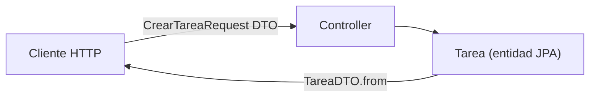
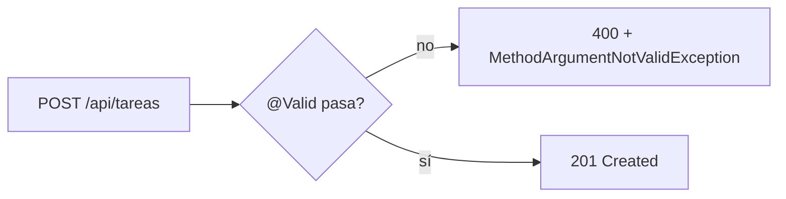
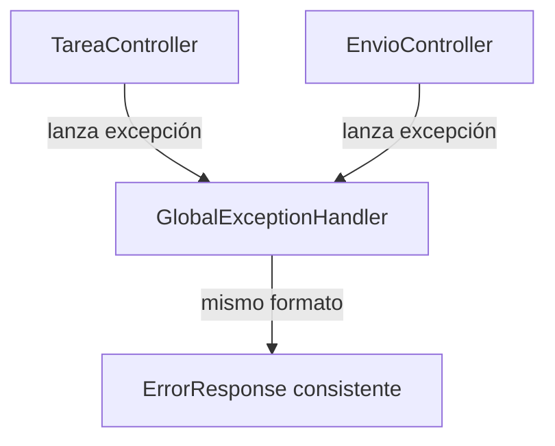
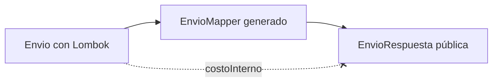
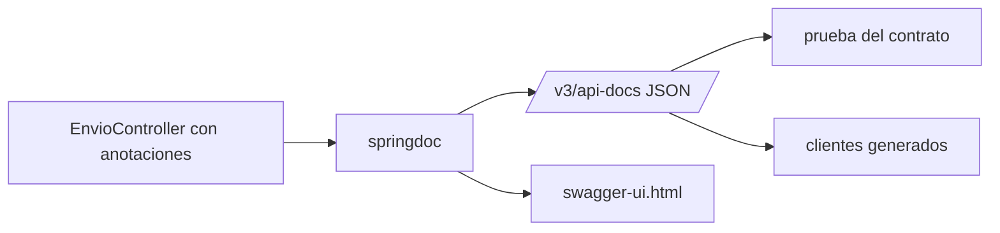

# Módulo 2: REST APIs con Spring Web

Cada tema declara nivel, duración y una salida verificable. El módulo separa el contrato HTTP (DTOs) de la persistencia interna (entidades), automatiza la validación de entrada y centraliza el manejo de errores: las tres piezas que hacen que una API REST sea predecible para quien la consume.

## Aprende construyendo

### Tema 1: Por qué DTOs en vez de entidades directamente · Intermedio · 30 min

**Prerrequisito:** Módulo 1 (Spring Initializr, perfiles). JDK 27, Maven y un editor.

**Al terminar podrás:** explicar por qué exponer entidades JPA directamente es riesgoso y separar el contrato HTTP de la persistencia con DTOs.

#### Aprende

**¿Por qué es importante?** Una API de paquetes recibe datos de clientes externos y no debe exponer columnas internas de la base de datos ni aceptar valores imposibles en la entrada; una frontera explícita entre el contrato público y el modelo interno protege ambos lados de ese cambio.

**Conceptos clave:** DTO (Data Transfer Object), desacoplar el contrato HTTP de la persistencia, relaciones `lazy`.

Un DTO representa el contrato de transporte hacia/desde el cliente HTTP, mientras que una entidad JPA (Módulo 3) representa el modelo de persistencia interno. Separarlos evita dos problemas concretos. Primero, exponer entidades filtraría detalles internos de la persistencia hacia el contrato público (campos que existen solo por el mapeo relacional, o relaciones que no deberían ser visibles ni modificables desde fuera). Segundo, puede producir errores de serialización con relaciones `lazy`, donde Jackson intentaría serializar una relación que Hibernate todavía no cargó, produciendo una excepción en tiempo de ejecución. Los DTOs son una capa de traducción explícita: renombrar un campo interno no rompe el contrato público si el DTO permanece estable.

**Analogía:** exponer entidades directamente es como mostrar a un cliente externo el inventario interno completo de un almacén, con sus códigos internos de ubicación; un DTO es como un catálogo de cara al público, que puede reorganizarse internamente sin que el catálogo cambie.

**Diagrama:**



#### Practica

**Demo paso a paso.** Desde una carpeta vacía, genera el proyecto con `web` y `validation`:

```bash
# descarga el proyecto y ejecuta las pruebas Java con Maven
mkdir ejemplo-spring-m2
cd ejemplo-spring-m2
curl -fsSL https://start.spring.io/starter.zip -d dependencies=web,validation -d javaVersion=25 -o app.zip
unzip app.zip
./mvnw test
```

1. Crea `src/main/java/com/example/demo/TareaController.java` recibiendo y devolviendo DTOs, nunca la entidad `Tarea`:

```java
package com.example.demo;

import org.springframework.http.HttpStatus;
import org.springframework.http.ResponseEntity;
import org.springframework.web.bind.annotation.*;

@RestController
@RequestMapping("/api/tareas")
public class TareaController {

    private final ServicioTareas servicio;

    public TareaController(ServicioTareas servicio) {
        this.servicio = servicio;
    }

    @PostMapping
    public ResponseEntity<TareaDTO> crear(@RequestBody CrearTareaRequest request) {
        Tarea tarea = servicio.crear(request);
        return ResponseEntity.status(HttpStatus.CREATED).body(TareaDTO.from(tarea));
    }
}
```

**Explicación línea por línea:** `crear` recibe `CrearTareaRequest` (DTO de entrada, no la entidad) y devuelve `TareaDTO` (DTO de salida); `TareaDTO.from(tarea)` traduce explícitamente la entidad interna hacia el contrato público, controlando qué campos se exponen.

2. Envía una petición real y confirma que la respuesta expone solo los campos del DTO:

```bash
curl -i -X POST http://localhost:8080/api/tareas -H 'Content-Type: application/json' -d '{"titulo":"Entregar paquete","prioridad":1}'
```

**Resultado esperado:** la respuesta es `201 Created` con un cuerpo JSON que contiene únicamente los campos de `TareaDTO`, sin ningún campo interno de la entidad que no esté mapeado, confirmando que el DTO controla la superficie expuesta.

**Fallo deliberado:** cambia el controller para devolver la entidad `Tarea` directamente. Si `Tarea` tiene una relación `@ManyToOne(fetch = FetchType.LAZY)`, Jackson intenta serializarla fuera de una sesión de Hibernate activa y produce `LazyInitializationException`. Diagnostica confirmando que exponer entidades directamente no es solo un problema de diseño, sino una fuente real de errores en ejecución.

**Ejercicios.**

1. Agrega un campo interno a la entidad `Tarea` (por ejemplo `costoInterno`) y confirma que no aparece en la respuesta porque el DTO no lo mapea.
2. Renombra un campo de la entidad sin renombrar el DTO y confirma que el contrato público no cambia.
3. Provoca el fallo de la relación lazy y documenta el stack trace exacto de `LazyInitializationException`.
4. Escribe de memoria un DTO de entrada, uno de salida y el método `from()` que traduce la entidad.

**Pista:** si un campo de la entidad no debe ser visible externamente, la forma más simple de garantizarlo es que el DTO de salida no lo incluya.

**Completa el código:** rellena el espacio para traducir la entidad al DTO:

```java
public ResponseEntity<TareaDTO> crear(@RequestBody CrearTareaRequest request) {
    Tarea tarea = servicio.crear(request);
    return ResponseEntity.status(HttpStatus.CREATED).body(TareaDTO.____(tarea));
}
```

**Reto de memoria:** cierra este documento y escribe un DTO de entrada, uno de salida y un controller que use ambos sin exponer la entidad.

#### Aplica

**Reto abierto.** Modela una API de envíos con `Envio` (entidad interna con `costoInterno`) y `EnvioRespuesta` (DTO público). Agrega un segundo DTO para creación. Demuestra con dos peticiones que un campo interno nunca sale y que renombrar un campo de la entidad no rompe el contrato.

**Checklist de salida.**

- [ ] Ningún endpoint devuelve una entidad JPA directamente.
- [ ] El DTO de salida documenta qué campos públicos expone.
- [ ] Un campo interno agregado a la entidad no aparece en la respuesta.
- [ ] El fallo por serialización lazy está reproducido y explicado.
- [ ] Los nombres de DTO y entidad se distinguen sin ambigüedad.

**Si falla.** Si un campo interno aparece en la respuesta, revisa que el controller devuelva el DTO y que Jackson no esté serializando la entidad por otra ruta. Si aparece `LazyInitializationException`, estás devolviendo la entidad: vuelve al DTO.

**Siguiente paso:** el Tema 2 automatiza la validación de esos DTOs de entrada.

**Errores comunes:** devolver entidades JPA directamente; nombrar el DTO igual que la entidad, generando confusión sobre cuál es cuál.

**Límites y decisión de uso:** para una API interna de solo lectura sin persistencia relacional (por ejemplo, un proxy que reenvía datos sin transformarlos), el DTO puede ser innecesario si no hay una entidad que proteger.

**Fuente oficial:** [Spring Web MVC](https://docs.spring.io/spring-framework/reference/web/webmvc.html).

**Transferencia al proyecto integrador:** los DTOs que diseñes aquí son los que expondrá la API del microservicio productivo.

### Tema 2: Validación con Bean Validation y ResponseEntity · Intermedio · 25 min

**Prerrequisito:** Tema 1 de este módulo.

**Al terminar podrás:** declarar restricciones sobre un DTO de entrada y controlar explícitamente el código de estado HTTP devuelto.

#### Aprende

**¿Por qué es importante?** Una API de paquetes no debe aceptar valores imposibles (un título vacío, una prioridad negativa); validar la entrada en la frontera evita que datos inválidos lleguen siquiera a la lógica de negocio.

**Conceptos clave:** anotaciones declarativas (`@NotBlank`, `@Min`), `@Valid`, códigos de estado HTTP explícitos.

Bean Validation declara restricciones sobre los campos del DTO mediante anotaciones (`@NotBlank`, `@Min`, `@Size`, `@Email`), verificadas automáticamente por Spring cuando el parámetro del controller se marca con `@Valid`, sin código imperativo repetido en cada endpoint. Si la validación falla, Spring lanza `MethodArgumentNotValidException` antes de que el cuerpo del método se ejecute. `ResponseEntity` permite controlar el código de estado según el resultado real (`201` al crear, `404` si el recurso no existe), en vez de que Spring infiera un único código genérico.

**Analogía:** Bean Validation es un formulario que rechaza automáticamente cualquier entrada que no cumpla reglas declaradas, sin que un revisor verifique cada regla en cada envío; usar el código HTTP correcto es usar el sello preciso de cada resultado en vez de un sello genérico.

**Diagrama:**



#### Practica

**Demo paso a paso.** Desde una carpeta vacía (o continuando en `ejemplo-spring-m2`, generado en el Tema 1), crea `src/main/java/com/example/demo/CrearTareaRequest.java`:

```java
package com.example.demo;

import jakarta.validation.constraints.Min;
import jakarta.validation.constraints.NotBlank;

public record CrearTareaRequest(
    @NotBlank String titulo,
    @Min(1) int prioridad
) {}
```

1. Marca el parámetro del controller con `@Valid`:

```java
@PostMapping
public ResponseEntity<TareaDTO> crear(@Valid @RequestBody CrearTareaRequest request) {
    Tarea tarea = servicio.crear(request);
    return ResponseEntity.status(HttpStatus.CREATED).body(TareaDTO.from(tarea));
}
```

**Explicación línea por línea:** `@NotBlank` rechaza `titulo` vacío, nulo o solo espacios; `@Min(1)` rechaza `prioridad` menor a 1; `@Valid` le indica a Spring que verifique las restricciones antes de ejecutar el cuerpo del método.

2. Ejecuta las pruebas y confirma que la validación se aplica:

```bash
# ejecuta las pruebas Java con Maven, incluyendo la petición inválida
cd ejemplo-spring-m2
./mvnw test
```

**Resultado esperado:** una petición con `titulo` vacío devuelve `400 Bad Request` con un detalle legible del campo que falló, sin que el controller escriba ninguna verificación manual, confirmando que `@Valid` intercepta la petición antes del cuerpo del método.

**Fallo deliberado:** quita `@Valid` de la firma y envía la misma petición con `titulo` vacío. La petición llega sin ser rechazada (`201 Created` con un título vacío persistido). Diagnostica confirmando que las anotaciones de Bean Validation por sí solas no verifican nada; sin `@Valid`, Spring las ignora.

**Ejercicios.**

1. Agrega `@Email` a un campo de correo y confirma que un valor sin `@` es rechazado con `400`.
2. Quita `@Valid` deliberadamente y confirma que la entrada inválida ya no es rechazada.
3. Cambia `ResponseEntity.status(HttpStatus.CREATED)` por `ResponseEntity.ok()` y documenta qué código cambia.
4. Escribe de memoria un DTO con dos restricciones distintas y un controller que las verifique con `@Valid`.

**Pista:** si una validación no se aplica, revisa primero si `@Valid` está presente en la firma; es la causa más común.

**Completa el código:** rellena el espacio para que la validación se aplique:

```java
@PostMapping
public ResponseEntity<TareaDTO> crear(@____ @RequestBody CrearTareaRequest request) { ... }
```

**Reto de memoria:** cierra este documento y escribe un DTO con `@NotBlank` y `@Min`, y un controller que lo valide con `@Valid` devolviendo el código correcto.

#### Aplica

**Reto abierto.** Diseña el contrato de creación de envíos con al menos cuatro restricciones (texto no vacío, rango numérico, formato de correo y tamaño máximo). Demuestra con `curl` una petición válida, una inválida por cada restricción y el código HTTP de cada caso. Documenta qué error devuelve Spring sin un manejador global.

**Checklist de salida.**

- [ ] Cada restricción tiene una petición que la viola y devuelve `400`.
- [ ] La petición válida devuelve `201` con el DTO esperado.
- [ ] El controller no contiene `if` de validación manual.
- [ ] Se explica qué ocurre al quitar `@Valid`.
- [ ] Los códigos HTTP elegidos coinciden con el resultado real de la operación.

**Si falla.** Si una restricción no actúa, falta `@Valid` o el starter `validation`. Si todo devuelve `200`, revisa que uses `ResponseEntity` con el estado correcto. Si el mensaje de error no es legible, el Tema 3 lo centraliza.

**Siguiente paso:** el Tema 3 centraliza el manejo de los errores que produce esta validación.

**Errores comunes:** olvidar `@Valid`, dejando las anotaciones sin efecto; devolver siempre `200` sin importar el resultado real.

**Límites y decisión de uso:** para un DTO que transporta datos ya validados por otra capa (por ejemplo, un mensaje de una cola interna validado en origen), duplicar la validación con Bean Validation puede ser redundante.

**Fuente oficial:** [Bean Validation (Jakarta)](https://jakarta.ee/specifications/bean-validation/).

**Transferencia al proyecto integrador:** esta validación protege cada endpoint del microservicio productivo.

### Tema 3: Manejo centralizado de errores con @ControllerAdvice · Intermedio · 30 min

**Prerrequisito:** Tema 2 de este módulo.

**Al terminar podrás:** centralizar las excepciones de toda una API en un único lugar, sin repetir try/catch en cada controller.

#### Aprende

**¿Por qué es importante?** Sin manejo centralizado, cada controller de una API con decenas de endpoints repetiría su lógica de traducción de excepciones a respuestas HTTP, arriesgando formatos de error inconsistentes entre endpoints de la misma API.

**Conceptos clave:** `@RestControllerAdvice`, `@ExceptionHandler`, formato de error consistente.

`@RestControllerAdvice` centraliza en una única clase el manejo de excepciones que pueden ocurrir en cualquier controller, mapeando cada tipo a una respuesta HTTP consistente mediante métodos anotados con `@ExceptionHandler`, en vez de que cada controller envuelva su lógica en bloques `try`/`catch` repetidos. Este enfoque garantiza que todos los controllers compartan exactamente el mismo formato de error, reduciendo la duplicación.

**Analogía:** `@ControllerAdvice` es un departamento central de atención de reclamos que procesa de forma consistente cualquier problema reportado desde cualquier sucursal, en vez de que cada sucursal improvise su procedimiento.

**Diagrama:**



#### Practica

**Demo paso a paso.** Desde una carpeta vacía (o continuando en `ejemplo-spring-m2`), crea `src/main/java/com/example/demo/GlobalExceptionHandler.java`:

```java
package com.example.demo;

import org.springframework.http.ResponseEntity;
import org.springframework.web.bind.MethodArgumentNotValidException;
import org.springframework.web.bind.annotation.ExceptionHandler;
import org.springframework.web.bind.annotation.RestControllerAdvice;

@RestControllerAdvice
public class GlobalExceptionHandler {

    @ExceptionHandler(MethodArgumentNotValidException.class)
    public ResponseEntity<ErrorResponse> manejarValidacion(MethodArgumentNotValidException ex) {
        return ResponseEntity.badRequest().body(new ErrorResponse(ex.getMessage()));
    }

    @ExceptionHandler(RecursoNoEncontradoException.class)
    public ResponseEntity<ErrorResponse> manejarNoEncontrado(RecursoNoEncontradoException ex) {
        return ResponseEntity.status(404).body(new ErrorResponse(ex.getMessage()));
    }
}
```

**Explicación línea por línea:** `@RestControllerAdvice` marca la clase como manejador global aplicado a todos los controllers; cada método `@ExceptionHandler(Tipo.class)` intercepta ese tipo de excepción lanzado desde cualquier controller y lo traduce a una respuesta con un formato (`ErrorResponse`) consistente.

1. Ejecuta las pruebas confirmando que ambos tipos de error usan el mismo formato:

```bash
# ejecuta las pruebas Java con Maven que verifican el formato de error consistente
cd ejemplo-spring-m2
./mvnw test
```

**Resultado esperado:** tanto un error de validación (`400`) como un recurso no encontrado (`404`) devuelven un cuerpo JSON con exactamente la misma estructura `ErrorResponse`, confirmando que el formato es consistente sin que cada controller lo implemente.

**Fallo deliberado:** elimina `GlobalExceptionHandler` y deja que `RecursoNoEncontradoException` se propague sin manejar. Spring devuelve su página de error genérica (`500 Internal Server Error` con un cuerpo que no sigue el formato `ErrorResponse`). Diagnostica confirmando que sin un `@ExceptionHandler` explícito para cada excepción de negocio, el cliente recibe una respuesta inconsistente con el contrato de la API.

**Ejercicios.**

1. Agrega un tercer `@ExceptionHandler` para una excepción de negocio nueva y confirma que reutiliza `ErrorResponse`.
2. Elimina temporalmente el handler de `RecursoNoEncontradoException` y documenta la respuesta genérica real de Spring.
3. Compara cuántas líneas requeriría el mismo error con `try`/`catch` repetido en tres controllers frente a un handler centralizado.
4. Escribe de memoria una clase `@RestControllerAdvice` con dos `@ExceptionHandler` que devuelvan el mismo formato.

**Pista:** cada `@ExceptionHandler` maneja un tipo específico; si una excepción no tiene handler, cae en el comportamiento genérico de Spring, no en un handler por defecto tuyo.

**Completa el código:** rellena el espacio para interceptar excepciones de todos los controllers:

```java
@____
public class GlobalExceptionHandler {
    @ExceptionHandler(RecursoNoEncontradoException.class)
    public ResponseEntity<ErrorResponse> manejarNoEncontrado(RecursoNoEncontradoException ex) { ... }
}
```

**Reto de memoria:** cierra este documento y escribe un `@RestControllerAdvice` con handlers para una excepción de validación y una de recurso no encontrado.

#### Aplica

**Reto abierto.** Define un contrato de error único para la API de entregas (`codigo`, `mensaje`, `campo`, `momento`) y cúbrelo con handlers para tres excepciones de negocio y una de validación. Comprueba que todos los endpoints devuelven la misma estructura y que ningún stack trace llega al cliente.

**Checklist de salida.**

- [ ] Los tres errores de negocio comparten exactamente la misma estructura.
- [ ] El error de validación identifica el campo que falló.
- [ ] Ningún endpoint devuelve la página genérica de Spring.
- [ ] No hay `try`/`catch` repetido en los controllers.
- [ ] El cuerpo del error no filtra stack traces ni rutas internas.

**Si falla.** Si un error sigue devolviendo la página genérica, la excepción no tiene handler o se lanza fuera del ciclo de Spring. Si el formato varía, algún controller está construyendo su propia respuesta de error: elimínala y usa el handler global. Si el cliente recibe un stack trace, estás capturando y serializando la excepción completa.

**Siguiente paso:** el Tema 4 reduce el código repetitivo de modelo y DTO con Lombok y MapStruct. El Tema 5 publica el contrato de la API.

**Errores comunes:** repetir try/catch en cada controller para el mismo tipo de error; capturar `Exception` genérico sin distinguir el tipo real, filtrando detalles internos hacia el cliente.

**Límites y decisión de uso:** para un endpoint verdaderamente único con un manejo muy específico y no reutilizable, un `try`/`catch` local puede ser más simple que un handler global de un solo uso.

**Fuente oficial:** [Spring — Exception Handling](https://docs.spring.io/spring-framework/reference/web/webmvc/mvc-controller/ann-exceptionhandler.html).

**Transferencia al proyecto integrador:** este manejo centralizado unifica las respuestas de error del microservicio productivo.

### Tema 4: Lombok y MapStruct sin exponer datos internos · Intermedio · 40 min

**Prerrequisito:** Tema 1 de este módulo (DTOs).

**Al terminar podrás:** reducir código repetitivo con Lombok, generar el mapeo entre modelo y DTO con MapStruct en tiempo de compilación y hacer que el compilador falle si un campo queda sin mapear.

#### Aprende

**¿Por qué es importante?** El backend de entregas tenía clases de 200 líneas de getters y setters y mapeos manuales donde un campo nuevo se olvidaba con frecuencia. Además, un `toString()` generado imprimía el costo interno en los logs. Lombok y MapStruct son estándar de facto en proyectos Spring empresariales: un caso real que encontrarás en casi cualquier código existente.

**Lombok** es un procesador de anotaciones: `@Getter`, `@Setter`, `@Builder` o `@ToString` generan código en el bytecode al compilar. **MapStruct** genera la implementación de una interfaz `@Mapper` con código Java normal (sin reflexión); `componentModel = "spring"` la registra como bean y `unmappedTargetPolicy = ERROR` convierte un campo sin mapear en error de compilación. Como ambos son procesadores de anotaciones, Lombok debe correr primero: de eso se encarga `lombok-mapstruct-binding`.

**Analogía:** Lombok es el molde que fabrica las piezas repetidas; MapStruct es la plantilla de traspaso que dice qué dato del formulario interno va en qué casilla del formulario público.

**Diagrama:**



#### Practica

**Demo paso a paso.** Desde una carpeta vacía, crea el proyecto y agrega MapStruct:

```bash
mkdir lombok-mapstruct && cd lombok-mapstruct
curl -fsSL https://start.spring.io/starter.zip -d dependencies=web,lombok -d javaVersion=25 -o app.zip
unzip -q app.zip
```

1. Agrega estos fragmentos a `pom.xml`:

```xml
<!-- 1) Dentro de <dependencies>: -->
<dependency>
  <groupId>org.mapstruct</groupId>
  <artifactId>mapstruct</artifactId>
  <version>1.6.3</version>
</dependency>

<!-- 2) En maven-compiler-plugin, dentro de <annotationProcessorPaths>,
     junto al path de lombok que ya generó Spring Initializr: -->
<path>
  <groupId>org.mapstruct</groupId>
  <artifactId>mapstruct-processor</artifactId>
  <version>1.6.3</version>
</path>
<path>
  <groupId>org.projectlombok</groupId>
  <artifactId>lombok-mapstruct-binding</artifactId>
  <version>0.2.0</version>
</path>
```

2. Crea `src/main/java/com/example/demo/Envio.java`:

```java
package com.example.demo;

import lombok.AllArgsConstructor;
import lombok.Builder;
import lombok.Getter;
import lombok.NoArgsConstructor;
import lombok.Setter;
import lombok.ToString;

import java.math.BigDecimal;

// Modelo interno. Lombok genera getters, setters, constructores y builder al compilar.
@Getter
@Setter
@NoArgsConstructor
@AllArgsConstructor
@Builder
@ToString(exclude = "costoInterno")       // no imprimir datos sensibles en logs
public class Envio {
    private Long id;
    private String guia;
    private String ciudadDestino;
    private int kilos;
    private BigDecimal costoInterno;      // dato interno: NO debe salir en la API
}
```

3. Crea `src/main/java/com/example/demo/EnvioRespuesta.java`:

```java
package com.example.demo;

// DTO público: lo que ve el cliente de la API
public record EnvioRespuesta(String guia, String destino, int kilos) {}
```

4. Crea `src/main/java/com/example/demo/EnvioMapper.java`:

```java
package com.example.demo;

import org.mapstruct.Mapper;
import org.mapstruct.Mapping;
import org.mapstruct.ReportingPolicy;

// MapStruct genera la implementación al compilar: código Java normal, sin reflexión
@Mapper(componentModel = "spring", unmappedTargetPolicy = ReportingPolicy.ERROR)
public interface EnvioMapper {
    @Mapping(source = "ciudadDestino", target = "destino")
    EnvioRespuesta aRespuesta(Envio envio);
}
```

5. Crea `src/test/java/com/example/demo/EnvioMapperTest.java`:

```java
package com.example.demo;

import org.junit.jupiter.api.Test;
import org.springframework.beans.factory.annotation.Autowired;
import org.springframework.boot.test.context.SpringBootTest;

import java.math.BigDecimal;

import static org.assertj.core.api.Assertions.assertThat;

@SpringBootTest
class EnvioMapperTest {

    @Autowired
    EnvioMapper mapper;

    @Test
    void mapeaCamposPublicosYNoExponeElCostoInterno() {
        Envio envio = Envio.builder()
                .id(7L).guia("BO-004512").ciudadDestino("Bogotá").kilos(3)
                .costoInterno(new BigDecimal("4100.50"))
                .build();

        EnvioRespuesta respuesta = mapper.aRespuesta(envio);

        assertThat(respuesta).isEqualTo(new EnvioRespuesta("BO-004512", "Bogotá", 3));
        assertThat(envio.toString()).doesNotContain("4100.50");
        System.out.println("Respuesta: " + respuesta);
        System.out.println("Log seguro: " + envio);
    }
}
```

6. Ejecuta el ejemplo:

```bash
./mvnw test
```

**Resultado esperado:**

```text
Respuesta: EnvioRespuesta[guia=BO-004512, destino=Bogotá, kilos=3]
Log seguro: Envio(id=7, guia=BO-004512, ciudadDestino=Bogotá, kilos=3)
...
[INFO] Tests run: 2, Failures: 0, Errors: 0, Skipped: 0
[INFO] BUILD SUCCESS
```

Las líneas de Maven se resumen: también verás el log de arranque de Spring y la prueba `DemoApplicationTests` que genera Initializr. `costoInterno` no aparece ni en la respuesta ni en el log. Las versiones de MapStruct y del binding son las vigentes al escribir este tema; consulta la documentación si hay una más nueva.

**Fallo deliberado:** borra `@Mapping(source = "ciudadDestino", target = "destino")`. La compilación falla con `Unmapped target property: "destino"` porque el DTO tiene un campo que MapStruct no sabe llenar. Con la política por defecto (`WARN`) solo verías una advertencia y la API devolvería `destino: null` en producción.

**Ejercicios.**

1. Agrega al DTO el campo `estado` y al modelo `estadoActual`, y mapéalos. Ejecuta `./mvnw test` para ver el error de campo sin mapear antes de agregar el `@Mapping`.
2. Abre `target/generated-sources/annotations/.../EnvioMapperImpl.java` y explica el código que generó MapStruct.
3. Investiga por qué `@Data` en entidades JPA con relaciones bidireccionales puede causar `StackOverflowError` en `toString` y `hashCode`, y demuéstralo con una prueba mínima.
4. Agrega un segundo método al mapper que ignore explícitamente un campo y justifica cuándo conviene ignorar frente a excluir en el DTO.

**Pista:** agrega el campo a ambos lados, ejecuta `./mvnw test` para ver el error de campo sin mapear y luego agrega el `@Mapping` correspondiente.

**Reto de memoria:** cierra este documento y escribe de memoria una entidad con Lombok, un DTO `record`, y una interfaz `@Mapper` con una renombrado de campo y política `ERROR`.

#### Aplica

**Reto abierto.** Integra Lombok y MapStruct en la API de entregas. Mapea las entidades a DTOs con política de error y excluye de `toString` los datos personales y el costo interno. Agrega una prueba que falle si un campo nuevo del DTO queda sin mapear y documenta la decisión de no usar `@Data` en entidades JPA.

**Checklist de salida.**

- [ ] El proyecto compila con MapStruct y Lombok en el orden correcto.
- [ ] Un campo nuevo del DTO sin mapear rompe la compilación.
- [ ] Ningún `toString` imprime datos sensibles.
- [ ] La respuesta pública no contiene `costoInterno`.
- [ ] La prueba del mapper se ejecuta y verifica el contrato público.
- [ ] El README explica por qué se evitó `@Data` en la entidad.

**Si falla.** Si MapStruct no genera la implementación, revisa `annotationProcessorPaths` y el orden con `lombok-mapstruct-binding`. Si la compilación falla por un campo sin mapear, agrega el `@Mapping` o excluye el campo del DTO conscientemente. Si el `toString` filtra datos, revisa `@ToString(exclude = ...)`.

**Siguiente paso:** el Tema 5 publica y prueba el contrato OpenAPI de la API.

**Errores comunes:** usar `@Data` en una entidad JPA (genera `equals`/`hashCode` sobre todos los campos, incluidas relaciones, y puede producir `StackOverflowError`); dejar la política de MapStruct en `WARN`, de modo que un campo nuevo llega como `null` a producción sin que la compilación avise.

**Límites y decisión de uso:** para DTOs simples, un `record` de Java ya no necesita Lombok; no uses `@Data` en entidades JPA.

**Fuente oficial:** [MapStruct Reference Guide](https://mapstruct.org/documentation/stable/reference/html/), [Project Lombok: features](https://projectlombok.org/features/).

**Transferencia al proyecto integrador:** mapea las entidades de entregas a DTOs con MapStruct y política de error, y excluye de `toString` los datos personales.

### Tema 5: OpenAPI con springdoc: el contrato como prueba · Intermedio · 40 min

**Prerrequisito:** Temas 1 a 3 de este módulo.

**Al terminar podrás:** generar la especificación OpenAPI de tu API, documentar operaciones, parámetros, respuestas y esquemas, y escribir una prueba que falle si el contrato publicado cambia.

#### Aprende

**¿Por qué es importante?** El equipo móvil de RutaFlow descubría los cambios de la API cuando la app fallaba. Un contrato OpenAPI publicado y probado permite a otros equipos generar clientes, probar contra mocks y detectar cambios antes de desplegar.

**OpenAPI** es un formato estándar (JSON o YAML) que describe rutas, parámetros, respuestas y esquemas de una API HTTP. **springdoc** inspecciona tus controladores en tiempo de ejecución y publica el documento en `/v3/api-docs` y una interfaz en `/swagger-ui.html`. Las anotaciones `@Operation`, `@ApiResponse`, `@Parameter` y `@Schema` agregan la información que el código no expresa (resúmenes, ejemplos, códigos de error). Probar el documento convierte la documentación en un contrato verificable.

**Analogía:** el contrato OpenAPI es el plano eléctrico de la casa: quien llega a instalar algo no necesita romper paredes para saber dónde están los cables.

**Diagrama:**



#### Practica

**Demo paso a paso.** Desde una carpeta vacía, crea el proyecto y agrega springdoc:

```bash
mkdir springdoc && cd springdoc
curl -fsSL https://start.spring.io/starter.zip -d dependencies=web -d javaVersion=25 -o app.zip
unzip -q app.zip
```

1. Agrega este fragmento a `pom.xml`:

```xml
<!-- Dentro de <dependencies>. Usa la línea 3.x de springdoc, compatible con Spring Boot 4 -->
<dependency>
  <groupId>org.springdoc</groupId>
  <artifactId>springdoc-openapi-starter-webmvc-ui</artifactId>
  <version>3.0.0</version>
</dependency>
```

2. Crea `src/main/java/com/example/demo/EnvioController.java`:

```java
package com.example.demo;

import io.swagger.v3.oas.annotations.Operation;
import io.swagger.v3.oas.annotations.Parameter;
import io.swagger.v3.oas.annotations.media.Schema;
import io.swagger.v3.oas.annotations.responses.ApiResponse;
import io.swagger.v3.oas.annotations.tags.Tag;
import org.springframework.http.ResponseEntity;
import org.springframework.web.bind.annotation.*;

import java.util.Map;

@RestController
@RequestMapping("/api/envios")
@Tag(name = "Envíos", description = "Consulta pública del estado de un envío")
public class EnvioController {

    @Schema(description = "Estado público de un envío")
    public record EstadoEnvio(
            @Schema(example = "BO-004512") String guia,
            @Schema(example = "en ruta", allowableValues = {"registrado", "en ruta", "entregado"}) String estado) {}

    private final Map<String, String> estados = Map.of("BO-004512", "en ruta");

    @Operation(summary = "Consultar el estado de un envío por guía")
    @ApiResponse(responseCode = "200", description = "Envío encontrado")
    @ApiResponse(responseCode = "404", description = "La guía no existe")
    @GetMapping("/{guia}")
    public ResponseEntity<EstadoEnvio> estado(
            @Parameter(description = "Guía con formato XX-000000", example = "BO-004512") @PathVariable String guia) {
        String estado = estados.get(guia);
        return estado == null ? ResponseEntity.notFound().build() : ResponseEntity.ok(new EstadoEnvio(guia, estado));
    }
}
```

3. Crea `src/test/java/com/example/demo/ContratoOpenApiTest.java`:

```java
package com.example.demo;

import org.junit.jupiter.api.Test;
import org.springframework.beans.factory.annotation.Value;
import org.springframework.boot.test.context.SpringBootTest;

import java.net.URI;
import java.net.http.HttpClient;
import java.net.http.HttpRequest;
import java.net.http.HttpResponse;

import static org.assertj.core.api.Assertions.assertThat;

@SpringBootTest(webEnvironment = SpringBootTest.WebEnvironment.RANDOM_PORT)
class ContratoOpenApiTest {

    @Value("${local.server.port}")
    int puerto;

    @Test
    void elContratoPublicadoDescribeLaOperacionYSusRespuestas() throws Exception {
        HttpResponse<String> respuesta = HttpClient.newHttpClient().send(
                HttpRequest.newBuilder(URI.create("http://localhost:" + puerto + "/v3/api-docs")).build(),
                HttpResponse.BodyHandlers.ofString());

        String contrato = respuesta.body();
        System.out.println("OpenAPI: " + contrato.length() + " caracteres");
        assertThat(respuesta.statusCode()).isEqualTo(200);
        assertThat(contrato)
                .contains("\"/api/envios/{guia}\"")
                .contains("Consultar el estado de un envío por guía")
                .contains("La guía no existe")
                .contains("\"EstadoEnvio\"");
    }
}
```

4. Ejecuta el ejemplo:

```bash
./mvnw test
./mvnw spring-boot:run   # luego abre http://localhost:8080/swagger-ui.html
```

**Resultado esperado:**

```text
OpenAPI: 1234 caracteres
...
[INFO] Tests run: 2, Failures: 0, Errors: 0, Skipped: 0
[INFO] BUILD SUCCESS
```

La prueba levanta la aplicación en un puerto aleatorio y lee el contrato real. El número de caracteres varía. En `swagger-ui.html` puedes ejecutar `GET /api/envios/BO-004512` desde el navegador. La versión de springdoc indicada es la línea 3.x vigente al escribir el tema; revisa la tabla de compatibilidad si usas otra versión de Spring Boot.

**Fallo deliberado:** borra `@ApiResponse(responseCode = "404", description = "La guía no existe")`. La prueba falla porque el contrato ya no contiene `La guía no existe`: el endpoint sigue devolviendo 404, pero el contrato ya no lo documenta. Ese desfase entre comportamiento y documentación es exactamente lo que la prueba debe atrapar.

**Ejercicios.**

1. Documenta un `POST /api/envios` que reciba un `record` validado con `@NotBlank` y verifica en la prueba que el esquema marca el campo como requerido. **Pista:** springdoc traduce `@NotBlank` a la lista `required`; busca el nombre del campo dentro de esa lista.
2. Guarda el contrato en `openapi.json` dentro del repositorio y escribe una prueba que lo compare con el contrato actual, para que todo cambio sea explícito en la revisión de código.
3. Agrega un segundo endpoint con un parámetro opcional y verifica que el contrato lo marca como no requerido.
4. Documenta un código `400` y comprueba que la prueba falla si lo eliminas.

**Reto de memoria:** cierra este documento y escribe de memoria un controlador con `@Operation`, dos `@ApiResponse` y un esquema, y la aserción mínima que comprobaría su presencia.

#### Aplica

**Reto abierto.** Publica el contrato del backend de entregas y agrega la prueba de contrato al pipeline. El contrato debe cubrir creación, consulta, errores `400`/`404` y los esquemas públicos. Versiona `openapi.json` y demuestra que un cambio de anotación sin actualizar la prueba rompe la compilación o el test.

**Checklist de salida.**

- [ ] `/v3/api-docs` responde y Swagger UI abre en el navegador.
- [ ] La prueba de contrato verifica rutas, operaciones y códigos de error.
- [ ] `openapi.json` está versionado y comparado por una prueba.
- [ ] Quitar una anotación de documentación rompe la prueba.
- [ ] Los esquemas no exponen campos internos.

**Si falla.** Si `/v3/api-docs` devuelve 404, springdoc no está en el classpath o la versión no es compatible. Si la prueba no conecta, revisa `RANDOM_PORT` y `local.server.port`. Si el contrato cambia y la prueba pasa, la aserción no cubre ese cambio: endurecela.

**Siguiente paso:** el Tema 6 aplica paginación y límites de recursos sobre esta API.

**Errores comunes:** borrar o cambiar una anotación `@ApiResponse`/`@Operation` sin volver a correr la prueba; versionar `openapi.json` sin una prueba que lo compare contra el contrato real.

**Límites y decisión de uso:** para APIs internas de un solo consumidor que cambian a diario, un contrato formal puede ser burocracia; aun así, documenta los errores que devuelves.

**Fuente oficial:** [springdoc-openapi](https://springdoc.org/), [OpenAPI Specification](https://spec.openapis.org/oas/latest.html).

**Transferencia al proyecto integrador:** publica el contrato del backend de entregas y agrega la prueba de contrato al pipeline.

### Tema 6: Paginación HTTP con validación y un límite de recursos explícito · Intermedio · 35 min

**Prerrequisito:** Java, Maven, REST y Bean Validation. JDK 27 y curl; comprueba `java --version`.

**Al terminar podrás:** exponer una colección paginada y rechazar parámetros que exceden el contrato.

#### Aprende

**¿Por qué es importante?** El proyecto integrador muestra envíos en un panel. Devolver toda la colección carga el servidor y el navegador; el cliente no debería poder pedir un millón de elementos porque cambió un parámetro.

Una página tiene posición y tamaño. La validación restringe el trabajo solicitado antes de ejecutar la lógica. Un orden estable requiere un desempate único.

**Analogía:** entregar carpetas en lotes permite controlar cuánto trabajo se hace en cada turno.

**Límite:** la paginación por offset puede desplazarse cuando cambian los datos; para recorridos grandes considera cursor y consistencia explícita.

**Diagrama:** [Documentación de Spring Data sobre consultas y paginación](https://docs.spring.io/spring-data/commons/reference/repositories/query-methods-details.html) describe el contrato que se implementa aquí con una colección en memoria.

#### Practica

**Demo paso a paso.** Crea el proyecto desde una carpeta vacía:

```bash
curl -fsSL 'https://start.spring.io/starter.zip?type=maven-project&language=java&bootVersion=4.0.9&baseDir=pagina-demo&groupId=com.example&artifactId=pagina-demo&packageName=com.example.pagina&javaVersion=25&dependencies=web,validation' -o pagina-demo.zip
unzip pagina-demo.zip
cd pagina-demo
```

Si Initializr ya no ofrece esa versión estable, selecciona una estable compatible con Java 27 en su UI, conserva Web y Validation y registra la versión elegida; no uses una milestone sin declarar el cambio.

1. Crea `src/main/java/com/example/pagina/EnviosController.java`:

```java
package com.example.pagina;

import jakarta.validation.constraints.Max;
import jakarta.validation.constraints.Min;
import org.springframework.web.bind.annotation.*;
import java.util.List;
import java.util.stream.IntStream;

@RestController
public class EnviosController {
    record Envio(int id, String estado) {}
    record Pagina(List<Envio> items, int page, int size, boolean hasNext) {}
    private final List<Envio> data = IntStream.rangeClosed(1, 5)
        .mapToObj(id -> new Envio(id, "creado")).toList();

    @GetMapping("/envios")
    public Pagina listar(@RequestParam(defaultValue = "0") @Min(0) @Max(1000) int page,
                         @RequestParam(defaultValue = "2") @Min(1) @Max(100) int size) {
        // El tamaño se valida antes de calcular el corte.
        long offset = (long) page * size;
        var items = data.stream().skip(offset).limit(size).toList();
        return new Pagina(items, page, size, offset + items.size() < data.size());
    }
}
```

2. Conserva la clase Application generada y ejecuta:

```bash
./mvnw spring-boot:run
```

En Windows usa `mvnw.cmd spring-boot:run`. En otra terminal:

```bash
curl -i 'http://localhost:8080/envios?page=0&size=2'
curl -i 'http://localhost:8080/envios?page=1&size=2'
curl -i 'http://localhost:8080/envios?size=1000000'
```

**Explicación línea por línea:** los `record` definen el contrato de respuesta; los parámetros `page` y `size` llevan `@Min`/`@Max` para rechazar valores fuera de rango; `skip`/`limit` seleccionan el corte. La colección es en memoria para aislar el contrato HTTP, no una consulta JPA.

**Resultado esperado:** la primera página devuelve los IDs 1 y 2; la segunda, 3 y 4; un tamaño excesivo produce `400` por validación de método del controlador.

**Fallo deliberado:** cambia la llamada a `size=0`. El servidor debe rechazarla con `400`. **Pista:** no transformes un tamaño inválido en respuesta vacía con estado 200; revisa la validación y que el starter Validation esté instalado. Corrige el parámetro y recupera los datos.

**Ejercicios.**

1. Comprueba la última página, una página posterior al final, un valor negativo y texto en `size`.
2. Adapta el contrato a un repositorio con `Pageable` y orden por ID, y comprueba que la base aplica límite y orden antes de cargar resultados.
3. Agrega un tamaño máximo configurable por propiedad y demuestra que el límite cambia sin recompilar.
4. Mide cuántas filas devuelve una página fuera de rango y documenta si el contrato actual las distingue de una página vacía válida.

**Reto de memoria:** cierra este documento y escribe de memoria un controlador con dos parámetros validados y una respuesta que indique si hay página siguiente.

#### Aplica

**Reto abierto.** Define el contrato de paginación de envíos con `page`, `size`, orden estable y `hasNext`. Demuestra con `curl` los límites superior e inferior, una página fuera de rango y el orden ante datos con el mismo estado. Documenta por qué el orden necesita un desempate único y cuándo pasarías a cursor.

**Checklist de salida.**

- [ ] Parámetros fuera de rango devuelven `400`, no una página vacía.
- [ ] El orden es determinista con un desempate único documentado.
- [ ] `hasNext` coincide con la página siguiente real.
- [ ] El tamaño máximo está documentado y aplicado en servidor.
- [ ] Se explica la diferencia entre paginar en memoria y paginar en base de datos.
- [ ] Existe una prueba automatizada para límites y página fuera de rango.

**Si falla.** Si un valor inválido devuelve 200, falta la validación en el parámetro o el starter. Si el orden cambia entre peticiones, falta un criterio de desempate. Si `hasNext` miente, el cálculo usa el tamaño solicitado en vez del tamaño real de la página.

**Siguiente paso:** observar la consulta SQL, el índice y el coste del recuento en el Módulo 3.

**Errores comunes:** cargar todo antes de paginar, aceptar tamaño ilimitado y mezclar resultados sin orden determinista.

**Límites y decisión de uso:** la lista estática no demuestra escalabilidad, concurrencia ni autorización por recurso; esas propiedades se prueban con base de datos real y datos representativos.

**Fuente oficial:** [Spring Data: consultas y paginación](https://docs.spring.io/spring-data/commons/reference/repositories/query-methods-details.html) y [Spring MVC: validación](https://docs.spring.io/spring-framework/reference/web/webmvc/mvc-controller/ann-validation.html).

**Transferencia al proyecto integrador:** el panel de envíos del microservicio productivo consumirá este contrato paginado.

## Laboratorio práctico

**Objetivo del laboratorio:** construir una API REST con validación de entrada y manejo centralizado de errores.

**Requisitos previos:** Módulos 0-1 completados.

| Paso | Acción | Código | Explicación |
|---|---|---|---|
| 1 | Crear GET/POST `/tareas` con DTOs | Ver Tema 1 | No expone la entidad directamente |
| 2 | Agregar validación con `@Valid` | Ver Tema 2 | `@NotBlank`, `@Min` en el DTO |
| 3 | Devolver `ResponseEntity` con códigos correctos | Ver Tema 2 | 201 al crear, 404 si no existe |
| 4 | Crear un `@ControllerAdvice` con `@ExceptionHandler` | Ver Tema 3 | Captura una excepción de negocio, devuelve 400 |
| 5 | Probar con curl un body inválido | — | Verifica el mensaje de error estructurado |

**Verificación:** el laboratorio se considera exitoso si ningún endpoint expone la entidad JPA directamente y si una entrada inválida produce `400` con un mensaje estructurado consistente, sin try/catch repetido en el controller.

**Errores comunes y soluciones**

- **Exponer la entidad JPA directamente en la respuesta HTTP.** Usa siempre un DTO para el contrato de la API.
- **Olvidar `@Valid` en el parámetro del controller.** Sin él, las anotaciones de Bean Validation no se verifican.
- **Repetir try/catch en cada controller para el mismo tipo de error.** Centraliza ese manejo en un `@ControllerAdvice`.

## Proyecto de cierre del módulo

**Objetivo:** entregar una API de entregas con contrato explícito, validación, errores consistentes, mapeo generado, documentación verificable y paginación limitada.

**Entregables.**

1. Proyecto `entregas-api` con endpoints de creación, consulta y listado de envíos.
2. DTOs de entrada y salida separados de la entidad interna.
3. Validación declarativa con al menos cuatro restricciones y pruebas de cada una.
4. `@RestControllerAdvice` con un formato único de error para validación, recurso ausente y regla de negocio.
5. MapStruct con `unmappedTargetPolicy = ERROR` y `toString` sin datos sensibles.
6. Contrato OpenAPI publicado, `openapi.json` versionado y prueba de contrato.
7. Paginación con límites validados, orden estable y `hasNext`.
8. `README.md` con comandos `curl`, códigos esperados y decisiones de diseño.

**Rúbrica (100 puntos).**

| Criterio | Puntos |
|---|---:|
| Endpoints funcionales y DTOs sin entidades expuestas | 15 |
| Validación efectiva y códigos HTTP correctos | 15 |
| Formato de error único y sin fugas internas | 15 |
| Mapeo con MapStruct en modo estricto y pruebas | 10 |
| Contrato OpenAPI probado y versionado | 15 |
| Paginación con límites, orden y pruebas de borde | 15 |
| README reproducible con `curl` y diagnóstico de fallos | 10 |
| Historial de commits legible y sin artefactos | 5 |

**Criterio de aceptación:** si algún endpoint expone la entidad, si un body inválido devuelve `200` o si el contrato publicado no está cubierto por una prueba, el proyecto no se cierra aunque la rúbrica sume 100.
