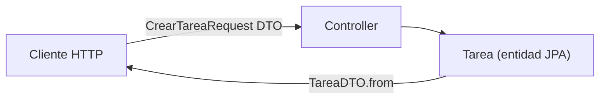
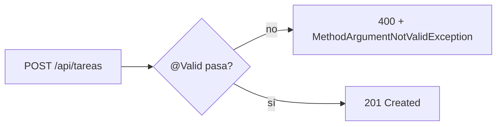
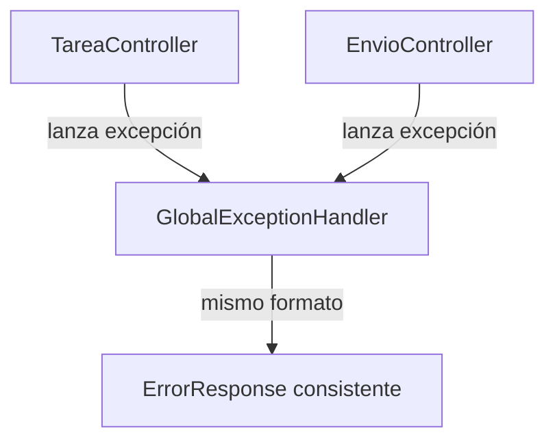
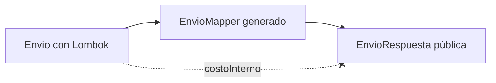
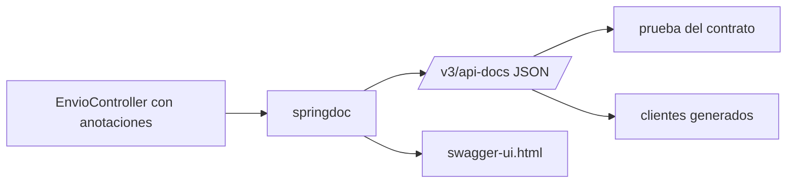

# Módulo 2: REST APIs con Spring Web

Cada tema separa el contrato HTTP (DTOs) de la persistencia interna (entidades), automatiza la validación de entrada y centraliza el manejo de errores — las tres piezas que hacen que una API REST sea predecible para quien la consume.


## Aprende construyendo

### Tema 1: Por qué DTOs en vez de entidades directamente

#### Paso 1 · Objetivo y preparación

Al finalizar podrás explicar por qué exponer entidades JPA directamente en una API es riesgoso, y separar el contrato HTTP de la persistencia interna usando DTOs.

**Conocimiento previo:** Módulo 1 (Spring Initializr, perfiles). Prerrequisitos: JDK 25, Maven y un editor.

#### Paso 2 · Contexto y caso real

**¿Por qué es importante?** Una API de paquetes recibe datos de clientes externos y no debe exponer columnas internas de la base de datos ni aceptar valores imposibles en la entrada; una frontera explícita entre el contrato público y el modelo interno protege ambos lados de ese cambio.

#### Paso 3 · Teoría con analogía

**Conceptos clave:** DTO (Data Transfer Object), desacoplar el contrato HTTP de la persistencia, relaciones `lazy`.

Un DTO representa el contrato de transporte hacia/desde el cliente HTTP, mientras que una entidad JPA (Módulo 3) representa el modelo de persistencia interno; separarlos evita dos problemas concretos. Primero, exponer entidades directamente filtraría detalles internos de la capa de persistencia hacia el contrato público (campos que existen únicamente por razones de mapeo relacional, o relaciones internas que no deberían ser visibles ni modificables desde fuera). Segundo, puede producir errores de serialización concretos con relaciones marcadas como `lazy` (Módulo 3), donde Jackson podría intentar serializar una relación que Hibernate todavía no cargó, produciendo una excepción en tiempo de ejecución. Los DTOs actúan como una capa de traducción explícita: renombrar un campo interno de la entidad no rompe el contrato público si el DTO correspondiente permanece estable.

**Analogía:** exponer entidades directamente es como mostrar a un cliente externo el inventario interno completo de un almacén, con sus códigos internos de ubicación; un DTO es como un catálogo de cara al público, que puede reorganizarse internamente sin que el catálogo público cambie.

**Diagrama:**



#### Paso 4 · Demostración guiada desde cero

Desde una carpeta vacía, genera el proyecto con los starters `web` y `validation`:

```bash
# descarga el proyecto y ejecuta las pruebas Java con Maven
mkdir ejemplo-spring-m2
cd ejemplo-spring-m2
curl -fsSL https://start.spring.io/starter.zip -d dependencies=web,validation -d javaVersion=25 -o app.zip
unzip app.zip
./mvnw test
```

Crea `src/main/java/com/example/demo/TareaController.java` recibiendo y devolviendo DTOs, nunca la entidad `Tarea` directamente:

```java
package com.example.demo;

import org.springframework.http.HttpStatus;
import org.springframework.http.ResponseEntity;
import org.springframework.web.bind.annotation.*;

@RestController
@RequestMapping("/api/tareas")
public class TareaController {

    private final ServicioTareas servicio;

    public TareaController(ServicioTareas servicio) {
        this.servicio = servicio;
    }

    @PostMapping
    public ResponseEntity<TareaDTO> crear(@RequestBody CrearTareaRequest request) {
        Tarea tarea = servicio.crear(request);
        return ResponseEntity.status(HttpStatus.CREATED).body(TareaDTO.from(tarea));
    }
}
```

**Explicación línea por línea:** `crear` recibe `CrearTareaRequest` (un DTO de entrada, no la entidad) y devuelve `TareaDTO` (un DTO de salida); `TareaDTO.from(tarea)` traduce explícitamente la entidad interna hacia el contrato público, controlando exactamente qué campos se exponen.

Envía una petición real y confirma que la respuesta expone solo los campos del DTO:

```bash
curl -i -X POST http://localhost:8080/api/tareas -H 'Content-Type: application/json' -d '{"titulo":"Entregar paquete","prioridad":1}'
```

**Resultado esperado:** la respuesta HTTP es `201 Created` con un cuerpo JSON que contiene únicamente los campos definidos en `TareaDTO` — sin ningún campo interno de la entidad `Tarea` que no esté explícitamente mapeado, confirmando que el DTO controla exactamente la superficie expuesta.

**Fallo deliberado:** cambia el controller para devolver la entidad `Tarea` directamente en vez de `TareaDTO`. Si `Tarea` tiene una relación `@ManyToOne(fetch = FetchType.LAZY)` hacia otra entidad, Jackson intenta serializarla fuera de una sesión de Hibernate activa, produciendo `LazyInitializationException` — diagnostica confirmando que exponer entidades directamente no es solo un problema de diseño, sino una fuente real de errores en tiempo de ejecución.

#### Paso 5 · Práctica guiada — repetición progresiva

1. Agrega un campo interno a la entidad `Tarea` (por ejemplo `costoInterno`) y confirma que no aparece en la respuesta JSON porque `TareaDTO` no lo mapea.
2. Renombra un campo de la entidad sin renombrar el campo correspondiente del DTO, y confirma que el contrato público no cambia.
3. Provoca el fallo deliberado del Paso 4 (devolver la entidad con una relación lazy) y documenta el stack trace exacto de `LazyInitializationException`.
4. Escribe de memoria (sin mirar) un DTO de entrada y uno de salida para un recurso nuevo, y el método `from()` que traduce la entidad al DTO de salida.

**Pista:** si un campo de la entidad no debería ser visible externamente, la forma más simple de garantizarlo es que el DTO de salida simplemente no lo incluya.

#### Paso 6 · Práctica independiente

**Completa el código:** rellena el espacio para que el método traduzca la entidad al DTO de salida:

```java
public ResponseEntity<TareaDTO> crear(@RequestBody CrearTareaRequest request) {
    Tarea tarea = servicio.crear(request);
    return ResponseEntity.status(HttpStatus.CREATED).body(TareaDTO.____(tarea));
}
```

**Reto de memoria sin mirar:** cierra este documento y escribe, solo de memoria, un DTO de entrada, un DTO de salida y un controller que use ambos sin exponer la entidad. Compara después contra el patrón del Paso 4.

#### Paso 7 · Cierre

Ya explicas por qué exponer entidades directamente es riesgoso y separas el contrato HTTP de la persistencia con DTOs. El siguiente tema automatiza la validación de esos DTOs de entrada. Fuentes oficiales: [Spring Web MVC](https://docs.spring.io/spring-framework/reference/web/webmvc.html).

**Errores comunes:** devolver entidades JPA directamente desde el controller; nombrar el DTO igual que la entidad, generando confusión sobre cuál es cuál.

**Cuándo no usarlo:** para una API interna de solo lectura, sin persistencia relacional detrás (por ejemplo, un proxy que reenvía datos de otro servicio sin transformarlos), el DTO puede ser innecesario si no existe ninguna entidad de persistencia que proteger.

Los DTOs que diseñes aquí son los que expondrá la API del proyecto integrador de este track (microservicio productivo, Módulo 12).

### Tema 2: Validación con Bean Validation y ResponseEntity

#### Paso 1 · Objetivo y preparación

Al finalizar podrás declarar restricciones de validación sobre un DTO de entrada y controlar explícitamente el código de estado HTTP devuelto.

**Conocimiento previo:** Tema 1 de este módulo.

#### Paso 2 · Contexto y caso real

**¿Por qué es importante?** Una API de paquetes no debe aceptar valores imposibles (un título vacío, una prioridad negativa); validar la entrada automáticamente en la frontera de la API evita que datos inválidos lleguen siquiera a la lógica de negocio.

#### Paso 3 · Teoría con analogía

**Conceptos clave:** anotaciones declarativas de validación (`@NotBlank`, `@Min`), `@Valid`, códigos de estado HTTP explícitos.

Bean Validation declara restricciones directamente sobre los campos del DTO mediante anotaciones (`@NotBlank`, `@Min`, `@Size`, `@Email`), verificadas automáticamente por Spring cuando el parámetro del controller se marca con `@Valid`, sin necesidad de código de validación imperativo repetido en cada endpoint. Si la validación falla, Spring lanza automáticamente `MethodArgumentNotValidException` antes de que el código del método del controller siquiera se ejecute. `ResponseEntity` permite controlar explícitamente el código de estado HTTP devuelto según el resultado real de la operación (`201` para creación exitosa, `404` si el recurso no existe), en vez de que Spring infiera un único código genérico para todos los casos.

**Analogía:** Bean Validation es como un formulario que rechaza automáticamente cualquier entrada que no cumpla reglas declaradas explícitamente, sin que un revisor humano verifique manualmente cada regla en cada envío; usar el código de estado HTTP correcto es como usar el sello oficial preciso correspondiente a cada resultado específico de un trámite, en vez de un único sello genérico.

**Diagrama:**



#### Paso 4 · Demostración guiada desde cero

Desde una carpeta vacía (o continuando en `ejemplo-spring-m2`, generado con `mvn` en el Tema 1), crea `src/main/java/com/example/demo/CrearTareaRequest.java` con restricciones declarativas:

```java
package com.example.demo;

import jakarta.validation.constraints.Min;
import jakarta.validation.constraints.NotBlank;

public record CrearTareaRequest(
    @NotBlank String titulo,
    @Min(1) int prioridad
) {}
```

Modifica el controller del Tema 1 para marcar el parámetro con `@Valid`:

```java
@PostMapping
public ResponseEntity<TareaDTO> crear(@Valid @RequestBody CrearTareaRequest request) {
    Tarea tarea = servicio.crear(request);
    return ResponseEntity.status(HttpStatus.CREATED).body(TareaDTO.from(tarea));
}
```

**Explicación línea por línea:** `@NotBlank` rechaza `titulo` vacío, nulo o solo espacios; `@Min(1)` rechaza `prioridad` menor a 1; `@Valid` en la firma del método le indica a Spring que verifique estas restricciones antes de ejecutar el cuerpo del método.

Ejecuta las pruebas reales y confirma que la validación se aplica:

```bash
# ejecuta las pruebas Java con Maven, incluyendo la petición inválida
cd ejemplo-spring-m2
./mvnw test
```

**Resultado esperado:** una petición con `titulo` vacío devuelve `400 Bad Request` con un detalle legible del campo que falló, sin que el código del controller haya escrito ninguna verificación manual — confirmando que `@Valid` intercepta la petición inválida antes de que llegue al cuerpo del método.

**Fallo deliberado:** quita `@Valid` de la firma del método y envía la misma petición con `titulo` vacío. La petición llega sin ser rechazada (`201 Created` con un título vacío persistido) — diagnostica confirmando que las anotaciones de Bean Validation por sí solas no verifican nada; sin `@Valid`, Spring simplemente las ignora.

#### Paso 5 · Práctica guiada — repetición progresiva

1. Agrega `@Email` a un campo de correo del DTO y confirma que un valor sin `@` es rechazado con `400`.
2. Quita `@Valid` deliberadamente y confirma que una entrada inválida ya no es rechazada.
3. Cambia `ResponseEntity.status(HttpStatus.CREATED)` por `ResponseEntity.ok()` y documenta qué código HTTP cambia en la respuesta.
4. Escribe de memoria (sin mirar) un DTO con al menos dos restricciones de Bean Validation distintas y un controller que las verifique con `@Valid`.

**Pista:** si una validación no se está aplicando, lo primero que hay que revisar es si `@Valid` está presente en la firma del método — es la causa más común de este fallo.

#### Paso 6 · Práctica independiente

**Completa el código:** rellena el espacio para que la validación se aplique automáticamente:

```java
@PostMapping
public ResponseEntity<TareaDTO> crear(@____ @RequestBody CrearTareaRequest request) { ... }
```

**Reto de memoria sin mirar:** cierra este documento y escribe, solo de memoria, un DTO con `@NotBlank` y `@Min`, y un controller que lo valide con `@Valid` devolviendo el código HTTP correcto. Compara después contra el patrón del Paso 4.

#### Paso 7 · Cierre

Ya declaras restricciones de validación sobre DTOs de entrada y controlas explícitamente el código de estado HTTP devuelto. El siguiente tema centraliza el manejo de los errores que esta validación produce. Fuentes oficiales: [Bean Validation (Jakarta)](https://jakarta.ee/specifications/bean-validation/).

**Errores comunes:** olvidar `@Valid` en la firma del método, dejando las anotaciones de validación sin efecto; devolver siempre `200` sin importar el resultado real de la operación.

**Cuándo no usarlo:** para un DTO que solo transporta datos ya validados por otra capa previa (por ejemplo, un mensaje de una cola interna ya validado en origen), duplicar la validación con Bean Validation puede ser redundante.

La validación con Bean Validation que practiques aquí protege cada endpoint del proyecto integrador de este track (microservicio productivo, Módulo 12).

### Tema 3: Manejo centralizado de errores con @ControllerAdvice

#### Paso 1 · Objetivo y preparación

Al finalizar podrás centralizar el manejo de excepciones de toda una API en un único lugar, sin repetir try/catch en cada controller.

**Conocimiento previo:** Tema 2 de este módulo.

#### Paso 2 · Contexto y caso real

**¿Por qué es importante?** Sin manejo centralizado, cada controller de una API con decenas de endpoints tendría que repetir su propia lógica de traducción de excepciones a respuestas HTTP, arriesgando formatos de error inconsistentes entre distintos endpoints de la misma API.

#### Paso 3 · Teoría con analogía

**Conceptos clave:** `@RestControllerAdvice`, `@ExceptionHandler`, formato de error consistente.

`@RestControllerAdvice` centraliza en una única clase el manejo de excepciones específicas que pueden ocurrir en cualquier controller de la aplicación, mapeando cada tipo de excepción a una respuesta HTTP consistente mediante métodos anotados con `@ExceptionHandler`, en vez de que cada controller individual envuelva su propia lógica en bloques `try`/`catch` repetidos. Este enfoque garantiza que todos los controllers compartan exactamente el mismo formato de respuesta de error, reduciendo la duplicación de lógica de manejo de errores.

**Analogía:** `@ControllerAdvice` es como un departamento central de atención de reclamos que procesa de forma consistente cualquier tipo de problema reportado desde cualquier sucursal de una empresa, en vez de que cada sucursal improvise su propio procedimiento particular.

**Diagrama:**



#### Paso 4 · Demostración guiada desde cero

Desde una carpeta vacía (o continuando en `ejemplo-spring-m2`, generado con `mvn` en el Tema 1), crea `src/main/java/com/example/demo/GlobalExceptionHandler.java`:

```java
package com.example.demo;

import org.springframework.http.ResponseEntity;
import org.springframework.web.bind.MethodArgumentNotValidException;
import org.springframework.web.bind.annotation.ExceptionHandler;
import org.springframework.web.bind.annotation.RestControllerAdvice;

@RestControllerAdvice
public class GlobalExceptionHandler {

    @ExceptionHandler(MethodArgumentNotValidException.class)
    public ResponseEntity<ErrorResponse> manejarValidacion(MethodArgumentNotValidException ex) {
        return ResponseEntity.badRequest().body(new ErrorResponse(ex.getMessage()));
    }

    @ExceptionHandler(RecursoNoEncontradoException.class)
    public ResponseEntity<ErrorResponse> manejarNoEncontrado(RecursoNoEncontradoException ex) {
        return ResponseEntity.status(404).body(new ErrorResponse(ex.getMessage()));
    }
}
```

**Explicación línea por línea:** `@RestControllerAdvice` marca la clase como manejador global aplicado a todos los controllers; cada método `@ExceptionHandler(Tipo.class)` intercepta ese tipo de excepción específico lanzado desde cualquier controller y lo traduce a una respuesta HTTP con un formato (`ErrorResponse`) consistente en toda la API.

Ejecuta las pruebas reales confirmando que ambos tipos de error usan el mismo formato:

```bash
# ejecuta las pruebas Java con Maven que verifican el formato de error consistente
cd ejemplo-spring-m2
./mvnw test
```

**Resultado esperado:** tanto un error de validación (`400`) como un recurso no encontrado (`404`) devuelven un cuerpo JSON con exactamente la misma estructura de `ErrorResponse`, confirmando que el formato de error es consistente en toda la API sin que cada controller lo implemente por separado.

**Fallo deliberado:** elimina `GlobalExceptionHandler` y deja que `RecursoNoEncontradoException` se propague sin manejar. Spring devuelve su página de error genérica por defecto (`500 Internal Server Error` con un cuerpo que no sigue el formato `ErrorResponse` de la API) — diagnostica confirmando que sin un `@ExceptionHandler` explícito para cada excepción de negocio, el cliente recibe una respuesta inconsistente con el resto del contrato de la API.

#### Paso 5 · Práctica guiada — repetición progresiva

1. Agrega un tercer `@ExceptionHandler` para una excepción de negocio nueva y confirma que reutiliza el mismo `ErrorResponse`.
2. Elimina temporalmente el handler de `RecursoNoEncontradoException` y documenta la respuesta genérica real que Spring produce en su lugar.
3. Compara cuántas líneas de código requeriría manejar el mismo error con `try`/`catch` repetido en tres controllers distintos, frente a un único handler centralizado.
4. Escribe de memoria (sin mirar) una clase `@RestControllerAdvice` con dos `@ExceptionHandler` que devuelvan el mismo formato de error.

**Pista:** cada `@ExceptionHandler` maneja un tipo de excepción específico — si una excepción no tiene un handler correspondiente, cae en el comportamiento genérico de Spring, no en un handler por defecto tuyo.

#### Paso 6 · Práctica independiente

**Completa el código:** rellena el espacio para que la clase intercepte excepciones de todos los controllers:

```java
@____
public class GlobalExceptionHandler {
    @ExceptionHandler(RecursoNoEncontradoException.class)
    public ResponseEntity<ErrorResponse> manejarNoEncontrado(RecursoNoEncontradoException ex) { ... }
}
```

**Reto de memoria sin mirar:** cierra este documento y escribe, solo de memoria, un `@RestControllerAdvice` con handlers para una excepción de validación y una de recurso no encontrado. Compara después contra el patrón del Paso 4.

#### Paso 7 · Cierre

Ya centralizas el manejo de excepciones de toda una API en un único lugar, con un formato de error consistente y sin repetir try/catch en cada controller. Esto cierra el ciclo básico de una API REST con Spring Web; el siguiente módulo persiste datos reales con JPA. Fuentes oficiales: [Spring — Exception Handling](https://docs.spring.io/spring-framework/reference/web/webmvc/mvc-controller/ann-exceptionhandler.html).

**Errores comunes:** repetir try/catch en cada controller para el mismo tipo de error, en vez de centralizarlo; capturar `Exception` genérico sin distinguir el tipo real, filtrando detalles internos (stack traces) hacia el cliente.

**Cuándo no usarlo:** para un endpoint verdaderamente único que necesita un manejo de error muy específico y no reutilizable en ningún otro lugar de la API, un `try`/`catch` local puntual puede ser más simple que agregar un handler global de un solo uso.

---

El manejo centralizado de errores de este tema es el que unifica las respuestas de error del proyecto integrador de este track (microservicio productivo, Módulo 12).

### Tema 4: Lombok y MapStruct sin exponer datos internos

#### Paso 1 · Objetivo y preparación
Al finalizar podrás reducir código repetitivo con Lombok, generar el mapeo entre modelo y DTO con MapStruct en tiempo de compilación, y hacer que el compilador falle si un campo del DTO queda sin mapear. Prerrequisito: Tema 1 de este módulo (DTOs).

#### Paso 2 · Contexto y caso real
El backend de entregas tenía clases de 200 líneas de getters y setters, y mapeos manuales donde un campo nuevo se olvidaba con frecuencia. Además, un `toString()` generado imprimía el costo interno en los logs. Lombok y MapStruct son estándar de facto en proyectos Spring empresariales: un caso real que encontrarás en casi cualquier código existente.

#### Paso 3 · Teoría, modelo mental y analogía
**Lombok** es un procesador de anotaciones: `@Getter`, `@Setter`, `@Builder` o `@ToString` generan código en el bytecode al compilar. **MapStruct** genera la implementación de una interfaz `@Mapper` con código Java normal (sin reflexión); `componentModel = "spring"` la registra como bean y `unmappedTargetPolicy = ERROR` convierte un campo sin mapear en error de compilación. Como ambos son procesadores de anotaciones, Lombok debe correr primero: de eso se encarga `lombok-mapstruct-binding`.

**Analogía:** Lombok es el molde que fabrica las piezas repetidas; MapStruct es la plantilla de traspaso que dice qué dato del formulario interno va en qué casilla del formulario público.

**Diagrama:**



#### Paso 4 · Demostración guiada desde cero
**Ejemplo independiente (desde cero):** este tema se reproduce en una **carpeta vacía**, como **proyecto nuevo**, sin estado de otros temas.

```bash
mkdir lombok-mapstruct && cd lombok-mapstruct
curl -fsSL https://start.spring.io/starter.zip -d dependencies=web,lombok -d javaVersion=25 -o app.zip
unzip -q app.zip
```

Crea `pom.xml (agrega estos fragmentos)`:

```xml
<!-- 1) Dentro de <dependencies>: -->
<dependency>
  <groupId>org.mapstruct</groupId>
  <artifactId>mapstruct</artifactId>
  <version>1.6.3</version>
</dependency>

<!-- 2) En maven-compiler-plugin, dentro de <annotationProcessorPaths>,
     junto al path de lombok que ya generó Spring Initializr: -->
<path>
  <groupId>org.mapstruct</groupId>
  <artifactId>mapstruct-processor</artifactId>
  <version>1.6.3</version>
</path>
<path>
  <groupId>org.projectlombok</groupId>
  <artifactId>lombok-mapstruct-binding</artifactId>
  <version>0.2.0</version>
</path>
```

Crea `src/main/java/com/example/demo/Envio.java`:

```java
package com.example.demo;

import lombok.AllArgsConstructor;
import lombok.Builder;
import lombok.Getter;
import lombok.NoArgsConstructor;
import lombok.Setter;
import lombok.ToString;

import java.math.BigDecimal;

// Modelo interno. Lombok genera getters, setters, constructores y builder al compilar.
@Getter
@Setter
@NoArgsConstructor
@AllArgsConstructor
@Builder
@ToString(exclude = "costoInterno")       // no imprimir datos sensibles en logs
public class Envio {
    private Long id;
    private String guia;
    private String ciudadDestino;
    private int kilos;
    private BigDecimal costoInterno;      // dato interno: NO debe salir en la API
}
```

Crea `src/main/java/com/example/demo/EnvioRespuesta.java`:

```java
package com.example.demo;

// DTO público: lo que ve el cliente de la API
public record EnvioRespuesta(String guia, String destino, int kilos) {}
```

Crea `src/main/java/com/example/demo/EnvioMapper.java`:

```java
package com.example.demo;

import org.mapstruct.Mapper;
import org.mapstruct.Mapping;
import org.mapstruct.ReportingPolicy;

// MapStruct genera la implementación al compilar: código Java normal, sin reflexión
@Mapper(componentModel = "spring", unmappedTargetPolicy = ReportingPolicy.ERROR)
public interface EnvioMapper {
    @Mapping(source = "ciudadDestino", target = "destino")
    EnvioRespuesta aRespuesta(Envio envio);
}
```

Crea `src/test/java/com/example/demo/EnvioMapperTest.java`:

```java
package com.example.demo;

import org.junit.jupiter.api.Test;
import org.springframework.beans.factory.annotation.Autowired;
import org.springframework.boot.test.context.SpringBootTest;

import java.math.BigDecimal;

import static org.assertj.core.api.Assertions.assertThat;

@SpringBootTest
class EnvioMapperTest {

    @Autowired
    EnvioMapper mapper;

    @Test
    void mapeaCamposPublicosYNoExponeElCostoInterno() {
        Envio envio = Envio.builder()
                .id(7L).guia("BO-004512").ciudadDestino("Bogotá").kilos(3)
                .costoInterno(new BigDecimal("4100.50"))
                .build();

        EnvioRespuesta respuesta = mapper.aRespuesta(envio);

        assertThat(respuesta).isEqualTo(new EnvioRespuesta("BO-004512", "Bogotá", 3));
        assertThat(envio.toString()).doesNotContain("4100.50");
        System.out.println("Respuesta: " + respuesta);
        System.out.println("Log seguro: " + envio);
    }
}
```

**Ejecuta el ejemplo:**

```bash
./mvnw test
```

**Resultado esperado:**

```text
Respuesta: EnvioRespuesta[guia=BO-004512, destino=Bogotá, kilos=3]
Log seguro: Envio(id=7, guia=BO-004512, ciudadDestino=Bogotá, kilos=3)
...
[INFO] Tests run: 2, Failures: 0, Errors: 0, Skipped: 0
[INFO] BUILD SUCCESS
```

Las líneas de Maven se resumen: también verás el log de arranque de Spring y la prueba `DemoApplicationTests` que genera Initializr. `costoInterno` no aparece ni en la respuesta ni en el log. Las versiones de MapStruct y del binding son las vigentes al escribir este tema; consulta la documentación si hay una más nueva.

**Fallo deliberado:** Borra la línea `@Mapping(source = "ciudadDestino", target = "destino")`. La compilación falla con `Unmapped target property: "destino".` porque el DTO tiene un campo que MapStruct no sabe llenar. Con la política por defecto (WARN) solo verías una advertencia y la API devolvería `destino: null` en producción.

#### Paso 5 · Práctica guiada
Agrega al DTO el campo `estado` y al modelo `estadoActual`, y mapéalos. **Pista:** agrega el campo a ambos lados, ejecuta `./mvnw test` para ver el error de campo sin mapear y luego agrega el `@Mapping` correspondiente.

#### Paso 6 · Práctica independiente
Abre `target/generated-sources/annotations/.../EnvioMapperImpl.java` y explica el código que generó MapStruct. Luego investiga por qué `@Data` en entidades JPA con relaciones bidireccionales puede causar `StackOverflowError` en `toString` y `hashCode`.

#### Paso 7 · Cierre
**¿Por qué es importante?** porque son herramientas presentes en la mayoría del código Spring que vas a mantener, y usarlas mal expone datos o produce errores difíciles de rastrear.
**Fuente oficial:** [MapStruct Reference Guide](https://mapstruct.org/documentation/stable/reference/html/), [Project Lombok: features](https://projectlombok.org/features/).
**Conceptos clave:** procesador de anotaciones, Lombok, `@Builder`, `@ToString(exclude)`, MapStruct, `@Mapper`, `unmappedTargetPolicy`, `lombok-mapstruct-binding`.
**Cuándo no usarlo:** no uses `@Data` en entidades JPA (genera `equals`/`hashCode` sobre todos los campos). Para DTOs simples, un `record` de Java ya no necesita Lombok.

**Transferencia al proyecto integrador «Backend profesional de entregas»:** mapea las entidades de entregas a DTOs con MapStruct y política de error, y excluye de `toString` los datos personales.
Como **siguiente** paso, aplica lo aprendido en el proyecto integrador del track y compara el resultado con lo que esperabas.
**Errores comunes:** usar `@Data` en una entidad JPA en vez de `@Getter`/`@Setter` explícitos (genera `equals`/`hashCode` sobre todos los campos, incluidas relaciones, y puede producir `StackOverflowError`), y dejar la política de MapStruct en `WARN` en vez de `unmappedTargetPolicy = ERROR`, de modo que un campo nuevo del DTO queda sin mapear y llega como `null` a producción sin que la compilación avise.

### Tema 5: OpenAPI con springdoc: el contrato como prueba

#### Paso 1 · Objetivo y preparación
Al finalizar podrás generar la especificación OpenAPI de tu API con springdoc, documentar operaciones, parámetros, respuestas y esquemas con anotaciones, y escribir una prueba que falle si el contrato publicado cambia. Prerrequisitos: Temas 1 a 3 de este módulo.

#### Paso 2 · Contexto y caso real
El equipo móvil de RutaFlow descubría los cambios de la API cuando la app fallaba. Un contrato OpenAPI publicado y probado es el caso real que permite a otros equipos generar clientes, probar contra mocks y detectar cambios antes de desplegar.

#### Paso 3 · Teoría, modelo mental y analogía
**OpenAPI** es un formato estándar (JSON o YAML) que describe rutas, parámetros, respuestas y esquemas de una API HTTP. **springdoc** inspecciona tus controladores en tiempo de ejecución y publica el documento en `/v3/api-docs` y una interfaz en `/swagger-ui.html`. Las anotaciones `@Operation`, `@ApiResponse`, `@Parameter` y `@Schema` agregan la información que el código no expresa (resúmenes, ejemplos, códigos de error). Probar el documento convierte la documentación en un contrato verificable.

**Analogía:** el contrato OpenAPI es el plano eléctrico de la casa: quien llega a instalar algo no necesita romper paredes para saber dónde están los cables.

**Diagrama:**



#### Paso 4 · Demostración guiada desde cero
**Ejemplo independiente (desde cero):** este tema se reproduce en una **carpeta vacía**, como **proyecto nuevo**, sin estado de otros temas.

```bash
mkdir springdoc && cd springdoc
curl -fsSL https://start.spring.io/starter.zip -d dependencies=web -d javaVersion=25 -o app.zip
unzip -q app.zip
```

Crea `pom.xml (agrega este fragmento)`:

```xml
<!-- Dentro de <dependencies>. Usa la línea 3.x de springdoc, compatible con Spring Boot 4 -->
<dependency>
  <groupId>org.springdoc</groupId>
  <artifactId>springdoc-openapi-starter-webmvc-ui</artifactId>
  <version>3.0.0</version>
</dependency>
```

Crea `src/main/java/com/example/demo/EnvioController.java`:

```java
package com.example.demo;

import io.swagger.v3.oas.annotations.Operation;
import io.swagger.v3.oas.annotations.Parameter;
import io.swagger.v3.oas.annotations.media.Schema;
import io.swagger.v3.oas.annotations.responses.ApiResponse;
import io.swagger.v3.oas.annotations.tags.Tag;
import org.springframework.http.ResponseEntity;
import org.springframework.web.bind.annotation.*;

import java.util.Map;

@RestController
@RequestMapping("/api/envios")
@Tag(name = "Envíos", description = "Consulta pública del estado de un envío")
public class EnvioController {

    @Schema(description = "Estado público de un envío")
    public record EstadoEnvio(
            @Schema(example = "BO-004512") String guia,
            @Schema(example = "en ruta", allowableValues = {"registrado", "en ruta", "entregado"}) String estado) {}

    private final Map<String, String> estados = Map.of("BO-004512", "en ruta");

    @Operation(summary = "Consultar el estado de un envío por guía")
    @ApiResponse(responseCode = "200", description = "Envío encontrado")
    @ApiResponse(responseCode = "404", description = "La guía no existe")
    @GetMapping("/{guia}")
    public ResponseEntity<EstadoEnvio> estado(
            @Parameter(description = "Guía con formato XX-000000", example = "BO-004512") @PathVariable String guia) {
        String estado = estados.get(guia);
        return estado == null ? ResponseEntity.notFound().build() : ResponseEntity.ok(new EstadoEnvio(guia, estado));
    }
}
```

Crea `src/test/java/com/example/demo/ContratoOpenApiTest.java`:

```java
package com.example.demo;

import org.junit.jupiter.api.Test;
import org.springframework.beans.factory.annotation.Value;
import org.springframework.boot.test.context.SpringBootTest;

import java.net.URI;
import java.net.http.HttpClient;
import java.net.http.HttpRequest;
import java.net.http.HttpResponse;

import static org.assertj.core.api.Assertions.assertThat;

@SpringBootTest(webEnvironment = SpringBootTest.WebEnvironment.RANDOM_PORT)
class ContratoOpenApiTest {

    @Value("${local.server.port}")
    int puerto;

    @Test
    void elContratoPublicadoDescribeLaOperacionYSusRespuestas() throws Exception {
        HttpResponse<String> respuesta = HttpClient.newHttpClient().send(
                HttpRequest.newBuilder(URI.create("http://localhost:" + puerto + "/v3/api-docs")).build(),
                HttpResponse.BodyHandlers.ofString());

        String contrato = respuesta.body();
        System.out.println("OpenAPI: " + contrato.length() + " caracteres");
        assertThat(respuesta.statusCode()).isEqualTo(200);
        assertThat(contrato)
                .contains("\"/api/envios/{guia}\"")
                .contains("Consultar el estado de un envío por guía")
                .contains("La guía no existe")
                .contains("\"EstadoEnvio\"");
    }
}
```

**Ejecuta el ejemplo:**

```bash
./mvnw test
./mvnw spring-boot:run   # luego abre http://localhost:8080/swagger-ui.html
```

**Resultado esperado:**

```text
OpenAPI: 1234 caracteres
...
[INFO] Tests run: 2, Failures: 0, Errors: 0, Skipped: 0
[INFO] BUILD SUCCESS
```

La prueba levanta la aplicación en un puerto aleatorio y lee el contrato real. El número de caracteres varía. En `swagger-ui.html` puedes ejecutar `GET /api/envios/BO-004512` desde el navegador. La versión de springdoc indicada es la de la línea 3.x vigente al escribir el tema; revisa la tabla de compatibilidad si usas otra versión de Spring Boot.

**Fallo deliberado:** Borra la línea `@ApiResponse(responseCode = "404", description = "La guía no existe")`. La prueba falla porque el contrato ya no contiene `La guía no existe`: el endpoint sigue devolviendo 404, pero el contrato ya no lo documenta. Ese desfase entre comportamiento y documentación es exactamente lo que la prueba debe atrapar.

#### Paso 5 · Práctica guiada
Documenta un `POST /api/envios` que reciba un `record` validado con `@NotBlank` y verifica en la prueba que el esquema marca el campo como requerido. **Pista:** springdoc traduce `@NotBlank` a la lista `required` del esquema; busca en el contrato el nombre del campo dentro de esa lista.

#### Paso 6 · Práctica independiente
Guarda el contrato en `openapi.json` dentro del repositorio y escribe una prueba que compare el contrato actual con el guardado, para que todo cambio de API sea explícito en la revisión de código.

#### Paso 7 · Cierre
**¿Por qué es importante?** porque las APIs se consumen por otros equipos y otras empresas, y un contrato verificable evita roturas silenciosas.
**Fuente oficial:** [springdoc-openapi](https://springdoc.org/), [OpenAPI Specification](https://spec.openapis.org/oas/latest.html).
**Conceptos clave:** OpenAPI, springdoc, `/v3/api-docs`, Swagger UI, `@Operation`, `@ApiResponse`, `@Schema`, prueba de contrato.
**Cuándo no usarlo:** para APIs internas de un solo consumidor que cambian a diario, un contrato formal puede ser burocracia; aun así, documenta los errores que devuelves.

**Transferencia al proyecto integrador «Backend profesional de entregas»:** publica el contrato del backend de entregas y agrega la prueba de contrato al pipeline.
Como **siguiente** paso, aplica lo aprendido en el proyecto integrador del track y compara el resultado con lo que esperabas.
**Errores comunes:** borrar o cambiar una anotación `@ApiResponse`/`@Operation` sin volver a correr `ContratoOpenApiTest`, dejando que el contrato publicado describa una respuesta que el endpoint ya no documenta, y versionar `openapi.json` sin una prueba que lo compare contra el contrato real, lo que permite que la API cambie sin que nadie lo note en la revisión de código.

## Laboratorio práctico

**Objetivo del laboratorio:** construir una API REST con validación de entrada y manejo centralizado de errores.

**Requisitos previos:** Módulos 0-1 completados.

| Paso | Acción | Código | Explicación |
|---|---|---|---|
| 1 | Crear GET/POST `/tareas` con DTOs | Ver Tema 1 | No expone la entidad directamente |
| 2 | Agregar validación con `@Valid` | Ver Tema 2 | `@NotBlank`, `@Min` en el DTO |
| 3 | Devolver `ResponseEntity` con códigos correctos | Ver Tema 2 | 201 al crear, 404 si no existe |
| 4 | Crear un `@ControllerAdvice` con `@ExceptionHandler` | Ver Tema 3 | Captura una excepción de negocio, devuelve 400 |
| 5 | Probar con curl un body inválido | — | Verifica el mensaje de error estructurado |

**Verificación:** el laboratorio se considera exitoso si ningún endpoint expone la entidad JPA directamente, y si una entrada inválida produce un error 400 con un mensaje estructurado consistente, sin ningún try/catch repetido en el controller.

**Errores comunes y soluciones**

- **Exponer la entidad JPA directamente en la respuesta HTTP.** Usa siempre un DTO específico para el contrato de la API.
- **Olvidar `@Valid` en el parámetro del controller.** Sin él, las anotaciones de Bean Validation en el DTO no se verifican.
- **Repetir try/catch en cada controller para el mismo tipo de error.** Centraliza ese manejo en un `@ControllerAdvice`.

---


## Laboratorio de transferencia

### Tema 6: Paginación HTTP con validación y un límite de recursos explícito

#### Paso 1 · Objetivo y preparación
Al finalizar expondrás una colección paginada y rechazarás parámetros que exceden el contrato. **Prerrequisitos:** Java, Maven, REST y Bean Validation. JDK 25 y curl; comprueba `java --version`. Ejemplo independiente desde proyecto nuevo con Spring Initializr.

#### Paso 2 · Contexto y caso real
El proyecto integrador muestra envíos en un panel. Devolver toda la colección carga el servidor y el navegador. **¿Por qué es importante?** El cliente no debería poder pedir un millón de elementos porque cambió un parámetro.

#### Paso 3 · Teoría, modelo mental y analogía
Una página tiene posición y tamaño. La validación restringe el trabajo solicitado antes de ejecutar la lógica. Un orden estable requiere desempate único. **Analogía:** entregar carpetas en lotes permite controlar cuánto trabajo se hace en cada turno. El límite es que paginación por offset puede desplazarse cuando cambian datos; para recorridos grandes considera cursor y consistencia explícita.

#### Paso 4 · Demostración guiada desde cero
Crea el proyecto desde una carpeta vacía:
```bash
curl -fsSL 'https://start.spring.io/starter.zip?type=maven-project&language=java&bootVersion=4.0.9&baseDir=pagina-demo&groupId=com.example&artifactId=pagina-demo&packageName=com.example.pagina&javaVersion=25&dependencies=web,validation' -o pagina-demo.zip
unzip pagina-demo.zip
cd pagina-demo
```
Si Initializr ya no ofrece esa versión estable, selecciona una estable compatible con Java 25 en su UI, conserva Web y Validation y registra la versión elegida; no uses una milestone sin declarar el cambio. Crea `src/main/java/com/example/pagina/EnviosController.java`:
```java
package com.example.pagina;

import jakarta.validation.constraints.Max;
import jakarta.validation.constraints.Min;
import org.springframework.web.bind.annotation.*;
import java.util.List;
import java.util.stream.IntStream;

@RestController
public class EnviosController {
    record Envio(int id, String estado) {}
    record Pagina(List<Envio> items, int page, int size, boolean hasNext) {}
    private final List<Envio> data = IntStream.rangeClosed(1, 5)
        .mapToObj(id -> new Envio(id, "creado")).toList();

    @GetMapping("/envios")
    public Pagina listar(@RequestParam(defaultValue = "0") @Min(0) @Max(1000) int page,
                         @RequestParam(defaultValue = "2") @Min(1) @Max(100) int size) {
        // El tamaño se valida antes de calcular el corte.
        long offset = (long) page * size;
        var items = data.stream().skip(offset).limit(size).toList();
        return new Pagina(items, page, size, offset + items.size() < data.size());
    }
}
```
Conserva la clase Application generada. Ejecuta:
```bash
./mvnw spring-boot:run
```
En Windows usa `mvnw.cmd spring-boot:run`. En otra terminal:
```bash
curl -i 'http://localhost:8080/envios?page=0&size=2'
curl -i 'http://localhost:8080/envios?page=1&size=2'
curl -i 'http://localhost:8080/envios?size=1000000'
```
**Resultado esperado:** primera página IDs 1 y 2, segunda 3 y 4; tamaño excesivo produce 400 por validación de método del controlador. Explica cada bloque: DTOs, datos de muestra, parámetros validados y selección. No se presenta como consulta JPA: la colección es en memoria para aislar el contrato HTTP.

#### Paso 5 · Práctica guiada
**Fallo deliberado:** cambia la llamada a `size=0`. El servidor debe rechazarla. **Pista:** no transformes un tamaño inválido en respuesta vacía con estado 200; revisa validación y que esté instalado el starter Validation. Corrige el parámetro y recupera los datos.

#### Paso 6 · Práctica independiente
Comprueba última página, página posterior al final, valor negativo y texto en `size`. Después adapta el contrato a un repositorio con Pageable y orden por ID. Comprueba que la base de datos aplica límite y orden antes de cargar resultados.

#### Paso 7 · Cierre
El siguiente paso es observar la consulta SQL, índice y coste del recuento. **Errores comunes:** cargar todo antes de paginar, aceptar tamaño ilimitado y mezclar resultados sin orden determinista. **Límites y decisión de uso:** la lista estática no demuestra escalabilidad, concurrencia ni autorización por recurso.

**Fuentes oficiales:** [Spring Data: consultas y paginación](https://docs.spring.io/spring-data/commons/reference/repositories/query-methods-details.html) y [Spring MVC validación](https://docs.spring.io/spring-framework/reference/web/webmvc/mvc-controller/ann-validation.html).
