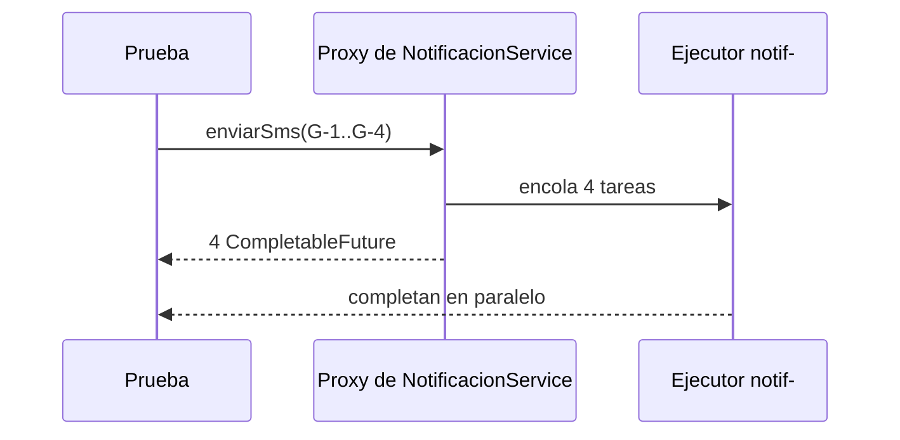

# Módulo 20: Integraciones Spring — scheduling, eventos, correo y caché

## Aprende construyendo

Este módulo completa el mapa de integraciones de Spring identificado en las capturas. Cada capacidad se introduce con una prueba observable y un límite importante: el scheduler local no coordina instancias, los eventos en memoria no son durables, SMTP puede fallar y las cachés necesitan invalidación.

### Dos ejemplos: primero visible, luego real

- **Ejemplo sencillo:** un `@Scheduled` revisa pedidos vencidos en H2; un evento Spring actualiza una métrica; Caffeine cachea una tarifa y el test observa la invalidación.
- **Caso RutaFlow:** al confirmar un envío, la API debe guardar el estado aunque el broker, SMTP o Redis no respondan. Usa el outbox para el evento que debe sobrevivir reinicios, procesa la notificación fuera de la transacción y mide el resultado de caché entre instancias.

Este módulo demuestra el comportamiento dentro de una aplicación Spring. El módulo 21 desarrolla Kafka entre procesos; `@TransactionalEventListener` no sustituye al outbox y un evento local no es mensajería durable.

### Tema 1: Scheduling y tareas periódicas

#### Paso 1 · Objetivo y preparación

Al finalizar podrás ejecutar una tarea periódica con Spring y probar su operación sin esperar al reloj real. Genera una app Spring Boot con `web` y `actuator`, JDK 25+ y Maven.
**Conocimiento previo:** haber seguido el tema anterior de este módulo y tener instalado el entorno del stack.
#### Paso 2 · Contexto y caso real

Una operación nocturna detecta pedidos que llevan demasiado tiempo pendientes y los marca para revisión. **¿Por qué es importante?** Un trabajo periódico evita depender de una persona que lo ejecute a mano y crea un punto verificable para automatización operativa.

#### Paso 3 · Teoría y modelo mental

`@EnableScheduling` activa las tareas; `@Scheduled` admite `fixedRate`, `fixedDelay` o una expresión cron. `fixedRate` mide desde el inicio del disparo anterior; `fixedDelay`, desde que termina. Configura explícitamente zona horaria en cron. Por defecto, el scheduler es local al proceso: con tres réplicas, la tarea puede ejecutarse tres veces.

Un scheduler no es una cola durable ni una exclusión distribuida. Si un trabajo puede durar más que el intervalo, define concurrencia limitada, idempotencia y un mecanismo de coordinación o utiliza Spring Batch y su repositorio cuando el trabajo deba reanudarse.
**Analogía:** una tarea periódica es como el despertador o el riego automático del jardín: se dispara solo según un horario (la expresión `cron`), sin que nadie tenga que acordarse de pulsar el botón cada día.
#### Paso 4 · Demostración guiada
**Ejemplo independiente (desde cero):** este tema también se puede reproducir en una **carpeta vacía**, como **proyecto nuevo**, sin arrastrar estado de otros temas: crea el andamiaje y vuelve a escribir `src/main/java/academia/pedidos/PedidosScheduler.java` dentro.
```bash
curl -fsSL https://start.spring.io/starter.zip -o ejemplo.zip && unzip -o ejemplo.zip -d ejemplo
```

**Crea** el archivo `src/main/java/academia/pedidos/PedidosScheduler.java` y pega en él el código mostrado a continuación; guárdalo antes de ejecutarlo.


En `src/main/java/academia/pedidos/PedidosScheduler.java`:

```java
@Component
public class PedidosScheduler {
    private final RevisionPedidos revision;

    public PedidosScheduler(RevisionPedidos revision) {
        this.revision = revision;
    }

    @Scheduled(cron = "${app.revision.cron}", zone = "UTC")
    public void revisarPendientes() {
        revision.marcarVencidos();
    }
}
```

**Ejecuta el ejemplo** (genera el proyecto con Spring Initializr, pega el código y corre las pruebas):

```bash
curl -fsSL https://start.spring.io/starter.zip -d dependencies=web -d javaVersion=25 -o app.zip && unzip -o app.zip
./mvnw test
```
Equivalencias Maven/Gradle en el Módulo 1.


Activa scheduling con `@EnableScheduling` en una configuración. En `src/main/resources/application.yml` configura `app.revision.cron: "0 */5 * * * *"` para el laboratorio. Inyecta `Clock` o una interfaz de servicio para probar lógica de vencimiento determinísticamente. Ejecuta `./mvnw test`.

**Resultado esperado:** la prueba invoca el servicio y comprueba el criterio de vencimiento; no depende de que el test duerma cinco minutos. **Fallo deliberado:** levanta dos instancias con el mismo cron y un contador compartido; observa dos ejecuciones. Diagnostica que un `@Scheduled` no es un lock distribuido.

#### Paso 5 · Práctica guiada

Agrega una tarea que registre inicio, duración y resultado con Micrometer. Fuerza una excepción del servicio y verifica que el scheduler no la oculte silenciosamente ni deja de producir señales operacionales. Define qué hacer si una ejecución supera el siguiente intervalo.
**Pista:** lanza una `RuntimeException` dentro de `revisarPendientes()` y vuelve a ejecutar la app; si no agregaste manejo de errores, el log solo muestra el stacktrace de esa ejecución y el scheduler sigue disparando la siguiente normalmente — confirma con Micrometer que esa ejecución fallida también queda registrada como fallo, no solo como "no se completó".
#### Paso 6 · Práctica independiente

Programa una revisión de envíos pendientes para el proyecto integrador de RutaFlow. Ejecuta dos instancias en tests o contenedores y prueba que una clave idempotente evita procesar dos veces el mismo envío. Si el negocio exige exactamente una ejecución coordinada, compara un lock distribuido o un job registrado con Spring Batch.

#### Paso 7 · Cierre y evidencia

Entrega configuración cron, test sin esperas reales, medición y prueba con dos instancias. **Cuándo no usarlo:** no uses `@Scheduled` como cola de tareas con payload o como garantía de ejecución única en cluster. **Evidencia:** test de vencimiento, log/Métrica y comportamiento duplicado documentado.
**Errores comunes:** asumir que `@Scheduled` es un lock distribuido y desplegar varias réplicas sin coordinación, dejando que la misma tarea se ejecute una vez por instancia, y tragar la excepción del servicio dentro del método programado sin relanzarla ni registrarla, con lo que el scheduler parece "funcionar" mientras la tarea real nunca se completa.
**Fuente oficial:** [documentación de Spring Boot](https://docs.spring.io/spring-boot/index.html).
**Evidencia de aprendizaje:** entrega el resultado del test que verifica el criterio de vencimiento sin esperar el reloj real, el log de las dos instancias ejecutando el mismo cron sobre el contador compartido, y la métrica de Micrometer que muestra la ejecución fallida al forzar la excepción.
### Tema 2: Eventos locales, eventos transaccionales y mensajería

#### Paso 1 · Objetivo y preparación

Al finalizar podrás elegir entre un evento Spring en memoria, una publicación después del commit y mensajería duradera mediante Kafka/outbox. Necesitas el servicio transaccional de los módulos anteriores.
**Conocimiento previo:** haber seguido el tema anterior de este módulo y tener instalado el entorno del stack.
#### Paso 2 · Contexto y caso real

Al crear un envío, una auditoría local debe reaccionar al cambio. **¿Por qué es importante?** Separar responsabilidades ayuda a mantener el servicio de negocio legible, pero un evento solo en memoria puede perderse si el proceso cae.

#### Paso 3 · Teoría y modelo mental

`ApplicationEventPublisher` desacopla componentes dentro de una misma aplicación y proceso; por sí solo no persiste ni distribuye el evento. `@TransactionalEventListener(phase = AFTER_COMMIT)` espera a que la transacción local termine antes de notificar. Aun así, el proceso puede caer entre el commit y la publicación.

Kafka u otro broker ofrece entrega entre procesos, con garantías que dependen de configuración y límites transaccionales. El patrón outbox escribe el evento en la misma transacción que el dato de negocio; un dispatcher lo publica después. El modelo mental: el evento local es una nota entre equipos de la misma oficina; el outbox es un registro en el libro de despacho que sobrevive al cierre.
**Analogía:** un evento local es gritar algo en la misma sala y que lo oiga quien está presente; un evento transaccional es esperar a que se firme el contrato antes de anunciar la noticia (si la transacción se cae, el anuncio nunca sale); y la mensajería es dejar el recado en un buzón para que otra oficina lo procese cuando pueda, aunque ahora esté cerrada.
#### Paso 4 · Demostración guiada
**Ejemplo independiente (desde cero):** este tema también se puede reproducir en una **carpeta vacía**, como **proyecto nuevo**, sin arrastrar estado de otros temas: crea el andamiaje y vuelve a escribir `src/main/java/academia/envios/EnvioCreado.java` dentro.
```bash
curl -fsSL https://start.spring.io/starter.zip -o ejemplo.zip && unzip -o ejemplo.zip -d ejemplo
```


En `src/main/java/academia/envios/EnvioCreado.java` declara un evento inmutable; en el servicio transaccional:

```java
publisher.publishEvent(new EnvioCreado(envioId));
```

**Ejecuta el ejemplo** (genera el proyecto con Spring Initializr, pega el código y corre las pruebas):

```bash
curl -fsSL https://start.spring.io/starter.zip -d dependencies=web -d javaVersion=25 -o app.zip && unzip -o app.zip
./mvnw test
```
Equivalencias Maven/Gradle en el Módulo 1.


El listener en `src/main/java/academia/envios/AuditoriaEnvio.java`:

```java
@Component
public class AuditoriaEnvio {
    @TransactionalEventListener(phase = TransactionPhase.AFTER_COMMIT)
    public void alCrear(EnvioCreado evento) {
        registrarAuditoria(evento.envioId());
    }
}
```

Escribe un test `@SpringBootTest` que publique el evento dentro de una transacción confirmada y otro que fuerce rollback. Ejecuta `./mvnw test -Dtest=AuditoriaEnvioTest`.

**Resultado esperado:** el listener actúa después del commit y no actúa cuando la transacción revierte. **Fallo deliberado:** reemplaza la anotación por `@EventListener`, fuerza rollback y observa la auditoría que quedó aunque el envío no se persistió.

#### Paso 5 · Práctica guiada

Agrega una tabla outbox con `event_id` único, tipo, payload y `published_at`; escribe el evento dentro de la transacción de negocio. Implementa un dispatcher que publique de forma repetible e idempotente y marque el resultado solo al confirmar la publicación.
**Pista:** ejecuta el dispatcher dos veces sobre la misma fila del outbox sin marcar `published_at` entre medio (simula un reintento tras una caída) y observa el efecto aguas abajo; si se duplica, el dispatcher no es idempotente — necesitas marcar la fila como publicada dentro de la misma operación que confirma el envío al broker, o deduplicar por `event_id` en el consumidor.
#### Paso 6 · Práctica independiente

Para el proyecto integrador de RutaFlow, decide cuáles eventos son locales (actualizar una métrica dentro del proceso) y cuáles deben sobrevivir un reinicio (notificar a Kafka, enviar correo). Implementa la persistencia del evento en el outbox dentro de la transacción que crea el envío, y luego sigue el laboratorio completo de Kafka del módulo 21 para publicar y consumirlo. Dibuja el límite de transacción y prueba la caída entre commit y dispatcher.

#### Paso 7 · Cierre y evidencia

Entrega pruebas de commit/rollback, tabla outbox y duplicado controlado. **Cuándo no usarlo:** no uses eventos locales para integración entre microservicios ni asumas que `AFTER_COMMIT` es durable. **Evidencia:** test que muestra los límites de entrega y test de reintento sin efecto duplicado.
Como **siguiente** paso, lleva lo aprendido al próximo tema y conéctalo con el proyecto integrador del track.
**Errores comunes:** asumir que `@TransactionalEventListener(phase = AFTER_COMMIT)` ya es "durable" y no necesita outbox, cuando el proceso puede caer entre el commit y la ejecución del listener, y publicar al dispatcher antes de marcar la fila del outbox como publicada, de forma que un reinicio a mitad de camino reenvía el mismo evento sin control de duplicados.
**Fuente oficial:** [documentación de Spring Boot](https://docs.spring.io/spring-boot/index.html).
**Evidencia de aprendizaje:** entrega el resultado del test que confirma que la auditoría solo se ejecuta tras el commit (y no tras un rollback), el fallo observado al reemplazar `@TransactionalEventListener` por `@EventListener` simple, y el resultado de ejecutar el dispatcher del outbox dos veces sobre el mismo evento sin duplicar el efecto.
### Tema 3: Correo con Spring Mail y entrega recuperable

#### Paso 1 · Objetivo y preparación

Al finalizar podrás crear un mensaje de correo desde un servicio, sustituir SMTP en tests y definir una política de reintento sin bloquear una transacción de negocio.
**Conocimiento previo:** haber seguido el tema anterior de este módulo y tener instalado el entorno del stack.
#### Paso 2 · Contexto y caso real

Después de asignar un conductor, el cliente recibe confirmación por correo. **¿Por qué es importante?** El proveedor SMTP es una dependencia externa: puede tardar, rechazar el mensaje o aceptar el correo aunque la respuesta se pierda.

#### Paso 3 · Teoría y modelo mental

`JavaMailSender` crea y envía mensajes; la configuración de host/puerto/credenciales debe venir de entorno o secret manager. El envío no es transaccional con la base de datos. No mantengas una transacción SQL abierta durante la llamada SMTP ni registres credenciales o contenido sensible en logs.

La operación de negocio debe confirmar independientemente del canal de notificación; un outbox permite reintentar con estado observable. La deduplicación requiere un identificador estable del evento, porque SMTP no ofrece una garantía general de entrega exactamente una vez.
**Analogía:** enviar correo con entrega recuperable es como el correo certificado: si el cartero no encuentra al destinatario, no tira la carta, la guarda y reintenta. El registro de intentos es el comprobante que te deja saber si llegó o sigue pendiente de reenvío.
#### Paso 4 · Demostración guiada
**Ejemplo independiente (desde cero):** este tema también se puede reproducir en una **carpeta vacía**, como **proyecto nuevo**, sin arrastrar estado de otros temas: crea el andamiaje y vuelve a escribir `src/main/java/academia/notificaciones/CorreoPedido.java` dentro.
```bash
curl -fsSL https://start.spring.io/starter.zip -o ejemplo.zip && unzip -o ejemplo.zip -d ejemplo
```


Genera el proyecto con `mail` y configura `spring.mail.host`, puerto y credenciales por variables externas. En `src/main/java/academia/notificaciones/CorreoPedido.java`:

```java
@Service
public class CorreoPedido {
    private final JavaMailSender sender;

    public CorreoPedido(JavaMailSender sender) { this.sender = sender; }

    public void enviarConfirmacion(String destinatario, String referencia) {
        SimpleMailMessage message = new SimpleMailMessage();
        message.setTo(destinatario);
        message.setSubject("Pedido confirmado");
        message.setText("Referencia: " + referencia);
        sender.send(message);
    }
}
```

**Ejecuta el ejemplo** (genera el proyecto con Spring Initializr, pega el código y corre las pruebas):

```bash
curl -fsSL https://start.spring.io/starter.zip -d dependencies=web -d javaVersion=25 -o app.zip && unzip -o app.zip
./mvnw test
```
Equivalencias Maven/Gradle en el Módulo 1.


En un test, reemplaza `JavaMailSender` con un mock y captura `SimpleMailMessage`; valida destinatario y asunto sin enviar correo. Ejecuta `./mvnw test -Dtest=CorreoPedidoTest`.

**Resultado esperado:** el mock recibe un mensaje con los campos esperados y ningún SMTP externo se contacta. **Fallo deliberado:** usa credenciales SMTP literales y falla la configuración en CI; mueve el secreto a variables externas y falla explícitamente si falta en el perfil de producción.

#### Paso 5 · Práctica guiada

Simula timeout SMTP y registra el intento fallido en outbox con siguiente fecha de reintento y número de intentos. Asegura que una segunda ejecución del dispatcher no envía dos notificaciones con el mismo `event_id` cuando el proveedor admite clave de idempotencia; documenta el riesgo residual cuando no la admite.
**Pista:** ejecuta el dispatcher dos veces para el mismo `event_id` del outbox simulando que el primer intento quedó en un timeout ambiguo (no sabes si el correo salió o no); si el proveedor SMTP no te da una clave de idempotencia, verás que no puedes garantizar cero duplicados y debes documentar ese posible reenvío como riesgo residual aceptado, no intentar resolverlo con más reintentos.
#### Paso 6 · Práctica independiente

Añade una plantilla de correo de confirmación para el proyecto integrador de RutaFlow. Prueba caracteres acentuados, destinatario inválido, fallo SMTP y redacción de logs. Separa contenido de correo del método que confirma el pedido.

#### Paso 7 · Cierre y evidencia

Entrega implementación, test del mock y flujo de outbox/retry. **Cuándo no usarlo:** no envíes correo síncrono en la transacción HTTP crítica ni guardes contraseña en `application.yml` versionado. **Evidencia:** prueba de mensaje, prueba de fallo y configuración sin secretos.
**Errores comunes:** enviar el correo dentro de la misma transacción que confirma el pedido (si SMTP tarda o falla, arriesga revertir una operación de negocio que ya era válida), y reintentar un envío fallido sin registrar número de intentos ni próxima fecha de reintento, perdiendo la capacidad de distinguir un fallo transitorio de uno permanente.
**Fuente oficial:** [documentación de Spring Boot](https://docs.spring.io/spring-boot/index.html).
### Tema 4: Caché con Spring Cache, Caffeine y Redis

#### Paso 1 · Objetivo y preparación

Al finalizar podrás cachear una lectura con Caffeine, invalidarla después de una escritura y explicar cuándo hace falta Redis. Genera una app con `cache`; agrega Caffeine para el laboratorio.
**Conocimiento previo:** haber seguido el tema anterior de este módulo y tener instalado el entorno del stack.
#### Paso 2 · Contexto y caso real

La lista de tarifas cambia poco y se consulta miles de veces por minuto. **¿Por qué es importante?** Una caché puede reducir latencia y carga de base de datos, pero introduce copias que pueden quedar obsoletas.

#### Paso 3 · Teoría y modelo mental

`@EnableCaching` activa la abstracción; `@Cacheable` reutiliza una respuesta por clave; `@CacheEvict` invalida entradas; `@CachePut` actualiza una entrada explícitamente. El proveedor define almacenamiento y expiración. Caffeine vive dentro de cada proceso; Redis comparte datos entre réplicas, a costa de una dependencia de red y operación.

La clave debe incluir parámetros que cambian el resultado, incluyendo tenant/locale cuando corresponda. Define TTL, invalidación, límites de tamaño y estrategia ante cache miss. Un cache stampede ocurre cuando muchas solicitudes recalculan simultáneamente una clave expirada.
**Analogía:** una caché es tener a mano, en el cajón del escritorio, los papeles que usas cada día en vez de bajar al archivo cada vez. Caffeine es ese cajón local (rápido, propio de cada oficina); Redis es un archivo compartido entre varias oficinas; y la expiración evita quedarte con una copia vieja cuando el original ya cambió.
#### Paso 4 · Demostración guiada
**Ejemplo independiente (desde cero):** este tema también se puede reproducir en una **carpeta vacía**, como **proyecto nuevo**, sin arrastrar estado de otros temas: crea el andamiaje y vuelve a escribir `src/main/java/academia/tarifas/TarifaService.java` dentro.
```bash
curl -fsSL https://start.spring.io/starter.zip -o ejemplo.zip && unzip -o ejemplo.zip -d ejemplo
```

**Crea** el archivo `src/main/java/academia/tarifas/TarifaService.java` y pega en él el código mostrado a continuación; guárdalo antes de ejecutarlo.


En `src/main/java/academia/tarifas/TarifaService.java`:

```java
@Service
public class TarifaService {
    private final TarifaRepository repository;

    public TarifaService(TarifaRepository repository) { this.repository = repository; }

    @Cacheable(cacheNames = "tarifas", key = "#zona")
    public Tarifa buscar(String zona) {
        return repository.findByZona(zona)
            .orElseThrow(() -> new IllegalArgumentException("Zona desconocida"));
    }

    @CacheEvict(cacheNames = "tarifas", key = "#tarifa.zona")
    public Tarifa actualizar(Tarifa tarifa) {
        return repository.save(tarifa);
    }
}
```

**Ejecuta el ejemplo** (genera el proyecto con Spring Initializr, pega el código y corre las pruebas):

```bash
curl -fsSL https://start.spring.io/starter.zip -d dependencies=web -d javaVersion=25 -o app.zip && unzip -o app.zip
./mvnw test
```
Equivalencias Maven/Gradle en el Módulo 1.


Activa caching con `@EnableCaching` y configura Caffeine con máximo de entradas y TTL. Escribe un test que invoque dos veces `buscar("NORTE")` y verifique una llamada al repository, luego actualice y verifique que la siguiente búsqueda vuelve a leer. Ejecuta `./mvnw test -Dtest=TarifaServiceTest`.

**Resultado esperado:** la segunda lectura reutiliza la entrada y la escritura la invalida. **Fallo deliberado:** elimina `@CacheEvict`; actualiza tarifa y demuestra que el usuario recibe el valor viejo hasta expirar el TTL.

#### Paso 5 · Práctica guiada

Mide hits, misses y tamaño con Actuator/Micrometer. Añade un test para dos zonas y confirma que no colisionan claves. Evalúa qué sucede si se actualiza la tarifa en otra réplica cuando usas caché local.
**Pista:** cachea `buscar("NORTE")` y `buscar("SUR")` y cuenta en el log del repository cuántas llamadas reales hizo cada una; si ves una sola llamada total en vez de dos, la clave del `@Cacheable` no está diferenciando por `#zona` y ambas zonas están colisionando en la misma entrada.
#### Paso 6 · Práctica independiente

Propón para el proyecto integrador de RutaFlow una caché de lectura de catálogo y otra de autorización. Para cada una define TTL, clave, invalidación, privacidad multi-tenant y comportamiento si Redis no responde. Implementa solo la caché con consistencia aceptable; deja otras consultas sin cachear justificadamente.

#### Paso 7 · Cierre y evidencia

Entrega tests de hit/miss/invalidation, métrica y tabla de decisión Caffeine vs Redis. **Cuándo no usarlo:** no caches datos sensibles sin aislamiento de clave, datos que cambian constantemente sin invalidación ni resultados de consultas no deterministas. **Evidencia:** resultados medidos y test de valor obsoleto.

Referencia: [Spring Boot — Task Execution and Scheduling](https://docs.spring.io/spring-boot/reference/features/task-execution-and-scheduling.html), [Spring Framework — Cache Abstraction](https://docs.spring.io/spring-framework/reference/integration/cache.html), [Spring Framework — Email](https://docs.spring.io/spring-framework/reference/integration/email.html).
**Errores comunes:** desalinear la clave de `@CacheEvict` respecto a la de `@Cacheable` (por ejemplo, invalidar por `#tarifa.zona` cuando la lectura cachea por `#zona` con otro formato), dejando entradas obsoletas que nunca se invalidan, y usar Caffeine (caché local por proceso) en un despliegue con varias réplicas esperando que la invalidación en una instancia se propague a las demás sin pasar por Redis.
**Fuente oficial:** [documentación de Spring Boot](https://docs.spring.io/spring-boot/index.html).
### Tema 5: @Async y ejecutores: trabajo en segundo plano con límites

#### Paso 1 · Objetivo y preparación
Al finalizar podrás ejecutar métodos en segundo plano con `@Async`, definir un ejecutor con límites explícitos, devolver `CompletableFuture` y diagnosticar por qué `@Async` a veces "no hace nada". Prerrequisitos: Temas 1 y 2 de este módulo y el módulo de concurrencia del track Java.

#### Paso 2 · Contexto y caso real
Al registrar un envío, el backend de RutaFlow enviaba un SMS al destinatario y la petición tardaba lo que tardara el proveedor. Mover esa tarea a segundo plano es el caso real más común de `@Async`; hacerlo con un pool sin límites es la forma más común de tumbar el servidor en un pico de tráfico.

#### Paso 3 · Teoría, modelo mental y analogía
Con `@EnableAsync`, Spring envuelve los beans que tienen métodos `@Async` en un **proxy**: la llamada se entrega a un `Executor` y regresa de inmediato. Si el método devuelve `CompletableFuture`, quien llama puede esperar o combinar resultados. Un `ThreadPoolTaskExecutor` con tamaño y cola definidos pone límites. Como funciona con proxies, una llamada **desde la misma clase** (`this.enviarSms()`) no pasa por el proxy y se ejecuta de forma síncrona. Las excepciones de métodos `void` no llegan a quien llama.

**Analogía:** `@Async` es dejar la carta en el buzón en vez de llevarla tú; el ejecutor es el número de carteros: si hay infinitos, la oficina colapsa.

**Diagrama:**



#### Paso 4 · Demostración guiada desde cero
**Ejemplo independiente (desde cero):** este tema se reproduce en una **carpeta vacía**, como **proyecto nuevo**, sin estado de otros temas.

```bash
mkdir spring-async && cd spring-async
curl -fsSL https://start.spring.io/starter.zip -d dependencies=web -d javaVersion=25 -o app.zip
unzip -q app.zip
```

Crea `src/main/java/com/example/demo/AsyncConfig.java`:

```java
package com.example.demo;

import org.springframework.context.annotation.Bean;
import org.springframework.context.annotation.Configuration;
import org.springframework.scheduling.annotation.EnableAsync;
import org.springframework.scheduling.concurrent.ThreadPoolTaskExecutor;

import java.util.concurrent.Executor;

@Configuration
@EnableAsync
public class AsyncConfig {
    // Pool acotado y con nombre: límites explícitos en vez de hilos ilimitados
    @Bean("notificaciones")
    public Executor notificaciones() {
        ThreadPoolTaskExecutor ejecutor = new ThreadPoolTaskExecutor();
        ejecutor.setCorePoolSize(4);
        ejecutor.setMaxPoolSize(4);
        ejecutor.setQueueCapacity(100);
        ejecutor.setThreadNamePrefix("notif-");
        ejecutor.initialize();
        return ejecutor;
    }
}
```

Crea `src/main/java/com/example/demo/NotificacionService.java`:

```java
package com.example.demo;

import org.slf4j.Logger;
import org.slf4j.LoggerFactory;
import org.springframework.scheduling.annotation.Async;
import org.springframework.stereotype.Service;

import java.util.concurrent.CompletableFuture;

@Service
public class NotificacionService {
    private static final Logger log = LoggerFactory.getLogger(NotificacionService.class);

    // Se ejecuta en un hilo del pool "notificaciones", no en el hilo de la petición
    @Async("notificaciones")
    public CompletableFuture<String> enviarSms(String guia) throws InterruptedException {
        Thread.sleep(300);                          // simula la latencia del proveedor de SMS
        log.info("SMS de {} enviado en {}", guia, Thread.currentThread().getName());
        return CompletableFuture.completedFuture(guia);
    }
}
```

Crea `src/test/java/com/example/demo/NotificacionServiceTest.java`:

```java
package com.example.demo;

import org.junit.jupiter.api.Test;
import org.springframework.beans.factory.annotation.Autowired;
import org.springframework.boot.test.context.SpringBootTest;

import java.time.Duration;
import java.time.Instant;
import java.util.List;
import java.util.concurrent.CompletableFuture;

import static org.assertj.core.api.Assertions.assertThat;

@SpringBootTest
class NotificacionServiceTest {

    @Autowired
    NotificacionService servicio;

    @Test
    void cuatroSmsEnParaleloTardanComoUno() throws Exception {
        Instant inicio = Instant.now();
        List<CompletableFuture<String>> envios = List.of(
                servicio.enviarSms("G-1"), servicio.enviarSms("G-2"),
                servicio.enviarSms("G-3"), servicio.enviarSms("G-4"));
        CompletableFuture.allOf(envios.toArray(CompletableFuture[]::new)).join();
        long ms = Duration.between(inicio, Instant.now()).toMillis();

        System.out.println("4 SMS en " + ms + " ms");
        assertThat(ms).isLessThan(1000);          // en serie serían unos 1200 ms
    }
}
```

**Ejecuta el ejemplo:**

```bash
./mvnw test
```

**Resultado esperado:**

```text
4 SMS en 312 ms
...
[INFO] Tests run: 2, Failures: 0, Errors: 0, Skipped: 0
[INFO] BUILD SUCCESS
```

El tiempo exacto varía, pero queda cerca de 300 ms porque las cuatro tareas corren en paralelo en hilos llamados `notif-1` a `notif-4` (míralos en el log). En serie serían unos 1 200 ms.

**Fallo deliberado:** Quita `@EnableAsync` de `AsyncConfig`. No hay error de compilación ni de arranque, pero la prueba falla: los cuatro SMS se ejecutan uno tras otro en el hilo de la prueba y tardan más de 1 000 ms. Sin `@EnableAsync` la anotación `@Async` se ignora en silencio.

#### Paso 5 · Práctica guiada
Llama `enviarSms` desde otro método de la misma clase `NotificacionService` y demuestra con el nombre del hilo en el log que esa llamada no fue asíncrona. **Pista:** agrega `enviarLote(List<String> guias)` en el mismo servicio, llama desde ahí a `enviarSms` y compara `Thread.currentThread().getName()`.

#### Paso 6 · Práctica independiente
Configura un `AsyncUncaughtExceptionHandler` para los métodos `@Async` que devuelven `void` y una política de rechazo para cuando la cola de 100 se llene. Prueba ambos casos.

#### Paso 7 · Cierre y evidencia
Entrega como evidencia la salida real del Paso 4 y la explicación del fallo deliberado. **¿Por qué es importante?** porque el trabajo en segundo plano mejora la latencia, pero sin límites ni manejo de errores provoca pérdidas silenciosas y caídas.
**Fuente oficial:** [Spring Framework: Task Execution and Scheduling](https://docs.spring.io/spring-framework/reference/integration/scheduling.html), [Spring Boot: Task Execution](https://docs.spring.io/spring-boot/reference/features/task-execution-and-scheduling.html).
**Conceptos clave:** `@EnableAsync`, `@Async`, proxy, `ThreadPoolTaskExecutor`, cola acotada, `CompletableFuture`, auto-invocación, excepciones no capturadas.
**Cuándo no usarlo:** si la tarea debe sobrevivir a un reinicio o reintentarse, usa una cola de mensajes (Kafka, RabbitMQ) o un outbox: `@Async` vive en la memoria del proceso y se pierde si cae. Con Java 21+ también puedes evaluar hilos virtuales (`spring.threads.virtual.enabled`).

**Transferencia al proyecto integrador «Backend profesional de entregas»:** envía las notificaciones push de entregas con `@Async` y un ejecutor acotado, y registra las fallas.
Como **siguiente** paso, aplica lo aprendido en el proyecto integrador del track y compara el resultado con lo que esperabas.
**Errores comunes:** olvidar `@EnableAsync` y no notarlo porque `@Async` se ignora en silencio sin error de compilación ni de arranque, y llamar a un método `@Async` desde otro método de la misma clase (auto-invocación) esperando que pase por el proxy, cuando en realidad se ejecuta de forma síncrona en el mismo hilo.

## Ampliación de la página 28 del PDF

### Tema complementario: Integraciones empresariales, SOAP y fronteras de protocolo

#### Paso 1 · Objetivo y preparación
Al finalizar podrás leer un contrato SOAP mínimo y separar transporte de lógica de negocio. **Prerrequisitos:** HTTP, XML y las capas del proyecto; Python para una demostración independiente de parsing. El siguiente ejemplo inspecciona XML confiable construido localmente; no es un servidor SOAP ni una sustitución de Spring Web Services.

#### Paso 2 · Contexto y caso real
**¿Por qué es importante?** Un socio de RutaFlow tiene SOAP y SFTP aunque la aplicación nueva use REST. REST describe una interfaz sobre recursos; SOAP define mensajes XML con Envelope, Header opcional, Body y Fault. SFTP transfiere archivos sobre SSH; no equivale a FTP ni a FTPS. SMTP transporta correo y no demuestra entrega al destinatario. Un adaptador traduce el contrato externo al dominio y conserva correlación, errores e idempotencia.

#### Paso 3 · Teoría, modelo mental y analogía
**Analogía:** varios formularios pueden solicitar el mismo despacho, pero cada formulario necesita un traductor que valide sus campos. El namespace identifica el vocabulario XML; el prefijo puede cambiar sin cambiar el significado. SOAP 1.1 y 1.2 usan namespaces y bindings diferentes. WSDL describe operaciones y tipos; no inventes un endpoint a partir del nombre de una operación.

#### Paso 4 · Demostración guiada desde cero
Crea `soap_contrato.py` en una carpeta vacía:

```python
import xml.etree.ElementTree as ET

mensaje = '''<s:Envelope xmlns:s="http://www.w3.org/2003/05/soap-envelope"
 xmlns:r="urn:rutaflow:entregas"><s:Body><r:ConsultarEnvio>
 <r:id>ENV-42</r:id></r:ConsultarEnvio></s:Body></s:Envelope>'''
ns = {"s": "http://www.w3.org/2003/05/soap-envelope", "r": "urn:rutaflow:entregas"}
# Buscar por URI de namespace; el prefijo visible no es la identidad.
raiz = ET.fromstring(mensaje)
id_envio = raiz.findtext("s:Body/r:ConsultarEnvio/r:id", namespaces=ns)
if not id_envio:
    raise ValueError("Falta id del envío en el contrato SOAP 1.2")
print(f"Consultar envío: {id_envio}")
```

**Ejecuta el ejemplo** (genera el proyecto con Spring Initializr, pega el código y corre las pruebas):

```bash
curl -fsSL https://start.spring.io/starter.zip -d dependencies=web -d javaVersion=25 -o app.zip && unzip -o app.zip
./mvnw test
```
Equivalencias Maven/Gradle en el Módulo 1.


```bash
mkdir -p practica-integraciones
python3 soap_contrato.py
```

Ejecuta desde la carpeta donde guardaste el archivo. **Salida esperada:** `Consultar envío: ENV-42`. Explicación por bloques: el documento declara vocabularios, el mapa de namespaces permite encontrar el identificador y la validación impide traducir un mensaje sin id.

**Fallo deliberado:** cambia el URI SOAP al de 1.1 sin actualizar el contrato: la búsqueda no encuentra el nodo y lanza ValueError. Diagnostica versión y URI antes de cambiar etiquetas a ciegas.

#### Paso 5 · Práctica guiada
**Pista:** cambia `s` por `env` en la declaración y etiquetas conservando el URI; la búsqueda sigue funcionando. Cambia luego ENV-42 por un campo vacío y comprueba rechazo.

#### Paso 6 · Práctica independiente
Dibuja adaptador SOAP → caso de uso → repositorio del proyecto integrador Spring. Define límites de tamaño, timeouts, Fault, autenticación y correlación. Para SFTP verifica host key y finalización de archivo; para SMTP distingue aceptación del servidor y entrega. **Límites:** para XML externo emplea parser/configuración endurecidos, schema y límites; este parser de un literal local no valida WSDL, seguridad XML ni interoperabilidad real.

#### Paso 7 · Cierre y evidencia
Entrega archivo, salida, fallo y tabla REST/SOAP/SFTP/SMTP con contratos y garantías. **Errores comunes:** confundir prefijo con namespace, tratar HTTP 200 como éxito de negocio, presentar un archivo enviado como proceso completado. El siguiente paso es integrar un WSDL autorizado y verificar contrato real. **Fuente oficial:** [SOAP 1.2, W3C](https://www.w3.org/TR/soap12-part1/).
