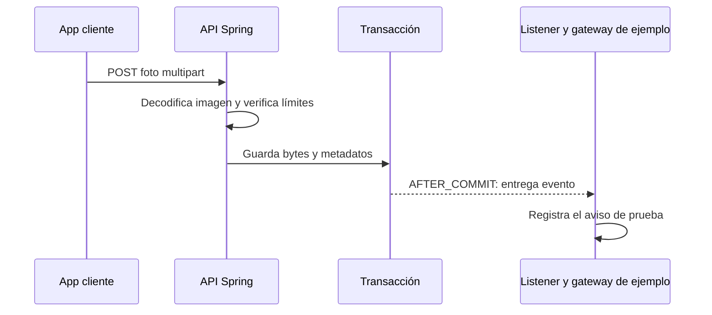

# Módulo 20: Proyecto integrador: backend de entregas productivo


## Aprende construyendo

Los Temas 1–3 amplían incrementalmente el proyecto real `examples/spring-boot-integrador-rutaflow/`, combinando piezas ya estudiadas en el track: entidades y migraciones Flyway (Módulo 4), JWT y `@PreAuthorize` (Módulo 5), pruebas de integración con Testcontainers (Módulo 6) y una métrica de negocio de Actuator (Módulo 7). Cada tema comprueba cambios con código ejecutable y evidencia observable. Los Temas 4–9 construyen el backend de entregas `gestion-entregas`: datos espaciales en MySQL, JWT con propiedad del recurso, tiempo real con STOMP y archivos con notificaciones.

### Tema 1: Arquitectura del microservicio integrador · Avanzado · 40 min

**Resultado del tema:** construirás y comprobarás un endpoint que valida una solicitud, pasa por controller → service → repository y guarda una entrega en PostgreSQL. Al final podrás explicar qué hace cada capa con evidencia de una petición HTTP y una fila guardada.

**¿Por qué es importante?** Separar HTTP, reglas del servicio y persistencia hace que cada cambio tenga un lugar claro. La prueba de extremo a extremo comprueba que esas piezas sí trabajan juntas.

**Necesitas:** Java 25, Maven Wrapper y Podman o Docker compatible con Testcontainers. Abre [`examples/spring-boot-integrador-rutaflow/`](https://github.com/NICORUIZ93/The_Imperial_Book/tree/main/examples/spring-boot-integrador-rutaflow). La práctica ya contiene el proyecto ejecutable; los subtemas indican qué archivo seguir, qué cambiar y cómo comprobarlo.

#### Subtema 1.1: Sigue una petición por las capas · 8 min

**1. Contexto**

Una petición no debería decidir cómo se guarda en la base de datos. El controller entiende HTTP; el service aplica la acción del producto; el repository habla con PostgreSQL.

**2. Hazlo tú**

Abre `src/main/java/academia/rutaflow/integrador/entrega/` y sigue `EntregaController.java` → `EntregaService.java` → `EntregaRepository.java`. Desde `examples/spring-boot-integrador-rutaflow/` ejecuta:

```bash
./scripts/verify-integration.sh
```

```text
POST /api/entregas
  JSON → EntregaController → EntregaService → EntregaRepository → PostgreSQL
  HTTP 201 ← EntregaResponse ← entidad guardada
```

**Resultado esperado:** la suite final informa 7 pruebas y 0 fallos; la petición de creación devuelve HTTP 201 y una URL `Location`.

**Fallo deliberado:** cambia temporalmente `@PostMapping` por `@PutMapping` y ejecuta `./scripts/verify-integration.sh`. **Diagnóstico:** la prueba recibe un estado distinto a 201 porque envía POST. Restaura `@PostMapping`.

**3. Entiende**

El flujo se puede seguir leyendo los archivos: el controller convierte la entrada y la respuesta HTTP, el service coordina la operación y el repository persiste. El diagrama recorta las capas de datos; el laboratorio final ya incluye JWT y métricas, que se analizan en el Tema 2. No incluye entrega de eventos a un broker.

**4. Cierra**

Sin mirar los archivos, explica qué clase recibe HTTP y cuál guarda los datos. Luego señala la línea de código que conecta cada paso.

#### Subtema 1.2: Deja que Flyway cree la tabla · 10 min

**1. Contexto**

La entidad Java describe los datos que usa la app. La migración SQL define el cambio que se aplica a la base. Así, el esquema no depende de que Hibernate invente tablas al arrancar.

**2. Hazlo tú**

Compara `src/main/resources/db/migration/V1__crear_entrega.sql` con `entrega/Entrega.java`. Ejecuta `./scripts/verify-integration.sh`.

```sql
CREATE TABLE entrega (
    id BIGINT GENERATED BY DEFAULT AS IDENTITY PRIMARY KEY,
    destinatario VARCHAR(200) NOT NULL,
    estado VARCHAR(30) NOT NULL
);
```

En `application.properties`, `spring.jpa.hibernate.ddl-auto=validate` pide comprobar que la tabla coincide; Flyway aplica la migración.

**Resultado esperado:** Flyway aplica la migración y Hibernate valida la tabla antes de ejecutar las siete pruebas.

**Fallo deliberado:** renombra la migración para que ya no empiece con `V1__` y vuelve a ejecutar `./scripts/verify-integration.sh`. **Diagnóstico:** Flyway no la reconoce y la validación de Hibernate falla porque falta `entrega`. Restaura el nombre `V1__crear_entrega.sql`.

**3. Entiende**

La migración deja un historial de cambios del esquema. La entidad y el SQL deben coincidir: por ejemplo, ambos limitan `destinatario` a 200 caracteres.

**4. Cierra**

Di qué archivo define la tabla y qué propiedad evita que Hibernate la cree por su cuenta.

#### Subtema 1.3: Valida la solicitud antes de guardar · 10 min

**1. Contexto**

Una entrega sin destinatario no sirve. Validar la entrada en el borde HTTP permite responder con un error claro antes de tocar la base.

**2. Hazlo tú**

Abre `entrega/CrearEntregaRequest.java` y `entrega/EntregaController.java`. Envía un cuerpo válido y uno vacío:

```json
{"destinatario":"Tienda Norte"}
```

```json
{"destinatario":" "}
```

El test `destinatarioVacioSeRechazaAntesDeGuardar` envía el segundo cuerpo por HTTP real y comprueba que recibe 400. Ejecuta `./scripts/verify-integration.sh`.

**Resultado esperado:** destinatario válido produce 201; destinatario vacío produce 400 y no se guarda. La suite completa mantiene sus siete pruebas en verde.

**Fallo deliberado:** quita `@Valid` de `crear(...)` y ejecuta `./scripts/verify-integration.sh`. **Diagnóstico:** la validación de `@NotBlank` deja de activarse y la prueba que espera 400 falla. Restaura `@Valid`.

**3. Entiende**

`CrearEntregaRequest` es el formato de entrada; `EntregaResponse` es la salida. Separarlos evita exponer directamente la entidad como contrato HTTP. `@NotBlank` rechaza texto vacío o compuesto por espacios.

**4. Cierra**

Explica por qué el cuerpo HTTP no se pasa directamente al repository. Identifica la anotación que activa la validación.

#### Subtema 1.4: Comprueba HTTP y PostgreSQL juntos · 12 min

**1. Contexto**

Una prueba del controller aislado no confirma que SQL, migración y base de datos funcionen en conjunto. Aquí la prueba arranca la aplicación y PostgreSQL real en un contenedor temporal.

**2. Hazlo tú**

Abre `src/test/java/academia/rutaflow/integrador/entrega/ArquitecturaIntegradaTest.java`. Localiza `@Testcontainers`, `@SpringBootTest`, la petición de `HttpClient` y la comprobación `entregas.existsByDestinatario(...)`. Corre:

```bash
./scripts/verify-integration.sh
```

**Resultado esperado:** las siete pruebas pasan; cubren HTTP 201 con persistencia, HTTP 400 sin guardar, reglas JWT 401/403, métrica y guardia de configuración.

**Fallo deliberado:** cambia en la prueba el puerto destino por `port + 1` y ejecútala. **Diagnóstico:** la conexión HTTP falla porque el servidor de prueba escucha en `port`. Restaura `port`.

**3. Entiende**

La app recibe una petición de red local, Flyway prepara PostgreSQL y el repository lee la fila después de crearla. Testcontainers ofrece la base real para esta prueba; no es una base simulada. En macOS, el script configura la conexión del runtime Podman antes de invocar Maven.

**4. Cierra**

Guarda como evidencia el resultado de las siete pruebas y dibuja el recorrido desde JSON hasta la fila. Si algo falla, anota primero el primer error y el archivo responsable; no tapes un problema de conexión cambiando el código de negocio.

**Siguiente:** el Tema 2 analiza la seguridad y las métricas ya presentes en este laboratorio final. No desactives JWT para seguir el Tema 1: sus pruebas envían credenciales válidas cuando corresponde.

**Fuentes:** [migraciones SQL de Flyway en Spring Boot](https://docs.spring.io/spring-boot/how-to/data-initialization.html), [Testcontainers con PostgreSQL](https://java.testcontainers.org/modules/databases/postgres/), [JUnit 5 con Testcontainers](https://java.testcontainers.org/test_framework_integration/junit_5/) y [runtime Podman](https://java.testcontainers.org/supported_docker_environment/).


**Aplicación y decisión:** En el proyecto integrador, recorre la petición desde EntregaController hasta Flyway y EntregaRepository. El límite del test local incluye PostgreSQL efímero y JWT de laboratorio; no prueba una plataforma desplegada ni credenciales de producción.

Desde `examples/spring-boot-integrador-rutaflow`, ejecuta la comprobación del laboratorio:

```bash
bash ./scripts/verify-integration.sh
```

### Tema 2: Integra seguridad JWT y observabilidad · Avanzado · 40 min

**Resultado del tema:** protegerás la creación de entregas con un JWT firmado y el rol `USER`, conservarás la persistencia del Tema 1 y medirás cada creación exitosa con un contador visible en Actuator.

**¿Por qué es importante?** La base de datos no sabe quién hizo una solicitud y un contador no prueba que el trabajo terminó. El servicio valida identidad y permiso antes de escribir, y registra la métrica después de guardar.

**Necesitas:** el Tema 1 y sus pruebas verdes. Continúa en [`examples/spring-boot-integrador-rutaflow/`](https://github.com/NICORUIZ93/The_Imperial_Book/tree/main/examples/spring-boot-integrador-rutaflow). La clave HS256 del archivo de propiedades es solo de demostración local; no la uses como secreto de producción.

#### Subtema 2.1: Verifica un JWT firmado · 10 min

**1. Contexto**

Un JWT es una credencial firmada. La API valida la firma y la caducidad antes de confiar en sus datos; cambiar texto del token no crea una identidad válida.

**2. Hazlo tú**

Abre `src/main/java/academia/rutaflow/integrador/security/JwtSecurityConfig.java`. Sigue el bean `jwtDecoder`, que valida HS256 con una clave, y `jwtAuthenticationConverter`, que lee el claim `roles`. En `src/test/java/academia/rutaflow/integrador/entrega/ArquitecturaIntegradaTest.java`, busca `token(...)`: crea una credencial firmada para las pruebas. Ejecuta:

```bash
./scripts/verify-integration.sh
```

**Resultado esperado:** la app inicia y las siete pruebas pasan; los requests de creación llevan `Authorization: Bearer ...`.

**Fallo deliberado:** cambia en el convertidor el claim `roles` por `perfiles` y ejecuta el script. **Diagnóstico:** el token todavía tiene una firma válida, pero el convertidor ya no encuentra la autoridad y el request con `ROLE_USER` recibe 403. Restaura `roles`.

**3. Entiende**

`JwtDecoder` verifica la credencial; el convertidor transforma el claim de roles en autoridades de Spring Security. La API consume tokens, no ofrece un endpoint para emitirlos. El valor por defecto solo sirve en local; para ejecutar con tu propia clave define `RUTAFLOW_JWT_SECRET_BASE64`. En producción, conecta un emisor de identidad y guarda las claves fuera del repositorio.

**4. Cierra**

Explica qué revisa la firma y de qué claim sale `ROLE_USER`. Señala por qué el token de la prueba es distinto de escribir un nombre en un encabezado.

#### Subtema 2.2: Distingue identidad de permiso · 10 min

**1. Contexto**

Tener un token válido confirma quién hace la llamada; no significa que esa persona pueda crear cualquier recurso. El endpoint exige el rol `USER`.

**2. Hazlo tú**

En `entrega/EntregaController.java`, localiza `@PreAuthorize("hasRole('USER')")`. En `ArquitecturaIntegradaTest.java`, corre el caso `escrituraRequiereJwtValidoYRolUser`: sin token espera 401; con token válido de `ROLE_ADMIN` espera 403.

```bash
./scripts/verify-integration.sh
```

**Resultado esperado:** 401 sin token o con firma alterada; 403 si el token es válido, pero no tiene el rol requerido.

**Fallo deliberado:** quita `@PreAuthorize` y ejecuta el script. **Diagnóstico:** el token `ROLE_ADMIN` alcanza el endpoint y devuelve 201; `anyRequest().authenticated()` valida identidad, pero no el rol de negocio. Restaura `@PreAuthorize`.

**3. Entiende**

`@EnableMethodSecurity` activa la regla sobre el método. La cadena HTTP exige autenticación general, usa sesiones sin estado y `@PreAuthorize` aplica el permiso concreto de esta acción. No uses un test con usuario simulado para afirmar que la firma JWT se verificó: aquí el test firma un token y altera otro para confirmar que el filtro rechaza la firma rota.

**4. Cierra**

Di qué respuesta esperas para (a) sin credencial, (b) firma alterada, (c) token válido con rol incorrecto y (d) token válido con `ROLE_USER`. Relaciona cada caso con la regla que lo produce.

#### Subtema 2.3: Cuenta solo las entregas guardadas · 10 min

**1. Contexto**

El contador debe representar trabajo terminado. Si sumas antes de guardar, puede informar una entrega que la base rechazó.

**2. Hazlo tú**

Abre `entrega/EntregaService.java`. Localiza el orden: `entregas.save(...)` y luego `entregasCreadas.increment()`. En la prueba `jwtConRolUserCreaYActuatorMuestraElContador`, compara el contador antes y después de una creación.

```java
Entrega creada = entregas.save(Entrega.crear(destinatario));
entregasCreadas.increment();
return creada;
```

Ejecuta `./scripts/verify-integration.sh`.

**Resultado esperado:** la prueba observa que el contador sube exactamente en 1 tras la respuesta 201.

**Fallo deliberado:** comenta `entregasCreadas.increment()` y ejecuta el script. **Diagnóstico:** PostgreSQL guarda la entrega y el endpoint responde 201, pero la aserción del contador no aumenta. Restaura la línea.

**3. Entiende**

`Counter` registra cuántas veces ocurre un evento acumulable. Este contador vive en la instancia del proceso y se reinicia cuando la app reinicia; para conservar y agregar valores entre réplicas se conecta un exporter y un sistema de métricas.

**4. Cierra**

Explica por qué el incremento ocurre después de `save` y qué limitación tiene un contador en memoria al reiniciar el proceso.

#### Subtema 2.4: Consulta la métrica sin abrirla a todos · 10 min

**1. Contexto**

La app puede medir por dentro y a la vez limitar quién consulta la información de Actuator. En este laboratorio salud es pública; métricas requiere `ROLE_ADMIN`.

**2. Hazlo tú**

En `application.properties`, verifica que Actuator expone `health,metrics`. En `JwtSecurityConfig.java`, localiza la regla `.requestMatchers("/actuator/metrics/**").hasRole("ADMIN")`. La prueba crea una entrega, lee el valor del `MeterRegistry` y consulta con un token de `ROLE_ADMIN`:

```text
GET /actuator/metrics/entregas.creadas
Authorization: Bearer <JWT con ROLE_ADMIN>
```

Ejecuta `./scripts/verify-integration.sh` y observa la aserción sobre `$.measurements[0].value`.

```bash
./scripts/verify-integration.sh
```

**Resultado esperado:** Actuator devuelve el mismo número que el `MeterRegistry`; la creación requirió `ROLE_USER` y la lectura de métricas requiere `ROLE_ADMIN`.

**Fallo deliberado:** cambia `.hasRole("ADMIN")` por `.hasRole("USER")` y ejecuta el script. **Diagnóstico:** las pruebas actuales aún leen la métrica con administrador, así que el endpoint responde 403; restaura `ADMIN`.

**3. Entiende**

`/actuator/metrics/{nombre}` consulta una medida local. Exponer el endpoint no envía métricas a Prometheus: hace falta configurar un exporter y restringir red, credenciales y etiquetas según el despliegue.

**4. Cierra**

Resume el recorrido: JWT validado → rol autorizado → fila persistida → contador incrementado → lectura de Actuator con permiso administrativo. Anota qué parte queda fuera del laboratorio.

**Fuentes:** [Spring Security: JWT Resource Server](https://docs.spring.io/spring-security/reference/servlet/oauth2/resource-server/jwt.html), [autorización por método](https://docs.spring.io/spring-security/reference/servlet/authorization/method-security.html), [métricas de Spring Boot 4.1.2](https://docs.spring.io/spring-boot/reference/actuator/metrics.html), [exposición y seguridad de Actuator](https://docs.spring.io/spring-boot/reference/actuator/endpoints.html#actuator.endpoints.exposing) y [Micrometer Counters](https://docs.micrometer.io/micrometer/reference/concepts/counters.html).


**Aplicación y decisión:** En el proyecto integrador, añade un caso de rol válido sin permiso sobre un recurso y demuestra el rechazo antes de guardar. Conserva métricas protegidas y evita inferir entrega final de un evento a partir de una creación HTTP.

Desde `examples/spring-boot-integrador-rutaflow`, ejecuta la comprobación del laboratorio:

```bash
bash ./scripts/verify-integration.sh
```

### Tema 3: Cierra el servicio con evidencia y próximos pasos · Experto · 35 min

**Resultado del tema:** ejecutarás una guardia automática de configuración, revisarás la suite completa y separarás lo comprobado en local de lo que todavía requiere evidencia del entorno de despliegue.

**¿Por qué es importante?** Un test verde no demuestra que la API esté lista para producción. La decisión mejora cuando sabes qué comprobó el test, qué no comprobó y cuál es el siguiente paso.

**Necesitas:** los Temas 1 y 2. Abre [`examples/spring-boot-integrador-rutaflow/`](https://github.com/NICORUIZ93/The_Imperial_Book/tree/main/examples/spring-boot-integrador-rutaflow).

#### Subtema 3.1: Protege la migración con una prueba de configuración · 8 min

**1. Contexto**

Flyway es responsable del esquema y Hibernate solo lo valida. Si alguien cambia la propiedad a `update`, una prueba de salida debe detener el cambio antes de un despliegue.

**2. Hazlo tú**

En `src/test/java/academia/rutaflow/integrador/entrega/ArquitecturaIntegradaTest.java`, busca `configuracionFinalMantieneMigracionSeguridadYValidacion`. Comprueba que verifica `ddl-auto=validate`, la versión aplicada por Flyway y los beans de JWT y seguridad. Ejecuta:

```bash
./scripts/verify-integration.sh
```

**Resultado esperado:** la suite informa 7 pruebas y 0 fallos; la prueba identifica la migración `V1__crear_entrega.sql`.

**Fallo deliberado:** cambia `spring.jpa.hibernate.ddl-auto=validate` a `update` en `application.properties` y ejecuta el script. **Diagnóstico:** la prueba falla con `expected: "validate" but was: "update"`. Restaura `validate`.

**3. Entiende**

La prueba inspecciona los valores y beans cargados por la aplicación con PostgreSQL conectado. No reemplaza una revisión de cambios SQL ni una práctica de respaldo y restauración.

**4. Cierra**

Señala qué evita la propiedad `validate` y qué evidencia confirma que Flyway aplicó la migración.

#### Subtema 3.2: Comprueba el flujo integrado completo · 10 min

**1. Contexto**

Cada pieza aislada puede pasar y el servicio completo fallar. Esta suite recorre HTTP, firma JWT, permisos, validación, PostgreSQL, Flyway, Micrometer y Actuator.

**2. Hazlo tú**

Abre `ArquitecturaIntegradaTest.java` y localiza las siete pruebas. Ejecuta `./scripts/verify-integration.sh`; observa el informe Surefire final.

```bash
./scripts/verify-integration.sh
```

**Resultado esperado:** 7 pruebas pasan: las cinco del flujo base (creación/persistencia, validación, JWT, métrica y configuración) y dos contratos adicionales de respuesta y error de M17.

**Fallo deliberado:** quita `metrics` de `management.endpoints.web.exposure.include` y repite el script. **Diagnóstico:** la prueba de Actuator no recibe 200 porque la ruta de métricas ya no se publica. Restaura `health,metrics`.

**3. Entiende**

`@SpringBootTest` levanta la app y Testcontainers aporta PostgreSQL. Algunas llamadas recorren HTTP real; MockMvc prueba filtros y reglas dentro del contexto completo, no un navegador ni un clúster.

**4. Cierra**

Relaciona cada una de las siete pruebas con la capa que verifica. No cuentes un 401 o un 403 esperado como fallo de la suite: son los resultados correctos para esos casos.

#### Subtema 3.3: Declara lo que todavía falta para desplegar · 8 min

**1. Contexto**

El laboratorio usa una clave de prueba y una base temporal. No contiene un proveedor de identidad, secretos del entorno destino, TLS ni una plataforma que recoja métricas.

**2. Hazlo tú**

Abre `docs/salida-a-produccion.md`. Separa la lista entre comprobado localmente y pendiente de evidencia externa. Ejecuta `./scripts/verify-integration.sh` y marca solo los puntos cuya prueba puedas reproducir aquí.

```bash
./scripts/verify-integration.sh
```

**Resultado esperado:** los seis puntos locales quedan respaldados por la suite; los pendientes del entorno siguen sin marcar.

**Fallo deliberado:** marca `Aplicar el manifiesto al clúster` como terminado sin desplegar. **Diagnóstico:** el script local no inicia un clúster ni observa al kubelet; deja el punto pendiente hasta registrar esa evidencia.

**3. Entiende**

Usar Testcontainers prueba integración con PostgreSQL, no copias de seguridad reales. Exponer un contador por Actuator no lo envía a Prometheus. La lista evita confundir código de demostración con operación desplegada.

**4. Cierra**

Escribe qué prueba faltaría para un punto pendiente: entorno, acción ejecutada y resultado que guardarías.

#### Subtema 3.4: Deja una ruta técnica para el siguiente nivel · 8 min

**1. Contexto**

El microservicio ya tiene un flujo vertical local. El siguiente salto profesional es operar la misma API con identidad, secretos, métricas y salud administrados por infraestructura real.

**2. Hazlo tú**

En `docs/salida-a-produccion.md`, toma los pendientes de identidad, métricas y Kubernetes. Para cada uno agrega el nombre de una prueba o evidencia que pedirías en el entorno destino. Usa como referencia los módulos 4 (JWT), 7 (Actuator), 11 (probes) y 12 (integración).

```bash
./scripts/verify-integration.sh
```

**Resultado esperado:** cada pendiente tiene una comprobación concreta, por ejemplo token emitido por el IdP, métrica recibida por el exporter o readiness observada por el clúster.

**Fallo deliberado:** borra de la lista los pendientes de identidad y Kubernetes sin añadir evidencia. **Diagnóstico:** la ruta deja de reflejar capacidades que este laboratorio no implementa; restáuralos antes de cerrar.

**3. Entiende**

La API no implementa emisor JWT, despliegue Kubernetes, exporter, TLS, límites de abuso ni procedimientos de recuperación de base. Los temas anteriores aportan piezas para avanzar, pero aún se deben integrar y comprobar en el destino.

**4. Cierra**

Entrega el informe de 7 pruebas verdes y la lista de pendientes con evidencias requeridas. Con eso cierras el hito integrador base. El M17 profundiza fronteras transaccionales, recuperación y contratos; M20–M11 amplían prácticas especializadas.

**Fuentes:** [inicialización de bases en Spring Boot](https://docs.spring.io/spring-boot/how-to/data-initialization.html), [JWT Resource Server](https://docs.spring.io/spring-security/reference/servlet/oauth2/resource-server/jwt.html), [métricas y Actuator](https://docs.spring.io/spring-boot/reference/actuator/metrics.html) y [probes de Spring Boot](https://docs.spring.io/spring-boot/reference/actuator/endpoints.html#actuator.endpoints.kubernetes-probes).

---


**Aplicación y decisión:** En el proyecto integrador, entrega el README de reproducción y el registro de salida a producción con lo ejecutado y lo pendiente. Una suite verde local no reemplaza restauración, carga o recuperación de un despliegue destino.

Desde `examples/spring-boot-integrador-rutaflow`, ejecuta la comprobación del laboratorio:

```bash
bash ./scripts/verify-integration.sh
```

### Tema 4: CRUD API y contratos · Intermedio · 35 min

**¿Por qué es importante?** Cancelar sin borrar conserva evidencia útil para auditoría y evita que un reintento de red destruya información o cree un resultado distinto. En este laboratorio, `DELETE` marca el envío como cancelado; no borra la fila. Las claves para reintentar una creación se estudian en M17 T2.

#### Subtema 4.1: Modela estados que sí existen · 8 min

**Contexto:** Una cadena libre como `"cancelado"` puede terminar con errores de escritura y estados inventados.

**Hazlo tú:** Abre `examples/spring-boot-cancel-rutaflow/src/main/java/academia/rutaflow/cancel/entrega/EstadoEnvio.java` y `Envio.java`. Sigue el valor inicial y el método `cancelar()`.

```java
public enum EstadoEnvio { CREADO, CANCELADO }

public void cancelar() {
    this.estado = EstadoEnvio.CANCELADO;
}
```

Ejecuta el test que crea y lee un envío desde `examples/spring-boot-cancel-rutaflow/`:

```bash
./mvnw -q test -Dtest=CancelacionContratoTest#crearPublicaLocationYGetRecuperaElDto
```

**Resultado esperado:** Maven termina con `BUILD SUCCESS`; la respuesta contiene estado `CREADO` y el GET recupera el mismo ID.

**Fallo deliberado:** Cambia `EstadoEnvio.CREADO` por `EstadoEnvio.CREARDO` en `crear()` y repite el comando. **Diagnóstico:** Maven falla al compilar, antes de ejecutar ninguna prueba, con `cannot find symbol` y `symbol: variable CREARDO`: el enum impide escribir un estado inventado. Para ver fallar el test, cambia `CREADO` por `CANCELADO` en `crear()`: `jsonPath("$.estado")` esperaba `CREADO` y recibe `CANCELADO`. Restaura `CREADO`.

**Entiende:** El enum limita los estados que Java puede guardar. No define por sí solo qué transiciones permite el negocio.

**Cierra:** Anota qué estado crea el envío y cuál escribe cancelar.

#### Subtema 4.2: Devuelve un contrato público pequeño · 8 min

**Contexto:** La entidad contiene datos de almacenamiento; el contrato HTTP debe mostrar solo los campos que el cliente necesita.

**Hazlo tú:** Revisa `EnvioResponse.java` y `EnvioController.java`. Ejecuta el test anterior y compara el JSON con el record `EnvioResponse(id, estado)`.

```bash
./mvnw -q test -Dtest=CancelacionContratoTest#crearPublicaLocationYGetRecuperaElDto
```

**Resultado esperado:** POST devuelve `201`, un encabezado `Location` y un DTO; GET devuelve `200` y el mismo ID. El JSON no serializa campos internos de JPA.

**Fallo deliberado:** Cambia el `201` de `ResponseEntity.created(ubicacion)` por `ResponseEntity.ok().location(ubicacion)`. **Diagnóstico:** El test esperaba `201` y debe fallar con `200`. Restaura `created`.

**Entiende:** Un DTO separa la forma que usa la API de cómo se guarda el objeto. Un cambio interno de persistencia no obliga a renombrar la respuesta pública.

**Cierra:** Identifica el status, `Location` y los dos campos de la respuesta de creación.

#### Subtema 4.3: Cancela sin destruir el historial · 10 min

**Contexto:** Un envío cancelado puede ser necesario para explicar una devolución o una disputa; borrar su fila elimina esa evidencia.

**Hazlo tú:** En `EnvioService.java`, sigue `cancelar(id)` hasta `Envio.cancelar()`. Ejecuta la prueba que hace el DELETE y consulta después el repositorio:

```bash
./mvnw -q test -Dtest=CancelacionContratoTest#deleteMarcaCanceladoYConservaLaFila
```

**Resultado esperado:** DELETE devuelve `200` con `CANCELADO`; `findById(id)` todavía encuentra la fila.

**Fallo deliberado:** Sustituye el cambio de estado por `envios.delete(envio)` en `EnvioService.cancelar()`. **Diagnóstico:** El test falla porque la fila ya no existe. Restaura la transición de estado.

**Entiende:** El verbo HTTP sugiere borrar el recurso, pero el dominio decide qué significa. En este sistema el registro histórico se conserva.

**Cierra:** Conserva la salida del test verde y describe qué aserción descubre la eliminación física.

#### Subtema 4.4: Repite DELETE sin cambiar el resultado · 8 min

**Contexto:** Redes y clientes pueden repetir una solicitud. La misma cancelación debe poder recibirse más de una vez.

**Hazlo tú:** Ejecuta `repetirDeleteConservaLaMismaCancelacion` en `CancelacionContratoTest`.

```bash
./mvnw -q test -Dtest=CancelacionContratoTest#repetirDeleteConservaLaMismaCancelacion
```

**Resultado esperado:** Las dos solicitudes responden `200` y `CANCELADO`. El endpoint no requiere `Idempotency-Key`: repetir esta transición no produce un efecto adicional.

**Fallo deliberado:** Añade temporalmente una excepción `409` si el estado ya es `CANCELADO`. **Diagnóstico:** El segundo DELETE falla; quita esa condición y repite la prueba.

**Entiende:** La idempotencia describe el efecto repetido, no una cabecera obligatoria. Para operaciones de creación que puedan duplicar un recurso, reutiliza el patrón con clave única de M17 T2.

**Cierra:** Entrega la salida de las tres pruebas. H2 verifica este laboratorio local; antes de producción hay que elegir y validar la base de datos real.

**Fuentes:** [Spring MVC](https://docs.spring.io/spring-framework/reference/web/webmvc.html), [Spring Data JPA](https://docs.spring.io/spring-data/jpa/reference/) y [Spring Boot Reference](https://docs.spring.io/spring-boot/reference/).

---


**Aplicación y decisión:** En el proyecto integrador, conserva la cancelación como transición y prueba la segunda petición sobre el mismo ID. Límite: idempotencia de DELETE no define por sí sola cómo resolver dos operaciones concurrentes ni la autorización del solicitante.

### Tema 5: MySQL y datos espaciales · Avanzado · 35 min

**¿Por qué es importante?** Una búsqueda de repartidores cercanos necesita distinguir coordenadas bien interpretadas de un filtro espacial rápido. El laboratorio ejecuta las consultas contra MySQL 8.0.36 real con Testcontainers, no contra H2.

#### Subtema 5.1: Guarda puntos con un SRID fijo · 8 min

**Contexto:** El SRID indica a la base cómo interpretar las coordenadas. El índice espacial requiere que la columna sea `NOT NULL` y tenga SRID explícito.

**Hazlo tú:** Abre `examples/spring-boot-mysql-spatial-rutaflow/src/test/java/academia/rutaflow/spatial/ConsultaEspacialMySqlTest.java`. Lee `crearTabla()` y localiza `POINT NOT NULL SRID 4326` e `idx_ubicacion`.

```sql
CREATE TABLE punto (
  id BIGINT PRIMARY KEY AUTO_INCREMENT,
  ubicacion POINT NOT NULL SRID 4326,
  SPATIAL INDEX idx_ubicacion (ubicacion)
);
```

Desde `examples/spring-boot-mysql-spatial-rutaflow/`, ejecuta:

```bash
DOCKER_HOST="unix://$(podman machine inspect --format '{{.ConnectionInfo.PodmanSocket.Path}}')" \
TESTCONTAINERS_DOCKER_SOCKET_OVERRIDE=/var/run/docker.sock \
TESTCONTAINERS_RYUK_DISABLED=true ./mvnw -q test
```

Con Docker puedes ejecutar `./mvnw -q test` directamente. Testcontainers descarga MySQL 8.0.36 si aún no está en caché.

**Resultado esperado:** Tres pruebas usan MySQL real. La tabla limita los puntos a SRID 4326 y declara el índice sobre `ubicacion`.

**Fallo deliberado y diagnóstico:** Quita `NOT NULL` y el índice deja de cumplir las condiciones de creación espacial; restaura la definición antes de ejecutar los tests.

**Entiende:** SRID evita mezclar coordenadas incompatibles. H2 no reemplaza MySQL cuando la lección depende de funciones e índices espaciales.

**Cierra:** Anota el nombre de la columna, su SRID y el índice que guarda sus puntos.

#### Subtema 5.2: Especifica cómo leer latitud y longitud · 10 min

**Contexto:** MySQL interpreta por defecto los ejes de SRID 4326 como latitud-longitud. Si tus datos vienen como longitud-latitud, dilo al convertirlos.

**Hazlo tú:** En `distanciaEntreBogotaYMedellinSeMideEnMetros`, sigue las dos conversiones `ST_GeomFromText(..., 'axis-order=long-lat')` y la consulta `ST_Distance_Sphere`.

```sql
ST_GeomFromText('POINT(-74.08 4.61)', 4326, 'axis-order=long-lat')
```

Ejecuta solo esa prueba:

```bash
DOCKER_HOST="unix://$(podman machine inspect --format '{{.ConnectionInfo.PodmanSocket.Path}}')" \
TESTCONTAINERS_DOCKER_SOCKET_OVERRIDE=/var/run/docker.sock \
TESTCONTAINERS_RYUK_DISABLED=true ./mvnw -q test -Dtest=ConsultaEspacialMySqlTest#distanciaEntreBogotaYMedellinSeMideEnMetros
```


Para comprobar «Especifica cómo leer latitud y longitud», consulta: `examples/spring-boot-mysql-spatial-rutaflow/src/test/java/academia/rutaflow/spatial/ConsultaEspacialMySqlTest.java`. Desde `examples/spring-boot-mysql-spatial-rutaflow` repite la comprobación:

```bash
./mvnw -q test
```

**Resultado esperado:** MySQL devuelve una distancia en metros entre 230 000 y 250 000 para Bogotá y Medellín en línea recta.

**Fallo deliberado:** Quita el tercer argumento `'axis-order=long-lat'`. **Diagnóstico:** El test de distancia debe fallar porque MySQL interpreta el primer eje como latitud. Restaura la opción explícita.

**Entiende:** `POINT(x y)` no basta para adivinar el orden del dato: el SRID y la opción de conversión deciden qué significa cada valor.

**Cierra:** Escribe qué coordenadas usa el test y por qué especifica el orden de ejes.

#### Subtema 5.3: Comprueba el índice con EXPLAIN · 8 min

**Contexto:** Una consulta puede ser correcta y aun así revisar demasiadas filas. `EXPLAIN` muestra el plan elegido o solicitado por la consulta.

**Hazlo tú:** Ejecuta `explainUsaIndiceEspacialParaReducirElAreaDeBusqueda` en `ConsultaEspacialMySqlTest`:

```bash
DOCKER_HOST="unix://$(podman machine inspect --format '{{.ConnectionInfo.PodmanSocket.Path}}')" \
TESTCONTAINERS_DOCKER_SOCKET_OVERRIDE=/var/run/docker.sock \
TESTCONTAINERS_RYUK_DISABLED=true ./mvnw -q test -Dtest=ConsultaEspacialMySqlTest#explainUsaIndiceEspacialParaReducirElAreaDeBusqueda
```


Para comprobar «Comprueba el índice con EXPLAIN», consulta: `examples/spring-boot-mysql-spatial-rutaflow/src/test/java/academia/rutaflow/spatial/ConsultaEspacialMySqlTest.java`. Desde `examples/spring-boot-mysql-spatial-rutaflow` repite la comprobación:

```bash
./mvnw -q test
```

**Resultado esperado:** El test lee `key=idx_ubicacion`. Usa `FORCE INDEX` para hacer determinista esta demostración; no afirma que el optimizador elegiría el índice con cualquier volumen o distribución.

**Fallo deliberado:** Cambia `idx_ubicacion` por `idx_inexistente` en `FORCE INDEX`. **Diagnóstico:** MySQL rechaza la consulta y el test falla; restaura el nombre verdadero.

**Entiende:** `MBRContains` usa un rectángulo para encontrar candidatos; el índice espacial no calcula la ruta ni decide por sí solo la distancia exacta.

**Cierra:** Guarda qué valor de `key` observaste y qué límite tiene `FORCE INDEX` como evidencia de rendimiento.

#### Subtema 5.4: Separa candidatos cercanos de una ruta · 8 min

**Contexto:** Una distancia en línea recta no sabe si hay ríos, calles cerradas o tráfico entre dos puntos.

**Hazlo tú:** Ejecuta `srid4326PorDefectoInterpretaElPrimerEjeComoLatitud`. Compara el resultado predeterminado de MySQL con la opción `axis-order=long-lat` que usa el test anterior.

```bash
DOCKER_HOST="unix://$(podman machine inspect --format '{{.ConnectionInfo.PodmanSocket.Path}}')" \
TESTCONTAINERS_DOCKER_SOCKET_OVERRIDE=/var/run/docker.sock \
TESTCONTAINERS_RYUK_DISABLED=true ./mvnw -q test -Dtest=ConsultaEspacialMySqlTest#srid4326PorDefectoInterpretaElPrimerEjeComoLatitud
```


Para comprobar «Separa candidatos cercanos de una ruta», consulta: `examples/spring-boot-mysql-spatial-rutaflow/src/test/java/academia/rutaflow/spatial/ConsultaEspacialMySqlTest.java`. Desde `examples/spring-boot-mysql-spatial-rutaflow` repite la comprobación:

```bash
./mvnw -q test
```

**Resultado esperado:** Sin opción, `ST_Latitude` devuelve `-74.08` y `ST_Longitude` devuelve `4.61`; con `long-lat`, la entrada representa longitud `-74.08` y latitud `4.61`.

**Fallo deliberado:** Usa el cálculo esférico como si diera minutos de viaje por carretera. **Diagnóstico:** Explica qué datos faltan y reemplaza esa conclusión por “distancia aproximada en línea recta”.

**Entiende:** Un cuadro espacial puede reducir candidatos; después se mide distancia. Para elegir una ruta vial hace falta un servicio o grafo de calles.

**Cierra:** Conserva la salida de las pruebas y la explicación del orden de ejes. El siguiente tema convierte estos puntos a tipos Java con Hibernate Spatial.

**Fuentes:** [MySQL 8.0: WKT y orden de ejes](https://dev.mysql.com/doc/refman/8.0/en/gis-wkt-functions.html), [MySQL: `ST_Distance_Sphere`](https://dev.mysql.com/doc/refman/8.0/en/spatial-convenience-functions.html), [MySQL: índices espaciales](https://dev.mysql.com/doc/refman/8.4/en/spatial-index-optimization.html) y [Testcontainers MySQL](https://java.testcontainers.org/modules/databases/mysql/).

---


**Aplicación y decisión:** En el proyecto integrador, fija orden de ejes y unidades antes de calcular distancias y conserva el EXPLAIN del caso real. Una distancia esférica no equivale a una ruta por carretera ni a tiempo de llegada.

### Tema 6: JPA e Hibernate Spatial · Avanzado · 35 min

**¿Por qué es importante?** La aplicación necesita trabajar con puntos GPS como datos tipados y conservar los cambios cuando dos conductores actualizan una posición casi al mismo tiempo. El laboratorio conecta JTS, Hibernate Spatial y MySQL real.

#### Subtema 6.1: Crea un punto Java con el SRID correcto · 8 min

**Contexto:** JTS representa geometría con objetos Java. El SRID del objeto debe coincidir con el de la columna MySQL.

**Hazlo tú:** Abre `examples/spring-boot-hibernate-spatial-rutaflow/src/test/java/academia/rutaflow/hibernate/posicion/PosicionConductorTest.java` y encuentra `GeometryFactory` con SRID `4326` y la creación de `Coordinate(-74.08, 4.61)`.

```java
var geometria = new GeometryFactory(new PrecisionModel(), 4326);
var punto = geometria.createPoint(new Coordinate(-74.08, 4.61));
```

Desde `examples/spring-boot-hibernate-spatial-rutaflow/`, ejecuta la suite. Con Docker usa `./mvnw -q test`; con Podman Machine en macOS consulta los comandos de `README.md`.

**Resultado esperado:** El proyecto levanta MySQL 8.0.36 y la prueba recupera coordenadas `X=-74.08`, `Y=4.61` y `SRID=4326`.

**Fallo deliberado:** Crea el `GeometryFactory` sin el SRID `4326`. **Diagnóstico:** La aserción del SRID falla; restáuralo.

**Entiende:** X guarda longitud y Y latitud en este punto. La prueba hace explícito el SRID en vez de confiar en valores por defecto.

**Cierra:** Anota X, Y y el SRID observados tras leer el punto de MySQL.

#### Subtema 6.2: Mapea Point al campo de la entidad · 8 min

**Contexto:** Hibernate Spatial agrega el mapeo para que el repositorio guarde un `Point` JTS como columna geométrica de MySQL.

**Hazlo tú:** Abre `src/main/java/academia/rutaflow/hibernate/posicion/PosicionConductor.java`. Revisa el tipo `Point`, `@Column(columnDefinition = "POINT SRID 4326")` y el test `puntoJtsPersisteYSeLeeConSusCoordenadasYSrid`.

```bash
./mvnw -q test -Dtest=PosicionConductorTest#puntoJtsPersisteYSeLeeConSusCoordenadasYSrid
```

**Resultado esperado:** La prueba guarda y vuelve a leer la entidad desde MySQL; las dos coordenadas y el SRID coinciden con los valores creados.

**Fallo deliberado:** Cambia el tipo Java de `Point` por `String`. **Diagnóstico:** El mapeo deja de representar la columna espacial y la compilación o persistencia falla; restaura `Point`.

**Entiende:** La columna espacial se declara en el esquema SQL y `hibernate-spatial` proporciona el puente hacia JTS. La anotación `columnDefinition` no administra una migración de producción.

**Cierra:** Señala qué dependencia aporta el tipo geométrico y qué prueba confirma el ida y vuelta.

#### Subtema 6.3: Detecta dos escrituras sobre versiones distintas · 10 min

**Contexto:** Dos peticiones pueden leer la misma versión antes de intentar guardar cambios diferentes.

**Hazlo tú:** En `PosicionConductorTest`, sigue `versionDetectaLaSegundaEscrituraBasadaEnUnaLecturaVieja`. Ejecuta solo esa prueba:

```bash
./mvnw -q test -Dtest=PosicionConductorTest#versionDetectaLaSegundaEscrituraBasadaEnUnaLecturaVieja
```


Para comprobar «Detecta dos escrituras sobre versiones distintas», consulta: `examples/spring-boot-hibernate-spatial-rutaflow/src/test/java/academia/rutaflow/hibernate/posicion/PosicionConductorTest.java`. Desde `examples/spring-boot-hibernate-spatial-rutaflow` repite la comprobación:

```bash
./mvnw -q test
```

**Resultado esperado:** La primera copia se guarda; Hibernate rechaza la segunda con `ObjectOptimisticLockingFailureException` porque lleva una versión obsoleta.

**Fallo deliberado:** Invierte las dos llamadas `actualizarUbicacion`. **Diagnóstico:** El conflicto sigue apareciendo: quien intenta guardar en segundo lugar detecta que la versión cambió. Restáuralas para conservar el ejemplo.

**Entiende:** `@Version` agrega un número a la fila. Hibernate incluye ese número en la actualización; si otra escritura ya lo cambió, la fila no coincide y la operación falla.

**Cierra:** Identifica cuál escritura se conserva y cuál debe volver a leer antes de reintentar.

#### Subtema 6.4: Observa la pérdida si quitas @Version · 8 min

**Contexto:** Sin comprobación de versión, la segunda copia puede sobrescribir el cambio reciente sin avisar.

**Hazlo tú:** Quita temporalmente `@Version` en `PosicionConductor.java` y repite el test del subtema anterior.

```bash
./mvnw -q test -Dtest=PosicionConductorTest#versionDetectaLaSegundaEscrituraBasadaEnUnaLecturaVieja
```

**Resultado esperado:** El test queda rojo: esperaba una excepción y Hibernate permitió la actualización. Restaura `@Version` y ejecuta de nuevo la prueba; vuelve a verde.

**Fallo deliberado:** Conserva solo la mutación sin `@Version` durante la prueba. **Diagnóstico:** Compara cuál coordenada termina guardada y explica cómo se perdió la actualización más nueva.

**Entiende:** El bloqueo optimista no bloquea la fila mientras lees; detecta el conflicto al guardar. Si ocurre, el caso de uso decide si debe volver a leer y pedir una decisión al usuario.

**Cierra:** Guarda la ejecución verde y el error real de la mutación. El siguiente tema agrega autenticación y comprueba propiedad del recurso.

**Fuentes:** [Hibernate Spatial y mapeo JTS](https://docs.jboss.org/hibernate/orm/current/userguide/html_single/Hibernate_User_Guide.html#spatial), [Hibernate: bloqueo optimista con `@Version`](https://docs.jboss.org/hibernate/orm/current/userguide/html_single/Hibernate_User_Guide.html#locking-optimistic) y [MySQL: tipos espaciales](https://dev.mysql.com/doc/refman/8.0/en/spatial-type-overview.html).

---


**Aplicación y decisión:** En el proyecto integrador, mantén SRID y orden de coordenadas en el adaptador Spatial. Límite: persistir un Point con Hibernate no acredita que el índice elegido reduzca coste bajo la distribución real de datos.

### Tema 7: JWT Bearer y autorización por roles · Avanzado · 35 min

**¿Por qué es importante?** Un rol autoriza una clase de acción; no demuestra que el recurso solicitado sea de esa persona. El laboratorio firma JWT con HS256, valida su firma y revisa el dueño de la jornada por separado.

#### Subtema 7.1: Verifica el Bearer firmado · 8 min

**Contexto:** Leer un nombre de un token no demuestra que el token sea auténtico. El servidor comprueba su firma y vencimiento antes de aceptar la identidad.

**Hazlo tú:** Abre `examples/spring-boot-jwt-ownership-rutaflow/src/main/java/academia/rutaflow/ownership/security/JwtSecurityConfig.java`. Sigue el `JwtEncoder`, el `JwtDecoder` HS256 y la conversión de la claim `roles`.

```bash
cd examples/spring-boot-jwt-ownership-rutaflow
./mvnw -q test -Dtest=OwnershipJwtTest#conductorPropietarioConTokenFirmadoPuedeActualizar
```

**Resultado esperado:** MockMvc envía un JWT que el propio servidor firma y luego valida; la jornada del subject autorizado responde `200`.

**Fallo deliberado:** Cambia `HS256` a `HS384` solo en el decoder. **Diagnóstico:** El token de prueba deja de ser aceptado; restaura el mismo algoritmo en emisor y validador.

**Entiende:** El token lleva subject y roles. El decoder verifica criptográficamente lo que el cliente envía; no tomes la identidad de un parámetro del request.

**Cierra:** Identifica quién firma el token y qué componente verifica la firma.

#### Subtema 7.2: Distingue autenticación de rol · 8 min

**Contexto:** Un token válido dice quién inició sesión. El rol decide si esa identidad puede intentar esta acción.

**Hazlo tú:** Ejecuta `sinBearerTokenRecibe401` y `propietarioSinRolDriverRecibe403` en `OwnershipJwtTest`.

```bash
./mvnw -q test -Dtest=OwnershipJwtTest#sinBearerTokenRecibe401+propietarioSinRolDriverRecibe403
```


Para comprobar «Distingue autenticación de rol», consulta: `examples/spring-boot-jwt-ownership-rutaflow/src/test/java/academia/rutaflow/ownership/jornada/OwnershipJwtTest.java`. Desde `examples/spring-boot-jwt-ownership-rutaflow` repite la comprobación:

```bash
./mvnw -q test
```

**Resultado esperado:** Sin token, el endpoint devuelve `401`; un token firmado con rol `ROLE_CUSTOMER` devuelve `403` ante `@PreAuthorize("hasRole('DRIVER')")`.

**Fallo deliberado:** Cambia el rol del token del segundo caso a `ROLE_DRIVER`. **Diagnóstico:** El test deja de recibir `403`; restaura `ROLE_CUSTOMER`.

**Entiende:** `401` señala que falta una identidad aceptada; `403` que la identidad autenticada no tiene permiso para la acción.

**Cierra:** Explica por qué el dueño sin rol puede autenticarse y aun así recibir `403`.

#### Subtema 7.3: Comprueba que el recurso pertenece al subject · 10 min

**Contexto:** Dos personas pueden tener el mismo rol y aun así no tener acceso a las jornadas de la otra.

**Hazlo tú:** Abre `JornadaController.java` y `JornadaOwnership.java`. Ejecuta los dos casos:

```bash
./mvnw -q test -Dtest=OwnershipJwtTest#conductorPropietarioConTokenFirmadoPuedeActualizar+mismoRolPeroOtroPropietarioRecibe403
```

**Resultado esperado:** `conductor-A`, dueño de `jornada-1`, recibe `200`; `conductor-B` tiene el mismo rol y recibe `403`.

**Fallo deliberado:** Cambia el subject de `conductor-B` a `conductor-A`. **Diagnóstico:** Ahora el segundo test recibe `200`; restaura `conductor-B`.

**Entiende:** `hasRole` comprueba la capacidad. `perteneceA` compara el subject firmado con el dueño del recurso. En producción ese dueño debe salir de la base de datos.

**Cierra:** Explica qué condición produciría `403` aunque la firma y el rol fueran correctos.

#### Subtema 7.4: Reproduce y corrige acceso horizontal · 8 min

**Contexto:** Si el servidor omite la comprobación del dueño, cualquier conductor con el rol puede cambiar otra jornada.

**Hazlo tú:** En `JornadaController.actualizarPosicion`, comenta temporalmente el bloque que llama a `ownership.perteneceA(...)` y corre `mismoRolPeroOtroPropietarioRecibe403`.

```bash
./mvnw -q test -Dtest=OwnershipJwtTest#mismoRolPeroOtroPropietarioRecibe403
```

**Resultado esperado:** El test falla: el usuario ajeno recibió `200`, no `403`. Restaura el bloque y vuelve a ejecutar `./mvnw -q test`; deben pasar las cuatro pruebas.

**Fallo deliberado:** Conserva el cambio sin propiedad solo durante esa prueba; la comparación de status muestra la vulnerabilidad. **Diagnóstico:** No publiques esa variante.

**Entiende:** Esta muestra usa un mapa fijo y una clave local para hacer visible cada decisión. No integra Keycloak ni obtiene dueños de una base de datos. **Límite:** HMAC usa una clave compartida; en un sistema real, elige un proveedor de identidad y gestiona sus claves y rotación.

**Cierra:** Guarda el resultado completo restaurado y anota que firma y rol no reemplazan la autorización por recurso.

**Transferencia al proyecto integrador:** aplica el filtro de rol y la comprobación de dueño a las rutas que modifican posiciones; consulta el propietario en persistencia y devuelve el status HTTP que el cliente pueda manejar.

**Fuentes:** [Spring Security: JWT Resource Server](https://docs.spring.io/spring-security/reference/servlet/oauth2/resource-server/jwt.html), [Spring Security: Method Security](https://docs.spring.io/spring-security/reference/servlet/authorization/method-security.html) y [Spring Security Test](https://docs.spring.io/spring-security/reference/servlet/test/index.html).

---

### Tema 8: Tiempo real con STOMP · Avanzado · 40 min

**Objetivo observable:** conectar un cliente STOMP por WebSocket, recibir una posición publicada a un topic y demostrar que una secuencia repetida se descarta.

**¿Por qué es importante?** Una posición atrasada o repetida puede confundir a quien sigue una entrega. El topic identifica a qué envío pertenece el aviso y la secuencia permite reconocer actualizaciones repetidas o antiguas.

**Antes de empezar:** saber iniciar un proyecto Maven del módulo 0. STOMP es el formato de mensajes y destinos que usa este ejemplo sobre una conexión WebSocket; Socket.IO es otro protocolo. Para Flutter/Socket.IO, continúa en [RutaFlow 5](/curso/rutaflow/5). Para identidad y permisos de la conexión, relaciona este tema con [Spring Boot 16](/curso/spring-boot/16).

**Recorrido del mensaje:** la app se conecta a `/ws-entregas`; el servidor publica en `/topic/entregas/SHP-1`; el cliente suscrito a ese destino recibe el JSON. Piensa en el topic como un canal de radio: escuchar el canal de otro envío no recibe esta posición.

El laboratorio autocontenido está en `examples/spring-boot-stomp-rutaflow/`. Abre terminal en esa carpeta y ejecuta `./mvnw -q test`. Usa servidor embebido, puerto aleatorio, un cliente `WebSocketStompClient` real y un broker simple local.

```bash
cd examples/spring-boot-stomp-rutaflow
./mvnw -q test
```

#### Subtema 8.1: Abre la conexión y define destinos · 8 min

**Contexto:** El endpoint es la puerta de entrada WebSocket. `/app` señala mensajes que el servidor procesa y `/topic` señala canales de publicación.

**Hazlo tú:** Abre `examples/spring-boot-stomp-rutaflow/src/main/java/academia/rutaflow/stomp/StompConfig.java`. Lee las tres líneas que definen los destinos:

```java
registry.enableSimpleBroker("/topic");
registry.setApplicationDestinationPrefixes("/app");
registry.addEndpoint("/ws-entregas");
```

En `StompEndToEndTest.java`, localiza la conexión `ws://localhost:` y compárala con `/ws-entregas`. Ejecuta desde la raíz del laboratorio: `./mvnw -q test`.

**Resultado esperado:** El test abre conexión WebSocket local al endpoint y finaliza en verde. El puerto lo asigna el sistema para evitar chocar con otro servicio.

**Fallo deliberado:** Cambia solo `/ws-entregas` del test por `/ws-equivocado`; ejecuta `./mvnw -q test`. **Diagnóstico:** La conexión falla porque no hay un endpoint registrado con ese nombre. Restaura la ruta.

**Entiende:** Un nombre de destino funciona como dirección postal: el mensaje debe llegar a la ruta que el servidor configuró. `/app` y `/topic` cumplen funciones diferentes.

**Cierra:** Anota qué ruta abre la conexión y qué prefijo leerías para ubicar un mensaje enviado al servidor.

#### Subtema 8.2: Suscríbete y recibe una posición · 10 min

**Contexto:** La conexión sola no recibe posiciones; el cliente se suscribe al envío que quiere observar.

**Hazlo tú:** Abre `src/test/java/academia/rutaflow/stomp/StompEndToEndTest.java`. Sigue `session.subscribe(...)`, el evento `PositionEvent` y `PositionPublisher.publish(...)`. El test confirma que el objeto publicado llega de vuelta por el WebSocket.

```java
session.subscribe("/topic/entregas/SHP-1", handler(PositionEvent.class, events));
PositionEvent first = new PositionEvent("SHP-1", 1, "2026-11-09T10:00:00Z", 1);
assertThat(publisher.publish(first)).isTrue();
assertThat(events.poll(3, TimeUnit.SECONDS)).isEqualTo(first);
```

Ejecuta `./mvnw -q test` desde `examples/spring-boot-stomp-rutaflow/`.

**Resultado esperado:** La prueba recibe `SHP-1` con secuencia `1`; no es una llamada directa al método del cliente, sino servidor, broker y cliente STOMP conectados.

**Fallo deliberado:** Cambia la suscripción a `/topic/entregas/SHP-2`. **Diagnóstico:** El test falla porque escucha el canal equivocado. El timeout limitado termina la espera y señala la falta de mensaje; no se cuelga indefinidamente. Restaura `SHP-1`.

**Entiende:** Publicador y suscriptor deben acordar el mismo destino. `PositionEvent` lleva ID, secuencia, hora y versión de esquema para que el receptor pueda interpretar y ordenar cambios.

**Cierra:** Copia del reporte de JUnit la línea que dice cuántas pruebas pasaron y nombra el destino exacto usado.

#### Subtema 8.3: Evita procesar dos veces la misma secuencia · 8 min

**Contexto:** Una conexión o productor puede repetir una actualización. Si ambos eventos se aplican, la app puede mostrar dos veces el mismo cambio.

**Hazlo tú:** Abre `src/main/java/academia/rutaflow/stomp/PositionSequenceTracker.java`. Identifica el último número guardado por envío. En `StompEndToEndTest.java`, localiza la segunda publicación del mismo `first`.

```java
assertThat(publisher.publish(first)).isTrue();
assertThat(publisher.publish(first)).isFalse();
assertThat(events.poll(3, TimeUnit.SECONDS)).isEqualTo(first);
assertThat(events.poll(250, TimeUnit.MILLISECONDS)).isNull();
```

Ejecuta `./mvnw -q test` y registra por qué la segunda llamada devuelve `false`.

**Resultado esperado:** Solo se recibe un evento. Para el mismo envío, una secuencia debe ser mayor que la última aceptada.

**Fallo deliberado:** En `PositionPublisher.publish`, quita temporalmente la condición que consulta `sequences.accept(event)` y publica siempre. **Diagnóstico:** Vuelve a ejecutar el test: la última comprobación falla porque llegó el duplicado. Restaura la condición y confirma el test verde.

**Entiende:** El tracker es una regla de orden, no una cola durable. Su mapa vive en memoria y una instancia; al reiniciar se borra y no coordina réplicas.

**Cierra:** Guarda reporte verde restaurado y el fallo que observaste al permitir publicar duplicados.

#### Subtema 8.4: Diagnostica destinos y límites de producción · 10 min

**Contexto:** El broker simple ayuda a aprender y probar el flujo, pero guarda sus suscripciones en memoria. La aplicación no valida aquí quién puede seguir un envío.

**Hazlo tú:** Ejecuta la prueba con el topic incorrecto y luego restáuralo. Abre `examples/spring-boot-stomp-rutaflow/README.md`; marca los límites sobre varias instancias, reinicios, autenticación y autorización por envío.

**Resultado esperado:** Puedes explicar por qué el suscriptor incorrecto no ve el mensaje, por qué el mapa de secuencias no basta en varias réplicas y qué permiso falta antes de exponer un envío real.

**Fallo deliberado:** Retira el timeout del `events.poll(...)` y observa que una prueba puede esperar para siempre cuando el destino no coincide. **Diagnóstico:** Restáuralo: las pruebas asíncronas necesitan un límite de espera.

**Entiende:** Para requisitos de confirmación STOMP, persistencia o múltiples instancias, evalúa un broker externo y su relay. Para clientes Socket.IO, hace falta un servidor compatible o gateway: compartir WebSocket como transporte no vuelve iguales los protocolos.

**Cierra:** Evidencia del tema: test verde restaurado, fallo diagnosticado del topic cambiado y respuesta breve sobre cómo proteger `/topic/entregas/{id}`.

**Transferencia al proyecto integrador:** aplica el flujo a una actualización de ruta: fija un contrato de evento, acuerda el destino con Flutter, y decide dónde guardar deduplicación y permisos. El ejemplo no implementa producción, ni integra Flutter o Keycloak.

**Cuándo no usarlo:** si basta con actualizar cada varios minutos, considera una consulta HTTP periódica sencilla. No mantengas conexiones persistentes sin una necesidad de tiempo real.

**Fuentes oficiales:** [Spring WebSocket y STOMP](https://docs.spring.io/spring-framework/reference/web/websocket/stomp.html), [broker simple: límites y alternativas](https://docs.spring.io/spring-framework/reference/web/websocket/stomp/handle-broker-relay.html).

### Tema 9: Archivos y notificaciones push · Avanzado · 40 min

**Objetivo observable:** aceptar una imagen decodificable de una lista permitida, guardar su contenido bajo una clave nueva y enviar un aviso solo tras el commit.

**¿Por qué es importante?** El nombre `foto.jpg` y el encabezado `Content-Type` los elige el cliente; por sí solos no demuestran qué bytes se recibieron. Y si se envía un push antes de confirmar la transacción, el teléfono podría anunciar una foto que luego no se guardó.

**Antes de empezar:** manejar un POST y reconocer una transacción del Módulo 17. Sigue el laboratorio `examples/spring-boot-upload-push-rutaflow/`; H2, el almacén de objetos y el gateway de push son de demostración, no servicios externos.



```bash
cd examples/spring-boot-upload-push-rutaflow
./mvnw -q test
```

#### Subtema 9.1: Recibe el archivo con límites · 8 min

**Contexto:** Spring recibe el archivo multipart. El límite protege el servicio de cargas mayores al tamaño previsto; también se controla el alto y ancho de las imágenes.

**Hazlo tú:** Abre `src/main/resources/application.properties` y `UploadController.java`. Encuentra `max-file-size`, `max-request-size`, `app.upload.max-bytes` y el endpoint `POST /api/fotos`. Ejecuta el laboratorio:

```bash
./mvnw -q test
```

**Resultado esperado:** Las pruebas multipart arrancan en Spring local. Un archivo que supera el límite configurado recibe `415` del validador; el límite multipart del servidor es una barrera anterior, con su propio error HTTP.

**Fallo deliberado:** Sube el límite de bytes y comenta la comprobación `bytes.length > maxBytes` en `ImageContentValidator`. **Diagnóstico:** Ejecuta `archivoQueSuperaElLimiteConfiguradoSeRechaza`: deja de demostrar el rechazo. Restaura ambas líneas y corre la suite completa.

**Entiende:** Poner un límite es como definir el tamaño de una caja antes de abrirla. Un archivo pequeño también puede declarar dimensiones enormes, por eso se acota el total de píxeles antes de decodificar.

**Cierra:** Escribe los dos límites que verificaste: bytes del archivo e imagen decodificada.

#### Subtema 9.2: Comprueba el contenido de la imagen · 10 min

**Contexto:** Un MIME declarado correcto todavía puede esconder texto o una imagen truncada. La validación debe abrir y decodificar el contenido, no confiar solo en el sufijo o los primeros bytes.

**Hazlo tú:** Lee `ImageContentValidator.validate`. Observa que permite PNG/JPEG, obtiene dimensiones, compara el MIME declarado y lee la imagen. En `UploadPushIntegrationTest`, los PNG válidos se crean con `ImageIO`; el caso de firma parcial prueba que una cabecera no basta.

```java
if (!detectedType.equalsIgnoreCase(declaredMediaType)) {
    throw new InvalidImageException("El tipo declarado no coincide con la imagen detectada");
}
if (reader.read(0) == null) throw new InvalidImageException("No se pudo decodificar la imagen");
```


Para comprobar «Comprueba el contenido de la imagen», consulta: `examples/spring-boot-upload-push-rutaflow/src/test/java/academia/rutaflow/upload/UploadPushIntegrationTest.java`. Desde `examples/spring-boot-upload-push-rutaflow` repite la comprobación:

```bash
./mvnw -q test
```

**Resultado esperado:** Una imagen PNG completa pasa; texto renombrado `.jpg`, MIME falso y PNG truncado reciben `415` y no crean filas ni avisos.

**Fallo deliberado:** En el test `textoDisfrazadoComoJpegNoGuardaNiNotifica`, conserva el nombre `.jpg` y `image/jpeg`, pero reemplaza el contenido por texto válido. **Diagnóstico:** La respuesta debe seguir siendo `415`. Cambia temporalmente el servicio para aceptar el MIME sin llamar a `validator.validate`: el test falla al recibir `201`; restaura la validación y vuelve a ejecutar la suite.

**Entiende:** `ImageIO` ayuda a confirmar que el contenido se puede leer como una imagen del tipo permitido; no certifica que el archivo sea benigno. Además, el nombre original del cliente no se usa como clave de almacenamiento.

**Cierra:** Guarda el resultado de la prueba verde y explica por qué la firma aislada puede aceptar un archivo incompleto.

#### Subtema 9.3: Notifica solo tras guardar · 10 min

**Contexto:** La base y el push no comparten una sola transacción. Espera a que H2 confirme antes de llamar al gateway; si hay rollback, no avises.

**Hazlo tú:** Sigue `UploadService.accept` (insert y publicación del evento), `PushAfterCommitListener` (`AFTER_COMMIT`) y `RecordingPushGateway`. En `rollbackNoDejaArchivoMetadataNiPush`, una transacción externa fuerza rollback y se comprueba que no quede fila, objeto o push.

```java
@TransactionalEventListener(phase = TransactionPhase.AFTER_COMMIT)
public void afterCommit(UploadAccepted event) {
    gateway.send(event);
}
```


Para comprobar «Notifica solo tras guardar», consulta: `examples/spring-boot-upload-push-rutaflow/src/test/java/academia/rutaflow/upload/UploadPushIntegrationTest.java`. Desde `examples/spring-boot-upload-push-rutaflow` repite la comprobación:

```bash
./mvnw -q test
```

**Resultado esperado:** `imagenValidaSeGuardaYNotificaDespuesDelCommit` comprueba la fila y un aviso. `rollbackNoDejaArchivoMetadataNiPush` comprueba cero avisos y limpia el objeto temporal.

**Fallo deliberado:** Cambia temporalmente `@TransactionalEventListener(AFTER_COMMIT)` por `@EventListener` y corre solo `rollbackNoDejaArchivoMetadataNiPush`: el gateway registra el aviso inmediatamente y la transacción luego falla. **Diagnóstico:** Restaura el listener transaccional y ejecuta `./mvnw -q test`.

**Entiende:** El aviso se parece a enviar un recibo después de guardar la compra. **Límite:** `AFTER_COMMIT` es un evento en memoria; una caída del proceso puede perderlo. Para reintentos confiables necesitas el outbox transaccional del Módulo 17.

**Cierra:** Anota qué cambia entre el test de commit y el test de rollback.


```bash
./mvnw -q test
```
#### Subtema 9.4: Traza el archivo y define qué falta · 8 min

**Contexto:** El laboratorio usa una clave UUID en un almacén en memoria, registra metadatos en H2 y prueba un gateway que solo conserva avisos en una lista.

**Hazlo tú:** Abre `InMemoryImageObjectStore`, `schema.sql` y `README.md`. Traza desde el POST los pasos validar → guardar objeto → insertar metadatos → commit → gateway. Comprueba que el nombre `malware.jpg` no se reutiliza como clave.


Para comprobar «Traza el archivo y define qué falta», consulta: `examples/spring-boot-upload-push-rutaflow/src/test/java/academia/rutaflow/upload/UploadPushIntegrationTest.java`. Desde `examples/spring-boot-upload-push-rutaflow` repite la comprobación:

```bash
./mvnw -q test
```

**Resultado esperado:** Puedes encontrar la fila, el MIME detectado, el tamaño, dimensiones y el ID de evento en el resultado de la prueba.

**Fallo deliberado:** Quita temporalmente la acción `objectStore.delete(storageKey)` del `afterCompletion` cuando hay rollback y vuelve a ejecutar `rollbackNoDejaArchivoMetadataNiPush`. **Diagnóstico:** El test detecta el archivo huérfano; restaura la limpieza.

**Entiende:** Para producción faltan almacenamiento persistente fuera del webroot, autorización por envío, cuota, protección de descarga, análisis de amenazas y un proveedor real de push. La aplicación debería transformar/re-encodear imágenes cuando corresponda. No afirmes que este validador por sí solo bloquea todos los archivos peligrosos.

**Cierra:** Evidencia: suite verde restaurada, rechazo de contenido falso y registro de la prueba de rollback. El proyecto integrador puede reutilizar el flujo; no se ha integrado a su almacenamiento ni a un proveedor móvil.

**Transferencia al proyecto integrador:** guarda la clave del objeto y metadatos junto al envío, enlaza el push mediante un outbox durable y prueba recuperación/idempotencia del consumidor.

**Fuentes oficiales:** [Spring: eventos ligados a transacción](https://docs.spring.io/spring-framework/reference/data-access/transaction/event.html), [Spring Boot: límites multipart](https://docs.spring.io/spring-boot/appendix/application-properties/) y [OWASP: File Upload Cheat Sheet](https://cheatsheetseries.owasp.org/cheatsheets/File_Upload_Cheat_Sheet.html). La firma de archivo es una defensa adicional, no un escaneo de seguridad.

## Laboratorio práctico

**Objetivo del laboratorio:** comprobar el flujo completo del microservicio con JWT, autorización por rol, persistencia real, Actuator y una guardia de configuración.

**Requisitos previos:** Módulos 0-11 completados.

| Paso | Acción | Código | Explicación |
|---|---|---|---|
| 1 | Diseñar la arquitectura por capas completa | Ver Tema 1 | controller/service/repository/dto |
| 2 | Implementar persistencia con migraciones Flyway | Módulo 4 | Flyway aplica el esquema y Hibernate usa `ddl-auto=validate` |
| 3 | Proteger endpoints con Spring Security + JWT | Módulo 5 | Autorización por rol |
| 4 | Exponer Actuator con una métrica de negocio | Módulo 7 | Verifica en `/actuator/metrics` |
| 5 | Escribir tests de integración con Testcontainers | Módulo 6 | Cubriendo el flujo crítico completo |

**Verificación local:** desde `examples/spring-boot-integrador-rutaflow/`, ejecuta `./scripts/verify-integration.sh`. Las siete pruebas recorren PostgreSQL real, migración, HTTP, JWT, roles, métrica y guardia de configuración. Este resultado no certifica despliegue productivo; consulta `docs/salida-a-produccion.md` para los pendientes.

**Errores comunes y soluciones**

- **Dejar endpoints sensibles sin protección de autorización.** Verifica que cada endpoint tenga la anotación de autorización apropiada según su sensibilidad.
- **Confiar en `ddl-auto` en vez de migraciones versionadas para el proyecto final.** Usa Flyway consistentemente.
- **Omitir tests de integración del flujo crítico.** Prioriza cubrir con Testcontainers el camino principal completo de la aplicación.

---
