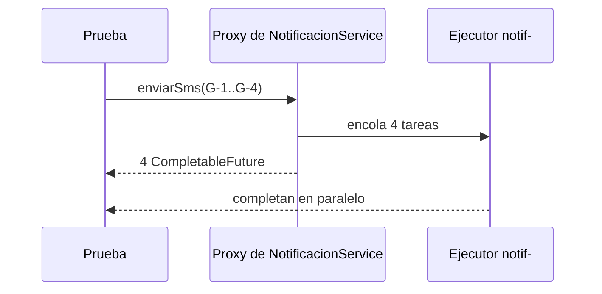

# Módulo 20: Integraciones Spring — scheduling, eventos, correo y caché

## Aprende construyendo

Este módulo completa el mapa de integraciones de Spring identificado en las capturas. Cada capacidad se introduce con una prueba observable y un límite importante: el scheduler local no coordina instancias, los eventos en memoria no son durables, SMTP puede fallar y las cachés necesitan invalidación.

### Dos ejemplos: primero visible, luego real

- **Ejemplo sencillo:** un `@Scheduled` revisa pedidos vencidos en H2; un evento Spring actualiza una métrica; Caffeine cachea una tarifa y el test observa la invalidación.
- **Caso RutaFlow:** al confirmar un envío, la API debe guardar el estado aunque el broker, SMTP o Redis no respondan. Usa el outbox para el evento que debe sobrevivir reinicios, procesa la notificación fuera de la transacción y mide el resultado de caché entre instancias.

Este módulo demuestra el comportamiento dentro de una aplicación Spring. El módulo 21 desarrolla Kafka entre procesos; `@TransactionalEventListener` no sustituye al outbox y un evento local no es mensajería durable.

### Tema 1: Scheduling y tareas periódicas · Avanzado · 1 h 10 min

**Prerrequisito:** Módulo 19 de este track, JDK 27+ y Maven, y el entorno del stack instalado.

**Al terminar podrás:** ejecutar una tarea periódica con Spring y probar su operación sin esperar al reloj real.

#### Aprende

Una operación nocturna detecta pedidos que llevan demasiado tiempo pendientes y los marca para revisión.

**¿Por qué es importante?** Un trabajo periódico evita depender de una persona que lo ejecute a mano y crea un punto verificable para automatización operativa.

`@EnableScheduling` activa las tareas; `@Scheduled` admite `fixedRate`, `fixedDelay` o una expresión cron. `fixedRate` mide desde el inicio del disparo anterior; `fixedDelay`, desde que termina. Configura explícitamente zona horaria en cron. Por defecto, el scheduler es local al proceso: con tres réplicas, la tarea puede ejecutarse tres veces.

Un scheduler no es una cola durable ni una exclusión distribuida. Si un trabajo puede durar más que el intervalo, define concurrencia limitada, idempotencia y un mecanismo de coordinación o utiliza Spring Batch y su repositorio cuando el trabajo deba reanudarse.

**Analogía:** una tarea periódica es como el despertador o el riego automático del jardín: se dispara solo según un horario (la expresión `cron`), sin que nadie tenga que acordarse de pulsar el botón cada día.

#### Practica

Genera una app Spring Boot con `web` y `actuator`.

**Desde cero:** parte de una carpeta vacía, ejecuta el comando que aparece debajo y escribe `src/main/java/academia/pedidos/PedidosScheduler.java` con el contenido de este tema.

```bash
curl -fsSL https://start.spring.io/starter.zip -o ejemplo.zip && unzip -o ejemplo.zip -d ejemplo
```

**Crea** el archivo `src/main/java/academia/pedidos/PedidosScheduler.java` y pega en él el código mostrado a continuación; guárdalo antes de ejecutarlo.

En `src/main/java/academia/pedidos/PedidosScheduler.java`:

```java
@Component
public class PedidosScheduler {
    private final RevisionPedidos revision;

    public PedidosScheduler(RevisionPedidos revision) {
        this.revision = revision;
    }

    @Scheduled(cron = "${app.revision.cron}", zone = "UTC")
    public void revisarPendientes() {
        revision.marcarVencidos();
    }
}
```

**Ejecuta el ejemplo** (genera el proyecto con Spring Initializr, pega el código y corre las pruebas):

```bash
curl -fsSL https://start.spring.io/starter.zip -d dependencies=web -d javaVersion=25 -o app.zip && unzip -o app.zip
./mvnw test
```
Equivalencias Maven/Gradle en el Módulo 1.

Activa scheduling con `@EnableScheduling` en una configuración. En `src/main/resources/application.yml` configura `app.revision.cron: "0 */5 * * * *"` para el laboratorio. Inyecta `Clock` o una interfaz de servicio para probar lógica de vencimiento determinísticamente. Ejecuta `./mvnw test`.

**Resultado esperado:** la prueba invoca el servicio y comprueba el criterio de vencimiento; no depende de que el test duerma cinco minutos. **Fallo deliberado:** levanta dos instancias con el mismo cron y un contador compartido; observa dos ejecuciones. Diagnostica que un `@Scheduled` no es un lock distribuido.

Agrega una tarea que registre inicio, duración y resultado con Micrometer. Fuerza una excepción del servicio y verifica que el scheduler no la oculte silenciosamente ni deja de producir señales operacionales. Define qué hacer si una ejecución supera el siguiente intervalo.

**Pista:** lanza una `RuntimeException` dentro de `revisarPendientes()` y vuelve a ejecutar la app; si no agregaste manejo de errores, el log solo muestra el stacktrace de esa ejecución y el scheduler sigue disparando la siguiente normalmente — confirma con Micrometer que esa ejecución fallida también queda registrada como fallo, no solo como "no se completó".

#### Aplica

Programa una revisión de envíos pendientes para el proyecto integrador de RutaFlow. Ejecuta dos instancias en tests o contenedores y prueba que una clave idempotente evita procesar dos veces el mismo envío. Si el negocio exige exactamente una ejecución coordinada, compara un lock distribuido o un job registrado con Spring Batch.

**Checklist de salida.**

- [ ] La app arranca con `@EnableScheduling` y `app.revision.cron` configurado con zona UTC.
- [ ] `PedidosScheduler` invoca el servicio y la prueba usa `Clock` o un servicio sustituible, sin dormir cinco minutos.
- [ ] El criterio de vencimiento se comprueba de forma determinista.
- [ ] Dos instancias con el mismo cron ejecutan la tarea dos veces y el diagnóstico queda registrado.
- [ ] Una excepción del servicio queda visible en el log y en la métrica de Micrometer.
- [ ] La decisión sobre ejecuciones que superan el intervalo está documentada.

**Si falla.** Si la prueba tarda minutos, está esperando al reloj real: inyecta `Clock` o el servicio de revisión. Si la tarea no se ejecuta, comprueba `@EnableScheduling`, la expresión cron y la zona horaria. Si el log muestra dos ejecuciones con dos instancias, no hay error de configuración: `@Scheduled` no coordina réplicas y necesitas idempotencia o un lock distribuido. Si la excepción desaparece del reporte, el método la está capturando sin registrarla.

Entrega configuración cron, test sin esperas reales, medición y prueba con dos instancias. **Cuándo no usarlo:** no uses `@Scheduled` como cola de tareas con payload o como garantía de ejecución única en cluster.

**Errores comunes:** asumir que `@Scheduled` es un lock distribuido y desplegar varias réplicas sin coordinación, dejando que la misma tarea se ejecute una vez por instancia, y tragar la excepción del servicio dentro del método programado sin relanzarla ni registrarla, con lo que el scheduler parece "funcionar" mientras la tarea real nunca se completa.

**Fuente oficial:** [documentación de Spring Boot](https://docs.spring.io/spring-boot/index.html).

### Tema 2: Eventos locales, eventos transaccionales y mensajería · Avanzado · 1 h 20 min

**Prerrequisito:** Tema 1 de este módulo, el servicio transaccional de los módulos anteriores y el entorno del stack instalado.

**Al terminar podrás:** elegir entre un evento Spring en memoria, una publicación después del commit y mensajería duradera mediante Kafka/outbox.

#### Aprende

Al crear un envío, una auditoría local debe reaccionar al cambio.

**¿Por qué es importante?** Separar responsabilidades ayuda a mantener el servicio de negocio legible, pero un evento solo en memoria puede perderse si el proceso cae.

`ApplicationEventPublisher` desacopla componentes dentro de una misma aplicación y proceso; por sí solo no persiste ni distribuye el evento. `@TransactionalEventListener(phase = AFTER_COMMIT)` espera a que la transacción local termine antes de notificar. Aun así, el proceso puede caer entre el commit y la publicación.

Kafka u otro broker ofrece entrega entre procesos, con garantías que dependen de configuración y límites transaccionales. El patrón outbox escribe el evento en la misma transacción que el dato de negocio; un dispatcher lo publica después. El modelo mental: el evento local es una nota entre equipos de la misma oficina; el outbox es un registro en el libro de despacho que sobrevive al cierre.

**Analogía:** un evento local es gritar algo en la misma sala y que lo oiga quien está presente; un evento transaccional es esperar a que se firme el contrato antes de anunciar la noticia (si la transacción se cae, el anuncio nunca sale); y la mensajería es dejar el recado en un buzón para que otra oficina lo procese cuando pueda, aunque ahora esté cerrada.

#### Practica

**Desde cero:** parte de una carpeta vacía, ejecuta el comando que aparece debajo y escribe `src/main/java/academia/envios/EnvioCreado.java` con el contenido de este tema.

```bash
curl -fsSL https://start.spring.io/starter.zip -o ejemplo.zip && unzip -o ejemplo.zip -d ejemplo
```

En `src/main/java/academia/envios/EnvioCreado.java` declara un evento inmutable; en el servicio transaccional:

```java
publisher.publishEvent(new EnvioCreado(envioId));
```

**Ejecuta el ejemplo** (genera el proyecto con Spring Initializr, pega el código y corre las pruebas):

```bash
curl -fsSL https://start.spring.io/starter.zip -d dependencies=web -d javaVersion=25 -o app.zip && unzip -o app.zip
./mvnw test
```
Equivalencias Maven/Gradle en el Módulo 1.

El listener en `src/main/java/academia/envios/AuditoriaEnvio.java`:

```java
@Component
public class AuditoriaEnvio {
    @TransactionalEventListener(phase = TransactionPhase.AFTER_COMMIT)
    public void alCrear(EnvioCreado evento) {
        registrarAuditoria(evento.envioId());
    }
}
```

Escribe un test `@SpringBootTest` que publique el evento dentro de una transacción confirmada y otro que fuerce rollback. Ejecuta `./mvnw test -Dtest=AuditoriaEnvioTest`.

**Resultado esperado:** el listener actúa después del commit y no actúa cuando la transacción revierte. **Fallo deliberado:** reemplaza la anotación por `@EventListener`, fuerza rollback y observa la auditoría que quedó aunque el envío no se persistió.

Agrega una tabla outbox con `event_id` único, tipo, payload y `published_at`; escribe el evento dentro de la transacción de negocio. Implementa un dispatcher que publique de forma repetible e idempotente y marque el resultado solo al confirmar la publicación.

**Pista:** ejecuta el dispatcher dos veces sobre la misma fila del outbox sin marcar `published_at` entre medio (simula un reintento tras una caída) y observa el efecto aguas abajo; si se duplica, el dispatcher no es idempotente — necesitas marcar la fila como publicada dentro de la misma operación que confirma el envío al broker, o deduplicar por `event_id` en el consumidor.

#### Aplica

Para el proyecto integrador de RutaFlow, decide cuáles eventos son locales (actualizar una métrica dentro del proceso) y cuáles deben sobrevivir un reinicio (notificar a Kafka, enviar correo). Implementa la persistencia del evento en el outbox dentro de la transacción que crea el envío, y luego sigue el laboratorio completo de Kafka del módulo 21 para publicar y consumirlo. Dibuja el límite de transacción y prueba la caída entre commit y dispatcher.

**Checklist de salida.**

- [ ] `EnvioCreado` es inmutable y se publica dentro de la transacción de negocio.
- [ ] El listener `AFTER_COMMIT` actúa tras el commit y no actúa tras el rollback.
- [ ] Reemplazar la anotación por `@EventListener` deja la auditoría aunque el envío no se persista.
- [ ] La tabla outbox tiene `event_id` único, tipo, payload y `published_at`.
- [ ] El dispatcher marca `published_at` solo al confirmar la publicación y no duplica al reintentar.
- [ ] El límite entre commit y dispatcher está dibujado y probado.

**Si falla.** Si el listener se ejecuta antes del commit, revisa la fase de `@TransactionalEventListener`. Si la auditoría aparece tras un rollback, la anotación es `@EventListener` o el test no envuelve la operación en una transacción. Si el dispatcher reenvía el mismo `event_id`, no está marcando la fila al confirmar o el consumidor no deduplica. Si el proceso cae entre commit y publicación, el evento solo existe en memoria: falta outbox.

Entrega pruebas de commit/rollback, tabla outbox y duplicado controlado. **Cuándo no usarlo:** no uses eventos locales para integración entre microservicios ni asumas que `AFTER_COMMIT` es durable.

Como **siguiente** paso, lleva lo aprendido al próximo tema y conéctalo con el proyecto integrador del track.

**Errores comunes:** asumir que `@TransactionalEventListener(phase = AFTER_COMMIT)` ya es "durable" y no necesita outbox, cuando el proceso puede caer entre el commit y la ejecución del listener, y publicar al dispatcher antes de marcar la fila del outbox como publicada, de forma que un reinicio a mitad de camino reenvía el mismo evento sin control de duplicados.

**Fuente oficial:** [documentación de Spring Boot](https://docs.spring.io/spring-boot/index.html).

### Tema 3: Correo con Spring Mail y entrega recuperable · Avanzado · 1 h 10 min

**Prerrequisito:** Tema 2 de este módulo y el entorno del stack instalado.

**Al terminar podrás:** crear un mensaje de correo desde un servicio, sustituir SMTP en tests y definir una política de reintento sin bloquear una transacción de negocio.

#### Aprende

Después de asignar un conductor, el cliente recibe confirmación por correo.

**¿Por qué es importante?** El proveedor SMTP es una dependencia externa: puede tardar, rechazar el mensaje o aceptar el correo aunque la respuesta se pierda.

`JavaMailSender` crea y envía mensajes; la configuración de host/puerto/credenciales debe venir de entorno o secret manager. El envío no es transaccional con la base de datos. No mantengas una transacción SQL abierta durante la llamada SMTP ni registres credenciales o contenido sensible en logs.

La operación de negocio debe confirmar independientemente del canal de notificación; un outbox permite reintentar con estado observable. La deduplicación requiere un identificador estable del evento, porque SMTP no ofrece una garantía general de entrega exactamente una vez.

**Analogía:** enviar correo con entrega recuperable es como el correo certificado: si el cartero no encuentra al destinatario, no tira la carta, la guarda y reintenta. El registro de intentos es el comprobante que te deja saber si llegó o sigue pendiente de reenvío.

#### Practica

**Desde cero:** parte de una carpeta vacía, ejecuta el comando que aparece debajo y escribe `src/main/java/academia/notificaciones/CorreoPedido.java` con el contenido de este tema.

```bash
curl -fsSL https://start.spring.io/starter.zip -o ejemplo.zip && unzip -o ejemplo.zip -d ejemplo
```

Genera el proyecto con `mail` y configura `spring.mail.host`, puerto y credenciales por variables externas. En `src/main/java/academia/notificaciones/CorreoPedido.java`:

```java
@Service
public class CorreoPedido {
    private final JavaMailSender sender;

    public CorreoPedido(JavaMailSender sender) { this.sender = sender; }

    public void enviarConfirmacion(String destinatario, String referencia) {
        SimpleMailMessage message = new SimpleMailMessage();
        message.setTo(destinatario);
        message.setSubject("Pedido confirmado");
        message.setText("Referencia: " + referencia);
        sender.send(message);
    }
}
```

**Ejecuta el ejemplo** (genera el proyecto con Spring Initializr, pega el código y corre las pruebas):

```bash
curl -fsSL https://start.spring.io/starter.zip -d dependencies=web -d javaVersion=25 -o app.zip && unzip -o app.zip
./mvnw test
```
Equivalencias Maven/Gradle en el Módulo 1.

En un test, reemplaza `JavaMailSender` con un mock y captura `SimpleMailMessage`; valida destinatario y asunto sin enviar correo. Ejecuta `./mvnw test -Dtest=CorreoPedidoTest`.

**Resultado esperado:** el mock recibe un mensaje con los campos esperados y ningún SMTP externo se contacta. **Fallo deliberado:** usa credenciales SMTP literales y falla la configuración en CI; mueve el secreto a variables externas y falla explícitamente si falta en el perfil de producción.

Simula timeout SMTP y registra el intento fallido en outbox con siguiente fecha de reintento y número de intentos. Asegura que una segunda ejecución del dispatcher no envía dos notificaciones con el mismo `event_id` cuando el proveedor admite clave de idempotencia; documenta el riesgo residual cuando no la admite.

**Pista:** ejecuta el dispatcher dos veces para el mismo `event_id` del outbox simulando que el primer intento quedó en un timeout ambiguo (no sabes si el correo salió o no); si el proveedor SMTP no te da una clave de idempotencia, verás que no puedes garantizar cero duplicados y debes documentar ese posible reenvío como riesgo residual aceptado, no intentar resolverlo con más reintentos.

#### Aplica

Añade una plantilla de correo de confirmación para el proyecto integrador de RutaFlow. Prueba caracteres acentuados, destinatario inválido, fallo SMTP y redacción de logs. Separa contenido de correo del método que confirma el pedido.

**Checklist de salida.**

- [ ] El proyecto declara la dependencia `mail` y lee host, puerto y credenciales de variables externas.
- [ ] `CorreoPedido` arma destinatario, asunto y texto con la referencia del pedido.
- [ ] Un test con `JavaMailSender` simulado captura `SimpleMailMessage` y no contacta SMTP.
- [ ] Un timeout simulado queda en outbox con próxima fecha de reintento y número de intentos.
- [ ] El dispatcher no duplica con el mismo `event_id` cuando el proveedor ofrece clave de idempotencia.
- [ ] El riesgo residual de reenvío está documentado cuando no existe esa clave.

**Si falla.** Si el test intenta contactar SMTP, el `JavaMailSender` no está sustituido o la configuración real se carga en el contexto. Si el mensaje llega sin referencia, revisa el armado o la plantilla. Si el timeout no deja registro, el envío no está pasando por outbox. Si el reintento duplica, el `event_id` no es estable o el dispatcher no confirma la marca de publicado.

Entrega implementación, test del mock y flujo de outbox/retry. **Cuándo no usarlo:** no envíes correo síncrono en la transacción HTTP crítica ni guardes contraseña en `application.yml` versionado.

**Errores comunes:** enviar el correo dentro de la misma transacción que confirma el pedido (si SMTP tarda o falla, arriesga revertir una operación de negocio que ya era válida), y reintentar un envío fallido sin registrar número de intentos ni próxima fecha de reintento, perdiendo la capacidad de distinguir un fallo transitorio de uno permanente.

**Fuente oficial:** [documentación de Spring Boot](https://docs.spring.io/spring-boot/index.html).

### Tema 4: Caché con Spring Cache, Caffeine y Redis · Avanzado · 1 h 20 min

**Prerrequisito:** Tema 3 de este módulo y el entorno del stack instalado.

**Al terminar podrás:** cachear una lectura con Caffeine, invalidarla después de una escritura y explicar cuándo hace falta Redis.

#### Aprende

La lista de tarifas cambia poco y se consulta miles de veces por minuto.

**¿Por qué es importante?** Una caché puede reducir latencia y carga de base de datos, pero introduce copias que pueden quedar obsoletas.

`@EnableCaching` activa la abstracción; `@Cacheable` reutiliza una respuesta por clave; `@CacheEvict` invalida entradas; `@CachePut` actualiza una entrada explícitamente. El proveedor define almacenamiento y expiración. Caffeine vive dentro de cada proceso; Redis comparte datos entre réplicas, a costa de una dependencia de red y operación.

La clave debe incluir parámetros que cambian el resultado, incluyendo tenant/locale cuando corresponda. Define TTL, invalidación, límites de tamaño y estrategia ante cache miss. Un cache stampede ocurre cuando muchas solicitudes recalculan simultáneamente una clave expirada.

**Analogía:** una caché es tener a mano, en el cajón del escritorio, los papeles que usas cada día en vez de bajar al archivo cada vez. Caffeine es ese cajón local (rápido, propio de cada oficina); Redis es un archivo compartido entre varias oficinas; y la expiración evita quedarte con una copia vieja cuando el original ya cambió.

#### Practica

Genera una app con `cache`; agrega Caffeine para el laboratorio.

**Desde cero:** parte de una carpeta vacía, ejecuta el comando que aparece debajo y escribe `src/main/java/academia/tarifas/TarifaService.java` con el contenido de este tema.

```bash
curl -fsSL https://start.spring.io/starter.zip -o ejemplo.zip && unzip -o ejemplo.zip -d ejemplo
```

**Crea** el archivo `src/main/java/academia/tarifas/TarifaService.java` y pega en él el código mostrado a continuación; guárdalo antes de ejecutarlo.

En `src/main/java/academia/tarifas/TarifaService.java`:

```java
@Service
public class TarifaService {
    private final TarifaRepository repository;

    public TarifaService(TarifaRepository repository) { this.repository = repository; }

    @Cacheable(cacheNames = "tarifas", key = "#zona")
    public Tarifa buscar(String zona) {
        return repository.findByZona(zona)
            .orElseThrow(() -> new IllegalArgumentException("Zona desconocida"));
    }

    @CacheEvict(cacheNames = "tarifas", key = "#tarifa.zona")
    public Tarifa actualizar(Tarifa tarifa) {
        return repository.save(tarifa);
    }
}
```

**Ejecuta el ejemplo** (genera el proyecto con Spring Initializr, pega el código y corre las pruebas):

```bash
curl -fsSL https://start.spring.io/starter.zip -d dependencies=web -d javaVersion=25 -o app.zip && unzip -o app.zip
./mvnw test
```
Equivalencias Maven/Gradle en el Módulo 1.

Activa caching con `@EnableCaching` y configura Caffeine con máximo de entradas y TTL. Escribe un test que invoque dos veces `buscar("NORTE")` y verifique una llamada al repository, luego actualice y verifique que la siguiente búsqueda vuelve a leer. Ejecuta `./mvnw test -Dtest=TarifaServiceTest`.

**Resultado esperado:** la segunda lectura reutiliza la entrada y la escritura la invalida. **Fallo deliberado:** elimina `@CacheEvict`; actualiza tarifa y demuestra que el usuario recibe el valor viejo hasta expirar el TTL.

Mide hits, misses y tamaño con Actuator/Micrometer. Añade un test para dos zonas y confirma que no colisionan claves. Evalúa qué sucede si se actualiza la tarifa en otra réplica cuando usas caché local.

**Pista:** cachea `buscar("NORTE")` y `buscar("SUR")` y cuenta en el log del repository cuántas llamadas reales hizo cada una; si ves una sola llamada total en vez de dos, la clave del `@Cacheable` no está diferenciando por `#zona` y ambas zonas están colisionando en la misma entrada.

#### Aplica

Propón para el proyecto integrador de RutaFlow una caché de lectura de catálogo y otra de autorización. Para cada una define TTL, clave, invalidación, privacidad multi-tenant y comportamiento si Redis no responde. Implementa solo la caché con consistencia aceptable; deja otras consultas sin cachear justificadamente.

**Checklist de salida.**

- [ ] `@EnableCaching` está activo y Caffeine tiene máximo de entradas y TTL configurados.
- [ ] Dos llamadas a `buscar("NORTE")` producen una sola lectura del repository.
- [ ] Actualizar la tarifa invalida la entrada y la siguiente búsqueda vuelve a leer.
- [ ] Sin `@CacheEvict`, la prueba demuestra el valor viejo hasta que expira el TTL.
- [ ] Dos zonas distintas no colisionan en la misma clave de caché.
- [ ] Hits, misses y tamaño se miden, y la elección Caffeine vs Redis está justificada.

**Si falla.** Si la segunda lectura vuelve al repository, revisa `@EnableCaching` y que la llamada pase por el proxy. Si zonas distintas comparten entrada, la clave no incluye `#zona`. Si la escritura no invalida, la clave de `@CacheEvict` no coincide con la de `@Cacheable`. Si la actualización en otra réplica no se ve, estás usando una caché local: Redis o un TTL corto son decisiones distintas, no un error del test.

Entrega tests de hit/miss/invalidation, métrica y tabla de decisión Caffeine vs Redis. **Cuándo no usarlo:** no caches datos sensibles sin aislamiento de clave, datos que cambian constantemente sin invalidación ni resultados de consultas no deterministas.

Referencia: [Spring Boot — Task Execution and Scheduling](https://docs.spring.io/spring-boot/reference/features/task-execution-and-scheduling.html), [Spring Framework — Cache Abstraction](https://docs.spring.io/spring-framework/reference/integration/cache.html), [Spring Framework — Email](https://docs.spring.io/spring-framework/reference/integration/email.html).

**Errores comunes:** desalinear la clave de `@CacheEvict` respecto a la de `@Cacheable` (por ejemplo, invalidar por `#tarifa.zona` cuando la lectura cachea por `#zona` con otro formato), dejando entradas obsoletas que nunca se invalidan, y usar Caffeine (caché local por proceso) en un despliegue con varias réplicas esperando que la invalidación en una instancia se propague a las demás sin pasar por Redis.

**Fuente oficial:** [documentación de Spring Boot](https://docs.spring.io/spring-boot/index.html).

### Tema 5: @Async y ejecutores: trabajo en segundo plano con límites · Avanzado · 1 h 40 min

**Prerrequisito:** Temas 1 y 2 de este módulo y el módulo de concurrencia del track Java.

**Al terminar podrás:** ejecutar métodos en segundo plano con `@Async`, definir un ejecutor con límites explícitos, devolver `CompletableFuture` y diagnosticar por qué `@Async` a veces "no hace nada".

#### Aprende

Al registrar un envío, el backend de RutaFlow enviaba un SMS al destinatario y la petición tardaba lo que tardara el proveedor. Mover esa tarea a segundo plano es el caso real más común de `@Async`; hacerlo con un pool sin límites es la forma más común de tumbar el servidor en un pico de tráfico.

**¿Por qué es importante?** porque el trabajo en segundo plano mejora la latencia, pero sin límites ni manejo de errores provoca pérdidas silenciosas y caídas.

Con `@EnableAsync`, Spring envuelve los beans que tienen métodos `@Async` en un **proxy**: la llamada se entrega a un `Executor` y regresa de inmediato. Si el método devuelve `CompletableFuture`, quien llama puede esperar o combinar resultados. Un `ThreadPoolTaskExecutor` con tamaño y cola definidos pone límites. Como funciona con proxies, una llamada **desde la misma clase** (`this.enviarSms()`) no pasa por el proxy y se ejecuta de forma síncrona. Las excepciones de métodos `void` no llegan a quien llama.

**Analogía:** `@Async` es dejar la carta en el buzón en vez de llevarla tú; el ejecutor es el número de carteros: si hay infinitos, la oficina colapsa.

**Diagrama:**



**Conceptos clave:** `@EnableAsync`, `@Async`, proxy, `ThreadPoolTaskExecutor`, cola acotada, `CompletableFuture`, auto-invocación, excepciones no capturadas.

#### Practica

**Ejemplo independiente (desde cero):** este tema se reproduce en una **carpeta vacía**, como **proyecto nuevo**, sin estado de otros temas.

```bash
mkdir spring-async && cd spring-async
curl -fsSL https://start.spring.io/starter.zip -d dependencies=web -d javaVersion=25 -o app.zip
unzip -q app.zip
```

Crea `src/main/java/com/example/demo/AsyncConfig.java`:

```java
package com.example.demo;

import org.springframework.context.annotation.Bean;
import org.springframework.context.annotation.Configuration;
import org.springframework.scheduling.annotation.EnableAsync;
import org.springframework.scheduling.concurrent.ThreadPoolTaskExecutor;

import java.util.concurrent.Executor;

@Configuration
@EnableAsync
public class AsyncConfig {
    // Pool acotado y con nombre: límites explícitos en vez de hilos ilimitados
    @Bean("notificaciones")
    public Executor notificaciones() {
        ThreadPoolTaskExecutor ejecutor = new ThreadPoolTaskExecutor();
        ejecutor.setCorePoolSize(4);
        ejecutor.setMaxPoolSize(4);
        ejecutor.setQueueCapacity(100);
        ejecutor.setThreadNamePrefix("notif-");
        ejecutor.initialize();
        return ejecutor;
    }
}
```

Crea `src/main/java/com/example/demo/NotificacionService.java`:

```java
package com.example.demo;

import org.slf4j.Logger;
import org.slf4j.LoggerFactory;
import org.springframework.scheduling.annotation.Async;
import org.springframework.stereotype.Service;

import java.util.concurrent.CompletableFuture;

@Service
public class NotificacionService {
    private static final Logger log = LoggerFactory.getLogger(NotificacionService.class);

    // Se ejecuta en un hilo del pool "notificaciones", no en el hilo de la petición
    @Async("notificaciones")
    public CompletableFuture<String> enviarSms(String guia) throws InterruptedException {
        Thread.sleep(300);                          // simula la latencia del proveedor de SMS
        log.info("SMS de {} enviado en {}", guia, Thread.currentThread().getName());
        return CompletableFuture.completedFuture(guia);
    }
}
```

Crea `src/test/java/com/example/demo/NotificacionServiceTest.java`:

```java
package com.example.demo;

import org.junit.jupiter.api.Test;
import org.springframework.beans.factory.annotation.Autowired;
import org.springframework.boot.test.context.SpringBootTest;

import java.time.Duration;
import java.time.Instant;
import java.util.List;
import java.util.concurrent.CompletableFuture;

import static org.assertj.core.api.Assertions.assertThat;

@SpringBootTest
class NotificacionServiceTest {

    @Autowired
    NotificacionService servicio;

    @Test
    void cuatroSmsEnParaleloTardanComoUno() throws Exception {
        Instant inicio = Instant.now();
        List<CompletableFuture<String>> envios = List.of(
                servicio.enviarSms("G-1"), servicio.enviarSms("G-2"),
                servicio.enviarSms("G-3"), servicio.enviarSms("G-4"));
        CompletableFuture.allOf(envios.toArray(CompletableFuture[]::new)).join();
        long ms = Duration.between(inicio, Instant.now()).toMillis();

        System.out.println("4 SMS en " + ms + " ms");
        assertThat(ms).isLessThan(1000);          // en serie serían unos 1200 ms
    }
}
```

**Ejecuta el ejemplo:**

```bash
./mvnw test
```

**Resultado esperado:**

```text
4 SMS en 312 ms
...
[INFO] Tests run: 2, Failures: 0, Errors: 0, Skipped: 0
[INFO] BUILD SUCCESS
```

El tiempo exacto varía, pero queda cerca de 300 ms porque las cuatro tareas corren en paralelo en hilos llamados `notif-1` a `notif-4` (míralos en el log). En serie serían unos 1 200 ms.

**Fallo deliberado:** Quita `@EnableAsync` de `AsyncConfig`. No hay error de compilación ni de arranque, pero la prueba falla: los cuatro SMS se ejecutan uno tras otro en el hilo de la prueba y tardan más de 1 000 ms. Sin `@EnableAsync` la anotación `@Async` se ignora en silencio.

Llama `enviarSms` desde otro método de la misma clase `NotificacionService` y demuestra con el nombre del hilo en el log que esa llamada no fue asíncrona.

**Pista:** agrega `enviarLote(List<String> guias)` en el mismo servicio, llama desde ahí a `enviarSms` y compara `Thread.currentThread().getName()`.

#### Aplica

Configura un `AsyncUncaughtExceptionHandler` para los métodos `@Async` que devuelven `void` y una política de rechazo para cuando la cola de 100 se llene. Prueba ambos casos.

**Checklist de salida.**

- [ ] `AsyncConfig` declara `@EnableAsync` y un pool `notificaciones` con core/max 4, cola 100 y prefijo `notif-`.
- [ ] Cuatro SMS terminan en torno a 300 ms y la prueba exige menos de 1 000 ms.
- [ ] El log muestra los hilos `notif-1` a `notif-4`.
- [ ] Quitar `@EnableAsync` ejecuta los SMS en serie y la prueba falla.
- [ ] La llamada desde otro método de la misma clase se demuestra síncrona con el nombre del hilo.
- [ ] `AsyncUncaughtExceptionHandler` y la política de rechazo cubren `void` y cola llena.
- [ ] Las tareas que deben sobrevivir un reinicio se derivan a una cola u outbox, no a `@Async`.

**Si falla.** Si la prueba tarda más de 1 000 ms y el log repite el hilo principal, falta `@EnableAsync` o la llamada es una auto-invocación que no pasa por el proxy. Si los hilos no llevan el prefijo `notif-`, el bean del ejecutor no se llama `notificaciones` o no se inyecta. Si las excepciones de métodos `void` no aparecen, configura `AsyncUncaughtExceptionHandler`. Si la tarea desaparece al reiniciar, `@Async` no es durable: usa una cola o un outbox.

**Transferencia al proyecto integrador «Backend profesional de entregas»:** envía las notificaciones push de entregas con `@Async` y un ejecutor acotado, y registra las fallas.

Como **siguiente** paso, aplica lo aprendido en el proyecto integrador del track y compara el resultado con lo que esperabas.

**Cuándo no usarlo:** si la tarea debe sobrevivir a un reinicio o reintentarse, usa una cola de mensajes (Kafka, RabbitMQ) o un outbox: `@Async` vive en la memoria del proceso y se pierde si cae. Con Java 21+ también puedes evaluar hilos virtuales (`spring.threads.virtual.enabled`).

**Errores comunes:** olvidar `@EnableAsync` y no notarlo porque `@Async` se ignora en silencio sin error de compilación ni de arranque, y llamar a un método `@Async` desde otro método de la misma clase (auto-invocación) esperando que pase por el proxy, cuando en realidad se ejecuta de forma síncrona en el mismo hilo.

**Fuente oficial:** [Spring Framework: Task Execution and Scheduling](https://docs.spring.io/spring-framework/reference/integration/scheduling.html), [Spring Boot: Task Execution](https://docs.spring.io/spring-boot/reference/features/task-execution-and-scheduling.html).

## Ampliación de la página 28 del PDF

### Tema complementario: Integraciones empresariales, SOAP y fronteras de protocolo · Avanzado · 50 min

**Prerrequisito:** HTTP, XML y las capas del proyecto; Python para una demostración independiente de parsing.

**Al terminar podrás:** leer un contrato SOAP mínimo y separar transporte de lógica de negocio.

#### Aprende

**¿Por qué es importante?** Un socio de RutaFlow tiene SOAP y SFTP aunque la aplicación nueva use REST. REST describe una interfaz sobre recursos; SOAP define mensajes XML con Envelope, Header opcional, Body y Fault. SFTP transfiere archivos sobre SSH; no equivale a FTP ni a FTPS. SMTP transporta correo y no demuestra entrega al destinatario. Un adaptador traduce el contrato externo al dominio y conserva correlación, errores e idempotencia.

**Analogía:** varios formularios pueden solicitar el mismo despacho, pero cada formulario necesita un traductor que valide sus campos. El namespace identifica el vocabulario XML; el prefijo puede cambiar sin cambiar el significado. SOAP 1.1 y 1.2 usan namespaces y bindings diferentes. WSDL describe operaciones y tipos; no inventes un endpoint a partir del nombre de una operación.

#### Practica

El siguiente ejemplo inspecciona XML confiable construido localmente; no es un servidor SOAP ni una sustitución de Spring Web Services.

Crea `soap_contrato.py` en una carpeta vacía:

```python
import xml.etree.ElementTree as ET

mensaje = '''<s:Envelope xmlns:s="http://www.w3.org/2003/05/soap-envelope"
 xmlns:r="urn:rutaflow:entregas"><s:Body><r:ConsultarEnvio>
 <r:id>ENV-42</r:id></r:ConsultarEnvio></s:Body></s:Envelope>'''
ns = {"s": "http://www.w3.org/2003/05/soap-envelope", "r": "urn:rutaflow:entregas"}
# Buscar por URI de namespace; el prefijo visible no es la identidad.
raiz = ET.fromstring(mensaje)
id_envio = raiz.findtext("s:Body/r:ConsultarEnvio/r:id", namespaces=ns)
if not id_envio:
    raise ValueError("Falta id del envío en el contrato SOAP 1.2")
print(f"Consultar envío: {id_envio}")
```

**Ejecuta el ejemplo** (genera el proyecto con Spring Initializr, pega el código y corre las pruebas):

```bash
curl -fsSL https://start.spring.io/starter.zip -d dependencies=web -d javaVersion=25 -o app.zip && unzip -o app.zip
./mvnw test
```
Equivalencias Maven/Gradle en el Módulo 1.

```bash
mkdir -p practica-integraciones
python3 soap_contrato.py
```

Ejecuta desde la carpeta donde guardaste el archivo. **Salida esperada:** `Consultar envío: ENV-42`. Explicación por bloques: el documento declara vocabularios, el mapa de namespaces permite encontrar el identificador y la validación impide traducir un mensaje sin id.

**Fallo deliberado:** cambia el URI SOAP al de 1.1 sin actualizar el contrato: la búsqueda no encuentra el nodo y lanza ValueError. Diagnostica versión y URI antes de cambiar etiquetas a ciegas.

**Pista:** cambia `s` por `env` en la declaración y etiquetas conservando el URI; la búsqueda sigue funcionando. Cambia luego ENV-42 por un campo vacío y comprueba rechazo.

#### Aplica

Dibuja adaptador SOAP → caso de uso → repositorio del proyecto integrador Spring. Define límites de tamaño, timeouts, Fault, autenticación y correlación. Para SFTP verifica host key y finalización de archivo; para SMTP distingue aceptación del servidor y entrega. **Límites:** para XML externo emplea parser/configuración endurecidos, schema y límites; este parser de un literal local no valida WSDL, seguridad XML ni interoperabilidad real.

**Checklist de salida.**

- [ ] `soap_contrato.py` imprime `Consultar envío: ENV-42`.
- [ ] La búsqueda usa el URI del namespace y cambiar el prefijo `s` por `env` no altera el resultado.
- [ ] Cambiar el URI al de SOAP 1.1 produce un `ValueError` diagnosticable.
- [ ] Un identificador vacío se rechaza antes de traducir el mensaje.
- [ ] La tabla REST/SOAP/SFTP/SMTP distingue contratos y garantías de entrega.
- [ ] Los límites del parser local están documentados: no valida WSDL ni seguridad XML.

**Si falla.** Si `findtext` devuelve `None`, el URI del namespace no coincide con el documento o la ruta cambió. Si cambiar el prefijo rompe la búsqueda, el mapa está usando prefijos en lugar de URIs. Si un id vacío pasa la validación, falta el control explícito. Si el resultado se presenta como integración real, recuerda que el ejercicio no valida WSDL, seguridad XML ni interoperabilidad.

Entrega archivo, salida, fallo y tabla REST/SOAP/SFTP/SMTP con contratos y garantías. **Errores comunes:** confundir prefijo con namespace, tratar HTTP 200 como éxito de negocio, presentar un archivo enviado como proceso completado. El siguiente paso es integrar un WSDL autorizado y verificar contrato real.

**Fuente oficial:** [SOAP 1.2, W3C](https://www.w3.org/TR/soap12-part1/).

## Aplicación del material de referencia

### Tema 6: Spring AI: ChatClient y herramientas con autorización fuera del modelo · Avanzado · 1 h 30 min

**Prerrequisito:** Java, interfaces, Maven, JUnit y autorización por recurso. JDK 27 y Maven. Ejemplo independiente desde carpeta vacía, con Spring AI 2.0.2 y Spring Boot 4.0.9; no usa claves, pagos ni llamadas a un modelo externo.

**Al terminar podrás:** ejecutar ChatClient contra un modelo controlado y un callback real de herramienta que rechaza un envío ajeno.

#### Aprende

El asistente del proyecto integrador podría consultar el estado de una entrega.

**¿Por qué es importante?** Un modelo puede proponer una llamada, pero la aplicación decide si está autorizada. Añadir la instrucción «consulta solo mis envíos» al prompt no sustituye ese control.

ChatClient construye mensajes para un ChatModel sustituible. Una herramienta es una función con contrato y argumentos; el callback traduce la petición en ejecución de código de la aplicación. La salida del modelo no es una instrucción privilegiada ni una identidad. En una integración real, la identidad viene de la sesión del servidor y se aplica en el servicio que ejecuta la herramienta.

**Analogía:** el modelo es quien propone una consulta al mostrador; el personal autorizado conserva las llaves. El límite es que la calidad del texto o la descripción de una herramienta no garantiza una decisión segura. Aquí probamos fronteras de software, no la precisión ni el comportamiento de un LLM.

#### Practica

```bash
cp -R examples/rutaflow-material/spring-ai ejemplo-spring-ai
cd ejemplo-spring-ai
mvn test -Dtest=ChatToolsTest
```
También puedes crear manualmente los archivos siguientes en una carpeta vacía. En ese caso, las rutas parten de esa carpeta: coloca el contenido de `spring-ai/pom.xml` en `pom.xml` y conserva `src/test/java/academia/ChatToolsTest.java`.

Crea `spring-ai/pom.xml` con este contenido completo:
```xml
<project xmlns="http://maven.apache.org/POM/4.0.0"><modelVersion>4.0.0</modelVersion>
  <parent><groupId>org.springframework.boot</groupId><artifactId>spring-boot-starter-parent</artifactId><version>4.0.9</version><relativePath/></parent>
  <groupId>academia</groupId><artifactId>spring-ai-lab</artifactId><version>1</version>
  <properties><java.version>27</java.version></properties>
  <dependencyManagement><dependencies><dependency><groupId>org.springframework.ai</groupId><artifactId>spring-ai-bom</artifactId><version>2.0.2</version><type>pom</type><scope>import</scope></dependency></dependencies></dependencyManagement>
  <dependencies><dependency><groupId>org.springframework.ai</groupId><artifactId>spring-ai-client-chat</artifactId></dependency><dependency><groupId>org.springframework.boot</groupId><artifactId>spring-boot-starter-test</artifactId><scope>test</scope></dependency></dependencies>
</project>
```

Crea `spring-ai/src/test/java/academia/ChatToolsTest.java` con este contenido completo:
```java
package academia;
import org.junit.jupiter.api.Test;
import org.springframework.ai.chat.client.ChatClient;
import org.springframework.ai.chat.messages.AssistantMessage;
import org.springframework.ai.chat.model.ChatModel;
import org.springframework.ai.chat.model.ChatResponse;
import org.springframework.ai.chat.model.Generation;
import org.springframework.ai.tool.annotation.Tool;
import org.springframework.ai.tool.method.MethodToolCallbackProvider;
import java.util.List;
import static org.junit.jupiter.api.Assertions.*;

class ChatToolsTest {
    static class Consulta {
        @Tool(description = "Consulta el estado del envío autorizado de esta sesión")
        public String estado(String envioId) {
            if (!"ENV-42".equals(envioId)) throw new IllegalArgumentException("Sin permiso");
            return "creado";
        }
    }
    @Test void chatClientUsaElModeloSustituible() {
        ChatModel modeloControlado = prompt -> {
            assertTrue(prompt.getInstructions().stream().anyMatch(m -> m.getText().contains("ENV-42")));
            return new ChatResponse(List.of(new Generation(new AssistantMessage("Estado: creado"))));
        };
        var client = ChatClient.builder(modeloControlado).build();
        assertEquals("Estado: creado", client.prompt().user("Consulta ENV-42").call().content());
    }
    @Test void callbackRealRespetaLaFronteraDeAutorizacion() {
        var callbacks = MethodToolCallbackProvider.builder().toolObjects(new Consulta()).build().getToolCallbacks();
        assertEquals(1, callbacks.length);
        assertTrue(callbacks[0].call("{\"envioId\":\"ENV-42\"}").contains("creado"));
        assertThrows(RuntimeException.class, () -> callbacks[0].call("{\"envioId\":\"ENV-ajeno\"}"));
    }
}
```

**Resultado esperado:** dos pruebas correctas. Explica cada bloque: el modelo controlado comprueba que recibió ENV-42, ChatClient adapta la respuesta, @Tool expone una operación de lectura y el callback real rechaza ENV-ajeno. No se ha probado que un modelo real elija correctamente la herramienta: eso exige un proveedor, modelo y evaluación adicionales.

**Fallo deliberado:** quita la comprobación `ENV-42` dentro de `estado`. La prueba que exige excepción para ENV-ajeno falla. **Pista:** la descripción de @Tool no ejecuta autorización; restaura el control en el código de negocio.

#### Aplica

Sustituye el ID fijo por un conjunto de permisos inyectado desde una sesión de prueba. Comprueba dos identidades con permisos distintos sin aceptar la identidad como argumento propuesto por el modelo. Añade un límite de llamadas y un timeout para una herramienta remota.

**Checklist de salida.**

- [ ] El pom fija Spring Boot 4.0.9, Spring AI BOM 2.0.2 y Java 27.
- [ ] `ChatClient` con el modelo controlado recibe `ENV-42` y devuelve `Estado: creado`.
- [ ] `MethodToolCallbackProvider` expone un callback de la herramienta.
- [ ] El callback real acepta `ENV-42` y lanza excepción con `ENV-ajeno`.
- [ ] Quitar la comprobación de `ENV-42` hace fallar la prueba de `ENV-ajeno`.
- [ ] La autorización se aplica en el código de negocio, no en la descripción de `@Tool` ni en el prompt.
- [ ] Los límites están escritos: no se probó la elección real de herramienta, ni facturación, latencia o recuperación del proveedor.

**Si falla.** Si el proyecto no compila, revisa las versiones del BOM y del parent. Si el modelo controlado no recibe `ENV-42`, revisa cómo se construye el prompt. Si el callback acepta `ENV-ajeno`, la autorización desapareció del código de negocio: la descripción de `@Tool` no autoriza. Si las pruebas pasan sin red, es lo esperado: el ejercicio no llama a un proveedor externo.

El siguiente tema estudia qué documentos puede recibir el modelo para construir su contexto. **Errores comunes:** conceder herramientas de escritura sin confirmación de negocio, confiar en argumentos como identidad y registrar prompts con datos sensibles. **Límites y decisión de uso:** no se han instalado agentes externos ni probado facturación, latencia, streaming o recuperación del proveedor; son controles distintos del adaptador y del callback.

**Fuentes oficiales:** [ChatClient](https://docs.spring.io/spring-ai/reference/api/chatclient.html), [herramientas](https://docs.spring.io/spring-ai/reference/api/tools.html) y [compatibilidad de versiones](https://docs.spring.io/spring-ai/reference/getting-started.html).

## Aplicación del material de referencia

### Tema 7: RAG desde la frontera de datos: recuperar evidencia autorizada antes de generar · Avanzado · 1 h 10 min

**Prerrequisito:** colecciones Java, metadatos, pruebas y el proyecto Spring AI del tema anterior.

**Al terminar podrás:** comprobar que el contexto recuperado no contiene documentación de otra empresa y que una consulta sin evidencia devuelve una colección vacía.

#### Aprende

En el proyecto integrador dos empresas consultan políticas de reembolso. Una búsqueda relevante pero de la empresa equivocada sigue siendo una fuga.

**¿Por qué es importante?** La autorización se debe aplicar antes de enviar documentos al modelo, no después de ver su respuesta.

Un flujo RAG ingiere documentos, los divide con una política de tamaño/solapamiento, crea un índice, recupera fragmentos y construye contexto con referencias. Los embeddings representan contenido como vectores; un vector store busca por similitud y debe aplicar filtros de acceso. Relevancia semántica no significa autorización ni verdad.

**Analogía:** consultar una biblioteca exige tanto encontrar una sección relevante como tener permiso para abrir el expediente. El límite es que un texto que contiene una palabra puede ser irrelevante, contradictorio o malicioso. Por eso este primer ejercicio usa recuperación léxica explícita, sin llamarla búsqueda vectorial ni fingir que un stub equivale a embeddings reales.

#### Practica

```bash
cp -R examples/rutaflow-material/spring-ai ejemplo-rag
cd ejemplo-rag
mvn test -Dtest=RagScopeTest
```
Para un ejemplo independiente copia `examples/rutaflow-material/spring-ai` a una carpeta vacía y usa su pom completo.

Crea el archivo siguiente bajo `src/test/java/academia/` del proyecto que contiene el pom del tema anterior:

Crea `spring-ai/src/test/java/academia/RagScopeTest.java` con este contenido completo:
```java
package academia;
import org.junit.jupiter.api.Test;
import org.springframework.ai.document.Document;
import java.util.List;
import java.util.Map;
import static org.junit.jupiter.api.Assertions.*;

class RagScopeTest {
    // Recuperador léxico didáctico: no simula embeddings ni búsqueda vectorial.
    List<Document> recuperar(String empresaAutorizada, String termino, List<Document> corpus) {
        if (termino.isBlank()) return List.of();
        return corpus.stream()
            .filter(d -> empresaAutorizada.equals(d.getMetadata().get("empresa")))
            .filter(d -> d.getText().toLowerCase(java.util.Locale.ROOT)
                .contains(termino.toLowerCase(java.util.Locale.ROOT)))
            .limit(2).toList();
    }
    @Test void filtraAntesDeConstruirContexto() {
        var corpus = List.of(
            new Document("Reembolso: revisar comprobante", Map.of("empresa", "A")),
            new Document("Reembolso secreto de B", Map.of("empresa", "B")));
        var docs = recuperar("A", "reembolso", corpus);
        assertEquals(1, docs.size());
        assertFalse(docs.getFirst().getText().contains("secreto"));
        assertEquals("A", docs.getFirst().getMetadata().get("empresa"));
    }
    @Test void sinEvidenciaNoSeInventaContexto() {
        assertTrue(recuperar("A", "", List.of()).isEmpty());
        assertTrue(recuperar("A", "factura", List.of(new Document("GPS", Map.of("empresa", "A")))).isEmpty());
    }
}
```

**Resultado esperado:** dos pruebas correctas. Explica cada bloque: Document conserva texto y metadatos, el tenant autorizado es una entrada confiable del servidor, se filtra antes de seleccionar contexto y se limita el número de resultados. El segundo test comprueba ausencia de evidencia; en la aplicación ese caso debe producir una respuesta explícita de insuficiencia, no inventar documentos.

Para una segunda fase con embeddings y proveedor reales, conserva este mismo contrato de aislamiento y usa un VectorStore y QuestionAnswerAdvisor de Spring AI. Registra modelo de embeddings, dimensiones, versión del corpus, topK, umbral, IDs recuperados y coste. Construye un conjunto de preguntas con documentos relevantes conocidos; mide recuperación por separado de fidelidad de respuesta. Cambiar de modelo o de particionado puede exigir reindexar y volver a evaluar.

**Fallo deliberado:** elimina el filtro por empresa. El primer test recibe también el documento secreto y falla. **Pista:** no lo compenses añadiendo «ignora la empresa B» al prompt; restaura el filtro antes de construir contexto.

#### Aplica

Añade un documento autorizado que incluya una instrucción maliciosa y marca su contenido como dato no confiable. Diseña una prueba que impida que ese texto cambie permisos o herramientas. Añade preguntas sin respuesta y documentos contradictorios: define cuándo abstenerse o pedir revisión.

**Checklist de salida.**

- [ ] El recuperador filtra por la empresa autorizada antes de seleccionar contexto.
- [ ] El corpus con documentos de A y B devuelve un solo documento y no contiene "secreto".
- [ ] Un término vacío o un corpus sin coincidencia devuelve una colección vacía.
- [ ] El número de resultados se limita a los documentos seleccionados.
- [ ] Quitar el filtro por empresa hace fallar el primer test.
- [ ] La fase con embeddings queda documentada con modelo, dimensiones, topK, umbral, IDs recuperados y coste.
- [ ] El texto no confiable y los documentos contradictorios tienen una prueba que impide cambiar permisos o herramientas.

**Si falla.** Si aparece el documento de B, el filtro por tenant no se aplicó antes de seleccionar contexto. Si una consulta sin evidencia devuelve texto, el recuperador está inventando o el test no cubre el caso. Si el test depende de embeddings, recuerda que este ejercicio es léxico: no simula búsqueda vectorial. Si el documento malicioso cambia permisos, el contenido recuperado se está tratando como instrucción en lugar de dato.

El siguiente paso exige ejecutar el índice vectorial real y evaluar el modelo; todavía no se acredita esa fase. **Errores comunes:** dar acceso al corpus entero, usar similitud como control de acceso y evaluar solo si la respuesta suena convincente. **Límites y decisión de uso:** estos tests validan contratos locales; no validan calidad semántica, resistencia completa a prompt injection ni cumplimiento regulatorio.

**Fuente oficial:** [Spring AI RAG y QuestionAnswerAdvisor](https://docs.spring.io/spring-ai/reference/api/retrieval-augmented-generation.html).
