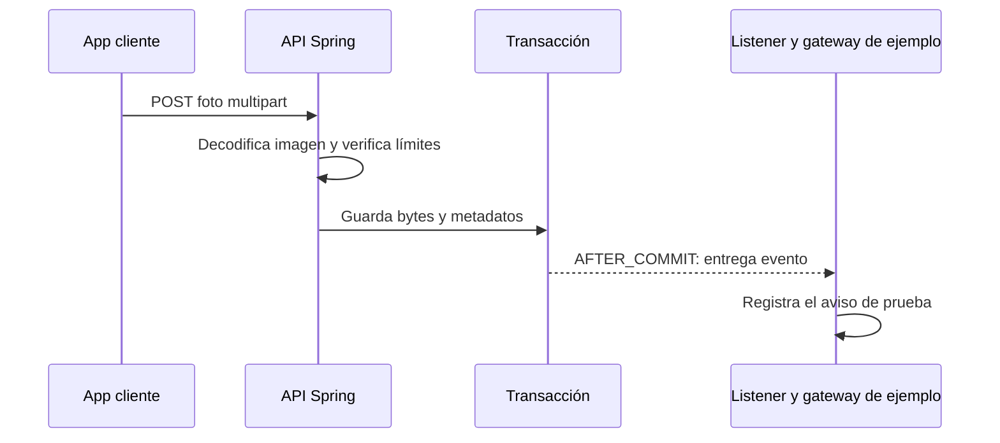

# Módulo 20: Proyecto integrador: backend de entregas productivo

## Aprende construyendo

Los Temas 1–3 amplían incrementalmente el proyecto real `spring-boot-integrador-rutaflow`, combinando piezas ya estudiadas en el track: entidades y migraciones Flyway (Módulo 4), JWT y `@PreAuthorize` (Módulo 5), pruebas de integración con Testcontainers (Módulo 6) y una métrica de negocio de Actuator (Módulo 7). Cada tema comprueba cambios con código ejecutable y evidencia observable. Los Temas 4–9 construyen el backend de entregas `gestion-entregas`: datos espaciales en MySQL, JWT con propiedad del recurso, tiempo real con STOMP y archivos con notificaciones.


### Tema 1: Arquitectura del microservicio integrador · Avanzado · 40 min

<details open>
<summary><strong>Capa 1 — Lectura</strong></summary>

#### ► DE QUÉ TRATA
Este tema te guía por arquitectura del microservicio integrador con foco en comprensión antes de implementación.

#### ► LA IDEA EN UNA FRASE
**Entender arquitectura del microservicio integrador te permite tomar mejores decisiones técnicas.**

#### ► POR QUÉ EXISTE ESTO
Resuelve un problema real de diseño o implementación y evita decisiones a ciegas.

#### ► LA ANALOGÍA
Piensa en arquitectura del microservicio integrador como una herramienta de taller: útil cuando conoces su propósito y sus límites.
**Dónde se rompe la analogía:** en software, los efectos dependen del contexto, la escala y los trade-offs.

#### ► CÓMO FUNCIONA
1. Identifica el problema que arquitectura del microservicio integrador resuelve.
2. Observa sus componentes y relaciones.
3. Aplica la opción más simple que funcione.
4. Verifica el resultado y los límites.

#### ► LO QUE PUEDE SALIR MAL
| Síntoma | Causa probable | Arreglo |
|---|---|---|
| Arquitectura del microservicio integrador se aplica pero el resultado no mejora | Se usó sin medir el problema real | Mide antes y compara contra la alternativa simple |
| Aparece complejidad inesperada | Se adoptó la técnica sin comprender sus trade-offs | Vuelve a la sección de trade-offs y reduce el alcance |
| Falla en un caso límite | Se asumió un contexto que no se cumple | Prueba el caso límite y documenta cuándo NO usarlo |

#### ► TRADE-OFFS
| Opción | Cuándo usarla | Cuándo NO usarla |
|---|---|---|
| Usar Arquitectura del microservicio integrador | Cuando el problema coincide con su propósito y el beneficio es observable | Cuando agrega complejidad sin resolver un problema real |
| Alternativa más simple | Cuando el contexto es pequeño, estable o fácil de razonar | Cuando ya demostró no escalar o no cumplir el requisito |
| Postergar la decisión | Cuando falta evidencia del problema | Cuando el costo de esperar es mayor que el costo de probar |

#### ► CUÁNDO NO USAR ESTO
No uses arquitectura del microservicio integrador por defecto. Aplícalo cuando el problema lo justifique y puedas verificar el beneficio; si una alternativa más simple resuelve igual, prefiérela.

#### ► DE VUELTA A LA ANALOGÍA
Volviendo a la analogía: arquitectura del microservicio integrador funciona como el modelo inicial, pero recuerda dónde se rompe: en producción importan la evidencia, la escala y el costo de equivocarte.

#### ► LO QUE DEBES RECORDAR
- Arquitectura del microservicio integrador existe para resolver un problema específico.
- Mide antes de adoptar complejidad.
- Conoce el caso donde NO usarlo.
- Verifica con evidencia observable.

#### ► PREGUNTAS PARA PENSAR
1. ¿Qué problema concreto resuelve arquitectura del microservicio integrador en tu contexto?
2. ¿Cómo sabrías que arquitectura del microservicio integrador no está funcionando bien?
3. ¿Qué alternativa más simple considerarías antes de usar arquitectura del microservicio integrador?

</details>

<details>
<summary><strong>Capa 2 — Construcción</strong></summary>

#### Código y verificación
```bash
./scripts/verify-integration.sh
```

```text
POST /api/entregas
  JSON → EntregaController → EntregaService → EntregaRepository → PostgreSQL
  HTTP 201 ← EntregaResponse ← entidad guardada
```

```sql
CREATE TABLE entrega (
    id BIGINT GENERATED BY DEFAULT AS IDENTITY PRIMARY KEY,
    destinatario VARCHAR(200) NOT NULL,
    estado VARCHAR(30) NOT NULL
);
```

```json
{"destinatario":"Tienda Norte"}
```

```json
{"destinatario":" "}
```

```bash
./scripts/verify-integration.sh
```

</details>

### Tema 2: Integra seguridad JWT y observabilidad · Avanzado · 40 min

<details open>
<summary><strong>Capa 1 — Lectura</strong></summary>

#### ► DE QUÉ TRATA
Este tema te guía por integra seguridad jwt y observabilidad con foco en comprensión antes de implementación.

#### ► LA IDEA EN UNA FRASE
**Entender integra seguridad jwt y observabilidad te permite tomar mejores decisiones técnicas.**

#### ► POR QUÉ EXISTE ESTO
Resuelve un problema real de diseño o implementación y evita decisiones a ciegas.

#### ► LA ANALOGÍA
Piensa en integra seguridad jwt y observabilidad como una herramienta de taller: útil cuando conoces su propósito y sus límites.
**Dónde se rompe la analogía:** en software, los efectos dependen del contexto, la escala y los trade-offs.

#### ► CÓMO FUNCIONA
1. Identifica el problema que integra seguridad jwt y observabilidad resuelve.
2. Observa sus componentes y relaciones.
3. Aplica la opción más simple que funcione.
4. Verifica el resultado y los límites.

#### ► LO QUE PUEDE SALIR MAL
| Síntoma | Causa probable | Arreglo |
|---|---|---|
| Integra seguridad JWT y observabilidad se aplica pero el resultado no mejora | Se usó sin medir el problema real | Mide antes y compara contra la alternativa simple |
| Aparece complejidad inesperada | Se adoptó la técnica sin comprender sus trade-offs | Vuelve a la sección de trade-offs y reduce el alcance |
| Falla en un caso límite | Se asumió un contexto que no se cumple | Prueba el caso límite y documenta cuándo NO usarlo |

#### ► TRADE-OFFS
| Opción | Cuándo usarla | Cuándo NO usarla |
|---|---|---|
| Usar Integra seguridad JWT y observabilidad | Cuando el problema coincide con su propósito y el beneficio es observable | Cuando agrega complejidad sin resolver un problema real |
| Alternativa más simple | Cuando el contexto es pequeño, estable o fácil de razonar | Cuando ya demostró no escalar o no cumplir el requisito |
| Postergar la decisión | Cuando falta evidencia del problema | Cuando el costo de esperar es mayor que el costo de probar |

#### ► CUÁNDO NO USAR ESTO
No uses integra seguridad jwt y observabilidad por defecto. Aplícalo cuando el problema lo justifique y puedas verificar el beneficio; si una alternativa más simple resuelve igual, prefiérela.

#### ► DE VUELTA A LA ANALOGÍA
Volviendo a la analogía: integra seguridad jwt y observabilidad funciona como el modelo inicial, pero recuerda dónde se rompe: en producción importan la evidencia, la escala y el costo de equivocarte.

#### ► LO QUE DEBES RECORDAR
- Integra seguridad JWT y observabilidad existe para resolver un problema específico.
- Mide antes de adoptar complejidad.
- Conoce el caso donde NO usarlo.
- Verifica con evidencia observable.

#### ► PREGUNTAS PARA PENSAR
1. ¿Qué problema concreto resuelve integra seguridad jwt y observabilidad en tu contexto?
2. ¿Cómo sabrías que integra seguridad jwt y observabilidad no está funcionando bien?
3. ¿Qué alternativa más simple considerarías antes de usar integra seguridad jwt y observabilidad?

</details>

<details>
<summary><strong>Capa 2 — Construcción</strong></summary>

#### Código y verificación
```bash
./scripts/verify-integration.sh
```

```bash
./scripts/verify-integration.sh
```

```java
Entrega creada = entregas.save(Entrega.crear(destinatario));
entregasCreadas.increment();
return creada;
```

```text
GET /actuator/metrics/entregas.creadas
Authorization: Bearer <JWT con ROLE_ADMIN>
```

```bash
./scripts/verify-integration.sh
```

```bash
bash ./scripts/verify-integration.sh
```

</details>

### Tema 3: Cierra el servicio con evidencia y próximos pasos · Experto · 35 min

<details open>
<summary><strong>Capa 1 — Lectura</strong></summary>

#### ► DE QUÉ TRATA
Este tema te guía por cierra el servicio con evidencia y próximos pasos con foco en comprensión antes de implementación.

#### ► LA IDEA EN UNA FRASE
**Entender cierra el servicio con evidencia y próximos pasos te permite tomar mejores decisiones técnicas.**

#### ► POR QUÉ EXISTE ESTO
Resuelve un problema real de diseño o implementación y evita decisiones a ciegas.

#### ► LA ANALOGÍA
Piensa en cierra el servicio con evidencia y próximos pasos como una herramienta de taller: útil cuando conoces su propósito y sus límites.
**Dónde se rompe la analogía:** en software, los efectos dependen del contexto, la escala y los trade-offs.

#### ► CÓMO FUNCIONA
1. Identifica el problema que cierra el servicio con evidencia y próximos pasos resuelve.
2. Observa sus componentes y relaciones.
3. Aplica la opción más simple que funcione.
4. Verifica el resultado y los límites.

#### ► LO QUE PUEDE SALIR MAL
| Síntoma | Causa probable | Arreglo |
|---|---|---|
| Cierra el servicio con evidencia y próximos pasos se aplica pero el resultado no mejora | Se usó sin medir el problema real | Mide antes y compara contra la alternativa simple |
| Aparece complejidad inesperada | Se adoptó la técnica sin comprender sus trade-offs | Vuelve a la sección de trade-offs y reduce el alcance |
| Falla en un caso límite | Se asumió un contexto que no se cumple | Prueba el caso límite y documenta cuándo NO usarlo |

#### ► TRADE-OFFS
| Opción | Cuándo usarla | Cuándo NO usarla |
|---|---|---|
| Usar Cierra el servicio con evidencia y próximos pasos | Cuando el problema coincide con su propósito y el beneficio es observable | Cuando agrega complejidad sin resolver un problema real |
| Alternativa más simple | Cuando el contexto es pequeño, estable o fácil de razonar | Cuando ya demostró no escalar o no cumplir el requisito |
| Postergar la decisión | Cuando falta evidencia del problema | Cuando el costo de esperar es mayor que el costo de probar |

#### ► CUÁNDO NO USAR ESTO
No uses cierra el servicio con evidencia y próximos pasos por defecto. Aplícalo cuando el problema lo justifique y puedas verificar el beneficio; si una alternativa más simple resuelve igual, prefiérela.

#### ► DE VUELTA A LA ANALOGÍA
Volviendo a la analogía: cierra el servicio con evidencia y próximos pasos funciona como el modelo inicial, pero recuerda dónde se rompe: en producción importan la evidencia, la escala y el costo de equivocarte.

#### ► LO QUE DEBES RECORDAR
- Cierra el servicio con evidencia y próximos pasos existe para resolver un problema específico.
- Mide antes de adoptar complejidad.
- Conoce el caso donde NO usarlo.
- Verifica con evidencia observable.

#### ► PREGUNTAS PARA PENSAR
1. ¿Qué problema concreto resuelve cierra el servicio con evidencia y próximos pasos en tu contexto?
2. ¿Cómo sabrías que cierra el servicio con evidencia y próximos pasos no está funcionando bien?
3. ¿Qué alternativa más simple considerarías antes de usar cierra el servicio con evidencia y próximos pasos?

</details>

<details>
<summary><strong>Capa 2 — Construcción</strong></summary>

#### Código y verificación
```bash
./scripts/verify-integration.sh
```

```bash
./scripts/verify-integration.sh
```

```bash
./scripts/verify-integration.sh
```

```bash
./scripts/verify-integration.sh
```

```bash
bash ./scripts/verify-integration.sh
```

</details>

### Tema 4: CRUD API y contratos · Experto · 35 min

<details open>
<summary><strong>Capa 1 — Lectura</strong></summary>

#### ► DE QUÉ TRATA
Este tema te guía por crud api y contratos con foco en comprensión antes de implementación.

#### ► LA IDEA EN UNA FRASE
**Entender crud api y contratos te permite tomar mejores decisiones técnicas.**

#### ► POR QUÉ EXISTE ESTO
Resuelve un problema real de diseño o implementación y evita decisiones a ciegas.

#### ► LA ANALOGÍA
Piensa en crud api y contratos como una herramienta de taller: útil cuando conoces su propósito y sus límites.
**Dónde se rompe la analogía:** en software, los efectos dependen del contexto, la escala y los trade-offs.

#### ► CÓMO FUNCIONA
1. Identifica el problema que crud api y contratos resuelve.
2. Observa sus componentes y relaciones.
3. Aplica la opción más simple que funcione.
4. Verifica el resultado y los límites.

#### ► LO QUE PUEDE SALIR MAL
| Síntoma | Causa probable | Arreglo |
|---|---|---|
| CRUD API y contratos se aplica pero el resultado no mejora | Se usó sin medir el problema real | Mide antes y compara contra la alternativa simple |
| Aparece complejidad inesperada | Se adoptó la técnica sin comprender sus trade-offs | Vuelve a la sección de trade-offs y reduce el alcance |
| Falla en un caso límite | Se asumió un contexto que no se cumple | Prueba el caso límite y documenta cuándo NO usarlo |

#### ► TRADE-OFFS
| Opción | Cuándo usarla | Cuándo NO usarla |
|---|---|---|
| Usar CRUD API y contratos | Cuando el problema coincide con su propósito y el beneficio es observable | Cuando agrega complejidad sin resolver un problema real |
| Alternativa más simple | Cuando el contexto es pequeño, estable o fácil de razonar | Cuando ya demostró no escalar o no cumplir el requisito |
| Postergar la decisión | Cuando falta evidencia del problema | Cuando el costo de esperar es mayor que el costo de probar |

#### ► CUÁNDO NO USAR ESTO
No uses crud api y contratos por defecto. Aplícalo cuando el problema lo justifique y puedas verificar el beneficio; si una alternativa más simple resuelve igual, prefiérela.

#### ► DE VUELTA A LA ANALOGÍA
Volviendo a la analogía: crud api y contratos funciona como el modelo inicial, pero recuerda dónde se rompe: en producción importan la evidencia, la escala y el costo de equivocarte.

#### ► LO QUE DEBES RECORDAR
- CRUD API y contratos existe para resolver un problema específico.
- Mide antes de adoptar complejidad.
- Conoce el caso donde NO usarlo.
- Verifica con evidencia observable.

#### ► PREGUNTAS PARA PENSAR
1. ¿Qué problema concreto resuelve crud api y contratos en tu contexto?
2. ¿Cómo sabrías que crud api y contratos no está funcionando bien?
3. ¿Qué alternativa más simple considerarías antes de usar crud api y contratos?

</details>

<details>
<summary><strong>Capa 2 — Construcción</strong></summary>

#### Código y verificación
```java
public enum EstadoEnvio { CREADO, CANCELADO }

public void cancelar() {
    this.estado = EstadoEnvio.CANCELADO;
}
```

```bash
./mvnw -q test -Dtest=CancelacionContratoTest#crearPublicaLocationYGetRecuperaElDto
```

```bash
./mvnw -q test -Dtest=CancelacionContratoTest#crearPublicaLocationYGetRecuperaElDto
```

```bash
./mvnw -q test -Dtest=CancelacionContratoTest#deleteMarcaCanceladoYConservaLaFila
```

```bash
./mvnw -q test -Dtest=CancelacionContratoTest#repetirDeleteConservaLaMismaCancelacion
```

</details>

### Tema 5: MySQL y datos espaciales · Experto · 35 min

<details open>
<summary><strong>Capa 1 — Lectura</strong></summary>

#### ► DE QUÉ TRATA
Este tema te guía por mysql y datos espaciales con foco en comprensión antes de implementación.

#### ► LA IDEA EN UNA FRASE
**Entender mysql y datos espaciales te permite tomar mejores decisiones técnicas.**

#### ► POR QUÉ EXISTE ESTO
Resuelve un problema real de diseño o implementación y evita decisiones a ciegas.

#### ► LA ANALOGÍA
Piensa en mysql y datos espaciales como una herramienta de taller: útil cuando conoces su propósito y sus límites.
**Dónde se rompe la analogía:** en software, los efectos dependen del contexto, la escala y los trade-offs.

#### ► CÓMO FUNCIONA
1. Identifica el problema que mysql y datos espaciales resuelve.
2. Observa sus componentes y relaciones.
3. Aplica la opción más simple que funcione.
4. Verifica el resultado y los límites.

#### ► LO QUE PUEDE SALIR MAL
| Síntoma | Causa probable | Arreglo |
|---|---|---|
| MySQL y datos espaciales se aplica pero el resultado no mejora | Se usó sin medir el problema real | Mide antes y compara contra la alternativa simple |
| Aparece complejidad inesperada | Se adoptó la técnica sin comprender sus trade-offs | Vuelve a la sección de trade-offs y reduce el alcance |
| Falla en un caso límite | Se asumió un contexto que no se cumple | Prueba el caso límite y documenta cuándo NO usarlo |

#### ► TRADE-OFFS
| Opción | Cuándo usarla | Cuándo NO usarla |
|---|---|---|
| Usar MySQL y datos espaciales | Cuando el problema coincide con su propósito y el beneficio es observable | Cuando agrega complejidad sin resolver un problema real |
| Alternativa más simple | Cuando el contexto es pequeño, estable o fácil de razonar | Cuando ya demostró no escalar o no cumplir el requisito |
| Postergar la decisión | Cuando falta evidencia del problema | Cuando el costo de esperar es mayor que el costo de probar |

#### ► CUÁNDO NO USAR ESTO
No uses mysql y datos espaciales por defecto. Aplícalo cuando el problema lo justifique y puedas verificar el beneficio; si una alternativa más simple resuelve igual, prefiérela.

#### ► DE VUELTA A LA ANALOGÍA
Volviendo a la analogía: mysql y datos espaciales funciona como el modelo inicial, pero recuerda dónde se rompe: en producción importan la evidencia, la escala y el costo de equivocarte.

#### ► LO QUE DEBES RECORDAR
- MySQL y datos espaciales existe para resolver un problema específico.
- Mide antes de adoptar complejidad.
- Conoce el caso donde NO usarlo.
- Verifica con evidencia observable.

#### ► PREGUNTAS PARA PENSAR
1. ¿Qué problema concreto resuelve mysql y datos espaciales en tu contexto?
2. ¿Cómo sabrías que mysql y datos espaciales no está funcionando bien?
3. ¿Qué alternativa más simple considerarías antes de usar mysql y datos espaciales?

</details>

<details>
<summary><strong>Capa 2 — Construcción</strong></summary>

#### Código y verificación
```sql
CREATE TABLE punto (
  id BIGINT PRIMARY KEY AUTO_INCREMENT,
  ubicacion POINT NOT NULL SRID 4326,
  SPATIAL INDEX idx_ubicacion (ubicacion)
);
```

```bash
DOCKER_HOST="unix://$(podman machine inspect --format '{{.ConnectionInfo.PodmanSocket.Path}}')" \
TESTCONTAINERS_DOCKER_SOCKET_OVERRIDE=/var/run/docker.sock \
TESTCONTAINERS_RYUK_DISABLED=true ./mvnw -q test
```

```sql
ST_GeomFromText('POINT(-74.08 4.61)', 4326, 'axis-order=long-lat')
```

```bash
DOCKER_HOST="unix://$(podman machine inspect --format '{{.ConnectionInfo.PodmanSocket.Path}}')" \
TESTCONTAINERS_DOCKER_SOCKET_OVERRIDE=/var/run/docker.sock \
TESTCONTAINERS_RYUK_DISABLED=true ./mvnw -q test -Dtest=ConsultaEspacialMySqlTest#distanciaEntreBogotaYMedellinSeMideEnMetros
```

```bash
./mvnw -q test
```

```bash
DOCKER_HOST="unix://$(podman machine inspect --format '{{.ConnectionInfo.PodmanSocket.Path}}')" \
TESTCONTAINERS_DOCKER_SOCKET_OVERRIDE=/var/run/docker.sock \
TESTCONTAINERS_RYUK_DISABLED=true ./mvnw -q test -Dtest=ConsultaEspacialMySqlTest#explainUsaIndiceEspacialParaReducirElAreaDeBusqueda
```

</details>

### Tema 6: JPA e Hibernate Spatial · Experto · 35 min

<details open>
<summary><strong>Capa 1 — Lectura</strong></summary>

#### ► DE QUÉ TRATA
Este tema te guía por jpa e hibernate spatial con foco en comprensión antes de implementación.

#### ► LA IDEA EN UNA FRASE
**Entender jpa e hibernate spatial te permite tomar mejores decisiones técnicas.**

#### ► POR QUÉ EXISTE ESTO
Resuelve un problema real de diseño o implementación y evita decisiones a ciegas.

#### ► LA ANALOGÍA
Piensa en jpa e hibernate spatial como una herramienta de taller: útil cuando conoces su propósito y sus límites.
**Dónde se rompe la analogía:** en software, los efectos dependen del contexto, la escala y los trade-offs.

#### ► CÓMO FUNCIONA
1. Identifica el problema que jpa e hibernate spatial resuelve.
2. Observa sus componentes y relaciones.
3. Aplica la opción más simple que funcione.
4. Verifica el resultado y los límites.

#### ► LO QUE PUEDE SALIR MAL
| Síntoma | Causa probable | Arreglo |
|---|---|---|
| JPA e Hibernate Spatial se aplica pero el resultado no mejora | Se usó sin medir el problema real | Mide antes y compara contra la alternativa simple |
| Aparece complejidad inesperada | Se adoptó la técnica sin comprender sus trade-offs | Vuelve a la sección de trade-offs y reduce el alcance |
| Falla en un caso límite | Se asumió un contexto que no se cumple | Prueba el caso límite y documenta cuándo NO usarlo |

#### ► TRADE-OFFS
| Opción | Cuándo usarla | Cuándo NO usarla |
|---|---|---|
| Usar JPA e Hibernate Spatial | Cuando el problema coincide con su propósito y el beneficio es observable | Cuando agrega complejidad sin resolver un problema real |
| Alternativa más simple | Cuando el contexto es pequeño, estable o fácil de razonar | Cuando ya demostró no escalar o no cumplir el requisito |
| Postergar la decisión | Cuando falta evidencia del problema | Cuando el costo de esperar es mayor que el costo de probar |

#### ► CUÁNDO NO USAR ESTO
No uses jpa e hibernate spatial por defecto. Aplícalo cuando el problema lo justifique y puedas verificar el beneficio; si una alternativa más simple resuelve igual, prefiérela.

#### ► DE VUELTA A LA ANALOGÍA
Volviendo a la analogía: jpa e hibernate spatial funciona como el modelo inicial, pero recuerda dónde se rompe: en producción importan la evidencia, la escala y el costo de equivocarte.

#### ► LO QUE DEBES RECORDAR
- JPA e Hibernate Spatial existe para resolver un problema específico.
- Mide antes de adoptar complejidad.
- Conoce el caso donde NO usarlo.
- Verifica con evidencia observable.

#### ► PREGUNTAS PARA PENSAR
1. ¿Qué problema concreto resuelve jpa e hibernate spatial en tu contexto?
2. ¿Cómo sabrías que jpa e hibernate spatial no está funcionando bien?
3. ¿Qué alternativa más simple considerarías antes de usar jpa e hibernate spatial?

</details>

<details>
<summary><strong>Capa 2 — Construcción</strong></summary>

#### Código y verificación
```java
var geometria = new GeometryFactory(new PrecisionModel(), 4326);
var punto = geometria.createPoint(new Coordinate(-74.08, 4.61));
```

```bash
./mvnw -q test -Dtest=PosicionConductorTest#puntoJtsPersisteYSeLeeConSusCoordenadasYSrid
```

```bash
./mvnw -q test -Dtest=PosicionConductorTest#versionDetectaLaSegundaEscrituraBasadaEnUnaLecturaVieja
```

```bash
./mvnw -q test
```

```bash
./mvnw -q test -Dtest=PosicionConductorTest#versionDetectaLaSegundaEscrituraBasadaEnUnaLecturaVieja
```

</details>

### Tema 7: JWT Bearer y autorización por roles · Experto · 35 min

<details open>
<summary><strong>Capa 1 — Lectura</strong></summary>

#### ► DE QUÉ TRATA
Este tema te guía por jwt bearer y autorización por roles con foco en comprensión antes de implementación.

#### ► LA IDEA EN UNA FRASE
**Entender jwt bearer y autorización por roles te permite tomar mejores decisiones técnicas.**

#### ► POR QUÉ EXISTE ESTO
Resuelve un problema real de diseño o implementación y evita decisiones a ciegas.

#### ► LA ANALOGÍA
Piensa en jwt bearer y autorización por roles como una herramienta de taller: útil cuando conoces su propósito y sus límites.
**Dónde se rompe la analogía:** en software, los efectos dependen del contexto, la escala y los trade-offs.

#### ► CÓMO FUNCIONA
1. Identifica el problema que jwt bearer y autorización por roles resuelve.
2. Observa sus componentes y relaciones.
3. Aplica la opción más simple que funcione.
4. Verifica el resultado y los límites.

#### ► LO QUE PUEDE SALIR MAL
| Síntoma | Causa probable | Arreglo |
|---|---|---|
| JWT Bearer y autorización por roles se aplica pero el resultado no mejora | Se usó sin medir el problema real | Mide antes y compara contra la alternativa simple |
| Aparece complejidad inesperada | Se adoptó la técnica sin comprender sus trade-offs | Vuelve a la sección de trade-offs y reduce el alcance |
| Falla en un caso límite | Se asumió un contexto que no se cumple | Prueba el caso límite y documenta cuándo NO usarlo |

#### ► TRADE-OFFS
| Opción | Cuándo usarla | Cuándo NO usarla |
|---|---|---|
| Usar JWT Bearer y autorización por roles | Cuando el problema coincide con su propósito y el beneficio es observable | Cuando agrega complejidad sin resolver un problema real |
| Alternativa más simple | Cuando el contexto es pequeño, estable o fácil de razonar | Cuando ya demostró no escalar o no cumplir el requisito |
| Postergar la decisión | Cuando falta evidencia del problema | Cuando el costo de esperar es mayor que el costo de probar |

#### ► CUÁNDO NO USAR ESTO
No uses jwt bearer y autorización por roles por defecto. Aplícalo cuando el problema lo justifique y puedas verificar el beneficio; si una alternativa más simple resuelve igual, prefiérela.

#### ► DE VUELTA A LA ANALOGÍA
Volviendo a la analogía: jwt bearer y autorización por roles funciona como el modelo inicial, pero recuerda dónde se rompe: en producción importan la evidencia, la escala y el costo de equivocarte.

#### ► LO QUE DEBES RECORDAR
- JWT Bearer y autorización por roles existe para resolver un problema específico.
- Mide antes de adoptar complejidad.
- Conoce el caso donde NO usarlo.
- Verifica con evidencia observable.

#### ► PREGUNTAS PARA PENSAR
1. ¿Qué problema concreto resuelve jwt bearer y autorización por roles en tu contexto?
2. ¿Cómo sabrías que jwt bearer y autorización por roles no está funcionando bien?
3. ¿Qué alternativa más simple considerarías antes de usar jwt bearer y autorización por roles?

</details>

<details>
<summary><strong>Capa 2 — Construcción</strong></summary>

#### Código y verificación
```bash
./mvnw -q test -Dtest=OwnershipJwtTest#conductorPropietarioConTokenFirmadoPuedeActualizar
```

```bash
./mvnw -q test -Dtest=OwnershipJwtTest#sinBearerTokenRecibe401+propietarioSinRolDriverRecibe403
```

```bash
./mvnw -q test
```

```bash
./mvnw -q test -Dtest=OwnershipJwtTest#conductorPropietarioConTokenFirmadoPuedeActualizar+mismoRolPeroOtroPropietarioRecibe403
```

```bash
./mvnw -q test -Dtest=OwnershipJwtTest#mismoRolPeroOtroPropietarioRecibe403
```

</details>

### Tema 8: Tiempo real con STOMP · Experto · 40 min

<details open>
<summary><strong>Capa 1 — Lectura</strong></summary>

#### ► DE QUÉ TRATA
Este tema te guía por tiempo real con stomp con foco en comprensión antes de implementación.

#### ► LA IDEA EN UNA FRASE
**Entender tiempo real con stomp te permite tomar mejores decisiones técnicas.**

#### ► POR QUÉ EXISTE ESTO
Resuelve un problema real de diseño o implementación y evita decisiones a ciegas.

#### ► LA ANALOGÍA
Piensa en tiempo real con stomp como una herramienta de taller: útil cuando conoces su propósito y sus límites.
**Dónde se rompe la analogía:** en software, los efectos dependen del contexto, la escala y los trade-offs.

#### ► CÓMO FUNCIONA
1. Identifica el problema que tiempo real con stomp resuelve.
2. Observa sus componentes y relaciones.
3. Aplica la opción más simple que funcione.
4. Verifica el resultado y los límites.

#### ► LO QUE PUEDE SALIR MAL
| Síntoma | Causa probable | Arreglo |
|---|---|---|
| Tiempo real con STOMP se aplica pero el resultado no mejora | Se usó sin medir el problema real | Mide antes y compara contra la alternativa simple |
| Aparece complejidad inesperada | Se adoptó la técnica sin comprender sus trade-offs | Vuelve a la sección de trade-offs y reduce el alcance |
| Falla en un caso límite | Se asumió un contexto que no se cumple | Prueba el caso límite y documenta cuándo NO usarlo |

#### ► TRADE-OFFS
| Opción | Cuándo usarla | Cuándo NO usarla |
|---|---|---|
| Usar Tiempo real con STOMP | Cuando el problema coincide con su propósito y el beneficio es observable | Cuando agrega complejidad sin resolver un problema real |
| Alternativa más simple | Cuando el contexto es pequeño, estable o fácil de razonar | Cuando ya demostró no escalar o no cumplir el requisito |
| Postergar la decisión | Cuando falta evidencia del problema | Cuando el costo de esperar es mayor que el costo de probar |

#### ► CUÁNDO NO USAR ESTO
No uses tiempo real con stomp por defecto. Aplícalo cuando el problema lo justifique y puedas verificar el beneficio; si una alternativa más simple resuelve igual, prefiérela.

#### ► DE VUELTA A LA ANALOGÍA
Volviendo a la analogía: tiempo real con stomp funciona como el modelo inicial, pero recuerda dónde se rompe: en producción importan la evidencia, la escala y el costo de equivocarte.

#### ► LO QUE DEBES RECORDAR
- Tiempo real con STOMP existe para resolver un problema específico.
- Mide antes de adoptar complejidad.
- Conoce el caso donde NO usarlo.
- Verifica con evidencia observable.

#### ► PREGUNTAS PARA PENSAR
1. ¿Qué problema concreto resuelve tiempo real con stomp en tu contexto?
2. ¿Cómo sabrías que tiempo real con stomp no está funcionando bien?
3. ¿Qué alternativa más simple considerarías antes de usar tiempo real con stomp?

</details>

<details>
<summary><strong>Capa 2 — Construcción</strong></summary>

#### Código y verificación
```bash
./mvnw -q test
```

```java
registry.enableSimpleBroker("/topic");
registry.setApplicationDestinationPrefixes("/app");
registry.addEndpoint("/ws-entregas");
```

```java
session.subscribe("/topic/entregas/SHP-1", handler(PositionEvent.class, events));
PositionEvent first = new PositionEvent("SHP-1", 1, "2026-11-09T10:00:00Z", 1);
assertThat(publisher.publish(first)).isTrue();
assertThat(events.poll(3, TimeUnit.SECONDS)).isEqualTo(first);
```

```java
assertThat(publisher.publish(first)).isTrue();
assertThat(publisher.publish(first)).isFalse();
assertThat(events.poll(3, TimeUnit.SECONDS)).isEqualTo(first);
assertThat(events.poll(250, TimeUnit.MILLISECONDS)).isNull();
```

</details>

### Tema 9: Archivos y notificaciones push · Experto · 40 min

<details open>
<summary><strong>Capa 1 — Lectura</strong></summary>

#### ► DE QUÉ TRATA
Este tema te guía por archivos y notificaciones push con foco en comprensión antes de implementación.

#### ► LA IDEA EN UNA FRASE
**Entender archivos y notificaciones push te permite tomar mejores decisiones técnicas.**

#### ► POR QUÉ EXISTE ESTO
Resuelve un problema real de diseño o implementación y evita decisiones a ciegas.

#### ► LA ANALOGÍA
Piensa en archivos y notificaciones push como una herramienta de taller: útil cuando conoces su propósito y sus límites.
**Dónde se rompe la analogía:** en software, los efectos dependen del contexto, la escala y los trade-offs.

#### ► CÓMO FUNCIONA


#### ► LO QUE PUEDE SALIR MAL
| Síntoma | Causa probable | Arreglo |
|---|---|---|
| Archivos y notificaciones push se aplica pero el resultado no mejora | Se usó sin medir el problema real | Mide antes y compara contra la alternativa simple |
| Aparece complejidad inesperada | Se adoptó la técnica sin comprender sus trade-offs | Vuelve a la sección de trade-offs y reduce el alcance |
| Falla en un caso límite | Se asumió un contexto que no se cumple | Prueba el caso límite y documenta cuándo NO usarlo |

#### ► TRADE-OFFS
| Opción | Cuándo usarla | Cuándo NO usarla |
|---|---|---|
| Usar Archivos y notificaciones push | Cuando el problema coincide con su propósito y el beneficio es observable | Cuando agrega complejidad sin resolver un problema real |
| Alternativa más simple | Cuando el contexto es pequeño, estable o fácil de razonar | Cuando ya demostró no escalar o no cumplir el requisito |
| Postergar la decisión | Cuando falta evidencia del problema | Cuando el costo de esperar es mayor que el costo de probar |

#### ► CUÁNDO NO USAR ESTO
No uses archivos y notificaciones push por defecto. Aplícalo cuando el problema lo justifique y puedas verificar el beneficio; si una alternativa más simple resuelve igual, prefiérela.

#### ► DE VUELTA A LA ANALOGÍA
Volviendo a la analogía: archivos y notificaciones push funciona como el modelo inicial, pero recuerda dónde se rompe: en producción importan la evidencia, la escala y el costo de equivocarte.

#### ► LO QUE DEBES RECORDAR
- Archivos y notificaciones push existe para resolver un problema específico.
- Mide antes de adoptar complejidad.
- Conoce el caso donde NO usarlo.
- Verifica con evidencia observable.

#### ► PREGUNTAS PARA PENSAR
1. ¿Qué problema concreto resuelve archivos y notificaciones push en tu contexto?
2. ¿Cómo sabrías que archivos y notificaciones push no está funcionando bien?
3. ¿Qué alternativa más simple considerarías antes de usar archivos y notificaciones push?

</details>

<details>
<summary><strong>Capa 2 — Construcción</strong></summary>

#### Código y verificación


```bash
./mvnw -q test
```

```bash
./mvnw -q test
```

```java
if (!detectedType.equalsIgnoreCase(declaredMediaType)) {
    throw new InvalidImageException("El tipo declarado no coincide con la imagen detectada");
}
if (reader.read(0) == null) throw new InvalidImageException("No se pudo decodificar la imagen");
```

```bash
./mvnw -q test
```

```java
@TransactionalEventListener(phase = TransactionPhase.AFTER_COMMIT)
public void afterCommit(UploadAccepted event) {
    gateway.send(event);
}
```

</details>
