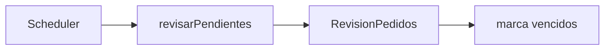

# Módulo 20: Integraciones Spring — scheduling, eventos, correo y caché

## Aprende construyendo

Este módulo completa el mapa de integraciones de Spring identificado en las capturas. Cada capacidad se introduce con una prueba observable y un límite importante: el scheduler local no coordina instancias, los eventos en memoria no son durables, SMTP puede fallar y las cachés necesitan invalidación.

### Dos ejemplos: primero visible, luego real

- **Ejemplo sencillo:** un `@Scheduled` revisa pedidos vencidos en H2; un evento Spring actualiza una métrica; Caffeine cachea una tarifa y el test observa la invalidación.
- **Caso RutaFlow:** al confirmar un envío, la API debe guardar el estado aunque el broker, SMTP o Redis no respondan. Usa el outbox para el evento que debe sobrevivir reinicios, procesa la notificación fuera de la transacción y mide el resultado de caché entre instancias.

Este módulo demuestra el comportamiento dentro de una aplicación Spring. El módulo 21 desarrolla Kafka entre procesos; `@TransactionalEventListener` no sustituye al outbox y un evento local no es mensajería durable.

### Tema 1: Scheduling y tareas periódicas

**Meta:** elegir entre fixed delay y cron, delegar una tarea a un servicio y probar su llamada sin esperar el reloj.

**Evidencia final:** un test confirma que Spring registró la tarea y que el método llama el servicio; una nota explica qué pasa si hay varias réplicas.

**¿Por qué es importante?** revisar pedidos pendientes en intervalos evita depender de que una persona recuerde ejecutar el proceso; probarlo sin esperar minutos hace que el feedback sea rápido.

**Modelo mental:** el scheduler es un despertador. Despierta al método; el método delega el trabajo real a un servicio.



#### Subtema 20.1 · Elige cuándo debe volver a correr · 8 min

**Contexto:** una revisión que debe ocurrir cinco minutos después de terminar no tiene la misma regla que una tarea que inicia cada cinco minutos.

**Hazlo tú:** abre `examples/spring-scheduling-rutaflow/src/main/java/academia/rutaflow/scheduling/PedidosScheduler.java`. Lee `fixedDelayString` y los valores en `application.yml`:

```java
@Scheduled(fixedDelayString = "${app.revision.delay-ms}",
           initialDelayString = "${app.revision.initial-delay-ms}")
```

**Resultado esperado:** el intervalo se lee de configuración y la primera ejecución espera el tiempo inicial.

**Fallo deliberado:** cambia `fixedDelayString` a `fixedRateString`. **Diagnóstico:** ahora el reloj mide de inicio a inicio, aunque la ejecución anterior siga trabajando. Vuelve a `fixedDelayString` para el caso del laboratorio.

**Entiende:** fixed delay espera que termine una ejecución; fixed rate mide entre inicios. Cron sirve para horarios de calendario y debe declarar zona cuando el horario local importe.

**Cierra:** elige una de las tres opciones para revisar pendientes de RutaFlow y escribe en una frase por qué encaja.

#### Subtema 20.2 · Conecta el disparo con el trabajo real · 8 min

**Contexto:** mantener la consulta del negocio dentro del método programado dificulta probarla y cambiar el disparador.

**Hazlo tú:** abre `PedidosScheduler.java` y `RevisionPedidos.java`:

```java
public void revisarPendientes() {
    revision.marcarVencidos();
}
```

Sigue la llamada desde scheduler hasta servicio. Ejecuta desde `examples/spring-scheduling-rutaflow`:

```bash
./mvnw -q test
```

**Resultado esperado:** la tarea registrada apunta al método del scheduler, que delega una vez al servicio.

**Fallo deliberado:** comenta `revision.marcarVencidos()`. **Diagnóstico:** el test del contador queda en cero. Restaura la llamada.

**Entiende:** el reloj decide cuándo empezar; el servicio define qué significa “pedido vencido”. Mantenerlos separados permite probar las reglas aparte.

**Cierra:** anota cuál regla de vencimiento agregarías al servicio del proyecto integrador RutaFlow.

#### Subtema 20.3 · Comprueba la tarea sin dormir en el test · 8 min

**Contexto:** un test no debe esperar cinco minutos para revisar una tarea periódica.

**Hazlo tú:** abre `PedidosSchedulerTest.java`. Los valores de prueba alargan la demora para que el reloj no dispare la tarea durante el test; `ScheduledTaskHolder` confirma que la tarea quedó registrada y el test invoca directamente el método.

```bash
./mvnw -q -Dtest=PedidosSchedulerTest test
```

**Resultado esperado:** pasa una prueba, cuenta una tarea registrada y el servicio registra una llamada.

**Fallo deliberado:** quita `@EnableScheduling` de `SchedulingApplication`. **Diagnóstico:** Spring no registra la tarea y el test detecta cero. Restáuralo.

**Entiende:** esta prueba comprueba registro y delegación; no espera al reloj ni demuestra la precisión de un cron de producción.

**Cierra:** guarda el test como evidencia del proyecto integrador RutaFlow y especifica qué parte cubre.

#### Subtema 20.4 · Evita duplicados al desplegar varias réplicas · 10 min

**Contexto:** si hay tres copias de la aplicación, cada proceso puede registrar su propio scheduler.

**Hazlo tú:** en `examples/spring-scheduling-rutaflow/README.md`, crea una nota para dos réplicas que intentan tomar `pedido-42`. Escribe qué reclamo atómico deja a una sola procesar la fila y qué ve la segunda. Ejecuta `./mvnw -q test` para confirmar que el lab local solo cubre registro y delegación.

**Resultado esperado:** la tarea local puede ocurrir una vez por réplica; la regla de negocio impide aplicar dos veces el mismo cambio.

**Fallo deliberado:** despliega dos instancias sin coordinación sobre el mismo pedido. **Diagnóstico:** ambas pueden procesar la fila. La anotación `@Scheduled` no comparte un lock entre procesos.

**Entiende:** un scheduler local no es cola durable ni coordinador de cluster. Para trabajo largo y reanudable, evalúa Spring Batch; para ejecución coordinada, usa un lock distribuido o reclama filas con una operación atómica.

**Cierra:** documenta una opción de coordinación y su evidencia en RutaFlow. El laboratorio usa un contador en memoria; no simula PostgreSQL, scheduler distribuido ni carga real.

**Fuentes primarias:** [Spring Framework: scheduling y `@Scheduled`](https://docs.spring.io/spring-framework/reference/integration/scheduling.html); [Spring Boot: ejecución y scheduler](https://docs.spring.io/spring-boot/reference/features/task-execution-and-scheduling.html).

### Tema 2: Eventos locales, eventos transaccionales y mensajería

**Meta:** distinguir un aviso dentro del proceso, una acción posterior al commit y un mensaje que debe sobrevivir al reinicio.

**¿Por qué es importante?** Notificar antes de guardar puede anunciar un envío que no existe; confiar solo en el aviso local puede perderlo si el proceso se cierra.

**Evidencia final:** para el proyecto integrador RutaFlow, explica qué se guarda junto al envío, qué puede publicarse de nuevo y cómo el consumidor evita repetir el efecto.

#### Subtema 20.5 · Sigue el evento dentro de la aplicación · 8 min

**Contexto:** al aceptar una imagen, RutaFlow debe guardar sus metadatos y pedir una notificación sin acoplar el servicio al proveedor push.

**Hazlo tú:** abre `examples/spring-boot-upload-push-rutaflow/src/main/java/academia/rutaflow/upload/UploadService.java` y sigue `publishEvent` hasta `PushAfterCommitListener.java`:

```java
@TransactionalEventListener(phase = TransactionPhase.AFTER_COMMIT)
public void afterCommit(UploadAccepted event) { gateway.send(event); }
```

Desde `examples/spring-boot-upload-push-rutaflow`, ejecuta:

```bash
./mvnw -q -Dtest=UploadPushIntegrationTest#imagenValidaSeGuardaYNotificaDespuesDelCommit test
```

**Resultado esperado:** la prueba confirma que se guardan archivo y metadatos, y se envía una notificación.

**Fallo deliberado:** cambia temporalmente `@TransactionalEventListener` por `@EventListener` y ejecuta `UploadPushIntegrationTest#rollbackNoDejaArchivoMetadataNiPush`. **Diagnóstico:** el test observa la notificación antes de que la transacción exterior haga rollback. Restablece la anotación.

**Entiende:** `ApplicationEventPublisher` conecta componentes del mismo proceso; el evento no queda guardado ni llega por sí mismo a otra aplicación.

**Cierra:** dibuja las tres llamadas desde el servicio hasta el gateway y señala en cuál línea sale el proceso a un proveedor externo.

#### Subtema 20.6 · Comprueba qué significa “después del commit” · 8 min

**Contexto:** el listener no debe anunciar una operación que la base de datos terminó revirtiendo.

**Hazlo tú:** abre `examples/spring-boot-upload-push-rutaflow/src/test/java/academia/rutaflow/upload/UploadPushIntegrationTest.java` y ejecuta:

```bash
./mvnw -q -Dtest=UploadPushIntegrationTest#rollbackNoDejaArchivoMetadataNiPush test
```

**Resultado esperado:** no queda fila, archivo ni push. La anotación espera al commit, pero la llamada externa todavía vive en el mismo proceso.

**Fallo deliberado:** quita `@TransactionalEventListener` o cambia la fase por `BEFORE_COMMIT`. **Diagnóstico:** el listener puede ejecutarse antes del rollback; vuelve a `AFTER_COMMIT` y repite la prueba.

**Entiende:** `AFTER_COMMIT` evita publicar antes de confirmar SQL; queda una ventana entre el commit y la ejecución del listener. Si el proceso cae allí, esta notificación local puede perderse. La opción `fallbackExecution` no es necesaria aquí; por defecto el listener necesita una transacción activa.

**Cierra:** escribe una oración que describa qué protege la prueba y qué no puede proteger.

#### Subtema 20.7 · Guarda el evento junto con el envío · 10 min

**Contexto:** si el mensaje debe sobrevivir al reinicio, guardar solo el envío y luego llamar Kafka deja una ventana en la que el envío existe pero el evento se pierde.

**Hazlo tú:** abre `examples/spring-kafka-rutaflow/src/main/java/academia/rutaflow/outbox/CrearEnvioService.java` y comprueba que ambos `INSERT` están dentro del mismo método `@Transactional`. Ejecuta desde `examples/spring-kafka-rutaflow`:

```java
@Transactional
public EnvioCreado crear(String referencia) {
    // ...
    jdbc.update("INSERT INTO envio (envio_id, referencia) VALUES (?, ?)", envioId, referencia);
    jdbc.update("""
            INSERT INTO outbox_event
                (event_id, aggregate_id, event_type, payload, created_at)
            VALUES (?, ?, ?, ?, ?)
            """, evento.eventId(), envioId, "EnvioCreado", payload, evento.occurredAt());
    return evento;
}
```

```bash
./mvnw -q -Dtest=EnvioEventPublisherTest#guardaEnvioYOutboxEnLaMismaTransaccion test
```

**Resultado esperado:** el test fuerza el fallo del `INSERT` outbox y verifica que también se revierte el envío.

**Fallo deliberado:** elimina temporalmente el `INSERT INTO outbox_event` y repite el test. **Diagnóstico:** ya no ocurre la violación SQL esperada y la prueba falla: el registro de negocio quedó sin su evento. Restaura el `INSERT`.

**Entiende:** la base de datos confirma los dos registros juntos. `OutboxDispatcher.java` los busca después, espera el ACK de Kafka y recién entonces marca `published_at`; el proceso puede caer tras el ACK y antes de marcar la fila.

**Cierra:** compara `published_at IS NULL` antes y después de ejecutar `dispatcherPublicaYMarcaSoloDespuesDelAck`.

#### Subtema 20.8 · Repite la entrega sin repetir el efecto · 10 min

**Contexto:** si el ACK de Kafka llegó pero falló la marca SQL, el dispatcher volverá a enviar el evento. El consumidor debe tolerar esa entrega repetida.

**Hazlo tú:** abre `examples/spring-kafka-rutaflow/src/main/java/academia/rutaflow/inbox/InboxProcessor.java` y el test `EnvioEventPublisherTest.java`. Ejecuta:

```java
if (existente != null && existente > 0) return false;
jdbc.update("INSERT INTO evento_procesado (event_id, processed_at) VALUES (?, ?)",
        evento.eventId(), clock.instant());
```

```bash
./mvnw -q -Dtest=EnvioEventPublisherTest#inboxHaceIdempotenteElEfectoDeNegocio test
./mvnw -q -Dtest=EnvioEventPublisherTest#replayTrasFallarLaMarcaDespuesDelAckConservaUnaSolaProyeccion test
```

**Resultado esperado:** el segundo manejo del mismo `event_id` no repite el efecto; el replay puede observar dos entregas y una sola proyección.

**Fallo deliberado:** quita la comprobación/registro de `event_id` en `InboxProcessor`. **Diagnóstico:** la prueba de inbox deja de poder ignorar el duplicado (o choca con la restricción única); restaura la deduplicación.

**Entiende:** outbox + Kafka permite reintentos con entrega al menos una vez. La tabla inbox hace idempotente el efecto de negocio; no convierte el dispatcher en exactly-once. **Límite:** el laboratorio usa H2 y Kafka embebido, no reclama filas con lease y no debe correr con varios dispatchers.

**Cierra:** entrega el resultado de los dos tests y marca en un diagrama el commit SQL, ACK de Kafka, marca `published_at` y deduplicación inbox.

**Fuentes primarias:** [Spring Framework: eventos ligados a transacciones](https://docs.spring.io/spring-framework/reference/data-access/transaction/event.html); [Spring for Apache Kafka: transacciones](https://docs.spring.io/spring-kafka/reference/kafka/transactions.html).
### Tema 3: Correo con Spring Mail y entrega recuperable

**Meta:** preparar un correo, proteger la configuración SMTP y reintentar una notificación fallida sin retrasar el guardado del envío.

**¿Por qué es importante?** SMTP es otro servicio remoto: puede tardar, fallar o aceptar el mensaje justo antes de que se pierda la respuesta.

**Evidencia final:** tests que inspeccionan el mensaje, comprueban el rollback conjunto y observan reintentos con límite.

#### Subtema 20.9 · Construye el mensaje y revísalo sin enviar correo · 8 min

**Contexto:** queremos revisar destinatario, asunto y texto antes de depender de una cuenta SMTP.

**Hazlo tú:** abre `examples/spring-mail-rutaflow/src/main/java/academia/rutaflow/mail/JavaMailCorreoGateway.java` y su test `JavaMailCorreoGatewayTest.java`:

```java
SimpleMailMessage message = new SimpleMailMessage();
message.setFrom(remitente);
message.setTo(correo.destinatario());
message.setSubject(correo.asunto());
message.setText(correo.texto());
sender.send(message);
```

Desde `examples/spring-mail-rutaflow`, ejecuta:

```bash
./mvnw -q -Dtest=JavaMailCorreoGatewayTest test
```

**Resultado esperado:** una prueba confirma remitente, destinatario, asunto y referencia; usa un `JavaMailSender` simulado, así que no contacta SMTP.

**Fallo deliberado:** cambia el asunto por `Envío cancelado`. **Diagnóstico:** el test detecta que el texto enviado no coincide con la confirmación; restaura el asunto.

**Entiende:** `SimpleMailMessage` sirve para texto simple. Si necesitas HTML o archivos adjuntos, Spring ofrece `MimeMessage`; usa esa forma solo cuando el mensaje lo requiera.

**Cierra:** indica qué campo del test protegería a un cliente de recibir un mensaje equivocado.

#### Subtema 20.10 · Configura SMTP fuera del código · 8 min

**Contexto:** el servidor de salida (SMTP) y sus credenciales cambian entre tu equipo, pruebas y producción; el código debe poder moverse sin editarlo.

**Hazlo tú:** abre `examples/spring-mail-rutaflow/src/main/resources/application.yml`:

```yaml
spring:
  mail:
    host: ${MAIL_HOST:localhost}
    username: ${MAIL_USERNAME:}
    password: ${MAIL_PASSWORD:}
    properties:
      "[mail.smtp.connectiontimeout]": 5000
      "[mail.smtp.timeout]": 3000
      "[mail.smtp.writetimeout]": 5000
```

Ejecuta la prueba sin servidor:

```bash
./mvnw -q -Dtest=JavaMailCorreoGatewayTest test
```

**Resultado esperado:** las pruebas no necesitan credenciales; el adaptador queda separado de la conexión real. Los límites de tiempo evitan esperar sin fin a un servidor SMTP.

**Fallo deliberado:** escribe una contraseña de prueba literal en `application.yml` y busca claves en el archivo con `rg -n 'password|secret|token' src/main/resources`. **Diagnóstico:** el valor quedaría versionado; quítalo y léelo desde el entorno o el gestor de secretos.

**Entiende:** variables como `MAIL_PASSWORD` son el puente entre el entorno y `spring.mail.password`. No imprimas esas variables ni contraseñas en logs.

**Cierra:** anota qué tres valores configurarías en el servicio de despliegue sin guardarlos en Git.

#### Subtema 20.11 · Guarda el envío y la notificación juntos · 10 min

**Contexto:** si el envío se confirma y el proceso se cierra antes de llamar SMTP, la confirmación debe quedar esperando en una fila recuperable.

**Hazlo tú:** abre `examples/spring-mail-rutaflow/src/main/java/academia/rutaflow/mail/ConfirmarEnvioService.java`:

```java
@Transactional
public UUID confirmar(String referencia, String destinatario) {
    UUID envioId = UUID.randomUUID();
    jdbc.update("INSERT INTO envio (envio_id, referencia) VALUES (?, ?)", envioId, referencia);
    jdbc.update("""
            INSERT INTO correo_outbox
                (event_id, envio_id, destinatario, asunto, cuerpo, next_attempt_at)
            VALUES (?, ?, ?, ?, ?, ?)
            """, eventId, envioId, destinatario, asunto, texto, clock.instant());
    return envioId;
}
```

En `examples/spring-mail-rutaflow`, ejecuta las pruebas de transacción y reintento:

```bash
./mvnw -q -Dtest=MailOutboxTest#confirmacionYCorreoPendienteSeGuardanEnLaMismaTransaccion test
./mvnw -q -Dtest=MailOutboxTest#falloTransitorioSeReintentaDespuesYQuedaMarcadoComoEnviado test
```

**Resultado esperado:** si falla insertar el correo, también se revierte el envío; ante un fallo transitorio se guarda el contador y la hora del próximo intento.

**Fallo deliberado:** quita `@Transactional` y repite la primera prueba. **Diagnóstico:** queda el envío aunque el outbox no se insertó; restaura la anotación.

**Entiende:** outbox significa “bandeja de salida”: es una fila pendiente, no una llamada SMTP. El dispatcher contacta SMTP después de que la transacción del envío terminó.

**Cierra:** explica por qué la espera y reintento ocurren fuera de la transacción que creó el envío.

#### Subtema 20.12 · Limita los reintentos y conserva evidencia útil · 10 min

**Contexto:** repetir para siempre tapa errores permanentes y puede llenar la cola.

**Hazlo tú:** abre `examples/spring-mail-rutaflow/src/main/java/academia/rutaflow/mail/MailOutboxDispatcher.java` y ejecuta:

```bash
./mvnw -q -Dtest=MailOutboxTest#agotaTresIntentosYConservaElErrorSinSeguirEnviando test
```

**Resultado esperado:** tras tres fallos, la fila queda apartada para revisión (`dead_lettered_at`) con un tipo de error; no sigue enviándose.

**Fallo deliberado:** cambia `MAX_INTENTOS` de 3 a 1. **Diagnóstico:** la prueba observa que se aparta tras el primer error, antes de probar la recuperación; restaura el límite.

**Entiende:** la espera crece de 30 a 60 segundos y luego llega al límite. Un timeout no siempre dice si el proveedor recibió el correo; si lo recibió y la aplicación reintenta, puede llegar duplicado. SMTP no promete exactamente una entrega; este laboratorio no simula una respuesta perdida tras aceptación.

**Cierra:** para el proyecto integrador RutaFlow, adjunta los resultados de los tres tests y acuerda qué equipo revisa las filas apartadas. No uses correo síncrono dentro de la transacción HTTP crítica ni guardes mensajes sensibles más tiempo del necesario.

**Fuentes primarias:** [Spring Boot: envío de correo y timeouts SMTP](https://docs.spring.io/spring-boot/reference/io/email.html); [Spring Framework: `JavaMailSender`, `SimpleMailMessage` y MIME](https://docs.spring.io/spring-framework/reference/integration/email.html).
### Tema 4: Caché con Spring Cache, Caffeine y Redis

**Meta:** cachear consultas repetidas, invalidar una tarifa que cambió y elegir entre memoria local y un almacén compartido.

**Preparación:** JDK 25, Maven Wrapper incluido y los archivos del repositorio. Todos los comandos de este tema se ejecutan desde `examples/spring-cache-rutaflow`. Primero trabaja con Caffeine sin servicios externos; el último subtema necesita Redis local.

**¿Por qué es importante?** la segunda lectura puede evitar trabajo repetido, pero una copia vieja puede mostrar una tarifa equivocada.

**Evidencia final:** tests que cuentan lecturas, separan zonas, verifican invalidación y leen los límites de tamaño y duración configurados.

**Práctica:** elige una consulta del catálogo de RutaFlow y define su clave, duración, tamaño máximo y regla de invalidación.

#### Subtema 20.13 · Comprueba qué trabajo ahorra una caché · 7 min

**Contexto:** la tarifa de una zona se consulta varias veces y el repositorio de ejemplo cuenta cada lectura.

**Hazlo tú:** abre `examples/spring-cache-rutaflow/src/main/java/academia/rutaflow/cache/TarifaService.java`:

```java
@Cacheable(cacheNames = "tarifas", key = "#zona")
public Tarifa buscar(String zona) {
    return repository.buscarPorZona(zona)
            .orElseThrow(() -> new IllegalArgumentException("Zona desconocida: " + zona));
}
```

Desde `examples/spring-cache-rutaflow`, ejecuta:

```bash
./mvnw -q -Dtest=TarifaServiceTest#segundaConsultaReutilizaLaTarifaCacheada test
```

**Resultado esperado:** dos llamadas a `buscar("NORTE")` devuelven 1200 centavos y el repositorio se consulta una sola vez.

**Fallo deliberado:** quita `@Cacheable` y repite el test. **Diagnóstico:** el contador sube a dos; restaura la anotación.

**Entiende:** `@EnableCaching` conecta las anotaciones con el proveedor. En una lectura repetida, Spring encuentra la clave y devuelve la copia guardada sin volver a ejecutar el método.

Spring intercepta las llamadas recibidas desde otro componente. Una llamada como `this.buscar("NORTE")` dentro del propio servicio no pasa por ese intermediario; la anotación no se aplica en ese recorrido.

**Cierra:** diferencia con tus palabras una primera lectura que no encuentra copia y una segunda que sí la encuentra.

#### Subtema 20.14 · Invalida o reemplaza la copia al actualizar · 10 min

**Contexto:** NORTE y SUR tienen tarifas diferentes; cambiar una tarifa no debe devolver el valor anterior.

**Hazlo tú:** compara la clave de `@Cacheable` con `@CacheEvict` en `TarifaService.java` y ejecuta los dos tests de zona e invalidación:

```java
@CacheEvict(cacheNames = "tarifas", key = "#tarifa.zona")
public Tarifa actualizar(Tarifa tarifa) {
    return repository.guardar(tarifa);
}

@CachePut(cacheNames = "tarifas", key = "#result.zona")
public Tarifa actualizarYCachear(Tarifa tarifa) {
    return repository.guardar(tarifa);
}
```

```bash
./mvnw -q -Dtest=TarifaServiceTest#cadaZonaTieneSuPropiaEntrada test
./mvnw -q -Dtest=TarifaServiceTest#actualizarInvalidaLaClaveDeEsaZona test
./mvnw -q -Dtest=TarifaServiceTest#cachePutActualizaLaCopiaSinOtraLecturaDelRepositorio test
```

**Resultado esperado:** NORTE devuelve 1200, SUR 900; al cambiar NORTE a 1350, la próxima consulta devuelve 1350 y vuelve al repositorio.

**Fallo deliberado:** quita `@CacheEvict`. **Diagnóstico:** tras guardar 1350, la búsqueda todavía devuelve 1200; restaura la invalidación con la misma clave `#tarifa.zona`.

**Entiende:** la clave debe representar todos los datos que cambian la respuesta. En una aplicación multi-tenant añade también el identificador del cliente; la clave del ejemplo solo usa zona.

`@CacheEvict` elimina la copia y deja que la próxima lectura consulte el repositorio. `@CachePut` ejecuta la escritura siempre y guarda su resultado en caché: el tercer test obtiene 1350 sin otra lectura del repositorio. Este catálogo vive en memoria; con una base de datos transaccional, coordina la invalidación con el commit y contempla lectores concurrentes que podrían volver a guardar un valor viejo.

**Cierra:** anota qué otra parte incluirías en la clave si cada cliente de RutaFlow mantiene su propio catálogo.

#### Subtema 20.15 · Pon un límite de memoria y de antigüedad · 8 min

**Contexto:** sin límite, una caché local puede crecer; sin expiración, una tarifa vieja puede quedarse hasta que alguien la invalide.

**Hazlo tú:** abre `examples/spring-cache-rutaflow/src/main/resources/application.yml` y ejecuta:

```yaml
spring:
  cache:
    type: caffeine
    cache-names: tarifas
    caffeine:
      spec: maximumSize=1000,expireAfterWrite=5m,recordStats
```

```bash
./mvnw -q -Dtest=TarifaServiceTest#proveedorTieneLimiteDeEntradasYExpiracionConfigurados test
```

**Resultado esperado:** el test lee el máximo de 1000 entradas y el vencimiento cinco minutos después de escribir la tarifa.

**Fallo deliberado:** cambia `maximumSize=1000` por `maximumSize=10`. **Diagnóstico:** el test reporta el límite configurado y falla; restaura 1000 o define un límite apropiado para tu catálogo.

**Entiende:** `maximumSize` limita entradas; `expireAfterWrite` (vencimiento tras escribir) cuenta desde que se crea o cambia una entrada, no desde cada lectura. En el test se valida la política, sin esperar cinco minutos.

**Cierra:** para el proyecto integrador RutaFlow, estima un límite y cuánto tiempo aceptas mostrar la tarifa guardada.

#### Subtema 20.16 · Mide las lecturas que realmente evitas · 8 min

**Contexto:** una caché que casi nunca encuentra la clave añade memoria y trabajo sin evitar muchas consultas. Un *hit* encuentra una copia; un *miss* obliga a cargarla.

**Hazlo tú:** abre `src/test/java/academia/rutaflow/cache/TarifaServiceTest.java`, método `metricasDistinguenAciertoYFalloDeCache`. Actuator conecta Caffeine con el registro de métricas de Micrometer; `recordStats` activa sus contadores:

```java
var aciertos = metricas.get("cache.gets")
        .tags("cache", "tarifas", "result", "hit").functionCounter();
```

```bash
./mvnw -q -Dtest=TarifaServiceTest#metricasDistinguenAciertoYFalloDeCache test
```

**Resultado esperado:** dos consultas a NORTE añaden un miss y un hit. El test compara incrementos porque limpiar las entradas no reinicia las estadísticas.

**Fallo deliberado:** elimina `recordStats` de `src/main/resources/application.yml` y repite la prueba. **Diagnóstico:** los contadores dejan de registrar las lecturas; restaura la opción.

**Entiende:** un miss es normal. Muchos misses simultáneos para la misma clave pueden causar una avalancha de recargas (*cache stampede*). `@Cacheable(sync = true)` permite coordinar la carga según el proveedor; con Caffeine esa coordinación pertenece al proceso. Estos tests secuenciales no demuestran coordinación entre réplicas ni rendimiento bajo carga. Evita etiquetas métricas por usuario o pedido, que crearían demasiadas series.

**Cierra:** como ejercicio independiente, añade CENTRO con 1100 centavos a `CatalogoTarifaRepository.java`; amplía `cadaZonaTieneSuPropiaEntrada` con dos lecturas a CENTRO y espera tres lecturas totales del repositorio. Ejecuta ese test y explica por qué la segunda consulta no lo incrementa.

#### Subtema 20.17 · Comprueba una caché compartida en Redis · 12 min

**Contexto:** Caffeine guarda una copia en cada proceso; Redis permite que varias réplicas lean el mismo almacén remoto.

**Hazlo tú:** compara `application.yml` con `application-redis.yml`. La primera fuerza Caffeine; la segunda cambia el proveedor y configura Redis:

```yaml
spring:
  cache:
    type: redis
    cache-names: tarifas
    redis:
      time-to-live: 5m
  data:
    redis:
      host: ${REDIS_HOST:localhost}
      port: ${REDIS_PORT:6379}
```

Abre también `src/main/java/academia/rutaflow/cache/RedisWriteConfiguration.java`: personaliza el writer con `RedisCacheWriter.create(connectionFactory, config -> config.immediateWrites())`, conservando TTL y prefijo definidos por Boot. El segundo gestor del test usa la misma política. En Spring Data Redis 4 con Lettuce, escritura e invalidación pueden terminar después del retorno del método; este laboratorio exige visibilidad inmediata y elige esperar la operación. Esa espera bloquea al llamador y no convierte caché y base de datos en una transacción.

Abre `src/test/java/academia/rutaflow/cache/RedisTarifaTest.java`. La prueba crea dos gestores de caché con el mismo prefijo único para comprobar que comparten valores e invalidación. Arranca un Redis de laboratorio en el puerto 16379 (puedes sustituir `podman` por `docker`):

```bash
podman run --rm -d --name rutaflow-cache-lab -p 127.0.0.1:16379:6379 docker.io/library/redis:7.4-alpine
podman exec rutaflow-cache-lab redis-cli ping
REDIS_PORT=16379 ./mvnw -q -Dredis.integration=true -Dtest=RedisTarifaTest test
podman stop rutaflow-cache-lab
```

Si ya tienes `redis-server`, puedes iniciarlo en otra terminal con `redis-server --bind 127.0.0.1 --port 16379 --save "" --appendonly no` y ejecutar el mismo comando Maven; detenlo con Ctrl+C. La suite local `./mvnw -q clean test` ejecuta seis pruebas Caffeine y omite Redis hasta que pases `-Dredis.integration=true`.

**Resultado esperado:** Redis responde `PONG`; el segundo gestor lee 1200, la entrada tiene entre 1 y 300 segundos de vida, la actualización elimina esa copia y la siguiente lectura comparte 1350. El test limpia solo su clave, sin borrar otras cachés.

**Fallo deliberado:** detén tu servidor Redis y repite el comando Maven de integración. **Diagnóstico:** aparece `RedisConnectionFailureException`; vuelve a arrancar el servicio en el puerto configurado.

**Entiende:** Redis comparte la caché entre réplicas que apuntan al mismo servidor, pero añade red, disponibilidad y reglas de serialización. Mantén el prefijo de clave de caché; separa claves por tenant y no caches datos sensibles sin aislamiento.

El ejemplo usa el serializador Java predeterminado, por eso `Tarifa` implementa `Serializable`. En un sistema con versiones distintas de la aplicación define un formato compatible y prueba su evolución. El repositorio de este lab es local: compartir la caché no convierte sus datos de origen en una base de datos compartida.

**Cierra:** elige Caffeine o Redis para el catálogo de RutaFlow y documenta qué harás si Redis no responde: consultar el origen con límites o devolver un error controlado. No añadas un fallback silencioso a autorización. La prueba usa dos gestores en una JVM; no mide carga, pérdida de red durante una escritura ni varias JVM con una base de datos real.

**Fuentes primarias:** [Spring Boot: proveedores, Caffeine y Redis](https://docs.spring.io/spring-boot/reference/io/caching.html); [Spring Data Redis: TTL, prefijos y serialización](https://docs.spring.io/spring-data/redis/reference/redis/redis-cache.html); [Spring Boot: conexión Redis](https://docs.spring.io/spring-boot/reference/data/nosql.html); [Spring Data Redis: migración y escrituras inmediatas](https://docs.spring.io/spring-data/redis/reference/upgrading.html).

Consulta también [Spring Framework: `@CachePut`, proxies y carga sincronizada](https://docs.spring.io/spring-framework/reference/integration/cache/annotations.html) y [Spring Boot: métricas de caché](https://docs.spring.io/spring-boot/reference/actuator/metrics.html).
**Hito del tema:** conserva (1) las seis pruebas locales correctas, (2) la predicción y el fallo al quitar la invalidación, (3) el ejercicio CENTRO con contador comprobado y (4) una decisión de proveedor con clave, TTL y respuesta ante indisponibilidad. Adjunta por separado el resultado Redis si lo ejecutaste; omitirlo no demuestra integración compartida. Sigue con M20 T5 para limitar el trabajo en segundo plano.

### Tema 5: @Async y ejecutores: trabajo en segundo plano con límites

**¿Por qué es importante?** el trabajo en segundo plano necesita límites y resultados observables para no ocultar fallos ni agotar recursos.

**Meta:** demostrar qué llamadas cambian de hilo, observar errores del trabajo y rechazar tareas cuando se agota la capacidad. **Prerrequisitos:** M20 T1 y T3, métodos Java, excepciones y `CompletableFuture` del track Java. Duración: 35–40 min.

**Preparación desde cero:** necesitas JDK 25 y el repositorio. Desde su raíz copia el laboratorio completo a una carpeta nueva y entra en ella:

```bash
cp -R examples/spring-async-rutaflow practica-async
cd practica-async
./mvnw -q clean test
```

El `pom.xml` fija Spring Boot 4.1.2 y el wrapper incluido ejecuta Maven. Trabajarás con `src/main/java/academia/rutaflow/async/AsyncConfiguration.java`, `NotificacionService.java` y `src/test/java/academia/rutaflow/async/AsyncBehaviorTest.java`. **Resultado esperado:** cuatro pruebas correctas. No necesitas credenciales ni proveedor SMS; el método devuelve el nombre del hilo para observar el mecanismo.

**Evidencia final:** una llamada externa usa `notif-`, una interna conserva el hilo actual, un error llega mediante el futuro y una cuarta tarea se rechaza cuando hay dos activas y una en cola. Esto comprueba comportamiento, no una promesa de velocidad.

#### Subtema 20.18 · Ejecuta una llamada a través del proxy · 8 min

**Contexto:** RutaFlow necesita apartar trabajo breve del hilo que atiende una solicitud. Un *proxy* es el objeto intermediario que Spring entrega al pedir el servicio; decide cómo ejecutar la llamada. **Analogía:** como dejar un encargo en una ventanilla: recibirlo no significa haberlo completado.

**Hazlo tú:** abre `src/main/java/academia/rutaflow/async/NotificacionService.java` en tu copia. Este es el método completo que observarás:

```java
@Async("notificaciones")
public CompletableFuture<String> enviar(String guia) {
    if (guia.isBlank()) throw new IllegalArgumentException("Guía vacía");
    return CompletableFuture.completedFuture(Thread.currentThread().getName());
}
```

Ejecuta desde `practica-async`:

```bash
./mvnw -q -Dtest=AsyncBehaviorTest#llamadaExternaCambiaDeHilo test
```

**Resultado esperado:** el futuro termina con un nombre que empieza por `notif-`; la prueba pasa. En `AsyncConfiguration.java`, `@EnableAsync` activa la interceptación y el bean `notificaciones` selecciona el ejecutor. El contexto de prueba registra ambas clases; no hay servidor HTTP.

**Fallo deliberado:** quita `@EnableAsync` de `AsyncConfiguration.java` y repite. **Diagnóstico:** se devuelve el nombre del hilo de prueba, sin prefijo `notif-`; restaura la anotación.

**Entiende:** `CompletableFuture` representa un resultado pendiente; `get(5, TimeUnit.SECONDS)` espera como máximo cinco segundos en la prueba. El método de demostración no envía un SMS. Esperar inmediatamente con `get` en un controlador volvería a bloquear ese controlador; cambiar de hilo no hace gratuito el trabajo.

**Cierra:** guarda el resultado del test y explica la diferencia entre aceptar una tarea y terminarla. Conserva la anotación restaurada antes de continuar.

#### Subtema 20.19 · Diagnostica la auto-invocación · 8 min

**Contexto:** llamar otro método de la misma instancia no vuelve a pasar por el proxy. Este límite explica por qué una anotación correcta puede parecer ignorada.

**Hazlo tú:** abre `src/main/java/academia/rutaflow/async/NotificacionService.java` y sigue este recorrido:

```java
public CompletableFuture<String> enviarDesdeDentro(String guia) {
    return this.enviar(guia);
}
```

Ejecuta desde la carpeta del laboratorio:

```bash
./mvnw -q -Dtest=AsyncBehaviorTest#autoInvocacionConservaElHiloActual test
```

**Resultado esperado:** el nombre devuelto coincide con el hilo que ejecuta el test. Contrástalo con el subtema anterior: ambos llaman `enviar`, pero solo la llamada externa atraviesa el intermediario.

**Fallo deliberado:** en `src/test/java/academia/rutaflow/async/AsyncBehaviorTest.java`, cambia la expectativa de este test a `.startsWith("notif-")`. **Diagnóstico:** falla porque `this.enviar` es una llamada directa; restaura `.isEqualTo(Thread.currentThread().getName())`.

**Entiende:** si un caso de uso necesita ejecutar ese trabajo asíncronamente, extrae el trabajo a otro bean e invócalo mediante la dependencia inyectada. No basta con añadir más anotaciones al mismo recorrido. La identidad y las transacciones del hilo llamante tampoco se trasladan automáticamente por cambiar de hilo.

**Cierra:** dibuja llamante → proxy → ejecutor y, debajo, servicio → `this.enviar`. Marca en cuál recorrido hay cambio de hilo y conserva la prueba correcta.

#### Subtema 20.20 · Observa el error del trabajo · 8 min

**Contexto:** una tarea aceptada puede fallar después. El llamante necesita conservar el futuro para saberlo; una respuesta inmediata no demuestra éxito de negocio.

**Hazlo tú:** en `src/test/java/academia/rutaflow/async/AsyncBehaviorTest.java`, lee `errorDelTrabajoLlegaPorElFuture`. El test llama `enviar("")` y luego espera el resultado:

```bash
./mvnw -q -Dtest=AsyncBehaviorTest#errorDelTrabajoLlegaPorElFuture test
```

**Resultado esperado:** `get` lanza `ExecutionException` cuya causa es `IllegalArgumentException`; el test pasa porque espera ese fallo. No es una excepción lanzada al encolar: la guía se valida dentro del trabajo.

**Fallo deliberado:** elimina la validación `guia.isBlank()` de `src/main/java/academia/rutaflow/async/NotificacionService.java`. **Diagnóstico:** el futuro termina correctamente y la aserción que exige excepción falla. Restaura la validación.

**Entiende:** maneja el futuro mediante composición o un registro de resultado. Si el método devuelve `void`, no puede devolver el error al llamante por un futuro; Spring ofrece `AsyncUncaughtExceptionHandler`. Ese handler registra o procesa el fallo, pero no aporta persistencia ni reintento por sí mismo. Este laboratorio verifica futuros, no un handler de métodos `void`.

**Cierra:** escribe en tu evidencia cómo distinguirías «encolado», «terminado» y «fallido» en RutaFlow sin informar entrega SMS a partir del nombre de un hilo.

#### Subtema 20.21 · Rechaza trabajo cuando no queda capacidad · 10 min

**Contexto:** si el proveedor tarda y siguen entrando solicitudes, la cola crece. Un ejecutor acotado obliga a decidir qué hacer cuando se llena; no garantiza que desaparezca la sobrecarga.

**Hazlo tú:** abre `src/main/java/academia/rutaflow/async/AsyncConfiguration.java`. El bean limita trabajadores y cola:

```java
executor.setCorePoolSize(2);
executor.setMaxPoolSize(2);
executor.setQueueCapacity(1);
executor.setThreadNamePrefix("notif-");
executor.setRejectedExecutionHandler(new ThreadPoolExecutor.AbortPolicy());
```

Ejecuta desde la carpeta del laboratorio:

```bash
./mvnw -q -Dtest=AsyncBehaviorTest#dosActivasUnaEnColaYLaCuartaSeRechaza test
```

**Resultado esperado:** dos tareas esperan una señal, la tercera ocupa la única plaza de cola y una llamada adicional al servicio lanza `TaskRejectedException`. Al liberar la señal, las tareas aceptadas terminan. `CountDownLatch` coordina la prueba: una barrera confirma que ambos trabajadores entraron y otra permite salir. El timeout evita esperar indefinidamente; no mide rendimiento.

**Fallo deliberado:** cambia `setQueueCapacity(1)` a `setQueueCapacity(2)` en `AsyncConfiguration.java` y repite. **Diagnóstico:** la cuarta tarea ya cabe y la aserción de rechazo falla; restaura 1. No cambies la prueba para esconder la nueva capacidad.

**Entiende:** con dos trabajadores fijos y una plaza de espera puedes tener dos tareas ejecutándose y una pendiente. `AbortPolicy` hace visible el rechazo al intentar enviar. El llamante debe convertirlo en una respuesta controlada o guardar el trabajo mediante un mecanismo recuperable. Este ejecutor reside en memoria: un reinicio pierde trabajo pendiente. Para correo que deba recuperarse conserva el outbox de M20 T3; no lo sustituyas por `@Async`.

**Cierra:** como ejercicio independiente, usa tres trabajadores y dos plazas de cola. Adapta las barreras a tres tareas activas, encola dos y demuestra el rechazo de la sexta; ejecuta el test y justifica ese límite para un proveedor con capacidad conocida. No aceptes un número por imitación del ejemplo.

**Hito del tema:** conserva cuatro evidencias: cambio de hilo externo, auto-invocación diagnosticada, error observado mediante futuro y saturación con rechazo. Adjunta tu ejercicio independiente y una decisión para el proyecto integrador RutaFlow sobre qué trabajos pueden perderse al reiniciar y cuáles exigen outbox. Las cuatro pruebas no validan entrega SMS, carga productiva, propagación de contexto ni recuperación tras caída.

**Fuentes primarias:** [Spring Framework: ejecución, `@Async`, proxies y errores](https://docs.spring.io/spring-framework/reference/integration/scheduling.html), [Spring Boot: ejecución y scheduling](https://docs.spring.io/spring-boot/reference/features/task-execution-and-scheduling.html). El siguiente bloque compara contratos de integración; conserva separados protocolo, ejecución y garantía de entrega.

## Ampliación de la página 28 del PDF

### Tema 6: Integraciones empresariales, SOAP y fronteras de protocolo

**¿Por qué es importante?** confundir un mensaje aceptado con un resultado correcto puede registrar entregas inexistentes; el adaptador debe reconocer contratos y fallos antes de tocar el dominio.

**Meta:** extraer un identificador de un mensaje local SOAP 1.2, distinguir namespace de prefijo y rechazar versión, identificador o respuesta de fallo incorrectos. **Prerrequisitos:** HTTP, XML básico y funciones del track Fundamentos. Duración: 30 min. No necesitas Java ni Maven para este ejemplo de contrato.

**Preparación:** desde la raíz del repositorio copia `examples/soap-contract-rutaflow` a una carpeta nueva:

```bash
cp -R examples/soap-contract-rutaflow practica-soap
cd practica-soap
python3 -m unittest -v
```

**Resultado esperado:** cuatro pruebas correctas. El código usa Python 3 sin dependencias. **Evidencia final:** salida del identificador, prefijo cambiado sin romper el contrato y rechazos observados. No es un servidor SOAP ni una implementación de Spring Web Services.

#### Subtema 20.22 · Lee un contrato antes de adaptar el dominio · 7 min

**Contexto:** un socio de RutaFlow envía XML; el adaptador debe extraer la identidad del envío antes de llamar al caso de uso. **Analogía:** como traducir un formulario, primero reconoce sus campos y luego aplica las reglas del negocio.

**Hazlo tú:** abre `soap_contrato.py` (original en `examples/soap-contract-rutaflow/soap_contrato.py`) en tu copia. `MENSAJE` contiene el sobre `Envelope`, un cuerpo `Body` y la operación `ConsultarEnvio` con su `id`. Ejecuta desde `practica-soap`:

```bash
python3 soap_contrato.py
python3 -m unittest test_soap_contrato.ContratoTest.test_extrae_identificador -v
```

**Resultado esperado:** `Consultar envío: ENV-42` y una prueba correcta. Sigue `ET.fromstring`, la búsqueda de `Body` y `findtext`: convierten el literal a un árbol, encuentran el cuerpo y extraen el texto de la operación.

**Fallo deliberado:** en `soap_contrato.py`, cambia `<r:id>` y `</r:id>` por `<r:codigo>` y `</r:codigo>`. **Diagnóstico:** `findtext` no encuentra el campo contratado y aparece `ValueError: Falta id del envío`. Restaura ambas etiquetas.

**Entiende:** SOAP define el mensaje; el dominio decide qué significa consultar ese envío y si está autorizado. Que exista un identificador no prueba su existencia ni permiso de lectura. Este código solo analiza un literal local confiable; no valida un esquema ni acepta XML de usuarios.

**Cierra:** conserva la salida y dibuja adaptador → caso de uso → repositorio. Señala dónde ubicarías autorización antes de consultar datos.

#### Subtema 20.23 · Separa prefijo de namespace y versión · 7 min

**Contexto:** dos socios pueden escribir prefijos distintos para el mismo vocabulario XML. La identidad se determina por el URI del namespace y el nombre local, no por las letras visibles antes de los dos puntos.

**Hazlo tú:** abre `test_soap_contrato.py` (original en `examples/soap-contract-rutaflow/test_soap_contrato.py`) y sigue `test_prefijo_no_cambia_identidad`. Cambia `s` por `env` en la declaración y etiquetas manteniendo el URI. Ejecuta:

```bash
python3 -m unittest test_soap_contrato.ContratoTest.test_prefijo_no_cambia_identidad -v
```

**Resultado esperado:** sigue extrayendo ENV-42. La notación `f"{{{SOAP}}}Body"` busca el nombre expandido que construye ElementTree; las llaves representan el URI, no el prefijo del documento.

**Fallo deliberado:** en `soap_contrato.py`, cambia solo el URI del literal `MENSAJE` al namespace SOAP 1.1 `http://schemas.xmlsoap.org/soap/envelope/`, manteniendo `SOAP` como SOAP 1.2. **Diagnóstico:** `consultar_id` rechaza la raíz por versión; restaura el literal. Ejecuta también `python3 -m unittest test_soap_contrato.ContratoTest.test_rechaza_version_y_id_vacio -v`.

**Entiende:** cambiar el prefijo conserva significado; cambiar el namespace puede cambiar el protocolo. No adaptes un cliente a SOAP 1.1 cambiando una cadena sin revisar binding, cabeceras y contrato WSDL. Un WSDL describe interfaz y tipos; no se inventa la dirección del servicio desde el nombre de una operación.

**Cierra:** registra un cambio que conserva el contrato y otro que lo rompe, con sus resultados reales y la corrección aplicada.

#### Subtema 20.24 · Rechaza campos vacíos y respuestas Fault · 8 min

**Contexto:** un mensaje bien formado puede indicar fallo o carecer de datos obligatorios. Convertirlo a una respuesta de éxito escondería el problema del socio.

**Hazlo tú:** abre las validaciones de `soap_contrato.py` (original en `examples/soap-contract-rutaflow/soap_contrato.py`) y ejecuta ambos casos negativos desde tu carpeta:

```bash
python3 -m unittest test_soap_contrato.ContratoTest.test_rechaza_version_y_id_vacio test_soap_contrato.ContratoTest.test_fault_no_se_convierte_en_exito -v
```

**Resultado esperado:** dos pruebas correctas porque observan `ValueError`. La primera comprueba versión y texto vacío después de `strip`; la segunda detecta `Fault` antes de buscar el identificador. El Fault mínimo de prueba enseña el rechazo; no demuestra conformidad con todo el esquema SOAP.

**Fallo deliberado:** elimina el bloque que comprueba `body.find(...Fault...)` de `soap_contrato.py`. **Diagnóstico:** la prueba de Fault recibe «Falta id» en lugar del fallo de protocolo y falla; restaura el bloque. No trates ambos errores como la misma causa.

**Entiende:** clasifica fallo de transporte, fallo de protocolo y fallo de negocio por separado. Este parser no ejecuta HTTP y no permite concluir que HTTP 200 equivalga a éxito. Para XML externo hacen falta parser/configuración adecuados, límites de tamaño y profundidad, y validación de contrato; este ejercicio no acredita esas defensas.

**Cierra:** guarda ambos diagnósticos e indica qué error puede corregir el usuario y cuál requiere investigar la integración. No añadas un reintento indiscriminado para datos inválidos.

#### Subtema 20.25 · Define garantías del adaptador del proyecto · 8 min

**Contexto:** REST, SOAP, SFTP y SMTP resuelven problemas distintos. El adaptador de RutaFlow conserva correlación y traduce resultados sin prometer más de lo observado.

**Hazlo tú:** crea `decision-integracion.md` en `practica-soap` con esta tabla inicial y complétala con una decisión para el socio:

```markdown
| Canal | Evidencia mínima | Lo que falta comprobar |
| REST | Estado HTTP y contrato del recurso | Autorización y resultado de negocio |
| SOAP | Versión, operación y Fault | WSDL, esquema y servicio real |
| SFTP | Transferencia sobre SSH | Host key, archivo completo y procesamiento |
| SMTP | Aceptación por servidor | Entrega final al destinatario |

Socio: transporte por confirmar con su contrato.
Identidad del envío: campo id, obligatorio y no vacío.
Correlación: conservar un identificador en petición, resultado y diagnóstico.
Reintentos: definir errores transitorios y evitar duplicar efectos.
```

Ejecuta desde la carpeta del laboratorio y abre `decision-integracion.md`:

```bash
python3 -m unittest -v
```

**Resultado esperado:** cuatro pruebas correctas y una decisión que distingue aceptación de procesamiento final. SFTP usa SSH y no equivale a FTP ni FTPS; una operación de lectura no demuestra entrega de archivos.

**Fallo deliberado:** escribe en la fila SMTP «aceptado implica entregado». **Diagnóstico:** las pruebas XML seguirán pasando porque no prueban correo; detecta el error comparando con el laboratorio outbox de M20 T3 y corrige la garantía. Una suite parcial no valida toda la tabla.

**Entiende:** probar el adaptador local es un primer paso. Timeouts, credenciales, host key y tamaño de mensajes dependen del canal y del socio. No conectes todavía este parser local a entradas externas ni declares interoperabilidad por cuatro tests.

**Cierra:** como ejercicio independiente, añade un test de `Body` ausente y otro de namespace de operación incorrecto en `test_soap_contrato.py`. Espera rechazo en ambos, ejecútalos y explica qué contrato incumple cada mensaje. Después documenta qué evidencia necesitarías del socio para probar una integración real.

**Transferencia al proyecto integrador RutaFlow:** conserva el adaptador separado del caso de uso y registra las garantías pendientes antes de conectarlo a un socio.

**Hito del tema:** conserva (1) extracción ejecutada, (2) equivalencia de prefijos y rechazo de versión, (3) diagnóstico de vacío y Fault y (4) tabla de garantías con tus dos pruebas nuevas. El ejemplo publicado verifica cuatro tests locales, no un endpoint, seguridad XML ni interoperabilidad. El siguiente bloque introduce Spring AI conservando autorización fuera del modelo.

**Fuente primaria:** [W3C: SOAP 1.2, mensajes y Fault](https://www.w3.org/TR/soap12-part1/).


## Aplicación del material de referencia

### Tema 7: Spring AI: ChatClient y herramientas con autorización fuera del modelo

**Meta:** ejecutar ChatClient con un modelo controlado, invocar un callback real y demostrar que dos sesiones no comparten permisos. **Prerrequisitos:** interfaces Java, JUnit, JSON y autorización por recurso de M18. Duración: 35–40 min.

**¿Por qué es importante?** una respuesta convincente no acredita permiso para consultar una entrega. En el proyecto integrador RutaFlow, el servidor conserva la identidad y la decisión de autorización aunque el modelo proponga argumentos.

**Preparación:** JDK 25 y repositorio. Desde su raíz copia el laboratorio a una carpeta nueva:

```bash
cp -R examples/rutaflow-material/spring-ai practica-spring-ai
cd practica-spring-ai
./mvnw -q clean test
```

**Resultado esperado:** ocho pruebas correctas: cuatro de herramientas y cuatro del tema siguiente. El wrapper incluido descarga Maven; la primera ejecución puede necesitar red para dependencias. No hacen falta claves ni pago a un proveedor. Spring AI 2.0.2 y Boot 4.0.9 están fijados; este tema conserva esas versiones compatibles en lugar de tomar versiones de una publicación social.

#### Subtema 20.26 · Separa ChatClient del modelo · 9 min

**Contexto:** ChatClient construye la solicitud y adapta la respuesta. ChatModel es la interfaz del componente que responde. **Analogía:** el cliente prepara un formulario y un mostrador lo atiende; la interfaz permite cambiar quién atiende. En esta práctica el mostrador está programado, no razona ni aprende.

**Hazlo tú:** abre `src/test/java/academia/ChatToolsTest.java`. El método `chatClientUsaElModeloSustituible` crea un ChatModel con una lambda: comprueba que la solicitud contiene ENV-42 y devuelve una respuesta fija. Ejecuta desde `practica-spring-ai`:

```bash
./mvnw -q -Dtest=ChatToolsTest#chatClientUsaElModeloSustituible test
```

**Resultado esperado:** una prueba correcta y respuesta `Estado: creado` comprobada por la aserción. No esperes ver una conversación en terminal: el test inspecciona el resultado. Lee `.prompt().user(...).call().content()`: prepara mensajes, asigna el texto del usuario, llama al modelo y extrae contenido.

**Fallo deliberado:** en el test cambia solo el texto enviado por `.user(...)` de ENV-42 a ENV-99. **Diagnóstico:** el modelo controlado exige ENV-42 y la aserción interna falla; restaura el texto. No cambies también la expectativa, porque perderías el contraste.

**Entiende:** esta prueba valida el contrato cliente/modelo sin variabilidad ni credenciales. No mide precisión, latencia o coste de un LLM. Para probar selección automática de herramientas hace falta otro recorrido: aquí el callback se ejecuta directamente en el siguiente subtema.

<details>
<summary>Archivos completos del laboratorio para contrastar tu copia</summary>

El archivo de construcción es `pom.xml` dentro de la carpeta copiada; no crees otro directorio `spring-ai` por dentro.

```xml
<project xmlns="http://maven.apache.org/POM/4.0.0"><modelVersion>4.0.0</modelVersion>
  <parent><groupId>org.springframework.boot</groupId><artifactId>spring-boot-starter-parent</artifactId><version>4.0.9</version><relativePath/></parent>
  <groupId>academia</groupId><artifactId>spring-ai-lab</artifactId><version>1</version>
  <properties><java.version>25</java.version></properties>
  <dependencyManagement><dependencies><dependency><groupId>org.springframework.ai</groupId><artifactId>spring-ai-bom</artifactId><version>2.0.2</version><type>pom</type><scope>import</scope></dependency></dependencies></dependencyManagement>
  <dependencies><dependency><groupId>org.springframework.ai</groupId><artifactId>spring-ai-client-chat</artifactId></dependency><dependency><groupId>org.springframework.boot</groupId><artifactId>spring-boot-starter-test</artifactId><scope>test</scope></dependency></dependencies>
</project>
```

El archivo de prueba completo es `src/test/java/academia/ChatToolsTest.java`:

```java
package academia;
import org.junit.jupiter.api.Test;
import org.springframework.ai.chat.client.ChatClient;
import org.springframework.ai.chat.messages.AssistantMessage;
import org.springframework.ai.chat.model.ChatModel;
import org.springframework.ai.chat.model.ChatResponse;
import org.springframework.ai.chat.model.Generation;
import org.springframework.ai.tool.annotation.Tool;
import org.springframework.ai.tool.method.MethodToolCallbackProvider;
import java.util.List;
import java.util.Set;
import static org.junit.jupiter.api.Assertions.*;

class ChatToolsTest {
    static class Consulta {
        // En producción, estos permisos vienen de la sesión verificada del servidor.
        private final Set<String> enviosPermitidos;
        Consulta() { this(Set.of("ENV-42")); }
        Consulta(Set<String> enviosPermitidos) { this.enviosPermitidos = Set.copyOf(enviosPermitidos); }
        @Tool(description = "Consulta el estado del envío autorizado de esta sesión")
        public String estado(String envioId) {
            if (!enviosPermitidos.contains(envioId)) throw new IllegalArgumentException("Sin permiso");
            return "creado";
        }
    }
    @Test void chatClientUsaElModeloSustituible() {
        ChatModel modeloControlado = prompt -> {
            assertTrue(prompt.getInstructions().stream().anyMatch(m -> m.getText().contains("ENV-42")));
            return new ChatResponse(List.of(new Generation(new AssistantMessage("Estado: creado"))));
        };
        var client = ChatClient.builder(modeloControlado).build();
        assertEquals("Estado: creado", client.prompt().user("Consulta ENV-42").call().content());
    }
    @Test void callbackRealRespetaLaFronteraDeAutorizacion() {
        var callbacks = MethodToolCallbackProvider.builder().toolObjects(new Consulta()).build().getToolCallbacks();
        assertEquals(1, callbacks.length);
        assertTrue(callbacks[0].call("{\"envioId\":\"ENV-42\"}").contains("creado"));
        assertThrows(RuntimeException.class, () -> callbacks[0].call("{\"envioId\":\"ENV-ajeno\"}"));
    }
    @Test void dosSesionesNoCompartenPermisos() {
        var ana = MethodToolCallbackProvider.builder()
            .toolObjects(new Consulta(Set.of("ENV-42"))).build().getToolCallbacks()[0];
        var bruno = MethodToolCallbackProvider.builder()
            .toolObjects(new Consulta(Set.of("ENV-99"))).build().getToolCallbacks()[0];
        assertTrue(ana.call("{\"envioId\":\"ENV-42\"}").contains("creado"));
        assertTrue(bruno.call("{\"envioId\":\"ENV-99\"}").contains("creado"));
        assertThrows(RuntimeException.class, () -> ana.call("{\"envioId\":\"ENV-99\"}"));
        assertThrows(RuntimeException.class, () -> bruno.call("{\"envioId\":\"ENV-42\"}"));
    }
    @Test void contratoNoSolicitaIdentidadAlModelo() {
        var callback = MethodToolCallbackProvider.builder()
            .toolObjects(new Consulta()).build().getToolCallbacks()[0];
        String schema = callback.getToolDefinition().inputSchema();
        assertTrue(schema.contains("envioId"));
        assertFalse(schema.contains("usuario"));
        assertFalse(schema.contains("empresa"));
    }
}
```

</details>

**Cierra:** guarda el resultado del test y explica qué piezas son reales (ChatClient y mensajes) y cuál está controlada (ChatModel). No presentes la cadena fija como una respuesta evaluada de IA.

#### Subtema 20.27 · Autoriza antes de consultar el envío · 9 min

**Contexto:** la herramienta permite consultar un estado; el argumento `envioId` puede referirse a un envío ajeno. La descripción de `@Tool` comunica intención, pero la condición Java ejecuta el control.

**Hazlo tú:** abre `src/test/java/academia/ChatToolsTest.java` y sigue `Consulta.estado`: consulta `enviosPermitidos` antes de devolver `creado`. `MethodToolCallbackProvider` construye un callback a partir del objeto y `.call(...)` convierte el argumento JSON a la llamada Java. Ejecuta:

```bash
./mvnw -q -Dtest=ChatToolsTest#callbackRealRespetaLaFronteraDeAutorizacion test
```

**Resultado esperado:** ENV-42 devuelve `creado`; ENV-ajeno lanza una excepción y el test pasa porque exige ese rechazo. No se lee una base de datos; el estado es fijo después de la autorización.

**Fallo deliberado:** elimina la línea que lanza `IllegalArgumentException` si el conjunto no contiene el envío. **Diagnóstico:** ENV-ajeno devuelve estado y falla la aserción que exige excepción. Restaura la línea antes de seguir.

**Entiende:** el callback es real, pero se invoca directamente; no hemos probado que un modelo lo elija, forme JSON válido o se detenga. En el proyecto integrador la identidad viene de una sesión autenticada del servidor. Nunca conviertas un `usuario` propuesto por el modelo en autoridad para consultar datos.

**Cierra:** conserva autorización positiva, rechazo ajeno y fallo corregido. Identifica el punto del servicio donde aplicarías el mismo control antes de acceder a un repositorio real.

#### Subtema 20.28 · Aísla permisos entre dos sesiones · 9 min

**Contexto:** comprobar solo ENV-42 con un permiso fijo puede ocultar contaminación entre usuarios. Aquí dos objetos Consulta representan contextos de sesión diferentes: Ana puede leer ENV-42 y Bruno ENV-99.

**Hazlo tú:** abre `src/test/java/academia/ChatToolsTest.java` y lee `dosSesionesNoCompartenPermisos`. El constructor copia el conjunto recibido con `Set.copyOf`; cada objeto mantiene sus permisos. Ejecuta:

```bash
./mvnw -q -Dtest=ChatToolsTest#dosSesionesNoCompartenPermisos test
```

**Resultado esperado:** cada sesión lee su envío y ambas lecturas cruzadas fallan. Son cuatro comprobaciones dentro de un test, no cuatro tests distintos.

**Fallo deliberado:** cambia el constructor para que ambas instancias reciban `Set.of("ENV-42", "ENV-99")`. **Diagnóstico:** los accesos cruzados dejan de rechazarse; restaura `Set.copyOf(enviosPermitidos)`.

**Entiende:** la independencia del objeto no implementa login ni valida una cookie. El servidor debe construir el contexto desde identidad verificada y evitar reutilizar como singleton un objeto con permisos personales. Un permiso también puede revocarse: copiarlo no define cómo se actualiza durante una sesión larga.

**Cierra:** como ejercicio independiente, crea una tercera sesión sin permisos y demuestra rechazo de los dos envíos. Después describe cómo verificarías revocación contra el servicio real de autorización, sin aceptar la identidad en los argumentos del modelo.

#### Subtema 20.29 · Revisa qué argumentos puede proponer el modelo · 8 min

**Contexto:** el esquema de entrada describe los campos de la herramienta. Reducir argumentos evita delegar decisiones que corresponden al servidor, aunque el esquema por sí solo tampoco autoriza una operación.

**Hazlo tú:** abre `src/test/java/academia/ChatToolsTest.java` y ejecuta:

```bash
./mvnw -q -Dtest=ChatToolsTest#contratoNoSolicitaIdentidadAlModelo test
```

**Resultado esperado:** el esquema contiene `envioId` y no contiene campos `usuario` ni `empresa`. Inspecciona `callback.getToolDefinition().inputSchema()` temporalmente en el depurador o imprime ese valor localmente para reconocer el contrato JSON.

**Fallo deliberado:** añade un argumento `String usuario` a `estado` sin modificar el cuerpo. **Diagnóstico:** el esquema ahora solicita identidad y falla la expectativa del test; restaura la firma original. No uses ese argumento para sustituir la sesión.

**Entiende:** comprobar nombres en el esquema solo controla este contrato concreto. No demuestra validación exhaustiva de JSON, rate limiting, timeout, auditoría ni seguridad del conjunto de herramientas. Una herramienta de escritura exige reglas de negocio propias antes de ejecutar efectos; añadirla a un prompt no resuelve esas reglas.

**Cierra:** registra los argumentos permitidos y los datos que aporta exclusivamente el servidor. En el proyecto integrador conserva la herramienta como lectura hasta probar autorización, límites y tratamiento de fallos de la dependencia real.

**Hito del tema:** conserva las cuatro pruebas correctas, un rechazo ajeno, la demostración de permisos separados y el esquema revisado. Explica el fallo que provocaste y corregiste. No se ha contactado un LLM ni probado selección automática, streaming, facturación o persistencia. Sigue con M20 T7 para decidir qué documentos pueden llegar al contexto.

**Fuentes primarias:** [ChatClient](https://docs.spring.io/spring-ai/reference/api/chatclient.html), [herramientas y ejecución](https://docs.spring.io/spring-ai/reference/api/tools.html), [compatibilidad Spring AI/Boot](https://docs.spring.io/spring-ai/reference/getting-started.html).

## Aplicación del material de referencia

### Tema 8: RAG desde la frontera de datos: recuperar evidencia autorizada antes de generar

**Meta:** filtrar documentos por empresa, excluir contexto sin evidencia y conservar referencias antes de generar una respuesta. **Prerrequisitos:** M20 T6, colecciones, metadatos y JUnit. Duración: 35–40 min.

**¿Por qué es importante?** recuperar un documento relevante de otra empresa sigue siendo una fuga. En el proyecto integrador RutaFlow, la autorización debe actuar antes de entregar contexto al modelo.

**Preparación independiente:** copia `examples/rutaflow-material/spring-ai` a `practica-rag`, entra y ejecuta `./mvnw -q -Dtest=RagScopeTest test`. Si ya tienes `practica-spring-ai`, usa esa misma copia. Requiere JDK 25; el `pom.xml` completo está en M20 T6 y el wrapper viene incluido.

#### Subtema 20.30 · Filtra la empresa antes de construir contexto · 9 min

**Contexto:** RAG añade documentos recuperados al contexto de una solicitud. Un flujo completo incluye ingestión, particionado, recuperación y generación. Aquí aislamos la frontera de recuperación con búsqueda literal; no usamos embeddings ni vector store.

**Hazlo tú:** abre `src/test/java/academia/RagScopeTest.java`. En `recuperar`, sigue el filtro `empresaAutorizada.equals(...)`, la búsqueda de texto y el límite. Ejecuta desde tu copia:

```bash
./mvnw -q -Dtest=RagScopeTest#filtraAntesDeConstruirContexto test
```

**Resultado esperado:** el documento de A aparece y el de B se excluye, aunque ambos contienen «Reembolso». `Document` conserva texto y metadatos; el campo `empresa` expresa una etiqueta de acceso que el backend debe haber asignado de forma confiable.

**Fallo deliberado:** quita el filtro por empresa de `recuperar`. **Diagnóstico:** la colección contiene también el documento de B y la prueba falla. Restaura el filtro; no intentes compensarlo añadiendo «ignora datos de B» al prompt.

**Entiende:** **analogía:** en una biblioteca, encontrar la sección adecuada no da permiso para abrir cualquier expediente. El límite de esa comparación es que también hay que controlar ingestión, cambios de permisos y almacenamiento. El parámetro `empresaAutorizada` debe venir de la sesión del servidor; este test lo suministra directamente y no implementa autenticación.

<details>
<summary>Código completo de la recuperación local y sus cuatro pruebas</summary>

Conserva este archivo como `src/test/java/academia/RagScopeTest.java`; comparte el `pom.xml` del tema anterior.

```java
package academia;
import org.junit.jupiter.api.Test;
import org.springframework.ai.document.Document;
import java.util.List;
import java.util.Map;
import static org.junit.jupiter.api.Assertions.*;

class RagScopeTest {
    // Recuperador léxico didáctico: no simula embeddings ni búsqueda vectorial.
    List<Document> recuperar(String empresaAutorizada, String termino, List<Document> corpus) {
        if (termino.isBlank()) return List.of();
        return corpus.stream()
            .filter(d -> empresaAutorizada.equals(d.getMetadata().get("empresa")))
            .filter(d -> d.getText().toLowerCase(java.util.Locale.ROOT)
                .contains(termino.toLowerCase(java.util.Locale.ROOT)))
            .limit(2).toList();
    }
    @Test void filtraAntesDeConstruirContexto() {
        var corpus = List.of(
            new Document("Reembolso: revisar comprobante", Map.of("empresa", "A")),
            new Document("Reembolso secreto de B", Map.of("empresa", "B")));
        var docs = recuperar("A", "reembolso", corpus);
        assertEquals(1, docs.size());
        assertFalse(docs.getFirst().getText().contains("secreto"));
        assertEquals("A", docs.getFirst().getMetadata().get("empresa"));
    }
    @Test void sinEvidenciaNoSeInventaContexto() {
        assertTrue(recuperar("A", "", List.of(new Document("Reembolso", Map.of("empresa", "A")))).isEmpty());
        assertTrue(recuperar("A", "factura", List.of(new Document("GPS", Map.of("empresa", "A")))).isEmpty());
    }
    @Test void filtraAntesDeLimitarYConservaReferencias() {
        var corpus = List.of(
            new Document("b-1", "Reembolso ajeno 1", Map.of("empresa", "B")),
            new Document("b-2", "Reembolso ajeno 2", Map.of("empresa", "B")),
            new Document("a-1", "Reembolso autorizado 1", Map.of("empresa", "A")),
            new Document("a-2", "Reembolso autorizado 2", Map.of("empresa", "A")),
            new Document("a-3", "Reembolso autorizado 3", Map.of("empresa", "A")));
        var docs = recuperar("A", "REEMBOLSO", corpus);
        assertEquals(List.of("a-1", "a-2"), docs.stream().map(Document::getId).toList());
        assertTrue(docs.stream().allMatch(d -> "A".equals(d.getMetadata().get("empresa"))));
    }
    @Test void documentoSinEmpresaNoSeCompartePorDefecto() {
        var corpus = List.of(new Document("Reembolso sin propietario", Map.of()));
        assertTrue(recuperar("A", "reembolso", corpus).isEmpty());
    }
}
```

</details>

**Cierra:** conserva la colección autorizada, el fallo al quitar el filtro y su corrección. Explica por qué filtrar después de enviar el contexto al modelo llega demasiado tarde.

#### Subtema 20.31 · Conserva un resultado vacío cuando no hay evidencia · 8 min

**Contexto:** no todas las preguntas tienen respuesta en el corpus. Generar texto sin reconocer esa ausencia puede convertir una suposición en una afirmación sobre la empresa.

**Hazlo tú:** abre `src/test/java/academia/RagScopeTest.java` y lee `sinEvidenciaNoSeInventaContexto`. Ejecuta:

```bash
./mvnw -q -Dtest=RagScopeTest#sinEvidenciaNoSeInventaContexto test
```

**Resultado esperado:** pregunta vacía y término ausente producen una lista vacía. El test no llama a un generador; solo verifica que el recuperador no inventa documentos. La salida de búsqueda no equivale a una respuesta validada.

**Fallo deliberado:** cambia la rama `termino.isBlank()` por `return corpus;`. **Diagnóstico:** la pregunta vacía recibe el documento de prueba, aunque no debería recuperar nada, y el test falla. Restaura `return List.of()`. El corpus no vacío permite distinguir vacío por política de vacío por falta de documentos.

**Entiende:** esta prueba muestra por qué debes elegir entradas que distingan el comportamiento correcto del incorrecto. En una integración real define abstención o solicitud de más datos cuando no hay evidencia autorizada. Esa política debe comprobarse antes de atribuir una respuesta al conocimiento de la empresa.

**Cierra:** guarda el resultado del caso con corpus no vacío para pregunta vacía. Como ejercicio independiente añade una búsqueda que solo coincide con B y exige vacío para A; comprueba que relevancia y autorización se aplican juntas.

#### Subtema 20.32 · Limita resultados después de filtrar y conserva IDs · 10 min

**Contexto:** limitar primero puede consumir todos los espacios con documentos ajenos y ocultar evidencia válida. Además, conservar IDs permite rastrear de dónde salió el contexto seleccionado.

**Hazlo tú:** abre `src/test/java/academia/RagScopeTest.java`. `filtraAntesDeLimitarYConservaReferencias` coloca dos documentos de B antes de tres de A. Ejecuta:

```bash
./mvnw -q -Dtest=RagScopeTest#filtraAntesDeLimitarYConservaReferencias test
```

**Resultado esperado:** exactamente `a-1` y `a-2`, ambos de A, aun buscando REEMBOLSO en mayúsculas. `Locale.ROOT` hace explícita la normalización; `.limit(2)` actúa sobre documentos ya permitidos y coincidentes.

**Fallo deliberado:** mueve `.limit(2)` inmediatamente después de `corpus.stream()`. **Diagnóstico:** solo inspeccionas los dos documentos iniciales de B, que luego se excluyen, y el resultado queda vacío. Restaura el orden filtro de permisos → coincidencia → límite.

**Entiende:** el orden del corpus decide cuáles aparecen aquí; no hay ranking semántico. Un embedding representa contenido como un vector y un vector store puede buscar similitud, pero esos componentes no se ejecutan en este laboratorio. Conservar un ID facilita trazabilidad; no demuestra que el documento sea correcto, vigente o que respalde la afirmación generada.

**Cierra:** registra IDs y textos recuperados. Añade una versión o fecha al corpus de tu proyecto integrador y explica qué volverías a evaluar al cambiar documentos, particionado o modelo de embeddings.

#### Subtema 20.33 · Excluye documentos sin empresa y delimita la siguiente prueba · 9 min

**Contexto:** un documento sin etiqueta de empresa no debe compartirse por defecto. También puede contener instrucciones maliciosas: estar autorizado para leer texto no le otorga autoridad para cambiar permisos o ejecutar herramientas.

**Hazlo tú:** abre `src/test/java/academia/RagScopeTest.java` y ejecuta:

```bash
./mvnw -q -Dtest=RagScopeTest#documentoSinEmpresaNoSeCompartePorDefecto test
```

**Resultado esperado:** la lista queda vacía para el documento sin `empresa`. La comparación con A no coincide con un metadato ausente.

**Fallo deliberado:** cambia el filtro para permitir documentos con `get("empresa") == null` además de los de A. **Diagnóstico:** el documento sin propietario aparece y el test falla; restaura el filtro estricto.

**Entiende:** no se ha demostrado resistencia a prompt injection: el test no ejecuta un modelo ni interpreta instrucciones del documento. Para la siguiente fase con VectorStore y QuestionAnswerAdvisor define primero filtros de sesión, corpus con IDs conocidos, modelo/dimensiones de embeddings, topK y umbral. Mide recuperación por separado de fidelidad de la respuesta; registra coste y latencia solo cuando exista ejecución real.

**Cierra:** crea `evaluacion-rag.md` en tu copia con cinco preguntas: respondible por A, solo respondible por B, sin respuesta, evidencia contradictoria y documento con instrucción maliciosa. Para cada una declara IDs permitidos y cuándo abstenerse. No marques los cinco casos como aprobados hasta ejecutar la integración correspondiente.

**Hito del tema:** conserva filtrado por empresa, ausencia de evidencia, selección de IDs con límite posterior y exclusión sin propietario. Adjunta tu caso independiente y plan de evaluación. Las cuatro pruebas publicadas verifican fronteras locales; no acreditan búsqueda vectorial, generación ni seguridad completa de un sistema RAG.

**Fuente primaria:** [Spring AI: RAG, QuestionAnswerAdvisor y filtros](https://docs.spring.io/spring-ai/reference/api/retrieval-augmented-generation.html).
