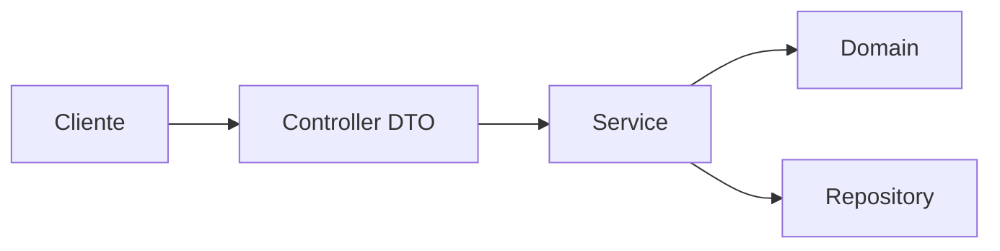

# Módulo 20: Proyecto integrador con Spring Boot

Este módulo integra todo el track: API, DTOs, validación, seguridad, persistencia, transacciones, observabilidad, resiliencia y entrega. El objetivo no es “usar todas las tecnologías”, sino construir un sistema pequeño con decisiones defendibles.

**Entorno de referencia verificado (2026-05-22):** JDK 27.0.1.0.2, Maven 3.10.0, Spring Boot 3.5.0, Docker 29.9.3.

## Aprende construyendo

### Tema 1: Diseño del dominio y contratos · Avanzado · 60 min

Caso guía: sistema de guías con creación, consulta y cambio de estado.

#### Contrato primero

**Definición formal.** Definir DTOs, códigos HTTP, errores, reglas de validación y permisos antes de implementar detalles.

**Entregable mínimo.** Endpoint `POST /guias`, `GET /guias/{id}`, modelo de error, auth requerida.



**Error común.** Empezar por entidad JPA y exponerla. Corrección: contrato y dominio primero.

### Tema 2: Persistencia, transacciones y migraciones · Avanzado · 60 min

Caso guía: crear guía y auditoría en la misma transacción.

#### Persistencia confiable

**Definición formal.** Usar repositorios, transacciones delimitadas, migraciones Flyway y consultas eficientes.

**Regla.** Integridad en DB + transacciones en servicio + migraciones versionadas.

**Error común.** `ddl-auto=create` en prod. Corrección: Flyway/Liquibase.

### Tema 3: Seguridad, observabilidad y resiliencia · Avanzado · 60 min

Caso guía: endpoint protegido, logs con correlation, timeout/retry en integración externa.

#### Operabilidad

**Definición formal.** Seguridad (authn/authz), observabilidad (logs/métricas/health) y resiliencia (timeouts/retries/circuit breaker) son requisitos del sistema.

**Error común.** Agregar observabilidad al final. Corrección: instrumentar desde el inicio.

### Tema 4: Smoke end-to-end y entrega · Avanzado · 60 min

Caso guía: arrancar app, crear guía, consultar, verificar health.

#### Smoke E2E

**Definición formal.** Prueba mínima que valida el flujo crítico en un entorno cercano al real.

**Ejemplo mínimo (comandos).**

```bash
mvn -q -DskipTests package
java -jar target/app.jar
curl -s http://localhost:8080/actuator/health
```

**Error común.** “Funciona en mi máquina” sin smoke reproducible. Corrección: script/comandos y evidencia.

**Nota de verificación.** El smoke completo depende del proyecto integrador construido por el estudiante; aquí se define el contrato de verificación.

## Cierre

Un integrador Spring Boot profesional no se mide por cantidad de anotaciones, sino por contratos claros, seguridad, datos confiables y operación observable.

## Checklist

- Contratos DTO + validación + errores.
- Persistencia con tx y migraciones.
- Seguridad en backend.
- Métricas/logs/health.
- Smoke E2E reproducible.
