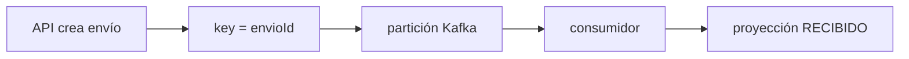
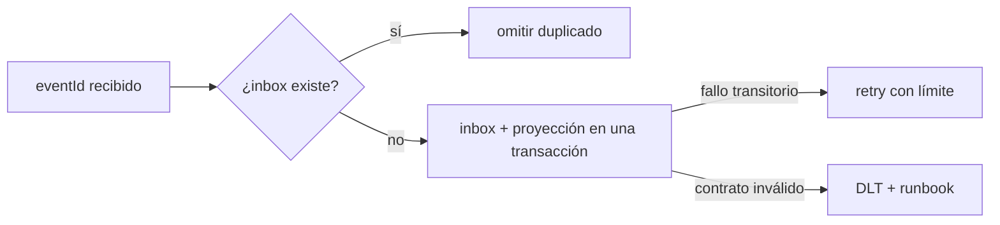
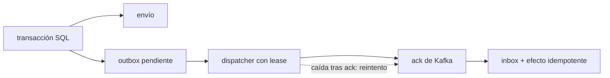

# Módulo 21: Apache Kafka con Spring Boot — eventos, consumidores y recuperación

## Aprende construyendo

Vas a seguir un envío desde una API hasta una proyección de ruteo. Primero entenderás productor, contrato, key, particiones y consumer groups; después provocarás duplicados y errores; al final cerrarás la ventana entre PostgreSQL y Kafka con outbox/inbox.

Cada práctica parte de una carpeta vacía: generarás el proyecto Maven y escribirás manualmente el contrato, el esquema SQL, la configuración, Compose y las pruebas. Las pruebas usan Kafka embebido y H2; el flujo manual con PostgreSQL y el broker de Compose requiere contenedores.

No se promete “exactly once” entre Kafka y PostgreSQL. El objetivo es entender la entrega al menos una vez, hacer los efectos SQL idempotentes y recuperar fallos sin perder silenciosamente eventos.

### Tema 1: Productor, tópico, key y consumidor · Experto · 1 h 20 min

**Prerrequisito:** Java básico, records, UUID, HTTP y transacciones SQL; JDK 27+, Maven 3.9+ y Docker Compose v2 o Podman Compose. Si aún no conoces `@Transactional`, revisa el módulo anterior del track Spring Boot antes de continuar.

**Al terminar podrás:** seguir un `EnvioCreado` desde el outbox hasta el consumer group `rutaflow-ruteo`, explicar qué orden conserva Kafka y observar la partición, el offset y la key reales.

#### Aprende

Al crear un envío, el servicio de ruteo necesita enterarse sin bloquear la respuesta de la API con una llamada síncrona a otro servicio. El productor publica un evento y cada grupo interesado mantiene su propia posición de lectura.

**¿Por qué es importante?** Elegir la key determina qué eventos comparten partición y orden. Sin observar key, partición y offset, un envío fuera de secuencia puede confundirse con un fallo del negocio. Separar productor y consumidores permite desplegarlos y escalarlos por separado; a cambio, el sistema debe aceptar retrasos, reentregas, cambios de contrato y fallos parciales.

**Mapa de subtemas críticos**

| Subtema | Papel | Evidencia |
|---|---|---|
| Transacciones SQL y `@Transactional` | Prerrequisito | `CrearEnvioService.crear` guarda `envio` y `outbox_event` bajo `@Transactional` |
| Key del agregado (`envioId`) | Núcleo | `kafka.send(topic, evento.envioId().toString(), evento)` fija la key en `EnvioEventPublisher` |
| Partición y offset observables | Núcleo | el log `key={} partition={} offset={}` de `RuteoListener` muestra los tres valores |
| Consumer group `rutaflow-ruteo` | Variante | `group-id: rutaflow-ruteo` en `application.yml` y dos grupos distintos leen el flujo por separado |
| Orden por partición, no global | Límite | la Pista: "el orden que Kafka garantiza es por partición" |
| Key equivocada rompe el orden por envío | Error frecuente | el fallo deliberado cambia la key a `eventId` y ya no se infiere orden por agregado |
| Instancias vs. número de particiones | Decisión | `@EmbeddedKafka(partitions = 3 ...)` y "más instancias que particiones no dan más paralelismo" |
| Serialización JSON del contrato | Diagnóstico | `JacksonJsonSerializer`/`JacksonJsonDeserializer` reconstruyen `EnvioCreado` en el consumidor |

Cada fila tiene su explicación individual a continuación.

**Transacciones SQL y `@Transactional` (prerrequisito).** El tema asume que ya sabes agrupar escrituras en una transacción: `CrearEnvioService.crear` inserta `envio` y `outbox_event` dentro de un método anotado con `@Transactional`, de modo que ambas filas se confirman juntas o ninguna. Sin este prerrequisito no se entiende por qué el publicador espera al commit antes de enviar. El propio prerrequisito del tema remite al módulo anterior si no conoces `@Transactional`.

**Key del agregado (`envioId`) (núcleo).** La key decide la partición destino: `EnvioEventPublisher` publica con `evento.envioId().toString()` para que todos los eventos del mismo envío caigan en la misma partición y conserven su orden. El mecanismo es el particionador predeterminado, que asigna la misma key a la misma partición mientras no cambien las condiciones de particionado. Elegir una key aleatoria rompería esta garantía de orden por agregado.

**Partición y offset observables (núcleo).** `RuteoListener.recibir` registra `key`, `partition` y `offset` del `ConsumerRecord` tras procesar, lo que convierte supuestos en datos verificables. El offset es la posición de lectura del grupo en esa partición, no un acuse del efecto SQL. Observar estos campos permite que la prueba compruebe la key real en lugar de una key supuesta.

**Consumer group `rutaflow-ruteo` (variante).** El `group-id: rutaflow-ruteo` define qué instancias comparten las particiones de un tópico; dos grupos distintos leen cada uno el flujo completo con su propio cursor. La variante clave es que grupos separados avanzan de forma independiente, mientras que instancias del mismo grupo se reparten particiones. La práctica pide levantar dos instancias del mismo grupo y luego otra con grupo distinto para observar la diferencia tras el rebalanceo.

**Orden por partición, no global (límite).** Kafka garantiza orden dentro de una partición, nunca entre particiones distintas, como recuerda la Pista del tema. El límite es que no existe un orden total del tópico, así que no puedes inferir secuencia global entre agregados. Cambiar el número de particiones puede reasignar una key, por lo que la partición no sirve como identidad de negocio persistente.

**Key equivocada rompe el orden por envío (error frecuente).** El fallo deliberado cambia temporalmente la key de `envioId` a `eventId` y publica varias ocurrencias del mismo envío: al compararse las particiones, ya no se puede inferir orden por agregado. El error típico es usar una key aleatoria y después esperar orden por envío. Restaurar `envioId` recupera la garantía, lo que demuestra causalmente que la key, y no la proyección, controla el orden.

**Instancias vs. número de particiones (decisión).** La prueba usa `@EmbeddedKafka(partitions = 3 ...)` y el texto advierte que más instancias que particiones no dan más paralelismo para ese tópico. La decisión operativa es dimensionar consumidores comparando su número con las particiones antes de escalar. Si una segunda instancia del mismo grupo no recibe nada, el síntoma apunta a este límite, no a un fallo de negocio.

**Serialización JSON del contrato (diagnóstico).** Kafka almacena bytes; `JacksonJsonSerializer` convierte el record a JSON en el productor y `JacksonJsonDeserializer` lo reconstruye como `EnvioCreado` en el consumidor, guiado por `spring.json.trusted.packages` y `spring.json.value.default.type`. Para diagnosticar problemas de lectura conviene revisar primero esta configuración y el contrato versionado por la aplicación, ya que no hay Schema Registry. Fijar el tipo de destino simplifica el laboratorio, pero no es una política general para aceptar clases arbitrarias desde mensajes externos.

- Un **tópico** es un flujo particionado de registros persistentes.
- Una **key** ayuda al particionador a asignar registros a una partición. Con el particionador predeterminado, la misma key conserva la asignación mientras no cambien las condiciones de particionado; Kafka garantiza orden dentro de una partición, no orden global.
- Un **consumer group** divide las particiones entre sus instancias. Dos grupos distintos leen cada uno el flujo; más instancias que particiones no dan más paralelismo para ese tópico.
- El **offset** es la posición de lectura de un grupo en una partición. No es un acuse universal del efecto SQL que la aplicación produjo.
- Kafka almacena bytes. Spring for Apache Kafka convierte el record Java a JSON en el productor y vuelve a construirlo en el consumidor.

La API del laboratorio guarda primero `envio` y `outbox_event`. El dispatcher publica el evento con `envioId` como key; `RuteoListener` muestra key, partición y offset después del procesamiento. El contrato JSON real es versionado por la aplicación: no hay Schema Registry en este laboratorio.

**Modelo mental:** cada partición es una secuencia ordenada y cada consumer group lleva su propio cursor; el cursor no certifica que un efecto SQL haya ocurrido.

**Analogía:** piensa en una cinta de clasificación con carriles; una key dirige los paquetes del mismo envío al mismo carril. A diferencia de una cinta física, Kafka persiste los registros y cada consumer group conserva su propio offset.

#### Practica

**Desde cero:** parte de una carpeta vacía, genera tu propio proyecto y escribe todos los archivos siguientes. No uses una aplicación ya preparada:

```bash
mkdir ejemplo-kafka-basico
cd ejemplo-kafka-basico
curl -fsSL https://start.spring.io/starter.zip \
  -d dependencies=web,data-jdbc,h2,postgresql,kafka \
  -d javaVersion=27 -d type=maven-project \
  -d groupId=com.academia -d artifactId=rutaflow \
  -d packageName=com.academia.rutaflow -o app.zip
unzip -q app.zip
mkdir -p src/main/java/com/academia/rutaflow/{event,envio,consumer}
```

En el `pom.xml` generado, agrega esta dependencia dentro de `<dependencies>` para poder usar Kafka embebido en las pruebas:

```xml
<dependency>
    <groupId>org.springframework.kafka</groupId>
    <artifactId>spring-kafka-test</artifactId>
    <scope>test</scope>
</dependency>
```

Crea `src/main/java/com/academia/rutaflow/event/EnvioCreado.java` con el contrato completo:

```java
package com.academia.rutaflow.event;

import java.time.Instant;
import java.util.UUID;

public record EnvioCreado(
        // Identifica una ocurrencia concreta para la deduplicación del consumidor.
        UUID eventId,
        // Identifica el agregado; se usa como key para conservar su orden por partición.
        UUID envioId,
        int version,
        Instant occurredAt,
        String referencia) {
}
```

`eventId` identifica una ocurrencia y sirve para deduplicar; `envioId` identifica el agregado y sirve como key para conservar el orden de sus eventos en una partición. `version` y `occurredAt` son parte del contrato, no una garantía automática de compatibilidad.

Crea `src/main/resources/schema.sql`:

```sql
CREATE TABLE IF NOT EXISTS envio (
    id UUID PRIMARY KEY,
    referencia VARCHAR(120) NOT NULL
);
CREATE TABLE IF NOT EXISTS outbox_event (
    event_id UUID PRIMARY KEY,
    aggregate_id UUID NOT NULL,
    payload TEXT NOT NULL,
    published_at TIMESTAMP WITH TIME ZONE
);
CREATE TABLE IF NOT EXISTS event_inbox (
    event_id UUID PRIMARY KEY,
    processed_at TIMESTAMP WITH TIME ZONE NOT NULL
);
CREATE TABLE IF NOT EXISTS route_projection (
    envio_id UUID PRIMARY KEY,
    estado VARCHAR(30) NOT NULL,
    referencia VARCHAR(120) NOT NULL
);
```

Crea `src/main/resources/application.yml`. H2 permite ejecutar las pruebas sin contenedores; el flujo manual recibirá la URL de PostgreSQL por variables de entorno:

```yaml
spring:
  datasource:
    url: jdbc:h2:mem:rutaflow;DB_CLOSE_DELAY=-1;MODE=PostgreSQL
    username: sa
    password:
  sql:
    init:
      mode: always
  kafka:
    bootstrap-servers: ${KAFKA_BOOTSTRAP_SERVERS:localhost:9092}
    producer:
      key-serializer: org.apache.kafka.common.serialization.StringSerializer
      value-serializer: org.springframework.kafka.support.serializer.JacksonJsonSerializer
    consumer:
      group-id: rutaflow-ruteo
      auto-offset-reset: earliest
      key-deserializer: org.apache.kafka.common.serialization.StringDeserializer
      value-deserializer: org.springframework.kafka.support.serializer.JacksonJsonDeserializer
      properties:
        spring.json.trusted.packages: com.academia.rutaflow.event
        spring.json.value.default.type: com.academia.rutaflow.event.EnvioCreado
app:
  topic:
    envio-creado: rutaflow.envio.creado
```

Crea `src/main/java/com/academia/rutaflow/envio/CrearEnvioService.java`. La escritura del envío y su outbox comparten transacción; el evento local se publica dentro de ella y el publicador esperará al commit:

```java
package com.academia.rutaflow.envio;

import com.academia.rutaflow.event.EnvioCreado;
import org.springframework.context.ApplicationEventPublisher;
import org.springframework.jdbc.core.JdbcTemplate;
import org.springframework.stereotype.Service;
import org.springframework.transaction.annotation.Transactional;
import tools.jackson.databind.ObjectMapper;

import java.time.Instant;
import java.util.UUID;

@Service
public class CrearEnvioService {
    private final JdbcTemplate jdbc;
    private final ApplicationEventPublisher publisher;
    private final ObjectMapper mapper;

    public CrearEnvioService(JdbcTemplate jdbc, ApplicationEventPublisher publisher, ObjectMapper mapper) {
        this.jdbc = jdbc;
        this.publisher = publisher;
        this.mapper = mapper;
    }

    @Transactional
    public EnvioCreado crear(String referencia) {
        if (referencia == null || referencia.isBlank()) {
            throw new IllegalArgumentException("La referencia es obligatoria");
        }
        UUID envioId = UUID.randomUUID();
        EnvioCreado evento = new EnvioCreado(
            UUID.randomUUID(), envioId, 1, Instant.now(), referencia);
        String payload;
        try {
            payload = mapper.writeValueAsString(evento);
        } catch (Exception e) {
            throw new IllegalStateException("No se pudo serializar el evento", e);
        }
        jdbc.update("INSERT INTO envio(id, referencia) VALUES (?, ?)", envioId, referencia);
        jdbc.update("""
            INSERT INTO outbox_event(event_id, aggregate_id, payload)
            VALUES (?, ?, ?)
            """, evento.eventId(), envioId, payload);
        publisher.publishEvent(evento);
        return evento;
    }
}
```

Crea `src/main/java/com/academia/rutaflow/event/EnvioEventPublisher.java`. En este primer incremento publica después del commit; el Tema 3 sustituirá esta entrega inmediata por un dispatcher recuperable:

```java
package com.academia.rutaflow.event;

import org.springframework.beans.factory.annotation.Value;
import org.springframework.jdbc.core.JdbcTemplate;
import org.springframework.kafka.core.KafkaTemplate;
import org.springframework.stereotype.Component;
import org.springframework.transaction.event.TransactionPhase;
import org.springframework.transaction.event.TransactionalEventListener;

@Component
public class EnvioEventPublisher {
    private final KafkaTemplate<String, EnvioCreado> kafka;
    private final JdbcTemplate jdbc;
    private final String topic;

    public EnvioEventPublisher(KafkaTemplate<String, EnvioCreado> kafka, JdbcTemplate jdbc,
            @Value("${app.topic.envio-creado}") String topic) {
        this.kafka = kafka;
        this.jdbc = jdbc;
        this.topic = topic;
    }

    @TransactionalEventListener(phase = TransactionPhase.AFTER_COMMIT)
    public void publicar(EnvioCreado evento) {
        kafka.send(topic, evento.envioId().toString(), evento)
            .whenComplete((result, error) -> {
                if (error == null) {
                    jdbc.update("UPDATE outbox_event SET published_at = CURRENT_TIMESTAMP WHERE event_id = ?",
                        evento.eventId());
                }
            });
    }
}
```

Crea `src/main/java/com/academia/rutaflow/consumer/RuteoService.java` con deduplicación y efecto SQL en la misma transacción:

```java
package com.academia.rutaflow.consumer;

import com.academia.rutaflow.event.EnvioCreado;
import org.springframework.jdbc.core.JdbcTemplate;
import org.springframework.stereotype.Service;
import org.springframework.transaction.annotation.Transactional;

@Service
public class RuteoService {
    private final JdbcTemplate jdbc;

    public RuteoService(JdbcTemplate jdbc) { this.jdbc = jdbc; }

    @Transactional
    public boolean procesar(EnvioCreado evento) {
        if (evento.referencia() == null || evento.referencia().isBlank()) {
            throw new IllegalArgumentException("Evento inválido: referencia vacía");
        }
        Integer existentes = jdbc.queryForObject(
            "SELECT COUNT(*) FROM event_inbox WHERE event_id = ?", Integer.class, evento.eventId());
        if (existentes != null && existentes > 0) return false;
        jdbc.update("INSERT INTO event_inbox(event_id, processed_at) VALUES (?, CURRENT_TIMESTAMP)",
            evento.eventId());
        jdbc.update("""
            INSERT INTO route_projection(envio_id, estado, referencia)
            VALUES (?, 'RECIBIDO', ?)
            """, evento.envioId(), evento.referencia());
        return true;
    }
}
```

Crea `src/main/java/com/academia/rutaflow/consumer/RuteoListener.java`. Los campos observables permiten que la prueba compruebe la key real, no una key supuesta:

```java
package com.academia.rutaflow.consumer;

import com.academia.rutaflow.event.EnvioCreado;
import org.apache.kafka.clients.consumer.ConsumerRecord;
import org.slf4j.Logger;
import org.slf4j.LoggerFactory;
import org.springframework.kafka.annotation.KafkaListener;
import org.springframework.stereotype.Component;

import java.util.concurrent.atomic.AtomicReference;

@Component
public class RuteoListener {
    private static final Logger log = LoggerFactory.getLogger(RuteoListener.class);
    private final RuteoService servicio;
    private final AtomicReference<String> ultimaKey = new AtomicReference<>();

    public RuteoListener(RuteoService servicio) { this.servicio = servicio; }

    @KafkaListener(topics = "${app.topic.envio-creado}", groupId = "rutaflow-ruteo")
    public void recibir(ConsumerRecord<String, EnvioCreado> record) {
        boolean aplicado = servicio.procesar(record.value());
        ultimaKey.set(record.key());
        log.info("key={} partition={} offset={} aplicado={}",
            record.key(), record.partition(), record.offset(), aplicado);
    }

    public String ultimaKey() { return ultimaKey.get(); }
}
```

Crea `src/main/java/com/academia/rutaflow/envio/EnvioController.java`:

```java
package com.academia.rutaflow.envio;

import com.academia.rutaflow.event.EnvioCreado;
import org.springframework.http.HttpStatus;
import org.springframework.http.ResponseEntity;
import org.springframework.jdbc.core.JdbcTemplate;
import org.springframework.web.bind.annotation.ExceptionHandler;
import org.springframework.web.bind.annotation.GetMapping;
import org.springframework.web.bind.annotation.PathVariable;
import org.springframework.web.bind.annotation.PostMapping;
import org.springframework.web.bind.annotation.RequestBody;
import org.springframework.web.bind.annotation.ResponseStatus;
import org.springframework.web.bind.annotation.RestController;
import org.springframework.web.server.ResponseStatusException;

import java.util.List;
import java.util.Map;
import java.util.UUID;

@RestController
public class EnvioController {
    private final CrearEnvioService crear;
    private final JdbcTemplate jdbc;

    public EnvioController(CrearEnvioService crear, JdbcTemplate jdbc) {
        this.crear = crear;
        this.jdbc = jdbc;
    }

    @PostMapping("/envios")
    public ResponseEntity<Map<String, UUID>> crear(@RequestBody Map<String, String> body) {
        EnvioCreado evento = crear.crear(body.get("referencia"));
        return ResponseEntity.accepted().body(Map.of(
            "envioId", evento.envioId(), "eventId", evento.eventId()));
    }

    @GetMapping("/envios/{id}/ruta")
    public Map<String, Object> ruta(@PathVariable UUID id) {
        List<Map<String, Object>> filas = jdbc.queryForList(
            "SELECT envio_id, estado, referencia FROM route_projection WHERE envio_id = ?", id);
        if (filas.isEmpty()) throw new ResponseStatusException(HttpStatus.NOT_FOUND);
        return filas.getFirst();
    }

    @ExceptionHandler(IllegalArgumentException.class)
    @ResponseStatus(HttpStatus.BAD_REQUEST)
    public Map<String, String> solicitudInvalida(IllegalArgumentException error) {
        return Map.of("error", error.getMessage());
    }
}
```

Crea `compose.yaml` para el flujo manual con un broker KRaft y PostgreSQL:

```yaml
services:
  postgres:
    image: postgres:16-alpine
    environment:
      POSTGRES_DB: rutaflow
      POSTGRES_USER: rutaflow
      POSTGRES_PASSWORD: rutaflow
    ports: ["5432:5432"]
  kafka:
    image: apache/kafka:4.0.0
    ports: ["9092:9092"]
    environment:
      KAFKA_NODE_ID: 1
      KAFKA_PROCESS_ROLES: broker,controller
      KAFKA_LISTENERS: PLAINTEXT://:9092,CONTROLLER://:9093
      KAFKA_ADVERTISED_LISTENERS: PLAINTEXT://localhost:9092
      KAFKA_CONTROLLER_LISTENER_NAMES: CONTROLLER
      KAFKA_LISTENER_SECURITY_PROTOCOL_MAP: CONTROLLER:PLAINTEXT,PLAINTEXT:PLAINTEXT
      KAFKA_CONTROLLER_QUORUM_VOTERS: 1@localhost:9093
      KAFKA_OFFSETS_TOPIC_REPLICATION_FACTOR: 1
      KAFKA_TRANSACTION_STATE_LOG_REPLICATION_FACTOR: 1
      KAFKA_TRANSACTION_STATE_LOG_MIN_ISR: 1
      KAFKA_GROUP_INITIAL_REBALANCE_DELAY_MS: 0
      KAFKA_NUM_PARTITIONS: 3
```

Crea `src/test/java/com/academia/rutaflow/KafkaFlowIntegrationTest.java` con esta primera prueba completa:

```java
package com.academia.rutaflow;

import com.academia.rutaflow.consumer.RuteoListener;
import com.academia.rutaflow.envio.CrearEnvioService;
import org.junit.jupiter.api.Test;
import org.springframework.beans.factory.annotation.Autowired;
import org.springframework.boot.test.context.SpringBootTest;
import org.springframework.jdbc.core.JdbcTemplate;
import org.springframework.kafka.test.context.EmbeddedKafka;
import org.springframework.test.annotation.DirtiesContext;

import java.time.Duration;

import static org.assertj.core.api.Assertions.assertThat;
import static org.awaitility.Awaitility.await;

@SpringBootTest(properties = "spring.kafka.bootstrap-servers=${spring.embedded.kafka.brokers}")
@EmbeddedKafka(partitions = 3, topics = "rutaflow.envio.creado")
@DirtiesContext
class KafkaFlowIntegrationTest {
    @Autowired CrearEnvioService crear;
    @Autowired RuteoListener listener;
    @Autowired JdbcTemplate jdbc;

    @Test
    void outboxPublishesWithAggregateKeyAndConsumerAppliesEffectOnce() {
        var evento = crear.crear("RF-TEST");

        await().atMost(Duration.ofSeconds(15)).untilAsserted(() -> {
            assertThat(listener.ultimaKey()).isEqualTo(evento.envioId().toString());
            Integer filas = jdbc.queryForObject(
                "SELECT COUNT(*) FROM route_projection WHERE envio_id = ?",
                Integer.class, evento.envioId());
            assertThat(filas).isEqualTo(1);
        });
    }
}
```

Ejecuta primero la prueba, que usa Kafka embebido y H2 y no necesita Docker:

```bash
mvn test -Dtest=KafkaFlowIntegrationTest#outboxPublishesWithAggregateKeyAndConsumerAppliesEffectOnce
```

Para el recorrido HTTP manual, inicia los contenedores y arranca la aplicación con PostgreSQL:

```bash
docker compose up -d --wait
SPRING_DATASOURCE_URL=jdbc:postgresql://localhost:5432/rutaflow \
SPRING_DATASOURCE_USERNAME=rutaflow \
SPRING_DATASOURCE_PASSWORD=rutaflow \
mvn spring-boot:run
```

Con la aplicación en marcha, abre otra terminal y publica un envío:

```bash
curl -i -X POST http://localhost:8080/envios \
  -H 'Content-Type: application/json' \
  -d '{"referencia":"RF-0001"}'
```

**Qué observar:** el endpoint responde `202 Accepted` con `envioId` y `eventId`. Copia el `envioId` de la respuesta y consulta la proyección:

```bash
curl http://localhost:8080/envios/PEGA_AQUI_EL_ENVIO_ID/ruta
```

Reemplaza `PEGA_AQUI_EL_ENVIO_ID` por el UUID de la respuesta anterior. La consulta puede dar `404` hasta que el consumidor procese el mensaje; después incluye `"estado":"RECIBIDO"`. Los logs de Spring muestran `key`, `partition` y `offset`. La asignación puede variar entre envíos, pero los eventos con la misma key van a la misma partición.

**Resultado esperado:** la API responde `202`, el consumer group registra el envío y la consulta de ruta muestra `RECIBIDO`. **Fallo deliberado:** envía una referencia vacía; diagnostica el error `400` y comprueba que la API no crea un envío. Luego cambia temporalmente la key de `envioId` a `eventId` en `EnvioEventPublisher`, publica varias ocurrencias del mismo envío y compara las particiones: ya no puedes inferir orden por agregado. Restaura `envioId`.

Para detener la aplicación, usa `Ctrl+C`; para bajar los contenedores, desde esta carpeta:

```bash
docker compose down
```

1. Publica varios envíos y anota `envioId`, key, partición y offset del log.
2. Repite la prueba de integración y confirma que la key observada es el UUID del agregado y que el efecto llega a SQL.
3. Cambia la key temporalmente; predice qué orden deja de preservarse y confirma la predicción observando particiones.
4. Levanta dos instancias del consumidor con el mismo `group-id` y después otra con un grupo distinto. Antes de concluir, espera a que termine el rebalanceo y verifica qué grupos reciben cada record.

**Pista:** el orden que Kafka garantiza es por partición. Cambiar el número de particiones puede cambiar la asignación de una key; no uses la partición como identidad de negocio persistente.

**Si falla.** Si la proyección sigue en `404`, espera a que el consumidor procese y revisa el `group-id` y la conexión del listener antes de suponer un error de negocio. Si dos eventos del mismo agregado aparecen desordenados, la key no es `envioId`. Si la segunda instancia del consumidor no recibe nada, compárala con el número de particiones: no hay paralelismo adicional por encima de ese límite. Si dos grupos distintos no reciben ambos el flujo, están usando el mismo `group-id`.

#### Aplica

En el proyecto que acabas de crear, añade `src/test/java/com/academia/rutaflow/ContratoEnvioCreadoTest.java`. Comprueba que el JSON de `EnvioCreado` conserva `eventId`, `envioId`, `version`, `occurredAt` y `referencia`, y documenta cómo leerían el evento una versión anterior y una nueva del consumidor. Ejecuta `mvn test` y guarda el test, el log y la respuesta HTTP como evidencia.

No elimines ni renombres campos del contrato sin probar antes ambos lados. Este proyecto fija el tipo de destino para enseñar una configuración simple; no es una política general para aceptar clases arbitrarias desde mensajes externos.



**Proyecto integrador:** conserva en RutaFlow el contrato `EnvioCreado`, publica con `envioId` como key y verifica que la proyección consultable refleja exactamente una creación.

**Checklist de salida.**

- [ ] El proyecto `ejemplo-kafka-basico`, creado desde una carpeta vacía, pasa `mvn test` y arranca con el broker de Compose.
- [ ] La API responde `202` con `envioId` y `eventId` para `RF-0001`.
- [ ] La proyección consultada por `envioId` llega a `"estado":"RECIBIDO"`.
- [ ] El log muestra key, partición y offset del record.
- [ ] `KafkaFlowIntegrationTest#outboxPublishesWithAggregateKeyAndConsumerAppliesEffectOnce` pasa y demuestra la key del agregado.
- [ ] Una referencia vacía produce `400` y no crea envío.
- [ ] El test `ContratoEnvioCreadoTest` conserva los cinco campos y documenta lectura anterior y nueva.

**Si falla.** Si `mvn test` no arranca, comprueba JDK 27+, Maven 3.9+ y que estás dentro de `ejemplo-kafka-basico`. Si el broker no levanta, revisa Docker Compose v2 y el archivo `compose.yaml` que escribiste. Si el consumidor no recibe después de cambiar la key, vuelve a la versión con `envioId`: el problema está en el particionado, no en la proyección.

Debes poder mostrar la respuesta `202`, la proyección `RECIBIDO`, el test de key y un log con partición/offset; explica qué cambia al usar `eventId` como key. Explica por qué dos grupos reciben el flujo por separado y por qué no existe orden global entre particiones. Conserva este contrato y usa el mismo `eventId` al estudiar reintentos e inbox en el Tema 2. **Cuándo no usar Kafka:** no lo agregues para una operación interna que necesita una respuesta inmediata y no requiere desacoplamiento durable; una llamada HTTP puede ser más simple.

**Errores comunes:** usar una key aleatoria y luego esperar orden por envío; interpretar `auto-offset-reset: earliest` como rebobinado de un grupo existente; o escalar consumidores sin comparar su número con las particiones.

**Fuente oficial:** [Spring Boot: Kafka](https://docs.spring.io/spring-boot/reference/messaging/kafka.html), [Spring Kafka: serialización JSON](https://docs.spring.io/spring-kafka/reference/kafka/serdes.html) y [Apache Kafka: conceptos](https://kafka.apache.org/documentation/#intro_concepts_and_terms).

### Tema 2: Reintentos, DLT, entrega al menos una vez e idempotencia · Experto · 1 h 50 min

**Prerrequisito:** el contrato, la key y el listener creados manualmente en el Tema 1.

**Al terminar podrás:** distinguir un evento inválido de un fallo transitorio, enviar un mensaje irrecuperable a DLT y demostrar que recibir dos veces el mismo `eventId` no repite el efecto SQL.

#### Aprende

**Caso real:** el consumidor puede confirmar el cambio de proyección y caer antes de que Kafka confirme el offset. El mismo evento vuelve a entregarse. En otro caso, un mensaje inválido falla cada vez: esperar no repara un contrato que no puede procesarse.

**¿Por qué es importante?** Una entrega repetida puede duplicar un efecto de negocio; un mensaje defectuoso puede detener el avance. Distinguir fallos temporales, permanentes y duplicados permite recuperar el flujo conservando evidencia: sin deduplicación, una reentrega puede duplicar asignaciones, cargos o notificaciones; sin una ruta de recuperación, un mensaje venenoso puede bloquear el avance.

**Mapa de subtemas críticos**

| Subtema | Papel | Evidencia |
|---|---|---|
| Contrato y key del Tema 1 | Prerrequisito | el prerrequisito exige "el contrato, la key y el listener creados manualmente en el Tema 1" |
| Entrega al menos una vez | Núcleo | caída "en la ventana entre efecto y commit del offset" hace que Kafka vuelva a llamar al handler |
| Inbox idempotente (`event_inbox`) | Núcleo | `event_id` es clave primaria y el handler inserta inbox y proyección en la misma transacción |
| Reintentos con `FixedBackOff(1000, 2)` | Variante | `new DefaultErrorHandler(recoverer, new FixedBackOff(1000, 2))` en `KafkaConfiguration` |
| Error permanente a DLT | Decisión | `handler.addNotRetryableExceptions(InvalidEventException.class)` envía a `rutaflow.envio.creado.DLT` |
| Partición de origen en la DLT | Límite | el recoverer usa `new TopicPartition(topic + ".DLT", record.partition())` |
| `enable.idempotence` del productor | Error frecuente | "protege retransmisiones del productor ... no coordina un commit Kafka con una transacción PostgreSQL" |
| Carrera entre entregas concurrentes | Diagnóstico | la restricción única hace que "una transacción pierde y puede reintentarse" |

Cada fila tiene su explicación individual a continuación.

**Contrato y key del Tema 1 (prerrequisito).** El tema parte del contrato `EnvioCreado`, la key `envioId` y el listener que ya escribiste manualmente en el Tema 1, como indica su prerrequisito. Sin ese `eventId` estable no habría sobre qué deduplicar ni un flujo que reentregar. Por eso la práctica pide regenerar el proyecto y reescribir esos archivos base antes de añadir reintentos.

**Entrega al menos una vez (núcleo).** El listener confirma el offset solo después de que `RuteoService.procesar` retorna, así que una caída en la ventana entre el efecto SQL y el commit del offset hace que Kafka vuelva a llamar al handler. El mecanismo subyacente es que offset y efecto de negocio se confirman por separado. La consecuencia es que el consumidor debe asumir que puede ver el mismo evento más de una vez.

**Inbox idempotente (`event_inbox`) (núcleo).** La tabla `event_inbox` usa `event_id` como clave primaria; el handler comprueba si el evento ya existe y, si no, inserta el ID y actualiza `route_projection` en la misma transacción. El mecanismo convierte una entrega repetida en un no-op observable: `RuteoService.procesar` retorna `false` cuando ya hay registro. El inbox evita repetir el efecto de negocio, pero no borra los duplicados del tópico.

**Reintentos con `FixedBackOff(1000, 2)` (variante).** `DefaultErrorHandler` se configura con `new FixedBackOff(1000, 2)`: un intento inicial y hasta dos reintentos bloqueantes separados por un segundo. Esta es la variante para fallos transitorios, que pueden resolverse esperando. Agotados los reintentos sin reclasificar el error, el registro pasa al recoverer.

**Error permanente a DLT (decisión).** `handler.addNotRetryableExceptions(InvalidEventException.class)` marca el evento inválido como no reintentable, de modo que va directo a `rutaflow.envio.creado.DLT` sin gastar reintentos. La decisión es distinguir un contrato que no puede procesarse de un fallo que podría repararse esperando. Por eso el tema sustituye `IllegalArgumentException` por `InvalidEventException` para la referencia vacía.

**Partición de origen en la DLT (límite).** El `DeadLetterPublishingRecoverer` construye `new TopicPartition(topic + ".DLT", record.partition())`, conservando el número de partición del registro fallido; la DLT tiene tres particiones como el tópico original. El límite es que la DLT es una bandeja de aislamiento para diagnóstico, no una papelera ni un mecanismo de reparación automática. Una persona debe decidir después si corrige, descarta o reproduce el mensaje.

**`enable.idempotence` del productor (error frecuente).** `enable.idempotence` protege retransmisiones del productor dentro de las garantías de Kafka, pero no coordina un commit de Kafka con una transacción de PostgreSQL. El error frecuente es creer que esa opción da "exactly once" entre el broker y la base de datos. La deduplicación de negocio sigue dependiendo del inbox, no de esta configuración del productor.

**Carrera entre entregas concurrentes (diagnóstico).** La clave primaria de `event_inbox` protege también contra dos entregas simultáneas del mismo `event_id`: si hay carrera, una transacción pierde al insertar y puede reintentarse, y la siguiente lectura ya verá el evento confirmado. Para diagnosticar un duplicado no es necesario bloqueo explícito: la restricción única basta. Así se decide entre reintentar la transacción perdedora o tratar el evento como ya aplicado.

En este laboratorio, el listener confirma el offset después de que `RuteoService.procesar` retorna; el servicio usa una transacción SQL para escribir inbox y proyección. Si el proceso cae en la ventana entre efecto y commit del offset, Kafka puede volver a llamar al handler.

La tabla `event_inbox` tiene `event_id` como clave primaria. El handler consulta si ya existe y, si no, inserta inbox y actualiza la proyección en la misma transacción. La restricción única protege también contra dos entregas concurrentes: si hay una carrera, una transacción pierde y puede reintentarse; la siguiente lectura ya verá el evento confirmado.

`DefaultErrorHandler` usa `FixedBackOff(1000, 2)`: un intento inicial y hasta dos reintentos. `InvalidEventException` se clasifica como no reintentable y se envía directamente a `rutaflow.envio.creado.DLT`. La DLT tiene tres particiones para conservar el número del tópico original, y el recoverer mantiene la partición de origen.

`enable.idempotence` protege retransmisiones del productor dentro de las garantías de Kafka; no coordina un commit Kafka con una transacción PostgreSQL. Inbox evita repetir un efecto de negocio, pero no elimina los duplicados del tópico.

**Modelo mental:** el inbox es el registro de “eventos ya aplicados”; la DLT es una bandeja de aislamiento, no una papelera ni un mecanismo automático de reparación.

**Analogía:** la DLT se parece a una bandeja de excepción que conserva el paquete para diagnóstico. A diferencia del flujo normal, una persona debe decidir si corrige, descarta o reproduce el mensaje.

#### Practica

Parte otra vez de una carpeta vacía. Genera un proyecto nuevo y vuelve a escribir manualmente los archivos base del Tema 1 (`pom.xml` con `spring-kafka-test`, `application.yml`, `schema.sql`, contrato, servicio de creación, publicador, consumidor y prueba); no copies ninguna aplicación preparada:

```bash
mkdir ejemplo-kafka-reintentos
cd ejemplo-kafka-reintentos
curl -fsSL https://start.spring.io/starter.zip \
  -d dependencies=web,data-jdbc,h2,postgresql,kafka \
  -d javaVersion=27 -d type=maven-project \
  -d groupId=com.academia -d artifactId=rutaflow \
  -d packageName=com.academia.rutaflow -o app.zip
unzip -q app.zip
mkdir -p src/main/java/com/academia/rutaflow/{config,event,envio,consumer}
```

En `RuteoService.procesar`, conserva este orden: validar, comprobar `event_inbox`, insertar el ID y actualizar `route_projection`. Ambas escrituras permanecen dentro del mismo `@Transactional`. Crea `src/main/java/com/academia/rutaflow/consumer/InvalidEventException.java` y úsala para la referencia vacía en lugar de `IllegalArgumentException`:

```java
package com.academia.rutaflow.consumer;

public class InvalidEventException extends RuntimeException {
    public InvalidEventException(String message) { super(message); }
}
```

Crea `src/main/java/com/academia/rutaflow/config/KafkaConfiguration.java` con dos reintentos bloqueantes, clasificación del error permanente y recoverer de DLT:

```java
package com.academia.rutaflow.config;

import com.academia.rutaflow.consumer.InvalidEventException;
import com.academia.rutaflow.event.EnvioCreado;
import org.apache.kafka.common.TopicPartition;
import org.springframework.beans.factory.annotation.Value;
import org.springframework.context.annotation.Bean;
import org.springframework.context.annotation.Configuration;
import org.springframework.kafka.core.KafkaOperations;
import org.springframework.kafka.listener.DeadLetterPublishingRecoverer;
import org.springframework.kafka.listener.DefaultErrorHandler;
import org.springframework.util.backoff.FixedBackOff;

@Configuration
public class KafkaConfiguration {
    @Bean
    DefaultErrorHandler errorHandler(KafkaOperations<String, EnvioCreado> kafka,
            @Value("${app.topic.envio-creado}") String topic) {
        DeadLetterPublishingRecoverer recoverer = new DeadLetterPublishingRecoverer(kafka,
            (record, error) -> new TopicPartition(topic + ".DLT", record.partition()));
        recoverer.setFailIfSendResultIsError(true);
        DefaultErrorHandler handler = new DefaultErrorHandler(recoverer, new FixedBackOff(1000, 2));
        handler.addNotRetryableExceptions(InvalidEventException.class);
        return handler;
    }
}
```

`FixedBackOff(1000, 2)` significa un intento inicial y hasta dos reintentos. `InvalidEventException` va directamente a `rutaflow.envio.creado.DLT`; conservar la partición de origen evita cambiar innecesariamente el carril del registro fallido.

Para poder estudiar JSON malformado sin transformar sus bytes, crea `src/main/java/com/academia/rutaflow/config/EventOrBytesSerializer.java`:

```java
package com.academia.rutaflow.config;

import org.apache.kafka.common.serialization.Serializer;
import org.springframework.kafka.support.serializer.JacksonJsonSerializer;

import java.util.Map;

public class EventOrBytesSerializer implements Serializer<Object> {
    private final JacksonJsonSerializer delegate = new JacksonJsonSerializer();

    @Override
    public void configure(Map<String, ?> configs, boolean isKey) {
        delegate.configure(configs, isKey);
    }

    @Override
    public byte[] serialize(String topic, Object data) {
        if (data instanceof byte[] bytes) return bytes;
        return delegate.serialize(topic, data);
    }

    @Override
    public void close() { delegate.close(); }
}
```

En `application.yml`, cambia `spring.kafka.producer.value-serializer` a `com.academia.rutaflow.config.EventOrBytesSerializer`. En `@EmbeddedKafka` de tu prueba, declara ambos tópicos:

```java
@EmbeddedKafka(partitions = 3,
    topics = {"rutaflow.envio.creado", "rutaflow.envio.creado.DLT"})
```

En `RuteoListener`, agrega un `AtomicReference<Boolean>` llamado `ultimoResultado`, actualízalo con el valor devuelto por `servicio.procesar(record.value())` y expón un getter. Esto permite esperar hasta que la segunda copia haya sido efectivamente reconocida como duplicada:

```java
private final AtomicReference<Boolean> ultimoResultado = new AtomicReference<>();

// Dentro de recibir, procesa una sola vez y conserva el resultado:
boolean aplicado = servicio.procesar(record.value());
ultimoResultado.set(aplicado);

public Boolean ultimoResultado() { return ultimoResultado.get(); }
```

Amplía `src/test/java/com/academia/rutaflow/KafkaFlowIntegrationTest.java` con las dependencias y los dos escenarios siguientes. La prueba de duplicado vuelve a publicar exactamente el mismo evento; la de DLT usa un consumidor independiente para observar el registro recuperado:

```java
// Campos adicionales de KafkaFlowIntegrationTest:
@Autowired org.springframework.kafka.core.KafkaTemplate<String, com.academia.rutaflow.event.EnvioCreado> kafka;
@Autowired org.springframework.kafka.test.EmbeddedKafkaBroker broker;

@Test
void duplicateEventDoesNotRepeatSqlEffect() throws Exception {
    var evento = crear.crear("RF-DUP");
    await().atMost(Duration.ofSeconds(15)).until(() -> Boolean.TRUE.equals(listener.ultimoResultado()));

    kafka.send("rutaflow.envio.creado", evento.envioId().toString(), evento).get();

    await().atMost(Duration.ofSeconds(15)).until(() -> Boolean.FALSE.equals(listener.ultimoResultado()));
    assertThat(jdbc.queryForObject(
        "SELECT COUNT(*) FROM event_inbox WHERE event_id = ?", Integer.class, evento.eventId()))
        .isEqualTo(1);
    assertThat(jdbc.queryForObject(
        "SELECT COUNT(*) FROM route_projection WHERE envio_id = ?", Integer.class, evento.envioId()))
        .isEqualTo(1);
}

@Test
void invalidEventIsRecoveredToDeadLetterTopic() throws Exception {
    var evento = new com.academia.rutaflow.event.EnvioCreado(
        java.util.UUID.randomUUID(), java.util.UUID.randomUUID(), 1,
        java.time.Instant.now(), "   ");
    kafka.send("rutaflow.envio.creado", evento.envioId().toString(), evento).get();

    var props = org.springframework.kafka.test.utils.KafkaTestUtils.consumerProps(
        "dlt-test-" + java.util.UUID.randomUUID(), "true", broker);
    props.put(org.apache.kafka.clients.consumer.ConsumerConfig.KEY_DESERIALIZER_CLASS_CONFIG,
        org.apache.kafka.common.serialization.StringDeserializer.class);
    props.put(org.apache.kafka.clients.consumer.ConsumerConfig.VALUE_DESERIALIZER_CLASS_CONFIG,
        org.springframework.kafka.support.serializer.JacksonJsonDeserializer.class);
    props.put(org.springframework.kafka.support.serializer.JsonDeserializer.VALUE_DEFAULT_TYPE,
        com.academia.rutaflow.event.EnvioCreado.class.getName());
    props.put(org.springframework.kafka.support.serializer.JsonDeserializer.TRUSTED_PACKAGES,
        "com.academia.rutaflow.event");

    try (var consumer = new org.springframework.kafka.core.DefaultKafkaConsumerFactory<String,
            com.academia.rutaflow.event.EnvioCreado>(props).createConsumer()) {
        consumer.subscribe(java.util.List.of("rutaflow.envio.creado.DLT"));
        var records = org.springframework.kafka.test.utils.KafkaTestUtils.getRecords(
            consumer, Duration.ofSeconds(15));
        assertThat(records.count()).isEqualTo(1);
        assertThat(records.iterator().next().value().eventId()).isEqualTo(evento.eventId());
    }
    assertThat(jdbc.queryForObject(
        "SELECT COUNT(*) FROM event_inbox WHERE event_id = ?", Integer.class, evento.eventId()))
        .isZero();
}
```

Ejecuta las pruebas que escribiste; usan Kafka embebido y H2, sin contenedores:

```bash
mvn test -Dtest=KafkaFlowIntegrationTest#duplicateEventDoesNotRepeatSqlEffect
mvn test -Dtest=KafkaFlowIntegrationTest#invalidEventIsRecoveredToDeadLetterTopic
```

**Qué observar:** el duplicado deja una fila inbox y una proyección, y la segunda llamada devuelve `false`. Una referencia compuesta solo por espacios no crea fila inbox y el payload termina en el tópico DLT sin gastar los dos reintentos. Las esperas usan condiciones con timeout, no `Thread.sleep()`.

Agrega ahora un tercer método `transientConsumerFailureRetriesAndThenCommits`: introduce una excepción recuperable solo en la primera entrega, permite que la segunda ejecute el método real y registra el número de llamadas. **Resultado esperado:** el servicio es llamado dos veces, pero solo existe una fila inbox y una proyección; el segundo intento llega aproximadamente un segundo después por `FixedBackOff`.

Comprueba otros dos fallos como ejercicios guiados dentro de la misma clase de prueba:

1. **`malformedJsonKeepsOriginalBytesInDlt`:** publica los 12 bytes de `{broken-json` con un productor `byte[]` y consume la DLT como `byte[]`. `EventOrBytesSerializer` conserva esos bytes; compara el arreglo original con el recuperado. **Fallo deliberado:** sustituye temporalmente el serializador por `JacksonJsonSerializer`; la DLT contendrá JSON/base64 en lugar de los bytes originales y la comparación fallará. Restaura el serializador. `setFailIfSendResultIsError(true)` hace que un fallo al publicar en DLT se propague al manejador.
2. **`projectionFailureRollsBackInboxAndAllowsRedelivery`:** usa una referencia de 121 caracteres para violar el límite SQL de 120 después de insertar el inbox. Verifica **cero filas** en inbox y proyección. Después publica una referencia válida con el mismo ID: se aplica una vez y la siguiente llamada se reconoce como duplicado. Es una reparación de laboratorio; un replay operativo requiere conservar el original y registrar quién autoriza la corrección.

Eliminar la clave primaria y reenviar secuencialmente no demuestra una carrera: el `SELECT` seguiría detectando el ID. Para estudiar concurrencia harían falta dos transacciones que lean la ausencia antes de insertar, una barrera controlada y PostgreSQL real; queda como ampliación. Este ejercicio usa `FixedBackOff` en el consumidor, no tópicos separados con demoras de 5, 10 y 20 segundos.

Spring Kafka también ofrece reintentos no bloqueantes mediante `@RetryableTopic` o `RetryTopicConfiguration`: el registro fallido se republica a uno o más tópicos de retry y finalmente puede llegar a DLT. Esa decisión cambia el orden del tópico principal y tiene restricciones con listeners batch y transacciones del contenedor. Cambiar este ejercicio a retry topics sería una decisión de arquitectura, no una mejora automática. Consulta [Non-Blocking Retries](https://docs.spring.io/spring-kafka/reference/retrytopic.html) y [How the Pattern Works](https://docs.spring.io/spring-kafka/reference/retrytopic/how-the-pattern-works.html). Si implementas la ampliación, prueba el orden de dos eventos con la misma `envioId` y define cómo reconciliar una actualización antigua que salga de retry después de una nueva.

1. Cambia temporalmente la referencia del evento inválido por una válida: predice qué excepción deja de ocurrir y compruébalo.
2. Registra el número de entregas del fallo temporal y verifica el backoff y el máximo de reintentos.
3. En el fallo de proyección, confirma que la transacción revierte ambas escrituras antes de reparar y reenviar.
4. Inspecciona los headers de DLT y redacta un procedimiento de replay que preserve `eventId`, registre motivo/operador y limite el lote. Este ejercicio envía a DLT, pero no implementa un servicio operativo de replay.

**Pista:** el efecto queda protegido porque el inbox y la proyección comparten transacción SQL. Si el listener retorna antes de completar esa transacción, el offset puede avanzar sin que el efecto quede persistido.

**Si falla.** Si el mismo evento escribe dos veces la proyección, el inbox y la proyección no comparten transacción o la consulta del inbox se hace fuera de ella. Si un mensaje inválido se reintenta dos veces antes de la DLT, `InvalidEventException` no está clasificada como no reintentable. Si la DLT contiene un payload mayor que el original, el serializador está transformando los bytes. Si el fallo de proyección deja filas, ocurrió después del commit y debes moverlo antes. Si una prueba de concurrencia no reproduce la carrera con H2, no está probando el bloqueo del motor real.

#### Aplica

En `ejemplo-kafka-reintentos`, crea `src/test/java/com/academia/rutaflow/ConsumerRollbackTest.java`. Inyecta una falla entre el insert de inbox y la actualización de la proyección, y verifica que ambas tablas quedan sin cambios. Después reentrega el mismo evento y demuestra que se procesa una vez.

Entrega también un runbook breve: cómo localizar un evento en DLT, qué datos registrar antes de reproducirlo y cómo detener un replay con errores. No reinyectes mensajes inválidos en un bucle.



**Proyecto integrador:** aplica inbox y DLT al consumidor de envíos de RutaFlow y adjunta pruebas de duplicado, rollback y replay acotado con el mismo `eventId`.

**Checklist de salida.**

- [ ] El proyecto `ejemplo-kafka-reintentos`, creado desde cero, pasa `mvn test` con Kafka embebido y H2.
- [ ] El test de duplicado demuestra una sola fila inbox y una sola proyección.
- [ ] La segunda llamada a `procesar` devuelve `false` por duplicado.
- [ ] El evento inválido termina en `rutaflow.envio.creado.DLT` sin escribir inbox.
- [ ] La prueba de fallo transitorio confirma el `FixedBackOff` de un intento inicial y dos reintentos.
- [ ] `malformedJsonKeepsOriginalBytesInDlt` conserva los 12 bytes originales.
- [ ] `ConsumerRollbackTest` demuestra cero filas tras el fallo entre inbox y proyección.
- [ ] El runbook de replay registra `eventId`, motivo, operador y límite de lote.

**Si falla.** Si el test de duplicado pasa por conteos antes de consumir la segunda copia, añade la comprobación del valor de retorno `false` y una condición con timeout. Si el evento inválido agota los reintentos, revisa la clasificación de `InvalidEventException`. Si la DLT no recibe nada, comprueba `setFailIfSendResultIsError(true)` y el nombre del tópico. Si el inbox queda escrito tras un fallo de proyección, las dos escrituras no están en la misma transacción.

La evidencia mínima son las dos pruebas automatizadas, los conteos de inbox/proyección y el payload de DLT; `event_inbox` conserva una sola fila por `eventId`. Distingue claramente entre reintentar un problema temporal y recuperar un contrato que necesita corrección. **Cuándo no basta este patrón:** si el efecto ocurre fuera de la misma base SQL (por ejemplo, un cargo externo), la inbox por sí sola no vuelve idempotente ese proveedor; necesitas una clave de idempotencia o reconciliación en esa frontera.

**Errores comunes:** afirmar “exactly once” entre SQL y Kafka; usar el offset como clave de negocio; capturar una excepción y retornar normalmente antes del commit SQL; o reintentar indefinidamente un mensaje inválido.

**Fuente oficial:** [Spring Kafka: manejo de errores](https://docs.spring.io/spring-kafka/reference/kafka/annotation-error-handling.html) y [Spring Boot: configuración Kafka](https://docs.spring.io/spring-boot/reference/messaging/kafka.html).

### Tema 3: Outbox transaccional y flujo de negocio · Experto · 1 h 50 min

**Prerrequisito:** transacciones SQL, la key del Tema 1 e idempotencia del Tema 2.

**Al terminar podrás:** explicar y probar la ventana de fallo entre PostgreSQL y Kafka, reclamar eventos pendientes sin mantener una transacción abierta durante el envío y aceptar duplicados seguros si el proceso cae después del ack del broker.

#### Aprende

**Caso real:** si la API guarda el envío y luego publica directamente, una caída entre ambas operaciones deja un envío sin evento. Si publica primero y después hace rollback SQL, el consumidor recibe un evento para un envío que nunca se confirmó.

**¿Por qué es importante?** Guardar un envío y publicar su evento son operaciones en sistemas diferentes. El outbox conserva la intención de publicación en la misma transacción del envío para que una caída del broker no la pierda. Kafka y PostgreSQL son sistemas con commits independientes: una `@Transactional` JDBC normal no incluye el ack del broker.

**Mapa de subtemas críticos**

| Subtema | Papel | Evidencia |
|---|---|---|
| Transacción e idempotencia previas | Prerrequisito | el prerrequisito pide "transacciones SQL, la key del Tema 1 e idempotencia del Tema 2" |
| Escritura atómica envío + outbox | Núcleo | `INSERT INTO envio` e `INSERT INTO outbox_event` en el mismo método `@Transactional` |
| Reclamo con `FOR UPDATE SKIP LOCKED` | Núcleo | el dispatcher "reclama un lote usando `FOR UPDATE SKIP LOCKED`" y confirma una transacción corta |
| Publicar, esperar ack y marcar `published_at` | Variante | publica con `aggregate_id` como key, "espera el ack con timeout y solo entonces marca `published_at`" |
| Ventana ack↔`published_at` duplica | Límite | el fallo entre ack y `published_at` "todavía puede duplicar el evento" |
| Leases entre dispatchers | Decisión | "los leases evitan que dos dispatchers reclamen simultáneamente la misma fila" |
| Backoff acotado y `last_error` | Diagnóstico | el dispatcher "aplica backoff exponencial acotado y guarda la causa en `last_error`" |
| Varias instancias del dispatcher | Error frecuente | el laboratorio "solo demuestra un dispatcher periódico"; varias instancias requieren más pruebas |

Cada fila tiene su explicación individual a continuación.

**Transacción e idempotencia previas (prerrequisito).** El tema exige las transacciones SQL, la key `envioId` del Tema 1 y el inbox idempotente del Tema 2, como fija su prerrequisito. El outbox apoya su garantía en esas piezas: la key conserva el orden y el inbox neutraliza los duplicados que el propio outbox puede generar. Por eso la práctica reescribe los archivos base de los Temas 1 y 2 antes de añadir el dispatcher.

**Escritura atómica envío + outbox (núcleo).** En `CrearEnvioService.crear` conviven `INSERT INTO envio` e `INSERT INTO outbox_event` dentro del mismo método `@Transactional`, y el servicio ya no publica directamente en Kafka. El mecanismo graba la intención de publicar junto al cambio de negocio, de modo que una caída del broker no la pierde. Así se evita el caso en que el envío se guarda pero el evento nunca se emite.

**Reclamo con `FOR UPDATE SKIP LOCKED` (núcleo).** El dispatcher reclama un lote con `FOR UPDATE SKIP LOCKED`, asigna un lease y confirma esa transacción corta antes de hablar con el broker. El mecanismo deja que varios reclamos salten filas ya tomadas en lugar de bloquearse esperándolas. La transacción corta es clave: no se mantienen bloqueos SQL durante el envío a Kafka.

**Publicar, esperar ack y marcar `published_at` (variante).** Tras reclamar el lote, el dispatcher publica con `aggregate_id` como key, espera el ack del broker con timeout y solo entonces marca `published_at`. Esta variante recuperable reemplaza la entrega inmediata del Tema 1, que publicaba tras el commit. Marcar `published_at` después del ack es lo que permite reintentar lo que quedó pendiente.

**Ventana ack↔`published_at` duplica (límite).** Si el proceso cae entre el ack de Kafka y la actualización de `published_at`, el evento puede reenviarse y duplicarse. El límite es que el outbox no logra "exactly once": garantiza no perder el evento, no enviarlo una sola vez. El inbox del tema anterior es el que neutraliza ese efecto repetido aguas abajo.

**Leases entre dispatchers (decisión).** El lease evita que dos dispatchers reclamen la misma fila mientras siga válido, lo que permite decidir cómo repartir trabajo sin publicar lo mismo dos veces a la vez. La decisión incluye qué hacer ante expiración, timeout o caída: el lease no elimina la necesidad de idempotencia en esos casos. Es un acuerdo temporal de propiedad, no una garantía permanente de entrega única.

**Backoff acotado y `last_error` (diagnóstico).** El dispatcher local aplica backoff exponencial acotado y guarda la causa del fallo en `last_error`. Ese campo convierte un fallo de envío en evidencia consultable para diagnosticar por qué una fila no avanza. El backoff acotado evita reintentar sin pausa, mientras la fila permanece pendiente hasta lograr el ack.

**Varias instancias del dispatcher (error frecuente).** El laboratorio solo demuestra un dispatcher periódico; dar por hecho que escala sin cambios a varias instancias es el error frecuente. Extender la operación a varios dispatchers depende de los leases y requiere más pruebas, como señala el propio tema. Confundir el ejemplo mínimo con una configuración lista para concurrencia alta es prematuro.

El outbox escribe el envío y la representación serializada del evento en una sola transacción SQL. Un dispatcher reclama un lote usando `FOR UPDATE SKIP LOCKED`, asigna un lease y confirma esa transacción corta antes de esperar al broker. Publica con `aggregate_id` como key, espera el ack con timeout y solo entonces marca `published_at`.

El fallo entre ack Kafka y actualización `published_at` todavía puede duplicar el evento. El inbox del tema anterior neutraliza el efecto repetido. Los leases evitan que dos dispatchers reclamen simultáneamente la misma fila mientras el lease sea válido; no eliminan la necesidad de idempotencia ante expiración, timeout o caída.

El dispatcher local aplica backoff exponencial acotado y guarda la causa en `last_error`. No se mantienen bloqueos SQL durante el envío. El laboratorio solo demuestra un dispatcher periódico; la práctica independiente extiende la operación a varias instancias y requiere más pruebas.

**Modelo mental:** el outbox es una bandeja SQL confirmada junto con el cambio de negocio; el dispatcher recoge el lote, obtiene el ack y luego marca la entrega.

**Analogía:** como una bandeja de salida duradera, evita olvidar una carta si el proceso se apaga. No impide que la carta salga dos veces si el mensajero no alcanza a registrar que ya la entregó.

#### Practica

Parte de una tercera carpeta vacía. Genera un proyecto nuevo y vuelve a escribir manualmente los archivos base de los Temas 1 y 2; no copies una aplicación ni datos de una sesión anterior:

```bash
mkdir ejemplo-kafka-outbox
cd ejemplo-kafka-outbox
curl -fsSL https://start.spring.io/starter.zip \
  -d dependencies=web,data-jdbc,h2,postgresql,kafka \
  -d javaVersion=27 -d type=maven-project \
  -d groupId=com.academia -d artifactId=rutaflow \
  -d packageName=com.academia.rutaflow -o app.zip
unzip -q app.zip
mkdir -p src/main/java/com/academia/rutaflow/{config,event,envio,consumer,outbox}
```

En `CrearEnvioService.crear`, conserva las llamadas a `INSERT INTO envio` e `INSERT INTO outbox_event` dentro del mismo método `@Transactional`; el servicio no publica directamente en Kafka. Sustituye en `schema.sql` la definición de `outbox_event` por esta versión con reintentos y lease:

```sql
CREATE TABLE IF NOT EXISTS outbox_event (
    event_id UUID PRIMARY KEY,
    aggregate_id UUID NOT NULL,
    payload TEXT NOT NULL,
    published_at TIMESTAMP WITH TIME ZONE,
    attempts INTEGER NOT NULL DEFAULT 0,
    lease_until TIMESTAMP WITH TIME ZONE,
    next_attempt_at TIMESTAMP WITH TIME ZONE NOT NULL DEFAULT CURRENT_TIMESTAMP,
    last_error TEXT
);
```

Reemplaza `src/main/java/com/academia/rutaflow/event/EnvioEventPublisher.java` por un publicador sin listener transaccional: ahora solo el dispatcher decidirá cuándo publicar y esperará el ack:

```java
package com.academia.rutaflow.event;

import org.apache.kafka.clients.producer.ProducerRecord;
import org.springframework.beans.factory.annotation.Value;
import org.springframework.kafka.core.KafkaTemplate;
import org.springframework.kafka.support.SendResult;
import org.springframework.stereotype.Component;

import java.util.concurrent.CompletableFuture;

@Component
public class EnvioEventPublisher {
    private final KafkaTemplate<String, EnvioCreado> kafka;
    private final String topic;

    public EnvioEventPublisher(KafkaTemplate<String, EnvioCreado> kafka,
            @Value("${app.topic.envio-creado}") String topic) {
        this.kafka = kafka;
        this.topic = topic;
    }

    public CompletableFuture<SendResult<String, EnvioCreado>> publicar(EnvioCreado evento) {
        return kafka.send(new ProducerRecord<>(topic, evento.envioId().toString(), evento));
    }
}
```

Crea `src/main/java/com/academia/rutaflow/outbox/OutboxRepository.java`. La transacción de `reclamarLote` termina antes de cualquier llamada de red; solo cubre selección y concesión del lease:

```java
package com.academia.rutaflow.outbox;

import com.academia.rutaflow.event.EnvioCreado;
import org.springframework.jdbc.core.JdbcTemplate;
import org.springframework.stereotype.Repository;
import org.springframework.transaction.annotation.Transactional;
import tools.jackson.databind.ObjectMapper;

import java.sql.Timestamp;
import java.time.Duration;
import java.time.Instant;
import java.util.List;
import java.util.UUID;

@Repository
public class OutboxRepository {
    private final JdbcTemplate jdbc;
    private final ObjectMapper mapper;

    public OutboxRepository(JdbcTemplate jdbc, ObjectMapper mapper) {
        this.jdbc = jdbc;
        this.mapper = mapper;
    }

    @Transactional
    public List<EnvioCreado> reclamarLote(int maximo) {
        List<EnvioCreado> eventos = jdbc.query("""
            SELECT event_id, payload FROM outbox_event
            WHERE published_at IS NULL
              AND next_attempt_at <= CURRENT_TIMESTAMP
              AND (lease_until IS NULL OR lease_until < CURRENT_TIMESTAMP)
            ORDER BY event_id
            LIMIT ?
            FOR UPDATE SKIP LOCKED
            """, (rs, rowNum) -> {
                try {
                    return mapper.readValue(rs.getString("payload"), EnvioCreado.class);
                } catch (Exception e) {
                    throw new IllegalStateException("Payload outbox inválido", e);
                }
            }, maximo);
        Timestamp lease = Timestamp.from(Instant.now().plus(Duration.ofSeconds(30)));
        for (EnvioCreado evento : eventos) {
            jdbc.update("""
                UPDATE outbox_event
                SET lease_until = ?, attempts = attempts + 1
                WHERE event_id = ?
                """, lease, evento.eventId());
        }
        return eventos;
    }

    public void marcarPublicado(UUID eventId) {
        jdbc.update("""
            UPDATE outbox_event
            SET published_at = CURRENT_TIMESTAMP, lease_until = NULL, last_error = NULL
            WHERE event_id = ?
            """, eventId);
    }

    public void liberarConError(UUID eventId, Throwable error) {
        Integer attempts = jdbc.queryForObject(
            "SELECT attempts FROM outbox_event WHERE event_id = ?", Integer.class, eventId);
        long segundos = Math.min(60, 1L << Math.min(attempts == null ? 0 : attempts, 6));
        jdbc.update("""
            UPDATE outbox_event
            SET lease_until = NULL, next_attempt_at = ?, last_error = ?
            WHERE event_id = ?
            """, Timestamp.from(Instant.now().plusSeconds(segundos)),
            String.valueOf(error.getMessage()), eventId);
    }
}
```

Crea `src/main/java/com/academia/rutaflow/outbox/OutboxDispatcher.java`. Observa que `marcarPublicado` ocurre únicamente después de que el futuro del broker termina con éxito:

```java
package com.academia.rutaflow.outbox;

import com.academia.rutaflow.event.EnvioCreado;
import com.academia.rutaflow.event.EnvioEventPublisher;
import org.springframework.scheduling.annotation.Scheduled;
import org.springframework.stereotype.Component;

import java.util.concurrent.TimeUnit;

@Component
public class OutboxDispatcher {
    private final OutboxRepository repository;
    private final EnvioEventPublisher publisher;

    public OutboxDispatcher(OutboxRepository repository, EnvioEventPublisher publisher) {
        this.repository = repository;
        this.publisher = publisher;
    }

    @Scheduled(fixedDelayString = "${app.outbox.fixed-delay:500}")
    public void publicarPendientes() {
        for (EnvioCreado evento : repository.reclamarLote(20)) {
            try {
                publisher.publicar(evento).get(5, TimeUnit.SECONDS);
                repository.marcarPublicado(evento.eventId());
            } catch (Exception error) {
                repository.liberarConError(evento.eventId(), error);
            }
        }
    }
}
```

Activa el scheduler creando `src/main/java/com/academia/rutaflow/config/SchedulingConfig.java`:

```java
package com.academia.rutaflow.config;

import org.springframework.context.annotation.Configuration;
import org.springframework.scheduling.annotation.EnableScheduling;

@Configuration
@EnableScheduling
public class SchedulingConfig {
}
```

Crea `src/test/java/com/academia/rutaflow/OutboxRecoveryTest.java`. El spy falla una vez y después ejecuta la publicación real contra Kafka embebido; la prueba adelanta solo `next_attempt_at`, no inventa el resultado SQL:

```java
package com.academia.rutaflow;

import com.academia.rutaflow.envio.CrearEnvioService;
import com.academia.rutaflow.event.EnvioCreado;
import com.academia.rutaflow.event.EnvioEventPublisher;
import com.academia.rutaflow.outbox.OutboxDispatcher;
import org.junit.jupiter.api.Test;
import org.springframework.beans.factory.annotation.Autowired;
import org.springframework.boot.test.context.SpringBootTest;
import org.springframework.jdbc.core.JdbcTemplate;
import org.springframework.kafka.test.context.EmbeddedKafka;
import org.springframework.test.annotation.DirtiesContext;
import org.springframework.test.context.bean.override.mockito.MockitoSpyBean;

import java.time.Duration;
import java.util.concurrent.CompletableFuture;

import static org.assertj.core.api.Assertions.assertThat;
import static org.awaitility.Awaitility.await;
import static org.mockito.ArgumentMatchers.any;
import static org.mockito.Mockito.doCallRealMethod;
import static org.mockito.Mockito.doReturn;

@SpringBootTest(properties = {
    "spring.kafka.bootstrap-servers=${spring.embedded.kafka.brokers}",
    "app.outbox.fixed-delay=3600000"
})
@EmbeddedKafka(partitions = 3, topics = "rutaflow.envio.creado")
@DirtiesContext
class OutboxRecoveryTest {
    @Autowired CrearEnvioService crear;
    @Autowired OutboxDispatcher dispatcher;
    @Autowired JdbcTemplate jdbc;
    @MockitoSpyBean EnvioEventPublisher publisher;

    @Test
    void failedPublishRemainsPendingAndCanRecover() {
        doReturn(CompletableFuture.failedFuture(new IllegalStateException("broker no disponible")))
            .doCallRealMethod().when(publisher).publicar(any(EnvioCreado.class));
        var evento = crear.crear("RF-RETRY");

        dispatcher.publicarPendientes();

        assertThat(jdbc.queryForObject(
            "SELECT attempts FROM outbox_event WHERE event_id = ?", Integer.class, evento.eventId()))
            .isEqualTo(1);
        assertThat(jdbc.queryForObject(
            "SELECT COUNT(*) FROM outbox_event WHERE event_id = ? AND published_at IS NULL AND lease_until IS NULL",
            Integer.class, evento.eventId())).isEqualTo(1);

        jdbc.update("""
            UPDATE outbox_event SET next_attempt_at = CURRENT_TIMESTAMP
            WHERE event_id = ?
            """, evento.eventId());
        dispatcher.publicarPendientes();

        await().atMost(Duration.ofSeconds(15)).untilAsserted(() -> {
            assertThat(jdbc.queryForObject(
                "SELECT COUNT(*) FROM outbox_event WHERE event_id = ? AND published_at IS NOT NULL",
                Integer.class, evento.eventId())).isEqualTo(1);
            assertThat(jdbc.queryForObject(
                "SELECT COUNT(*) FROM event_inbox WHERE event_id = ?", Integer.class, evento.eventId()))
                .isEqualTo(1);
        });
        assertThat(jdbc.queryForObject(
            "SELECT attempts FROM outbox_event WHERE event_id = ?", Integer.class, evento.eventId()))
            .isEqualTo(2);
    }
}
```

Ejecuta la recuperación sin Docker; si tu versión de H2 no reproduce `SKIP LOCKED`, repite también con PostgreSQL antes de concluir sobre el bloqueo:

```bash
mvn test -Dtest=OutboxRecoveryTest#failedPublishRemainsPendingAndCanRecover
```

La primera publicación devuelve un futuro fallido simulado: queda una fila pendiente, `attempts = 1`, lease liberado y error guardado. La segunda publicación real deja `published_at`, `attempts = 2` y una fila inbox. Esto verifica la lógica de recuperación, no una caída real de red.

**Ejecuta el flujo manual con PostgreSQL y Kafka** usando el `compose.yaml` que escribiste:

```bash
docker compose up -d --wait
SPRING_DATASOURCE_URL=jdbc:postgresql://localhost:5432/rutaflow \
SPRING_DATASOURCE_USERNAME=rutaflow \
SPRING_DATASOURCE_PASSWORD=rutaflow \
mvn spring-boot:run
```

En otra terminal, crea un envío y consulta la proyección como en el Tema 1. Para observar recuperación, detén Kafka antes de publicar; el envío debe seguir persistido con una fila outbox pendiente. Vuelve a levantar Kafka y observa que el dispatcher publica el evento.

**Resultado esperado:** la API responde aunque Kafka esté temporalmente caído; tras restaurarlo, la fila se publica y la proyección llega a `RECIBIDO`. El dispatcher no marca el evento como publicado antes del ack.

**Fallo deliberado:** detén la aplicación después de que Kafka acepte el evento y antes de que PostgreSQL marque `published_at`. Diagnostica el duplicado tras reiniciar: puede publicarse una segunda copia, pero inbox debe mantener un solo efecto SQL.

1. Consulta `outbox_event` en PostgreSQL antes y después de publicar; registra `attempts`, `lease_until`, `published_at` y `last_error`.
2. Interrumpe el broker antes de un envío y confirma que el error queda visible y se programa un backoff acotado.
3. Simula la ventana “ack Kafka, caída antes de marcar publicado”. Demuestra que puede haber dos records en Kafka y una sola fila de efecto en `event_inbox`.
4. Inspecciona la consulta con `SKIP LOCKED` y explica cómo dos dispatchers podrían reclamar lotes distintos. Luego prueba el caso de lease vencido: todavía puede haber un duplicado, así que no retires la inbox.

**Pista:** el outbox evita perder el evento entre el commit de negocio y el intento de publicar; no es una transacción distribuida y no evita duplicados después de que el broker acepta el record.

**Si falla.** Si el envío se pierde cuando Kafka está caído, el outbox no se está escribiendo en la misma transacción o el dispatcher marca `published_at` sin ack. Si el dispatcher no reintenta, revisa `next_attempt_at`, `attempts` y `last_error`. Si dos dispatchers procesan la misma fila, el lease o `SKIP LOCKED` no cubren la reclamación. Si no aparece el duplicado esperado tras el ack, el corte ocurrió antes de que el broker aceptara el record. Si `SKIP LOCKED` se comporta distinto en H2, repite con PostgreSQL real antes de concluir.

#### Aplica

En `ejemplo-kafka-outbox`, amplía el `src/test/java/com/academia/rutaflow/OutboxRecoveryTest.java` que creaste. Cubre rollback de la creación, broker no disponible, lease expirado y caída después del ack. Ejecuta las pruebas con PostgreSQL real además de H2 antes de considerar verificado el comportamiento de bloqueo específico del motor.

Para una segunda instancia del dispatcher, mide edad del evento pendiente, tasa de reintentos, consumer lag y mensajes DLT. Diseña retención, limpieza y un replay que preserve `eventId`. Estas piezas operativas no están implementadas ni certificadas por el laboratorio base.



**Proyecto integrador:** implementa el outbox de creación de envíos en RutaFlow y demuestra recuperación con broker detenido y duplicado posterior al ack sin duplicar el efecto SQL.

**Checklist de salida.**

- [ ] El proyecto `ejemplo-kafka-outbox`, creado desde cero, pasa `mvn test` y el flujo manual con Compose.
- [ ] `CrearEnvioService.crear` guarda envío y outbox dentro de la misma transacción.
- [ ] La API responde con Kafka detenido y deja una fila outbox pendiente.
- [ ] El dispatcher publica con `aggregate_id` como key y espera el ack antes de `published_at`.
- [ ] `failedPublishRemainsPendingAndCanRecover` confirma `attempts`, lease liberado y recuperación.
- [ ] El duplicado tras el ack se demuestra con dos records y una sola fila inbox.
- [ ] `OutboxRecoveryTest` cubre rollback, broker caído, lease expirado y caída tras el ack.
- [ ] El informe separa qué se ejecutó con Kafka embebido/H2 y qué requiere PostgreSQL real.

**Si falla.** Si el flujo manual no arranca, confirma que Compose está arriba con `docker compose ps` y que la API usa ese broker. Si la fila queda pendiente para siempre, revisa el backoff y `next_attempt_at`. Si `attempts` no sube, el error se está capturando sin actualizar la fila. Si el lease nunca expira, estás probando con H2 un comportamiento que requiere PostgreSQL.

Entrega el test de rollback, evidencia de recuperación tras caída, filas outbox/inbox y logs con key/partición/offset. Especifica qué se ejecutó con Kafka embebido/H2 y qué requiere repetir con PostgreSQL y el broker de Compose. **Cuándo no usar outbox:** para un proceso local que no requiere entregar un evento durable a otro sistema, el patrón puede añadir tablas, dispatcher, leases, limpieza y operación sin beneficio.

**Errores comunes:** publicar dentro de una transacción SQL larga; marcar el evento como publicado antes del ack; asumir que `SKIP LOCKED` elimina duplicados tras un crash; o presentar un broker de un nodo como configuración de producción.

**Fuente oficial:** [Spring Boot: Kafka](https://docs.spring.io/spring-boot/reference/messaging/kafka.html), [Spring Kafka: JSON](https://docs.spring.io/spring-kafka/reference/kafka/serdes.html), [Spring Kafka: manejo de errores](https://docs.spring.io/spring-kafka/reference/kafka/annotation-error-handling.html) y [Apache Kafka: conceptos](https://kafka.apache.org/documentation/#intro_concepts_and_terms).
