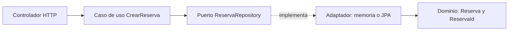
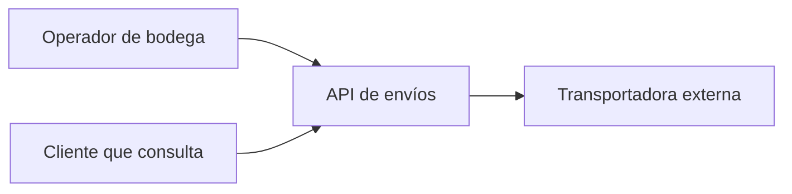
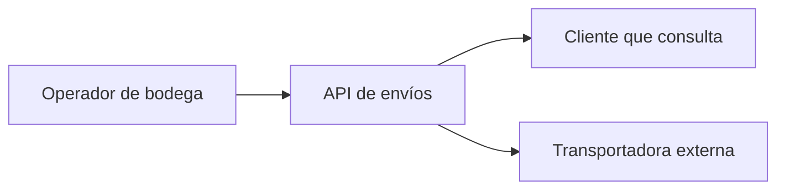
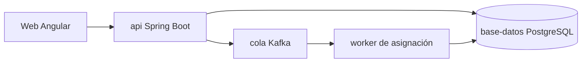
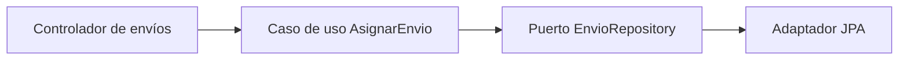
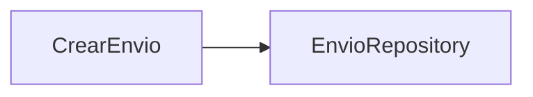
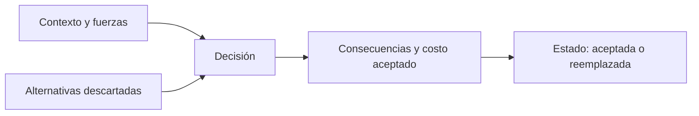

# Módulo 22: Arquitectura: puertos, C4 y decisiones

## Aprende construyendo

Cada Tema parte de una carpeta vacía, produce un artefacto concreto y lo verifica con un comando real.

### Tema 1: Hexagonal: puertos que hablan el idioma del dominio

#### Paso 1 · Objetivo y preparación

Al finalizar vas a separar una regla de negocio de su infraestructura con un puerto que devuelve tipos del dominio, y a compilar el caso de uso sin Spring ni JPA en el classpath.

**Conocimiento previo:** Java 21 o superior, `javac`/`java` en el `PATH`, y el Módulo 15 (Clean Architecture y DDD táctico). Comprueba `javac -version`.

#### Paso 2 · Contexto y caso real

**¿Por qué es importante?** Un puerto que devuelve `Page<ReservaEntity>` obliga al dominio a depender de Spring Data: el test del caso de uso levanta el contexto de Spring, tarda segundos y falla cuando cambia la versión de JPA. El síntoma aparece cuando alguien intenta probar una regla de negocio y descubre que necesita una base de datos.

En el proyecto integrador, las reglas de asignación de envíos deben probarse sin infraestructura. Un puerto que habla el idioma del negocio es lo que hace posible esa prueba.

#### Paso 3 · Teoría, modelo mental y analogía

La arquitectura hexagonal separa tres zonas: el **dominio** (tipos y reglas), la **aplicación** (casos de uso que coordinan) y los **adaptadores** (HTTP, JPA, colas). El puerto es una interfaz declarada por la aplicación y hablada en tipos del dominio; el adaptador la implementa traduciendo desde su tecnología.

**Analogía:** un enchufe no sabe qué aparato se conecta. El puerto fija la forma (dos patas, 220 V) y el adaptador es el cable del aparato concreto. Si el enchufe exigiera un tipo de cable propietario, cambiar de aparato obligaría a cambiar la pared.

**Diagrama:**



#### Paso 4 · Demostración guiada desde cero

Desde una carpeta vacía:

```bash
mkdir arquitectura-hexagonal && cd arquitectura-hexagonal
mkdir src
```

Crea `src/Hexagonal.java` con este contenido completo:

```java
import java.util.ArrayList;
import java.util.List;
import java.util.Optional;

public final class Hexagonal {
    record ReservaId(String valor) {
        ReservaId {
            if (valor == null || valor.isBlank()) throw new IllegalArgumentException("id requerido");
        }
    }

    record Reserva(ReservaId id, String vehiculo, int dias) {
        Reserva {
            if (dias <= 0) throw new IllegalArgumentException("dias debe ser positivo");
        }
    }

    // Puerto: declara lo que la aplicación necesita, con tipos del dominio.
    interface ReservaRepository {
        void guardar(Reserva reserva);
        Optional<Reserva> buscar(ReservaId id);
    }

    static final class CrearReserva {
        private final ReservaRepository repositorio;
        CrearReserva(ReservaRepository repositorio) { this.repositorio = repositorio; }

        Reserva ejecutar(ReservaId id, String vehiculo, int dias) {
            Reserva reserva = new Reserva(id, vehiculo, dias);
            repositorio.guardar(reserva);
            return reserva;
        }
    }

    static final class EnMemoria implements ReservaRepository {
        private final List<Reserva> datos = new ArrayList<>();

        public void guardar(Reserva reserva) { datos.add(reserva); }

        public Optional<Reserva> buscar(ReservaId id) {
            return datos.stream().filter(reserva -> reserva.id().equals(id)).findFirst();
        }
    }

    public static void main(String[] args) {
        ReservaRepository repositorio = new EnMemoria();
        Reserva creada = new CrearReserva(repositorio).ejecutar(new ReservaId("RES-1"), "camion-1", 3);
        Reserva recuperada = repositorio.buscar(creada.id()).orElseThrow();
        System.out.println("reserva=" + recuperada.id().valor() + " vehiculo=" + recuperada.vehiculo());
    }
}
```

Compila y ejecuta sin ninguna dependencia externa:

```bash
javac -d out src/Hexagonal.java
java -cp out Hexagonal
```

**Resultado esperado:** `reserva=RES-1 vehiculo=camion-1`. El programa no menciona Spring, JPA ni una base de datos: el adaptador es una lista en memoria y el caso de uso no lo sabe.

**Fallo deliberado:** cambia el puerto para que devuelva una entidad de Spring Data:

```java
interface ReservaRepository {
    org.springframework.data.domain.Page<ReservaEntity> buscar(
        org.springframework.data.domain.Pageable pageable);
}
```

Al compilar, `javac` responde:

```text
Hexagonal.java:19: error: package org.springframework.data.domain does not exist
```

El diagnóstico es que el dominio ahora depende de un framework. No falta una dependencia en el `build.gradle`: el problema es de dirección. Corrige el puerto para devolver `Reserva` y comprueba que `javac` vuelve a compilar sin Spring.

**Conceptos clave:** puerto, adaptador, dirección de dependencias, tipos del dominio.

#### Paso 5 · Práctica guiada

**Pista:** añade al puerto `List<Reserva> buscarPorVehiculo(String vehiculo)` y verifica que sigue compilando sin Spring. Si necesitas `Pageable` para paginar, la paginación pertenece al adaptador, no al puerto.

**Resultado esperado:** el proyecto compila y el caso de uso se prueba con `EnMemoria`, sin levantar contexto.

#### Paso 6 · Práctica independiente

Crea `src/CancelarReserva.java`: un caso de uso que busque la reserva, valide que no esté ya cancelada y guarde el cambio. Ejecútalo con `java -cp out` desde una clase `Main` propia.

**Resultado esperado:** cancelar dos veces la misma reserva produce un mensaje de dominio, no un `NullPointerException`.

#### Paso 7 · Cierre

Siguiente paso: documentar el sistema completo con C4.

**Errores comunes:** devolver entidades JPA desde el puerto; inyectar `Pageable` en el dominio; poner la lógica de negocio en el adaptador; crear un puerto por cada método del repositorio.

**Límites y decisión de uso:** hexagonal no significa una carpeta por capa ni un puerto por tabla. Si el sistema es un CRUD sin reglas, la separación añade ceremonia sin beneficio. En el proyecto integrador se justifica donde hay reglas que deben probarse sin infraestructura.

**Fuente oficial:** [Hexagonal Architecture (Alistair Cockburn)](https://alistair.cockburn.us/hexagonal-architecture/) y [Spring Data JPA](https://docs.spring.io/spring-data/jpa/reference/).

### Tema 2: C4: contexto, contenedores, componentes y código

#### Paso 1 · Objetivo y preparación

Al finalizar vas a dibujar los cuatro niveles C4 de una API de envíos, a enlazar cada relación con el código que la implementa y a validar el documento con un script que falla si un contenedor del sistema no aparece.

**Conocimiento previo:** Tema 1 de este módulo; Node.js 20 o superior (`node --version`).

#### Paso 2 · Contexto y caso real

**¿Por qué es importante?** Un diagrama que nadie puede contrastar se convierte en decoración. En el proyecto integrador, el diagrama de contenedores se usa para decidir dónde vive la cola y quién escribe en la base; si el diagrama muestra un worker que el código no tiene, la decisión se toma sobre una ficción.

C4 resuelve el problema de escala: no se dibuja todo en un solo nivel. Cada nivel responde una pregunta distinta y no repite la anterior.

#### Paso 3 · Teoría, modelo mental y analogía

Los cuatro niveles son: **contexto** (el sistema y sus usuarios), **contenedores** (aplicaciones, colas y bases que se despliegan por separado), **componentes** (piezas dentro de un contenedor) y **código** (clases y relaciones). Cada flecha debe corresponder a una llamada o dependencia real.

**Analogía:** es un mapa de escalas. El contexto es el mapa del país, los contenedores son las ciudades, los componentes son los barrios y el código son las calles. Un mapa de país con calles es ilegible; un mapa de calles que pretende explicar el país, también.

**Diagrama:**



#### Paso 4 · Demostración guiada desde cero

Desde una carpeta vacía:

```bash
mkdir c4-envios && cd c4-envios
mkdir -p docs/c4
```

Crea `validar-c4.mjs` y `docs/c4/envios.md`. El validador primero, para que el documento tenga una prueba:

```javascript
// Comprueba que el C4 tenga los cuatro niveles y los contenedores reales.
import { readFile } from 'node:fs/promises';

const texto = await readFile('docs/c4/envios.md', 'utf8');
const contenedores = ['api', 'worker', 'base-datos', 'cola'];
const faltantes = contenedores.filter((nombre) => !texto.toLowerCase().includes(nombre));
if (faltantes.length) {
  console.error(`Faltan contenedores en el C4: ${faltantes.join(', ')}`);
  process.exit(1);
}

const niveles = ['Contexto', 'Contenedores', 'Componentes', 'Código'];
const sinNivel = niveles.filter((nivel) => !texto.includes(`## ${nivel}`));
if (sinNivel.length) {
  console.error(`Faltan niveles: ${sinNivel.join(', ')}`);
  process.exit(1);
}

const relaciones = (texto.match(/-->/g) ?? []).length;
if (relaciones < 12) {
  console.error(`Se esperaban al menos 12 relaciones y hay ${relaciones}`);
  process.exit(1);
}

console.log(`C4 OK: ${niveles.length} niveles y ${relaciones} relaciones`);
```

Crea `docs/c4/envios.md` con el título `# API de envíos — C4` y cuatro secciones (`## Contexto`, `## Contenedores`, `## Componentes`, `## Código`). Cada sección lleva su diagrama; estos son los cuatro, en orden:









Verifica:

```bash
node validar-c4.mjs
```

**Resultado esperado:** `C4 OK: 4 niveles y 12 relaciones`. El número es el de flechas del documento; el validador informa el real y falla si baja de doce.

**Fallo deliberado:** elimina la línea `Cola --> Worker["worker de asignación"]` y ejecuta otra vez. El validador responde `Se esperaban al menos 12 relaciones y hay 11`. Si además borras el nodo del worker, responde `Faltan contenedores en el C4: worker`. El diagnóstico es que el diagrama y el sistema se separaron: el validador detecta la ausencia, no la corrige. Vuelve a añadir el worker y su relación.

**Conceptos clave:** nivel C4, contenedor, relación verificable, documento versionado.

#### Paso 5 · Práctica guiada

**Pista:** añade el nivel de código de `CancelarEnvio` con su dependencia de `EnvioRepository` y vuelve a ejecutar. El contador de relaciones debe subir sin tocar el validador.

**Resultado esperado:** `C4 OK: 4 niveles y 13 relaciones`.

#### Paso 6 · Práctica independiente

Añade un contenedor real que hoy no está en el diagrama (por ejemplo, un `worker` de recordatorios) y actualiza también la lista `contenedores` del validador. Ejecuta `node validar-c4.mjs`.

**Resultado esperado:** el validador pasa y el documento menciona el nuevo contenedor en el nivel correcto.

#### Paso 7 · Cierre

Siguiente paso: registrar por qué se eligió esta arquitectura.

**Errores comunes:** mezclar niveles en un solo dibujo; dibujar un contenedor que no existe; usar C4 como sustituto de un ADR; no versionar el diagrama junto al código.

**Límites y decisión de uso:** C4 documenta estructura, no decisiones ni comportamiento en tiempo de ejecución. Para una decisión que cambia el costo futuro, el artefacto correcto es un ADR. En el proyecto integrador, C4 responde «qué hay» y el ADR responde «por qué».

**Fuente oficial:** [C4 model](https://c4model.com/) y [Diagramas como código con Mermaid](https://mermaid.js.org/syntax/flowchart.html).

### Tema 3: ADR: decisiones con contexto, alternativas y consecuencias

#### Paso 1 · Objetivo y preparación

Al finalizar vas a escribir tres Architecture Decision Records con contexto, alternativas, consecuencias y estado, y a validarlos con un script que falla si falta una sección o si no se consideró ninguna alternativa.

**Conocimiento previo:** Temas 1 y 2; Node.js 20 o superior.

#### Paso 2 · Contexto y caso real

**¿Por qué es importante?** Dentro de un año, alguien preguntará por qué la asignación va por Kafka y no por una llamada directa. Sin un ADR, la respuesta se pierde y la decisión se revierte por moda. En el proyecto integrador, la elección de cola, base de datos y estrategia de reintentos debe poder revisarse sin depender de la memoria del equipo.

Un ADR no es un documento de diseño: es la memoria de una decisión concreta, con las alternativas que se descartaron y el costo que se aceptó.

#### Paso 3 · Teoría, modelo mental y analogía

Un ADR tiene cinco partes: **contexto** (la fuerza que obliga a decidir), **decisión** (qué se eligió), **alternativas** (qué se descartó y por qué), **consecuencias** (qué se gana y qué se paga) y **estado** (propuesta, aceptada, reemplazada). El estado importa: una decisión reemplazada sigue siendo historia útil.

**Analogía:** es el acta de una reunión técnica. No describe la oficina ni el organigrama; registra qué se decidió, quién lo propuso, qué otras opciones había y qué se aceptó perder. Sin acta, la reunión se repite cada seis meses.

**Diagrama:**



#### Paso 4 · Demostración guiada desde cero

Desde una carpeta vacía:

```bash
mkdir adr-envios && cd adr-envios
mkdir -p docs/adr
```

Crea `validar-adr.mjs` y tres ADR. Empieza por el validador:

```javascript
// Verifica que cada ADR tenga las secciones y al menos dos alternativas.
import { readdir, readFile } from 'node:fs/promises';

const archivos = (await readdir('docs/adr'))
  .filter((nombre) => /^\d{4}-.+\.md$/.test(nombre))
  .sort();
if (archivos.length < 3) {
  console.error(`Se esperaban 3 ADR y hay ${archivos.length}`);
  process.exit(1);
}

const secciones = ['## Contexto', '## Decisión', '## Alternativas', '## Consecuencias', '## Estado'];
for (const archivo of archivos) {
  const texto = await readFile(`docs/adr/${archivo}`, 'utf8');
  const faltan = secciones.filter((seccion) => !texto.includes(seccion));
  if (faltan.length) {
    console.error(`${archivo}: faltan ${faltan.join(', ')}`);
    process.exit(1);
  }
  const alternativas = (texto.match(/^- \*\*/gm) ?? []).length;
  if (alternativas < 2) {
    console.error(`${archivo}: se esperaban al menos 2 alternativas y hay ${alternativas}`);
    process.exit(1);
  }
}

console.log(`ADR OK: ${archivos.length} decisiones con contexto, alternativas y consecuencias`);
```

Crea `docs/adr/0001-postgresql-en-lugar-de-mongodb.md`:

```markdown
# 0001 — PostgreSQL para el estado de envíos

## Contexto

El estado de un envío cambia con reglas de negocio (transiciones válidas) y se consulta por
identificador y por fecha. El equipo ya opera PostgreSQL en local y necesita transacciones.

## Decisión

Usar PostgreSQL como base de datos del estado de envíos.

## Alternativas

- **MongoDB:** documentos flexibles, pero sin transacciones multi-documento simples en nuestro caso de uso.
- **SQLite:** suficiente para una demo, no para varias instancias concurrentes.

## Consecuencias

Se gana consistencia transaccional y consultas por fecha con índices. Se paga operación de
migraciones y un esquema que exige revisar cada cambio.

## Estado

Aceptada el 2026-10-30.
```

Crea `docs/adr/0002-kafka-para-asignacion.md` y `docs/adr/0003-reintentos-con-outbox.md` con la misma estructura y al menos dos alternativas cada uno. Verifica:

```bash
node validar-adr.mjs
```

**Resultado esperado:** `ADR OK: 3 decisiones con contexto, alternativas y consecuencias`.

**Fallo deliberado:** borra la sección `## Alternativas` del ADR `0003`. El validador responde `0003-reintentos-con-outbox.md: faltan ## Alternativas`. El diagnóstico es que un ADR sin alternativas no permite revisar la decisión: parece una orden, no una elección. Vuelve a añadir la sección con dos opciones reales.

**Conceptos clave:** contexto, decisión, alternativas, consecuencias, estado del ADR.

#### Paso 5 · Práctica guiada

**Pista:** cambia el estado de `0002` a `Reemplazada por 0004` y crea `0004` con la nueva decisión. El validador debe seguir pasando y el historial queda explícito.

**Resultado esperado:** `ADR OK: 4 decisiones...` sin borrar la decisión anterior.

#### Paso 6 · Práctica independiente

Escribe un ADR para una decisión del proyecto integrador que todavía no esté documentada (por ejemplo, autenticación con JWT o estrategia de caché) y enlázalo desde el README del proyecto.

**Resultado esperado:** el validador pasa y el README apunta al ADR con su número.

#### Paso 7 · Cierre

Siguiente paso: aplicar el mismo criterio a cada nueva decisión del proyecto.

**Errores comunes:** escribir un ADR después de implementar sin registrar las alternativas; copiar el mismo texto en los tres; dejar el estado «propuesta» para siempre; usar el ADR para describir la arquitectura completa.

**Límites y decisión de uso:** un ADR documenta una decisión, no garantiza que sea buena. Si la decisión es reversible y barata, el registro puede ser una línea en el commit; el ADR se justifica cuando el costo de revertir es alto. En el proyecto integrador se escribe para las decisiones que alguien querrá cuestionar dentro de un año.

**Fuente oficial:** [Architecture Decision Records (AWS Prescriptive Guidance)](https://docs.aws.amazon.com/prescriptive-guidance/latest/architectural-decision-records/adr-process.html) y [ADR en Martin Fowler](https://martinfowler.com/bliki/ArchitectureDecisionRecord.html).
