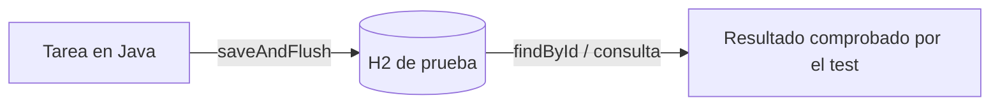
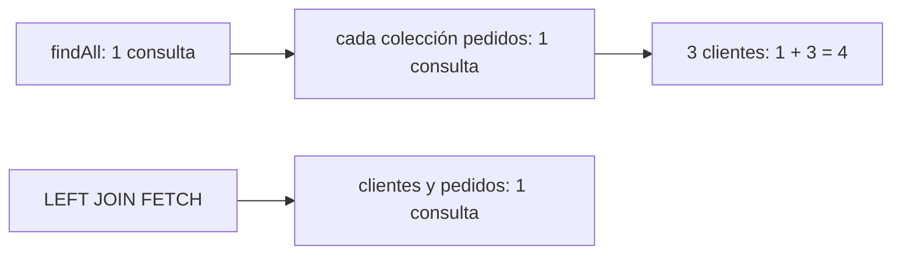

# Módulo 3: Persistencia con Spring Data JPA

Este módulo continúa el backend `academia-spring` creado en los módulos 1 y 2. Ejecuta los ejemplos con la base H2 de pruebas; el test comprueba datos reales, no repositorios simulados.

## Aprende construyendo

### Tema 1: Entidades y repositorios derivados

Al terminar, podrás probar que una entidad se guarda y se recupera, escribir un método de búsqueda a partir de propiedades reales y reconocer cuándo una consulta JPQL queda más clara. El tema usa `Tarea(titulo, prioridad, ubicacionInterna)` que ya existe en `academia-spring`.

**¿Por qué es importante?** Una consulta mal nombrada puede impedir que el servicio arranque; probar con datos reales permite localizar el error antes de conectar la API con otros servicios.

Prerrequisitos: Temas 1–6 del módulo 2. En particular, existe `TareaRepository extends JpaRepository<Tarea, Long>`, H2 está configurado y el proyecto incluye `spring-boot-starter-data-jpa-test`.



#### Subtema 3.1 · Guardar y recuperar una entidad · 8 min

**Contexto:** Antes de filtrar una lista, comprueba el viaje más pequeño: Java guarda una tarea, la base asigna su ID y luego el repositorio la busca. Así separas un problema de persistencia de un problema de consulta.

**Hazlo tú:** En `academia-spring`, crea `src/test/java/com/example/demo/TareaRepositoryTest.java`:

```java
package com.example.demo;

import org.junit.jupiter.api.Test;
import org.springframework.beans.factory.annotation.Autowired;
import org.springframework.boot.data.jpa.test.autoconfigure.DataJpaTest;
import static org.assertj.core.api.Assertions.assertThat;

@DataJpaTest
class TareaRepositoryTest {
    @Autowired TareaRepository tareas;

    @Test
    void guardaYRecuperaLaTarea() {
        Tarea guardada = tareas.saveAndFlush(
            new Tarea("Revisar paquete", 2, "BODEGA-A")
        );

        Tarea leida = tareas.findById(guardada.getId()).orElseThrow();

        assertThat(leida.getTitulo()).isEqualTo("Revisar paquete");
        assertThat(leida.getPrioridad()).isEqualTo(2);
    }
}
```

Desde la raíz del proyecto, ejecuta:

```bash
./mvnw -q -Dtest=TareaRepositoryTest test
```

**Salida esperada:** el comando termina con código 0 y Maven informa `BUILD SUCCESS`. El test obliga a escribir y leer en H2; `saveAndFlush` envía el cambio antes de buscarlo.

**Fallo deliberado y diagnóstico:** cambia `isEqualTo(2)` por `isEqualTo(9)` y repite el comando. El test falla con una comparación esperada 9 frente a actual 2. Eso indica que la lectura sí ocurrió y que el valor esperado del test es incorrecto. Restáuralo a 2.

**Entiende:** `@DataJpaTest` (en Boot 4 se importa desde `org.springframework.boot.data.jpa.test.autoconfigure`) prepara las piezas de persistencia y una base de prueba; no arranca toda la API. `JpaRepository` ya aporta `saveAndFlush` y `findById`. El ID se genera al guardar, por eso se consulta con `guardada.getId()`. La [guía oficial de pruebas de Spring Boot](https://docs.spring.io/spring-boot/4.1/reference/testing/spring-boot-applications.html) confirma que este slice busca entidades, configura repositorios JPA y usa una base embebida disponible.

**Cierra:** conserva el test verde. Puedes mostrar el ID generado y los dos valores leídos; eso es evidencia de ida y vuelta, no solo de que el proyecto compila.

#### Subtema 3.2 · Filtrar con el nombre del método · 10 min

**Contexto:** La API ya guarda `prioridad`. El listado necesita devolver tareas cuya prioridad sea al menos el mínimo recibido, sin escribir una consulta para una comparación sencilla.

**Hazlo tú:** En `src/main/java/com/example/demo/TareaRepository.java`, agrega el método señalado:

```java
package com.example.demo;

import java.util.List;
import org.springframework.data.jpa.repository.JpaRepository;

public interface TareaRepository extends JpaRepository<Tarea, Long> {
    List<Tarea> findByPrioridadGreaterThanEqual(int minimo);
}
```

En `src/test/java/com/example/demo/TareaRepositoryTest.java`, conserva el test de guardado e imports del subtema anterior. Añade este método antes de la llave final de la clase:

```java
@Test
void filtraPrioridadMinimaIncluyendoElLimite() {
    tareas.save(new Tarea("Sobre", 1, "A"));
    tareas.save(new Tarea("Caja", 2, "B"));
    tareas.save(new Tarea("Pallet", 3, "C"));
    tareas.flush();

    var resultado = tareas.findByPrioridadGreaterThanEqual(2);

    assertThat(resultado).extracting(Tarea::getTitulo)
        .containsExactlyInAnyOrder("Caja", "Pallet");
}
```

Ejecuta desde la raíz del proyecto:

```bash
./mvnw -q -Dtest=TareaRepositoryTest test
```

**Salida esperada:** `BUILD SUCCESS`; aparecen Caja y Pallet, pero no Sobre. El sufijo `GreaterThanEqual` incluye el valor límite 2.

**Fallo deliberado y diagnóstico:** cambia `findByPrioridadGreaterThanEqual` a `findByPrioridGreaterThanEqual` en la interfaz y cambia igual la llamada en el test para que el código compile. Al arrancar, Spring muestra `PropertyReferenceException` porque no encuentra `priorid` en `Tarea` y sugiere `prioridad`. La consulta se valida desde el nombre de propiedad; restaura ambas apariciones y ejecuta otra vez.

**Entiende:** Spring Data separa `findBy` del nombre de la propiedad y del operador. La forma de la consulta se lee así:

```text
findBy | Prioridad | GreaterThanEqual
buscar | campo    | mayor o igual
```

El nombre debe corresponder al atributo Java (`prioridad`), no al nombre de columna ni al nombre que llega en JSON. La lista se escribe con `List<Tarea>` porque el filtro puede devolver varias filas.

**Cierra:** entrega el test verde y señala cuál resultado prueba que el límite es inclusivo. La referencia oficial lista los operadores y explica cómo Spring Data interpreta nombres de métodos: [Spring Data JPA — Query methods](https://docs.spring.io/spring-data/jpa/reference/jpa/query-methods.html).

#### Subtema 3.3 · Escribir JPQL cuando ayuda a leer · 10 min

**Contexto:** El nombre derivado anterior es corto y claro. Cuando la consulta requiere una condición expresada con más detalle, puedes escribir JPQL; JPQL usa nombres de entidades y atributos Java, no nombres directos de tablas y columnas.

**Hazlo tú:** En `src/main/java/com/example/demo/TareaRepository.java`, declara ambos caminos para comparar sus resultados:

```java
package com.example.demo;

import java.util.List;
import org.springframework.data.jpa.repository.JpaRepository;
import org.springframework.data.jpa.repository.Query;
import org.springframework.data.repository.query.Param;

public interface TareaRepository extends JpaRepository<Tarea, Long> {
    List<Tarea> findByPrioridadGreaterThanEqual(int minimo);

    @Query("select t from Tarea t where t.prioridad >= :minimo")
    List<Tarea> buscarPrioridadMinima(@Param("minimo") int minimo);
}
```

Dentro de `TareaRepositoryTest`, añade este método antes de la última llave:

```java
@Test
void jpqlYMetodoDerivadoDevuelvenLasMismasTareas() {
    tareas.save(new Tarea("Sobre", 1, "A"));
    tareas.save(new Tarea("Caja", 2, "B"));
    tareas.save(new Tarea("Pallet", 3, "C"));
    tareas.flush();

    var derivado = tareas.findByPrioridadGreaterThanEqual(2);
    var jpql = tareas.buscarPrioridadMinima(2);

    assertThat(jpql).extracting(Tarea::getTitulo)
        .containsExactlyInAnyOrderElementsOf(
            derivado.stream().map(Tarea::getTitulo).toList()
        );
}
```

Ejecuta desde la raíz del proyecto:

```bash
./mvnw -q -Dtest=TareaRepositoryTest test
```

**Salida esperada:** `BUILD SUCCESS`; las dos consultas encuentran las mismas tareas. Si agregas este método al test existente, conserva los imports de la prueba anterior.

**Fallo deliberado y diagnóstico:** escribe `t.priorid` en la cadena de `@Query` y ejecuta el test. Spring no reconoce ese atributo JPQL y el contexto falla al crear el repositorio con `QueryCreationException: Query validation failed`. El nombre válido es `prioridad`, como en la propiedad Java. Corrígelo y vuelve a ejecutar.

**Entiende:** JPQL consulta entidades (`Tarea t`) y sus propiedades (`t.prioridad`); el proveedor JPA lo traduce a SQL para la base configurada. `@Param` conecta el marcador `:minimo` con el argumento Java. Prefiere un método derivado cuando se entiende de un vistazo; usa `@Query` cuando el nombre se vuelve difícil de leer o necesitas expresar una forma que la convención no cubre. Ninguno da control total del SQL físico: JPQL y SQL son lenguajes distintos.

**Cierra:** conserva las dos pruebas y explica con un ejemplo cuándo elegirías cada versión. Para pasar a una relación entre entidades, revisa el siguiente tema sobre N+1. Referencia oficial: [Spring Data JPA — declarar consultas](https://docs.spring.io/spring-data/jpa/reference/jpa/query-methods.html).

La entidad y el repositorio de esta práctica continúan en el proyecto integrador del track. La estructura atómica describe actividades verificables; no certifica por sí sola dominio profesional.

### Tema 2: El problema N+1 y su corrección

En este tema añadimos `Cliente` y `Pedido` al proyecto `academia-spring` ya existente. Así probamos una relación propia sin alterar la entidad `Tarea` que usa el mapper del API.

**¿Por qué es importante?** Una página que carga clientes y luego consulta los pedidos de cada uno puede hacer muchas llamadas a la base. Con pocos datos parece rápida; al crecer la lista, cada consulta adicional añade demora.



#### Subtema 3.4 · Relacionar clientes y pedidos y medir · 12 min

**Contexto:** Una ficha de cliente muestra sus pedidos. La relación debe decir quién es el dueño de la referencia y permitir contar las consultas reales sin confundirlas con las escrituras de datos.

**Hazlo tú:** En `academia-spring`, crea estos archivos en `src/main/java/com/example/demo/`.

`Cliente.java`:

```java
package com.example.demo;

import jakarta.persistence.Entity;
import jakarta.persistence.FetchType;
import jakarta.persistence.GeneratedValue;
import jakarta.persistence.GenerationType;
import jakarta.persistence.Id;
import jakarta.persistence.OneToMany;
import jakarta.persistence.Table;
import java.util.ArrayList;
import java.util.List;
import lombok.Getter;

@Getter
@Entity
@Table(name = "clientes")
public class Cliente {
    @Id
    @GeneratedValue(strategy = GenerationType.IDENTITY)
    private Long id;

    private String nombre;

    @OneToMany(mappedBy = "cliente", fetch = FetchType.LAZY)
    private List<Pedido> pedidos = new ArrayList<>();

    protected Cliente() {}

    public Cliente(String nombre) {
        this.nombre = nombre;
    }
}
```

`Pedido.java`:

```java
package com.example.demo;

import jakarta.persistence.Entity;
import jakarta.persistence.FetchType;
import jakarta.persistence.GeneratedValue;
import jakarta.persistence.GenerationType;
import jakarta.persistence.Id;
import jakarta.persistence.JoinColumn;
import jakarta.persistence.ManyToOne;
import jakarta.persistence.Table;
import lombok.Getter;

@Getter
@Entity
@Table(name = "pedidos")
public class Pedido {
    @Id
    @GeneratedValue(strategy = GenerationType.IDENTITY)
    private Long id;

    private String codigo;

    @ManyToOne(fetch = FetchType.LAZY, optional = false)
    @JoinColumn(name = "cliente_id", nullable = false)
    private Cliente cliente;

    protected Pedido() {}

    public Pedido(String codigo, Cliente cliente) {
        this.codigo = codigo;
        this.cliente = cliente;
    }
}
```

Crea los repositorios `ClienteRepository.java` y `PedidoRepository.java` en la misma carpeta:

```java
package com.example.demo;

import java.util.List;
import org.springframework.data.jpa.repository.JpaRepository;
import org.springframework.data.jpa.repository.Query;

public interface ClienteRepository extends JpaRepository<Cliente, Long> {
    @Query("select c from Cliente c")
    List<Cliente> buscarSinPedidos();
}
```

```java
package com.example.demo;

import org.springframework.data.jpa.repository.JpaRepository;

public interface PedidoRepository extends JpaRepository<Pedido, Long> {}
```

Crea `src/test/java/com/example/demo/NMasUnoTest.java`:

```java
package com.example.demo;

import jakarta.persistence.EntityManager;
import org.hibernate.SessionFactory;
import org.hibernate.stat.Statistics;
import org.junit.jupiter.api.Test;
import org.springframework.beans.factory.annotation.Autowired;
import org.springframework.boot.data.jpa.test.autoconfigure.DataJpaTest;
import static org.assertj.core.api.Assertions.assertThat;

@DataJpaTest(properties = "spring.jpa.properties.hibernate.generate_statistics=true")
class NMasUnoTest {
    @Autowired ClienteRepository clientes;
    @Autowired PedidoRepository pedidos;
    @Autowired EntityManager entityManager;
    @Autowired SessionFactory sessionFactory;

    private void crearTresClientesConPedido() {
        for (int i = 1; i <= 3; i++) {
            Cliente cliente = clientes.save(new Cliente("Cliente " + i));
            pedidos.save(new Pedido("RF-" + i, cliente));
        }
        entityManager.flush();
        entityManager.clear();
    }

    @Test
    void laCargaPerezosaHaceUnaConsultaPorCadaColeccion() {
        crearTresClientesConPedido();
        Statistics stats = sessionFactory.getStatistics();
        stats.clear();

        for (Cliente cliente : clientes.buscarSinPedidos()) {
            assertThat(cliente.getPedidos()).hasSize(1);
        }

        assertThat(stats.getPrepareStatementCount()).isEqualTo(4L);
    }
}
```

Desde la raíz, ejecuta:

```bash
./mvnw -q -Dtest=NMasUnoTest test
```

**Resultado esperado:** `BUILD SUCCESS`; la aserción muestra cuatro sentencias preparadas: una para `buscarSinPedidos()` y tres para cargar las colecciones. El contador se limpia después de guardar y vaciar el contexto.

**Fallo deliberado y diagnóstico:** cambia `mappedBy = "cliente"` por `mappedBy = "clientee"` en `Cliente.java`. El contexto de persistencia falla al iniciar porque el nombre no coincide con ningún atributo de `Pedido`. Restaura `cliente`.

**Entiende:** `Pedido.cliente` guarda la clave foránea `cliente_id`; `Cliente.pedidos` es el lado inverso y `mappedBy` nombra el atributo dueño. `LAZY` significa que la colección se busca al accederla. `getPrepareStatementCount()` mide sentencias SQL preparadas, incluidas las consultas de carga perezosa; `getQueryExecutionCount()` no es el contador que queremos para estas consultas de colección.

**Cierra:** registra el número 4 y explica qué sentencia corresponde al `+1` y cuáles a las tres colecciones.

#### Subtema 3.5 · Cargar la relación con `JOIN FETCH` · 10 min

**Contexto:** Ya mediste la repetición. Ahora cambia la consulta que carga la página para pedir clientes y pedidos juntos cuando sabes que mostrarás ambos.

**Hazlo tú:** Reemplaza `src/main/java/com/example/demo/ClienteRepository.java` con la versión completa:

```java
package com.example.demo;

import java.util.List;
import org.springframework.data.jpa.repository.JpaRepository;
import org.springframework.data.jpa.repository.Query;

public interface ClienteRepository extends JpaRepository<Cliente, Long> {
    @Query("select c from Cliente c")
    List<Cliente> buscarSinPedidos();

    @Query("select distinct c from Cliente c left join fetch c.pedidos")
    List<Cliente> buscarTodosConPedidos();
}
```

En `src/test/java/com/example/demo/NMasUnoTest.java`, añade este método dentro de la clase:

```java
@Test
void joinFetchCargaLosPedidosEnLaConsultaPrincipal() {
    crearTresClientesConPedido();
    Statistics stats = sessionFactory.getStatistics();
    stats.clear();

    for (Cliente cliente : clientes.buscarTodosConPedidos()) {
        assertThat(cliente.getPedidos()).hasSize(1);
    }

    assertThat(stats.getPrepareStatementCount()).isEqualTo(1L);
}
```

Ejecuta desde la raíz:

```bash
./mvnw -q -Dtest=NMasUnoTest test
```

**Resultado esperado:** los dos tests pasan; el recorrido normal preparó 4 sentencias y el método con `left join fetch` preparó 1.

**Fallo deliberado y diagnóstico:** quita la palabra `fetch` y deja `left join c.pedidos`. Ejecuta el test: la relación no se inicializa junto con el cliente y la medición vuelve a mostrar 4 sentencias. Restaura `fetch`.

**Entiende:** `join fetch` le pide a JPA que traiga el atributo relacionado en la consulta que devuelve el cliente. `left` conserva también clientes que todavía no tienen pedidos. `distinct` expresa que cada cliente debe aparecer una vez en el resultado aunque tenga varios pedidos.

**Cierra:** entrega las mediciones 4 y 1. La guía de Hibernate explica el [fetch join y las asociaciones](https://docs.jboss.org/hibernate/orm/current/userguide/html_single/Hibernate_User_Guide.html#hql-explicit-association-joins).

#### Subtema 3.6 · Elegir `@EntityGraph` y revisar el límite · 10 min

**Contexto:** Puedes declarar qué relación se carga sin escribir el `JOIN` en una cadena JPQL. Compara esa opción cuando la consulta de repositorio ya tiene un nombre que quieres conservar.

**Hazlo tú:** Reemplaza `src/main/java/com/example/demo/ClienteRepository.java` por la versión completa que conserva las consultas anteriores y aplica `@EntityGraph` al `findAll()` heredado:

```java
package com.example.demo;

import java.util.List;
import org.springframework.data.jpa.repository.EntityGraph;
import org.springframework.data.jpa.repository.JpaRepository;
import org.springframework.data.jpa.repository.Query;

public interface ClienteRepository extends JpaRepository<Cliente, Long> {
    @Query("select c from Cliente c")
    List<Cliente> buscarSinPedidos();

    @Query("select distinct c from Cliente c left join fetch c.pedidos")
    List<Cliente> buscarTodosConPedidos();

    @Override
    @EntityGraph(attributePaths = "pedidos")
    List<Cliente> findAll();
}
```

En `NMasUnoTest.java`, añade:

```java
@Test
void entityGraphCargaLosPedidosEnLaConsulta() {
    crearTresClientesConPedido();
    Statistics stats = sessionFactory.getStatistics();
    stats.clear();

    for (Cliente cliente : clientes.findAll()) {
        assertThat(cliente.getPedidos()).hasSize(1);
    }

    assertThat(stats.getPrepareStatementCount()).isEqualTo(1L);
}
```

Ejecuta desde la raíz:

```bash
./mvnw -q -Dtest=NMasUnoTest test
```

**Resultado esperado:** pasan los tres tests. El fetch plan explícito de `@EntityGraph` evita las tres lecturas posteriores para esta relación.

**Fallo deliberado y diagnóstico:** cambia `attributePaths = "pedidos"` por `attributePaths = "pedido"`. El test falla al ejecutar `findAll()` con `Unable to locate Attribute ... [pedido] on ... Cliente`; `pedido` no coincide con la propiedad `pedidos`. Restaura el plural.

**Entiende:** `JOIN FETCH` deja visible la forma JPQL; `@EntityGraph` declara atributos a cargar en el método. Ambos resuelven este acceso concreto. Una colección grande puede multiplicar filas y `JOIN FETCH` de colección junto con paginación requiere cuidado; mide el caso real y evita cargar relaciones que la pantalla no usa. [Spring Data JPA — `@EntityGraph`](https://docs.spring.io/spring-data/jpa/docs/current/api/org/springframework/data/jpa/repository/EntityGraph.html).

**Cierra:** guarda los tres resultados de la prueba y explica por qué no cambiarías todo a `EAGER`. **Práctica:** en `crearTresClientesConPedido()` cambia el límite del bucle a 4 y ajusta la prueba perezosa a `5L`; ambas pruebas con carga previa deben seguir en `1L`. Ejecuta `./mvnw -q -Dtest=NMasUnoTest test` y luego restaura el límite y la aserción. Integra `Cliente` y `Pedido` al backend acumulativo y lleva la medición al proyecto integrador cuando uses una lista real. El tema siguiente versiona el esquema para que estas dos tablas tengan cambios reproducibles.

### Tema 3: Migraciones con Flyway

#### Paso 1 · Objetivo y preparación

Al finalizar podrás versionar un cambio de esquema con una migración de Flyway, y explicar por qué `hibernate.ddl-auto=update` es riesgoso en producción.

**Conocimiento previo:** Temas 1 y 2 de este módulo.

#### Paso 2 · Contexto y caso real

**¿Por qué es importante?** Un cambio de esquema aplicado automáticamente por Hibernate (`ddl-auto=update`) no queda registrado en ningún historial versionado ni revisable en un pull request; una migración de Flyway sí, y se aplica de forma idéntica y predecible en cada entorno.

#### Paso 3 · Teoría con analogía

**Conceptos clave:** esquema versionado y revisable, riesgo de `ddl-auto` en producción, migraciones aplicadas en orden secuencial.

`hibernate.ddl-auto=update` permite que Hibernate genere y actualice automáticamente el esquema basándose en las entidades declaradas, cómodo en desarrollo temprano pero riesgoso en producción: Hibernate podría inferir un cambio distinto al pretendido, sin quedar registrado en ningún historial revisable antes de aplicarse. `V1__crear_tabla_tareas.sql` (una migración de Flyway, nombrada según su convención de versión secuencial) declara explícitamente en SQL puro el cambio de esquema, versionado en el repositorio, revisable en un pull request, y aplicado de forma idéntica en cada entorno — Flyway registra qué migraciones ya se aplicaron en cada base de datos, aplicando únicamente las nuevas pendientes, en orden.

**Analogía:** `ddl-auto=update` es como dejar que un asistente reorganice el mobiliario de una casa según sus propias inferencias, sin un plano ni revisión previa; Flyway es seguir un plano de renovación explícito, versionado y revisado antes de ejecutarse, aplicado exactamente igual en cada casa idéntica.

**Diagrama:**

```
┌── V1__crear_tabla_tareas.sql ──┐
│  aplicada primero                │
└──────────┬─────────────────┘
           │ V2__agregar_columna_prioridad.sql
           ▼
┌── esquema actual, versionado y revisable ──┐
│  Flyway registra qué migraciones ya corrieron │
└──────────────────────────────────────┘
```

#### Paso 4 · Demostración guiada desde cero

Reutiliza `academia-spring` (o créalo desde una carpeta vacía con `mkdir -p academia-spring` si es tu primera vez), agrega la dependencia `flyway-core` y crea la migración inicial en `src/main/resources/db/migration/`:

```bash
mkdir -p academia-spring/src/main/resources/db/migration
cd academia-spring
```

```sql
-- src/main/resources/db/migration/V1__crear_tabla_tarea.sql
CREATE TABLE tarea (
    id BIGSERIAL PRIMARY KEY,
    titulo VARCHAR(255) NOT NULL,
    completada BOOLEAN NOT NULL DEFAULT false
);
```

```bash
# desactiva ddl-auto: el esquema ahora lo gestiona exclusivamente Flyway
cat >> src/main/resources/application.properties <<'EOF'
spring.jpa.hibernate.ddl-auto=validate
spring.flyway.enabled=true
EOF
mvn test          # Maven
./gradlew test    # Gradle (equivalente)
```

**Explicación línea por línea:** `V1__crear_tabla_tarea.sql` (prefijo `V1`, número de versión secuencial, seguido de `__` y una descripción) declara el esquema inicial en SQL real; `spring.jpa.hibernate.ddl-auto=validate` le indica a Hibernate que NO genere ni modifique el esquema, solo que valide que las entidades coincidan con lo que Flyway ya creó — si no coinciden, la aplicación falla al arrancar en vez de aplicar un cambio silencioso no revisado.

Confirma con un test real que la migración se aplicó y el esquema coincide con la entidad `Tarea`, guardando y leyendo una fila real:

```java
// src/test/java/com/academia/tarea/MigracionFlywayTest.java
package com.academia.tarea;

import org.junit.jupiter.api.Test;
import org.springframework.beans.factory.annotation.Autowired;
import org.springframework.boot.test.autoconfigure.orm.jpa.DataJpaTest;
import static org.assertj.core.api.Assertions.assertThat;

@DataJpaTest
class MigracionFlywayTest {

    @Autowired
    private TareaRepository tareaRepository;

    @Test
    void elEsquemaCreadoPorFlywayAceptaGuardarYLeerUnaTarea() {
        Tarea guardada = tareaRepository.save(new Tarea("Comprar leche"));

        Tarea leida = tareaRepository.findById(guardada.getId()).orElseThrow();

        assertThat(leida.getTitulo()).isEqualTo("Comprar leche");
    }
}
```

```bash
mvn test -Dtest=MigracionFlywayTest # Maven
./gradlew test --tests MigracionFlywayTest # Gradle (equivalente)
```

**Resultado esperado:** `BUILD SUCCESS`, confirmando que Flyway aplicó `V1__crear_tabla_tarea.sql` antes de que el contexto de Spring arrancara, que `ddl-auto=validate` confirmó que la entidad `Tarea` coincide con ese esquema, y que guardar y leer una fila real funciona correctamente.

**Fallo deliberado:** agrega manualmente un campo nuevo a la entidad `Tarea` (por ejemplo, `private String descripcion;`) SIN crear ninguna migración `V2` que agregue la columna correspondiente, y ejecuta `mvn test` de nuevo. La aplicación falla al arrancar con `SchemaManagementException: Schema-validation: missing column [descripcion] in table [tarea]` — diagnostica confirmando exactamente el propósito de `ddl-auto=validate`: en vez de que Hibernate silenciosamente agregara la columna faltante (el riesgo de `ddl-auto=update`), la aplicación se niega a arrancar hasta que exista una migración explícita y revisable que agregue esa columna. Revierte el campo agregado, o crea `V2__agregar_columna_descripcion.sql` con `ALTER TABLE tarea ADD COLUMN descripcion VARCHAR(500);` para resolverlo correctamente.

#### Paso 5 · Práctica guiada — repetición progresiva

1. Agrega `V2__agregar_indice_completada.sql` con `CREATE INDEX idx_tarea_completada ON tarea(completada);` y confirma que `mvn test` sigue en verde tras aplicar ambas migraciones en secuencia.
2. Intenta nombrar una migración fuera de secuencia (`V1__otra_migracion.sql`, reutilizando la versión `1` ya aplicada) y observa el error real que produce Flyway ante una versión duplicada.
3. Agrega una migración que renombre una columna (`ALTER TABLE tarea RENAME COLUMN titulo TO nombre;`) y actualiza la entidad correspondientemente, confirmando que el test de lectura/escritura sigue pasando con el nuevo nombre.
4. Escribe de memoria (sin mirar) una migración `V1` que cree una tabla de dos columnas, y un test que confirme que Flyway la aplicó correctamente.

**Pista:** el prefijo de versión (`V1`, `V2`, ...) debe ser único y estrictamente creciente; Flyway rechaza aplicar una migración con una versión ya registrada como aplicada.

#### Paso 6 · Práctica independiente

**Completa el código:** rellena el espacio para que Hibernate solo valide el esquema, sin modificarlo:

```properties
spring.jpa.hibernate.ddl-auto=____
```

**Reto de memoria sin mirar:** cierra este documento y escribe, solo de memoria, una migración `V1` que cree una tabla con al menos dos columnas, y explica en una frase por qué `ddl-auto=validate` es preferible a `update` en producción. Compara después contra el patrón del Paso 4.

#### Paso 7 · Cierre y evidencia

Ya versionas cambios de esquema con migraciones explícitas y revisables de Flyway, en vez de depender de la inferencia automática de Hibernate. Esto cierra el módulo de persistencia; el siguiente módulo aborda cómo exponer y proteger estos datos a través de una API REST completa. **Evidencia:** entrega el resultado de `MigracionFlywayTest` en verde, y el mensaje de error real que produce un campo de entidad sin su migración correspondiente. Fuente oficial: [Flyway — Migrations](https://documentation.red-gate.com/flyway/flyway-cli-and-api/concepts/migrations).

**Errores comunes:** confiar en `ddl-auto=update` en un entorno de producción, arriesgando cambios de esquema no versionados ni revisables; editar tablas manualmente en vez de a través de una migración versionada, perdiendo el historial y la reproducibilidad entre entornos.

**Cuándo no usarlo:** para un prototipo local descartable sin ningún dato que preservar entre reinicios, `ddl-auto=create-drop` sin Flyway es más simple y suficiente; reserva las migraciones versionadas para cualquier entorno compartido o con datos que deban persistir.

---

Las migraciones con Flyway que escribas aquí versionan el esquema del proyecto integrador de este track (microservicio productivo, Módulo 12).

## Laboratorio práctico

**Objetivo del laboratorio:** construir una API con persistencia real, medir y corregir un problema N+1, y versionar el esquema con Flyway.

**Requisitos previos:** Módulos 0-2 completados.

| Paso | Acción | Código | Explicación |
|---|---|---|---|
| 1 | Definir `Tarea` con `@Entity` y su repositorio | Ver Tema 1 | Método derivado `findByCompletadaFalse` |
| 2 | Comparar con el equivalente en `@Query` | Ver Tema 1 | Discute cuándo cada enfoque es apropiado |
| 3 | Modelar `@OneToMany` y provocar N+1 | Ver Tema 2 | Cuenta las queries ejecutadas con `Statistics` |
| 4 | Corregir con `JOIN FETCH` o `@EntityGraph` | Ver Tema 2 | Mide la diferencia real en queries |
| 5 | Configurar Flyway con una migración versionada | Ver Tema 3 | En vez de `ddl-auto=update` |

**Verificación:** el laboratorio se considera exitoso si la corrección del problema N+1 reduce el número de queries medido con `Statistics` de N+1 a una única query, y si el esquema de la base de datos se gestiona completamente mediante migraciones versionadas de Flyway, con `ddl-auto=validate` confirmando la coincidencia.

**Errores comunes y soluciones**

- **Confiar en `ddl-auto=update` en un entorno de producción.** Usa migraciones versionadas con Flyway.
- **No notar el problema N+1 hasta que aparece en producción con datos reales.** Mide el número de queries con `Statistics` durante el desarrollo, con datasets representativos.
- **Sobreusar `@Query` para casos que un método derivado simple resolvería.** Usa métodos derivados para consultas simples y directas.

---
