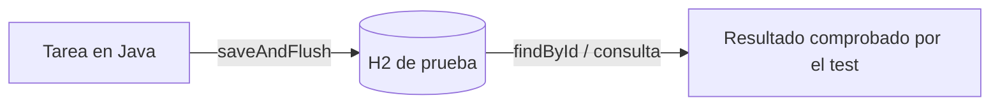
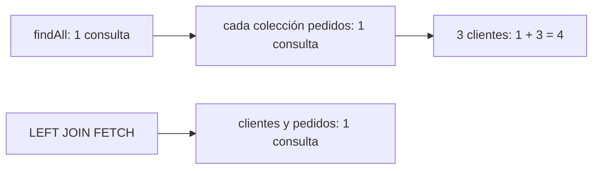
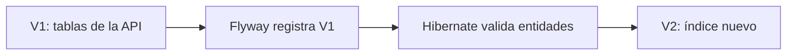

# Módulo 3: Persistencia con Spring Data JPA

Este módulo continúa el backend `academia-spring` creado en los módulos 1 y 2. Ejecuta los ejemplos con la base H2 de pruebas; el test comprueba datos reales, no repositorios simulados.

**Referencia ejecutable al terminar los módulos 2–7:** en la raíz del repositorio, abre `examples/spring-tareas-rutaflow/README.md`. Incluye el estado final y pruebas; algunas clases incorporan cambios de módulos posteriores. Construye primero las prácticas de este módulo y usa la referencia para comparar y diagnosticar.

## Aprende construyendo

### Tema 1: Entidades y repositorios derivados

Al terminar, podrás probar que una entidad se guarda y se recupera, escribir un método de búsqueda a partir de propiedades reales y reconocer cuándo una consulta JPQL queda más clara. El tema usa `Tarea(titulo, prioridad, ubicacionInterna)` que ya existe en `academia-spring`.

**¿Por qué es importante?** Una consulta mal nombrada puede impedir que el servicio arranque; probar con datos reales permite localizar el error antes de conectar la API con otros servicios.

Prerrequisitos: Temas 1–6 del módulo 2. En particular, existe `TareaRepository extends JpaRepository<Tarea, Long>`, H2 está configurado y el proyecto incluye `spring-boot-starter-data-jpa-test`.



#### Subtema 3.1 · Guardar y recuperar una entidad · 8 min

**Contexto:** Antes de filtrar una lista, comprueba el viaje más pequeño: Java guarda una tarea, la base asigna su ID y luego el repositorio la busca. Así separas un problema de persistencia de un problema de consulta.

**Hazlo tú:** En `academia-spring`, agrega a `<dependencies>` de `pom.xml` el starter del slice JPA de Boot 4, si todavía no existe:

```xml
<dependency>
    <groupId>org.springframework.boot</groupId>
    <artifactId>spring-boot-starter-data-jpa-test</artifactId>
    <scope>test</scope>
</dependency>
```

No basta con el starter general de pruebas para disponer de todos los slices modulares. Crea `src/test/java/com/example/demo/TareaRepositoryTest.java`:

```java
package com.example.demo;

import org.junit.jupiter.api.Test;
import org.springframework.beans.factory.annotation.Autowired;
import org.springframework.boot.data.jpa.test.autoconfigure.DataJpaTest;
import static org.assertj.core.api.Assertions.assertThat;

@DataJpaTest
class TareaRepositoryTest {
    @Autowired TareaRepository tareas;

    @Test
    void guardaYRecuperaLaTarea() {
        Tarea guardada = tareas.saveAndFlush(
            new Tarea("Revisar paquete", 2, "BODEGA-A")
        );

        Tarea leida = tareas.findById(guardada.getId()).orElseThrow();

        assertThat(leida.getTitulo()).isEqualTo("Revisar paquete");
        assertThat(leida.getPrioridad()).isEqualTo(2);
    }
}
```

Desde la raíz del proyecto, ejecuta:

```bash
./mvnw -q -Dtest=TareaRepositoryTest test
```

**Salida esperada:** el comando termina con código 0 y Maven informa `BUILD SUCCESS`. El test obliga a escribir y leer en H2; `saveAndFlush` envía el cambio antes de buscarlo.

**Fallo deliberado y diagnóstico:** cambia `isEqualTo(2)` por `isEqualTo(9)` y repite el comando. El test falla con una comparación esperada 9 frente a actual 2. Eso indica que la lectura sí ocurrió y que el valor esperado del test es incorrecto. Restáuralo a 2.

**Entiende:** `@DataJpaTest` (en Boot 4 se importa desde `org.springframework.boot.data.jpa.test.autoconfigure`) prepara las piezas de persistencia y una base de prueba; no arranca toda la API. `JpaRepository` ya aporta `saveAndFlush` y `findById`. El ID se genera al guardar, por eso se consulta con `guardada.getId()`. La [guía oficial de pruebas de Spring Boot](https://docs.spring.io/spring-boot/4.1/reference/testing/spring-boot-applications.html) confirma que este slice busca entidades, configura repositorios JPA y usa una base embebida disponible.

**Cierra:** conserva el test verde. Puedes mostrar el ID generado y los dos valores leídos; eso es evidencia de ida y vuelta, no solo de que el proyecto compila.

#### Subtema 3.2 · Filtrar con el nombre del método · 10 min

**Contexto:** La API ya guarda `prioridad`. El listado necesita devolver tareas cuya prioridad sea al menos el mínimo recibido, sin escribir una consulta para una comparación sencilla.

**Hazlo tú:** En `src/main/java/com/example/demo/TareaRepository.java`, agrega el método señalado:

```java
package com.example.demo;

import java.util.List;
import org.springframework.data.jpa.repository.JpaRepository;

public interface TareaRepository extends JpaRepository<Tarea, Long> {
    List<Tarea> findByPrioridadGreaterThanEqual(int minimo);
}
```

En `src/test/java/com/example/demo/TareaRepositoryTest.java`, conserva el test de guardado e imports del subtema anterior. Añade este método antes de la llave final de la clase:

```java
@Test
void filtraPrioridadMinimaIncluyendoElLimite() {
    tareas.save(new Tarea("Sobre", 1, "A"));
    tareas.save(new Tarea("Caja", 2, "B"));
    tareas.save(new Tarea("Pallet", 3, "C"));
    tareas.flush();

    var resultado = tareas.findByPrioridadGreaterThanEqual(2);

    assertThat(resultado).extracting(Tarea::getTitulo)
        .containsExactlyInAnyOrder("Caja", "Pallet");
}
```

Ejecuta desde la raíz del proyecto:

```bash
./mvnw -q -Dtest=TareaRepositoryTest test
```

**Salida esperada:** `BUILD SUCCESS`; aparecen Caja y Pallet, pero no Sobre. El sufijo `GreaterThanEqual` incluye el valor límite 2.

**Fallo deliberado y diagnóstico:** cambia `findByPrioridadGreaterThanEqual` a `findByPrioridGreaterThanEqual` en la interfaz y cambia igual la llamada en el test para que el código compile. Al arrancar, Spring muestra `PropertyReferenceException` porque no encuentra `priorid` en `Tarea` y sugiere `prioridad`. La consulta se valida desde el nombre de propiedad; restaura ambas apariciones y ejecuta otra vez.

**Entiende:** Spring Data separa `findBy` del nombre de la propiedad y del operador. La forma de la consulta se lee así:

```text
findBy | Prioridad | GreaterThanEqual
buscar | campo    | mayor o igual
```

El nombre debe corresponder al atributo Java (`prioridad`), no al nombre de columna ni al nombre que llega en JSON. La lista se escribe con `List<Tarea>` porque el filtro puede devolver varias filas.

**Cierra:** entrega el test verde y señala cuál resultado prueba que el límite es inclusivo. La referencia oficial lista los operadores y explica cómo Spring Data interpreta nombres de métodos: [Spring Data JPA — Query methods](https://docs.spring.io/spring-data/jpa/reference/jpa/query-methods.html).

#### Subtema 3.3 · Escribir JPQL cuando ayuda a leer · 10 min

**Contexto:** El nombre derivado anterior es corto y claro. Cuando la consulta requiere una condición expresada con más detalle, puedes escribir JPQL; JPQL usa nombres de entidades y atributos Java, no nombres directos de tablas y columnas.

**Hazlo tú:** En `src/main/java/com/example/demo/TareaRepository.java`, declara ambos caminos para comparar sus resultados:

```java
package com.example.demo;

import java.util.List;
import org.springframework.data.jpa.repository.JpaRepository;
import org.springframework.data.jpa.repository.Query;
import org.springframework.data.repository.query.Param;

public interface TareaRepository extends JpaRepository<Tarea, Long> {
    List<Tarea> findByPrioridadGreaterThanEqual(int minimo);

    @Query("select t from Tarea t where t.prioridad >= :minimo")
    List<Tarea> buscarPrioridadMinima(@Param("minimo") int minimo);
}
```

Dentro de `TareaRepositoryTest`, añade este método antes de la última llave:

```java
@Test
void jpqlYMetodoDerivadoDevuelvenLasMismasTareas() {
    tareas.save(new Tarea("Sobre", 1, "A"));
    tareas.save(new Tarea("Caja", 2, "B"));
    tareas.save(new Tarea("Pallet", 3, "C"));
    tareas.flush();

    var derivado = tareas.findByPrioridadGreaterThanEqual(2);
    var jpql = tareas.buscarPrioridadMinima(2);

    assertThat(jpql).extracting(Tarea::getTitulo)
        .containsExactlyInAnyOrderElementsOf(
            derivado.stream().map(Tarea::getTitulo).toList()
        );
}
```

Ejecuta desde la raíz del proyecto:

```bash
./mvnw -q -Dtest=TareaRepositoryTest test
```

**Salida esperada:** `BUILD SUCCESS`; las dos consultas encuentran las mismas tareas. Si agregas este método al test existente, conserva los imports de la prueba anterior.

**Fallo deliberado y diagnóstico:** escribe `t.priorid` en la cadena de `@Query` y ejecuta el test. Spring no reconoce ese atributo JPQL y el contexto falla al crear el repositorio con `QueryCreationException: Query validation failed`. El nombre válido es `prioridad`, como en la propiedad Java. Corrígelo y vuelve a ejecutar.

**Entiende:** JPQL consulta entidades (`Tarea t`) y sus propiedades (`t.prioridad`); el proveedor JPA lo traduce a SQL para la base configurada. `@Param` conecta el marcador `:minimo` con el argumento Java. Prefiere un método derivado cuando se entiende de un vistazo; usa `@Query` cuando el nombre se vuelve difícil de leer o necesitas expresar una forma que la convención no cubre. Ninguno da control total del SQL físico: JPQL y SQL son lenguajes distintos.

**Cierra:** conserva las dos pruebas y explica con un ejemplo cuándo elegirías cada versión. Para pasar a una relación entre entidades, revisa el siguiente tema sobre N+1. Referencia oficial: [Spring Data JPA — declarar consultas](https://docs.spring.io/spring-data/jpa/reference/jpa/query-methods.html).

La entidad y el repositorio de esta práctica continúan en el proyecto integrador del track. La estructura atómica describe actividades verificables; no certifica por sí sola dominio profesional.

### Tema 2: El problema N+1 y su corrección

En este tema añadimos `Cliente` y `Pedido` al proyecto `academia-spring` ya existente. Así probamos una relación propia sin alterar la entidad `Tarea` que usa el mapper del API.

**¿Por qué es importante?** Una página que carga clientes y luego consulta los pedidos de cada uno puede hacer muchas llamadas a la base. Con pocos datos parece rápida; al crecer la lista, cada consulta adicional añade demora.



#### Subtema 3.4 · Relacionar clientes y pedidos y medir · 12 min

**Contexto:** Una ficha de cliente muestra sus pedidos. La relación debe decir quién es el dueño de la referencia y permitir contar las consultas reales sin confundirlas con las escrituras de datos.

**Hazlo tú:** En `academia-spring`, crea estos archivos en `src/main/java/com/example/demo/`.

`Cliente.java`:

```java
package com.example.demo;

import jakarta.persistence.Entity;
import jakarta.persistence.FetchType;
import jakarta.persistence.GeneratedValue;
import jakarta.persistence.GenerationType;
import jakarta.persistence.Id;
import jakarta.persistence.OneToMany;
import jakarta.persistence.Table;
import java.util.ArrayList;
import java.util.List;
import lombok.Getter;

@Getter
@Entity
@Table(name = "clientes")
public class Cliente {
    @Id
    @GeneratedValue(strategy = GenerationType.IDENTITY)
    private Long id;

    private String nombre;

    @OneToMany(mappedBy = "cliente", fetch = FetchType.LAZY)
    private List<Pedido> pedidos = new ArrayList<>();

    protected Cliente() {}

    public Cliente(String nombre) {
        this.nombre = nombre;
    }
}
```

`Pedido.java`:

```java
package com.example.demo;

import jakarta.persistence.Entity;
import jakarta.persistence.FetchType;
import jakarta.persistence.GeneratedValue;
import jakarta.persistence.GenerationType;
import jakarta.persistence.Id;
import jakarta.persistence.JoinColumn;
import jakarta.persistence.ManyToOne;
import jakarta.persistence.Table;
import lombok.Getter;

@Getter
@Entity
@Table(name = "pedidos")
public class Pedido {
    @Id
    @GeneratedValue(strategy = GenerationType.IDENTITY)
    private Long id;

    private String codigo;

    @ManyToOne(fetch = FetchType.LAZY, optional = false)
    @JoinColumn(name = "cliente_id", nullable = false)
    private Cliente cliente;

    protected Pedido() {}

    public Pedido(String codigo, Cliente cliente) {
        this.codigo = codigo;
        this.cliente = cliente;
    }
}
```

Crea los repositorios `ClienteRepository.java` y `PedidoRepository.java` en la misma carpeta:

```java
package com.example.demo;

import java.util.List;
import org.springframework.data.jpa.repository.JpaRepository;
import org.springframework.data.jpa.repository.Query;

public interface ClienteRepository extends JpaRepository<Cliente, Long> {
    @Query("select c from Cliente c")
    List<Cliente> buscarSinPedidos();
}
```

```java
package com.example.demo;

import org.springframework.data.jpa.repository.JpaRepository;

public interface PedidoRepository extends JpaRepository<Pedido, Long> {}
```

Crea `src/test/java/com/example/demo/NMasUnoTest.java`:

```java
package com.example.demo;

import jakarta.persistence.EntityManager;
import org.hibernate.SessionFactory;
import org.hibernate.stat.Statistics;
import org.junit.jupiter.api.Test;
import org.springframework.beans.factory.annotation.Autowired;
import org.springframework.boot.data.jpa.test.autoconfigure.DataJpaTest;
import static org.assertj.core.api.Assertions.assertThat;

@DataJpaTest(properties = "spring.jpa.properties.hibernate.generate_statistics=true")
class NMasUnoTest {
    @Autowired ClienteRepository clientes;
    @Autowired PedidoRepository pedidos;
    @Autowired EntityManager entityManager;
    @Autowired SessionFactory sessionFactory;

    private void crearTresClientesConPedido() {
        for (int i = 1; i <= 3; i++) {
            Cliente cliente = clientes.save(new Cliente("Cliente " + i));
            pedidos.save(new Pedido("RF-" + i, cliente));
        }
        entityManager.flush();
        entityManager.clear();
    }

    @Test
    void laCargaPerezosaHaceUnaConsultaPorCadaColeccion() {
        crearTresClientesConPedido();
        Statistics stats = sessionFactory.getStatistics();
        stats.clear();

        for (Cliente cliente : clientes.buscarSinPedidos()) {
            assertThat(cliente.getPedidos()).hasSize(1);
        }

        assertThat(stats.getPrepareStatementCount()).isEqualTo(4L);
    }
}
```

Desde la raíz, ejecuta:

```bash
./mvnw -q -Dtest=NMasUnoTest test
```

**Resultado esperado:** `BUILD SUCCESS`; la aserción muestra cuatro sentencias preparadas: una para `buscarSinPedidos()` y tres para cargar las colecciones. El contador se limpia después de guardar y vaciar el contexto.

**Fallo deliberado y diagnóstico:** cambia `mappedBy = "cliente"` por `mappedBy = "clientee"` en `Cliente.java`. El contexto de persistencia falla al iniciar porque el nombre no coincide con ningún atributo de `Pedido`. Restaura `cliente`.

**Entiende:** `Pedido.cliente` guarda la clave foránea `cliente_id`; `Cliente.pedidos` es el lado inverso y `mappedBy` nombra el atributo dueño. `LAZY` significa que la colección se busca al accederla. `getPrepareStatementCount()` mide sentencias SQL preparadas, incluidas las consultas de carga perezosa; `getQueryExecutionCount()` no es el contador que queremos para estas consultas de colección.

**Cierra:** registra el número 4 y explica qué sentencia corresponde al `+1` y cuáles a las tres colecciones.

#### Subtema 3.5 · Cargar la relación con `JOIN FETCH` · 10 min

**Contexto:** Ya mediste la repetición. Ahora cambia la consulta que carga la página para pedir clientes y pedidos juntos cuando sabes que mostrarás ambos.

**Hazlo tú:** Reemplaza `src/main/java/com/example/demo/ClienteRepository.java` con la versión completa:

```java
package com.example.demo;

import java.util.List;
import org.springframework.data.jpa.repository.JpaRepository;
import org.springframework.data.jpa.repository.Query;

public interface ClienteRepository extends JpaRepository<Cliente, Long> {
    @Query("select c from Cliente c")
    List<Cliente> buscarSinPedidos();

    @Query("select distinct c from Cliente c left join fetch c.pedidos")
    List<Cliente> buscarTodosConPedidos();
}
```

En `src/test/java/com/example/demo/NMasUnoTest.java`, añade este método dentro de la clase:

```java
@Test
void joinFetchCargaLosPedidosEnLaConsultaPrincipal() {
    crearTresClientesConPedido();
    Statistics stats = sessionFactory.getStatistics();
    stats.clear();

    for (Cliente cliente : clientes.buscarTodosConPedidos()) {
        assertThat(cliente.getPedidos()).hasSize(1);
    }

    assertThat(stats.getPrepareStatementCount()).isEqualTo(1L);
}
```

Ejecuta desde la raíz:

```bash
./mvnw -q -Dtest=NMasUnoTest test
```

**Resultado esperado:** los dos tests pasan; el recorrido normal preparó 4 sentencias y el método con `left join fetch` preparó 1.

**Fallo deliberado y diagnóstico:** quita la palabra `fetch` y deja `left join c.pedidos`. Ejecuta el test: la relación no se inicializa junto con el cliente y la medición vuelve a mostrar 4 sentencias. Restaura `fetch`.

**Entiende:** `join fetch` le pide a JPA que traiga el atributo relacionado en la consulta que devuelve el cliente. `left` conserva también clientes que todavía no tienen pedidos. `distinct` expresa que cada cliente debe aparecer una vez en el resultado aunque tenga varios pedidos.

**Cierra:** entrega las mediciones 4 y 1. La guía de Hibernate explica el [fetch join y las asociaciones](https://docs.jboss.org/hibernate/orm/current/userguide/html_single/Hibernate_User_Guide.html#hql-explicit-association-joins).

#### Subtema 3.6 · Elegir `@EntityGraph` y revisar el límite · 10 min

**Contexto:** Puedes declarar qué relación se carga sin escribir el `JOIN` en una cadena JPQL. Compara esa opción cuando la consulta de repositorio ya tiene un nombre que quieres conservar.

**Hazlo tú:** Reemplaza `src/main/java/com/example/demo/ClienteRepository.java` por la versión completa que conserva las consultas anteriores y aplica `@EntityGraph` al `findAll()` heredado:

```java
package com.example.demo;

import java.util.List;
import org.springframework.data.jpa.repository.EntityGraph;
import org.springframework.data.jpa.repository.JpaRepository;
import org.springframework.data.jpa.repository.Query;

public interface ClienteRepository extends JpaRepository<Cliente, Long> {
    @Query("select c from Cliente c")
    List<Cliente> buscarSinPedidos();

    @Query("select distinct c from Cliente c left join fetch c.pedidos")
    List<Cliente> buscarTodosConPedidos();

    @Override
    @EntityGraph(attributePaths = "pedidos")
    List<Cliente> findAll();
}
```

En `NMasUnoTest.java`, añade:

```java
@Test
void entityGraphCargaLosPedidosEnLaConsulta() {
    crearTresClientesConPedido();
    Statistics stats = sessionFactory.getStatistics();
    stats.clear();

    for (Cliente cliente : clientes.findAll()) {
        assertThat(cliente.getPedidos()).hasSize(1);
    }

    assertThat(stats.getPrepareStatementCount()).isEqualTo(1L);
}
```

Ejecuta desde la raíz:

```bash
./mvnw -q -Dtest=NMasUnoTest test
```

**Resultado esperado:** pasan los tres tests. El fetch plan explícito de `@EntityGraph` evita las tres lecturas posteriores para esta relación.

**Fallo deliberado y diagnóstico:** cambia `attributePaths = "pedidos"` por `attributePaths = "pedido"`. El test falla al ejecutar `findAll()` con `Unable to locate Attribute ... [pedido] on ... Cliente`; `pedido` no coincide con la propiedad `pedidos`. Restaura el plural.

**Entiende:** `JOIN FETCH` deja visible la forma JPQL; `@EntityGraph` declara atributos a cargar en el método. Ambos resuelven este acceso concreto. Una colección grande puede multiplicar filas y `JOIN FETCH` de colección junto con paginación requiere cuidado; mide el caso real y evita cargar relaciones que la pantalla no usa. [Spring Data JPA — `@EntityGraph`](https://docs.spring.io/spring-data/jpa/docs/current/api/org/springframework/data/jpa/repository/EntityGraph.html).

**Cierra:** guarda los tres resultados de la prueba y explica por qué no cambiarías todo a `EAGER`. **Práctica:** en `crearTresClientesConPedido()` cambia el límite del bucle a 4 y ajusta la prueba perezosa a `5L`; ambas pruebas con carga previa deben seguir en `1L`. Ejecuta `./mvnw -q -Dtest=NMasUnoTest test` y luego restaura el límite y la aserción. Integra `Cliente` y `Pedido` al backend acumulativo y lleva la medición al proyecto integrador cuando uses una lista real. El tema siguiente versiona el esquema para que estas dos tablas tengan cambios reproducibles.

### Tema 3: Migraciones con Flyway

Al cerrar este tema, el mismo backend `academia-spring` crea las tablas desde archivos SQL versionados y Hibernate solo confirma que el modelo Java coincide con ese esquema.

**¿Por qué es importante?** Si cada ambiente crea o modifica tablas de forma distinta, un cambio puede funcionar localmente y fallar al desplegar. Una migración versionada deja visible qué cambió y en qué orden se aplicó.



#### Subtema 3.7 · Crear el esquema con V1 · 12 min

**Contexto:** `academia-spring` ya tiene las entidades `Tarea`, `Cliente` y `Pedido`. Ahora el repositorio debe poder recrear sus tres tablas al partir de una base vacía.

**Hazlo tú:** En `pom.xml`, añade a `<dependencies>` el starter administrado por Spring Boot:

```xml
<dependency>
    <groupId>org.springframework.boot</groupId>
    <artifactId>spring-boot-starter-flyway</artifactId>
</dependency>
```

En `src/main/resources/application.yml`, reemplaza `create-drop` por `validate`:

```yaml
spring:
  jpa:
    hibernate:
      ddl-auto: validate
```

Crea `src/main/resources/db/migration/V1__crear_esquema_inicial.sql`:

```sql
CREATE TABLE tareas (
    id BIGINT GENERATED BY DEFAULT AS IDENTITY PRIMARY KEY,
    titulo VARCHAR(255),
    prioridad INTEGER NOT NULL,
    nota_interna VARCHAR(255),
    ubicacion_interna VARCHAR(255)
);

CREATE TABLE clientes (
    id BIGINT GENERATED BY DEFAULT AS IDENTITY PRIMARY KEY,
    nombre VARCHAR(255)
);

CREATE TABLE pedidos (
    id BIGINT GENERATED BY DEFAULT AS IDENTITY PRIMARY KEY,
    codigo VARCHAR(255),
    cliente_id BIGINT NOT NULL,
    CONSTRAINT fk_pedidos_clientes FOREIGN KEY (cliente_id) REFERENCES clientes (id)
);
```

Crea `src/test/java/com/example/demo/MigracionesTest.java`:

```java
package com.example.demo;

import org.flywaydb.core.Flyway;
import org.junit.jupiter.api.Test;
import org.springframework.beans.factory.annotation.Autowired;
import org.springframework.boot.data.jpa.test.autoconfigure.DataJpaTest;
import static org.assertj.core.api.Assertions.assertThat;

@DataJpaTest
class MigracionesTest {
    @Autowired Flyway flyway;
    @Autowired TareaRepository tareas;

    @Test
    void flywayRegistroLaMigracionInicial() {
        assertThat(flyway.info().applied())
            .extracting(migration -> migration.getVersion().getVersion())
            .contains("1");
    }

    @Test
    void laTablaCreadaPorFlywayAceptaUnaTarea() {
        Tarea guardada = tareas.saveAndFlush(
            new Tarea("Probar esquema", 2, "BODEGA-A")
        );
        assertThat(tareas.findById(guardada.getId())).isPresent();
    }
}
```

Desde la raíz del proyecto ejecuta:

```bash
./mvnw -q clean test
```

**Resultado esperado:** `BUILD SUCCESS`. Flyway crea las tablas antes de que Hibernate valide las tres entidades; el test también guarda y vuelve a buscar una tarea.

**Fallo deliberado y diagnóstico:** cambia `ubicacion_interna VARCHAR(255)` por `ubicacion_extra VARCHAR(255)` en V1 y vuelve a ejecutar `./mvnw -q clean test`. Hibernate falla con `Schema validation: missing column [ubicacion_interna] in table [tareas]`: el nombre del SQL ya no coincide con el atributo de la entidad. Restaura `ubicacion_interna`.

**Entiende:** `spring-boot-starter-flyway` ejecuta migraciones al iniciar; H2 en memoria es compatible con este starter. `V1__crear_esquema_inicial.sql` significa versión 1, separador doble guion bajo y descripción. Hibernate no cambia el esquema con `validate`; solo compara el mapeo con lo que Flyway creó. **Límite:** esta prueba ejecuta el SQL en H2; antes de desplegarlo, comprueba también la migración contra el motor de base de datos del ambiente final. [Spring Boot — inicialización con Flyway](https://docs.spring.io/spring-boot/4.1/how-to/data-initialization.html).

**Cierra:** deja el test verde y conserva V1 como la definición revisable de las tablas actuales. La documentación de Flyway explica que las migraciones versionadas se aplican una vez y se registran en su tabla de historial: [Flyway — Versioned migrations](https://documentation.red-gate.com/fd/versioned-migrations-273973333.html).

#### Subtema 3.8 · Aplicar un cambio nuevo con V2 · 10 min

**Contexto:** El equipo quiere buscar por prioridad con frecuencia. Agregar un índice cambia el esquema aunque no cambie el JSON ni los campos Java.

**Hazlo tú:** Crea `src/main/resources/db/migration/V2__indice_prioridad_tareas.sql`:

```sql
CREATE INDEX idx_tareas_prioridad ON tareas(prioridad);
```

En `MigracionesTest.java`, añade este método dentro de la clase:

```java
@Test
void flywayAplicoV1YV2EnOrden() {
    assertThat(flyway.info().applied())
        .extracting(migration -> migration.getVersion().getVersion())
        .contains("1", "2");
    assertThat(flyway.info().current().getVersion().getVersion()).isEqualTo("2");
}
```

Ejecuta desde la raíz:

```bash
./mvnw -q clean test
```

**Resultado esperado:** pasan las pruebas anteriores y la nueva; `Flyway.info()` muestra V1 y V2 como aplicadas, con V2 como versión actual.

**Fallo deliberado y diagnóstico:** en V2 cambia `tareas` por `tareaas` y ejecuta el comando. H2 informa `Table "TAREAAS" not found`; el nombre no coincide con el creado en V1. Restaura `tareas` y vuelve a ejecutar.

**Entiende:** el índice acelera ciertos filtros a cambio de espacio y trabajo adicional al insertar o cambiar filas. La migración tiene una versión nueva; Flyway registra cada aplicación en `flyway_schema_history`. `clean test` parte de `target` limpio, lo que también retira recursos de migración eliminados durante este laboratorio.

**Cierra:** guarda la prueba que muestra V1 y V2. Anota que este índice es una hipótesis que debe medirse con consultas y volumen representativos antes de llevarlo a producción.

#### Subtema 3.9 · Diagnosticar versiones repetidas · 8 min

**Contexto:** Dos ramas pueden agregar por accidente archivos con la misma versión. Detecta ese choque antes de desplegar.

**Hazlo tú:** Crea temporalmente `src/main/resources/db/migration/V2__otra.sql`:

```sql
SELECT 1;
```

Ejecuta:

```bash
./mvnw -q clean test
```

**Resultado esperado:** el arranque falla con `Found more than one migration with version 2`. Flyway ve dos archivos V2, aunque uno solo tenga `SELECT 1`.

**Fallo deliberado y diagnóstico:** el duplicado anterior es el fallo. Diagnostícalo listando `src/main/resources/db/migration/`; deben verse V1 y una sola V2. Borra `V2__otra.sql` y ejecuta otra vez `./mvnw -q clean test`.

**Entiende:** una migración versionada se aplica una vez y su contenido queda vinculado a un checksum. No edites una migración que ya compartiste o desplegaste; prepara `V3__...sql` para un cambio posterior. Así el historial sigue explicando qué esquema recibió cada versión. [Flyway — historial y validación](https://documentation.red-gate.com/flyway/flyway-concepts/migrations/flyway-schema-history-table).

**Cierra:** conserva una ejecución verde tras quitar el duplicado y explica por qué el próximo cambio debe ser V3. Este backend acumulativo ya combina DTO/API, JPA, medición N+1 y esquema versionado para el proyecto integrador.

## Laboratorio práctico

**Objetivo:** llevar el backend acumulativo desde la entidad hasta un esquema reproducible y medir un acceso relacionado.

| Paso | Evidencia que guardas | Resultado |
|---|---|---|
| 1 | `TareaRepositoryTest` y consultas del Tema 1 | ida y vuelta, filtro derivado y JPQL pasan |
| 2 | `NMasUnoTest` | 4 sentencias perezosas frente a 1 con `JOIN FETCH` o `@EntityGraph` |
| 3 | V1 y V2 en `src/main/resources/db/migration/` | Flyway registra ambas y Hibernate valida el mapeo |
| 4 | `./mvnw -q clean test` | suite verde desde un `target` limpio |

No uses el número de sentencias de tres filas como un benchmark de producción; aquí demuestra dónde aparecen las consultas y cómo comparar las dos estrategias.

---
