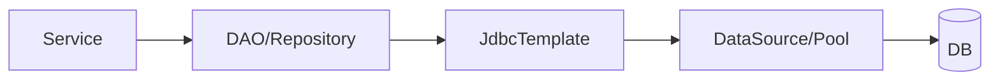
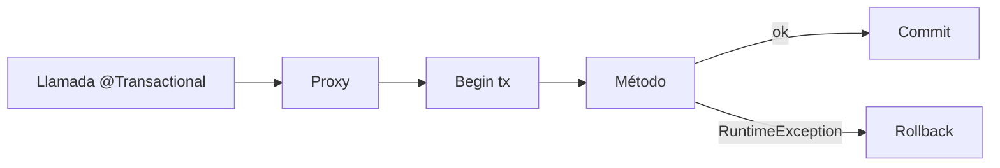

# Módulo 3: Acceso a datos con JDBC

JPA es cómodo, pero JDBC te da control directo sobre SQL, latencia y transacciones. Spring simplifica JDBC con `DataSource`, `JdbcTemplate`, `JdbcClient` y manejo declarativo de transacciones. Este módulo enseña el acceso relacional explícito, que también es la base para entender qué hace JPA por debajo.

**Entorno de referencia verificado (2026-05-22):** JDK 27.0.1.0.2, Maven 3.10.0, Spring Boot 3.5.0, H2 2.3.232 para smokes.

## Aprende construyendo

### Tema 1: DataSource, JdbcTemplate y DAO · Intermedio · 35 min

Caso guía: guardar y consultar guías con SQL explícito sin manejar manualmente cada `Connection/PreparedStatement`.

#### `DataSource`

**Definición formal.** `DataSource` es la fábrica de conexiones JDBC. En producción suele ser un pool (HikariCP por defecto en Boot).

**Contrato.** El código pide conexiones al pool; debe cerrarlas/devolverlas. Spring maneja esto con templates.

**Error común.** Crear conexiones por request sin pool. Corrección: DataSource pool.

#### `JdbcTemplate` y DAO

**Definición formal.** `JdbcTemplate` ejecuta SQL con manejo de recursos, mapeo y traducción de excepciones. DAO (Data Access Object) encapsula acceso a datos detrás de una interfaz.



**Ejemplo mínimo enfocado (ejecutable, Spring Boot + H2).**

```bash
mkdir -p sb3-jdbc/src/main/java/com/academia
cd sb3-jdbc
```

Crea el archivo `pom.xml`:

```xml
<project xmlns="http://maven.apache.org/POM/4.0.0" xmlns:xsi="http://www.w3.org/2001/XMLSchema-instance"
 xsi:schemaLocation="http://maven.apache.org/POM/4.0.0 https://maven.apache.org/xsd/maven-4.0.0.xsd">
  <modelVersion>4.0.0</modelVersion>
  <parent><groupId>org.springframework.boot</groupId><artifactId>spring-boot-starter-parent</artifactId><version>3.5.0</version><relativePath/></parent>
  <groupId>com.academia</groupId><artifactId>sb3-jdbc</artifactId><version>0.0.1</version>
  <properties><java.version>21</java.version></properties>
  <dependencies>
    <dependency><groupId>org.springframework.boot</groupId><artifactId>spring-boot-starter-jdbc</artifactId></dependency>
    <dependency><groupId>com.h2database</groupId><artifactId>h2</artifactId><scope>runtime</scope></dependency>
  </dependencies>
  <build><plugins><plugin><groupId>org.springframework.boot</groupId><artifactId>spring-boot-maven-plugin</artifactId></plugin></plugins></build>
</project>
```

Crea el archivo `src/main/java/com/academia/Demo.java`:

```java
package com.academia;
import org.springframework.boot.*; import org.springframework.boot.autoconfigure.*;
import org.springframework.jdbc.core.JdbcTemplate; import org.springframework.context.annotation.Bean;

@SpringBootApplication
public class Demo {
  public static void main(String[] args) {
    var ctx = SpringApplication.run(Demo.class, args);
    JdbcTemplate jdbc = ctx.getBean(JdbcTemplate.class);
    jdbc.execute("CREATE TABLE guia(id INT PRIMARY KEY, codigo VARCHAR(20))");
    jdbc.update("INSERT INTO guia(id,codigo) VALUES(?,?)", 1, "G1");
    System.out.println(jdbc.queryForObject("SELECT codigo FROM guia WHERE id=?", String.class, 1));
    ctx.close();
  }
}
```

```bash
mvn -q -DskipTests package
java -jar target/sb3-jdbc-0.0.1.jar
```

**Error común.** Concatenar SQL con input. Riesgo: inyección SQL. Corrección: parámetros `?` o binding nombrado.

**Verificación (Spring Boot 3.5.0, H2, JDK 27, 2026-05-22).** Salida incluye `G1`.

### Tema 2: `JdbcClient`: la API fluida de Spring para SQL explícito · Intermedio · 35 min

Caso guía: misma consulta con API más legible.

#### `JdbcClient`

**Definición formal.** `JdbcClient` (Spring Framework 6.1+) es una fachada fluida sobre JDBC/JdbcTemplate para consultas/updates con binding nombrado o posicional.

**Ejemplo mínimo enfocado (ejecutable en proyecto Spring Boot).**

```java
String codigo = jdbcClient.sql("SELECT codigo FROM guia WHERE id=:id")
  .param("id", 1)
  .query(String.class)
  .single();
System.out.println(codigo);
```

**Error común.** Asumir que `JdbcClient` reemplaza diseño de repositorios/SQL. Es una API; el diseño de queries sigue siendo tu responsabilidad.

**Nota de verificación.** Disponible en Spring Framework 6.1 / Boot 3.2+; verificado por compatibilidad de versión Boot 3.5.0.

### Tema 3: `@Transactional`, rollback y límites de transacción · Avanzado · 35 min

Caso guía: guardar guía y movimiento de auditoría; si falla el segundo, se revierte todo.

#### `@Transactional`

**Definición formal.** Anotación declarativa para delimitar transacciones. Spring crea proxy que abre/commitea/rollbackea según resultado.

**Cómo funciona por dentro.** El proxy inicia transacción antes del método, ejecuta lógica, hace commit al retornar normalmente o rollback según reglas (por defecto runtime/unchecked exceptions).



**Ejemplo mínimo enfocado (Java puro simulando contrato).**

```bash
mkdir -p java-sb3-tx
cd java-sb3-tx
```

Crea el archivo `DemoTx.java`:

```java
class Tx {
  static void run(boolean fail) {
    boolean committed = false;
    try {
      System.out.println("begin");
      if (fail) throw new RuntimeException("boom");
      committed = true;
    } catch (RuntimeException e) {
      System.out.println("rollback");
    } finally {
      if (committed) System.out.println("commit");
    }
  }
}
public class DemoTx { public static void main(String[] args){ Tx.run(false); Tx.run(true); } }
```

```bash
javac DemoTx.java
java DemoTx
```

**Error común.** Self-invocation: llamar método `@Transactional` desde el mismo bean pasando por `this`. El proxy no intercepta. Corrección: llamar por bean proxy, separar clase, o usar AspectJ.

**Error común.** Atrapar excepción y no relanzar, esperando rollback. Corrección: relanzar o marcar rollback explícitamente.

**Verificación (JDK 27, 2026-05-22).** `begin, commit, begin, rollback`.

## Cierre

JDBC con Spring es control explícito con ergonomía: tú ves el SQL, Spring maneja recursos y transacciones. Es la base para razonar sobre JPA y performance.

## Checklist

- Uso `DataSource`/pool, no conexiones sueltas.
- Parametrizo SQL siempre.
- Entiendo `@Transactional`, rollback por defecto y self-invocation.
- Conozco `JdbcClient` como alternativa moderna a `JdbcTemplate`.
