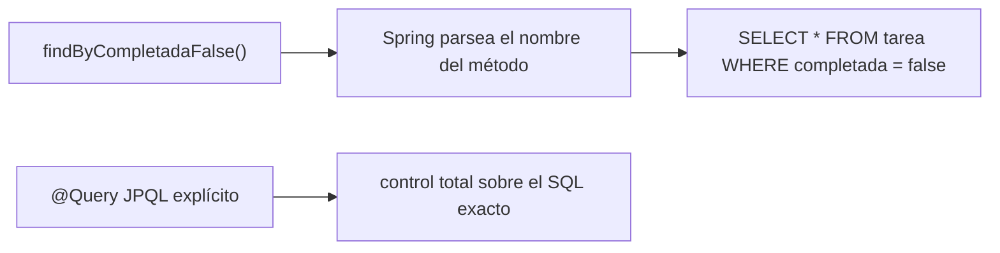
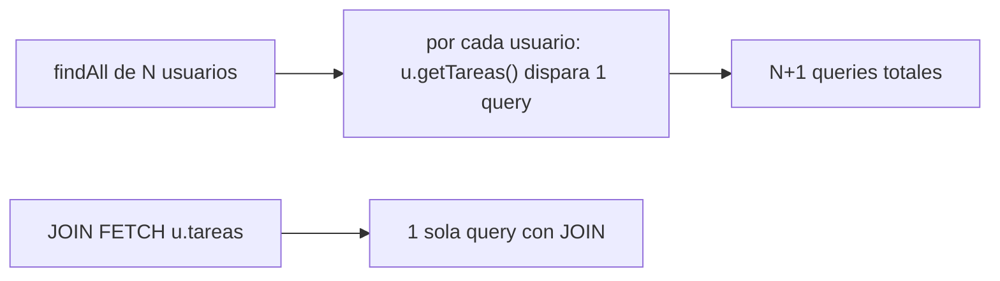

# Módulo 3: Persistencia con Spring Data JPA

Cada tema declara nivel, duración y una verificación real contra una base de datos H2 embebida y `mvn test`, para que cada afirmación sobre consultas y migraciones sea comprobable, no solo descrita.

## Aprende construyendo

### Tema 1: Entidades y repositorios derivados · Intermedio · 35 min

**Prerrequisito:** Spring Initializr y starters (Módulo 1); DTOs vs entidades (Módulo 2).

**Al terminar podrás:** mapear una clase Java a una tabla con `@Entity`, declarar un repositorio derivado y explicar cuándo se necesita `@Query` explícito.

#### Aprende

**¿Por qué es importante?** Una lista de tareas pendientes necesita persistirse en una base de datos real; escribir SQL manual para cada consulta simple (buscar por estado, por usuario) es repetitivo y propenso a errores tipográficos que solo se detectan en tiempo de ejecución.

**Mapa de subtemas críticos**

| Subtema | Papel | Evidencia |
|---|---|---|
| Mapeo `@Entity` a tabla | Prerrequisito | La clase `Tarea` con `@Id @GeneratedValue` se persiste y recupera en `@DataJpaTest` |
| Constructor protegido requerido por JPA | Núcleo | `protected Tarea() {}` permite reconstruir filas; su ausencia rompe la hidratación |
| Query derivada del nombre del método | Núcleo | `findByCompletadaFalse()` devuelve las pendientes sin cuerpo escrito a mano |
| `@Query` JPQL explícito | Variante | `@Query("SELECT t FROM Tarea t WHERE t.completada = false")` mantiene el test en verde |
| Validación de propiedades en el arranque | Diagnóstico | `findByTituloo` lanza `PropertyReferenceException: No property 'tituloo' found` al iniciar |
| Límite de la convención de nombres | Límite | Más de dos o tres condiciones encadenadas vuelven el nombre ilegible |
| Elección derivado vs `@Query` | Decisión | Para joins o agregaciones se opta por `@Query` desde el principio |

Cada fila tiene su explicación individual a continuación.

**Mapeo `@Entity` a tabla (prerrequisito).** Marcar la clase `Tarea` con `@Entity` indica a Hibernate que traduzca cada instancia a una fila y viceversa, usando `@Id @GeneratedValue` para delegar en la base la generación del identificador. Sin este mapeo no existe tabla contra la que consultar, por lo que es la base sobre la que se apoyan los repositorios del tema. El test `@DataJpaTest` lo confirma guardando y leyendo tareas reales en H2.

**Constructor protegido requerido por JPA (núcleo).** `protected Tarea() {}` existe porque JPA necesita un constructor sin argumentos para reconstruir instancias al leer filas, mientras el constructor público controla la creación válida desde código. Si se elimina, la hidratación de entidades desde la base falla, de modo que ambos constructores cumplen papeles distintos y complementarios. La explicación línea por línea del tema lo señala explícitamente como requisito.

**Query derivada del nombre del método (núcleo).** Spring Data parsea `findBy` + `Completada` + `False` en tiempo de arranque y genera la implementación SQL sin ningún cuerpo escrito a mano. Este mecanismo evita el SQL repetitivo y propenso a typos para consultas simples por convención. El test demuestra que `findByCompletadaFalse()` devuelve exactamente las tareas sin completar partiendo solo del nombre.

**`@Query` JPQL explícito (variante).** Cuando la consulta es demasiado compleja para expresarse por convención de nombres, `@Query` con JPQL da control total sobre el SQL. El ejercicio reemplaza `findByCompletadaFalse()` por `@Query("SELECT t FROM Tarea t WHERE t.completada = false")` y confirma que el test original sigue pasando. Es la variante a usar cuando el nombre derivado dejaría de ser legible o posible.

**Validación de propiedades en el arranque (diagnóstico).** Spring Data contrasta los nombres derivados contra las propiedades reales de la entidad al arrancar el contexto, no al ejecutar la query. El fallo deliberado renombra el método a `findByTituloo` y produce `PropertyReferenceException: No property 'tituloo' found for type 'Tarea'` antes de cualquier consulta. Esto adelanta el error mucho antes que un SQL manual con un typo que solo fallaría en tiempo de ejecución.

**Límite de la convención de nombres (límite).** La derivación por nombre se vuelve forzada cuando se encadenan muchas condiciones: la pista del tema advierte que más de dos o tres condiciones hacen el nombre ilegible. Para agregaciones o joins específicos la convención se vuelve imposible de expresar. Ese límite marca la frontera donde conviene cambiar de mecanismo.

**Elección derivado vs `@Query` (decisión).** La decisión profesional es usar métodos derivados donde la intención es legible y `@Query` donde la convención se vuelve ambigua, como recoge el reto abierto sobre la entidad `Envio`. Para joins específicos o lógica que no se expresa como secuencia de condiciones, el tema recomienda `@Query` desde el principio. Así se evita tanto el SQL innecesario como los nombres de método impronunciables.

**Conceptos clave:** mapeo objeto-relacional (`@Entity`), query derivada del nombre del método, `@Query` explícito para casos complejos.

```java
@Entity
public class Tarea {
    @Id @GeneratedValue
    private Long id;
    private String titulo;
    private boolean completada;
}
```

Esta clase mapea una clase Java a una tabla: Hibernate (la implementación de JPA que usa Spring Data JPA) traduce automáticamente entre instancias y filas, gestionando la generación de identificadores (`@GeneratedValue`).

```java
public interface TareaRepository extends JpaRepository<Tarea, Long> {
    List<Tarea> findByCompletadaFalse();
}
```

Esta interfaz demuestra la capacidad más distintiva de Spring Data: Spring parsea el nombre del método (`findBy` + `Completada` + `False`) y genera la implementación SQL automáticamente, sin ningún cuerpo escrito a mano. Cuando la consulta es demasiado compleja para expresarse por convención de nombres (agregaciones, joins específicos), `@Query` con JPQL explícito da control total.

**Analogía:** un método derivado es como pedirle a un asistente que entienda automáticamente qué necesitas a partir de cómo formulas tu pedido ("las tareas no completadas"); `@Query` es darle instrucciones explícitas y precisas cuando el pedido es demasiado específico para inferirlo.

**Diagrama:**



#### Practica

**Demo paso a paso.** Desde una carpeta vacía (o continuando en `academia-spring`), genera el proyecto con `data-jpa` y `h2` y crea la entidad y el repositorio en `src/main/java/com/academia/tarea/`:

```bash
mkdir -p academia-spring
cd academia-spring
curl -fsSL https://start.spring.io/starter.zip -d type=maven-project -d dependencies=data-jpa,h2 -d javaVersion=25 -d artifactId=academia-tareas -o app.zip
unzip -o app.zip
mkdir -p src/main/java/com/academia/tarea
```

1. Crea `src/main/java/com/academia/tarea/Tarea.java`:

```java
// src/main/java/com/academia/tarea/Tarea.java
package com.academia.tarea;

import jakarta.persistence.Entity;
import jakarta.persistence.GeneratedValue;
import jakarta.persistence.Id;

@Entity
public class Tarea {
    @Id
    @GeneratedValue
    private Long id;
    private String titulo;
    private boolean completada;

    protected Tarea() {} // requerido por JPA

    public Tarea(String titulo) {
        this.titulo = titulo;
        this.completada = false;
    }

    public Long getId() { return id; }
    public String getTitulo() { return titulo; }
    public boolean isCompletada() { return completada; }
}
```

2. Crea `src/main/java/com/academia/tarea/TareaRepository.java`:

```java
// src/main/java/com/academia/tarea/TareaRepository.java
package com.academia.tarea;

import org.springframework.data.jpa.repository.JpaRepository;
import java.util.List;

public interface TareaRepository extends JpaRepository<Tarea, Long> {
    List<Tarea> findByCompletadaFalse(); // Spring genera la query a partir del nombre del método
}
```

**Explicación línea por línea:** `@Id @GeneratedValue` delega en la base la generación del identificador; el constructor protegido sin argumentos es requerido por JPA para reconstruir instancias desde filas, mientras el constructor público controla la creación válida desde código; `findByCompletadaFalse()` no tiene cuerpo porque Spring Data genera la implementación a partir del nombre en tiempo de arranque.

3. Escribe un test real con `@DataJpaTest` (levanta un contexto JPA contra H2, sin mockear nada):

```java
// src/test/java/com/academia/tarea/TareaRepositoryTest.java
package com.academia.tarea;

import org.junit.jupiter.api.Test;
import org.springframework.beans.factory.annotation.Autowired;
import org.springframework.boot.test.autoconfigure.orm.jpa.DataJpaTest;
import java.util.List;
import static org.assertj.core.api.Assertions.assertThat;

@DataJpaTest
class TareaRepositoryTest {

    @Autowired
    private TareaRepository tareaRepository;

    @Test
    void findByCompletadaFalseDevuelveSoloLasPendientes() {
        tareaRepository.save(new Tarea("Comprar leche"));
        Tarea pagada = new Tarea("Pagar factura");
        tareaRepository.save(pagada);

        List<Tarea> pendientes = tareaRepository.findByCompletadaFalse();

        assertThat(pendientes).extracting(Tarea::getTitulo).containsExactlyInAnyOrder("Comprar leche", "Pagar factura");
    }
}
```

4. Ejecuta el test:

```bash
mvn test -Dtest=TareaRepositoryTest # Maven
./gradlew test --tests TareaRepositoryTest # Gradle (equivalente)
```

`mvn` ejecuta Maven; `test` es la fase que compila y corre las pruebas, y `-Dtest=` acota la ejecución a una sola clase.

**Resultado esperado:** `BUILD SUCCESS` con el test en verde, confirmando que `findByCompletadaFalse()` devuelve exactamente las dos tareas sin completar, generadas a partir únicamente del nombre del método, sin SQL escrito a mano.

**Fallo deliberado:** cambia el nombre del método a `findByTituloo` (columna inexistente, error tipográfico deliberado) y ejecuta `mvn test`. La aplicación falla al ARRANCAR el contexto (no al ejecutar la query) con `PropertyReferenceException: No property 'tituloo' found for type 'Tarea'`. Diagnostica confirmando que Spring Data valida los nombres contra las propiedades reales de la entidad en el arranque, adelantando el error mucho antes que un SQL manual con un typo. Revierte el nombre.

**Ejercicios.**

1. Agrega `findByTituloContaining(String fragmento)` y confirma con un test que filtra por coincidencia parcial.
2. Agrega `findByCompletadaFalseAndTituloContaining(String fragmento)` y pruébalo con datos que solo cumplen una condición.
3. Reemplaza `findByCompletadaFalse()` por `@Query("SELECT t FROM Tarea t WHERE t.completada = false")` y confirma que el test original sigue pasando.
4. Escribe de memoria una entidad con dos campos y un repositorio con un método derivado que filtre por uno de ellos.

**Pista:** si el nombre derivado empieza a tener más de dos o tres condiciones encadenadas, `@Query` explícito será más legible.

**Completa el código:** rellena el espacio para que Spring genere la query desde el nombre:

```java
public interface TareaRepository extends JpaRepository<Tarea, Long> {
    List<Tarea> ____CompletadaFalse();
}
```

**Reto de memoria:** cierra este documento y escribe una entidad `@Entity` con `@Id @GeneratedValue` y un repositorio con un método derivado por un campo booleano.

#### Aplica

**Reto abierto.** Modela entregas y estados con una entidad `Envio` y un repositorio que cubra búsquedas por estado, por guía parcial y por rango de fechas. Usa métodos derivados donde la intención sea legible y `@Query` donde la convención se vuelva ambigua. Demuestra con `@DataJpaTest` al menos cuatro consultas y documenta por qué elegiste cada mecanismo.

**Checklist de salida.**

- [ ] La entidad tiene identificador generado y constructor protegido.
- [ ] Al menos dos consultas derivadas y una `@Query` funcionan en pruebas.
- [ ] Un nombre de método inválido rompe el arranque y el diagnóstico está documentado.
- [ ] Las pruebas usan H2 real, sin mocks del repositorio.
- [ ] El README explica cuándo un método derivado deja de ser suficiente.

**Si falla.** Si el contexto no arranca por una propiedad inexistente, revisa el nombre contra los campos reales. Si un método derivado devuelve vacío, comprueba el nombre exacto y los datos insertados. Si `@DataJpaTest` no encuentra el repositorio, revisa el paquete y la anotación de la clase principal.

**Siguiente paso:** el Tema 2 aborda qué ocurre cuando estas consultas se combinan con relaciones entre entidades.

**Errores comunes:** escribir SQL manual para consultas simples que un método derivado resolvería; encadenar demasiadas condiciones en el nombre hasta volverlo ilegible.

**Límites y decisión de uso:** para agregaciones, joins específicos o lógica que no se expresa como una secuencia de condiciones, un método derivado se vuelve forzado o imposible; usa `@Query` desde el principio.

**Fuente oficial:** [Spring Data JPA — Query methods](https://docs.spring.io/spring-data/jpa/reference/jpa/query-methods.html).

**Transferencia al proyecto integrador:** estas entidades y repositorios son la base de persistencia del microservicio productivo.

### Tema 2: El problema N+1 y su corrección · Avanzado · 50 min

**Prerrequisito:** Tema 1 de este módulo (entidades y repositorios).

**Al terminar podrás:** reproducir el problema N+1 con una relación `@OneToMany`, medir el número real de consultas y corregirlo con `JOIN FETCH`.

#### Aprende

**¿Por qué es importante?** Iterar sobre una lista de usuarios accediendo a las tareas de cada uno, con una relación perezosa, dispara una query SQL separada por cada usuario: un problema de rendimiento que empeora con el tamaño de los datos y puede pasar desapercibido en desarrollo con pocos registros.

**Mapa de subtemas críticos**

| Subtema | Papel | Evidencia |
|---|---|---|
| Relación `@OneToMany` perezosa | Prerrequisito | `@OneToMany(mappedBy = "usuario")` no carga `tareas` hasta `u.getTareas().size()` |
| Medición real con `Statistics` | Núcleo | `stats.getQueryExecutionCount()` reporta exactamente `4` para 3 usuarios |
| Patrón N+1 al iterar | Núcleo | 1 query de `findAll()` + 3 lazy = 4 queries totales |
| Corrección con `JOIN FETCH` | Variante | `JOIN FETCH u.tareas` baja el conteo a `1L` |
| `stats.clear()` antes de medir | Diagnóstico | Sin él, el conteo arrastra queries previas y deja de ser interpretable |
| `EAGER` como falsa solución | Error frecuente | Usar `EAGER` indiscriminadamente carga datos innecesarios siempre |
| `JOIN FETCH` vs acceso raro | Decisión | Para relaciones casi nunca accedidas, forzar `JOIN FETCH` traería datos de más |

Cada fila tiene su explicación individual a continuación.

**Relación `@OneToMany` perezosa (prerrequisito).** `@OneToMany(mappedBy = "usuario") private List<Tarea> tareas;` declara una relación uno-a-muchos con carga perezosa por defecto, de modo que la colección no se materializa hasta acceder a ella con `u.getTareas().size()`. Esta pereza es justamente la condición que habilita el problema N+1. Sin entender que el acceso diferido dispara una query, el resto del tema no tiene sentido.

**Medición real con `Statistics` (núcleo).** Activar `hibernate.generate_statistics=true` y leer `sessionFactory.getStatistics().getQueryExecutionCount()` reporta el número exacto de queries por sesión en lugar de una suposición. El test demuestra con tres usuarios que el contador da exactamente `4`. Medir es el núcleo del tema: convierte N+1 de una sospecha en un número observable.

**Patrón N+1 al iterar (núcleo).** Al recorrer los usuarios de `findAll()` y tocar sus tareas, Hibernate ejecuta la query original más una adicional por cada usuario, resultando en N+1 queries. El test lo cuantifica: 1 de `findAll()` más 3 lazy igual a 4. Este es el mecanismo exacto que se reproduce para luego corregirlo con evidencia.

**Corrección con `JOIN FETCH` (variante).** `@Query("SELECT u FROM Usuario u JOIN FETCH u.tareas") List<Usuario> buscarConTareas();` carga usuarios y tareas en una sola query con un JOIN real, y el conteo baja a `1L`. El tema propone `@EntityGraph(attributePaths = "tareas")` como alternativa declarativa que logra el mismo `1`. Ambas son variantes para colapsar las N queries adicionales en una.

**`stats.clear()` antes de medir (diagnóstico).** Llamar a `stats.clear()` justo antes de la sección medida es imprescindible, porque de lo contrario el contador incluye queries previas (como los `save`) y deja de ser interpretable. La pista del tema lo marca como paso obligatorio. Si el conteo varía entre ejecuciones, la primera sospecha es que falta este reinicio.

**`EAGER` como falsa solución (error frecuente).** Un error común documentado es usar `EAGER` indiscriminadamente como "solución" genérica, lo que carga datos innecesarios incluso cuando no se necesitan. La checklist exige explícitamente no usar `EAGER` de esa forma. Resuelve el síntoma aparente pero empeora el rendimiento en todas las consultas que ni siquiera usan la relación.

**`JOIN FETCH` vs acceso raro (decisión).** La decisión profesional, según los límites del tema, es reservar `JOIN FETCH` para accesos donde se sabe que la relación se usará. Para una relación que casi nunca se accede junto con la entidad principal, forzar `JOIN FETCH` en todas las consultas cargaría datos innecesarios. El reto abierto pide comparar `JOIN FETCH`, `@EntityGraph` y una proyección DTO para un listado paginado y decidir en consecuencia.

**Conceptos clave:** carga perezosa (`lazy`), una query adicional por cada elemento de una colección, `JOIN FETCH`.

`@OneToMany(mappedBy = "usuario") private List<Tarea> tareas;` mapea una relación uno-a-muchos con carga perezosa por defecto: la lista de tareas no se carga hasta que se accede a ella (`u.getTareas().size()`). Al iterar sobre una colección de usuarios, Hibernate ejecuta una query separada por usuario para cargar sus tareas, resultando en N queries adicionales más la original — de ahí "N+1". `@Query("SELECT u FROM Usuario u JOIN FETCH u.tareas") List<Usuario> buscarConTareas();` corrige esto indicando que cargue usuarios y tareas en una única query con `JOIN` real.

**Analogía:** el problema N+1 es como enviar un mensajero por separado a buscar cada ingrediente de una receta, uno a la vez, en vez de un único mensajero que trae todos en un solo viaje coordinado (`JOIN FETCH`); cada viaje tiene un costo fijo que se multiplica.

**Diagrama:**



#### Practica

**Demo paso a paso.** Reutiliza `academia-spring` (o créalo desde una carpeta vacía) y crea `src/main/java/com/academia/tarea/Usuario.java` con la relación, habilitando el contador de queries real vía el logger de Hibernate:

```bash
mkdir -p academia-spring/src/main/java/com/academia/tarea
cd academia-spring
```

1. Crea `Usuario.java`:

```java
// src/main/java/com/academia/tarea/Usuario.java
package com.academia.tarea;

import jakarta.persistence.*;
import java.util.ArrayList;
import java.util.List;

@Entity
public class Usuario {
    @Id
    @GeneratedValue
    private Long id;
    private String nombre;

    @OneToMany(mappedBy = "usuario")
    private List<Tarea> tareas = new ArrayList<>();

    protected Usuario() {}

    public Usuario(String nombre) { this.nombre = nombre; }

    public Long getId() { return id; }
    public List<Tarea> getTareas() { return tareas; }
}
```

2. Activa las estadísticas reales:

```bash
cat >> src/main/resources/application.properties <<'EOF'
spring.jpa.properties.hibernate.generate_statistics=true
logging.level.org.hibernate.stat=DEBUG
EOF
```

**Explicación línea por línea:** `@OneToMany(mappedBy = "usuario")` declara la relación uno-a-muchos con carga perezosa (comportamiento por defecto); `hibernate.generate_statistics=true` activa estadísticas que reportan el número exacto de queries por sesión, la forma real de medir N+1.

3. Escribe un test que provoque N+1 y lea el conteo real desde `SessionFactory.getStatistics()`:

```java
// src/test/java/com/academia/tarea/NMasUnoTest.java
package com.academia.tarea;

import org.hibernate.SessionFactory;
import org.hibernate.stat.Statistics;
import org.junit.jupiter.api.Test;
import org.springframework.beans.factory.annotation.Autowired;
import org.springframework.boot.test.autoconfigure.orm.jpa.DataJpaTest;
import static org.assertj.core.api.Assertions.assertThat;

@DataJpaTest
class NMasUnoTest {

    @Autowired
    private UsuarioRepository usuarioRepository;
    @Autowired
    private SessionFactory sessionFactory;

    @Test
    void iterarSobreUsuariosAccediendoATareasDisparaNMasUnoQueries() {
        for (int i = 0; i < 3; i++) usuarioRepository.save(new Usuario("usuario-" + i));

        Statistics stats = sessionFactory.getStatistics();
        stats.clear();

        for (Usuario u : usuarioRepository.findAll()) {
            u.getTareas().size(); // dispara una query lazy POR CADA usuario
        }

        // 1 query para findAll() + 3 queries lazy (una por usuario) = 4
        assertThat(stats.getQueryExecutionCount()).isEqualTo(4L);
    }
}
```

4. Ejecuta el test:

```bash
mvn test -Dtest=NMasUnoTest         # Maven
./gradlew test --tests NMasUnoTest  # Gradle (equivalente)
```

**Resultado esperado:** el test pasa y `stats.getQueryExecutionCount()` reporta exactamente `4` queries (1 de `findAll()` + 3 de acceso perezoso, una por usuario): la medición real del problema, no una suposición.

**Fallo deliberado:** cambia el conteo esperado a `isEqualTo(1L)` (asumiendo que `findAll()` ya trae todo) y ejecuta. El test FALLA con `expected: 1L but was: 4L`. Diagnostica con evidencia real que la carga perezosa dispara las queries adicionales al iterar. Revierte a `4L`, corrige el repositorio con `JOIN FETCH` (`@Query("SELECT u FROM Usuario u JOIN FETCH u.tareas") List<Usuario> buscarConTareas();`) y confirma que usando ese método el conteo baja a `1L`.

**Ejercicios.**

1. Agrega un cuarto usuario y confirma que el conteo sube a `5` antes de la corrección y permanece en `1` después de `JOIN FETCH`.
2. Prueba `@EntityGraph(attributePaths = "tareas")` sobre `findAll()` como alternativa declarativa y confirma con `Statistics` que reduce el conteo a `1`.
3. Provoca N+1 con una segunda relación (`@OneToMany` de `Usuario` a `Comentario`) y confirma que iterar sobre ambas multiplica las queries adicionales.
4. Escribe de memoria una entidad con `@OneToMany` y un test que mida el número real de queries antes y después de `JOIN FETCH`.

**Pista:** `stats.clear()` antes de la sección que quieres medir es imprescindible; sin eso, el conteo incluye queries previas y deja de ser interpretable.

**Completa el código:** rellena el espacio para cargar usuarios y tareas en una única query:

```java
@Query("SELECT u FROM Usuario u ____ u.tareas")
List<Usuario> buscarConTareas();
```

**Reto de memoria:** cierra este documento y escribe un test que mida con `Statistics.getQueryExecutionCount()` la diferencia entre carga perezosa y `JOIN FETCH`.

#### Aplica

**Reto abierto.** Reproduce N+1 con tres entidades relacionadas y demuestra con `Statistics` el número exacto de queries antes y después de la corrección. Compara `JOIN FETCH`, `@EntityGraph` y una proyección DTO, y decide cuál usarías para un listado paginado de entregas. Documenta el trade-off entre traer datos de más y ejecutar N+1.

**Checklist de salida.**

- [ ] El test mide queries reales, no estimaciones.
- [ ] La corrección baja el conteo a una consulta para el caso probado.
- [ ] Se comparan al menos dos alternativas con evidencia.
- [ ] El README explica cuándo `JOIN FETCH` carga datos innecesarios.
- [ ] La prueba falla de forma legible si el conteo cambia.
- [ ] No se usa `EAGER` indiscriminadamente como solución.

**Si falla.** Si el conteo no baja, la consulta con `JOIN FETCH` no se está usando o la relación es de otro tipo. Si el conteo varía entre ejecuciones, falta `stats.clear()` o hay caché de segundo nivel. Si aparecen duplicados, usa `DISTINCT` en la consulta.

**Siguiente paso:** el Tema 3 aborda cómo versionar cambios de esquema sin depender de la generación automática de Hibernate.

**Errores comunes:** no notar N+1 hasta producción, por no medirlo durante el desarrollo; usar `EAGER` indiscriminadamente como "solución" genérica, cargando datos innecesarios incluso cuando no se necesitan.

**Límites y decisión de uso:** para una relación que casi nunca se accede junto con la entidad principal, forzar `JOIN FETCH` en todas las consultas cargaría datos innecesarios; resérvalo para accesos donde sabes que la relación se usará.

**Fuente oficial:** [Hibernate — Fetching strategies](https://docs.jboss.org/hibernate/orm/current/userguide/html_single/Hibernate_User_Guide.html#fetching).

**Transferencia al proyecto integrador:** detectar y corregir N+1 es una revisión obligatoria antes de cerrar el microservicio productivo.

### Tema 3: Migraciones con Flyway · Intermedio · 35 min

**Prerrequisito:** Temas 1 y 2 de este módulo.

**Al terminar podrás:** versionar un cambio de esquema con Flyway y explicar por qué `hibernate.ddl-auto=update` es riesgoso en producción.

#### Aprende

**¿Por qué es importante?** Un cambio de esquema aplicado automáticamente por Hibernate (`ddl-auto=update`) no queda registrado en ningún historial versionado ni revisable en un pull request; una migración de Flyway sí, y se aplica de forma idéntica y predecible en cada entorno.

**Mapa de subtemas críticos**

| Subtema | Papel | Evidencia |
|---|---|---|
| Riesgo de `ddl-auto=update` | Prerrequisito | Hibernate podría inferir un cambio no pretendido, sin historial revisable |
| Migración versionada `V1__...sql` | Núcleo | `V1__crear_tabla_tarea.sql` declara el esquema en SQL puro revisable |
| `ddl-auto=validate` | Núcleo | Valida que las entidades coincidan con lo que Flyway creó, sin modificar |
| Validación de esquema fallida | Diagnóstico | Un campo sin migración lanza `Schema-validation: missing column [descripcion]` |
| Orden y unicidad de versiones | Límite | Flyway rechaza aplicar una versión ya registrada (`V1` duplicada) |
| Edición manual de tablas | Error frecuente | Modificar tablas fuera de una migración pierde historial y reproducibilidad |
| `create-drop` vs migraciones | Decisión | Para un prototipo descartable, `create-drop` sin Flyway basta |

Cada fila tiene su explicación individual a continuación.

**Riesgo de `ddl-auto=update` (prerrequisito).** `hibernate.ddl-auto=update` deja que Hibernate genere y actualice el esquema a partir de las entidades, cómodo al inicio pero riesgoso en producción porque podría inferir un cambio distinto al pretendido sin quedar registrado en un historial revisable. Entender este riesgo es el punto de partida que motiva introducir Flyway. El tema lo contrapone directamente a una migración explícita y revisable en un pull request.

**Migración versionada `V1__...sql` (núcleo).** `V1__crear_tabla_tarea.sql` (prefijo `V1`, `__` y descripción) declara el cambio de esquema en SQL puro, versionado en el repositorio y revisable antes de aplicarse. Flyway registra qué migraciones ya corrieron y ejecuta solo las pendientes, en orden. El test confirma que esa migración se aplicó antes de arrancar el contexto y que guardar y leer una fila funciona.

**`ddl-auto=validate` (núcleo).** `spring.jpa.hibernate.ddl-auto=validate` indica a Hibernate que no genere ni modifique el esquema, solo que valide que las entidades coinciden con lo que Flyway creó. Si no coinciden, la aplicación falla al arrancar en vez de aplicar un cambio silencioso. Es el complemento de Flyway que convierte cualquier desalineación en un error visible y temprano.

**Validación de esquema fallida (diagnóstico).** El fallo deliberado agrega `private String descripcion;` a `Tarea` sin crear la migración `V2` y produce `SchemaManagementException: Schema-validation: missing column [descripcion] in table [tarea]` al arrancar. Esto demuestra el propósito de `validate`: en lugar de que Hibernate agregue la columna silenciosamente, la aplicación se niega a arrancar hasta que exista una migración explícita. La reparación es crear `V2__agregar_columna_descripcion.sql` con el `ALTER TABLE` correspondiente.

**Orden y unicidad de versiones (límite).** El prefijo de versión debe ser único y estrictamente creciente; Flyway rechaza aplicar una versión ya registrada. El ejercicio provoca este límite reutilizando `V1` para otra migración y observando el error ante la versión duplicada. Esta restricción es la que garantiza que cada entorno aplique exactamente la misma secuencia.

**Edición manual de tablas (error frecuente).** Un error común es editar tablas manualmente en vez de a través de una migración, lo que pierde el historial y la reproducibilidad. La checklist exige que ninguna tabla se modifique fuera de una migración. Cada cambio hecho a mano rompe la garantía de que el esquema es idéntico y reconstruible en todos los entornos.

**`create-drop` vs migraciones (decisión).** La decisión de uso del tema es que, para un prototipo local descartable sin datos que preservar, `ddl-auto=create-drop` sin Flyway es más simple y suficiente. Las migraciones versionadas se reservan para entornos compartidos o con datos que deban persistir. Elegir según el entorno evita tanto la ceremonia innecesaria como la pérdida de datos en producción.

**Conceptos clave:** esquema versionado y revisable, riesgo de `ddl-auto` en producción, migraciones aplicadas en orden secuencial.

`hibernate.ddl-auto=update` permite que Hibernate genere y actualice el esquema basándose en las entidades, cómodo en desarrollo temprano pero riesgoso en producción: Hibernate podría inferir un cambio distinto al pretendido, sin quedar registrado en un historial revisable antes de aplicarse. `V1__crear_tabla_tareas.sql` declara explícitamente en SQL puro el cambio de esquema, versionado en el repositorio, revisable en un pull request y aplicado de forma idéntica en cada entorno. Flyway registra qué migraciones ya se aplicaron y ejecuta únicamente las pendientes, en orden.

**Analogía:** `ddl-auto=update` es como dejar que un asistente reorganice el mobiliario según sus inferencias, sin plano ni revisión previa; Flyway es seguir un plano de renovación explícito, versionado y revisado antes de ejecutarse, aplicado igual en cada casa idéntica.

**Diagrama:**

```text
┌── V1__crear_tabla_tareas.sql ──┐
│  aplicada primero                │
└──────────┬─────────────────┘
           │ V2__agregar_columna_prioridad.sql
           ▼
┌── esquema actual, versionado y revisable ──┐
│  Flyway registra qué migraciones ya corrieron │
└──────────────────────────────────────┘
```

#### Practica

**Demo paso a paso.** Reutiliza `academia-spring` (o créalo desde una carpeta vacía), agrega `flyway-core` y crea la migración inicial en `src/main/resources/db/migration/`:

```bash
mkdir -p academia-spring/src/main/resources/db/migration
cd academia-spring
```

1. Crea `src/main/resources/db/migration/V1__crear_tabla_tarea.sql`:

```sql
-- src/main/resources/db/migration/V1__crear_tabla_tarea.sql
CREATE TABLE tarea (
    id BIGSERIAL PRIMARY KEY,
    titulo VARCHAR(255) NOT NULL,
    completada BOOLEAN NOT NULL DEFAULT false
);
```

2. Desactiva `ddl-auto` y activa Flyway:

```bash
# desactiva ddl-auto: el esquema ahora lo gestiona exclusivamente Flyway
cat >> src/main/resources/application.properties <<'EOF'
spring.jpa.hibernate.ddl-auto=validate
spring.flyway.enabled=true
EOF
mvn test          # Maven
./gradlew test    # Gradle (equivalente)
```

**Explicación línea por línea:** `V1__crear_tabla_tarea.sql` (prefijo `V1`, versión secuencial, `__` y descripción) declara el esquema inicial en SQL real; `spring.jpa.hibernate.ddl-auto=validate` indica a Hibernate que NO genere ni modifique el esquema, solo que valide que las entidades coincidan con lo que Flyway creó; si no coinciden, la aplicación falla al arrancar en vez de aplicar un cambio silencioso.

3. Confirma con un test real que la migración se aplicó y el esquema coincide con la entidad:

```java
// src/test/java/com/academia/tarea/MigracionFlywayTest.java
package com.academia.tarea;

import org.junit.jupiter.api.Test;
import org.springframework.beans.factory.annotation.Autowired;
import org.springframework.boot.test.autoconfigure.orm.jpa.DataJpaTest;
import static org.assertj.core.api.Assertions.assertThat;

@DataJpaTest
class MigracionFlywayTest {

    @Autowired
    private TareaRepository tareaRepository;

    @Test
    void elEsquemaCreadoPorFlywayAceptaGuardarYLeerUnaTarea() {
        Tarea guardada = tareaRepository.save(new Tarea("Comprar leche"));

        Tarea leida = tareaRepository.findById(guardada.getId()).orElseThrow();

        assertThat(leida.getTitulo()).isEqualTo("Comprar leche");
    }
}
```

4. Ejecuta el test:

```bash
mvn test -Dtest=MigracionFlywayTest # Maven
./gradlew test --tests MigracionFlywayTest # Gradle (equivalente)
```

**Resultado esperado:** `BUILD SUCCESS`, confirmando que Flyway aplicó `V1__crear_tabla_tarea.sql` antes de que el contexto arrancara, que `ddl-auto=validate` confirmó la coincidencia con la entidad y que guardar y leer una fila real funciona.

**Fallo deliberado:** agrega un campo a `Tarea` (por ejemplo, `private String descripcion;`) SIN crear la migración `V2` correspondiente y ejecuta `mvn test`. La aplicación falla al arrancar con `SchemaManagementException: Schema-validation: missing column [descripcion] in table [tarea]`. Diagnostica confirmando el propósito de `ddl-auto=validate`: en vez de que Hibernate agregue la columna silenciosamente (el riesgo de `update`), la aplicación se niega a arrancar hasta que exista una migración explícita y revisable. Revierte el campo o crea `V2__agregar_columna_descripcion.sql` con `ALTER TABLE tarea ADD COLUMN descripcion VARCHAR(500);`.

**Ejercicios.**

1. Agrega `V2__agregar_indice_completada.sql` con `CREATE INDEX idx_tarea_completada ON tarea(completada);` y confirma que `mvn test` sigue en verde tras aplicar ambas migraciones.
2. Intenta nombrar una migración fuera de secuencia (`V1__otra_migracion.sql`, reutilizando la versión ya aplicada) y observa el error real de Flyway ante una versión duplicada.
3. Agrega una migración que renombre una columna (`ALTER TABLE tarea RENAME COLUMN titulo TO nombre;`) y actualiza la entidad; confirma que el test sigue pasando.
4. Escribe de memoria una migración `V1` que cree una tabla de dos columnas y un test que confirme que Flyway la aplicó.

**Pista:** el prefijo de versión (`V1`, `V2`, ...) debe ser único y estrictamente creciente; Flyway rechaza aplicar una versión ya registrada.

**Completa el código:** rellena el espacio para que Hibernate solo valide el esquema:

```properties
spring.jpa.hibernate.ddl-auto=____
```

**Reto de memoria:** cierra este documento y escribe una migración `V1` que cree una tabla con al menos dos columnas, y explica en una frase por qué `validate` es preferible a `update` en producción.

#### Aplica

**Reto abierto.** Versiona el esquema del proyecto de entregas con Flyway: crea `V1` con las tablas base, `V2` con un índice y `V3` con una columna nueva. Mantén `ddl-auto=validate` y demuestra que una entidad desalineada impide arrancar. Documenta cómo se aplicaría el mismo conjunto de migraciones en una base vacía y en una base ya poblada.

**Checklist de salida.**

- [ ] Las tres migraciones se aplican en orden sobre una base vacía.
- [ ] `ddl-auto=validate` detecta cualquier desalineación entre entidad y esquema.
- [ ] Una versión duplicada produce un error explícito y documentado.
- [ ] El test de lectura/escritura pasa después de cada migración.
- [ ] El README explica cómo revertir o reparar una migración fallida.
- [ ] Ninguna tabla se modifica manualmente fuera de una migración.

**Si falla.** Si Flyway no se ejecuta, revisa la dependencia y `spring.flyway.enabled=true`. Si falla la validación, crea la migración que corresponda en vez de cambiar `ddl-auto`. Si una migración fallida bloquea el arranque, no borres el historial: documenta la reparación y aplica una migración nueva.

**Siguiente paso:** el Módulo 4 aborda cómo exponer y proteger estos datos a través de una API REST completa.

**Errores comunes:** confiar en `ddl-auto=update` en producción, arriesgando cambios de esquema no versionados; editar tablas manualmente en vez de a través de una migración, perdiendo el historial y la reproducibilidad.

**Límites y decisión de uso:** para un prototipo local descartable sin datos que preservar, `ddl-auto=create-drop` sin Flyway es más simple y suficiente; reserva las migraciones versionadas para entornos compartidos o con datos que deban persistir.

**Fuente oficial:** [Flyway — Migrations](https://documentation.red-gate.com/flyway/flyway-concepts/migrations).

**Transferencia al proyecto integrador:** estas migraciones versionan el esquema del microservicio productivo.

## Laboratorio práctico

**Objetivo del laboratorio:** construir una API con persistencia real, medir y corregir un problema N+1, y versionar el esquema con Flyway.

**Requisitos previos:** Módulos 0-2 completados.

| Paso | Acción | Código | Explicación |
|---|---|---|---|
| 1 | Definir `Tarea` con `@Entity` y su repositorio | Ver Tema 1 | Método derivado `findByCompletadaFalse` |
| 2 | Comparar con el equivalente en `@Query` | Ver Tema 1 | Discute cuándo cada enfoque es apropiado |
| 3 | Modelar `@OneToMany` y provocar N+1 | Ver Tema 2 | Cuenta las queries con `Statistics` |
| 4 | Corregir con `JOIN FETCH` o `@EntityGraph` | Ver Tema 2 | Mide la diferencia real en queries |
| 5 | Configurar Flyway con una migración versionada | Ver Tema 3 | En vez de `ddl-auto=update` |

**Verificación:** el laboratorio se considera exitoso si la corrección de N+1 reduce el número de queries medido con `Statistics` de N+1 a una única query y si el esquema se gestiona completamente con migraciones versionadas de Flyway, con `ddl-auto=validate` confirmando la coincidencia.

**Errores comunes y soluciones**

- **Confiar en `ddl-auto=update` en producción.** Usa migraciones versionadas con Flyway.
- **No notar N+1 hasta que aparece en producción.** Mide las queries con `Statistics` durante el desarrollo, con datasets representativos.
- **Sobreusar `@Query` para casos que un método derivado resolvería.** Usa métodos derivados para consultas simples y directas.

## Proyecto de cierre del módulo

**Objetivo:** entregar una capa de persistencia verificable con entidades mapeadas, consultas derivadas y explícitas, N+1 medido y corregido, y esquema versionado con Flyway.

**Entregables.**

1. Proyecto `entregas-persistencia` con `data-jpa`, `h2` y `flyway-core`.
2. Entidades `Envio` y `EstadoEnvio` con relaciones y constructores requeridos por JPA.
3. Repositorios con al menos tres consultas derivadas y dos `@Query`.
4. Pruebas `@DataJpaTest` para cada consulta, sin mocks del repositorio.
5. Prueba que mida `Statistics.getQueryExecutionCount()` antes y después de `JOIN FETCH`.
6. Migraciones `V1`, `V2` y `V3`, con `ddl-auto=validate`.
7. `README.md` con el modelo, el conteo de queries, las migraciones y el diagnóstico de dos fallos.

**Rúbrica (100 puntos).**

| Criterio | Puntos |
|---|---:|
| Entidades y repositorios correctos sobre H2 real | 20 |
| Consultas cubiertas por pruebas y con intención clara | 20 |
| N+1 reproducido, medido y corregido con evidencia | 20 |
| Migraciones en orden y `validate` activo | 20 |
| Fallos reproducidos y diagnosticados por escrito | 10 |
| README reproducible y commits legibles | 10 |

**Criterio de aceptación:** si el proyecto depende de `ddl-auto=update` o si el conteo de queries no está probado, el proyecto no se cierra aunque la rúbrica sume 100.
