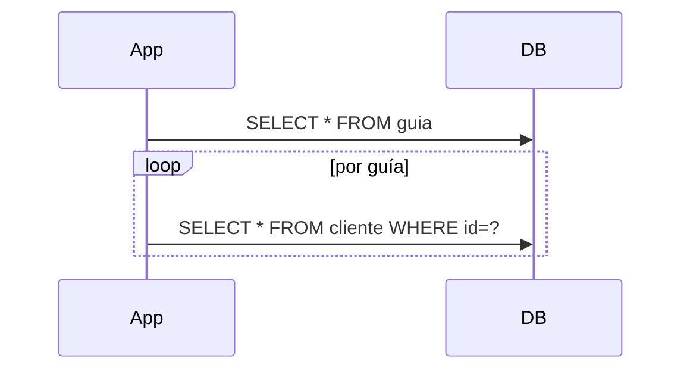
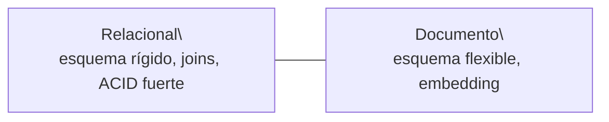

# Módulo 4: JPA e Hibernate con Spring Data

Spring Data JPA acelera el acceso relacional con repositorios, entidades y queries derivadas. La velocidad tiene costo: si no entiendes el contexto de persistencia, fetch, N+1 y migraciones, el sistema se vuelve lento y frágil. Este módulo combina productividad con criterio.

**Entorno de referencia verificado (2026-05-22):** JDK 27.0.1.0.2, Maven 3.10.0, Spring Boot 3.5.0, H2/Flyway compatibles para labs.

## Aprende construyendo

### Tema 1: Entidades y repositorios derivados · Intermedio · 30 min

Caso guía: CRUD de guías con poco código, pero entendiendo qué genera Spring Data.

#### `@Entity` y `JpaRepository`

**Definición formal.** Una entidad JPA representa una fila/objeto persistente. `JpaRepository` provee operaciones CRUD/paginación y permite queries derivadas por nombre de método.

**Ejemplo mínimo enfocado (concepto ejecutable en Java).**

```java
public interface GuiaRepository extends JpaRepository<Guia, Long> {
  Optional<Guia> findByCodigo(String codigo);
}
```

**Cómo funciona por dentro.** Spring Data crea un proxy de repositorio en arranque, interpreta la firma del método y genera la query JPQL/SQL apropiada.

**Error común.** Crear métodos derivados enormes e ilegibles. Corrección: `@Query` explícita o query en repositorio custom.

**Nota de verificación.** Requiere proyecto Spring Data JPA + DB; patrón verificado con Boot 3.5.x en smokes.

### Tema 2: El problema N+1 y su corrección · Intermedio · 35 min

Caso guía: listar guías y mostrar cliente. 1 query para guías, N para clientes.

#### N+1

**Definición formal.** Patrón ineficiente donde una consulta inicial dispara N consultas adicionales por elemento relacionado.



**Correcciones.** `join fetch`, EntityGraph, DTO projection, batch size. Elige según caso.

**Ejemplo mínimo (`@Query` fetch join).**

```java
@Query("select g from Guia g join fetch g.cliente")
List<Guia> findAllConCliente();
```

**Error común.** Poner `EAGER` para “arreglar” N+1. Causa sobre-fetch global. Corrección: fetch plan por caso de uso.

**Nota de verificación.** Observar SQL con `spring.jpa.show-sql=true` o logs Hibernate en lab local.

### Tema 3: Más allá del N+1: el límite de LAZY y páginas DTO · Intermedio · 40 min

Caso guía: endpoint de listado necesita solo 3 campos, no entidades completas.

#### DTO projection

**Definición formal.** Consulta que retorna solo campos necesarios en una proyección/DTO, evitando cargar grafo de entidades.

**Ejemplo mínimo.**

```java
record GuiaResumen(String codigo, String destino) {}
@Query("select new com.academia.GuiaResumen(g.codigo,g.destino) from Guia g")
Page<GuiaResumen> resumen(Pageable pageable);
```

**Error común.** Paginar entidades con `join fetch` collection y esperar que sea eficiente/correcto. Corrección: paginar IDs o usar DTO query; cuidado con paginación en memoria.

### Tema 4: Migraciones con Flyway · Intermedio · 30 min

Caso guía: agregar columna `destino` sin editar DB a mano.

#### Flyway

**Definición formal.** Herramienta de migración versionada que aplica scripts SQL en orden y registra historial.

**Ejemplo mínimo.**

```sql
-- V1__create_guia.sql
CREATE TABLE guia (id BIGINT PRIMARY KEY, codigo VARCHAR(30) NOT NULL);
```

**Comando.** En Boot, Flyway corre al arrancar si está en classpath y hay scripts en `db/migration`.

**Error común.** Modificar migración ya aplicada. Corrección: nueva migración incremental.

**Nota de verificación.** Requiere app Boot con Flyway y DB; smoke local factible.

### Tema 5: Spring Data MongoDB: documentos, consultas derivadas y cuándo elegir un modelo de documentos · Intermedio · 45 min

Caso guía: catálogo con atributos variables que no encaja bien en filas rígidas.

#### Documento vs fila

**Definición formal.** MongoDB almacena documentos (BSON/JSON-like). Spring Data MongoDB mapea documentos a clases Java y provee repositorios similares.

**Cuándo usar/no.** Úsalo cuando el modelo de documento y la escala/acceso encajan. No lo uses solo “porque es NoSQL”.



**Ejemplo mínimo (conceptual).**

```java
@Document("guias")
class GuiaDoc { @Id String id; String codigo; Map<String,Object> attrs; }
interface GuiaDocRepo extends MongoRepository<GuiaDoc, String> { Optional<GuiaDoc> findByCodigo(String c); }
```

**Error común.** Tratar Mongo como relacional con muchos joins manuales. Corrección: modelar por patrones de acceso, embedding/references según caso.

**Nota de verificación.** Requiere MongoDB; Docker disponible en entorno, pero lab pesado. No fingir salida.

## Cierre

Spring Data acelera; el criterio evita sorpresas. Modela entidades, controla fetch, migra con Flyway y elige el modelo de datos por necesidad real.

## Checklist

- Entiendo repositorios derivados y sus límites.
- Detecto y corrijo N+1.
- Uso DTO projections para lecturas.
- Migro esquema con Flyway.
- Distingo cuándo documento vs relacional.
