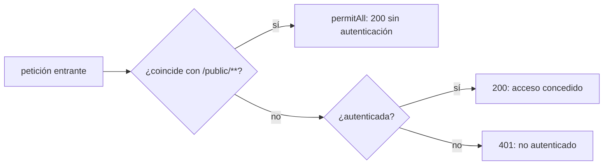
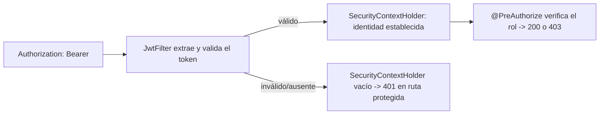
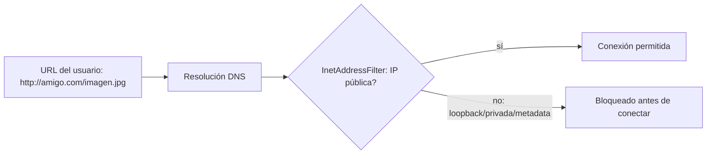
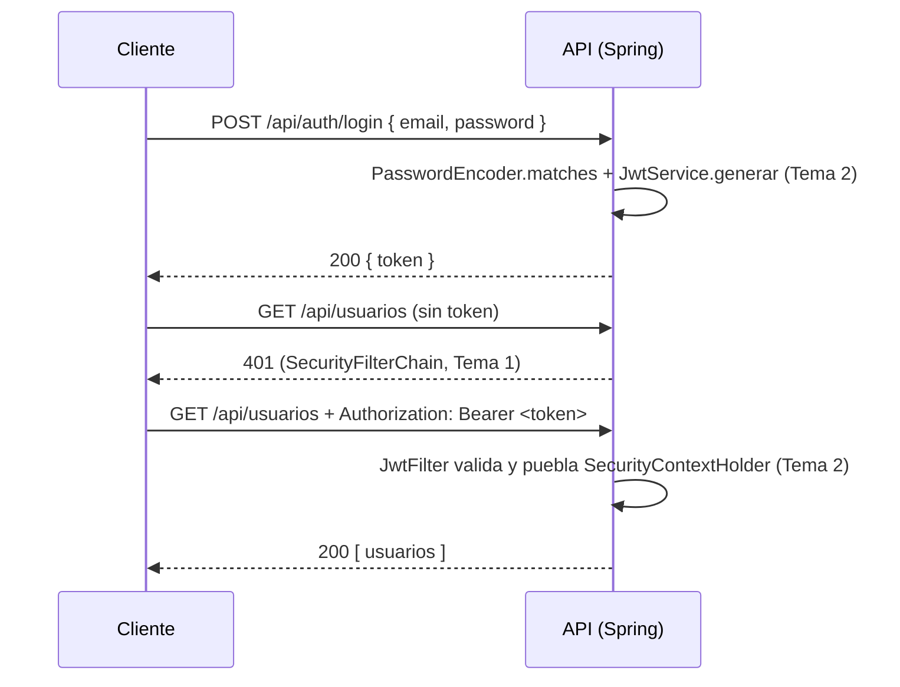

# Módulo 4: Spring Security

Cada tema declara su nivel, su duración y un proyecto verificable. La frontera de seguridad se comprueba con `MockMvc` real contra un contexto de Spring real, para que cada código de estado HTTP (200/401/403) sea evidencia ejecutada, no solo descrito.

## Aprende construyendo

### Tema 1: SecurityFilterChain moderno · Intermedio · 40 min

**Prerrequisito:** Spring Initializr y starters (Módulo 1); `@RestController` básico (Módulo 1).

**Al terminar podrás:** declarar un `SecurityFilterChain` como `@Bean` que permite rutas públicas y exige autenticación en el resto, y confirmar con `MockMvc` real los códigos 200 y 401 correspondientes.

#### Aprende

**¿Por qué es importante?** Clientes, conductores y operadores consultan rutas distintas de una API de entregas; un endpoint de salud (`/public/health`) debe responder sin credencial para que un balanceador de carga lo consulte, mientras las rutas de negocio (`/api/**`) deben exigir identidad — confundir esta frontera expone datos y operaciones críticas.

**Mapa de subtemas críticos**

| Subtema | Papel | Evidencia |
|---|---|---|
| `SecurityFilterChain` como `@Bean` | Núcleo | El `@Bean filterChain(HttpSecurity http)` de `SecurityConfig.java` compila y arranca el contexto |
| `authorizeHttpRequests` y orden de reglas | Núcleo | `/public/health` da `200` y `/api/entregas` da `401` en `SecurityFilterChainTest` |
| `permitAll()` para rutas públicas | Prerrequisito | `requestMatchers("/public/**").permitAll()` deja pasar `/public/health` sin credencial |
| `anyRequest().authenticated()` como frontera | Decisión | `@WithMockUser` convierte el `401` de `/api/entregas` en `200` |
| Migración desde `WebSecurityConfigurerAdapter` | Variante | El tema declara el adapter como deprecado frente al `@Bean` actual |
| Evaluación en orden específico-general | Límite | Quitar `permitAll()` hace que incluso `/public/health` responda `401` (ejercicio 3) |
| Abrir todo con `anyRequest().permitAll()` | Error frecuente | El fallo deliberado produce `expected: 401 but was: 200` |

Cada fila tiene su explicación individual a continuación.

**`SecurityFilterChain` como `@Bean` (núcleo).** La configuración moderna declara la cadena de filtros como un `@Bean` dentro de una clase `@Configuration`, reemplazando la herencia de `WebSecurityConfigurerAdapter`. El método `filterChain(HttpSecurity http)` construye y devuelve la cadena con `.build()`; si la clase no está anotada o el bean no se registra, toda ruta responde `401`, como señala la sección "Si falla".

**`authorizeHttpRequests` y orden de reglas (núcleo).** `http.authorizeHttpRequests(auth -> ...)` configura de forma fluida qué rutas requieren autenticación. El test `SecurityFilterChainTest` ejecuta la frontera real: `/public/health` responde `200` sin credencial y `/api/entregas` responde `401`. La evidencia es un código de estado HTTP ejecutado con `MockMvc`, no una inspección visual del código.

**`permitAll()` para rutas públicas (prerrequisito).** `requestMatchers("/public/**").permitAll()` declara explícitamente las rutas que no exigen identidad, para que un balanceador consulte `/public/health` sin credencial. Es prerrequisito de la regla general: sin esta declaración explícita, la ruta de salud cae bajo `anyRequest().authenticated()` y el ejercicio 3 demuestra que entonces responde `401`.

**`anyRequest().authenticated()` como frontera (decisión).** Esta única línea decide que cualquier ruta no listada exige autenticación; es la frontera completa entre una API protegida y una abierta. El test con `@WithMockUser` lo confirma: simula un usuario autenticado dentro del contexto de seguridad y el `401` de `/api/entregas` pasa a `200`. La decisión profesional es ubicar las reglas específicas antes de esta regla general.

**Migración desde `WebSecurityConfigurerAdapter` (variante).** El enfoque por `@Bean` sustituye al patrón anterior de extender `WebSecurityConfigurerAdapter`, ahora deprecado. Es la misma frontera de seguridad expresada por composición explícita de beans en vez de herencia de una clase base configurable, reflejando la dirección general de Spring.

**Evaluación en orden específico-general (límite).** Las reglas de `authorizeHttpRequests` se evalúan en orden, y una regla general declarada primero cubriría a las específicas antes de que se evalúen. El ejercicio 3 lo vuelve observable: eliminar `requestMatchers("/public/**").permitAll()` hace que incluso `/public/health` responda `401`, demostrando que la presencia y posición de cada regla importan.

**Abrir todo con `anyRequest().permitAll()` (error frecuente).** Cambiar `.anyRequest().authenticated()` por `.anyRequest().permitAll()` durante el desarrollo y olvidar revertirlo abre toda la API. El fallo deliberado del tema lo reproduce: `rutaProtegidaExigeAutenticacion` falla con `expected: 401 but was: 200`, evidencia ejecutada de que esa sola línea separa una API protegida de una completamente abierta.

**Conceptos clave:** configuración declarativa vía `@Bean`, reglas de autorización por ruta.

La configuración moderna de Spring Security (reemplazando el patrón anterior basado en extender `WebSecurityConfigurerAdapter`, ahora deprecado) declara la cadena de filtros directamente como un `@Bean`: `http.authorizeHttpRequests(auth -> auth.requestMatchers("/public/**").permitAll().anyRequest().authenticated())` configura de forma fluida qué rutas requieren autenticación y cuáles están explícitamente permitidas sin ella. Este enfoque basado en `@Bean` refleja la migración general de Spring hacia composición explícita mediante beans en vez de herencia de clases base configurables.

**Analogía:** el `SecurityFilterChain` es como una lista de control de acceso a la entrada de un edificio: especifica explícitamente qué áreas son de acceso público sin credencial, y cuáles requieren verificación de identidad antes de permitir el paso.

**Diagrama:**



#### Practica

**Demo paso a paso.** Desde una carpeta vacía (o continuando en `academia-spring`, o créala con `mkdir -p academia-spring` si es tu primera vez), genera el proyecto con Spring Initializr real (`web`, `security`) y crea `src/main/java/com/academia/seguridad/SecurityConfig.java` junto con un controlador mínimo:

```bash
mkdir -p academia-spring
cd academia-spring
curl -fsSL https://start.spring.io/starter.zip -d type=maven-project -d dependencies=web,security -d javaVersion=25 -d artifactId=academia-security -o app.zip
unzip -o app.zip
mkdir -p src/main/java/com/academia/seguridad
```

```java
// src/main/java/com/academia/seguridad/SecurityConfig.java
package com.academia.seguridad;

import org.springframework.context.annotation.Bean;
import org.springframework.context.annotation.Configuration;
import org.springframework.security.config.annotation.web.builders.HttpSecurity;
import org.springframework.security.web.SecurityFilterChain;

@Configuration
public class SecurityConfig {

    @Bean
    SecurityFilterChain filterChain(HttpSecurity http) throws Exception {
        return http
            .csrf(csrf -> csrf.disable()) // API stateless: sin sesiones basadas en cookies
            .authorizeHttpRequests(auth -> auth
                .requestMatchers("/public/**").permitAll()
                .anyRequest().authenticated())
            .httpBasic(httpBasic -> {}) // autenticación básica real para este tema; JWT llega en el Tema 2
            .build();
    }
}
```

```java
// src/main/java/com/academia/seguridad/RutasController.java
package com.academia.seguridad;

import org.springframework.web.bind.annotation.GetMapping;
import org.springframework.web.bind.annotation.RestController;

@RestController
public class RutasController {

    @GetMapping("/public/health")
    public String salud() { return "OK"; }

    @GetMapping("/api/entregas")
    public String entregas() { return "entregas confidenciales"; }
}
```

**Explicación línea por línea:** `requestMatchers("/public/**").permitAll()` declara explícitamente qué rutas no requieren autenticación; `anyRequest().authenticated()` exige identidad para cualquier otra ruta no listada; `httpBasic(...)` habilita autenticación básica real (usuario/contraseña) como mecanismo concreto de este tema, reemplazado por el filtro JWT en el Tema 2.

Confirma con `MockMvc` real (levanta el contexto de seguridad completo, sin mockear la cadena de filtros) que `/public/health` responde sin credencial y `/api/entregas` exige autenticación. **Nota (Spring Boot 4):** `AutoConfigureMockMvc`/`WebMvcTest` requieren agregar explícitamente `spring-boot-webmvc-test` (scope `test`) al `pom.xml` — en Boot 3.x venía incluido en `spring-boot-starter-test`; en Boot 4 se movió a su propio módulo, con el import reubicado a `org.springframework.boot.webmvc.test.autoconfigure`:

```xml
<!-- dentro de <dependencies> del pom.xml -->
<dependency>
    <groupId>org.springframework.boot</groupId>
    <artifactId>spring-boot-webmvc-test</artifactId>
    <scope>test</scope>
</dependency>
```

```java
// src/test/java/com/academia/seguridad/SecurityFilterChainTest.java
package com.academia.seguridad;

import org.junit.jupiter.api.Test;
import org.springframework.beans.factory.annotation.Autowired;
import org.springframework.boot.webmvc.test.autoconfigure.AutoConfigureMockMvc;
import org.springframework.boot.test.context.SpringBootTest;
import org.springframework.security.test.context.support.WithMockUser;
import org.springframework.test.web.servlet.MockMvc;

import static org.springframework.test.web.servlet.request.MockMvcRequestBuilders.get;
import static org.springframework.test.web.servlet.result.MockMvcResultMatchers.status;

@SpringBootTest
@AutoConfigureMockMvc
class SecurityFilterChainTest {

    @Autowired
    private MockMvc mockMvc;

    @Test
    void rutaPublicaRespondeSinCredencial() throws Exception {
        mockMvc.perform(get("/public/health")).andExpect(status().isOk());
    }

    @Test
    void rutaProtegidaExigeAutenticacion() throws Exception {
        mockMvc.perform(get("/api/entregas")).andExpect(status().isUnauthorized());
    }

    @Test
    @WithMockUser
    void rutaProtegidaRespondeConUsuarioAutenticado() throws Exception {
        mockMvc.perform(get("/api/entregas")).andExpect(status().isOk());
    }
}
```

```bash
mvn test -Dtest=SecurityFilterChainTest           # Maven
./gradlew test --tests SecurityFilterChainTest    # Gradle (equivalente)
```

**Resultado esperado:** `BUILD SUCCESS` con los 3 tests en verde: `/public/health` responde `200` sin credencial, `/api/entregas` responde `401` sin autenticar, y responde `200` cuando `@WithMockUser` simula un usuario autenticado real dentro del contexto de seguridad.

**Fallo deliberado:** cambia `.anyRequest().authenticated()` por `.anyRequest().permitAll()` (permitiendo todo por error) y ejecuta de nuevo `mvn test -Dtest=SecurityFilterChainTest`. El test `rutaProtegidaExigeAutenticacion` FALLA con `expected: 401 but was: 200` — diagnostica confirmando con evidencia real, no una revisión visual del código, que esa única línea es la frontera completa entre una API protegida y una completamente abierta. Revierte el cambio antes de continuar.

**Ejercicios.**

1. Agrega una segunda ruta pública (`/public/version`) y confirma con un test real que responde `200` sin credencial.
2. Cambia `/api/entregas` a `/api/entregas/**` y agrega un sub-recurso (`/api/entregas/1/detalle`) confirmando que también exige autenticación por estar bajo el mismo patrón.
3. Elimina temporalmente `requestMatchers("/public/**").permitAll()` por completo y confirma que ahora incluso `/public/health` responde `401` — deduce por qué el orden y la presencia explícita de cada regla importan.
4. Escribe de memoria (sin mirar) un `SecurityFilterChain` con una ruta pública y el resto autenticado, y un test que confirme ambos códigos.

**Pista:** las reglas de `authorizeHttpRequests` se evalúan en orden; una regla más específica debe declararse antes que una más general que la cubriría primero.

**Completa el código:** rellena el espacio para que el resto de rutas exija autenticación:

```java
.authorizeHttpRequests(auth -> auth
    .requestMatchers("/public/**").permitAll()
    .anyRequest().____())
```

**Reto de memoria:** cierra este documento y escribe, solo de memoria, un `SecurityFilterChain` con una ruta pública y el resto protegido, y un test `MockMvc` que confirme `200` y `401` respectivamente. Compara después contra el patrón del Paso 4.

#### Aplica

**Reto abierto.** Divide la API de entregas en tres fronteras reales: salud pública para el balanceador, rutas de cliente autenticadas y un área de operaciones que exija un rol concreto. Escribe las reglas en el orden correcto, documenta por qué cada regla vive donde vive y demuestra con `MockMvc` los códigos de cada frontera.

**Checklist de salida.**

- [ ] `/public/**` responde sin credencial y el resto exige autenticación.
- [ ] Un test confirma `200` público, `401` sin identidad y `200` con identidad.
- [ ] El orden de las reglas está justificado por escrito y probado.
- [ ] El fallo por `anyRequest().permitAll()` se reprodujo y se revirtió.
- [ ] La configuración arranca desde un clon limpio sin pasos manuales ocultos.

**Si falla.** Si toda ruta responde `401`, revisa que la clase esté anotada `@Configuration` y que el `@Bean` devuelva la cadena construida; si toda ruta responde `200`, busca un `permitAll()` general declarado antes que las reglas específicas.

**Siguiente paso:** el Tema 2 reemplaza la autenticación básica por un filtro JWT real.

**Errores comunes:** usar `anyRequest().permitAll()` por error durante desarrollo y olvidar revertirlo; no probar explícitamente el caso sin autenticación, asumiendo que la configuración es correcta sin confirmarlo.

**Límites y decisión de uso:** para un prototipo interno de un solo desarrollador sin ningún dato sensible expuesto, una configuración de seguridad completa puede posponerse; sigue siendo buena práctica no exponerlo públicamente sin protección antes de manejar datos reales.

**Fuente oficial:** [Spring Security — Authorize HTTP requests](https://docs.spring.io/spring-security/reference/servlet/authorization/authorize-http-requests.html).

**Transferencia al proyecto integrador:** el `SecurityFilterChain` que configures aquí protege cada endpoint del proyecto integrador de este track (microservicio productivo, Módulo 12).

### Tema 2: Filtro JWT y autorización por rol · Avanzado · 55 min

**Prerrequisito:** Tema 1 de este módulo (SecurityFilterChain).

**Al terminar podrás:** implementar un filtro que valida un JWT real en cada petición, y proteger un endpoint con `@PreAuthorize` según el rol contenido en ese token.

#### Aprende

**¿Por qué es importante?** Una API stateless (sin sesiones en el servidor) necesita identificar al usuario en cada petición sin mantener estado; un JWT firmado transporta esa identidad de forma verificable sin que el servidor necesite recordar nada entre peticiones, y el rol contenido en él determina qué operaciones puede realizar.

**Mapa de subtemas críticos**

| Subtema | Papel | Evidencia |
|---|---|---|
| `OncePerRequestFilter` | Prerrequisito | `JwtFilter extends OncePerRequestFilter` se ejecuta una vez por petición |
| Firma y validación con la misma clave HMAC | Núcleo | El fallo deliberado con otra clave lanza `SignatureException` y da `401` |
| `SecurityContextHolder` como fuente de identidad | Núcleo | El token válido establece la autenticación y `/api/entregas/1` da `200` |
| `@PreAuthorize("hasRole('ADMIN')")` | Núcleo | `conRolInsuficienteResponde403` da `403` con rol `DRIVER` |
| Prefijo `ROLE_` en `SimpleGrantedAuthority` | Límite | `new SimpleGrantedAuthority("ROLE_" + rol)` hace funcionar `hasRole(...)` |
| Expiración del token (`expiration`) | Variante | Una fecha pasada hace que `validar(...)` lance excepción (ejercicio 2) |
| Confundir `401` con `403` | Diagnóstico | Sin token `401`; autenticado sin rol `403` en `JwtFilterTest` |
| Registrar el JWT completo en logs | Error frecuente | El checklist exige que ningún token completo aparezca en logs |

Cada fila tiene su explicación individual a continuación.

**`OncePerRequestFilter` (prerrequisito).** `JwtFilter` extiende `OncePerRequestFilter`, lo que garantiza que la extracción y validación del token ocurra exactamente una vez por petición, incluso en configuraciones de servlets anidados. Es prerrequisito del resto: sin esta base el filtro podría ejecutarse varias veces, como advierten los errores comunes del laboratorio.

**Firma y validación con la misma clave HMAC (núcleo).** `JwtService.generar` firma el token con una clave HMAC y `validar` lo verifica con esa misma clave mediante `Jwts.parser().verifyWith(clave)`. El fallo deliberado lo hace observable: firmar con una clave distinta hace que `validar(...)` lance una `SignatureException` real, el filtro deja la petición sin autenticar y `conRolAdminResponde200` obtiene `401`. Un JWT no vale por su estructura, sino por estar firmado con la clave exacta del servidor.

**`SecurityContextHolder` como fuente de identidad (núcleo).** Si el token es válido, el filtro construye un `UsernamePasswordAuthenticationToken` y lo coloca en `SecurityContextHolder.getContext().setAuthentication(auth)`, el mecanismo central que el resto de Spring Security consulta para saber quién es el usuario. Con un token `ADMIN`, `DELETE /api/entregas/1` responde `200` porque la identidad quedó establecida.

**`@PreAuthorize("hasRole('ADMIN')")` (núcleo).** Esta anotación sobre `eliminar(...)` verifica el rol del usuario autenticado antes de ejecutar el método y devuelve `403` automáticamente si falta. El test `conRolInsuficienteResponde403` lo confirma: un token real firmado con rol `DRIVER` recibe `403` porque está autenticado pero no tiene el rol requerido.

**Prefijo `ROLE_` en `SimpleGrantedAuthority` (límite).** El filtro crea la autoridad como `new SimpleGrantedAuthority("ROLE_" + rol)` porque `hasRole(...)` espera ese prefijo. Es un límite concreto: si se omite `ROLE_`, la sección "Si falla" advierte que todo responderá `403` aunque el token sea correcto, porque la autoridad no coincide con lo que `hasRole` busca.

**Expiración del token (`expiration`) (variante).** `JwtService.generar` fija `expiration` a una hora en el futuro; el ejercicio 2 convierte esa fecha en una ya pasada (`System.currentTimeMillis() - 1000`) y confirma que `validar(...)` lanza una excepción real de token expirado. Es una variante del caso de token inválido: estructura y firma correctas, pero fuera de vigencia.

**Confundir `401` con `403` (diagnóstico).** Un `401` significa "no autenticado en absoluto" y un `403` "autenticado pero sin permiso". `JwtFilterTest` separa ambos: sin token `401`, con rol insuficiente `403`. La pista del tema lo usa como herramienta de diagnóstico: si esperas uno y obtienes el otro, el problema está en un lugar distinto del que asumías.

**Registrar el JWT completo en logs (error frecuente).** Guardar el token completo en logs expone la sesión de un usuario si esos logs se filtran. El checklist de salida exige explícitamente que ningún token completo aparezca en logs, tratando este error como un punto verificable y no como un detalle opcional.

**Conceptos clave:** validación de token en cada request, `SecurityContextHolder`, `@PreAuthorize`.

Un filtro que extiende `OncePerRequestFilter` (garantizando que se ejecute exactamente una vez por petición) extrae el token JWT del header `Authorization`, lo valida criptográficamente, y si es válido establece la identidad autenticada en el `SecurityContextHolder` — el mecanismo central que el resto de Spring Security consulta para saber quién es el usuario actual. `@PreAuthorize("hasRole('ADMIN')")` sobre un método de controller verifica, antes de ejecutarlo, que el usuario autenticado tenga el rol requerido, devolviendo `403` automáticamente si no lo tiene.

**Analogía:** el filtro JWT es un control de identidad en la entrada que verifica las credenciales de cada visitante y le entrega una etiqueta visible con su identidad verificada; `@PreAuthorize` es un letrero en la puerta de una sala específica que solo permite el paso a visitantes con cierta etiqueta, rechazando automáticamente a cualquiera sin ella.

**Diagrama:**



#### Practica

**Demo paso a paso.** Reutiliza `academia-spring` (o créalo desde una carpeta vacía con `mkdir -p academia-spring` si es tu primera vez), agrega la dependencia real `io.jsonwebtoken:jjwt-api` (más `jjwt-impl` y `jjwt-jackson` en runtime) y crea `src/main/java/com/academia/seguridad/JwtService.java`:

```bash
mkdir -p academia-spring/src/main/java/com/academia/seguridad
cd academia-spring
```

```java
// src/main/java/com/academia/seguridad/JwtService.java
package com.academia.seguridad;

import io.jsonwebtoken.Jwts;
import io.jsonwebtoken.security.Keys;
import org.springframework.stereotype.Service;

import javax.crypto.SecretKey;
import java.util.Date;

@Service
public class JwtService {
    private final SecretKey clave = Keys.hmacShaKeyFor("clave-de-prueba-academia-floci-32-bytes-min".getBytes());

    public String generar(String usuario, String rol) {
        return Jwts.builder()
            .subject(usuario)
            .claim("rol", rol)
            .issuedAt(new Date())
            .expiration(new Date(System.currentTimeMillis() + 3_600_000))
            .signWith(clave)
            .compact();
    }

    public io.jsonwebtoken.Claims validar(String token) {
        return Jwts.parser().verifyWith(clave).build().parseSignedClaims(token).getPayload();
    }
}
```

```java
// src/main/java/com/academia/seguridad/JwtFilter.java
package com.academia.seguridad;

import jakarta.servlet.FilterChain;
import jakarta.servlet.http.HttpServletRequest;
import jakarta.servlet.http.HttpServletResponse;
import org.springframework.security.authentication.UsernamePasswordAuthenticationToken;
import org.springframework.security.core.authority.SimpleGrantedAuthority;
import org.springframework.security.core.context.SecurityContextHolder;
import org.springframework.stereotype.Component;
import org.springframework.web.filter.OncePerRequestFilter;

import java.io.IOException;
import java.util.List;

@Component
public class JwtFilter extends OncePerRequestFilter {
    private final JwtService jwtService;

    public JwtFilter(JwtService jwtService) { this.jwtService = jwtService; }

    @Override
    protected void doFilterInternal(HttpServletRequest req, HttpServletResponse res, FilterChain chain)
            throws jakarta.servlet.ServletException, IOException {
        String header = req.getHeader("Authorization");
        if (header != null && header.startsWith("Bearer ")) {
            try {
                var claims = jwtService.validar(header.substring(7));
                String rol = claims.get("rol", String.class);
                var auth = new UsernamePasswordAuthenticationToken(
                    claims.getSubject(), null, List.of(new SimpleGrantedAuthority("ROLE_" + rol)));
                SecurityContextHolder.getContext().setAuthentication(auth);
            } catch (Exception tokenInvalido) {
                // token presente pero inválido: se deja sin autenticar, la ruta protegida rechazará con 401
            }
        }
        chain.doFilter(req, res);
    }
}
```

**Explicación línea por línea:** `JwtService.generar` firma un token real con una clave HMAC, incluyendo el rol como claim personalizado; `JwtFilter.doFilterInternal` extrae el token del header `Authorization`, lo valida con la MISMA clave, y si es válido construye una identidad autenticada con el rol como `GrantedAuthority` (`ROLE_` es el prefijo que Spring Security espera para `hasRole(...)`); un token ausente o inválido simplemente deja la petición sin autenticar, delegando el rechazo a las reglas de `authorizeHttpRequests` del Tema 1.

Agrega un endpoint protegido por rol y confirma con `MockMvc` real, usando tokens generados por el propio `JwtService`, los tres escenarios: sin token, con token de rol insuficiente, y con token del rol correcto:

```java
// src/main/java/com/academia/seguridad/AdminController.java (agregar al RutasController o en archivo nuevo)
package com.academia.seguridad;

import org.springframework.security.access.prepost.PreAuthorize;
import org.springframework.web.bind.annotation.DeleteMapping;
import org.springframework.web.bind.annotation.PathVariable;
import org.springframework.web.bind.annotation.RestController;

@RestController
public class AdminController {

    @PreAuthorize("hasRole('ADMIN')")
    @DeleteMapping("/api/entregas/{id}")
    public void eliminar(@PathVariable Long id) { /* elimina la entrega */ }
}
```

```java
// src/test/java/com/academia/seguridad/JwtFilterTest.java
package com.academia.seguridad;

import org.junit.jupiter.api.Test;
import org.springframework.beans.factory.annotation.Autowired;
import org.springframework.boot.webmvc.test.autoconfigure.AutoConfigureMockMvc;
import org.springframework.boot.test.context.SpringBootTest;
import org.springframework.test.web.servlet.MockMvc;

import static org.springframework.test.web.servlet.request.MockMvcRequestBuilders.delete;
import static org.springframework.test.web.servlet.result.MockMvcResultMatchers.status;

@SpringBootTest
@AutoConfigureMockMvc
class JwtFilterTest {

    @Autowired
    private MockMvc mockMvc;
    @Autowired
    private JwtService jwtService;

    @Test
    void sinTokenLaRutaProtegidaResponde401() throws Exception {
        mockMvc.perform(delete("/api/entregas/1")).andExpect(status().isUnauthorized());
    }

    @Test
    void conRolInsuficienteResponde403() throws Exception {
        String token = jwtService.generar("conductor1", "DRIVER");
        mockMvc.perform(delete("/api/entregas/1").header("Authorization", "Bearer " + token))
            .andExpect(status().isForbidden());
    }

    @Test
    void conRolAdminResponde200() throws Exception {
        String token = jwtService.generar("admin1", "ADMIN");
        mockMvc.perform(delete("/api/entregas/1").header("Authorization", "Bearer " + token))
            .andExpect(status().isOk());
    }
}
```

```bash
mvn test -Dtest=JwtFilterTest           # Maven
./gradlew test --tests JwtFilterTest    # Gradle (equivalente)
```

**Resultado esperado:** `BUILD SUCCESS` con los 3 tests en verde: sin token, `401`; con un token real firmado pero de rol `DRIVER`, `403` (autenticado pero sin el rol requerido); con un token real de rol `ADMIN`, `200` — los tres casos usan tokens JWT genuinamente generados y validados por `JwtService`, no simulados.

**Fallo deliberado:** en `JwtFilterTest`, genera el token con `jwtService.generar("admin1", "ADMIN")` pero fírmalo con una clave distinta modificando temporalmente `JwtService` para usar `Keys.hmacShaKeyFor("otra-clave-completamente-diferente-32-bytes".getBytes())` solo en la generación (no en la validación). Ejecuta de nuevo `conRolAdminResponde200` — el test FALLA porque `jwtService.validar(...)` lanza una excepción real de firma inválida (`SignatureException`), y el filtro deja la petición sin autenticar, resultando en `401` en vez del `200` esperado — diagnostica confirmando que un JWT no es válido por su estructura o contenido, sino por estar firmado con la clave exacta que el servidor usa para verificarlo. Revierte el cambio antes de continuar.

**Ejercicios.**

1. Agrega un segundo rol (`OPERATOR`) al endpoint (`hasAnyRole('ADMIN', 'OPERATOR')`) y confirma con un token de cada rol que ambos obtienen `200`.
2. Genera un token con `JwtService.generar` pero con una fecha de expiración ya pasada (modifica temporalmente `expiration` a `new Date(System.currentTimeMillis() - 1000)`) y confirma que `validar(...)` lanza una excepción real de token expirado.
3. Agrega un segundo endpoint protegido con un rol distinto y confirma que un token válido de un rol no da acceso al endpoint del otro rol.
4. Escribe de memoria (sin mirar) un filtro que extraiga un header `Authorization`, valide un JWT, y establezca la identidad en `SecurityContextHolder`. Compara después contra el patrón del Paso 4.

**Pista:** un `403` significa "autenticado pero sin permiso"; un `401` significa "no autenticado en absoluto" — si tu test espera uno y obtiene el otro, el problema está en un lugar distinto del que asumías.

**Completa el código:** rellena el espacio para exigir el rol `ADMIN` antes de ejecutar el método:

```java
@____("hasRole('ADMIN')")
@DeleteMapping("/api/entregas/{id}")
public void eliminar(@PathVariable Long id) { }
```

**Reto de memoria:** cierra este documento y escribe, solo de memoria, un test `MockMvc` que confirme `401` sin token, `403` con rol insuficiente, y `200` con el rol correcto, usando un `JwtService` real. Compara después contra el patrón del Paso 4.

#### Aplica

**Reto abierto.** Diseña una matriz de roles real para entregas: quién puede leer, quién puede crear y quién puede cancelar. Implementa los endpoints con `@PreAuthorize`, demuestra en tests cada celda de la matriz y documenta las combinaciones que deliberadamente quedan denegadas.

**Checklist de salida.**

- [ ] El filtro valida firma y expiración antes de establecer identidad.
- [ ] Sin token responde `401`; con rol insuficiente responde `403`; con rol correcto responde `200`.
- [ ] La matriz de roles está escrita y cada celda tiene un test.
- [ ] El fallo por firma distinta se reprodujo y se revirtió.
- [ ] Ningún token completo aparece en logs.

**Si falla.** Si un token válido sigue dando `401`, confirma que el filtro está registrado en la cadena (`addFilterBefore`) y que `@EnableMethodSecurity` está presente para que `@PreAuthorize` se evalúe; si todo da `403`, revisa el prefijo `ROLE_` de la autoridad.

**Siguiente paso:** el Tema 3 aborda dos protecciones específicas del navegador, CORS y CSRF.

**Errores comunes:** guardar el JWT completo en logs de la aplicación, exponiendo el token de sesión de un usuario si esos logs se filtran; confundir `401` (no autenticado) con `403` (autenticado pero sin permiso) al diagnosticar un fallo de acceso.

**Límites y decisión de uso:** para una aplicación con sesiones tradicionales basadas en cookies del lado del servidor (no una API stateless consumida por múltiples clientes), la autenticación por sesión de Spring Security sin JWT es más simple y apropiada.

**Fuente oficial:** [Spring Security — JWT](https://docs.spring.io/spring-security/reference/servlet/oauth2/resource-server/jwt.html).

**Transferencia al proyecto integrador:** el filtro JWT y la autorización por rol de este tema son los que protegen el proyecto integrador de este track (microservicio productivo, Módulo 12).

### Tema 3: CORS y CSRF · Intermedio · 35 min

**Prerrequisito:** Temas 1 y 2 de este módulo.

**Al terminar podrás:** configurar CORS para restringir qué orígenes de navegador consumen la API, y explicar por qué una API stateless con JWT generalmente no necesita protección CSRF.

#### Aprende

**¿Por qué es importante?** Un frontend servido desde un dominio distinto al de la API necesita permiso explícito del navegador para consumirla (CORS); un atacante no debería poder inducir peticiones no deseadas aprovechando cookies de sesión (CSRF) — dos protecciones distintas que se confunden con frecuencia.

**Mapa de subtemas críticos**

| Subtema | Papel | Evidencia |
|---|---|---|
| `CorsConfigurationSource` como `@Bean` | Núcleo | El bean `corsConfigurationSource()` compila y registra la config en `/**` |
| `setAllowedOrigins` con origen explícito | Núcleo | El origen permitido recibe `Access-Control-Allow-Origin: https://demo.academia.dev` |
| Preflight `OPTIONS` con header `Origin` | Prerrequisito | El test envía `options("/public/health")` con `Origin` y `Access-Control-Request-Method` |
| `.cors(cors -> {})` en el `SecurityFilterChain` | Límite | Sin registrarlo, la petición permitida no recibe el header (sección "Si falla") |
| Restringir `setAllowedMethods` | Variante | Un preflight con `DELETE` restringido a `GET` se rechaza (ejercicio 2) |
| CSRF solo en sesiones por cookie | Decisión | La API JWT stateless usa `csrf.disable()` justificado, no por costumbre |
| `allowedOrigins("*")` en producción | Error frecuente | El fallo deliberado hace que `sitio-no-autorizado.com` reciba el header |

Cada fila tiene su explicación individual a continuación.

**`CorsConfigurationSource` como `@Bean` (núcleo).** `CorsConfig` publica un `CorsConfigurationSource` como `@Bean` y lo registra para `/**` con `source.registerCorsConfiguration("/**", config)`. El bean debe llamarse exactamente `corsConfigurationSource`, como recuerda la sección "Si falla"; con otro nombre Spring Security no lo aplica y la política no surte efecto.

**`setAllowedOrigins` con origen explícito (núcleo).** `config.setAllowedOrigins(List.of("https://demo.academia.dev"))` declara qué frontend puede consumir la API desde JavaScript en el navegador. El test `origenPermitidoRecibeElHeaderDeAutorizacionCors` lo verifica: la respuesta preflight incluye `Access-Control-Allow-Origin: https://demo.academia.dev`, mientras un origen no listado se rechaza con `403`.

**Preflight `OPTIONS` con header `Origin` (prerrequisito).** El navegador envía una petición preflight `OPTIONS` con `Origin` y `Access-Control-Request-Method` antes de la llamada real; entender ese mecanismo es prerrequisito para probar CORS. El test lo reproduce con `options("/public/health")` y esos dos headers, porque `MockMvc` simula fielmente el preflight que un navegador ejecutaría.

**`.cors(cors -> {})` en el `SecurityFilterChain` (límite).** La configuración de CORS solo se aplica si se registra `.cors(cors -> {})` en la cadena del Tema 1. Es un límite concreto: según la sección "Si falla", si una petición permitida no recibe el header hay que confirmar que `.cors(...)` está registrado; sin ese enganche el bean existe pero nunca interviene.

**Restringir `setAllowedMethods` (variante).** `config.setAllowedMethods(List.of("GET", "POST", "DELETE"))` acota qué métodos acepta la política. El ejercicio 2 explora la variante restrictiva: limitar a solo `GET` hace que un preflight con `Access-Control-Request-Method: DELETE` desde el origen permitido sea rechazado de todas formas, porque el método no está en la lista aunque el origen sí lo esté.

**CSRF solo en sesiones por cookie (decisión).** CSRF es relevante cuando el navegador envía cookies de sesión automáticamente; una API stateless con JWT no corre ese riesgo porque el token debe incluirse explícitamente en el header `Authorization`. El ejercicio 3 pide decidir por qué `csrf.disable()` es apropiado aquí y por qué sí haría falta con sesiones basadas en cookies: una decisión ligada al transporte de sesión, no a la costumbre.

**`allowedOrigins("*")` en producción (error frecuente).** Abrir la política con `setAllowedOrigins(List.of("*"))` permite que cualquier sitio consuma la API desde un navegador. El fallo deliberado lo hace observable: `origenNoPermitidoNoRecibeElHeaderDeAutorizacionCors` falla porque ahora `https://sitio-no-autorizado.com` recibe el header de autorización, exactamente el error que la lista explícita existe para prevenir.

**Conceptos clave:** origen distinto del navegador (CORS), protección específica de sesiones basadas en cookies (CSRF).

CORS controla qué orígenes (protocolo + dominio + puerto) tienen permitido, desde el navegador del usuario, realizar peticiones hacia la API desde un origen distinto: `config.setAllowedOrigins(List.of("https://miapp.com"))` restringe explícitamente qué frontends pueden consumirla desde JavaScript en el navegador — no aplica a llamadas directas entre servidores. CSRF es un ataque relevante específicamente para aplicaciones con sesiones basadas en cookies: el navegador envía automáticamente las cookies de un dominio en cualquier petición hacia él, incluso iniciada desde un sitio malicioso. Una API stateless con JWT (Tema 2) generalmente no necesita esa protección, porque el token debe incluirse explícitamente en el header `Authorization` por el código cliente — algo que un atacante no puede forzar sin conocer el token de la víctima.

**Analogía:** CORS es una lista de invitados autorizados a acceder a un recurso desde direcciones externas específicas; CSRF aprovecha que alguien lleva puesta automáticamente una credencial visible (la cookie) que cualquier lugar reconoce sin verificación adicional, mientras un JWT es una credencial que debe presentarse explícitamente cada vez.

**Diagrama:**

```text
┌── navegador en https://miapp.com ──┐
│  petición hacia https://api.miapp.com  │
└──────────┬───────────────────┘
           │ CORS: ¿https://miapp.com está en allowedOrigins?
           ▼
┌── sí: header Access-Control-Allow-Origin devuelto ──┐
│  no: navegador bloquea la respuesta del lado cliente   │
└─────────────────────────────────────────────┘
```

#### Practica

**Demo paso a paso.** Reutiliza `academia-spring` (o créalo desde una carpeta vacía con `mkdir -p academia-spring` si es tu primera vez) y crea `src/main/java/com/academia/seguridad/CorsConfig.java`:

```bash
mkdir -p academia-spring/src/main/java/com/academia/seguridad
cd academia-spring
```

```java
// src/main/java/com/academia/seguridad/CorsConfig.java
package com.academia.seguridad;

import org.springframework.context.annotation.Bean;
import org.springframework.context.annotation.Configuration;
import org.springframework.web.cors.CorsConfiguration;
import org.springframework.web.cors.UrlBasedCorsConfigurationSource;
import org.springframework.web.cors.CorsConfigurationSource;

import java.util.List;

@Configuration
public class CorsConfig {

    @Bean
    CorsConfigurationSource corsConfigurationSource() {
        var config = new CorsConfiguration();
        config.setAllowedOrigins(List.of("https://demo.academia.dev"));
        config.setAllowedMethods(List.of("GET", "POST", "DELETE"));

        var source = new UrlBasedCorsConfigurationSource();
        source.registerCorsConfiguration("/**", config);
        return source;
    }
}
```

Registra `.cors(cors -> {})` en el `SecurityFilterChain` del Tema 1 para que Spring Security aplique esta configuración, y confirma con `MockMvc` real, enviando el header `Origin`, la diferencia entre un origen permitido y uno no permitido:

```java
// src/test/java/com/academia/seguridad/CorsConfigTest.java
package com.academia.seguridad;

import org.junit.jupiter.api.Test;
import org.springframework.beans.factory.annotation.Autowired;
import org.springframework.boot.webmvc.test.autoconfigure.AutoConfigureMockMvc;
import org.springframework.boot.test.context.SpringBootTest;
import org.springframework.test.web.servlet.MockMvc;

import static org.springframework.test.web.servlet.request.MockMvcRequestBuilders.options;
import static org.springframework.test.web.servlet.result.MockMvcResultMatchers.header;
import static org.springframework.test.web.servlet.result.MockMvcResultMatchers.status;

@SpringBootTest
@AutoConfigureMockMvc
class CorsConfigTest {

    @Autowired
    private MockMvc mockMvc;

    @Test
    void origenPermitidoRecibeElHeaderDeAutorizacionCors() throws Exception {
        mockMvc.perform(options("/public/health")
                .header("Origin", "https://demo.academia.dev")
                .header("Access-Control-Request-Method", "GET"))
            .andExpect(status().isOk())
            .andExpect(header().string("Access-Control-Allow-Origin", "https://demo.academia.dev"));
    }

    @Test
    void origenNoPermitidoNoRecibeElHeaderDeAutorizacionCors() throws Exception {
        mockMvc.perform(options("/public/health")
                .header("Origin", "https://sitio-no-autorizado.com")
                .header("Access-Control-Request-Method", "GET"))
            .andExpect(status().isForbidden());
    }
}
```

```bash
mvn test -Dtest=CorsConfigTest           # Maven
./gradlew test --tests CorsConfigTest    # Gradle (equivalente)
```

**Resultado esperado:** `BUILD SUCCESS` con ambos tests en verde: la petición preflight (`OPTIONS`) desde el origen permitido recibe `Access-Control-Allow-Origin: https://demo.academia.dev`, mientras la misma petición desde un origen no listado es rechazada por el propio filtro CORS de Spring Security antes de llegar al controller.

**Fallo deliberado:** cambia `config.setAllowedOrigins(List.of("https://demo.academia.dev"))` por `config.setAllowedOrigins(List.of("*"))` (permitiendo cualquier origen) y ejecuta de nuevo `origenNoPermitidoNoRecibeElHeaderDeAutorizacionCors`. El test FALLA porque ahora CUALQUIER origen, incluido `https://sitio-no-autorizado.com`, recibe el header de autorización — diagnostica confirmando por qué `allowedOrigins("*")` en producción es exactamente el error que la lista explícita de orígenes existe para prevenir. Revierte el cambio antes de continuar.

**Ejercicios.**

1. Agrega un segundo origen permitido (por ejemplo, un entorno de staging) a `allowedOrigins` y confirma con un test que ambos orígenes reciben el header correspondiente.
2. Restringe `allowedMethods` a solo `GET` y confirma que una petición preflight con `Access-Control-Request-Method: DELETE` desde el origen permitido es rechazada de todas formas.
3. Documenta en una frase, basándote en el Paso 3, por qué reactivar CSRF (`csrf(csrf -> {})` en vez de `csrf(csrf -> csrf.disable())`) en la API JWT de este módulo no sería necesario, mientras sí lo sería si la aplicación usara sesiones basadas en cookies.
4. Escribe de memoria (sin mirar) una configuración de CORS con un único origen permitido, y un test que confirme el rechazo de un origen distinto.

**Pista:** CORS se aplica del lado del NAVEGADOR del cliente; una herramienta como `curl` o Postman, al no ser un navegador, no aplica la política del mismo origen y puede recibir respuestas que un navegador real bloquearía — por eso este Tema se verifica con `MockMvc`, que sí simula fielmente el comportamiento de preflight que un navegador ejecutaría.

**Completa el código:** rellena el espacio para restringir CORS a un único origen específico:

```java
config.setAllowedOrigins(List.of("____"));
```

**Reto de memoria:** cierra este documento y escribe, solo de memoria, una configuración de `CorsConfigurationSource` con un origen permitido, y explica en una frase por qué una API JWT stateless generalmente deshabilita CSRF. Compara después contra el patrón del Paso 4.

#### Aplica

**Reto abierto.** Publica la API en dos entornos (local y staging) con orígenes distintos y demuestra en tests que solo esos dos pueden consumirla desde un navegador. Escribe además una nota de arquitectura que decida si el proyecto usará cookies o tokens, y que justifique la postura sobre CSRF a partir de esa decisión, no por costumbre.

**Checklist de salida.**

- [ ] Solo los orígenes declarados reciben `Access-Control-Allow-Origin`.
- [ ] Un origen ajeno se rechaza con un test real de preflight.
- [ ] Los métodos permitidos están restringidos y probados.
- [ ] La decisión sobre CSRF está escrita y ligada al transporte de sesión elegido.
- [ ] No hay `allowedOrigins("*")` en ningún perfil de producción.

**Si falla.** Si una petición permitida no recibe el header, confirma que `.cors(...)` está registrado en la cadena de seguridad y que el bean se llama exactamente `corsConfigurationSource`; si el origen permitido falla solo en el navegador, revisa que protocolo, dominio y puerto coincidan exactamente.

**Siguiente paso:** el Tema 4 cierra una vulnerabilidad SSRF real en las peticiones salientes del cliente HTTP.

**Errores comunes:** desactivar CSRF sin entender el tipo de transporte de sesión que la aplicación realmente usa; configurar CORS con `allowedOrigins("*")` en producción, permitiendo que cualquier sitio consuma la API desde un navegador.

**Límites y decisión de uso:** para una API consumida exclusivamente por otros servicios backend (nunca desde JavaScript en un navegador), la configuración de CORS no tiene efecto alguno — esa protección es exclusivamente relevante para peticiones iniciadas desde un navegador.

**Fuente oficial:** [Spring — CORS](https://docs.spring.io/spring-framework/reference/web/webmvc-cors.html).

**Transferencia al proyecto integrador:** define los orígenes permitidos del frontend y la protección de las mutaciones según el transporte de sesión. Prueba un origen ajeno y una solicitud sin protección requerida, manteniendo autorización por guía en el servidor.

### Tema 4: Protección SSRF con InetAddressFilter (Spring Boot 4.1) · Experto · 50 min

**Prerrequisito:** Tema 2 de este módulo.

**Al terminar podrás:** configurar un `InetAddressFilter` (Spring Boot 4.1) que bloquee las peticiones salientes de un cliente HTTP hacia direcciones de loopback, link-local y metadatos de nube, cerrando una vulnerabilidad SSRF real en un endpoint que acepta una URL del usuario.

#### Aprende

**¿Por qué es importante?** Un endpoint que valida webhooks o genera miniaturas de imágenes a partir de una URL que el usuario proporciona, sin restringir a qué direcciones puede conectarse el cliente HTTP del servidor, permite que un atacante le pida al propio servidor que consulte `http://169.254.169.254/latest/meta-data/iam/security-credentials/` (el endpoint de metadatos de la nube) o un servicio interno sin autenticación, filtrando credenciales o datos que nunca deberían ser accesibles desde fuera.

**Mapa de subtemas críticos**

| Subtema | Papel | Evidencia |
|---|---|---|
| `InetAddressFilter.externalAddresses()` | Núcleo | `bloqueaLoopbackAntesDeConectar` lanza `FilteredHostException` |
| Bloqueo sobre la IP resuelta, no el string | Núcleo | El servidor local recibe cero peticiones (`solicitudes.get()` es `0`) |
| Allowlist vs blocklist | Prerrequisito | El tema advierte no confundir lista de permitidos con lista de bloqueados |
| `withRedirects(HttpRedirects.DONT_FOLLOW)` | Límite | Un redirect hacia dirección interna debe rechazarse, no seguirse (ejercicio 2) |
| Control positivo con `InetAddressFilter.all()` | Diagnóstico | El segundo test recibe `200` y `solicitudes.get()` es `1` |
| Clasificar la causa del error | Decisión | No traducir toda `ResourceAccessException` como rechazo por política |
| Validar solo el string de la URL | Error frecuente | Allowlist de strings evadible con DNS rebinding; falta el rango `169.254.169.254` |

Cada fila tiene su explicación individual a continuación.

**`InetAddressFilter.externalAddresses()` (núcleo).** `SafeClient.externalOnly()` aplica `InetAddressFilter.externalAddresses()`, agregado en Spring Boot 4.1, que rechaza destinos que resuelvan a loopback, link-local, rangos privados o metadatos de nube. El test `bloqueaLoopbackAntesDeConectar` lo confirma: la petición hacia el servidor local lanza `FilteredHostException`, evidencia de que el transporte filtró la dirección.

**Bloqueo sobre la IP resuelta, no el string (núcleo).** `withInetAddressFilter(allowedAddresses)` interviene en la resolución DNS/IP antes de establecer la conexión, no sobre el texto de la URL. La evidencia es que `solicitudes.get()` queda en `0`: el servidor local nunca recibe la petición porque el filtro bloquea antes de conectar, no después de una validación de cadena.

**Allowlist vs blocklist (prerrequisito).** `externalAddresses()` describe las direcciones permitidas y el transporte rechaza las demás; el tema insiste en no confundir una lista de permitidos con una de bloqueados. Entender que el modelo es allowlist por destino resuelto es prerrequisito para razonar qué pasa con una IP nueva: si no es externa, se bloquea por defecto.

**`withRedirects(HttpRedirects.DONT_FOLLOW)` (límite).** `withRedirects(HttpRedirects.DONT_FOLLOW)` impide que un redirect traslade la conexión a un destino que la política original no evaluó. Es el límite que un atacante intentaría cruzar: el ejercicio 2 exige confirmar que un redirect hacia una dirección interna se rechaza en vez de seguirse, cerrando una evasión que el filtro por sí solo no cubriría si se permitieran redirects.

**Control positivo con `InetAddressFilter.all()` (diagnóstico).** El segundo test usa `SafeClient.create(InetAddressFilter.all())` contra el mismo servidor local y espera `200` con `solicitudes.get()` igual a `1`. Es diagnóstico: sin este control positivo, un servidor que nunca arrancó también fallaría y parecería un bloqueo correcto; el par positivo/negativo distingue el filtrado real de un destino simplemente inalcanzable.

**Clasificar la causa del error (decisión).** El tema advierte que un timeout genérico no satisface la prueba de bloqueo y que la capa llamadora no debe traducir toda `ResourceAccessException` como rechazo por política. La decisión profesional es clasificar la causa: distinguir `FilteredHostException` de un timeout permite reportar correctamente por qué falló una petición saliente.

**Validar solo el string de la URL (error frecuente).** Confiar únicamente en comparar el texto de la URL contra una allowlist es evadible con DNS rebinding, porque el nombre validado puede resolver luego a una IP interna. Los errores comunes del tema añaden no probar el rango de metadatos `169.254.169.254`, uno de los destinos más valiosos para un atacante en un entorno cloud; el filtro actúa en la capa de red real, no sobre el string.

**Conceptos clave:** Server-Side Request Forgery (SSRF), rango de direcciones bloqueadas, egress controlado, validación de URL insuficiente por sí sola.

```java
@Bean
RestClient.Builder restClientBuilder() {
    HttpClientSettings settings = HttpClientSettings.defaults()
        .withInetAddressFilter(InetAddressFilter.externalAddresses());
    return RestClient.builder()
        .requestFactory(ClientHttpRequestFactoryBuilder.jdk().build(settings));
}
```

`InetAddressFilter` (agregado en Spring Boot 4.1) intercepta la resolución DNS/IP de cada petición saliente del cliente HTTP, antes de establecer la conexión, y rechaza cualquier destino que resuelva a loopback (127.0.0.1), link-local, rangos privados (10.0.0.0/8, 192.168.0.0/16) o el rango reservado de metadatos de nube — sin depender de que el código de la aplicación valide correctamente el string de la URL, una validación que un atacante puede evadir con redirects o DNS rebinding.

**Analogía:** validar el string de una URL antes de pedirle al cliente HTTP que la visite es como revisar el nombre escrito en un sobre antes de enviarlo, sin verificar la dirección real a la que viaja el cartero; `InetAddressFilter` es el control en la puerta del cartero mismo, que rechaza la entrega sin importar qué nombre diga el sobre si la dirección real resuelve a una zona prohibida.

**Diagrama:**



#### Practica

**Demo paso a paso.** Requisitos: JDK 27 y Maven 3.9. Parte de una carpeta vacía y crea manualmente un proyecto Maven con el BOM de Spring Boot 4.1.1:

```bash
mkdir -p ejemplo-ssrf/src/main/java/com/academia
mkdir -p ejemplo-ssrf/src/test/java/com/academia
cd ejemplo-ssrf
```

Crea `pom.xml` con este contenido completo:

```xml
<project xmlns="http://maven.apache.org/POM/4.0.0"
         xmlns:xsi="http://www.w3.org/2001/XMLSchema-instance"
         xsi:schemaLocation="http://maven.apache.org/POM/4.0.0 https://maven.apache.org/xsd/maven-4.0.0.xsd">
    <modelVersion>4.0.0</modelVersion>
    <parent>
        <groupId>org.springframework.boot</groupId>
        <artifactId>spring-boot-starter-parent</artifactId>
        <version>4.1.1</version>
        <relativePath/>
    </parent>
    <groupId>com.academia</groupId>
    <artifactId>ejemplo-ssrf</artifactId>
    <version>0.0.1-SNAPSHOT</version>
    <properties>
        <java.version>27</java.version>
    </properties>
    <dependencies>
        <dependency>
            <groupId>org.springframework.boot</groupId>
            <artifactId>spring-boot-starter</artifactId>
        </dependency>
        <dependency>
            <groupId>org.springframework</groupId>
            <artifactId>spring-web</artifactId>
        </dependency>
        <dependency>
            <groupId>org.springframework.boot</groupId>
            <artifactId>spring-boot-starter-test</artifactId>
            <scope>test</scope>
        </dependency>
    </dependencies>
</project>
```

Crea `src/main/java/com/academia/SafeClient.java` con este contenido completo:

```java
package com.academia;

import java.time.Duration;
import org.springframework.boot.http.client.ClientHttpRequestFactoryBuilder;
import org.springframework.boot.http.client.HttpClientSettings;
import org.springframework.boot.http.client.HttpRedirects;
import org.springframework.boot.http.client.InetAddressFilter;
import org.springframework.web.client.RestClient;

public final class SafeClient {
    private SafeClient() {}
    public static RestClient create(InetAddressFilter allowedAddresses) {
        var settings = HttpClientSettings.defaults()
            .withConnectTimeout(Duration.ofSeconds(2))
            .withReadTimeout(Duration.ofSeconds(2))
            .withRedirects(HttpRedirects.DONT_FOLLOW)
            .withInetAddressFilter(allowedAddresses);
        return RestClient.builder()
            .requestFactory(ClientHttpRequestFactoryBuilder.jdk().build(settings))
            .build();
    }
    public static RestClient externalOnly() {
        return create(InetAddressFilter.externalAddresses());
    }
}
```

Crea `src/test/java/com/academia/SafeClientTest.java`. La primera prueba exige el bloqueo antes de que el servidor local reciba una petición; la segunda es el control positivo con el mismo servidor y un filtro que sí permite loopback:

```java
package com.academia;

import com.sun.net.httpserver.HttpServer;
import org.junit.jupiter.api.AfterEach;
import org.junit.jupiter.api.BeforeEach;
import org.junit.jupiter.api.Test;
import org.springframework.boot.http.client.FilteredHostException;
import org.springframework.boot.http.client.InetAddressFilter;

import java.io.IOException;
import java.net.InetSocketAddress;
import java.nio.charset.StandardCharsets;
import java.util.concurrent.atomic.AtomicInteger;

import static org.assertj.core.api.Assertions.assertThat;
import static org.assertj.core.api.Assertions.assertThatThrownBy;

class SafeClientTest {
    private final AtomicInteger solicitudes = new AtomicInteger();
    private HttpServer server;
    private String url;

    @BeforeEach
    void arrancarServidorLocal() throws IOException {
        server = HttpServer.create(new InetSocketAddress("127.0.0.1", 0), 0);
        server.createContext("/", exchange -> {
            solicitudes.incrementAndGet();
            byte[] body = "OK".getBytes(StandardCharsets.UTF_8);
            exchange.sendResponseHeaders(200, body.length);
            try (var output = exchange.getResponseBody()) {
                output.write(body);
            }
        });
        server.start();
        url = "http://127.0.0.1:" + server.getAddress().getPort() + "/";
    }

    @AfterEach
    void detenerServidorLocal() {
        server.stop(0);
    }

    @Test
    void bloqueaLoopbackAntesDeConectar() {
        assertThatThrownBy(() -> SafeClient.externalOnly()
                .get().uri(url).retrieve().toBodilessEntity())
            .isInstanceOf(FilteredHostException.class);
        assertThat(solicitudes.get()).isZero();
    }

    @Test
    void elControlPositivoConfirmaQueElServidorResponde() {
        var response = SafeClient.create(InetAddressFilter.all())
            .get().uri(url).retrieve().toBodilessEntity();

        assertThat(response.getStatusCode().value()).isEqualTo(200);
        assertThat(solicitudes.get()).isEqualTo(1);
    }
}
```

Ejecuta las pruebas que acabas de escribir:

```bash
mvn test
```

**Explicación línea por línea:** `HttpClientSettings.defaults()` parte de la configuración base del transporte JDK; `withConnectTimeout` y `withReadTimeout` acotan cuánto puede colgarse una petición saliente; `withRedirects(HttpRedirects.DONT_FOLLOW)` impide que un redirect traslade la conexión a un destino que la política original no evaluó; `withInetAddressFilter(allowedAddresses)` aplica el control sobre la dirección IP resuelta, no sobre el string de la URL.

`externalAddresses()` describe las direcciones permitidas; el transporte rechaza las demás. No confundir una lista de permitidos con una lista de bloqueados. La configuración desactiva redirects y acota tiempos.

En `src/test/java/com/academia/SafeClientTest.java` cada prueba inicia un servidor propio en loopback y puerto efímero. Con el filtro externo se exige directamente `FilteredHostException` con el transporte JDK elegido y cero peticiones recibidas; un segundo cliente de control permite la IP local y debe recibir 200 e incrementar el contador. No se consulta ningún servicio de metadatos real.

**Resultado esperado:** dos pruebas verdes: bloqueo real del transporte con cero peticiones recibidas y control positivo con respuesta 200. Un timeout genérico no satisface la primera prueba. La aplicación que use este cliente debe clasificar la causa de error; no traduzcas toda `ResourceAccessException` como rechazo por política.

**Fallo deliberado:** provoca el fallo reemplazando temporalmente `externalAddresses()` por `all()` SOLO en el laboratorio. `mvn test` falla porque la solicitud local ya no lanza `FilteredHostException`. El servidor efímero recibe la petición; restaura el filtro y comprueba el test verde. No pruebes este cambio contra URLs de terceros ni metadatos reales.

**Ejercicios.**

1. Agrega un caso para IPv6 privado manteniendo el servidor de prueba local.
2. Agrega un caso que confirme que un redirect hacia una dirección interna se rechaza en vez de seguirse.
3. Configura el cliente de tu proyecto integrador a través de una clase equivalente y confirma, con una prueba, qué clientes pasan por él y cuáles no.
4. Escribe de memoria una prueba con control positivo y negativo: ambos son necesarios para distinguir bloqueo de un servidor que nunca estuvo disponible.

**Pista:** el control positivo es tan importante como el negativo; sin él, un servidor que nunca arrancó también produciría un fallo que parecería un bloqueo correcto.

**Completa el código:** rellena el espacio para que el cliente solo permita direcciones externas:

```java
var settings = HttpClientSettings.defaults()
    .withInetAddressFilter(InetAddressFilter.____());
```

**Reto de memoria:** cierra este documento y escribe, solo de memoria, un cliente `RestClient` con timeout, redirects desactivados y filtro de direcciones, más un test local con control positivo y negativo.

#### Aplica

**Reto abierto.** Audita todos los clientes HTTP salientes del proyecto y determina cuáles aceptan URLs de usuario o de terceros. Para cada uno, configura el filtro, desactiva redirects que evadan la política, escribe un test con servidor local y documenta qué error recibe la capa que llama cuando el transporte bloquea el destino.

**Checklist de salida.**

- [ ] Todo cliente que acepta URLs externas pasa por el filtro de direcciones.
- [ ] Una dirección loopback o privada se bloquea antes de conectar, con test local.
- [ ] El control positivo demuestra que un destino permitido sí responde.
- [ ] Los redirects no permiten saltar la política.
- [ ] La capa llamadora distingue el bloqueo de un timeout genérico.

**Si falla.** Si el test local recibe `200` en lugar de la excepción de filtrado, confirma que el servidor de prueba escucha en loopback y que el filtro usado es el del transporte JDK construido con la misma configuración; si el control positivo falla, el problema está en el servidor de prueba, no en la política.

**Siguiente paso:** el Tema 5 une todas las piezas en un flujo de login completo.

**Errores comunes:** confiar únicamente en una validación de string de la URL contra una allowlist, vulnerable a DNS rebinding; no probar explícitamente el rango de metadatos de nube (`169.254.169.254`), uno de los destinos más valiosos para un atacante en un entorno cloud real.

**Límites y decisión de uso:** para un cliente HTTP que SOLO consume URLs fijas y conocidas en tiempo de compilación (nunca una URL proporcionada por el usuario o un tercero), el riesgo de SSRF no existe en ese flujo específico y el filtro agrega restricción sin beneficio real ahí.

**Fuente oficial:** [Spring Boot 4.1 Release Notes — InetAddressFilter](https://github.com/spring-projects/spring-boot/wiki/Spring-Boot-4.1-Release-Notes).

**Transferencia al proyecto integrador:** la configuración de CORS, CSRF e InetAddressFilter de este tema es la que necesitará el frontend y los webhooks que consuma el proyecto integrador de este track (microservicio productivo, Módulo 12).

### Tema 5: Flujo de login completo — de `/api/auth/login` a una ruta protegida · Avanzado · 45 min

**Prerrequisito:** Temas 1 (SecurityFilterChain) y 2 (filtro JWT) de este módulo.

**Al terminar podrás:** unir las piezas de los temas anteriores en un flujo real: un endpoint `POST /api/auth/login` que verifica credenciales y devuelve un JWT firmado por el `JwtService` (Tema 2), y un endpoint protegido `GET /api/usuarios` que solo responde cuando ese token viaja en `Authorization: Bearer`, todo confirmado con `MockMvc` real.

#### Aprende

**¿Por qué es importante?** En los temas anteriores generaste tokens y protegiste rutas en ejemplos separados. En el backend real de RutaFlow, el panel operativo hace login una sola vez (`POST /api/auth/login`), recibe un token y lo adjunta en cada operación posterior. Ver ese recorrido completo —credenciales → token → petición protegida— es lo que une la seguridad en un sistema que de verdad funciona, no piezas aisladas.

**Mapa de subtemas críticos**

| Subtema | Papel | Evidencia |
|---|---|---|
| `POST /api/auth/login` como ruta pública | Prerrequisito | `.requestMatchers("/api/auth/**", "/public/**").permitAll()` deja entrar el login |
| `BCryptPasswordEncoder.matches` contra el hash | Núcleo | El login solo emite token si `encoder.matches(password, hashGuardado)` es verdadero |
| Emisión del JWT con `JwtService.generar` | Núcleo | `flujoCompletoLoginYRutaProtegida` obtiene un token y la ruta protegida da `200` |
| Flujo stateless de punta a punta | Núcleo | Sin token `401`, con `Authorization: Bearer` `200` en el mismo test |
| Extraer el token del JSON con `ObjectMapper` | Variante | `mapper.readTree(respuesta).get("token")` lee un token distinto en cada login |
| Respuesta de error uniforme | Decisión | Email inexistente y contraseña incorrecta devuelven el mismo `401` |
| No devolver el hash en `/api/usuarios` | Error frecuente | `UsuariosController` retorna solo `email` y `rol`, nunca el hash |

Cada fila tiene su explicación individual a continuación.

**`POST /api/auth/login` como ruta pública (prerrequisito).** El propio login debe ser accesible sin token, por eso el `SecurityFilterChain` declara `.requestMatchers("/api/auth/**", "/public/**").permitAll()`. Es prerrequisito del flujo: la sección "Si falla" advierte que olvidar permitir `/api/auth/**` bloquearía el login con `401`, impidiendo obtener el token que abre el resto.

**`BCryptPasswordEncoder.matches` contra el hash (núcleo).** `AuthController` compara la contraseña recibida contra `hashGuardado` con `encoder.matches(password, hashGuardado)`, sin descifrar el hash. El fallo deliberado lo hace observable: forzar la comparación a falsa hace que el login responda `401` en vez de `200`, confirmando que sin credenciales válidas no se emite token.

**Emisión del JWT con `JwtService.generar` (núcleo).** Solo tras validar email y contraseña se ejecuta `jwtService.generar(email, "ADMIN")`, reutilizando el servicio del Tema 2. El test `flujoCompletoLoginYRutaProtegida` confirma que el login devuelve ese token y que, presentado en la ruta protegida, produce `200`.

**Flujo stateless de punta a punta (núcleo).** El recorrido completo encadena credenciales → token → petición protegida sin estado en el servidor. El mismo test muestra los tres momentos: login `200`, `/api/usuarios` sin token `401`, y `/api/usuarios` con `Authorization: Bearer <token>` `200`, que es la frontera del Tema 1 operando sobre la identidad del Tema 2.

**Extraer el token del JSON con `ObjectMapper` (variante).** El test lee el token de la respuesta con `mapper.readTree(respuesta).get("token")` en vez de hardcodearlo. La pista explica el porqué: cada login genera un token distinto con una marca de tiempo nueva, así que extraerlo dinámicamente es la variante correcta frente a fijar un valor que quedaría obsoleto.

**Respuesta de error uniforme (decisión).** `AuthController` devuelve el mismo `401` y el mismo cuerpo ante email inexistente y ante contraseña incorrecta, para no revelar qué correos existen. Es una decisión de seguridad verificable: el ejercicio 3 pide dos tests que confirmen que ningún mensaje distingue cuál de los dos factores falló.

**No devolver el hash en `/api/usuarios` (error frecuente).** `UsuariosController` retorna solo `email` y `rol`, nunca el hash de la contraseña. Devolver el hash en la respuesta es un error común que el checklist marca como punto de control; exponerlo filtraría material sensible aunque la ruta estuviera correctamente protegida.

**Conceptos clave:** endpoint de login, emisión de JWT tras verificar credenciales, header `Authorization: Bearer`, flujo stateless de punta a punta.

El flujo tiene tres momentos: (1) **login** — `POST /api/auth/login` recibe email y contraseña, verifica la contraseña contra el hash guardado (como en Node M6 Tema 1; en Spring con `PasswordEncoder`), y si coincide firma un JWT con `JwtService.generar(...)` (Tema 2); (2) **el cliente guarda el token**; (3) **uso** — cada petición a una ruta protegida lleva `Authorization: Bearer <token>`, que el `JwtFilter` (Tema 2) valida y convierte en una identidad en el `SecurityContextHolder` antes de que la ruta responda.

**Analogía:** `/api/auth/login` es la recepción del edificio donde muestras tu documento una vez y recibes una tarjeta temporal; el header `Authorization: Bearer` es pasar esa tarjeta por el lector de cada puerta; el `401` es la puerta que no se abre sin tarjeta válida.

**Diagrama:**



**Diagrama interactivo:** [Flujo de login con JWT: de credenciales a ruta protegida](/visuals/temas/spring-boot/modulo-4-tema-5-login-jwt.html) — secuencia explorable con los tres momentos (login, sin token, con token) y la frontera de seguridad resaltada.

#### Practica

**Demo paso a paso.** Reutiliza `academia-spring` (o créalo con `mkdir -p academia-spring` si es tu primera vez). Reutiliza el `JwtService` del Tema 2 y añade un controlador de login y uno de usuarios:

```java
// src/main/java/com/academia/seguridad/AuthController.java
package com.academia.seguridad;

import org.springframework.http.ResponseEntity;
import org.springframework.security.crypto.bcrypt.BCryptPasswordEncoder;
import org.springframework.security.crypto.password.PasswordEncoder;
import org.springframework.web.bind.annotation.*;

import java.util.Map;

@RestController
@RequestMapping("/api/auth")
public class AuthController {

    private final JwtService jwtService;
    private final PasswordEncoder encoder = new BCryptPasswordEncoder();
    // Usuario de ejemplo: la contraseña se guarda HASHEADA, nunca en texto plano.
    private final String emailValido = "ana@rutaflow.dev";
    private final String hashGuardado = encoder.encode("clave-larga-segura");

    public AuthController(JwtService jwtService) { this.jwtService = jwtService; }

    @PostMapping("/login")
    public ResponseEntity<?> login(@RequestBody Map<String, String> body) {
        String email = body.getOrDefault("email", "");
        String password = body.getOrDefault("password", "");
        // Respuesta idéntica ante email inexistente o contraseña incorrecta.
        if (!email.equals(emailValido) || !encoder.matches(password, hashGuardado)) {
            return ResponseEntity.status(401).body(Map.of("error", "Credenciales inválidas"));
        }
        String token = jwtService.generar(email, "ADMIN");
        return ResponseEntity.ok(Map.of("token", token));
    }
}
```

```java
// src/main/java/com/academia/seguridad/UsuariosController.java
package com.academia.seguridad;

import org.springframework.web.bind.annotation.GetMapping;
import org.springframework.web.bind.annotation.RestController;

import java.util.List;
import java.util.Map;

@RestController
public class UsuariosController {

    @GetMapping("/api/usuarios")
    public List<Map<String, String>> listar() {
        // Nunca se devuelve el hash de la contraseña.
        return List.of(Map.of("email", "ana@rutaflow.dev", "rol", "ADMIN"));
    }
}
```

Asegúrate de que el `SecurityFilterChain` (Tema 1) permita `/api/auth/**` sin autenticar y exija token en `/api/usuarios`:

```java
.authorizeHttpRequests(auth -> auth
    .requestMatchers("/api/auth/**", "/public/**").permitAll()
    .anyRequest().authenticated())
```

**Explicación línea por línea:** `@RequestMapping("/api/auth")` agrupa las rutas de autenticación bajo un prefijo que la cadena de seguridad deja público; `BCryptPasswordEncoder.matches` compara la contraseña recibida contra el hash almacenado sin descifrarlo; la respuesta de error es idéntica para email inexistente y contraseña incorrecta, para no revelar qué correos existen; `jwtService.generar` solo se ejecuta después de validar ambas condiciones.

Confirma el flujo completo con `MockMvc` real, encadenando login → extraer token → usarlo:

```java
// src/test/java/com/academia/seguridad/LoginFlowTest.java
package com.academia.seguridad;

import com.fasterxml.jackson.databind.JsonNode;
import com.fasterxml.jackson.databind.ObjectMapper;
import org.junit.jupiter.api.Test;
import org.springframework.beans.factory.annotation.Autowired;
import org.springframework.boot.webmvc.test.autoconfigure.AutoConfigureMockMvc;
import org.springframework.boot.test.context.SpringBootTest;
import org.springframework.http.MediaType;
import org.springframework.test.web.servlet.MockMvc;

import static org.springframework.test.web.servlet.request.MockMvcRequestBuilders.get;
import static org.springframework.test.web.servlet.request.MockMvcRequestBuilders.post;
import static org.springframework.test.web.servlet.result.MockMvcResultMatchers.status;

@SpringBootTest
@AutoConfigureMockMvc
class LoginFlowTest {

    @Autowired private MockMvc mockMvc;
    private final ObjectMapper mapper = new ObjectMapper();

    @Test
    void flujoCompletoLoginYRutaProtegida() throws Exception {
        // 1. Login devuelve un token
        String respuesta = mockMvc.perform(post("/api/auth/login")
                .contentType(MediaType.APPLICATION_JSON)
                .content("{\"email\":\"ana@rutaflow.dev\",\"password\":\"clave-larga-segura\"}"))
            .andExpect(status().isOk())
            .andReturn().getResponse().getContentAsString();
        JsonNode token = mapper.readTree(respuesta).get("token");

        // 2. Sin token -> 401
        mockMvc.perform(get("/api/usuarios")).andExpect(status().isUnauthorized());

        // 3. Con token -> 200
        mockMvc.perform(get("/api/usuarios")
                .header("Authorization", "Bearer " + token.asText()))
            .andExpect(status().isOk());
    }

    @Test
    void credencialesInvalidasResponde401() throws Exception {
        mockMvc.perform(post("/api/auth/login")
                .contentType(MediaType.APPLICATION_JSON)
                .content("{\"email\":\"ana@rutaflow.dev\",\"password\":\"incorrecta\"}"))
            .andExpect(status().isUnauthorized());
    }
}
```

```bash
mvn test -Dtest=LoginFlowTest           # Maven
./gradlew test --tests LoginFlowTest    # Gradle (equivalente)
```

**Resultado esperado:** `BUILD SUCCESS` con los 2 tests en verde: el flujo completo obtiene un token en el login, recibe `401` sin él y `200` con `Authorization: Bearer`; y las credenciales incorrectas responden `401` sin emitir token.

**Fallo deliberado:** cambia en `AuthController` la verificación a `encoder.matches("otra", hashGuardado)` (siempre falsa) y ejecuta `flujoCompletoLoginYRutaProtegida` — el test FALLA en el login con `401` en vez de `200`, confirmando que sin credenciales válidas no se emite token y el resto del flujo no puede continuar. Revierte el cambio.

**Ejercicios.**

1. Añade a `/api/usuarios` la anotación `@PreAuthorize("hasRole('ADMIN')")` y confirma que un token con rol `DRIVER` recibe `403` mientras el de `ADMIN` recibe `200`.
2. Devuelve también el `sub` (email) dentro de la respuesta protegida leyéndolo del `SecurityContextHolder`, y confirma que coincide con el usuario que hizo login.
3. Haz que el login responda lo mismo (`401`, mismo cuerpo) ante un email inexistente y ante una contraseña incorrecta; confirma con dos tests que ningún mensaje revela cuál de los dos falló.
4. Escribe de memoria (sin mirar) el test que encadena login → token → petición protegida.

**Pista:** extrae el token del JSON de respuesta con un `ObjectMapper`; no lo hardcodees, porque cada login genera un token distinto con una marca de tiempo nueva.

**Completa el código:** rellena el espacio para que el login solo emita token cuando la contraseña coincide con el hash:

```java
if (!email.equals(emailValido) || !encoder.____(password, hashGuardado)) {
    return ResponseEntity.status(401).body(Map.of("error", "Credenciales inválidas"));
}
```

**Reto de memoria:** cierra este documento y escribe, solo de memoria, un `AuthController` con `POST /api/auth/login` que verifique credenciales y emita un JWT, más un test `MockMvc` que confirme el flujo login → `401` sin token → `200` con token. Compara después contra el patrón del Paso 4.

#### Aplica

**Reto abierto.** Implementa el login y la ruta protegida en el proyecto real, pero con usuarios almacenados en base de datos en lugar de credenciales de ejemplo. Incluye bloqueo tras varios intentos fallidos, registro de auditoría sin tokens y una prueba de extremo a extremo que recorra login, token y operación protegida.

**Checklist de salida.**

- [ ] El login emite token solo con credenciales válidas y almacenadas como hash.
- [ ] La respuesta de error no distingue email inexistente de contraseña incorrecta.
- [ ] Una ruta protegida responde `401` sin token y `200` con token vigente.
- [ ] El token expirado se rechaza con una prueba real.
- [ ] Ningún hash ni token completo se devuelve o se registra en claro.

**Si falla.** Si el login devuelve `401` con credenciales correctas, revisa que `/api/auth/**` esté permitido en la cadena; si el token válido no abre la ruta, confirma que el filtro está registrado antes del filtro de autenticación y que la clave de firma es la misma en emisión y validación.

**Siguiente paso:** el módulo 5 centraliza y valida la configuración del resto de la aplicación.

**Errores comunes:** devolver el hash de la contraseña en la respuesta de `/api/usuarios`; responder distinto ante email inexistente vs contraseña incorrecta (filtra qué correos existen); olvidar permitir `/api/auth/**` en el `SecurityFilterChain` (el propio login quedaría bloqueado con `401`).

**Límites y decisión de uso:** si delegás la autenticación a un proveedor externo (Keycloak/OIDC, Módulo 10), no implementas el login tú mismo: el proveedor emite el token y tu API solo lo valida como resource server.

**Fuente oficial:** [Spring Security — Authentication](https://docs.spring.io/spring-security/reference/servlet/authentication/index.html).

**Transferencia al proyecto integrador:** es el mismo recorrido que protege el proyecto integrador (microservicio productivo, Módulo 12).

## Laboratorio práctico

**Objetivo del laboratorio:** construir una API protegida con JWT y rutas con autorización por rol.

**Requisitos previos:** Módulos 0-3 completados.

| Paso | Acción | Código | Explicación |
|---|---|---|---|
| 1 | Configurar el `SecurityFilterChain` | Ver Tema 1 | `/api/**` autenticado, `/public/**` permitido |
| 2 | Implementar el filtro JWT | Ver Tema 2 | Valida el token real en cada request |
| 3 | Agregar `@PreAuthorize("hasRole('ADMIN')")` | Ver Tema 2 | Verifica el 403 real sin ese rol |
| 4 | Configurar CORS para el frontend | Ver Tema 3 | Solo el origen esperado, no `"*"` |
| 5 | Documentar cuándo CSRF es relevante | Ver Tema 3 | Y por qué se deshabilita en esta API |
| 6 | Configurar `InetAddressFilter` en el cliente HTTP | Ver Tema 4 | Bloquea SSRF hacia metadatos de nube y rangos internos |

**Verificación:** el laboratorio se considera exitoso si un usuario sin el rol requerido recibe `403` real al intentar acceder a un endpoint protegido, si el filtro JWT rechaza correctamente peticiones con un token inválido o ausente hacia rutas autenticadas, y si una petición saliente hacia la IP de metadatos de nube es bloqueada antes de conectarse, todo confirmado con `MockMvc`.

**Errores comunes y soluciones**

- **Deshabilitar CSRF en una aplicación que usa sesiones basadas en cookies.** CSRF sigue siendo relevante en ese caso; solo deshabilítalo en APIs stateless con JWT.
- **Configurar CORS con `allowedOrigins("*")` en producción.** Restringe explícitamente a los orígenes reales esperados.
- **Olvidar `OncePerRequestFilter` para el filtro JWT.** Sin él, el filtro podría ejecutarse más de una vez por petición en ciertas configuraciones de servlets anidados.
- **Confiar solo en validar el string de una URL de usuario sin `InetAddressFilter`.** Esa validación es evadible con DNS rebinding; el filtro bloquea en la capa de red real.

## Proyecto de cierre del módulo

**Objetivo:** entregar un backend de entregas con autenticación de punta a punta, autorización por rol verificada y un cliente saliente que no pueda alcanzar direcciones internas.

**Entregables.**

1. `academia-security` arrancable con `./mvnw spring-boot:run` y una matriz de rutas públicas, autenticadas y por rol documentada en el README.
2. `POST /api/auth/login` con contraseñas almacenadas como hash BCrypt, respuesta de error uniforme y emisión de JWT firmado.
3. `GET /api/usuarios` y al menos una operación de escritura protegida con `@PreAuthorize`.
4. Filtro JWT registrado en la cadena, con rechazo probado de token ausente, inválido y expirado.
5. CORS restringido a un origen explícito, con prueba de rechazo de un origen ajeno.
6. Un cliente HTTP saliente construido con `InetAddressFilter.externalAddresses()`, redirects desactivados y prueba local que demuestre el bloqueo con control positivo.
7. Suíte `MockMvc` verde que cubra `200`, `401` y `403` de la matriz, ejecutable con `mvn test`.

**Rúbrica (100 puntos).**

| Criterio | Puntos |
|---|---:|
| Login, hash de contraseñas y token firmado verificados con pruebas | 20 |
| Matriz de rutas y roles documentada y probada en cada celda | 20 |
| Rechazo de token ausente, inválido y expirado | 15 |
| CORS restringido con prueba de origen ajeno | 10 |
| Cliente saliente con filtro de direcciones y control positivo | 15 |
| Diagnóstico escrito de al menos dos fallos provocados | 10 |
| README reproducible y commits sin secretos | 10 |

**Criterio de aceptación:** si una ruta de negocio responde sin identidad, si el login emite token con credenciales incorrectas o si un cliente saliente alcanza loopback en la prueba local, el módulo no se considera cerrado aunque la rúbrica sume 100.
