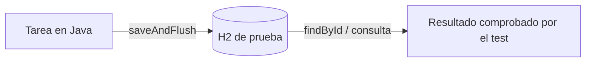
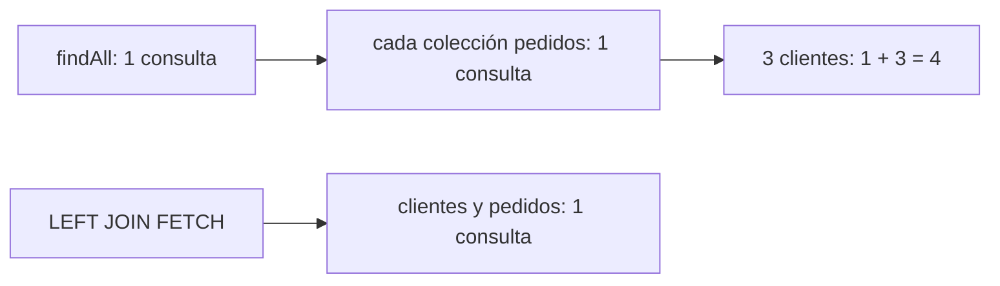
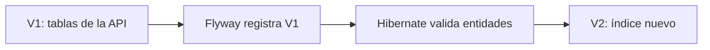
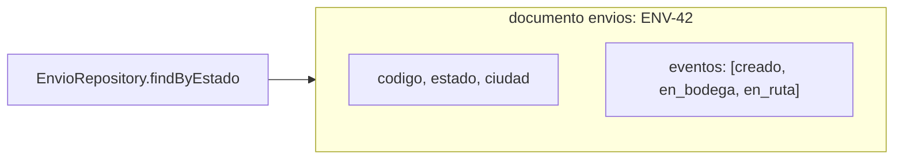

# Módulo 4: Persistencia con Spring Data JPA

Este módulo continúa el backend `academia-spring` creado en los módulos 1 y 2. Ejecuta los ejemplos con la base H2 de pruebas; el test comprueba datos reales, no repositorios simulados.

**Prerrequisito sin Spring:** el lado propietario de una relación, las cascadas y el conteo básico de N+1 se enseñan una sola vez, en [Java M16 T1–T2](/curso/java/16), con el mismo laboratorio `java-jpa-lab`. Aquí se usa ese modelo mental y se añade lo propio de Spring Data: repositorios derivados, `@EntityGraph`, páginas DTO y migraciones.

**Referencia ejecutable al terminar los módulos 2 y 4–7:** en la raíz del repositorio, abre `README.md`. Incluye el estado final y pruebas; algunas clases incorporan cambios de módulos posteriores. Construye primero las prácticas de este módulo y usa la referencia para comparar y diagnosticar.

## Aprende construyendo


### Tema 1: Entidades y repositorios derivados · Intermedio · 30 min

<details open>
<summary><strong>Capa 1 — Lectura</strong></summary>

#### ► DE QUÉ TRATA
Este tema te guía por entidades y repositorios derivados con foco en comprensión antes de implementación.

#### ► LA IDEA EN UNA FRASE
**Entender entidades y repositorios derivados te permite tomar mejores decisiones técnicas.**

#### ► POR QUÉ EXISTE ESTO
Resuelve un problema real de diseño o implementación y evita decisiones a ciegas.

#### ► LA ANALOGÍA
Piensa en entidades y repositorios derivados como una herramienta de taller: útil cuando conoces su propósito y sus límites.
**Dónde se rompe la analogía:** en software, los efectos dependen del contexto, la escala y los trade-offs.

#### ► CÓMO FUNCIONA


#### ► LO QUE PUEDE SALIR MAL
| Síntoma | Causa probable | Arreglo |
|---|---|---|
| Entidades y repositorios derivados se aplica pero el resultado no mejora | Se usó sin medir el problema real | Mide antes y compara contra la alternativa simple |
| Aparece complejidad inesperada | Se adoptó la técnica sin comprender sus trade-offs | Vuelve a la sección de trade-offs y reduce el alcance |
| Falla en un caso límite | Se asumió un contexto que no se cumple | Prueba el caso límite y documenta cuándo NO usarlo |

#### ► TRADE-OFFS
| Opción | Cuándo usarla | Cuándo NO usarla |
|---|---|---|
| Usar Entidades y repositorios derivados | Cuando el problema coincide con su propósito y el beneficio es observable | Cuando agrega complejidad sin resolver un problema real |
| Alternativa más simple | Cuando el contexto es pequeño, estable o fácil de razonar | Cuando ya demostró no escalar o no cumplir el requisito |
| Postergar la decisión | Cuando falta evidencia del problema | Cuando el costo de esperar es mayor que el costo de probar |

#### ► CUÁNDO NO USAR ESTO
No uses entidades y repositorios derivados por defecto. Aplícalo cuando el problema lo justifique y puedas verificar el beneficio; si una alternativa más simple resuelve igual, prefiérela.

#### ► DE VUELTA A LA ANALOGÍA
Volviendo a la analogía: entidades y repositorios derivados funciona como el modelo inicial, pero recuerda dónde se rompe: en producción importan la evidencia, la escala y el costo de equivocarte.

#### ► LO QUE DEBES RECORDAR
- Entidades y repositorios derivados existe para resolver un problema específico.
- Mide antes de adoptar complejidad.
- Conoce el caso donde NO usarlo.
- Verifica con evidencia observable.

#### ► PREGUNTAS PARA PENSAR
1. ¿Qué problema concreto resuelve entidades y repositorios derivados en tu contexto?
2. ¿Cómo sabrías que entidades y repositorios derivados no está funcionando bien?
3. ¿Qué alternativa más simple considerarías antes de usar entidades y repositorios derivados?

</details>

<details>
<summary><strong>Capa 2 — Construcción</strong></summary>

#### Código y verificación


```xml
<dependency>
    <groupId>org.springframework.boot</groupId>
    <artifactId>spring-boot-starter-data-jpa-test</artifactId>
    <scope>test</scope>
</dependency>
```

```java
package com.example.demo;

import org.junit.jupiter.api.Test;
import org.springframework.beans.factory.annotation.Autowired;
import org.springframework.boot.data.jpa.test.autoconfigure.DataJpaTest;
import static org.assertj.core.api.Assertions.assertThat;

@DataJpaTest
class TareaRepositoryTest {
    @Autowired TareaRepository tareas;

    @Test
    void guardaYRecuperaLaTarea() {
        Tarea guardada = tareas.saveAndFlush(
            new Tarea("Revisar paquete", 2, "BODEGA-A")
        );

        Tarea leida = tareas.findById(guardada.getId()).orElseThrow();

        assertThat(leida.getTitulo()).isEqualTo("Revisar paquete");
        assertThat(leida.getPrioridad()).isEqualTo(2);
    }
}
```

```bash
./mvnw -q -Dtest=TareaRepositoryTest test
```

```java
package com.example.demo;

import java.util.List;
import org.springframework.data.jpa.repository.JpaRepository;

public interface TareaRepository extends JpaRepository<Tarea, Long> {
    List<Tarea> findByPrioridadGreaterThanEqual(int minimo);
}
```

```java
@Test
void filtraPrioridadMinimaIncluyendoElLimite() {
    tareas.save(new Tarea("Sobre", 1, "A"));
    tareas.save(new Tarea("Caja", 2, "B"));
    tareas.save(new Tarea("Pallet", 3, "C"));
    tareas.flush();

    var resultado = tareas.findByPrioridadGreaterThanEqual(2);

    assertThat(resultado).extracting(Tarea::getTitulo)
        .containsExactlyInAnyOrder("Caja", "Pallet");
}
```

</details>

### Tema 2: El problema N+1 y su corrección · Intermedio · 35 min

<details open>
<summary><strong>Capa 1 — Lectura</strong></summary>

#### ► DE QUÉ TRATA
Este tema te guía por el problema n+1 y su corrección con foco en comprensión antes de implementación.

#### ► LA IDEA EN UNA FRASE
**Entender el problema n+1 y su corrección te permite tomar mejores decisiones técnicas.**

#### ► POR QUÉ EXISTE ESTO
Resuelve un problema real de diseño o implementación y evita decisiones a ciegas.

#### ► LA ANALOGÍA
Piensa en el problema n+1 y su corrección como una herramienta de taller: útil cuando conoces su propósito y sus límites.
**Dónde se rompe la analogía:** en software, los efectos dependen del contexto, la escala y los trade-offs.

#### ► CÓMO FUNCIONA


#### ► LO QUE PUEDE SALIR MAL
| Síntoma | Causa probable | Arreglo |
|---|---|---|
| El problema N+1 y su corrección se aplica pero el resultado no mejora | Se usó sin medir el problema real | Mide antes y compara contra la alternativa simple |
| Aparece complejidad inesperada | Se adoptó la técnica sin comprender sus trade-offs | Vuelve a la sección de trade-offs y reduce el alcance |
| Falla en un caso límite | Se asumió un contexto que no se cumple | Prueba el caso límite y documenta cuándo NO usarlo |

#### ► TRADE-OFFS
| Opción | Cuándo usarla | Cuándo NO usarla |
|---|---|---|
| Usar El problema N+1 y su corrección | Cuando el problema coincide con su propósito y el beneficio es observable | Cuando agrega complejidad sin resolver un problema real |
| Alternativa más simple | Cuando el contexto es pequeño, estable o fácil de razonar | Cuando ya demostró no escalar o no cumplir el requisito |
| Postergar la decisión | Cuando falta evidencia del problema | Cuando el costo de esperar es mayor que el costo de probar |

#### ► CUÁNDO NO USAR ESTO
No uses el problema n+1 y su corrección por defecto. Aplícalo cuando el problema lo justifique y puedas verificar el beneficio; si una alternativa más simple resuelve igual, prefiérela.

#### ► DE VUELTA A LA ANALOGÍA
Volviendo a la analogía: el problema n+1 y su corrección funciona como el modelo inicial, pero recuerda dónde se rompe: en producción importan la evidencia, la escala y el costo de equivocarte.

#### ► LO QUE DEBES RECORDAR
- El problema N+1 y su corrección existe para resolver un problema específico.
- Mide antes de adoptar complejidad.
- Conoce el caso donde NO usarlo.
- Verifica con evidencia observable.

#### ► PREGUNTAS PARA PENSAR
1. ¿Qué problema concreto resuelve el problema n+1 y su corrección en tu contexto?
2. ¿Cómo sabrías que el problema n+1 y su corrección no está funcionando bien?
3. ¿Qué alternativa más simple considerarías antes de usar el problema n+1 y su corrección?

</details>

<details>
<summary><strong>Capa 2 — Construcción</strong></summary>

#### Código y verificación


```java
package com.example.demo;

import jakarta.persistence.Entity;
import jakarta.persistence.FetchType;
import jakarta.persistence.GeneratedValue;
import jakarta.persistence.GenerationType;
import jakarta.persistence.Id;
import jakarta.persistence.OneToMany;
import jakarta.persistence.Table;
import java.util.ArrayList;
import java.util.List;
import lombok.Getter;

@Getter
@Entity
@Table(name = "clientes")
public class Cliente {
    @Id
    @GeneratedValue(strategy = GenerationType.IDENTITY)
    private Long id;

    private String nombre;

    @OneToMany(mappedBy = "cliente", fetch = FetchType.LAZY)
    private List<Pedido> pedidos = new ArrayList<>();

    protected Cliente() {}

    public Cliente(String nombre) {
        this.nombre = nombre;
    }
}
```

```java
package com.example.demo;

import jakarta.persistence.Entity;
import jakarta.persistence.FetchType;
import jakarta.persistence.GeneratedValue;
import jakarta.persistence.GenerationType;
import jakarta.persistence.Id;
import jakarta.persistence.JoinColumn;
import jakarta.persistence.ManyToOne;
import jakarta.persistence.Table;
import lombok.Getter;

@Getter
@Entity
@Table(name = "pedidos")
public class Pedido {
    @Id
    @GeneratedValue(strategy = GenerationType.IDENTITY)
    private Long id;

    private String codigo;

    @ManyToOne(fetch = FetchType.LAZY, optional = false)
    @JoinColumn(name = "cliente_id", nullable = false)
    private Cliente cliente;

    protected Pedido() {}

    public Pedido(String codigo, Cliente cliente) {
        this.codigo = codigo;
        this.cliente = cliente;
    }
}
```

```java
package com.example.demo;

import java.util.List;
import org.springframework.data.jpa.repository.JpaRepository;
import org.springframework.data.jpa.repository.Query;

public interface ClienteRepository extends JpaRepository<Cliente, Long> {
    @Query("select c from Cliente c")
    List<Cliente> buscarSinPedidos();
}
```

```java
package com.example.demo;

import org.springframework.data.jpa.repository.JpaRepository;

public interface PedidoRepository extends JpaRepository<Pedido, Long> {}
```

```java
package com.example.demo;

import jakarta.persistence.EntityManager;
import org.hibernate.SessionFactory;
import org.hibernate.stat.Statistics;
import org.junit.jupiter.api.Test;
import org.springframework.beans.factory.annotation.Autowired;
import org.springframework.boot.data.jpa.test.autoconfigure.DataJpaTest;
import static org.assertj.core.api.Assertions.assertThat;

@DataJpaTest(properties = "spring.jpa.properties.hibernate.generate_statistics=true")
class NMasUnoTest {
    @Autowired ClienteRepository clientes;
    @Autowired PedidoRepository pedidos;
    @Autowired EntityManager entityManager;
    @Autowired SessionFactory sessionFactory;

    private void crearTresClientesConPedido() {
        for (int i = 1; i <= 3; i++) {
            Cliente cliente = clientes.save(new Cliente("Cliente " + i));
            pedidos.save(new Pedido("RF-" + i, cliente));
        }
        entityManager.flush();
        entityManager.clear();
    }

    @Test
    void laCargaPerezosaHaceUnaConsultaPorCadaColeccion() {
        crearTresClientesConPedido();
        Statistics stats = sessionFactory.getStatistics();
        stats.clear();

        for (Cliente cliente : clientes.buscarSinPedidos()) {
            assertThat(cliente.getPedidos()).hasSize(1);
        }

        assertThat(stats.getPrepareStatementCount()).isEqualTo(4L);
    }
}
```

</details>

### Tema 3: Más allá del N+1: el límite de LAZY y páginas DTO · Intermedio · 40 min

<details open>
<summary><strong>Capa 1 — Lectura</strong></summary>

#### ► DE QUÉ TRATA
Este tema te guía por más allá del n+1: el límite de lazy y páginas dto con foco en comprensión antes de implementación.

#### ► LA IDEA EN UNA FRASE
**Entender más allá del n+1: el límite de lazy y páginas dto te permite tomar mejores decisiones técnicas.**

#### ► POR QUÉ EXISTE ESTO
Resuelve un problema real de diseño o implementación y evita decisiones a ciegas.

#### ► LA ANALOGÍA
Piensa en más allá del n+1: el límite de lazy y páginas dto como una herramienta de taller: útil cuando conoces su propósito y sus límites.
**Dónde se rompe la analogía:** en software, los efectos dependen del contexto, la escala y los trade-offs.

#### ► CÓMO FUNCIONA
1. Identifica el problema que más allá del n+1: el límite de lazy y páginas dto resuelve.
2. Observa sus componentes y relaciones.
3. Aplica la opción más simple que funcione.
4. Verifica el resultado y los límites.

#### ► LO QUE PUEDE SALIR MAL
| Síntoma | Causa probable | Arreglo |
|---|---|---|
| Más allá del N+1: el límite de LAZY y páginas DTO se aplica pero el resultado no mejora | Se usó sin medir el problema real | Mide antes y compara contra la alternativa simple |
| Aparece complejidad inesperada | Se adoptó la técnica sin comprender sus trade-offs | Vuelve a la sección de trade-offs y reduce el alcance |
| Falla en un caso límite | Se asumió un contexto que no se cumple | Prueba el caso límite y documenta cuándo NO usarlo |

#### ► TRADE-OFFS
| Opción | Cuándo usarla | Cuándo NO usarla |
|---|---|---|
| Usar Más allá del N+1: el límite de LAZY y páginas DTO | Cuando el problema coincide con su propósito y el beneficio es observable | Cuando agrega complejidad sin resolver un problema real |
| Alternativa más simple | Cuando el contexto es pequeño, estable o fácil de razonar | Cuando ya demostró no escalar o no cumplir el requisito |
| Postergar la decisión | Cuando falta evidencia del problema | Cuando el costo de esperar es mayor que el costo de probar |

#### ► CUÁNDO NO USAR ESTO
No uses más allá del n+1: el límite de lazy y páginas dto por defecto. Aplícalo cuando el problema lo justifique y puedas verificar el beneficio; si una alternativa más simple resuelve igual, prefiérela.

#### ► DE VUELTA A LA ANALOGÍA
Volviendo a la analogía: más allá del n+1: el límite de lazy y páginas dto funciona como el modelo inicial, pero recuerda dónde se rompe: en producción importan la evidencia, la escala y el costo de equivocarte.

#### ► LO QUE DEBES RECORDAR
- Más allá del N+1: el límite de LAZY y páginas DTO existe para resolver un problema específico.
- Mide antes de adoptar complejidad.
- Conoce el caso donde NO usarlo.
- Verifica con evidencia observable.

#### ► PREGUNTAS PARA PENSAR
1. ¿Qué problema concreto resuelve más allá del n+1: el límite de lazy y páginas dto en tu contexto?
2. ¿Cómo sabrías que más allá del n+1: el límite de lazy y páginas dto no está funcionando bien?
3. ¿Qué alternativa más simple considerarías antes de usar más allá del n+1: el límite de lazy y páginas dto?

</details>

<details>
<summary><strong>Capa 2 — Construcción</strong></summary>

#### Código y verificación
```bash
./mvnw -Dtest=PedidoJpaLabTest#accederRelacionLazyDespuesDeSepararLaEntidadFallaConDiagnosticoClaro test
```

```java
@Query("select new academia.pedidos.PedidoResumen(p.referencia, p.cliente.nombre) "
    + "from Pedido p order by p.referencia")
Page<PedidoResumen> listarResumenes(Pageable pageable);
```

```bash
./mvnw -Dtest=PedidoJpaLabTest#paginaResumenConSoloLasColumnasQueNecesitaLaLista test
```

</details>

### Tema 4: Migraciones con Flyway · Intermedio · 30 min

<details open>
<summary><strong>Capa 1 — Lectura</strong></summary>

#### ► DE QUÉ TRATA
Este tema te guía por migraciones con flyway con foco en comprensión antes de implementación.

#### ► LA IDEA EN UNA FRASE
**Entender migraciones con flyway te permite tomar mejores decisiones técnicas.**

#### ► POR QUÉ EXISTE ESTO
Resuelve un problema real de diseño o implementación y evita decisiones a ciegas.

#### ► LA ANALOGÍA
Piensa en migraciones con flyway como una herramienta de taller: útil cuando conoces su propósito y sus límites.
**Dónde se rompe la analogía:** en software, los efectos dependen del contexto, la escala y los trade-offs.

#### ► CÓMO FUNCIONA


#### ► LO QUE PUEDE SALIR MAL
| Síntoma | Causa probable | Arreglo |
|---|---|---|
| Migraciones con Flyway se aplica pero el resultado no mejora | Se usó sin medir el problema real | Mide antes y compara contra la alternativa simple |
| Aparece complejidad inesperada | Se adoptó la técnica sin comprender sus trade-offs | Vuelve a la sección de trade-offs y reduce el alcance |
| Falla en un caso límite | Se asumió un contexto que no se cumple | Prueba el caso límite y documenta cuándo NO usarlo |

#### ► TRADE-OFFS
| Opción | Cuándo usarla | Cuándo NO usarla |
|---|---|---|
| Usar Migraciones con Flyway | Cuando el problema coincide con su propósito y el beneficio es observable | Cuando agrega complejidad sin resolver un problema real |
| Alternativa más simple | Cuando el contexto es pequeño, estable o fácil de razonar | Cuando ya demostró no escalar o no cumplir el requisito |
| Postergar la decisión | Cuando falta evidencia del problema | Cuando el costo de esperar es mayor que el costo de probar |

#### ► CUÁNDO NO USAR ESTO
No uses migraciones con flyway por defecto. Aplícalo cuando el problema lo justifique y puedas verificar el beneficio; si una alternativa más simple resuelve igual, prefiérela.

#### ► DE VUELTA A LA ANALOGÍA
Volviendo a la analogía: migraciones con flyway funciona como el modelo inicial, pero recuerda dónde se rompe: en producción importan la evidencia, la escala y el costo de equivocarte.

#### ► LO QUE DEBES RECORDAR
- Migraciones con Flyway existe para resolver un problema específico.
- Mide antes de adoptar complejidad.
- Conoce el caso donde NO usarlo.
- Verifica con evidencia observable.

#### ► PREGUNTAS PARA PENSAR
1. ¿Qué problema concreto resuelve migraciones con flyway en tu contexto?
2. ¿Cómo sabrías que migraciones con flyway no está funcionando bien?
3. ¿Qué alternativa más simple considerarías antes de usar migraciones con flyway?

</details>

<details>
<summary><strong>Capa 2 — Construcción</strong></summary>

#### Código y verificación


```xml
<dependency>
    <groupId>org.springframework.boot</groupId>
    <artifactId>spring-boot-starter-flyway</artifactId>
</dependency>
```

```yaml
spring:
  jpa:
    hibernate:
      ddl-auto: validate
```

```sql
CREATE TABLE tareas (
    id BIGINT GENERATED BY DEFAULT AS IDENTITY PRIMARY KEY,
    titulo VARCHAR(255),
    prioridad INTEGER NOT NULL,
    nota_interna VARCHAR(255),
    ubicacion_interna VARCHAR(255)
);

CREATE TABLE clientes (
    id BIGINT GENERATED BY DEFAULT AS IDENTITY PRIMARY KEY,
    nombre VARCHAR(255)
);

CREATE TABLE pedidos (
    id BIGINT GENERATED BY DEFAULT AS IDENTITY PRIMARY KEY,
    codigo VARCHAR(255),
    cliente_id BIGINT NOT NULL,
    CONSTRAINT fk_pedidos_clientes FOREIGN KEY (cliente_id) REFERENCES clientes (id)
);
```

```java
package com.example.demo;

import org.flywaydb.core.Flyway;
import org.junit.jupiter.api.Test;
import org.springframework.beans.factory.annotation.Autowired;
import org.springframework.boot.data.jpa.test.autoconfigure.DataJpaTest;
import static org.assertj.core.api.Assertions.assertThat;

@DataJpaTest
class MigracionesTest {
    @Autowired Flyway flyway;
    @Autowired TareaRepository tareas;

    @Test
    void flywayRegistroLaMigracionInicial() {
        assertThat(flyway.info().applied())
            .extracting(migration -> migration.getVersion().getVersion())
            .contains("1");
    }

    @Test
    void laTablaCreadaPorFlywayAceptaUnaTarea() {
        Tarea guardada = tareas.saveAndFlush(
            new Tarea("Probar esquema", 2, "BODEGA-A")
        );
        assertThat(tareas.findById(guardada.getId())).isPresent();
    }
}
```

```bash
./mvnw -q clean test
```

</details>

### Tema 5: Spring Data MongoDB: documentos, consultas derivadas y cuándo elegir un modelo de documentos · Intermedio · 45 min

<details open>
<summary><strong>Capa 1 — Lectura</strong></summary>

#### ► DE QUÉ TRATA
Usa Spring Boot 4.1.2 y JDK 25 en academia-spring (paquete com.example.demo), agrega spring-boot-starter-data-mongodb y usa Docker para levantar MongoDB: docker run -d --name mongo -p 27017:27017 mongo:8.

#### ► LA IDEA EN UNA FRASE
**Usa Spring Boot 4.1.2 y JDK 25 en academia-spring (paquete com.example.demo), agrega spring-boot-starter-data-mongodb y usa Docker para levantar MongoDB: docker run -d --name mongo -p 27017:27017 mongo:8.**

#### ► POR QUÉ EXISTE ESTO
Resuelve un problema real de diseño o implementación y evita decisiones a ciegas.

#### ► LA ANALOGÍA
Piensa en spring data mongodb: documentos, consultas derivadas y cuándo elegir un modelo de documentos como una herramienta de taller: útil cuando conoces su propósito y sus límites.
**Dónde se rompe la analogía:** en software, los efectos dependen del contexto, la escala y los trade-offs.

#### ► CÓMO FUNCIONA


#### ► LO QUE PUEDE SALIR MAL
| Síntoma | Causa probable | Arreglo |
|---|---|---|
| Spring Data MongoDB: documentos, consultas derivadas y cuándo elegir un modelo de documentos se aplica pero el resultado no mejora | Se usó sin medir el problema real | Mide antes y compara contra la alternativa simple |
| Aparece complejidad inesperada | Se adoptó la técnica sin comprender sus trade-offs | Vuelve a la sección de trade-offs y reduce el alcance |
| Falla en un caso límite | Se asumió un contexto que no se cumple | Prueba el caso límite y documenta cuándo NO usarlo |

#### ► TRADE-OFFS
| Opción | Cuándo usarla | Cuándo NO usarla |
|---|---|---|
| Usar Spring Data MongoDB: documentos, consultas derivadas y cuándo elegir un modelo de documentos | Cuando el problema coincide con su propósito y el beneficio es observable | Cuando agrega complejidad sin resolver un problema real |
| Alternativa más simple | Cuando el contexto es pequeño, estable o fácil de razonar | Cuando ya demostró no escalar o no cumplir el requisito |
| Postergar la decisión | Cuando falta evidencia del problema | Cuando el costo de esperar es mayor que el costo de probar |

#### ► CUÁNDO NO USAR ESTO
No uses spring data mongodb: documentos, consultas derivadas y cuándo elegir un modelo de documentos por defecto. Aplícalo cuando el problema lo justifique y puedas verificar el beneficio; si una alternativa más simple resuelve igual, prefiérela.

#### ► DE VUELTA A LA ANALOGÍA
Volviendo a la analogía: spring data mongodb: documentos, consultas derivadas y cuándo elegir un modelo de documentos funciona como el modelo inicial, pero recuerda dónde se rompe: en producción importan la evidencia, la escala y el costo de equivocarte.

#### ► LO QUE DEBES RECORDAR
- Spring Data MongoDB: documentos, consultas derivadas y cuándo elegir un modelo de documentos existe para resolver un problema específico.
- Mide antes de adoptar complejidad.
- Conoce el caso donde NO usarlo.
- Verifica con evidencia observable.

#### ► PREGUNTAS PARA PENSAR
1. ¿Qué problema concreto resuelve spring data mongodb: documentos, consultas derivadas y cuándo elegir un modelo de documentos en tu contexto?
2. ¿Cómo sabrías que spring data mongodb: documentos, consultas derivadas y cuándo elegir un modelo de documentos no está funcionando bien?
3. ¿Qué alternativa más simple considerarías antes de usar spring data mongodb: documentos, consultas derivadas y cuándo elegir un modelo de documentos?

</details>

<details>
<summary><strong>Capa 2 — Construcción</strong></summary>

#### Código y verificación


```java
package com.example.demo.envios;

import java.time.Instant;
import java.util.List;
import org.springframework.data.annotation.Id;
import org.springframework.data.mongodb.core.mapping.Document;

@Document("envios")
public record Envio(@Id String codigo, String estado, String ciudad, List<Evento> eventos) {
    public record Evento(String tipo, Instant cuando) {} // embebido: viaja con el envío
}
```

```java
package com.example.demo.envios;

import java.util.List;
import org.springframework.data.mongodb.repository.Aggregation;
import org.springframework.data.mongodb.repository.MongoRepository;

public interface EnvioRepository extends MongoRepository<Envio, String> {
    List<Envio> findByEstadoAndCiudad(String estado, String ciudad); // consulta derivada

    @Aggregation(pipeline = { "{ $group: { _id: '$estado', total: { $sum: 1 } } }", "{ $sort: { _id: 1 } }" })
    List<ConteoPorEstado> contarPorEstado();

    record ConteoPorEstado(String id, long total) {}
}
```

```java
package com.example.demo.envios;

import java.time.Instant;
import java.util.List;
import org.springframework.boot.CommandLineRunner;
import org.springframework.stereotype.Component;

@Component
class CargaInicial implements CommandLineRunner {
    private final EnvioRepository repositorio;
    CargaInicial(EnvioRepository repositorio) { this.repositorio = repositorio; }

    @Override
    public void run(String... args) {
        repositorio.deleteAll();
        repositorio.saveAll(List.of(
            new Envio("ENV-42", "EN_RUTA", "bogota", List.of(new Envio.Evento("CREADO", Instant.now()))),
            new Envio("ENV-43", "EN_RUTA", "medellin", List.of()),
            new Envio("ENV-44", "ENTREGADO", "bogota", List.of())));
        System.out.println("En ruta en Bogotá: " + repositorio.findByEstadoAndCiudad("EN_RUTA", "bogota").size());
        repositorio.contarPorEstado().forEach(c -> System.out.println(c.id() + ": " + c.total()));
    }
}
```

```properties
# Desde Spring Boot 4.0 la conexión usa el prefijo spring.mongodb (antes spring.data.mongodb)
spring.mongodb.uri=mongodb://localhost:27017/rutaflow
```

```bash
docker run -d --name mongo -p 27017:27017 mongo:8
./mvnw spring-boot:run
docker exec mongo mongosh rutaflow --quiet --eval 'db.envios.findOne({_id: "ENV-42"})'
```

</details>
