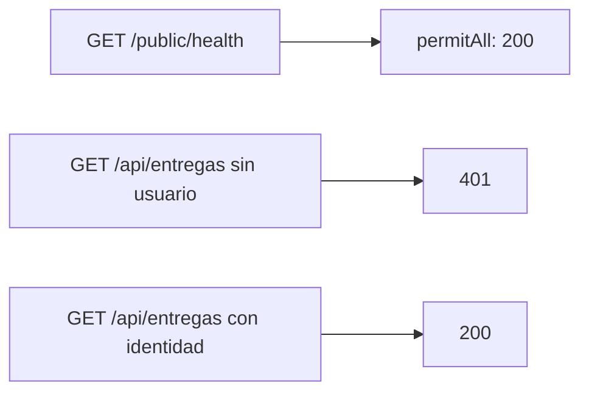
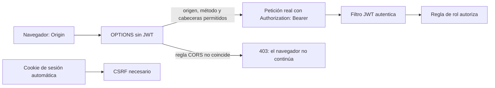
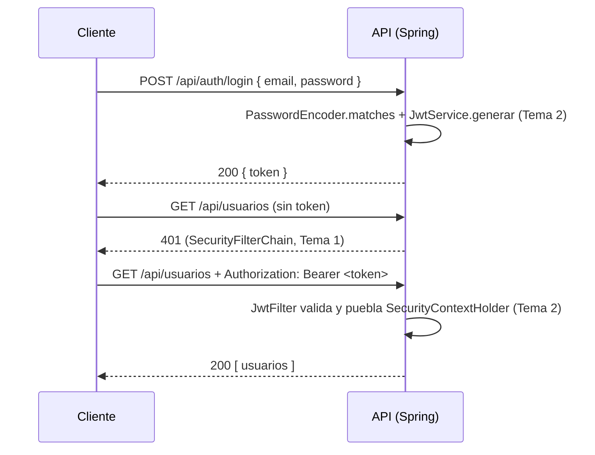

# Módulo 4: Spring Security

Cada tema se practica por separado con su propia repetición progresiva y su propio reto de memoria, verificado con `MockMvc` real contra un contexto de Spring real, para que cada código de estado HTTP (200/401/403) sea comprobable, no solo descrito.


## Aprende construyendo

### Tema 1: SecurityFilterChain moderno

Al terminar, podrás añadir Spring Security al backend `academia-spring`, separar una ruta pública de las protegidas y probar la regla con MockMvc. Este tema usa HTTP Basic para mostrar la cadena de filtros; el siguiente añade JWT.

Prerrequisitos: API y pruebas de Spring Boot Módulos 1–3.

**¿Por qué es importante?** La ruta de salud debe responder a un balanceador sin credencial; las operaciones con datos de clientes deben exigir una identidad. Una regla equivocada puede dejar pública toda la API.



#### Subtema 4.1 · Proteger rutas del backend · 10 min

**Contexto:** Spring Boot ya sirve tareas y documentación OpenAPI. Agrega la seguridad al mismo proyecto para que la regla viva junto al backend real.

**Hazlo tú:** En `pom.xml`, añade el starter de aplicación dentro de `<dependencies>`:

```xml
<dependency>
    <groupId>org.springframework.boot</groupId>
    <artifactId>spring-boot-starter-security</artifactId>
</dependency>
```

Crea `src/main/java/com/example/demo/SecurityConfig.java`:

```java
package com.example.demo;

import org.springframework.context.annotation.Bean;
import org.springframework.context.annotation.Configuration;
import org.springframework.security.config.Customizer;
import org.springframework.security.config.annotation.web.builders.HttpSecurity;
import org.springframework.security.web.SecurityFilterChain;

@Configuration
public class SecurityConfig {
    @Bean
    SecurityFilterChain filterChain(HttpSecurity http) throws Exception {
        return http
            .authorizeHttpRequests(auth -> auth
                .requestMatchers("/public/**").permitAll()
                .anyRequest().authenticated())
            .httpBasic(Customizer.withDefaults())
            .build();
    }
}
```

Crea `src/main/java/com/example/demo/RutasController.java`:

```java
package com.example.demo;

import org.springframework.web.bind.annotation.GetMapping;
import org.springframework.web.bind.annotation.RestController;

@RestController
public class RutasController {
    @GetMapping("/public/health")
    public String salud() { return "OK"; }

    @GetMapping("/api/entregas")
    public String entregas() { return "entregas confidenciales"; }
}
```

**Resultado esperado:** desde la raíz, `./mvnw -q -Dtest=SecurityFilterChainTest test` aún no aplica porque el test se crea en el siguiente subtema. Comprueba al menos que `./mvnw -q compile` termina correctamente.

**Fallo deliberado y diagnóstico:** cambia `.authenticated()` por `.permitAll()` y arranca el backend. La aplicación inicia, pero esa regla hace pública cualquier ruta restante; el test del siguiente subtema debe detectar el problema. Restáurala a `.authenticated()` antes de continuar.

**Entiende:** el filtro revisa cada petición antes de que llegue al controller. `permitAll()` deja pasar sin identidad; `authenticated()` exige una identidad ya comprobada; HTTP Basic pide usuario y contraseña mediante el encabezado de autenticación. CSRF queda habilitado con su valor seguro por defecto.

**Cierra:** deja la regla privada en `.authenticated()` y guarda los nombres de las dos rutas que acabas de crear.

#### Subtema 4.2 · Verificar 200, 401 y usuario autenticado · 10 min

**Contexto:** Compilar no demuestra que la cadena se aplique. Usa MockMvc con los filtros del contexto para pedir la ruta pública y la protegida.

**Hazlo tú:** En `pom.xml`, añade el starter de pruebas a `<dependencies>`:

```xml
<dependency>
    <groupId>org.springframework.boot</groupId>
    <artifactId>spring-boot-starter-security-test</artifactId>
    <scope>test</scope>
</dependency>
```

Crea `src/test/java/com/example/demo/SecurityFilterChainTest.java`:

```java
package com.example.demo;

import org.junit.jupiter.api.Test;
import org.springframework.beans.factory.annotation.Autowired;
import org.springframework.boot.test.context.SpringBootTest;
import org.springframework.boot.webmvc.test.autoconfigure.AutoConfigureMockMvc;
import org.springframework.security.test.context.support.WithMockUser;
import org.springframework.test.web.servlet.MockMvc;
import static org.springframework.test.web.servlet.request.MockMvcRequestBuilders.get;
import static org.springframework.test.web.servlet.result.MockMvcResultMatchers.status;

@SpringBootTest
@AutoConfigureMockMvc
class SecurityFilterChainTest {
    @Autowired MockMvc mockMvc;

    @Test
    void publicaDejaPasarSinCredencial() throws Exception {
        mockMvc.perform(get("/public/health")).andExpect(status().isOk());
    }

    @Test
    void protegidaRechazaSolicitudAnonima() throws Exception {
        mockMvc.perform(get("/api/entregas")).andExpect(status().isUnauthorized());
    }

    @Test
    @WithMockUser
    void protegidaAceptaLaIdentidadDePrueba() throws Exception {
        mockMvc.perform(get("/api/entregas")).andExpect(status().isOk());
    }
}
```

Ejecuta desde la raíz:

```bash
./mvnw -q -Dtest=SecurityFilterChainTest test
```

**Resultado esperado:** los tres tests pasan: público `200`, anónimo protegido `401`, identidad de prueba `200`.

**Fallo deliberado y diagnóstico:** cambia `.anyRequest().authenticated()` a `.anyRequest().permitAll()` y repite el comando. El test anónimo falla con `expected 401 but was 200`: el controller responde, pero la cadena ya no frena a quien llega sin identidad. Restaura `.authenticated()`.

**Entiende:** `@WithMockUser` crea un principal solo para la prueba; no verifica una contraseña ni comprueba un proveedor de usuarios. MockMvc sí ejecuta la cadena de filtros real. La [guía de Spring Security sobre usuarios de prueba](https://docs.spring.io/spring-security/reference/servlet/test/mockmvc/authentication.html) aclara el alcance de esta anotación.

**Cierra:** conserva la salida verde y la prueba fallida/restaurada. La anotación `@AutoConfigureMockMvc` en Boot 4 se importa desde `org.springframework.boot.webmvc.test.autoconfigure`; el starter de seguridad de prueba entrega `@WithMockUser`.

#### Subtema 4.3 · Decidir qué rutas son públicas · 10 min

**Contexto:** Al proteger todo lo que no esté en `/public/**`, la prueba OpenAPI existente también recibe `401`. Decide explícitamente si el documento debe estar abierto en este entorno de aprendizaje.

**Hazlo tú:** En `src/main/java/com/example/demo/SecurityConfig.java`, conserva los imports y la clase. Reemplaza únicamente el método `filterChain`:

```java
@Bean
SecurityFilterChain filterChain(HttpSecurity http) throws Exception {
    return http
        .authorizeHttpRequests(auth -> auth
            .requestMatchers(
                "/public/**",
                "/v3/api-docs/**",
                "/swagger-ui/**",
                "/swagger-ui.html"
            ).permitAll()
            .anyRequest().authenticated())
        .httpBasic(Customizer.withDefaults())
        .build();
}
```

Desde la raíz, prueba primero el contrato que ya existe y luego la suite:

Antes de ejecutar, añade a `src/main/java/com/example/demo/RutasController.java` el import `org.springframework.web.bind.annotation.PathVariable` y este método dentro de la clase:

```java
@GetMapping("/api/entregas/{id}")
public String entrega(@PathVariable long id) {
    return "entrega " + id;
}
```

Añade también estos dos métodos a `SecurityFilterChainTest.java`:

```java
@Test
void subrutaTambienRechazaSolicitudAnonima() throws Exception {
    mockMvc.perform(get("/api/entregas/42")).andExpect(status().isUnauthorized());
}

@Test
@WithMockUser
void subrutaAceptaIdentidadDePrueba() throws Exception {
    mockMvc.perform(get("/api/entregas/42")).andExpect(status().isOk());
}
```

```bash
./mvnw -q -Dtest=ContratoOpenApiTest test
./mvnw -q clean test
```

**Resultado esperado:** OpenAPI devuelve `200` sin credencial; las pruebas confirman que `/api/entregas` y `/api/entregas/42` devuelven `401` sin identidad y `200` con un usuario de prueba. La suite completa pasa.

**Fallo deliberado y diagnóstico:** quita `"/v3/api-docs/**"` de la lista y ejecuta `./mvnw -q -Dtest=ContratoOpenApiTest test`. El test obtiene `401` en vez de `200`, porque el contrato documental ahora cae en `.anyRequest().authenticated()`. Restaura el matcher.

**Entiende:** una regla pública es una decisión sobre información, no solo una forma de arreglar tests. La documentación se deja abierta para el curso; en una API real, revisa si su esquema revela rutas o datos que convenga restringir. **Límite:** HTTP Basic envía credenciales en cada petición; úsalo solo por HTTPS fuera de pruebas locales. No desactives CSRF a ciegas; aquí se conserva porque la cadena aún admite autenticación Basic.

**Cierra:** guarda la suite verde. **Práctica:** en los dos tests de subruta, cambia `/api/entregas/42` por `/api/entregas/43` y ejecuta `./mvnw -q -Dtest=SecurityFilterChainTest test`; anónima debe seguir en `401` y con `@WithMockUser` en `200`. Enumera las rutas que decidiste dejar públicas. El siguiente tema sustituye HTTP Basic por validación de JWT y agrega autorización por rol.

El filtro que definiste protege el backend acumulativo del proyecto integrador; una marca de test confirma esta regla de rutas, no una revisión de todos los controles de acceso del producto.

### Tema 2: Filtro JWT y autorización por rol

Al terminar, podrás firmar y validar un JWT, conectarlo a la cadena de Spring Security y restringir una operación por rol. El backend de los Temas 1–3 sigue siendo `academia-spring`.

**¿Por qué es importante?** Una firma válida prueba quién emitió el token y que no se alteró; la autorización separa qué operaciones puede ejecutar cada usuario. Si el filtro no entra en la cadena o el rol se traduce mal, la API puede rechazar a todos o abrir acciones sensibles.

#### Subtema 4.4 · Firmar y validar un token · 10 min

**Contexto:** el Tema 1 dejó las rutas privadas con HTTP Basic. Ahora el cliente enviará un token firmado en cada llamada; no guardaremos una sesión en el servidor.

**Hazlo tú:** desde `academia-spring`, añade a `pom.xml` las dependencias de JJWT. Usa la misma versión para los tres módulos:

```xml
<dependency>
    <groupId>io.jsonwebtoken</groupId>
    <artifactId>jjwt-api</artifactId>
    <version>0.13.0</version>
</dependency>
<dependency>
    <groupId>io.jsonwebtoken</groupId>
    <artifactId>jjwt-impl</artifactId>
    <version>0.13.0</version>
    <scope>runtime</scope>
</dependency>
<dependency>
    <groupId>io.jsonwebtoken</groupId>
    <artifactId>jjwt-jackson</artifactId>
    <version>0.13.0</version>
    <scope>runtime</scope>
</dependency>
```

En `src/main/resources/application.properties`, lee el secreto de una variable de entorno. No escribas la clave en Java ni en Git:

```properties
security.jwt.secret-base64=${JWT_SECRET_BASE64}
```

En una terminal local, genera una clave de 32 bytes y arranca los comandos Maven desde `academia-spring`:

```bash
export JWT_SECRET_BASE64="$(openssl rand -base64 32)"
./mvnw -q compile
```

Crea `src/main/java/com/example/demo/JwtService.java`:

```java
package com.example.demo;

import io.jsonwebtoken.Claims;
import io.jsonwebtoken.Jwts;
import io.jsonwebtoken.io.Decoders;
import io.jsonwebtoken.security.Keys;
import java.time.Instant;
import java.util.Date;
import javax.crypto.SecretKey;
import org.springframework.beans.factory.annotation.Value;
import org.springframework.stereotype.Service;

@Service
public class JwtService {
    private final SecretKey key;

    public JwtService(@Value("${security.jwt.secret-base64}") String secretBase64) {
        this.key = Keys.hmacShaKeyFor(Decoders.BASE64.decode(secretBase64));
    }

    public String generar(String usuario, String rol) {
        Instant ahora = Instant.now();
        return Jwts.builder()
            .subject(usuario)
            .claim("rol", rol)
            .issuedAt(Date.from(ahora))
            .expiration(Date.from(ahora.plusSeconds(900)))
            .signWith(key)
            .compact();
    }

    public Claims validar(String token) {
        return Jwts.parser().verifyWith(key).build()
            .parseSignedClaims(token).getPayload();
    }
}
```

Crea `src/test/java/com/example/demo/JwtServiceTest.java` para probar el firmante sin iniciar Spring:

```java
package com.example.demo;

import static org.junit.jupiter.api.Assertions.assertEquals;
import org.junit.jupiter.api.Test;

class JwtServiceTest {
    private static final String CLAVE_DE_PRUEBA = "VVFRc3BzQVFzZXJ0T0xhbkt0ZUd4cHlsU21pSnhhOFM=";

    @Test
    void tokenFirmadoConservaUsuarioYRol() {
        var service = new JwtService(CLAVE_DE_PRUEBA);
        var claims = service.validar(service.generar("ana-1", "ADMIN"));
        assertEquals("ana-1", claims.getSubject());
        assertEquals("ADMIN", claims.get("rol", String.class));
    }
}
```

**Resultado esperado:** `./mvnw -q -Dtest=JwtServiceTest test` pasa. Un token generado dura 15 minutos; `validar` solo devuelve sus claims después de comprobar firma y vencimiento.

**Fallo deliberado y diagnóstico:** cambia temporalmente `.signWith(key)` por `.signWith(Keys.hmacShaKeyFor(new byte[32]))` y ejecuta `./mvnw -q -Dtest=JwtServiceTest test`. El test lanza error al validar el token recién firmado: compara la clave de firma con la de verificación y restaura `.signWith(key)`.

**Entiende:** Base64 representa los bytes de la clave; no la cifra ni la vuelve secreta. JJWT necesita una clave aleatoria con longitud suficiente y recomienda no convertir una frase común con `getBytes()`. `verifyWith` fija la clave de verificación; `parseSignedClaims` también comprueba las fechas estándar del token. **Analogía:** firma y verificación son una cerradura y su llave compartida. Referencia primaria: [JJWT — instalación y firmas](https://github.com/jwtk/jjwt#installation).

**Cierra:** guarda `JwtService` y comprueba que el valor real de producción no quedó escrito en archivos versionados.

#### Subtema 4.5 · Poner el filtro dentro de Spring Security · 10 min

**Contexto:** validar una cadena no protege rutas por sí solo. Spring debe ejecutar el filtro antes de autorización y crear la identidad de la petición.

**Hazlo tú:** crea `src/main/java/com/example/demo/JwtFilter.java`:

```java
package com.example.demo;

import io.jsonwebtoken.JwtException;
import jakarta.servlet.FilterChain;
import jakarta.servlet.ServletException;
import jakarta.servlet.http.HttpServletRequest;
import jakarta.servlet.http.HttpServletResponse;
import java.io.IOException;
import java.util.List;
import org.springframework.security.authentication.UsernamePasswordAuthenticationToken;
import org.springframework.security.core.authority.SimpleGrantedAuthority;
import org.springframework.security.core.context.SecurityContext;
import org.springframework.security.core.context.SecurityContextHolder;
import org.springframework.stereotype.Component;
import org.springframework.web.filter.OncePerRequestFilter;

@Component
public class JwtFilter extends OncePerRequestFilter {
    private final JwtService jwtService;

    public JwtFilter(JwtService jwtService) { this.jwtService = jwtService; }

    @Override
    protected void doFilterInternal(HttpServletRequest request, HttpServletResponse response,
            FilterChain chain) throws ServletException, IOException {
        String header = request.getHeader("Authorization");
        if (header != null && header.startsWith("Bearer ")) {
            try {
                var claims = jwtService.validar(header.substring(7));
                String rol = claims.get("rol", String.class);
                var authentication = new UsernamePasswordAuthenticationToken(
                    claims.getSubject(), null,
                    List.of(new SimpleGrantedAuthority("ROLE_" + rol)));
                SecurityContext context = SecurityContextHolder.createEmptyContext();
                context.setAuthentication(authentication);
                SecurityContextHolder.setContext(context);
            } catch (JwtException | IllegalArgumentException tokenInvalido) {
                SecurityContextHolder.clearContext();
            }
        }
        chain.doFilter(request, response);
    }
}
```

Reemplaza el método `filterChain` de `src/main/java/com/example/demo/SecurityConfig.java`. Conserva los imports de clase y añade los que aparecen aquí; el `FilterRegistrationBean` desactiva el registro automático del servlet para evitar ejecutar el filtro dos veces:

```java
import org.springframework.boot.web.servlet.FilterRegistrationBean;
import org.springframework.http.HttpStatus;
import org.springframework.security.config.annotation.method.configuration.EnableMethodSecurity;
import org.springframework.security.config.annotation.web.configurers.AbstractHttpConfigurer;
import org.springframework.security.config.http.SessionCreationPolicy;
import org.springframework.security.web.authentication.HttpStatusEntryPoint;
import org.springframework.security.web.authentication.UsernamePasswordAuthenticationFilter;

@EnableMethodSecurity
@Configuration
public class SecurityConfig {
    @Bean
    SecurityFilterChain filterChain(HttpSecurity http, JwtFilter jwtFilter) throws Exception {
        return http
            .csrf(AbstractHttpConfigurer::disable)
            .formLogin(AbstractHttpConfigurer::disable)
            .httpBasic(AbstractHttpConfigurer::disable)
            .sessionManagement(session -> session.sessionCreationPolicy(SessionCreationPolicy.STATELESS))
            .authorizeHttpRequests(auth -> auth
                .requestMatchers("/public/**", "/v3/api-docs/**", "/swagger-ui/**", "/swagger-ui.html").permitAll()
                .anyRequest().authenticated())
            .exceptionHandling(errors -> errors.authenticationEntryPoint(
                new HttpStatusEntryPoint(HttpStatus.UNAUTHORIZED)))
            .addFilterBefore(jwtFilter, UsernamePasswordAuthenticationFilter.class)
            .build();
    }

    @Bean
    FilterRegistrationBean<JwtFilter> desactivarRegistroDelServlet(JwtFilter jwtFilter) {
        var registration = new FilterRegistrationBean<>(jwtFilter);
        registration.setEnabled(false);
        return registration;
    }
}
```

Agrega a `src/main/java/com/example/demo/AdminController.java` una operación que exija rol:

```java
package com.example.demo;

import org.springframework.security.access.prepost.PreAuthorize;
import org.springframework.web.bind.annotation.DeleteMapping;
import org.springframework.web.bind.annotation.PathVariable;
import org.springframework.web.bind.annotation.RestController;

@RestController
public class AdminController {
    @PreAuthorize("hasAuthority('ROLE_ADMIN')")
    @DeleteMapping("/api/entregas/{id}")
    public void eliminar(@PathVariable long id) { }
}
```

**Resultado esperado:** `./mvnw -q compile` compila el filtro y la regla de rol. La cadena sigue permitiendo salud y OpenAPI; las rutas restantes requieren identidad.

**Fallo deliberado y diagnóstico:** quita `/public/**` de los `requestMatchers` y ejecuta `./mvnw -q -Dtest=SecurityFilterChainTest test`. La ruta de salud deja de ser pública y el test obtiene `401` en vez de `200`; revisa la regla de rutas y restaura el matcher.

**Entiende:** `OncePerRequestFilter` lee el encabezado una vez. `SecurityContextHolder` guarda la identidad para esta petición. `ROLE_ADMIN` es una autoridad; `@EnableMethodSecurity` activa `@PreAuthorize`. Sin identidad, la regla responde `401`; una identidad sin autoridad suficiente recibe `403`. En la práctica, el filtro revisa la credencial en la entrada y `@PreAuthorize` revisa el permiso de esta operación.

**Cierra:** deja el filtro integrado con `addFilterBefore` y los tests del Tema 1 verdes.

#### Subtema 4.6 · Probar identidad, rol y firma · 10 min

**Contexto:** un `@WithMockUser` prueba una regla con identidad simulada, pero no prueba el JWT. Este test firma y valida tokens reales con el servicio del subtema 4.4.

**Hazlo tú:** crea `src/test/resources/application.properties` con una clave de prueba de 32 bytes. Este valor solo es para tests; producción usa `JWT_SECRET_BASE64`:

```properties
security.jwt.secret-base64=VVFRc3BzQVFzZXJ0T0xhbkt0ZUd4cHlsU21pSnhhOFM=
```

Crea `src/test/java/com/example/demo/JwtFilterTest.java`:

```java
package com.example.demo;

import org.junit.jupiter.api.Test;
import org.springframework.beans.factory.annotation.Autowired;
import org.springframework.boot.test.context.SpringBootTest;
import org.springframework.boot.webmvc.test.autoconfigure.AutoConfigureMockMvc;
import org.springframework.test.web.servlet.MockMvc;

import static org.springframework.test.web.servlet.request.MockMvcRequestBuilders.delete;
import static org.springframework.test.web.servlet.result.MockMvcResultMatchers.status;

@SpringBootTest
@AutoConfigureMockMvc
class JwtFilterTest {
    @Autowired MockMvc mockMvc;
    @Autowired JwtService jwtService;

    @Test
    void sinTokenResponde401() throws Exception {
        mockMvc.perform(delete("/api/entregas/42")).andExpect(status().isUnauthorized());
    }

    @Test
    void rolDriverResponde403() throws Exception {
        String token = jwtService.generar("conductor-7", "DRIVER");
        mockMvc.perform(delete("/api/entregas/42").header("Authorization", "Bearer " + token))
            .andExpect(status().isForbidden());
    }

    @Test
    void rolAdminResponde200() throws Exception {
        String token = jwtService.generar("admin-1", "ADMIN");
        mockMvc.perform(delete("/api/entregas/42").header("Authorization", "Bearer " + token))
            .andExpect(status().isOk());
    }

    @Test
    void firmaAlteradaResponde401() throws Exception {
        String[] partes = jwtService.generar("admin-1", "ADMIN").split("\\.");
        String primerCaracter = partes[2].charAt(0) == 'A' ? "B" : "A";
        String tokenAlterado = partes[0] + "." + partes[1] + "." + primerCaracter + partes[2].substring(1);
        mockMvc.perform(delete("/api/entregas/42").header("Authorization", "Bearer " + tokenAlterado))
            .andExpect(status().isUnauthorized());
    }
}
```

Desde la raíz del proyecto ejecuta `./mvnw -q -Dtest=JwtFilterTest test` y después `./mvnw -q clean test`.

**Resultado esperado:** los cuatro tests específicos pasan: `401` sin token, `403` para `DRIVER`, `200` para `ADMIN`, y `401` cuando cambia un carácter de la firma. La suite completa conserva también las pruebas de JPA, Flyway y OpenAPI.

**Fallo deliberado y diagnóstico:** cambia `"ROLE_" + rol` por `rol` en `JwtFilter` y ejecuta `./mvnw -q -Dtest=JwtFilterTest#rolAdminResponde200 test`. Obtendrás `403` en lugar de `200`: el controller pide `ROLE_ADMIN`, pero el filtro ya no añade el prefijo. Restaura el prefijo.

**Entiende:** un JWT firmado no está cifrado: no pongas contraseñas ni secretos en sus claims. El HMAC usa el mismo secreto para firmar y verificar; en microservicios reales, repartir ese secreto a cada API también permitiría que cada API emita tokens. Normalmente un proveedor de identidad firma y los servicios validan con claves públicas/JWKS; Spring Security incluye un resource server JWT para ese caso: [Spring Security — JWT Resource Server](https://docs.spring.io/spring-security/reference/servlet/oauth2/resource-server/jwt.html).

**Práctica:** agrega un segundo método que exija `ROLE_DRIVER` y confirma que el mismo token ADMIN obtiene `403` allí. **Cuándo no usar este filtro casero:** si la API valida tokens emitidos por un proveedor de identidad, prefiere el resource server oficial de Spring Security. **Cierra:** conserva la suite verde y la salida del test de firma alterada. En el proyecto integrador, el login del Módulo 4 Tema 5 debe reutilizar `JwtService`; no guardes claves en el repositorio.

---

### Tema 3: CORS y CSRF

Al terminar, podrás permitir desde qué sitios web se llama la API y decidir cuándo proteger las peticiones contra CSRF. Continúa el proyecto integrador `academia-spring` con JWT en `Authorization`.



**¿Por qué es importante?** CORS deja que el navegador de tu frontend lea la API; CSRF evita cambios que un navegador podría enviar usando credenciales que adjunta solo, como una cookie. Son problemas distintos: CORS no autentica usuarios ni reemplaza permisos.

#### Subtema 4.7 · Permitir un origen y responder al preflight · 10 min

**Contexto:** el navegador suele enviar primero una petición `OPTIONS` cuando el frontend usa `Authorization` o un método como `DELETE`. Esa petición previa normalmente no lleva el JWT; Spring debe revisar CORS antes de exigir autenticación.

**Hazlo tú:** en `src/main/java/com/example/demo/CorsConfig.java`, configura el único sitio web aprobado y los métodos/cabeceras que usa el cliente:

```java
package com.example.demo;

import java.util.List;
import org.springframework.context.annotation.Bean;
import org.springframework.context.annotation.Configuration;
import org.springframework.web.cors.CorsConfiguration;
import org.springframework.web.cors.CorsConfigurationSource;
import org.springframework.web.cors.UrlBasedCorsConfigurationSource;

@Configuration
public class CorsConfig {
    @Bean
    CorsConfigurationSource corsConfigurationSource() {
        var config = new CorsConfiguration();
        config.setAllowedOrigins(List.of("https://web.academia.dev"));
        config.setAllowedMethods(List.of("GET", "POST", "DELETE"));
        config.setAllowedHeaders(List.of("Authorization", "Content-Type"));
        config.setAllowCredentials(false);
        config.setMaxAge(3600L);

        var source = new UrlBasedCorsConfigurationSource();
        source.registerCorsConfiguration("/api/**", config);
        return source;
    }
}
```

En `src/main/java/com/example/demo/SecurityConfig.java`, añade `.cors(cors -> {})` antes de `.csrf(...)`; conserva el resto de la cadena JWT del Tema 2. Spring Security toma la configuración del `CorsConfigurationSource` y procesa CORS antes de autenticar.

Crea `src/test/java/com/example/demo/CorsConfigTest.java`:

```java
package com.example.demo;

import org.junit.jupiter.api.Test;
import org.springframework.beans.factory.annotation.Autowired;
import org.springframework.boot.test.context.SpringBootTest;
import org.springframework.boot.webmvc.test.autoconfigure.AutoConfigureMockMvc;
import org.springframework.test.web.servlet.MockMvc;

import static org.springframework.test.web.servlet.request.MockMvcRequestBuilders.options;
import static org.springframework.test.web.servlet.result.MockMvcResultMatchers.header;
import static org.springframework.test.web.servlet.result.MockMvcResultMatchers.status;

@SpringBootTest
@AutoConfigureMockMvc
class CorsConfigTest {
    @Autowired MockMvc mockMvc;

    @Test
    void preflightPermitidoDevuelveOrigenYMetodo() throws Exception {
        mockMvc.perform(options("/api/entregas/42")
                .header("Origin", "https://web.academia.dev")
                .header("Access-Control-Request-Method", "DELETE")
                .header("Access-Control-Request-Headers", "Authorization"))
            .andExpect(status().isOk())
            .andExpect(header().string("Access-Control-Allow-Origin", "https://web.academia.dev"))
            .andExpect(header().string("Access-Control-Allow-Methods",
                org.hamcrest.Matchers.containsString("DELETE")))
            .andExpect(header().string("Access-Control-Allow-Headers",
                org.hamcrest.Matchers.containsString("Authorization")));
    }

    @Test
    void preflightDeOrigenAjenoRecibe403() throws Exception {
        mockMvc.perform(options("/api/entregas/42")
                .header("Origin", "https://sitio-no-autorizado.dev")
                .header("Access-Control-Request-Method", "DELETE"))
            .andExpect(status().isForbidden())
            .andExpect(header().doesNotExist("Access-Control-Allow-Origin"));
    }
}
```

Desde la raíz de `academia-spring`, ejecuta:

```bash
./mvnw -q -Dtest=CorsConfigTest test
```

**Resultado esperado:** los dos tests pasan: el origen aprobado recibe `Access-Control-Allow-Origin`; el origen ajeno recibe `403` y no recibe permiso CORS.

**Fallo deliberado y diagnóstico:** cambia `setAllowedOrigins(List.of("https://web.academia.dev"))` por `setAllowedOrigins(List.of("*"))` y ejecuta `./mvnw -q -Dtest=CorsConfigTest#preflightDeOrigenAjenoRecibe403 test`. Obtendrás `200` en vez de `403`: la lista ya acepta cualquier sitio. Restaura el origen exacto.

**Entiende:** `Origin` identifica protocolo, host y puerto. `OPTIONS` pregunta si después puede salir el `DELETE`; el navegador aplica la decisión. Una herramienta como Postman puede enviar la petición aunque el servidor devuelva otra política. Referencias primarias: [Spring Security — integración CORS](https://docs.spring.io/spring-security/reference/servlet/integrations/cors.html) y [Spring Framework — CORS](https://docs.spring.io/spring-framework/reference/web/webmvc-cors.html).

**Cierra:** anota los orígenes y métodos que necesita el frontend. CORS limita acceso desde navegadores; no impide llamadas directas desde otros servidores.

#### Subtema 4.8 · Llamar con el JWT y decidir CSRF · 10 min

**Contexto:** autorizar el preflight no prueba todavía la petición real. El frontend manda el JWT en un encabezado `Authorization`; el filtro del Tema 2 valida identidad y rol después de que CORS permita ese origen.

**Hazlo tú:** añade este test a `CorsConfigTest.java`. Comprueba una operación `DELETE` real con un token ADMIN válido y `Origin` aprobado:

```java
@Autowired JwtService jwtService;

@Test
void deleteConJwtDevuelveElHeaderCors() throws Exception {
    String token = jwtService.generar("admin-1", "ADMIN");
    mockMvc.perform(delete("/api/entregas/42")
            .header("Origin", "https://web.academia.dev")
            .header("Authorization", "Bearer " + token))
        .andExpect(status().isOk())
        .andExpect(header().string("Access-Control-Allow-Origin", "https://web.academia.dev"));
}
```

Añade los imports estáticos `delete` y `status` si todavía no están. Ejecuta `./mvnw -q -Dtest=CorsConfigTest test`.

**Resultado esperado:** la petición real devuelve `200` y el header de origen aprobado. El preflight no lleva token; la petición `DELETE` posterior sí. MockMvc verifica la respuesta del servidor, pero no reemplaza una prueba en navegador.

**Fallo deliberado y diagnóstico:** quita `"Authorization"` de `setAllowedHeaders(...)` y ejecuta `./mvnw -q -Dtest=CorsConfigTest#preflightPermitidoInformaOrigenYHeaders test`. Spring devuelve `403` porque el navegador pregunta permiso para enviar ese encabezado; restaura `"Authorization"`.

**Entiende:** CSRF importa cuando el navegador agrega la credencial sin que el código de la página tenga que presentarla; eso sucede con cookies de sesión. Aquí la API no usa sesión, y JavaScript debe enviar el JWT explícitamente en `Authorization`, por eso el Tema 2 desactiva CSRF. Si guardas el JWT en una cookie enviada automáticamente, vuelve a evaluar CSRF y el modo `SameSite`; el hecho de que sea JWT no lo exime.

**Práctica:** cambia el encabezado por un origen ajeno y comprueba que el navegador no podría leer la respuesta aunque el endpoint responda internamente. No confundas ese bloqueo del navegador con un `401` o un `403` de autorización.

**Cierra:** conserva los tests de preflight y petición real en verde.

#### Subtema 4.9 · Ajustar métodos y detectar configuraciones amplias · 10 min

**Contexto:** un origen aprobado tampoco debería poder invocar métodos que el frontend no usa. CORS limita el intercambio del navegador a los métodos y cabeceras declarados.

**Hazlo tú:** añade a `CorsConfigTest.java` una prueba que solicite `PATCH`, método que el cliente no tiene permitido:

```java
@Test
void preflightDeMetodoNoListadoRecibe403() throws Exception {
    mockMvc.perform(options("/api/entregas/42")
            .header("Origin", "https://web.academia.dev")
            .header("Access-Control-Request-Method", "PATCH"))
        .andExpect(status().isForbidden());
}
```

Ejecuta `./mvnw -q -Dtest=CorsConfigTest#preflightDeMetodoNoListadoRecibe403 test`.

**Resultado esperado:** `403`; la configuración permite `GET`, `POST` y `DELETE`, pero no `PATCH`.

**Fallo deliberado y diagnóstico:** cambia `setAllowedMethods(List.of("GET", "POST", "DELETE"))` por `setAllowedMethods(List.of("*"))` y repite el test. Falla porque `PATCH` ahora queda permitido: compara los métodos de la petición con la lista y restaura los tres métodos explícitos.

**Entiende:** dar permiso CORS a un origen no le da acceso al endpoint; JWT y `@PreAuthorize` siguen decidiendo autenticación y rol. Evita `*` si no es necesario. Si habilitas cookies con `allowCredentials(true)`, limita todavía más orígenes y cabeceras; Spring no permite combinar credenciales con `allowedOrigins("*")`.

**Práctica:** agrega a la configuración solo un segundo origen real de staging y comprueba preflight para ambos. Explica si cada ambiente necesita `GET`, `POST` o `DELETE`.

**Límite:** CORS solo controla navegadores. No es una barrera para Postman, `curl` ni una petición servidor a servidor.

**Cierra:** entrega los tres resultados de preflight y el `DELETE` autenticado. Referencias: [Spring Security — CORS](https://docs.spring.io/spring-security/reference/servlet/integrations/cors.html) y [Spring Security — CSRF](https://docs.spring.io/spring-security/reference/features/exploits/csrf.html).

---

### Tema 4: Reducir SSRF en clientes HTTP con InetAddressFilter

**Meta:** configurar un cliente saliente de Spring Boot 4 que rechace direcciones internas, poner límites al tiempo de conexión y comprobar que no sigue redirecciones. Esto reduce una vía de SSRF en ese cliente; no convierte en segura cualquier URL ni reemplaza reglas de salida de red.

**¿Por qué es importante?** Una función que obtiene una imagen o consulta un webhook por una URL recibida puede terminar conectándose a servicios internos. El control se coloca en el cliente HTTP usado para hacer la petición. Si el endpoint usa otro cliente, proxy o SDK, este filtro no lo cubre.

#### Subtema 4.10 · Crear un RestClient con límites · 10 min

**Contexto:** `InetAddressFilter.externalAddresses()` permite direcciones externas y excluye direcciones internas conocidas. Combínalo con timeouts y redirects desactivados. La allowlist de hosts de negocio y las reglas de egreso siguen siendo controles útiles: una IP pública también puede ser un destino que tu aplicación no debería consultar.

**Hazlo tú:** Desde la raíz, copia el laboratorio autocontenido y entra en él:

```bash
cp -R examples/spring-ssrf /tmp/ssrf-lab
cd /tmp/ssrf-lab
./mvnw -q -DskipTests package
```

Abre `src/main/java/com/academia/SafeClient.java`. Allí `SafeClient.externalOnly()` crea un `RestClient` JDK con el filtro, timeout de conexión y lectura de dos segundos, y `DONT_FOLLOW` para redirects. Sigue esos métodos desde `SafeClient.create(...)` hasta `ClientHttpRequestFactoryBuilder.jdk()`.

**Resultado esperado:** Maven termina con código `0`; el laboratorio compila con Spring Boot `4.1.2` y JDK `25`.

**Fallo deliberado y diagnóstico:** cambia temporalmente `externalAddresses()` por `all()` en `externalOnly()` y ejecuta `./mvnw -q -Dtest=SafeClientTest#blocksBeforeRequestAndControlReallyReachesServer test`. La prueba falla porque ahora la petición llega al servidor local en vez de lanzar `FilteredHostException`. Restaura `externalAddresses()`.

**Entiende:** el filtro pertenece a la configuración del cliente saliente; no inspecciona automáticamente todas las peticiones de la aplicación. Los timeouts limitan cuánto espera el cliente. `DONT_FOLLOW` evita que una respuesta lo redirija a otra URL sin una nueva decisión explícita.

**Cierra:** señala las tres opciones en `SafeClient` y describe cuál limita destino, espera y redirección.

#### Subtema 4.11 · Probar destinos internos con un servidor local · 10 min

**Contexto:** una prueba que solo comprueba una excepción podría pasar porque el servidor estaba apagado. El control positivo debe demostrar que el mismo servidor sí responde cuando se permite la dirección local.

**Hazlo tú:** Ejecuta desde `examples/spring-ssrf`:

```bash
./mvnw -q -Dtest=SafeClientTest#blocksBeforeRequestAndControlReallyReachesServer,SafeClientTest#excludesInternalAndMetadataRangesWithoutConnecting test
```

Lee `src/test/java/com/academia/SafeClientTest.java`: el servidor escucha solo en `127.0.0.1` en un puerto efímero. Primero el cliente filtrado debe lanzar `FilteredHostException` y el contador debe quedar en cero; luego el control con `InetAddressFilter.all()` recibe `local fixture`. La segunda prueba clasifica loopback, red privada, link-local `169.254.169.254`, IPv6 loopback y una IP externa conocida sin abrir conexiones.

**Resultado esperado:** las dos pruebas pasan; el rechazo no es un timeout y el control positivo confirma que el servidor estaba disponible. No se llama a servicios cloud ni a terceros.

**Fallo deliberado y diagnóstico:** elimina temporalmente la aserción `assertEquals(0, received.get())` y cambia `externalAddresses()` por `all()`. Ejecuta el comando otra vez: verás que el test pierde la garantía de que la petición se detuvo antes de llegar al servidor. Restaura ambos cambios.

**Entiende:** el rechazo de `169.254.169.254` aquí se prueba como clasificación de dirección; no se solicita ese destino real. DNS y transporte tienen detalles propios, así que no presentes esta prueba como cobertura de DNS rebinding.

**Cierra:** explica por qué la prueba necesita tanto el contador en cero como el control que alcanza el servidor.

#### Subtema 4.12 · Impedir redirects y definir el límite de protección · 10 min

**Contexto:** incluso una primera URL aceptable puede responder con una redirección a otro destino. El laboratorio verifica la decisión del cliente en una pareja de servidores locales.

**Hazlo tú:** ejecuta el caso de redirección:

```bash
./mvnw -q -Dtest=SafeClientTest#doesNotFollowRedirectToAnotherAddress test
```

El primer servidor devuelve `302` apuntando al segundo; el cliente debe devolver `302` y el contador del servidor destino debe permanecer en cero. Para cerrar el tema, ejecuta toda la suite:

```bash
./mvnw -q clean test
```

**Resultado esperado:** tres pruebas pasan. Si tu producto necesita redirects, valida cada destino y limita la cantidad de saltos con una estrategia explícita antes de habilitarlos.

**Fallo deliberado y diagnóstico:** cambia `HttpRedirects.DONT_FOLLOW` por `HttpRedirects.FOLLOW` en `SafeClient.java` y repite el primer comando. La prueba falla porque obtiene `200` y el servidor destino recibe la solicitud. Restaura `DONT_FOLLOW` y confirma el test verde.

**Entiende:** este filtro solo se aplica a clientes construidos con estos ajustes. Cuando se usa un proxy que resuelve el host por su cuenta, hay que configurar la política de destinos en el proxy o en el egreso de red. Una IP externa aún puede ser indeseada; combina este filtro con una allowlist de hosts/servicios cuando el caso lo requiera. Fuentes: [API oficial de InetAddressFilter](https://docs.spring.io/spring-boot/api/java/org/springframework/boot/http/client/InetAddressFilter.html), [API oficial de HttpClientSettings](https://docs.spring.io/spring-boot/api/java/org/springframework/boot/http/client/HttpClientSettings.html) y [notas de Spring Boot 4.1](https://github.com/spring-projects/spring-boot/wiki/Spring-Boot-4.1-Release-Notes).

**Cierra:** conserva la suite verde y resume qué limita el filtro y qué parte debe cubrir el proxy o la red. No afirmes que un test local certifica el control de todos los destinos de producción.

---
### Tema 5: Flujo de login completo — de `/api/auth/login` a una ruta protegida

#### Paso 1 · Objetivo y preparación

Al finalizar podrás unir las piezas de los temas anteriores en un flujo real: un endpoint `POST /api/auth/login` que verifica credenciales y devuelve un JWT firmado por el `JwtService` (Tema 2), y un endpoint protegido `GET /api/usuarios` que solo responde cuando ese token viaja en `Authorization: Bearer`, todo confirmado con `MockMvc` real.

**Conocimiento previo:** Temas 1 (SecurityFilterChain) y 2 (filtro JWT) de este módulo.

#### Paso 2 · Contexto y caso real

**¿Por qué es importante?** En los temas anteriores generaste tokens y protegiste rutas en ejemplos separados. En el backend real de RutaFlow, el panel operativo hace login una sola vez (`POST /api/auth/login`), recibe un token y lo adjunta en cada operación posterior. Ver ese recorrido completo —credenciales → token → petición protegida— es lo que une la seguridad en un sistema que de verdad funciona, no piezas aisladas.

#### Paso 3 · Teoría con analogía

**Conceptos clave:** endpoint de login, emisión de JWT tras verificar credenciales, header `Authorization: Bearer`, flujo stateless de punta a punta.

El flujo tiene tres momentos: (1) **login** — `POST /api/auth/login` recibe email y contraseña, verifica la contraseña contra el hash guardado (como en Node M6 Tema 1; en Spring con `PasswordEncoder`), y si coincide firma un JWT con `JwtService.generar(...)` (Tema 2); (2) **el cliente guarda el token**; (3) **uso** — cada petición a una ruta protegida lleva `Authorization: Bearer <token>`, que el `JwtFilter` (Tema 2) valida y convierte en una identidad en el `SecurityContextHolder` antes de que la ruta responda.

**Analogía:** `/api/auth/login` es la recepción del edificio donde muestras tu documento una vez y recibes una tarjeta temporal; el header `Authorization: Bearer` es pasar esa tarjeta por el lector de cada puerta; el `401` es la puerta que no se abre sin tarjeta válida.

**Diagrama:**



**Diagrama interactivo:** [Flujo de login con JWT: de credenciales a ruta protegida](/visuals/temas/spring-boot/modulo-4-tema-5-login-jwt.html) — secuencia explorable con los tres momentos (login, sin token, con token) y la frontera de seguridad resaltada.

#### Paso 4 · Demostración guiada desde cero

Reutiliza `academia-spring` (o créalo con `mkdir -p academia-spring` si es tu primera vez). Reutiliza el `JwtService` del Tema 2 y añade un controlador de login y uno de usuarios:

```java
// src/main/java/com/academia/seguridad/AuthController.java
package com.academia.seguridad;

import org.springframework.http.ResponseEntity;
import org.springframework.security.crypto.bcrypt.BCryptPasswordEncoder;
import org.springframework.security.crypto.password.PasswordEncoder;
import org.springframework.web.bind.annotation.*;

import java.util.Map;

@RestController
@RequestMapping("/api/auth")
public class AuthController {

    private final JwtService jwtService;
    private final PasswordEncoder encoder = new BCryptPasswordEncoder();
    // Usuario de ejemplo: la contraseña se guarda HASHEADA, nunca en texto plano.
    private final String emailValido = "ana@rutaflow.dev";
    private final String hashGuardado = encoder.encode("clave-larga-segura");

    public AuthController(JwtService jwtService) { this.jwtService = jwtService; }

    @PostMapping("/login")
    public ResponseEntity<?> login(@RequestBody Map<String, String> body) {
        String email = body.getOrDefault("email", "");
        String password = body.getOrDefault("password", "");
        // Respuesta idéntica ante email inexistente o contraseña incorrecta.
        if (!email.equals(emailValido) || !encoder.matches(password, hashGuardado)) {
            return ResponseEntity.status(401).body(Map.of("error", "Credenciales inválidas"));
        }
        String token = jwtService.generar(email, "ADMIN");
        return ResponseEntity.ok(Map.of("token", token));
    }
}
```

```java
// src/main/java/com/academia/seguridad/UsuariosController.java
package com.academia.seguridad;

import org.springframework.web.bind.annotation.GetMapping;
import org.springframework.web.bind.annotation.RestController;

import java.util.List;
import java.util.Map;

@RestController
public class UsuariosController {

    @GetMapping("/api/usuarios")
    public List<Map<String, String>> listar() {
        // Nunca se devuelve el hash de la contraseña.
        return List.of(Map.of("email", "ana@rutaflow.dev", "rol", "ADMIN"));
    }
}
```

Asegúrate de que el `SecurityFilterChain` (Tema 1) permita `/api/auth/**` sin autenticar y exija token en `/api/usuarios`:

```java
.authorizeHttpRequests(auth -> auth
    .requestMatchers("/api/auth/**", "/public/**").permitAll()
    .anyRequest().authenticated())
```

Confirma el flujo completo con `MockMvc` real, encadenando login → extraer token → usarlo:

```java
// src/test/java/com/academia/seguridad/LoginFlowTest.java
package com.academia.seguridad;

import com.fasterxml.jackson.databind.JsonNode;
import com.fasterxml.jackson.databind.ObjectMapper;
import org.junit.jupiter.api.Test;
import org.springframework.beans.factory.annotation.Autowired;
import org.springframework.boot.test.autoconfigure.web.servlet.AutoConfigureMockMvc;
import org.springframework.boot.test.context.SpringBootTest;
import org.springframework.http.MediaType;
import org.springframework.test.web.servlet.MockMvc;

import static org.springframework.test.web.servlet.request.MockMvcRequestBuilders.get;
import static org.springframework.test.web.servlet.request.MockMvcRequestBuilders.post;
import static org.springframework.test.web.servlet.result.MockMvcResultMatchers.status;

@SpringBootTest
@AutoConfigureMockMvc
class LoginFlowTest {

    @Autowired private MockMvc mockMvc;
    private final ObjectMapper mapper = new ObjectMapper();

    @Test
    void flujoCompletoLoginYRutaProtegida() throws Exception {
        // 1. Login devuelve un token
        String respuesta = mockMvc.perform(post("/api/auth/login")
                .contentType(MediaType.APPLICATION_JSON)
                .content("{\"email\":\"ana@rutaflow.dev\",\"password\":\"clave-larga-segura\"}"))
            .andExpect(status().isOk())
            .andReturn().getResponse().getContentAsString();
        JsonNode token = mapper.readTree(respuesta).get("token");

        // 2. Sin token -> 401
        mockMvc.perform(get("/api/usuarios")).andExpect(status().isUnauthorized());

        // 3. Con token -> 200
        mockMvc.perform(get("/api/usuarios")
                .header("Authorization", "Bearer " + token.asText()))
            .andExpect(status().isOk());
    }

    @Test
    void credencialesInvalidasResponde401() throws Exception {
        mockMvc.perform(post("/api/auth/login")
                .contentType(MediaType.APPLICATION_JSON)
                .content("{\"email\":\"ana@rutaflow.dev\",\"password\":\"incorrecta\"}"))
            .andExpect(status().isUnauthorized());
    }
}
```

```bash
mvn test -Dtest=LoginFlowTest           # Maven
./gradlew test --tests LoginFlowTest    # Gradle (equivalente)
```

**Resultado esperado:** `BUILD SUCCESS` con los 2 tests en verde: el flujo completo obtiene un token en el login, recibe `401` sin él y `200` con `Authorization: Bearer`; y las credenciales incorrectas responden `401` sin emitir token. **Fallo deliberado:** cambia en `AuthController` la verificación a `encoder.matches("otra", hashGuardado)` (siempre falsa) y ejecuta `flujoCompletoLoginYRutaProtegida` — el test FALLA en el login con `401` en vez de `200`, confirmando que sin credenciales válidas no se emite token y el resto del flujo no puede continuar. Revierte el cambio.

#### Paso 5 · Práctica guiada — repetición progresiva

1. Añade a `/api/usuarios` la anotación `@PreAuthorize("hasRole('ADMIN')")` y confirma que un token con rol `DRIVER` recibe `403` mientras el de `ADMIN` recibe `200`.
2. Devuelve también el `sub` (email) dentro de la respuesta protegida leyéndolo del `SecurityContextHolder`, y confirma que coincide con el usuario que hizo login.
3. Haz que el login responda lo mismo (`401`, mismo cuerpo) ante un email inexistente y ante una contraseña incorrecta; confirma con dos tests que ningún mensaje revela cuál de los dos falló.
4. Escribe de memoria (sin mirar) el test que encadena login → token → petición protegida.

**Pista:** extrae el token del JSON de respuesta con un `ObjectMapper`; no lo hardcodees, porque cada login genera un token distinto con una marca de tiempo nueva.

#### Paso 6 · Práctica independiente

**Completa el código:** rellena el espacio para que el login solo emita token cuando la contraseña coincide con el hash:

```java
if (!email.equals(emailValido) || !encoder.____(password, hashGuardado)) {
    return ResponseEntity.status(401).body(Map.of("error", "Credenciales inválidas"));
}
```

**Reto de memoria sin mirar:** cierra este documento y escribe, solo de memoria, un `AuthController` con `POST /api/auth/login` que verifique credenciales y emita un JWT, más un test `MockMvc` que confirme el flujo login → `401` sin token → `200` con token. Compara después contra el patrón del Paso 4.

#### Paso 7 · Cierre y evidencia

Ya tienes el flujo de autenticación completo de punta a punta en Spring: `/api/auth/login` verifica credenciales y emite el JWT, y `/api/usuarios` lo exige vía `Authorization: Bearer`, confirmado con `MockMvc` real encadenando los tres pasos. Es el mismo recorrido que protege el proyecto integrador (microservicio productivo, Módulo 12). **Evidencia:** entrega los 2 tests de `LoginFlowTest` en verde y el resultado del fallo deliberado mostrando el login rechazado. Fuente oficial: [Spring Security — Authentication](https://docs.spring.io/spring-security/reference/servlet/authentication/index.html).

**Errores comunes:** devolver el hash de la contraseña en la respuesta de `/api/usuarios`; responder distinto ante email inexistente vs contraseña incorrecta (filtra qué correos existen); olvidar permitir `/api/auth/**` en el `SecurityFilterChain` (el propio login quedaría bloqueado con `401`).

**Cuándo no usarlo:** si delegás la autenticación a un proveedor externo (Keycloak/OIDC, Módulo 10), no implementas el login tú mismo: el proveedor emite el token y tu API solo lo valida como resource server.

---
Como **siguiente** paso, lleva lo aprendido al próximo tema y conéctalo con el proyecto integrador del track.
## Laboratorio práctico

**Objetivo del laboratorio:** construir una API protegida con JWT y rutas con autorización por rol.

**Requisitos previos:** Módulos 0-3 completados.

| Paso | Acción | Código | Explicación |
|---|---|---|---|
| 1 | Configurar el `SecurityFilterChain` | Ver Tema 1 | `/api/**` autenticado, `/public/**` permitido |
| 2 | Implementar el filtro JWT | Ver Tema 2 | Valida el token real en cada request |
| 3 | Agregar `@PreAuthorize("hasRole('ADMIN')")` | Ver Tema 2 | Verifica el 403 real sin ese rol |
| 4 | Configurar CORS para el frontend | Ver Tema 3 | Solo el origen esperado, no `"*"` |
| 5 | Documentar cuándo CSRF es relevante | Ver Tema 3 | Y por qué se deshabilita en esta API |
| 6 | Configurar `InetAddressFilter` en el cliente HTTP | Ver Tema 4 | Rechaza direcciones internas en ese cliente saliente; combina con reglas de egreso |

**Verificación:** comprueba con MockMvc los contratos HTTP de roles y tokens. Para SSRF ejecuta el laboratorio separado `examples/spring-ssrf`: su servidor local confirma bloqueo de loopback antes de conectar; la dirección de metadatos se clasifica sin intentar acceder a ella. Este ensayo no valida todos los clientes ni las reglas de salida del despliegue.

**Errores comunes y soluciones**

- **Deshabilitar CSRF en una aplicación que usa sesiones basadas en cookies.** CSRF sigue siendo relevante en ese caso; solo deshabilítalo en APIs stateless con JWT.
- **Configurar CORS con `allowedOrigins("*")` en producción.** Restringe explícitamente a los orígenes reales esperados.
- **Olvidar `OncePerRequestFilter` para el filtro JWT.** Sin él, el filtro podría ejecutarse más de una vez por petición en ciertas configuraciones de servlets anidados.
- **Afirmar que una validación de URL o este filtro por sí solos detienen DNS rebinding.** Restringe hosts aceptados cuando el caso lo permite y configura el proxy o egreso de red; prueba el comportamiento del cliente usado en producción.

---
