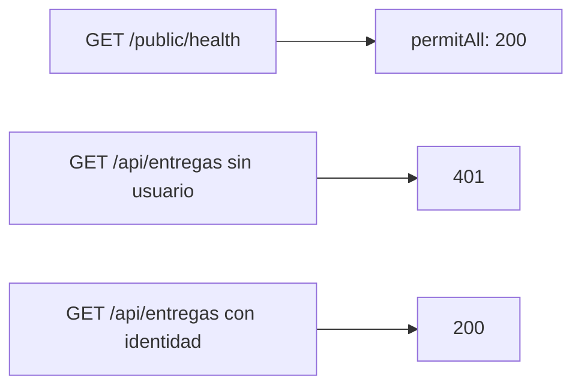
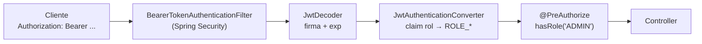
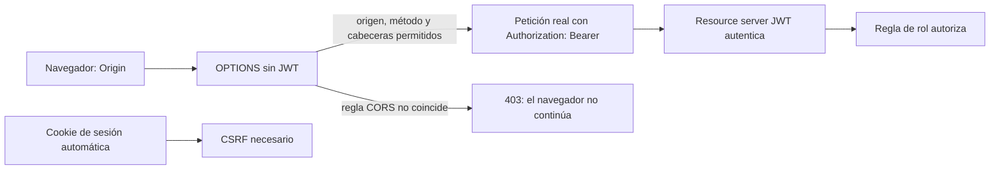
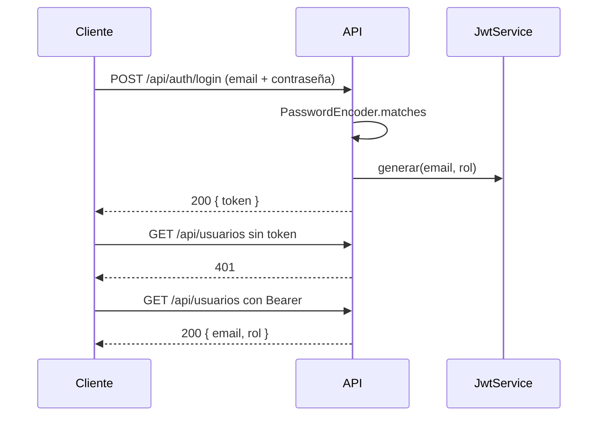

# Módulo 5: Spring Security I: cadena, JWT con resource server, CORS y SSRF

Cada tema se practica por separado con su propia repetición progresiva y su propio reto de memoria, verificado con `MockMvc` real contra un contexto de Spring real, para que cada código de estado HTTP (200/401/403) sea comprobable, no solo descrito. El JWT se valida con el **resource server** de Spring Security (`oauth2ResourceServer().jwt()`), no con un filtro escrito a mano: así el mismo código sirve cuando, en el Módulo 18, los tokens los emita un proveedor de identidad.

**Referencia ejecutable al terminar los módulos 2 y 4–7:** en la raíz del repositorio, abre `README.md`. Incluye el estado final y pruebas; algunas clases incorporan cambios de módulos posteriores. Construye primero las prácticas de este módulo y usa la referencia para comparar y diagnosticar.

## Aprende construyendo


### Tema 1: SecurityFilterChain moderno · Intermedio · 30 min

<details open>
<summary><strong>Capa 1 — Lectura</strong></summary>

#### ► DE QUÉ TRATA
Este tema te guía por securityfilterchain moderno con foco en comprensión antes de implementación.

#### ► LA IDEA EN UNA FRASE
**Entender securityfilterchain moderno te permite tomar mejores decisiones técnicas.**

#### ► POR QUÉ EXISTE ESTO
Resuelve un problema real de diseño o implementación y evita decisiones a ciegas.

#### ► LA ANALOGÍA
Piensa en securityfilterchain moderno como una herramienta de taller: útil cuando conoces su propósito y sus límites.
**Dónde se rompe la analogía:** en software, los efectos dependen del contexto, la escala y los trade-offs.

#### ► CÓMO FUNCIONA


#### ► LO QUE PUEDE SALIR MAL
| Síntoma | Causa probable | Arreglo |
|---|---|---|
| SecurityFilterChain moderno se aplica pero el resultado no mejora | Se usó sin medir el problema real | Mide antes y compara contra la alternativa simple |
| Aparece complejidad inesperada | Se adoptó la técnica sin comprender sus trade-offs | Vuelve a la sección de trade-offs y reduce el alcance |
| Falla en un caso límite | Se asumió un contexto que no se cumple | Prueba el caso límite y documenta cuándo NO usarlo |

#### ► TRADE-OFFS
| Opción | Cuándo usarla | Cuándo NO usarla |
|---|---|---|
| Usar SecurityFilterChain moderno | Cuando el problema coincide con su propósito y el beneficio es observable | Cuando agrega complejidad sin resolver un problema real |
| Alternativa más simple | Cuando el contexto es pequeño, estable o fácil de razonar | Cuando ya demostró no escalar o no cumplir el requisito |
| Postergar la decisión | Cuando falta evidencia del problema | Cuando el costo de esperar es mayor que el costo de probar |

#### ► CUÁNDO NO USAR ESTO
No uses securityfilterchain moderno por defecto. Aplícalo cuando el problema lo justifique y puedas verificar el beneficio; si una alternativa más simple resuelve igual, prefiérela.

#### ► DE VUELTA A LA ANALOGÍA
Volviendo a la analogía: securityfilterchain moderno funciona como el modelo inicial, pero recuerda dónde se rompe: en producción importan la evidencia, la escala y el costo de equivocarte.

#### ► LO QUE DEBES RECORDAR
- SecurityFilterChain moderno existe para resolver un problema específico.
- Mide antes de adoptar complejidad.
- Conoce el caso donde NO usarlo.
- Verifica con evidencia observable.

#### ► PREGUNTAS PARA PENSAR
1. ¿Qué problema concreto resuelve securityfilterchain moderno en tu contexto?
2. ¿Cómo sabrías que securityfilterchain moderno no está funcionando bien?
3. ¿Qué alternativa más simple considerarías antes de usar securityfilterchain moderno?

</details>

<details>
<summary><strong>Capa 2 — Construcción</strong></summary>

#### Código y verificación


```xml
<dependency>
    <groupId>org.springframework.boot</groupId>
    <artifactId>spring-boot-starter-security</artifactId>
</dependency>
```

```java
package com.example.demo;

import org.springframework.context.annotation.Bean;
import org.springframework.context.annotation.Configuration;
import org.springframework.security.config.Customizer;
import org.springframework.security.config.annotation.web.builders.HttpSecurity;
import org.springframework.security.web.SecurityFilterChain;

@Configuration
public class SecurityConfig {
    @Bean
    SecurityFilterChain filterChain(HttpSecurity http) throws Exception {
        return http
            .authorizeHttpRequests(auth -> auth
                .requestMatchers("/public/**").permitAll()
                .anyRequest().authenticated())
            .httpBasic(Customizer.withDefaults())
            .build();
    }
}
```

```java
package com.example.demo;

import org.springframework.web.bind.annotation.GetMapping;
import org.springframework.web.bind.annotation.RestController;

@RestController
public class RutasController {
    @GetMapping("/public/health")
    public String salud() { return "OK"; }

    @GetMapping("/api/entregas")
    public String entregas() { return "entregas confidenciales"; }
}
```

```xml
<dependency>
    <groupId>org.springframework.boot</groupId>
    <artifactId>spring-boot-starter-security-test</artifactId>
    <scope>test</scope>
</dependency>
```

```xml
<dependency>
    <groupId>org.springframework.boot</groupId>
    <artifactId>spring-boot-starter-webmvc-test</artifactId>
    <scope>test</scope>
</dependency>
```

</details>

### Tema 2: JWT con el resource server de Spring Security y autorización por rol · Intermedio · 45 min

<details open>
<summary><strong>Capa 1 — Lectura</strong></summary>

#### ► DE QUÉ TRATA
Este tema te guía por jwt con el resource server de spring security y autorización por rol con foco en comprensión antes de implementación.

#### ► LA IDEA EN UNA FRASE
**Entender jwt con el resource server de spring security y autorización por rol te permite tomar mejores decisiones técnicas.**

#### ► POR QUÉ EXISTE ESTO
Resuelve un problema real de diseño o implementación y evita decisiones a ciegas.

#### ► LA ANALOGÍA
Piensa en jwt con el resource server de spring security y autorización por rol como una herramienta de taller: útil cuando conoces su propósito y sus límites.
**Dónde se rompe la analogía:** en software, los efectos dependen del contexto, la escala y los trade-offs.

#### ► CÓMO FUNCIONA


#### ► LO QUE PUEDE SALIR MAL
| Síntoma | Causa probable | Arreglo |
|---|---|---|
| JWT con el resource server de Spring Security y autorización por rol se aplica pero el resultado no mejora | Se usó sin medir el problema real | Mide antes y compara contra la alternativa simple |
| Aparece complejidad inesperada | Se adoptó la técnica sin comprender sus trade-offs | Vuelve a la sección de trade-offs y reduce el alcance |
| Falla en un caso límite | Se asumió un contexto que no se cumple | Prueba el caso límite y documenta cuándo NO usarlo |

#### ► TRADE-OFFS
| Opción | Cuándo usarla | Cuándo NO usarla |
|---|---|---|
| Usar JWT con el resource server de Spring Security y autorización por rol | Cuando el problema coincide con su propósito y el beneficio es observable | Cuando agrega complejidad sin resolver un problema real |
| Alternativa más simple | Cuando el contexto es pequeño, estable o fácil de razonar | Cuando ya demostró no escalar o no cumplir el requisito |
| Postergar la decisión | Cuando falta evidencia del problema | Cuando el costo de esperar es mayor que el costo de probar |

#### ► CUÁNDO NO USAR ESTO
No uses jwt con el resource server de spring security y autorización por rol por defecto. Aplícalo cuando el problema lo justifique y puedas verificar el beneficio; si una alternativa más simple resuelve igual, prefiérela.

#### ► DE VUELTA A LA ANALOGÍA
Volviendo a la analogía: jwt con el resource server de spring security y autorización por rol funciona como el modelo inicial, pero recuerda dónde se rompe: en producción importan la evidencia, la escala y el costo de equivocarte.

#### ► LO QUE DEBES RECORDAR
- JWT con el resource server de Spring Security y autorización por rol existe para resolver un problema específico.
- Mide antes de adoptar complejidad.
- Conoce el caso donde NO usarlo.
- Verifica con evidencia observable.

#### ► PREGUNTAS PARA PENSAR
1. ¿Qué problema concreto resuelve jwt con el resource server de spring security y autorización por rol en tu contexto?
2. ¿Cómo sabrías que jwt con el resource server de spring security y autorización por rol no está funcionando bien?
3. ¿Qué alternativa más simple considerarías antes de usar jwt con el resource server de spring security y autorización por rol?

</details>

<details>
<summary><strong>Capa 2 — Construcción</strong></summary>

#### Código y verificación


```xml
<dependency>
    <groupId>org.springframework.boot</groupId>
    <artifactId>spring-boot-starter-security-oauth2-resource-server</artifactId>
</dependency>
```

```properties
security.jwt.secret-base64=${JWT_SECRET_BASE64}
```

```bash
export JWT_SECRET_BASE64="$(openssl rand -base64 32)"
./mvnw -q compile
```

```java
package com.example.demo;

import java.time.Instant;
import java.util.Base64;
import javax.crypto.SecretKey;
import javax.crypto.spec.SecretKeySpec;
import org.springframework.beans.factory.annotation.Value;
import org.springframework.security.oauth2.jose.jws.MacAlgorithm;
import org.springframework.security.oauth2.jwt.JwsHeader;
import org.springframework.security.oauth2.jwt.Jwt;
import org.springframework.security.oauth2.jwt.JwtClaimsSet;
import org.springframework.security.oauth2.jwt.JwtDecoder;
import org.springframework.security.oauth2.jwt.JwtEncoder;
import org.springframework.security.oauth2.jwt.JwtEncoderParameters;
import org.springframework.security.oauth2.jwt.NimbusJwtDecoder;
import org.springframework.security.oauth2.jwt.NimbusJwtEncoder;
import org.springframework.stereotype.Service;

@Service
public class JwtService {
    private final JwtEncoder encoder;
    private final JwtDecoder decoder;

    public JwtService(@Value("${security.jwt.secret-base64}") String secretBase64) {
        SecretKey key = new SecretKeySpec(Base64.getDecoder().decode(secretBase64), "HmacSHA256");
        this.encoder = NimbusJwtEncoder.withSecretKey(key).algorithm(MacAlgorithm.HS256).build();
        this.decoder = NimbusJwtDecoder.withSecretKey(key).macAlgorithm(MacAlgorithm.HS256).build();
    }

    public String generar(String usuario, String rol) {
        Instant ahora = Instant.now();
        JwtClaimsSet claims = JwtClaimsSet.builder()
            .subject(usuario)
            .claim("rol", rol)
            .issuedAt(ahora)
            .expiresAt(ahora.plusSeconds(900))
            .build();
        JwsHeader cabecera = JwsHeader.with(MacAlgorithm.HS256).build();
        return encoder.encode(JwtEncoderParameters.from(cabecera, claims)).getTokenValue();
    }

    public Jwt validar(String token) {
        return decoder.decode(token);
    }

    JwtDecoder decoder() {
        return decoder;
    }
}
```

```java
package com.example.demo;

import static org.junit.jupiter.api.Assertions.assertEquals;

import org.junit.jupiter.api.Test;
import org.springframework.security.oauth2.jwt.Jwt;

class JwtServiceTest {
    private static final String CLAVE_DE_PRUEBA = "VVFRc3BzQVFzZXJ0T0xhbkt0ZUd4cHlsU21pSnhhOFM=";

    @Test
    void tokenFirmadoConservaUsuarioYRol() {
        var service = new JwtService(CLAVE_DE_PRUEBA);
        Jwt jwt = service.validar(service.generar("ana-1", "ADMIN"));
        assertEquals("ana-1", jwt.getSubject());
        assertEquals("ADMIN", jwt.getClaimAsString("rol"));
    }
}
```

</details>

### Tema 3: CORS y CSRF · Intermedio · 30 min

<details open>
<summary><strong>Capa 1 — Lectura</strong></summary>

#### ► DE QUÉ TRATA
Este tema te guía por cors y csrf con foco en comprensión antes de implementación.

#### ► LA IDEA EN UNA FRASE
**Entender cors y csrf te permite tomar mejores decisiones técnicas.**

#### ► POR QUÉ EXISTE ESTO
Resuelve un problema real de diseño o implementación y evita decisiones a ciegas.

#### ► LA ANALOGÍA
Piensa en cors y csrf como una herramienta de taller: útil cuando conoces su propósito y sus límites.
**Dónde se rompe la analogía:** en software, los efectos dependen del contexto, la escala y los trade-offs.

#### ► CÓMO FUNCIONA


#### ► LO QUE PUEDE SALIR MAL
| Síntoma | Causa probable | Arreglo |
|---|---|---|
| CORS y CSRF se aplica pero el resultado no mejora | Se usó sin medir el problema real | Mide antes y compara contra la alternativa simple |
| Aparece complejidad inesperada | Se adoptó la técnica sin comprender sus trade-offs | Vuelve a la sección de trade-offs y reduce el alcance |
| Falla en un caso límite | Se asumió un contexto que no se cumple | Prueba el caso límite y documenta cuándo NO usarlo |

#### ► TRADE-OFFS
| Opción | Cuándo usarla | Cuándo NO usarla |
|---|---|---|
| Usar CORS y CSRF | Cuando el problema coincide con su propósito y el beneficio es observable | Cuando agrega complejidad sin resolver un problema real |
| Alternativa más simple | Cuando el contexto es pequeño, estable o fácil de razonar | Cuando ya demostró no escalar o no cumplir el requisito |
| Postergar la decisión | Cuando falta evidencia del problema | Cuando el costo de esperar es mayor que el costo de probar |

#### ► CUÁNDO NO USAR ESTO
No uses cors y csrf por defecto. Aplícalo cuando el problema lo justifique y puedas verificar el beneficio; si una alternativa más simple resuelve igual, prefiérela.

#### ► DE VUELTA A LA ANALOGÍA
Volviendo a la analogía: cors y csrf funciona como el modelo inicial, pero recuerda dónde se rompe: en producción importan la evidencia, la escala y el costo de equivocarte.

#### ► LO QUE DEBES RECORDAR
- CORS y CSRF existe para resolver un problema específico.
- Mide antes de adoptar complejidad.
- Conoce el caso donde NO usarlo.
- Verifica con evidencia observable.

#### ► PREGUNTAS PARA PENSAR
1. ¿Qué problema concreto resuelve cors y csrf en tu contexto?
2. ¿Cómo sabrías que cors y csrf no está funcionando bien?
3. ¿Qué alternativa más simple considerarías antes de usar cors y csrf?

</details>

<details>
<summary><strong>Capa 2 — Construcción</strong></summary>

#### Código y verificación


```java
package com.example.demo;

import java.util.List;
import org.springframework.context.annotation.Bean;
import org.springframework.context.annotation.Configuration;
import org.springframework.web.cors.CorsConfiguration;
import org.springframework.web.cors.CorsConfigurationSource;
import org.springframework.web.cors.UrlBasedCorsConfigurationSource;

@Configuration
public class CorsConfig {
    @Bean
    CorsConfigurationSource corsConfigurationSource() {
        var config = new CorsConfiguration();
        config.setAllowedOrigins(List.of("https://web.academia.dev"));
        config.setAllowedMethods(List.of("GET", "POST", "DELETE"));
        config.setAllowedHeaders(List.of("Authorization", "Content-Type"));
        config.setAllowCredentials(false);
        config.setMaxAge(3600L);

        var source = new UrlBasedCorsConfigurationSource();
        source.registerCorsConfiguration("/api/**", config);
        return source;
    }
}
```

```java
package com.example.demo;

import org.junit.jupiter.api.Test;
import org.springframework.beans.factory.annotation.Autowired;
import org.springframework.boot.test.context.SpringBootTest;
import org.springframework.boot.webmvc.test.autoconfigure.AutoConfigureMockMvc;
import org.springframework.test.web.servlet.MockMvc;

import static org.springframework.test.web.servlet.request.MockMvcRequestBuilders.options;
import static org.springframework.test.web.servlet.result.MockMvcResultMatchers.header;
import static org.springframework.test.web.servlet.result.MockMvcResultMatchers.status;

@SpringBootTest
@AutoConfigureMockMvc
class CorsConfigTest {
    @Autowired MockMvc mockMvc;

    @Test
    void preflightPermitidoDevuelveOrigenYMetodo() throws Exception {
        mockMvc.perform(options("/api/entregas/42")
                .header("Origin", "https://web.academia.dev")
                .header("Access-Control-Request-Method", "DELETE")
                .header("Access-Control-Request-Headers", "Authorization"))
            .andExpect(status().isOk())
            .andExpect(header().string("Access-Control-Allow-Origin", "https://web.academia.dev"))
            .andExpect(header().string("Access-Control-Allow-Methods",
                org.hamcrest.Matchers.containsString("DELETE")))
            .andExpect(header().string("Access-Control-Allow-Headers",
                org.hamcrest.Matchers.containsString("Authorization")));
    }

    @Test
    void preflightDeOrigenAjenoRecibe403() throws Exception {
        mockMvc.perform(options("/api/entregas/42")
                .header("Origin", "https://sitio-no-autorizado.dev")
                .header("Access-Control-Request-Method", "DELETE"))
            .andExpect(status().isForbidden())
            .andExpect(header().doesNotExist("Access-Control-Allow-Origin"));
    }
}
```

```bash
./mvnw -q -Dtest=CorsConfigTest test
```

```java
@Autowired JwtService jwtService;

@Test
void deleteConJwtDevuelveElHeaderCors() throws Exception {
    String token = jwtService.generar("admin-1", "ADMIN");
    mockMvc.perform(delete("/api/entregas/42")
            .header("Origin", "https://web.academia.dev")
            .header("Authorization", "Bearer " + token))
        .andExpect(status().isOk())
        .andExpect(header().string("Access-Control-Allow-Origin", "https://web.academia.dev"));
}
```

```java
@Test
void preflightDeMetodoNoListadoRecibe403() throws Exception {
    mockMvc.perform(options("/api/entregas/42")
            .header("Origin", "https://web.academia.dev")
            .header("Access-Control-Request-Method", "PATCH"))
        .andExpect(status().isForbidden());
}
```

</details>

### Tema 4: Reducir SSRF en clientes HTTP con InetAddressFilter · Avanzado · 30 min

<details open>
<summary><strong>Capa 1 — Lectura</strong></summary>

#### ► DE QUÉ TRATA
Este tema te guía por reducir ssrf en clientes http con inetaddressfilter con foco en comprensión antes de implementación.

#### ► LA IDEA EN UNA FRASE
**Entender reducir ssrf en clientes http con inetaddressfilter te permite tomar mejores decisiones técnicas.**

#### ► POR QUÉ EXISTE ESTO
Resuelve un problema real de diseño o implementación y evita decisiones a ciegas.

#### ► LA ANALOGÍA
Piensa en reducir ssrf en clientes http con inetaddressfilter como una herramienta de taller: útil cuando conoces su propósito y sus límites.
**Dónde se rompe la analogía:** en software, los efectos dependen del contexto, la escala y los trade-offs.

#### ► CÓMO FUNCIONA
1. Identifica el problema que reducir ssrf en clientes http con inetaddressfilter resuelve.
2. Observa sus componentes y relaciones.
3. Aplica la opción más simple que funcione.
4. Verifica el resultado y los límites.

#### ► LO QUE PUEDE SALIR MAL
| Síntoma | Causa probable | Arreglo |
|---|---|---|
| Reducir SSRF en clientes HTTP con InetAddressFilter se aplica pero el resultado no mejora | Se usó sin medir el problema real | Mide antes y compara contra la alternativa simple |
| Aparece complejidad inesperada | Se adoptó la técnica sin comprender sus trade-offs | Vuelve a la sección de trade-offs y reduce el alcance |
| Falla en un caso límite | Se asumió un contexto que no se cumple | Prueba el caso límite y documenta cuándo NO usarlo |

#### ► TRADE-OFFS
| Opción | Cuándo usarla | Cuándo NO usarla |
|---|---|---|
| Usar Reducir SSRF en clientes HTTP con InetAddressFilter | Cuando el problema coincide con su propósito y el beneficio es observable | Cuando agrega complejidad sin resolver un problema real |
| Alternativa más simple | Cuando el contexto es pequeño, estable o fácil de razonar | Cuando ya demostró no escalar o no cumplir el requisito |
| Postergar la decisión | Cuando falta evidencia del problema | Cuando el costo de esperar es mayor que el costo de probar |

#### ► CUÁNDO NO USAR ESTO
No uses reducir ssrf en clientes http con inetaddressfilter por defecto. Aplícalo cuando el problema lo justifique y puedas verificar el beneficio; si una alternativa más simple resuelve igual, prefiérela.

#### ► DE VUELTA A LA ANALOGÍA
Volviendo a la analogía: reducir ssrf en clientes http con inetaddressfilter funciona como el modelo inicial, pero recuerda dónde se rompe: en producción importan la evidencia, la escala y el costo de equivocarte.

#### ► LO QUE DEBES RECORDAR
- Reducir SSRF en clientes HTTP con InetAddressFilter existe para resolver un problema específico.
- Mide antes de adoptar complejidad.
- Conoce el caso donde NO usarlo.
- Verifica con evidencia observable.

#### ► PREGUNTAS PARA PENSAR
1. ¿Qué problema concreto resuelve reducir ssrf en clientes http con inetaddressfilter en tu contexto?
2. ¿Cómo sabrías que reducir ssrf en clientes http con inetaddressfilter no está funcionando bien?
3. ¿Qué alternativa más simple considerarías antes de usar reducir ssrf en clientes http con inetaddressfilter?

</details>

<details>
<summary><strong>Capa 2 — Construcción</strong></summary>

#### Código y verificación
```bash
cp -R spring-ssrf /tmp/ssrf-lab
cd /tmp/ssrf-lab
./mvnw -q -DskipTests package
```

```bash
./mvnw -q -Dtest=SafeClientTest#blocksBeforeRequestAndControlReallyReachesServer,SafeClientTest#excludesInternalAndMetadataRangesWithoutConnecting test
```

```bash
./mvnw -q -Dtest=SafeClientTest#doesNotFollowRedirectToAnotherAddress test
```

```bash
./mvnw -q clean test
```

</details>

### Tema 5: Flujo de login completo — de `/api/auth/login` a una ruta protegida · Avanzado · 30 min

<details open>
<summary><strong>Capa 1 — Lectura</strong></summary>

#### ► DE QUÉ TRATA
Este tema te guía por flujo de login completo — de `/api/auth/login` a una ruta protegida con foco en comprensión antes de implementación.

#### ► LA IDEA EN UNA FRASE
**Entender flujo de login completo — de `/api/auth/login` a una ruta protegida te permite tomar mejores decisiones técnicas.**

#### ► POR QUÉ EXISTE ESTO
Resuelve un problema real de diseño o implementación y evita decisiones a ciegas.

#### ► LA ANALOGÍA
Piensa en flujo de login completo — de `/api/auth/login` a una ruta protegida como una herramienta de taller: útil cuando conoces su propósito y sus límites.
**Dónde se rompe la analogía:** en software, los efectos dependen del contexto, la escala y los trade-offs.

#### ► CÓMO FUNCIONA


#### ► LO QUE PUEDE SALIR MAL
| Síntoma | Causa probable | Arreglo |
|---|---|---|
| Flujo de login completo — de `/api/auth/login` a una ruta protegida se aplica pero el resultado no mejora | Se usó sin medir el problema real | Mide antes y compara contra la alternativa simple |
| Aparece complejidad inesperada | Se adoptó la técnica sin comprender sus trade-offs | Vuelve a la sección de trade-offs y reduce el alcance |
| Falla en un caso límite | Se asumió un contexto que no se cumple | Prueba el caso límite y documenta cuándo NO usarlo |

#### ► TRADE-OFFS
| Opción | Cuándo usarla | Cuándo NO usarla |
|---|---|---|
| Usar Flujo de login completo — de `/api/auth/login` a una ruta protegida | Cuando el problema coincide con su propósito y el beneficio es observable | Cuando agrega complejidad sin resolver un problema real |
| Alternativa más simple | Cuando el contexto es pequeño, estable o fácil de razonar | Cuando ya demostró no escalar o no cumplir el requisito |
| Postergar la decisión | Cuando falta evidencia del problema | Cuando el costo de esperar es mayor que el costo de probar |

#### ► CUÁNDO NO USAR ESTO
No uses flujo de login completo — de `/api/auth/login` a una ruta protegida por defecto. Aplícalo cuando el problema lo justifique y puedas verificar el beneficio; si una alternativa más simple resuelve igual, prefiérela.

#### ► DE VUELTA A LA ANALOGÍA
Volviendo a la analogía: flujo de login completo — de `/api/auth/login` a una ruta protegida funciona como el modelo inicial, pero recuerda dónde se rompe: en producción importan la evidencia, la escala y el costo de equivocarte.

#### ► LO QUE DEBES RECORDAR
- Flujo de login completo — de `/api/auth/login` a una ruta protegida existe para resolver un problema específico.
- Mide antes de adoptar complejidad.
- Conoce el caso donde NO usarlo.
- Verifica con evidencia observable.

#### ► PREGUNTAS PARA PENSAR
1. ¿Qué problema concreto resuelve flujo de login completo — de `/api/auth/login` a una ruta protegida en tu contexto?
2. ¿Cómo sabrías que flujo de login completo — de `/api/auth/login` a una ruta protegida no está funcionando bien?
3. ¿Qué alternativa más simple considerarías antes de usar flujo de login completo — de `/api/auth/login` a una ruta protegida?

</details>

<details>
<summary><strong>Capa 2 — Construcción</strong></summary>

#### Código y verificación


```java
@Bean
PasswordEncoder passwordEncoder() {
    return new BCryptPasswordEncoder();
}
```

```java
import org.springframework.security.crypto.bcrypt.BCryptPasswordEncoder;
import org.springframework.security.crypto.password.PasswordEncoder;
```

```java
package com.example.demo;

public record LoginRequest(String email, String password) {}
```

```java
package com.example.demo;

import java.util.Map;
import org.springframework.http.ResponseEntity;
import org.springframework.security.crypto.password.PasswordEncoder;
import org.springframework.web.bind.annotation.PostMapping;
import org.springframework.web.bind.annotation.RequestBody;
import org.springframework.web.bind.annotation.RequestMapping;
import org.springframework.web.bind.annotation.RestController;

@RestController
@RequestMapping("/api/auth")
public class AuthController {
    private final JwtService jwtService;
    private final PasswordEncoder passwordEncoder;
    private final String emailDemo = "ana@rutaflow.dev";
    private final String hashDemo;

    public AuthController(JwtService jwtService, PasswordEncoder passwordEncoder) {
        this.jwtService = jwtService;
        this.passwordEncoder = passwordEncoder;
        this.hashDemo = passwordEncoder.encode("clave-larga-segura");
    }

    @PostMapping("/login")
    public ResponseEntity<Map<String, String>> login(@RequestBody LoginRequest request) {
        String email = request.email() == null ? "" : request.email();
        String password = request.password() == null ? "" : request.password();
        if (!emailDemo.equals(email) || !passwordEncoder.matches(password, hashDemo)) {
            return ResponseEntity.status(401).body(Map.of("error", "Credenciales inválidas"));
        }
        return ResponseEntity.ok(Map.of("token", jwtService.generar(email, "ADMIN")));
    }
}
```

```java
package com.example.demo;

import java.util.Map;
import org.springframework.security.core.Authentication;
import org.springframework.web.bind.annotation.GetMapping;
import org.springframework.web.bind.annotation.RestController;

@RestController
public class UsuariosController {
    @GetMapping("/api/usuarios")
    public Map<String, String> usuarioActual(Authentication authentication) {
        String rol = authentication.getAuthorities().iterator().next().getAuthority();
        return Map.of("email", authentication.getName(), "rol", rol);
    }
}
```

</details>
