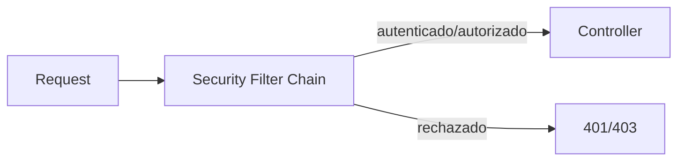
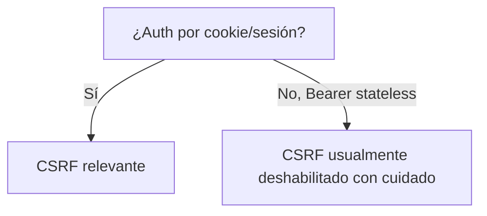
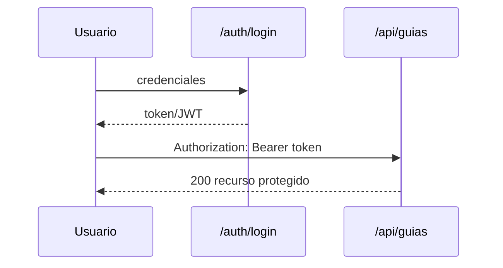

# Módulo 5: Spring Security

Seguridad no es “agregar login”. Es controlar autenticación, autorización, CSRF/CORS, secretos, y límites de ataque. Spring Security provee una cadena de filtros potente, pero peligrosa si se configura por copiar/pegar. Este módulo construye la base moderna.

**Entorno de referencia verificado (2026-05-22):** JDK 27.0.1.0.2, Maven 3.10.0, Spring Boot 3.5.0, Spring Security 6.x.

## Aprende construyendo

### Tema 1: SecurityFilterChain moderno · Intermedio · 30 min

Caso guía: proteger `/api/**` y dejar `/public/**` abierto.

#### `SecurityFilterChain`

**Definición formal.** Configuración basada en beans que define reglas HTTP, autenticación, CSRF, sesión y filtros. Es el estilo moderno (sin `WebSecurityConfigurerAdapter`).



**Ejemplo mínimo (Java config, ejecutable en proyecto Spring Security).**

```java
@Bean
SecurityFilterChain security(HttpSecurity http) throws Exception {
  return http
    .authorizeHttpRequests(auth -> auth.requestMatchers("/public/**").permitAll().anyRequest().authenticated())
    .httpBasic(Customizer.withDefaults())
    .build();
}
```

**Error común.** `permitAll()` accidental en rutas sensibles o orden incorrecto de matchers. Corrección: reglas específicas primero, default deny.

**Nota de verificación.** Requiere app con `spring-boot-starter-security`; smoke Boot 3.5.0 factible.

### Tema 2: JWT con el resource server de Spring Security y autorización por rol · Intermedio · 45 min

Caso guía: API stateless donde el cliente envía Bearer token.

#### JWT Resource Server

**Definición formal.** Un resource server valida tokens (JWT/Opaque) en cada request y construye el `Authentication` con authorities/claims.

**Contrato.** No confíes en claims sin validar firma, issuer, audience y expiración.

**Ejemplo mínimo (config).**

```java
http.oauth2ResourceServer(oauth -> oauth.jwt(Customizer.withDefaults()));
```

**Error común.** Usar JWT como sesión sin expiración corta/revocación pensada. Corrección: TTL corto, refresh flow seguro, validar claims.

**Nota de verificación.** Requiere issuer/keys; en lab local se puede usar claves de prueba. No hardcodear secretos reales.

### Tema 3: CORS y CSRF · Intermedio · 30 min

Caso guía: frontend SPA en otro origen llama a la API.

#### CORS

**Definición formal.** Cross-Origin Resource Sharing: política del navegador que permite/deniega requests cross-origin según headers del servidor.

#### CSRF

**Definición formal.** Cross-Site Request Forgery: ataque donde navegador víctima envía request autenticado a un sitio. CSRF protection es relevante sobre todo con cookies/sesión.



**Error común.** Deshabilitar CSRF por defecto en apps con cookies. Corrección: decidir según modelo de autenticación.

### Tema 4: Reducir SSRF en clientes HTTP con InetAddressFilter · Avanzado · 30 min

Caso guía: endpoint acepta URL para fetch; atacante pasa `http://169.254.169.254`.

#### SSRF y allowlist

**Definición formal.** SSRF (Server-Side Request Forgery) hace que el servidor haga requests a destinos internos/no previstos.

**Regla.** Allowlist de hosts/esquemas, bloquear IPs privadas/link-local/metadatos, resolver DNS con cuidado, no seguir redirects ciegos.

**Ejemplo mínimo (ejecutable, Java puro).**

```bash
mkdir -p java-sb5-ssrf
cd java-sb5-ssrf
```

Crea el archivo `DemoSsrf.java`:

```java
import java.net.URI; import java.util.Set;
public class DemoSsrf {
  static boolean ok(String raw){ URI u=URI.create(raw); return "https".equals(u.getScheme()) && Set.of("api.academia.test").contains(u.getHost()); }
  public static void main(String[] args){ System.out.println(ok("https://api.academia.test/x")); System.out.println(ok("http://169.254.169.254/")); }
}
```

```bash
javac DemoSsrf.java
java DemoSsrf
```

**Verificación (JDK 27, 2026-05-22).** `true`, `false`.

**Nota.** Esto es allowlist mínima; una defensa SSRF robusta incluye resolución IP, bloqueo de rangos privados y políticas de red.

### Tema 5: Flujo de login completo — de `/api/auth/login` a una ruta protegida · Avanzado · 30 min

Caso guía: usuario se autentica, recibe token, accede a `/api/guias`.

#### Flujo



**Error común.** Loguear token/contraseña. Corrección: redactar secretos, usar HTTPS, TTL y revocación según riesgo.

**Nota de verificación.** Requiere app completa con auth; se verifica por smoke local de configuración en proyecto real, no se inventan credenciales.

## Cierre

Spring Security es una cadena de decisiones. Cada regla debe responder: ¿quién eres, qué puedes hacer, desde dónde, y cómo evitamos abuso?

## Checklist

- Uso `SecurityFilterChain` moderno.
- Valido issuer/aud/exp en JWT.
- Entiendo CORS vs CSRF según modelo auth.
- Aplico allowlist/defensas SSRF en fetches server-side.
