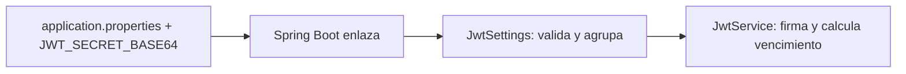
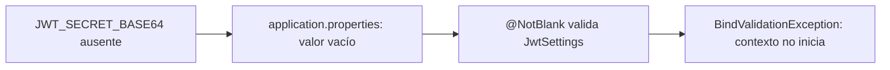
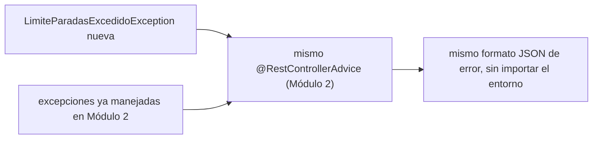

# Módulo 5: Configuración, perfiles y manejo de errores

Cada tema se practica por separado con su propia repetición progresiva y su propio reto de memoria, verificado con `ApplicationContextRunner` y `MockMvc` reales, para que "la aplicación falla al arranque" o "el formato de error es consistente" sean afirmaciones comprobables, no solo descritas.


## Aprende construyendo

### Tema 1: @ConfigurationProperties tipado

**Meta:** agrupar la clave y el vencimiento de JWT que ya existen en el proyecto del Módulo 4, enlazarlos a un `record` validado y usarlos desde el mismo `JwtService`.

**¿Por qué es importante?** Ahora la clave se lee en un sitio y el vencimiento está escrito como número dentro de `JwtService`. Al agruparlos, es más fácil ver qué necesita JWT y detectar un valor mal formado al iniciar.



#### Subtema 4.16 · Agrupar la configuración JWT existente · 10 min

**Contexto:** continúa el proyecto `academia-spring` de Módulo 4. El secreto sigue llegando desde `JWT_SECRET_BASE64`; crea un tipo para reunirlo con los segundos de vencimiento.

**Hazlo tú:** verifica que `pom.xml` tenga `spring-boot-starter-validation`. Crea `src/main/java/com/example/demo/JwtSettings.java`:

```java
package com.example.demo;

import jakarta.validation.constraints.Min;
import jakarta.validation.constraints.NotBlank;
import org.springframework.boot.context.properties.ConfigurationProperties;
import org.springframework.validation.annotation.Validated;

@ConfigurationProperties("security.jwt")
@Validated
public record JwtSettings(
    @NotBlank String secretBase64,
    @Min(60) long expirationSeconds
) {}
```

En `src/main/java/com/example/demo/DemoApplication.java`, añade el escaneo para registrar el record:

```java
import org.springframework.boot.context.properties.ConfigurationPropertiesScan;

@SpringBootApplication
@ConfigurationPropertiesScan
public class DemoApplication { /* conserva aquí el main existente */ }
```

En `src/main/resources/application.properties`, deja la clave fuera del código y agrégale un vencimiento:

```properties
security.jwt.secret-base64=${JWT_SECRET_BASE64:}
security.jwt.expiration-seconds=900
```

El `:` deja el valor vacío si falta la variable; `@NotBlank` lo rechaza con un error de configuración legible, sin poner un secreto falso como valor por defecto. Actualiza también `src/test/resources/application.properties`: conserva la clave Base64 de prueba del Módulo 4 y añade `security.jwt.expiration-seconds=900`. Ese archivo de test sustituye el del entorno principal durante las pruebas; si falta la propiedad, `@Min(60)` hace fallar los contextos que construyen `JwtService`.

El nombre Java `secretBase64` corresponde a la propiedad `secret-base64`; ambas están bajo `security.jwt`.

**Resultado esperado:** el proyecto compila con Spring Boot `4.1.2` y JDK `25`. Spring Boot enlaza las propiedades al record al arrancar; la conversión y validación ocurren en ese momento, no en compilación.

**Fallo deliberado y diagnóstico:** cambia temporalmente `expiration-seconds=900` por `expiration-seconds=texto` en la prueba aislada del subtema siguiente. El contexto debe fallar al enlazar `long`; restaura `900`.

**Entiende:** el prefijo reúne propiedades relacionadas; cada componente del record recibe el valor correspondiente. `@ConfigurationPropertiesScan` busca estos tipos desde el paquete de la aplicación. Fuente: [Spring Boot 4.1.2 — ConfigurationPropertiesScan](https://docs.spring.io/spring-boot/api/java/org/springframework/boot/context/properties/ConfigurationPropertiesScan.html).

**Cierra:** identifica en el archivo de propiedades los dos valores y encuentra los campos que los reciben.

#### Subtema 4.17 · Probar enlace y límites con un contexto pequeño · 10 min

**Contexto:** no necesitas levantar web, base de datos ni filtros para revisar solo el enlace de configuración. `ApplicationContextRunner` crea un contexto mínimo con el tipo que quieres probar.

**Hazlo tú:** crea `src/test/java/com/example/demo/JwtSettingsTest.java`:

```java
package com.example.demo;

import org.junit.jupiter.api.Test;
import org.springframework.boot.context.properties.EnableConfigurationProperties;
import org.springframework.boot.test.context.runner.ApplicationContextRunner;
import org.springframework.context.annotation.Configuration;
import static org.assertj.core.api.Assertions.assertThat;

class JwtSettingsTest {
    private final ApplicationContextRunner runner = new ApplicationContextRunner()
        .withUserConfiguration(SettingsTestConfig.class);

    @Test
    void enlazaLaClaveYElVencimiento() {
        runner.withPropertyValues(
                "security.jwt.secret-base64=VVFRc3BzQVFzZXJ0T0xhbkt0ZUd4cHlsU21pSnhhOFM=",
                "security.jwt.expiration-seconds=900")
            .run(context -> {
                assertThat(context).hasNotFailed();
                JwtSettings settings = context.getBean(JwtSettings.class);
                assertThat(settings.secretBase64())
                    .isEqualTo("VVFRc3BzQVFzZXJ0T0xhbkt0ZUd4cHlsU21pSnhhOFM=");
                assertThat(settings.expirationSeconds()).isEqualTo(900);
            });
    }

    @Test
    void textoNoSePuedeEnlazarAUnLong() {
        runner.withPropertyValues(
                "security.jwt.secret-base64=test",
                "security.jwt.expiration-seconds=texto")
            .run(context -> assertThat(context).hasFailed());
    }

    @Test
    void vencimientoMenorAlMinimoEsRechazado() {
        runner.withPropertyValues(
                "security.jwt.secret-base64=test",
                "security.jwt.expiration-seconds=59")
            .run(context -> assertThat(context).hasFailed());
    }

    @Configuration(proxyBeanMethods = false)
    @EnableConfigurationProperties(JwtSettings.class)
    static class SettingsTestConfig {}
}
```

Ejecuta desde la raíz del proyecto:

```bash
./mvnw -q -Dtest=JwtSettingsTest test
```

**Resultado esperado:** pasan tres pruebas: los dos valores se enlazan, el texto no se convierte a `long`, y `59` no cumple `@Min(60)`. En los dos casos inválidos el contexto registra un fallo; el callback puede comprobarlo con `hasFailed()`.

**Fallo deliberado y diagnóstico:** quita temporalmente `@Validated` de `JwtSettings` y repite `JwtSettingsTest#vencimientoMenorAlMinimoEsRechazado`. Ese test falla porque `59` ahora se enlaza sin validación. Restaura la anotación.

**Entiende:** `@Min` y `@NotBlank` son restricciones aplicadas por Bean Validation al enlazar. Un tipo incorrecto es un error de conversión; un número debajo de `60` es un error de validación. Son fallos distintos y el test los separa.

**Cierra:** conserva la salida verde y explica cuál error viene de conversión y cuál de validación.

#### Subtema 4.18 · Inyectar el record en el JwtService · 10 min

**Contexto:** tener un record que nadie usa no centraliza la configuración del sistema. Cambia el constructor del servicio existente para que reciba ese tipo y usa su vencimiento al firmar.

**Hazlo tú:** en `src/main/java/com/example/demo/JwtService.java`, reemplaza la lectura con `@Value` por esta inyección:

```java
private final SecretKey key;
private final long expirationSeconds;

public JwtService(JwtSettings settings) {
    this.key = Keys.hmacShaKeyFor(Decoders.BASE64.decode(settings.secretBase64()));
    this.expirationSeconds = settings.expirationSeconds();
}
```

En el método `generar`, cambia el valor fijo `900` por la configuración:

```java
.expiration(Date.from(ahora.plusSeconds(expirationSeconds)))
```

Actualiza `src/test/java/com/example/demo/JwtServiceTest.java` para probar un vencimiento de 120 segundos:

```java
var service = new JwtService(new JwtSettings(CLAVE_DE_PRUEBA, 120));
var claims = service.validar(service.generar("ana-1", "ADMIN"));
assertEquals(120L, Duration.between(
    claims.getIssuedAt().toInstant(), claims.getExpiration().toInstant()).getSeconds());
```

Añade `import java.time.Duration;` y conserva las aserciones existentes de usuario y rol. Después ejecuta los tests relacionados y la suite:

```bash
./mvnw -q -Dtest=JwtSettingsTest,JwtServiceTest test
./mvnw -q clean test
```

**Resultado esperado:** los tests de firma siguen pasando y ahora `JwtService` obtiene tanto la clave como el tiempo de expiración del mismo objeto validado. Para ejecutar la aplicación, exporta una clave Base64 de 32 bytes fuera del repositorio: `export JWT_SECRET_BASE64="$(openssl rand -base64 32)"`.

**Fallo deliberado y diagnóstico:** cambia temporalmente `ahora.plusSeconds(expirationSeconds)` por `ahora.plusSeconds(900)` y ejecuta `./mvnw -q -Dtest=JwtServiceTest test`. La aserción esperaba `120` segundos y recibe `900`: el servicio volvió a ignorar la configuración. Restaura `expirationSeconds` y confirma el test verde.

**Entiende:** el record no guarda secretos ni crea una segunda clave; agrupa el valor que ya llegaba desde el entorno. Los records anidados se enlazan por estructura; `@NestedConfigurationProperty` es una pista para metadatos y no es necesaria para enlazar un objeto anidado en ejecución. Referencias: [Spring Boot — Type-safe Configuration Properties](https://docs.spring.io/spring-boot/reference/features/external-config.html#features.external-config.typesafe-configuration-properties), [API de ConfigurationPropertiesScan](https://docs.spring.io/spring-boot/api/java/org/springframework/boot/context/properties/ConfigurationPropertiesScan.html) y [API de NestedConfigurationProperty](https://docs.spring.io/spring-boot/api/java/org/springframework/boot/context/properties/NestedConfigurationProperty.html).

**Cierra:** deja en verde los tests y señala una clase que ahora recibe `JwtSettings` en vez de leer strings de configuración.

**Práctica independiente:** agrega `@Min(1) int refreshAfterMinutes` al record y `security.jwt.refresh-after-minutes=20` a los archivos principal y de test. Comprueba el valor con `ApplicationContextRunner`; cambia el test a `0`, confirma `hasFailed()` y restaura `20`.

**Proyecto integrador:** aplica este mismo tipo `JwtSettings` al backend de RutaFlow y conserva `JWT_SECRET_BASE64` como fuente externa. No crees otra propiedad para la misma clave ni otro `JwtService`.

---

### Tema 2: Fallar rápido al arranque

**Meta:** provocar y leer el fallo del contexto cuando falta el secreto JWT, y distinguirlo de un arranque correcto con una clave de prueba.

**¿Por qué es importante?** Si una app acepta una clave ausente o vacía, la falla puede aparecer después, al emitir o validar el primer token. Es más fácil corregirlo al arrancar, cuando Spring todavía puede señalar la propiedad.



#### Subtema 4.19 · Probar el valor obligatorio ausente · 10 min

**Contexto:** el subtema M5 T1 ya creó `JwtSettingsTest` con `ApplicationContextRunner` y `@EnableConfigurationProperties`. Reutiliza esa configuración de test y su clase `JwtSettings`; no crees `JwtConfig` ni un segundo prefijo.

**Hazlo tú:** en `src/test/java/com/example/demo/JwtSettingsTest.java`, agrega:

```java
@Test
void missingSecretHasValidationFailureAtStartup() {
    runner.withPropertyValues("security.jwt.expiration-seconds=900")
        .run(context -> {
            assertThat(context).hasFailed();
            assertThat(context.getStartupFailure())
                .hasRootCauseInstanceOf(BindValidationException.class);
        });
}
```

Añade el import:

```java
import org.springframework.boot.context.properties.bind.validation.BindValidationException;
```

La propiedad del vencimiento está presente; el secreto falta a propósito. Ejecuta el test:

```bash
./mvnw -q -Dtest=JwtSettingsTest#missingSecretHasValidationFailureAtStartup test
```

**Resultado esperado:** el test pasa porque Spring informa un contexto fallido y la causa raíz es `BindValidationException`, causada por `@NotBlank` sobre `secretBase64`.

**Fallo deliberado y diagnóstico:** reemplaza `hasFailed()` por `hasNotFailed()`. El test falla: el secreto ausente no debe permitir construir `JwtSettings`. Restaura `hasFailed()`.

**Entiende:** `ApplicationContextRunner` levanta un contexto pequeño y captura el fallo en `context`; no lanza la excepción fuera del callback. Por eso se inspecciona `getStartupFailure()`.

**Cierra:** conserva la aserción de causa raíz y explica en qué momento se rechaza el secreto.

#### Subtema 4.20 · Rechazar también un secreto vacío · 10 min

**Contexto:** una variable puede existir pero estar vacía. `@NotBlank` debe rechazar ambos casos: propiedad ausente y cadena vacía.

**Hazlo tú:** agrega esta prueba a `JwtSettingsTest.java`:

```java
@Test
void blankSecretIsRejectedAtStartup() {
    runner.withPropertyValues(
            "security.jwt.secret-base64=",
            "security.jwt.expiration-seconds=900")
        .run(context -> {
            assertThat(context).hasFailed();
            assertThat(context.getStartupFailure())
                .hasRootCauseInstanceOf(BindValidationException.class);
        });
}
```

Ejecuta ambos escenarios:

```bash
./mvnw -q -Dtest=JwtSettingsTest#missingSecretHasValidationFailureAtStartup+blankSecretIsRejectedAtStartup test
```

Para reproducir el entorno real sin secreto, desde la raíz del proyecto ejecuta:

```bash
env -u JWT_SECRET_BASE64 ./mvnw -q spring-boot:run
```

`src/main/resources/application.properties` usa `security.jwt.secret-base64=${JWT_SECRET_BASE64:}`: el sufijo `:` produce una cadena vacía si la variable no existe, y `@NotBlank` detiene el arranque con la propiedad señalada. No pongas un secreto de fallback en el archivo.

**Resultado esperado:** los tests pasan porque ambos contextos fallan con `BindValidationException`. El comando de la aplicación termina con error antes de atender HTTP y el log menciona `security.jwt`/`secretBase64` como propiedad inválida.

**Fallo deliberado y diagnóstico:** cambia `${JWT_SECRET_BASE64:}` por `${JWT_SECRET_BASE64}` y repite el comando con `env -u`. Comprueba el error real que reporta el entorno; restaura el `:` para que el tipo reciba vacío y Bean Validation dé el mensaje controlado.

**Entiende:** el test aislado demuestra el enlace y la validación. El comando ejecuta la app completa. Son comprobaciones relacionadas, pero no significan lo mismo.

**Cierra:** distingue en el log de arranque el nombre de propiedad del nombre de la clase que falló.

#### Subtema 4.21 · Quitar la validación y observar el riesgo · 10 min

**Contexto:** `@ConfigurationProperties` enlaza valores; `@Validated` hace que restricciones como `@NotBlank` y `@Min` se ejecuten durante ese enlace.

**Hazlo tú:** mantén también los tests existentes `vencimientoMenorAlMinimoEsRechazado` y `enlazaLaClaveYElVencimiento`. Ejecuta la clase completa:

```bash
./mvnw -q -Dtest=JwtSettingsTest test
```

**Resultado esperado:** los valores válidos arrancan; secreto ausente, vacío, texto que no cabe en `long` y vencimiento `59` fallan. Los callbacks comprueban `hasNotFailed()` o `hasFailed()` según el caso.

**Fallo deliberado y diagnóstico:** quita temporalmente `@Validated` de `JwtSettings` y repite `./mvnw -q -Dtest=JwtSettingsTest#missingSecretHasValidationFailureAtStartup+vencimientoMenorAlMinimoEsRechazado test`. Ambos tests fallan porque el contexto arranca sin aplicar las restricciones. Restaura `@Validated` y corre de nuevo la clase completa.

**Entiende:** una propiedad opcional puede tener un valor por defecto seguro; un secreto no debe tener una clave de fallback. La validación solo funciona si el tipo se registra con `@ConfigurationPropertiesScan` o `@EnableConfigurationProperties`.

**Cierra:** conserva la suite verde y la salida del proceso que falla sin `JWT_SECRET_BASE64`. Referencias: [Spring Boot — Type-safe Configuration Properties](https://docs.spring.io/spring-boot/reference/features/external-config.html#features.external-config.typesafe-configuration-properties), [API de BindValidationException](https://docs.spring.io/spring-boot/api/java/org/springframework/boot/context/properties/bind/validation/BindValidationException.html) y [Spring Boot — Testing auto-configuration](https://docs.spring.io/spring-boot/reference/testing/spring-boot-applications.html#testing.spring-boot-applications.testing-auto-configuration).

**Cuándo no exigirlo:** un valor opcional, como el tamaño de página, puede tener un valor predeterminado seguro. Reserva el fallo de arranque para entradas necesarias donde no hay un default válido, como la clave JWT.

**Práctica independiente:** repite los dos casos con `security.jwt.expiration-seconds=59` y con la propiedad ausente. En cada caso anota la propiedad indicada por el error y restaura `900`.

**Proyecto integrador:** conserva la validación en el backend RutaFlow y entrega configuración secreta desde el entorno del despliegue. La app no debe iniciar si la variable obligatoria está vacía.

---

### Tema 3: Manejo global de excepciones consistente entre entornos

#### Paso 1 · Objetivo y preparación

Al finalizar podrás extender el manejo global de excepciones (Módulo 2) para una nueva excepción de negocio, confirmando con `MockMvc` real que el formato de error permanece consistente.

**Conocimiento previo:** `@ControllerAdvice` y `ResponseEntity` (Módulo 2); Temas 1-2 de este módulo.

#### Paso 2 · Contexto y caso real

**¿Por qué es importante?** Cada nueva regla de negocio que puede fallar (por ejemplo, exceder el límite de paradas por ruta) necesita comunicar el error al cliente de la API en el MISMO formato que cualquier otro error ya manejado, sin que el consumidor de la API tenga que aprender un formato distinto por cada tipo de excepción nueva.

#### Paso 3 · Teoría con analogía

**Conceptos clave:** el mismo `@RestControllerAdvice` extendido, formato uniforme sin importar el entorno.

El manejo global de excepciones, ya cubierto en el Módulo 2 con `@RestControllerAdvice`, se extiende naturalmente para mapear cualquier excepción de negocio adicional hacia una respuesta HTTP consistente, en el mismo lugar centralizado, garantizando que el formato de error permanezca exactamente el mismo sin importar el entorno (desarrollo, pruebas, producción) ni qué endpoint originó el error. Combinar esto con la configuración tipada y validada de los Temas 1-2 produce una aplicación robusta en su conjunto: los problemas de configuración se detectan al arranque, y los errores de negocio que sí ocurren durante la operación se comunican de forma predecible.

**Analogía:** extender el manejo global de excepciones es ampliar el mismo protocolo unificado de atención de incidencias de una empresa para cubrir cada nuevo tipo de incidencia, en vez de crear un protocolo distinto para cada problema nuevo que aparece.

**Diagrama:**



#### Paso 4 · Demostración guiada desde cero

Reutiliza `academia-spring` (o créalo desde una carpeta vacía con `mkdir -p academia-spring` si es tu primera vez) y crea la excepción de negocio y su mapeo en `src/main/java/com/academia/errores/`:

```bash
mkdir -p academia-spring/src/main/java/com/academia/errores
cd academia-spring
```

```java
// src/main/java/com/academia/errores/LimiteParadasExcedidoException.java
package com.academia.errores;

public class LimiteParadasExcedidoException extends RuntimeException {
    public LimiteParadasExcedidoException(int limite) {
        super("El límite de " + limite + " paradas por ruta fue excedido");
    }
}
```

```java
// src/main/java/com/academia/errores/ManejadorGlobalErrores.java
package com.academia.errores;

import org.springframework.http.HttpStatus;
import org.springframework.http.ProblemDetail;
import org.springframework.web.bind.annotation.ExceptionHandler;
import org.springframework.web.bind.annotation.RestControllerAdvice;

@RestControllerAdvice
public class ManejadorGlobalErrores {

    @ExceptionHandler(LimiteParadasExcedidoException.class)
    public ProblemDetail manejarLimiteExcedido(LimiteParadasExcedidoException ex) {
        ProblemDetail problema = ProblemDetail.forStatusAndDetail(HttpStatus.UNPROCESSABLE_ENTITY, ex.getMessage());
        problema.setTitle("Límite de paradas excedido");
        return problema;
    }
}
```

```java
// src/main/java/com/academia/errores/RutasController.java
package com.academia.errores;

import org.springframework.web.bind.annotation.PostMapping;
import org.springframework.web.bind.annotation.RequestParam;
import org.springframework.web.bind.annotation.RestController;

@RestController
public class RutasController {
    private static final int LIMITE_PARADAS = 20;

    @PostMapping("/api/rutas")
    public String crearRuta(@RequestParam int numeroDeParadas) {
        if (numeroDeParadas > LIMITE_PARADAS) throw new LimiteParadasExcedidoException(LIMITE_PARADAS);
        return "ruta creada con " + numeroDeParadas + " paradas";
    }
}
```

**Explicación línea por línea:** `LimiteParadasExcedidoException` es una excepción de negocio específica del dominio; `@ExceptionHandler(LimiteParadasExcedidoException.class)` en el MISMO `@RestControllerAdvice` que ya manejaría otras excepciones (Módulo 2) la mapea a `422 Unprocessable Entity` usando `ProblemDetail` (el formato estándar RFC 7807, el mismo formato que cualquier otro error de esta API); el controller lanza la excepción cuando la regla de negocio se viola, sin necesidad de construir la respuesta de error manualmente en cada endpoint.

Confirma con `MockMvc` real que la excepción se traduce al formato `ProblemDetail` esperado, con el mismo `Content-Type` estándar que cualquier otro error de la API:

```java
// src/test/java/com/academia/errores/ManejadorGlobalErroresTest.java
package com.academia.errores;

import org.junit.jupiter.api.Test;
import org.springframework.beans.factory.annotation.Autowired;
import org.springframework.boot.test.autoconfigure.web.servlet.AutoConfigureMockMvc;
import org.springframework.boot.test.context.SpringBootTest;
import org.springframework.test.web.servlet.MockMvc;

import static org.springframework.test.web.servlet.request.MockMvcRequestBuilders.post;
import static org.springframework.test.web.servlet.result.MockMvcResultMatchers.*;

@SpringBootTest
@AutoConfigureMockMvc
class ManejadorGlobalErroresTest {

    @Autowired
    private MockMvc mockMvc;

    @Test
    void excederElLimiteDeParadasDevuelveProblemDetailConsistente() throws Exception {
        mockMvc.perform(post("/api/rutas").param("numeroDeParadas", "25"))
            .andExpect(status().isUnprocessableEntity())
            .andExpect(content().contentTypeCompatibleWith("application/problem+json"))
            .andExpect(jsonPath("$.title").value("Límite de paradas excedido"))
            .andExpect(jsonPath("$.status").value(422));
    }

    @Test
    void dentroDelLimiteCreaLaRutaCorrectamente() throws Exception {
        mockMvc.perform(post("/api/rutas").param("numeroDeParadas", "10"))
            .andExpect(status().isOk());
    }
}
```

```bash
mvn test -Dtest=ManejadorGlobalErroresTest # Maven
./gradlew test --tests ManejadorGlobalErroresTest # Gradle (equivalente)
```

**Resultado esperado:** ambos tests pasan: exceder el límite devuelve `422` con el formato `application/problem+json` estándar (el mismo formato RFC 7807 usado por cualquier otro error ya manejado en el Módulo 2), y una petición dentro del límite responde `200` normalmente.

**Fallo deliberado:** en `RutasController`, reemplaza `throw new LimiteParadasExcedidoException(LIMITE_PARADAS)` por una respuesta manual de error construida directamente en el método (`return "ERROR: límite excedido"`, con `200 OK` por defecto en vez de un código de error). Ejecuta de nuevo `excederElLimiteDeParadasDevuelveProblemDetailConsistente` — el test FALLA porque `status().isUnprocessableEntity()` no coincide con el `200` real devuelto — diagnostica confirmando por qué construir respuestas de error manualmente dentro de cada endpoint, en vez de lanzar una excepción de negocio hacia el manejador centralizado, produce inconsistencias reales y detectables: un cliente que espera `422` con `ProblemDetail` recibiría un `200` con un texto plano no estructurado. Revierte el cambio antes de continuar.

#### Paso 5 · Práctica guiada — repetición progresiva

1. Agrega una segunda excepción de negocio distinta al mismo `@RestControllerAdvice` y confirma con un test que ambas producen el mismo formato `application/problem+json`, solo con `title`/`detail` distintos.
2. Agrega un campo adicional al `ProblemDetail` (`problema.setProperty("limite", LIMITE_PARADAS)`) y confirma con `jsonPath("$.limite")` que aparece en la respuesta.
3. Provoca el error con un valor límite exacto (`numeroDeParadas=20`, igual al límite, no mayor) y confirma si la condición actual (`>`) lo acepta o lo rechaza; decide si ese es el comportamiento correcto según el enunciado "el límite es 20".
4. Escribe de memoria (sin mirar) una excepción de negocio, su mapeo en `@RestControllerAdvice` a `ProblemDetail`, y un test `MockMvc` que confirme el código de estado y el `title`. Compara después contra el patrón del Paso 4.

**Pista:** `content().contentTypeCompatibleWith("application/problem+json")` es más robusto que comparar el string exacto del `Content-Type`, porque tolera parámetros adicionales como el charset que Spring puede agregar automáticamente.

#### Paso 6 · Práctica independiente

**Completa el código:** rellena el espacio para mapear la excepción a una respuesta HTTP:

```java
@____(LimiteParadasExcedidoException.class)
public ProblemDetail manejarLimiteExcedido(LimiteParadasExcedidoException ex) {
    return ProblemDetail.forStatusAndDetail(HttpStatus.UNPROCESSABLE_ENTITY, ex.getMessage());
}
```

**Reto de memoria sin mirar:** cierra este documento y escribe, solo de memoria, una excepción de negocio mapeada a `ProblemDetail` en un `@RestControllerAdvice`, y un test `MockMvc` que confirme el código de estado y el formato de la respuesta. Compara después contra el patrón del Paso 4.

#### Paso 7 · Cierre y evidencia

Ya extiendes el manejo centralizado de excepciones para una nueva regla de negocio, confirmando con `MockMvc` real que el formato de error permanece consistente sin importar qué endpoint lo originó. Esto cierra el módulo de configuración y manejo de errores; el siguiente módulo aborda cómo probar la aplicación completa de forma automatizada. **Evidencia:** entrega el resultado de ambos tests de `ManejadorGlobalErroresTest` en verde, y el resultado del fallo deliberado mostrando la inconsistencia de un `200` donde se esperaba `422`. Fuente oficial: [Spring — Error Handling for REST with ProblemDetail](https://docs.spring.io/spring-framework/reference/web/webmvc/mvc-ann-rest-exceptions.html).

**Errores comunes:** construir respuestas de error manualmente dentro de un endpoint específico en vez de lanzar una excepción hacia el manejador centralizado; crear un `@ControllerAdvice` nuevo y separado para cada excepción, en vez de extender el mismo existente.

**Cuándo no usarlo:** para un error verdaderamente específico de un único endpoint sin ninguna posibilidad de reutilización en otro lugar de la aplicación, manejarlo directamente en el método del controller sin pasar por el mecanismo global puede ser aceptable; reserva el `@RestControllerAdvice` centralizado para excepciones de negocio con sentido a nivel de aplicación.

---

El manejo global de excepciones de este tema es el que mantendrá consistente el proyecto integrador de este track (microservicio productivo, Módulo 12) entre entornos.

## Laboratorio práctico

**Objetivo del laboratorio:** configurar propiedades tipadas y validadas al arranque, sin valores hardcodeados.

**Requisitos previos:** Módulos 0-4 completados.

| Paso | Acción | Código | Explicación |
|---|---|---|---|
| 1 | Crear una clase `@ConfigurationProperties` | Ver Tema 1 | Con valores tipados desde `application.yml` |
| 2 | Agregar `@Validated` | Ver Tema 2 | Falla al arranque si falta un valor obligatorio |
| 3 | Provocar la falla intencionalmente | Ver Tema 2 | Confirmado con `ApplicationContextRunner` real |
| 4 | Centralizar una excepción de negocio adicional | Ver Tema 3 | Mismo formato `ProblemDetail` consistente |

**Verificación:** el laboratorio se considera exitoso si borrar un valor de configuración obligatorio impide que la aplicación arranque, con `BindValidationException` como causa raíz real, y si todos los errores de negocio devuelven el mismo formato `application/problem+json` consistente.

**Errores comunes y soluciones**

- **Usar `@Value` disperso en vez de `@ConfigurationProperties` agrupado.** Agrupa configuración relacionada en un único tipo tipado.
- **Omitir `@Validated` en la clase de configuración.** Sin ella, un valor faltante puede pasar desapercibido hasta usarse en producción.
- **Crear un nuevo `@ControllerAdvice` separado para cada nueva excepción.** Extiende el mismo `@ControllerAdvice` centralizado existente.

---
