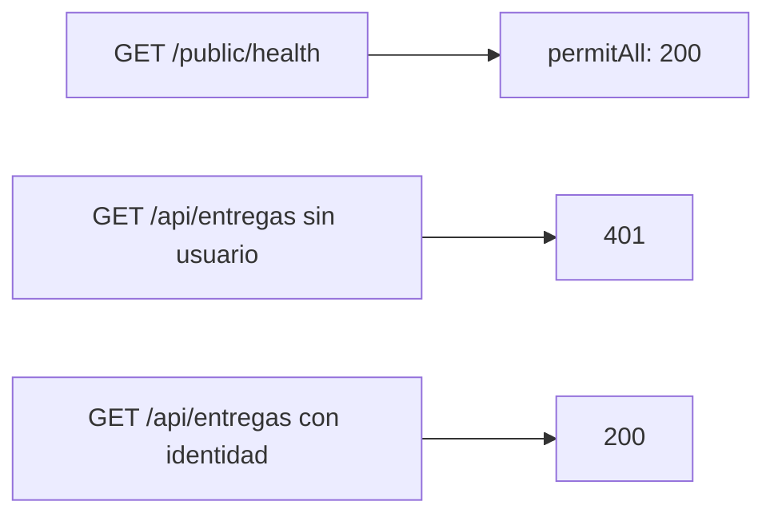
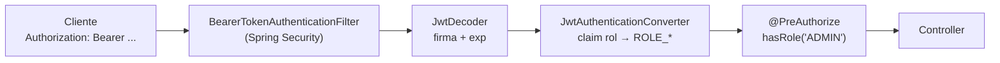
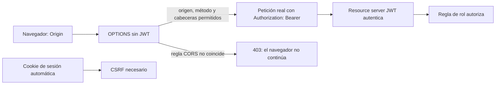
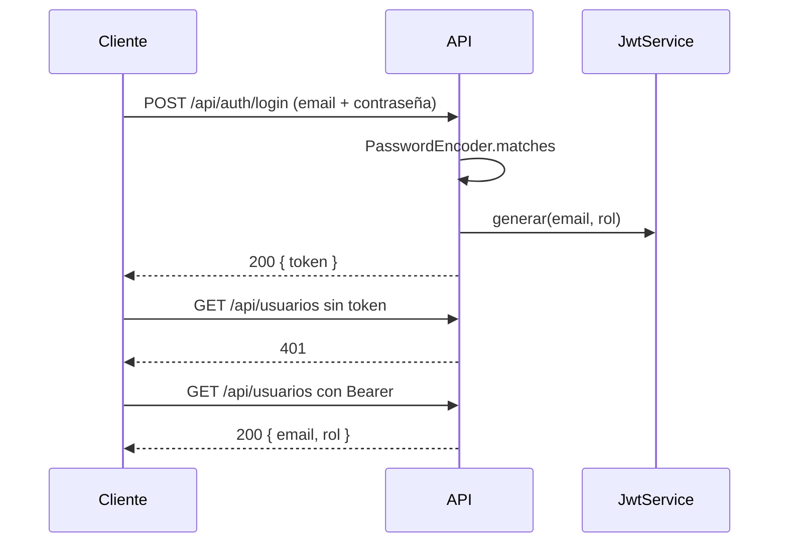

# Módulo 5: Spring Security I: cadena, JWT con resource server, CORS y SSRF

Cada tema se practica por separado con su propia repetición progresiva y su propio reto de memoria, verificado con `MockMvc` real contra un contexto de Spring real, para que cada código de estado HTTP (200/401/403) sea comprobable, no solo descrito. El JWT se valida con el **resource server** de Spring Security (`oauth2ResourceServer().jwt()`), no con un filtro escrito a mano: así el mismo código sirve cuando, en el Módulo 18, los tokens los emita un proveedor de identidad.

**Referencia ejecutable al terminar los módulos 2 y 4–7:** en la raíz del repositorio, abre `README.md`. Incluye el estado final y pruebas; algunas clases incorporan cambios de módulos posteriores. Construye primero las prácticas de este módulo y usa la referencia para comparar y diagnosticar.

## Aprende construyendo

### Tema 1: SecurityFilterChain moderno · Intermedio · 30 min

Al terminar, podrás añadir Spring Security al backend `academia-spring`, separar una ruta pública de las protegidas y probar la regla con MockMvc. Este tema usa HTTP Basic para mostrar la cadena de filtros; el siguiente añade JWT.

Prerrequisitos: API y pruebas de Spring Boot Módulos 1–3.

**¿Por qué es importante?** La ruta de salud debe responder a un balanceador sin credencial; las operaciones con datos de clientes deben exigir una identidad. Una regla equivocada puede dejar pública toda la API.



#### Subtema 1.1 · Proteger rutas del backend · 10 min

**Contexto:** Spring Boot ya sirve tareas y documentación OpenAPI. Agrega la seguridad al mismo proyecto para que la regla viva junto al backend real.

**Hazlo tú:** En `pom.xml`, añade el starter de aplicación dentro de `<dependencies>`:

```xml
<dependency>
    <groupId>org.springframework.boot</groupId>
    <artifactId>spring-boot-starter-security</artifactId>
</dependency>
```

Crea `src/main/java/com/example/demo/SecurityConfig.java`:

```java
package com.example.demo;

import org.springframework.context.annotation.Bean;
import org.springframework.context.annotation.Configuration;
import org.springframework.security.config.Customizer;
import org.springframework.security.config.annotation.web.builders.HttpSecurity;
import org.springframework.security.web.SecurityFilterChain;

@Configuration
public class SecurityConfig {
    @Bean
    SecurityFilterChain filterChain(HttpSecurity http) throws Exception {
        return http
            .authorizeHttpRequests(auth -> auth
                .requestMatchers("/public/**").permitAll()
                .anyRequest().authenticated())
            .httpBasic(Customizer.withDefaults())
            .build();
    }
}
```

Crea `src/main/java/com/example/demo/RutasController.java`:

```java
package com.example.demo;

import org.springframework.web.bind.annotation.GetMapping;
import org.springframework.web.bind.annotation.RestController;

@RestController
public class RutasController {
    @GetMapping("/public/health")
    public String salud() { return "OK"; }

    @GetMapping("/api/entregas")
    public String entregas() { return "entregas confidenciales"; }
}
```

**Resultado esperado:** desde la raíz, `./mvnw -q -Dtest=SecurityFilterChainTest test` aún no aplica porque el test se crea en el siguiente subtema. Comprueba al menos que `./mvnw -q compile` termina correctamente.

**Fallo deliberado y diagnóstico:** cambia `.authenticated()` por `.permitAll()` y arranca el backend. La aplicación inicia, pero esa regla hace pública cualquier ruta restante; el test del siguiente subtema debe detectar el problema. Restáurala a `.authenticated()` antes de continuar.

**Entiende:** el filtro revisa cada petición antes de que llegue al controller. `permitAll()` deja pasar sin identidad; `authenticated()` exige una identidad ya comprobada; HTTP Basic pide usuario y contraseña mediante el encabezado de autenticación. CSRF queda habilitado con su valor seguro por defecto.

**Cierra:** deja la regla privada en `.authenticated()` y guarda los nombres de las dos rutas que acabas de crear.

#### Subtema 1.2 · Verificar 200, 401 y usuario autenticado · 10 min

**Contexto:** Compilar no demuestra que la cadena se aplique. Usa MockMvc con los filtros del contexto para pedir la ruta pública y la protegida.

**Hazlo tú:** En `pom.xml`, añade el starter de pruebas a `<dependencies>`:

```xml
<dependency>
    <groupId>org.springframework.boot</groupId>
    <artifactId>spring-boot-starter-security-test</artifactId>
    <scope>test</scope>
</dependency>
```

Agrega también el soporte MVC de pruebas; `@AutoConfigureMockMvc` pertenece a este módulo en Boot 4:

```xml
<dependency>
    <groupId>org.springframework.boot</groupId>
    <artifactId>spring-boot-starter-webmvc-test</artifactId>
    <scope>test</scope>
</dependency>
```

Crea `src/test/java/com/example/demo/SecurityFilterChainTest.java`:

```java
package com.example.demo;

import org.junit.jupiter.api.Test;
import org.springframework.beans.factory.annotation.Autowired;
import org.springframework.boot.test.context.SpringBootTest;
import org.springframework.boot.webmvc.test.autoconfigure.AutoConfigureMockMvc;
import org.springframework.security.test.context.support.WithMockUser;
import org.springframework.test.web.servlet.MockMvc;
import static org.springframework.test.web.servlet.request.MockMvcRequestBuilders.get;
import static org.springframework.test.web.servlet.result.MockMvcResultMatchers.status;

@SpringBootTest
@AutoConfigureMockMvc
class SecurityFilterChainTest {
    @Autowired MockMvc mockMvc;

    @Test
    void publicaDejaPasarSinCredencial() throws Exception {
        mockMvc.perform(get("/public/health")).andExpect(status().isOk());
    }

    @Test
    void protegidaRechazaSolicitudAnonima() throws Exception {
        mockMvc.perform(get("/api/entregas")).andExpect(status().isUnauthorized());
    }

    @Test
    @WithMockUser
    void protegidaAceptaLaIdentidadDePrueba() throws Exception {
        mockMvc.perform(get("/api/entregas")).andExpect(status().isOk());
    }
}
```

Ejecuta desde la raíz:

```bash
./mvnw -q -Dtest=SecurityFilterChainTest test
```

**Resultado esperado:** los tres tests pasan: público `200`, anónimo protegido `401`, identidad de prueba `200`.

**Fallo deliberado y diagnóstico:** cambia `.anyRequest().authenticated()` a `.anyRequest().permitAll()` y repite el comando. El test anónimo falla con `expected 401 but was 200`: el controller responde, pero la cadena ya no frena a quien llega sin identidad. Restaura `.authenticated()`.

**Entiende:** `@WithMockUser` crea un principal solo para la prueba; no verifica una contraseña ni comprueba un proveedor de usuarios. MockMvc sí ejecuta la cadena de filtros real. La [guía de Spring Security sobre usuarios de prueba](https://docs.spring.io/spring-security/reference/servlet/test/mockmvc/authentication.html) aclara el alcance de esta anotación.

**Cierra:** conserva la salida verde y la prueba fallida/restaurada. La anotación `@AutoConfigureMockMvc` en Boot 4 se importa desde `org.springframework.boot.webmvc.test.autoconfigure`; el starter de seguridad de prueba entrega `@WithMockUser`.

#### Subtema 1.3 · Decidir qué rutas son públicas · 10 min

**Contexto:** Al proteger todo lo que no esté en `/public/**`, la prueba OpenAPI existente también recibe `401`. Decide explícitamente si el documento debe estar abierto en este entorno de aprendizaje.

**Hazlo tú:** En `src/main/java/com/example/demo/SecurityConfig.java`, conserva los imports y la clase. Reemplaza únicamente el método `filterChain`:

```java
@Bean
SecurityFilterChain filterChain(HttpSecurity http) throws Exception {
    return http
        .authorizeHttpRequests(auth -> auth
            .requestMatchers(
                "/public/**",
                "/v3/api-docs/**",
                "/swagger-ui/**",
                "/swagger-ui.html"
            ).permitAll()
            .anyRequest().authenticated())
        .httpBasic(Customizer.withDefaults())
        .build();
}
```

Desde la raíz, prueba primero el contrato que ya existe y luego la suite:

Antes de ejecutar, añade a `src/main/java/com/example/demo/RutasController.java` el import `org.springframework.web.bind.annotation.PathVariable` y este método dentro de la clase:

```java
@GetMapping("/api/entregas/{id}")
public String entrega(@PathVariable long id) {
    return "entrega " + id;
}
```

Añade también estos dos métodos a `SecurityFilterChainTest.java`:

```java
@Test
void subrutaTambienRechazaSolicitudAnonima() throws Exception {
    mockMvc.perform(get("/api/entregas/42")).andExpect(status().isUnauthorized());
}

@Test
@WithMockUser
void subrutaAceptaIdentidadDePrueba() throws Exception {
    mockMvc.perform(get("/api/entregas/42")).andExpect(status().isOk());
}
```

```bash
./mvnw -q -Dtest=ContratoOpenApiTest test
./mvnw -q clean test
```

**Resultado esperado:** OpenAPI devuelve `200` sin credencial; las pruebas confirman que `/api/entregas` y `/api/entregas/42` devuelven `401` sin identidad y `200` con un usuario de prueba. La suite completa pasa.

**Fallo deliberado y diagnóstico:** quita `"/v3/api-docs/**"` de la lista y ejecuta `./mvnw -q -Dtest=ContratoOpenApiTest test`. El test obtiene `401` en vez de `200`, porque el contrato documental ahora cae en `.anyRequest().authenticated()`. Restaura el matcher.

**Entiende:** una regla pública es una decisión sobre información, no solo una forma de arreglar tests. La documentación se deja abierta para el curso; en una API real, revisa si su esquema revela rutas o datos que convenga restringir. **Límite:** HTTP Basic envía credenciales en cada petición; úsalo solo por HTTPS fuera de pruebas locales. No desactives CSRF a ciegas; aquí se conserva porque la cadena aún admite autenticación Basic.

**Cierra:** guarda la suite verde. **Práctica:** en los dos tests de subruta, cambia `/api/entregas/42` por `/api/entregas/43` y ejecuta `./mvnw -q -Dtest=SecurityFilterChainTest test`; anónima debe seguir en `401` y con `@WithMockUser` en `200`. Enumera las rutas que decidiste dejar públicas. El siguiente tema sustituye HTTP Basic por validación de JWT y agrega autorización por rol.

El filtro que definiste protege el backend acumulativo del proyecto integrador; una marca de test confirma esta regla de rutas, no una revisión de todos los controles de acceso del producto.

### Tema 2: JWT con el resource server de Spring Security y autorización por rol · Intermedio · 45 min

Al terminar, podrás emitir un JWT firmado, dejar que **Spring Security** lo valide con su resource server estándar y restringir una operación por rol. El backend de los Temas 1–3 sigue siendo `academia-spring`.

**¿Por qué es importante?** Una firma válida prueba quién emitió el token y que no se alteró; la autorización separa qué puede hacer cada usuario. Escribir a mano el filtro que lee `Authorization`, valida la firma y crea la identidad es repetir código de seguridad que Spring ya mantiene, prueba y actualiza. Con `oauth2ResourceServer().jwt()` cambias solo el `JwtDecoder` el día que los tokens los emita un proveedor de identidad (Módulo 18), y el resto de la cadena no cambia.

**Prerrequisitos:** Tema 1 de este módulo (`SecurityFilterChain`) y `@Value` del Módulo 0. Usa JDK 25 y Spring Boot 4.1.2.



#### Subtema 2.1 · Emite y valida un token con `JwtEncoder` y `JwtDecoder` · 10 min

**Contexto:** el Tema 1 dejó las rutas privadas con HTTP Basic. Ahora el cliente enviará un token firmado en cada llamada y el servidor no guardará sesión. Para aprender sin un proveedor externo, la misma API emitirá y validará tokens con una clave HMAC de laboratorio.

**Hazlo tú:** desde `academia-spring`, añade el starter del resource server a `pom.xml`. En Spring Boot 4 se llama `spring-boot-starter-security-oauth2-resource-server` (el nombre antiguo, sin `security-`, quedó deprecado) y trae `spring-security-oauth2-jose`, que contiene `JwtEncoder` y `JwtDecoder`. No añadas versión: la fija el BOM de Boot.

```xml
<dependency>
    <groupId>org.springframework.boot</groupId>
    <artifactId>spring-boot-starter-security-oauth2-resource-server</artifactId>
</dependency>
```

En `src/main/resources/application.properties`, lee el secreto de una variable de entorno. No escribas la clave en Java ni en Git:

```properties
security.jwt.secret-base64=${JWT_SECRET_BASE64}
```

Genera una clave de 32 bytes (256 bits, el mínimo para HS256) y compila:

```bash
export JWT_SECRET_BASE64="$(openssl rand -base64 32)"
./mvnw -q compile
```

Crea `src/main/java/com/example/demo/JwtService.java`:

```java
package com.example.demo;

import java.time.Instant;
import java.util.Base64;
import javax.crypto.SecretKey;
import javax.crypto.spec.SecretKeySpec;
import org.springframework.beans.factory.annotation.Value;
import org.springframework.security.oauth2.jose.jws.MacAlgorithm;
import org.springframework.security.oauth2.jwt.JwsHeader;
import org.springframework.security.oauth2.jwt.Jwt;
import org.springframework.security.oauth2.jwt.JwtClaimsSet;
import org.springframework.security.oauth2.jwt.JwtDecoder;
import org.springframework.security.oauth2.jwt.JwtEncoder;
import org.springframework.security.oauth2.jwt.JwtEncoderParameters;
import org.springframework.security.oauth2.jwt.NimbusJwtDecoder;
import org.springframework.security.oauth2.jwt.NimbusJwtEncoder;
import org.springframework.stereotype.Service;

@Service
public class JwtService {
    private final JwtEncoder encoder;
    private final JwtDecoder decoder;

    public JwtService(@Value("${security.jwt.secret-base64}") String secretBase64) {
        SecretKey key = new SecretKeySpec(Base64.getDecoder().decode(secretBase64), "HmacSHA256");
        this.encoder = NimbusJwtEncoder.withSecretKey(key).algorithm(MacAlgorithm.HS256).build();
        this.decoder = NimbusJwtDecoder.withSecretKey(key).macAlgorithm(MacAlgorithm.HS256).build();
    }

    public String generar(String usuario, String rol) {
        Instant ahora = Instant.now();
        JwtClaimsSet claims = JwtClaimsSet.builder()
            .subject(usuario)
            .claim("rol", rol)
            .issuedAt(ahora)
            .expiresAt(ahora.plusSeconds(900))
            .build();
        JwsHeader cabecera = JwsHeader.with(MacAlgorithm.HS256).build();
        return encoder.encode(JwtEncoderParameters.from(cabecera, claims)).getTokenValue();
    }

    public Jwt validar(String token) {
        return decoder.decode(token);
    }

    JwtDecoder decoder() {
        return decoder;
    }
}
```

Crea `src/test/java/com/example/demo/JwtServiceTest.java` para probar el emisor sin iniciar Spring:

```java
package com.example.demo;

import static org.junit.jupiter.api.Assertions.assertEquals;

import org.junit.jupiter.api.Test;
import org.springframework.security.oauth2.jwt.Jwt;

class JwtServiceTest {
    private static final String CLAVE_DE_PRUEBA = "VVFRc3BzQVFzZXJ0T0xhbkt0ZUd4cHlsU21pSnhhOFM=";

    @Test
    void tokenFirmadoConservaUsuarioYRol() {
        var service = new JwtService(CLAVE_DE_PRUEBA);
        Jwt jwt = service.validar(service.generar("ana-1", "ADMIN"));
        assertEquals("ana-1", jwt.getSubject());
        assertEquals("ADMIN", jwt.getClaimAsString("rol"));
    }
}
```

**Resultado esperado:** `./mvnw -q -Dtest=JwtServiceTest test` pasa. El token dura 15 minutos; `validar` devuelve un `Jwt` solo después de comprobar la firma y las fechas `exp`/`nbf`.

**Fallo deliberado y diagnóstico:** en el test, firma con un servicio y valida con otro que usa una clave distinta:

```java
var otro = new JwtService("QUFBQUFBQUFBQUFBQUFBQUFBQUFBQUFBQUFBQUFBQUE=");
service.validar(otro.generar("ana-1", "ADMIN"));
```

El test lanza `BadJwtException` (una `JwtException`) porque la firma no corresponde a la clave del decodificador. Compara la clave de firma con la de verificación y borra esas dos líneas.

**Entiende:** Base64 representa los bytes de la clave; no la cifra ni la vuelve secreta. `NimbusJwtEncoder.withSecretKey` (Spring Security 7) firma con HS256 por defecto; aquí se fija igual que en la cabecera para que el algoritmo sea explícito. `NimbusJwtDecoder` verifica firma y vencimiento con los validadores por defecto. **Límite:** con HMAC, la misma clave firma y verifica, así que cada servicio que valida también podría emitir. Por eso en producción un proveedor de identidad firma con clave privada y los servicios validan con la pública (JWKS), sin tocar el resto de la cadena.

**Cierra:** guarda `JwtService` y comprueba que el valor real de la clave no quedó en archivos versionados.

#### Subtema 2.2 · Conecta el resource server a la cadena · 10 min

**Contexto:** validar una cadena en un test no protege rutas. La cadena de filtros debe leer el encabezado, validar el token, crear la identidad y traducir el claim `rol` a una autoridad que entienda `@PreAuthorize`.

**Hazlo tú:** reemplaza `src/main/java/com/example/demo/SecurityConfig.java` completo:

```java
package com.example.demo;

import org.springframework.context.annotation.Bean;
import org.springframework.context.annotation.Configuration;
import org.springframework.security.config.annotation.method.configuration.EnableMethodSecurity;
import org.springframework.security.config.annotation.web.builders.HttpSecurity;
import org.springframework.security.config.annotation.web.configurers.AbstractHttpConfigurer;
import org.springframework.security.config.http.SessionCreationPolicy;
import org.springframework.security.oauth2.server.resource.authentication.JwtAuthenticationConverter;
import org.springframework.security.oauth2.server.resource.authentication.JwtGrantedAuthoritiesConverter;
import org.springframework.security.web.SecurityFilterChain;

@EnableMethodSecurity
@Configuration
public class SecurityConfig {
    @Bean
    SecurityFilterChain filterChain(HttpSecurity http, JwtService jwtService) throws Exception {
        return http
            .csrf(AbstractHttpConfigurer::disable)
            .formLogin(AbstractHttpConfigurer::disable)
            .httpBasic(AbstractHttpConfigurer::disable)
            .sessionManagement(session -> session.sessionCreationPolicy(SessionCreationPolicy.STATELESS))
            .authorizeHttpRequests(auth -> auth
                .requestMatchers("/public/**", "/v3/api-docs/**", "/swagger-ui/**", "/swagger-ui.html").permitAll()
                .anyRequest().authenticated())
            .oauth2ResourceServer(oauth2 -> oauth2.jwt(jwt -> jwt
                .decoder(jwtService.decoder())
                .jwtAuthenticationConverter(rolesDesdeElClaimRol())))
            .build();
    }

    private static JwtAuthenticationConverter rolesDesdeElClaimRol() {
        var autoridades = new JwtGrantedAuthoritiesConverter();
        autoridades.setAuthoritiesClaimName("rol");
        autoridades.setAuthorityPrefix("ROLE_");
        var conversor = new JwtAuthenticationConverter();
        conversor.setJwtGrantedAuthoritiesConverter(autoridades);
        return conversor;
    }
}
```

Crea `src/main/java/com/example/demo/AdminController.java` con una operación que exija rol:

```java
package com.example.demo;

import org.springframework.security.access.prepost.PreAuthorize;
import org.springframework.web.bind.annotation.DeleteMapping;
import org.springframework.web.bind.annotation.PathVariable;
import org.springframework.web.bind.annotation.RestController;

@RestController
public class AdminController {
    @PreAuthorize("hasRole('ADMIN')")
    @DeleteMapping("/api/entregas/{id}")
    public void eliminar(@PathVariable long id) { }
}
```

**Resultado esperado:** `./mvnw -q compile` termina sin errores. No existe ninguna clase `JwtFilter`: el filtro que lee `Bearer` lo añade `oauth2ResourceServer()`.

**Fallo deliberado y diagnóstico:** quita `/public/**` de los `requestMatchers` y ejecuta `./mvnw -q -Dtest=SecurityFilterChainTest test`. La ruta de salud deja de ser pública y el test recibe `401` en vez de `200`; restaura el matcher.

**Entiende:** por defecto, `JwtGrantedAuthoritiesConverter` lee los claims `scope`/`scp` y antepone `SCOPE_`. Aquí lo apuntas al claim `rol` y al prefijo `ROLE_`, que es lo que espera `hasRole('ADMIN')` (equivale a `hasAuthority('ROLE_ADMIN')`). Sin token o con token inválido responde `401` con la cabecera `WWW-Authenticate: Bearer`; con identidad pero sin rol, `403`. `@EnableMethodSecurity` activa `@PreAuthorize`, que es un proxy AOP como los del Módulo 0.

**Cierra:** la cadena compila sin filtro propio y los tests del Tema 1 siguen verdes.

#### Subtema 2.3 · Prueba identidad, rol y firma con tokens reales · 10 min

**Contexto:** `@WithMockUser` prueba una regla con una identidad inventada, pero no ejercita la validación del token. Esta prueba firma tokens reales con el `JwtService` y los manda por HTTP simulado.

**Hazlo tú:** crea `src/test/resources/application.properties` con una clave de prueba de 32 bytes. Solo es para tests; producción usa `JWT_SECRET_BASE64`:

```properties
security.jwt.secret-base64=VVFRc3BzQVFzZXJ0T0xhbkt0ZUd4cHlsU21pSnhhOFM=
```

Crea `src/test/java/com/example/demo/JwtSeguridadTest.java`:

```java
package com.example.demo;

import static org.springframework.test.web.servlet.request.MockMvcRequestBuilders.delete;
import static org.springframework.test.web.servlet.result.MockMvcResultMatchers.header;
import static org.springframework.test.web.servlet.result.MockMvcResultMatchers.status;

import org.junit.jupiter.api.Test;
import org.springframework.beans.factory.annotation.Autowired;
import org.springframework.boot.test.context.SpringBootTest;
import org.springframework.boot.webmvc.test.autoconfigure.AutoConfigureMockMvc;
import org.springframework.test.web.servlet.MockMvc;

@SpringBootTest
@AutoConfigureMockMvc
class JwtSeguridadTest {
    @Autowired MockMvc mockMvc;
    @Autowired JwtService jwtService;

    @Test
    void sinTokenResponde401() throws Exception {
        mockMvc.perform(delete("/api/entregas/42"))
            .andExpect(status().isUnauthorized())
            .andExpect(header().exists("WWW-Authenticate"));
    }

    @Test
    void rolDriverResponde403() throws Exception {
        String token = jwtService.generar("conductor-7", "DRIVER");
        mockMvc.perform(delete("/api/entregas/42").header("Authorization", "Bearer " + token))
            .andExpect(status().isForbidden());
    }

    @Test
    void rolAdminResponde200() throws Exception {
        String token = jwtService.generar("admin-1", "ADMIN");
        mockMvc.perform(delete("/api/entregas/42").header("Authorization", "Bearer " + token))
            .andExpect(status().isOk());
    }

    @Test
    void firmaAlteradaResponde401() throws Exception {
        String[] partes = jwtService.generar("admin-1", "ADMIN").split("\\.");
        String primerCaracter = partes[2].charAt(0) == 'A' ? "B" : "A";
        String tokenAlterado = partes[0] + "." + partes[1] + "." + primerCaracter + partes[2].substring(1);
        mockMvc.perform(delete("/api/entregas/42").header("Authorization", "Bearer " + tokenAlterado))
            .andExpect(status().isUnauthorized());
    }
}
```

Ejecuta `./mvnw -q -Dtest=JwtSeguridadTest test` y después `./mvnw -q clean test`.

**Resultado esperado:** los cuatro tests pasan: `401` sin token (con `WWW-Authenticate`), `403` para `DRIVER`, `200` para `ADMIN` y `401` al cambiar un carácter de la firma.

**Fallo deliberado y diagnóstico:** en `rolesDesdeElClaimRol`, comenta `autoridades.setAuthorityPrefix("ROLE_");` y ejecuta `./mvnw -q -Dtest=JwtSeguridadTest#rolAdminResponde200 test`. Obtienes `403`: el conversor vuelve al prefijo por defecto `SCOPE_`, así que la autoridad es `SCOPE_ADMIN` y `hasRole('ADMIN')` no la reconoce. Restaura la línea.

**Entiende:** un JWT firmado no está cifrado: cualquiera puede leer sus claims en Base64, así que no pongas contraseñas ni datos sensibles en ellos. La prueba de firma alterada demuestra que el decodificador del resource server rechaza el token antes de llegar al controller.

**Cierra:** conserva la suite verde y la salida del test de firma alterada.

#### Subtema 2.4 · Prueba la regla sin firmar: `jwt()` de `spring-security-test` · 8 min

**Contexto:** firmar tokens en cada prueba acopla los tests de autorización a la clave. Para probar solo la regla de un endpoint, `spring-security-test` crea un `Jwt` ya validado.

**Hazlo tú:** añade a `JwtSeguridadTest.java`:

```java
import static org.springframework.security.test.web.servlet.request.SecurityMockMvcRequestPostProcessors.jwt;
import org.springframework.security.core.authority.SimpleGrantedAuthority;

@Test
void reglaDeRolSinFirmarElToken() throws Exception {
    mockMvc.perform(delete("/api/entregas/42")
            .with(jwt().authorities(new SimpleGrantedAuthority("ROLE_ADMIN"))))
        .andExpect(status().isOk());
    mockMvc.perform(delete("/api/entregas/42")
            .with(jwt().authorities(new SimpleGrantedAuthority("ROLE_DRIVER"))))
        .andExpect(status().isForbidden());
}
```

Si `spring-security-test` no está en el `pom.xml`, agrégalo con `<scope>test</scope>` (sin versión). Ejecuta `./mvnw -q -Dtest=JwtSeguridadTest#reglaDeRolSinFirmarElToken test`.

**Resultado esperado:** verde: `200` con `ROLE_ADMIN` y `403` con `ROLE_DRIVER`.

**Fallo deliberado y diagnóstico:** cambia la primera autoridad a `"ADMIN"` (sin prefijo). La primera petición devuelve `403`: `jwt().authorities(...)` reemplaza las autoridades que calcularía tu conversor, así que debes escribirlas ya con el prefijo. Restaura `ROLE_ADMIN`.

**Entiende:** `jwt()` salta la firma y el conversor; prueba la autorización, no la autenticación. Por eso conservas las dos clases de prueba: `firmaAlteradaResponde401` cubre el decodificador y `reglaDeRolSinFirmarElToken` cubre la regla.

**Cierra:** anota qué prueba fallaría si alguien cambiara la clave y cuál si cambiara `@PreAuthorize`.

**Ejercicio:** añade `GET /api/entregas/{id}/ruta` que exija `ROLE_DRIVER` o `ROLE_ADMIN` y escribe dos pruebas: una con token real de `DRIVER` (200) y otra con `jwt()` sin autoridades (403). Antes de abrir la solución, escribe qué expresión SpEL usarás en `@PreAuthorize`.

<details>
<summary>Solución</summary>

```java
@PreAuthorize("hasAnyRole('DRIVER', 'ADMIN')")
@GetMapping("/api/entregas/{id}/ruta")
public String ruta(@PathVariable long id) { return "ruta-" + id; }
```

```java
@Test
void driverVeLaRuta() throws Exception {
    String token = jwtService.generar("conductor-7", "DRIVER");
    mockMvc.perform(get("/api/entregas/42/ruta").header("Authorization", "Bearer " + token))
        .andExpect(status().isOk());
}

@Test
void sinAutoridadesNoVeLaRuta() throws Exception {
    mockMvc.perform(get("/api/entregas/42/ruta").with(jwt()))
        .andExpect(status().isForbidden());
}
```

`jwt()` sin `authorities(...)` produce solo `SCOPE_read`, que no es un rol: por eso responde `403` y no `401`. Importa `get` de `MockMvcRequestBuilders` y `GetMapping` de Spring Web.

</details>

**Hito del tema:**

- [ ] Emití y validé un token con `JwtEncoder`/`JwtDecoder` y provoqué el rechazo por clave distinta.
- [ ] Conecté `oauth2ResourceServer().jwt()` sin escribir un filtro propio.
- [ ] Obtuve `401`, `403` y `200` con tokens reales y `401` con la firma alterada.
- [ ] Expliqué por qué `jwt()` prueba la autorización pero no la firma, y el límite de usar HMAC.

**Fuentes oficiales:** [Spring Security — OAuth 2.0 Resource Server JWT](https://docs.spring.io/spring-security/reference/servlet/oauth2/resource-server/jwt.html), [API de `NimbusJwtEncoder`](https://docs.spring.io/spring-security/reference/api/java/org/springframework/security/oauth2/jwt/NimbusJwtEncoder.html) y [Spring Boot 4.0 Migration Guide](https://github.com/spring-projects/spring-boot/wiki/Spring-Boot-4.0-Migration-Guide) (renombre de starters).

**Proyecto integrador:** el login del Tema 5 reutiliza este `JwtService`; no crees otra clave ni otra clase. **Límite:** este tema no implementa revocación ni refresh tokens; el Módulo 18 delega la emisión en un proveedor OIDC y el servicio solo valida.

### Tema 3: CORS y CSRF · Intermedio · 30 min

Al terminar, podrás permitir desde qué sitios web se llama la API y decidir cuándo proteger las peticiones contra CSRF. Continúa el proyecto integrador `academia-spring` con JWT en `Authorization`.



**¿Por qué es importante?** CORS deja que el navegador de tu frontend lea la API; CSRF evita cambios que un navegador podría enviar usando credenciales que adjunta solo, como una cookie. Son problemas distintos: CORS no autentica usuarios ni reemplaza permisos.

#### Subtema 3.1 · Permitir un origen y responder al preflight · 10 min

**Contexto:** el navegador suele enviar primero una petición `OPTIONS` cuando el frontend usa `Authorization` o un método como `DELETE`. Esa petición previa normalmente no lleva el JWT; Spring debe revisar CORS antes de exigir autenticación.

**Hazlo tú:** en `src/main/java/com/example/demo/CorsConfig.java`, configura el único sitio web aprobado y los métodos/cabeceras que usa el cliente:

```java
package com.example.demo;

import java.util.List;
import org.springframework.context.annotation.Bean;
import org.springframework.context.annotation.Configuration;
import org.springframework.web.cors.CorsConfiguration;
import org.springframework.web.cors.CorsConfigurationSource;
import org.springframework.web.cors.UrlBasedCorsConfigurationSource;

@Configuration
public class CorsConfig {
    @Bean
    CorsConfigurationSource corsConfigurationSource() {
        var config = new CorsConfiguration();
        config.setAllowedOrigins(List.of("https://web.academia.dev"));
        config.setAllowedMethods(List.of("GET", "POST", "DELETE"));
        config.setAllowedHeaders(List.of("Authorization", "Content-Type"));
        config.setAllowCredentials(false);
        config.setMaxAge(3600L);

        var source = new UrlBasedCorsConfigurationSource();
        source.registerCorsConfiguration("/api/**", config);
        return source;
    }
}
```

En `src/main/java/com/example/demo/SecurityConfig.java`, añade `.cors(cors -> {})` antes de `.csrf(...)`; conserva el resto de la cadena JWT del Tema 2. Spring Security toma la configuración del `CorsConfigurationSource` y procesa CORS antes de autenticar.

Crea `src/test/java/com/example/demo/CorsConfigTest.java`:

```java
package com.example.demo;

import org.junit.jupiter.api.Test;
import org.springframework.beans.factory.annotation.Autowired;
import org.springframework.boot.test.context.SpringBootTest;
import org.springframework.boot.webmvc.test.autoconfigure.AutoConfigureMockMvc;
import org.springframework.test.web.servlet.MockMvc;

import static org.springframework.test.web.servlet.request.MockMvcRequestBuilders.options;
import static org.springframework.test.web.servlet.result.MockMvcResultMatchers.header;
import static org.springframework.test.web.servlet.result.MockMvcResultMatchers.status;

@SpringBootTest
@AutoConfigureMockMvc
class CorsConfigTest {
    @Autowired MockMvc mockMvc;

    @Test
    void preflightPermitidoDevuelveOrigenYMetodo() throws Exception {
        mockMvc.perform(options("/api/entregas/42")
                .header("Origin", "https://web.academia.dev")
                .header("Access-Control-Request-Method", "DELETE")
                .header("Access-Control-Request-Headers", "Authorization"))
            .andExpect(status().isOk())
            .andExpect(header().string("Access-Control-Allow-Origin", "https://web.academia.dev"))
            .andExpect(header().string("Access-Control-Allow-Methods",
                org.hamcrest.Matchers.containsString("DELETE")))
            .andExpect(header().string("Access-Control-Allow-Headers",
                org.hamcrest.Matchers.containsString("Authorization")));
    }

    @Test
    void preflightDeOrigenAjenoRecibe403() throws Exception {
        mockMvc.perform(options("/api/entregas/42")
                .header("Origin", "https://sitio-no-autorizado.dev")
                .header("Access-Control-Request-Method", "DELETE"))
            .andExpect(status().isForbidden())
            .andExpect(header().doesNotExist("Access-Control-Allow-Origin"));
    }
}
```

Desde la raíz de `academia-spring`, ejecuta:

```bash
./mvnw -q -Dtest=CorsConfigTest test
```

**Resultado esperado:** los dos tests pasan: el origen aprobado recibe `Access-Control-Allow-Origin`; el origen ajeno recibe `403` y no recibe permiso CORS.

**Fallo deliberado y diagnóstico:** cambia `setAllowedOrigins(List.of("https://web.academia.dev"))` por `setAllowedOrigins(List.of("*"))` y ejecuta `./mvnw -q -Dtest=CorsConfigTest#preflightDeOrigenAjenoRecibe403 test`. Obtendrás `200` en vez de `403`: la lista ya acepta cualquier sitio. Restaura el origen exacto.

**Entiende:** `Origin` identifica protocolo, host y puerto. `OPTIONS` pregunta si después puede salir el `DELETE`; el navegador aplica la decisión. Una herramienta como Postman puede enviar la petición aunque el servidor devuelva otra política. Referencias primarias: [Spring Security — integración CORS](https://docs.spring.io/spring-security/reference/servlet/integrations/cors.html) y [Spring Framework — CORS](https://docs.spring.io/spring-framework/reference/web/webmvc-cors.html).

**Cierra:** anota los orígenes y métodos que necesita el frontend. CORS limita acceso desde navegadores; no impide llamadas directas desde otros servidores.

#### Subtema 3.2 · Llamar con el JWT y decidir CSRF · 10 min

**Contexto:** autorizar el preflight no prueba todavía la petición real. El frontend manda el JWT en un encabezado `Authorization`; el resource server del Tema 2 valida identidad y rol después de que CORS permita ese origen.

**Hazlo tú:** añade este test a `CorsConfigTest.java`. Comprueba una operación `DELETE` real con un token ADMIN válido y `Origin` aprobado:

```java
@Autowired JwtService jwtService;

@Test
void deleteConJwtDevuelveElHeaderCors() throws Exception {
    String token = jwtService.generar("admin-1", "ADMIN");
    mockMvc.perform(delete("/api/entregas/42")
            .header("Origin", "https://web.academia.dev")
            .header("Authorization", "Bearer " + token))
        .andExpect(status().isOk())
        .andExpect(header().string("Access-Control-Allow-Origin", "https://web.academia.dev"));
}
```

Añade los imports estáticos `delete` y `status` si todavía no están. Ejecuta `./mvnw -q -Dtest=CorsConfigTest test`.

**Resultado esperado:** la petición real devuelve `200` y el header de origen aprobado. El preflight no lleva token; la petición `DELETE` posterior sí. MockMvc verifica la respuesta del servidor, pero no reemplaza una prueba en navegador.

**Fallo deliberado y diagnóstico:** quita `"Authorization"` de `setAllowedHeaders(...)` y ejecuta `./mvnw -q -Dtest=CorsConfigTest#preflightPermitidoInformaOrigenYHeaders test`. Spring devuelve `403` porque el navegador pregunta permiso para enviar ese encabezado; restaura `"Authorization"`.

**Entiende:** CSRF importa cuando el navegador agrega la credencial sin que el código de la página tenga que presentarla; eso sucede con cookies de sesión. Aquí la API no usa sesión, y JavaScript debe enviar el JWT explícitamente en `Authorization`, por eso el Tema 2 desactiva CSRF. Si guardas el JWT en una cookie enviada automáticamente, vuelve a evaluar CSRF y el modo `SameSite`; el hecho de que sea JWT no lo exime.

**Práctica:** cambia el encabezado por un origen ajeno y comprueba que el navegador no podría leer la respuesta aunque el endpoint responda internamente. No confundas ese bloqueo del navegador con un `401` o un `403` de autorización.

**Cierra:** conserva los tests de preflight y petición real en verde.

#### Subtema 3.3 · Ajustar métodos y detectar configuraciones amplias · 10 min

**Contexto:** un origen aprobado tampoco debería poder invocar métodos que el frontend no usa. CORS limita el intercambio del navegador a los métodos y cabeceras declarados.

**Hazlo tú:** añade a `CorsConfigTest.java` una prueba que solicite `PATCH`, método que el cliente no tiene permitido:

```java
@Test
void preflightDeMetodoNoListadoRecibe403() throws Exception {
    mockMvc.perform(options("/api/entregas/42")
            .header("Origin", "https://web.academia.dev")
            .header("Access-Control-Request-Method", "PATCH"))
        .andExpect(status().isForbidden());
}
```

Ejecuta `./mvnw -q -Dtest=CorsConfigTest#preflightDeMetodoNoListadoRecibe403 test`.

**Resultado esperado:** `403`; la configuración permite `GET`, `POST` y `DELETE`, pero no `PATCH`.

**Fallo deliberado y diagnóstico:** cambia `setAllowedMethods(List.of("GET", "POST", "DELETE"))` por `setAllowedMethods(List.of("*"))` y repite el test. Falla porque `PATCH` ahora queda permitido: compara los métodos de la petición con la lista y restaura los tres métodos explícitos.

**Entiende:** dar permiso CORS a un origen no le da acceso al endpoint; JWT y `@PreAuthorize` siguen decidiendo autenticación y rol. Evita `*` si no es necesario. Si habilitas cookies con `allowCredentials(true)`, limita todavía más orígenes y cabeceras; Spring no permite combinar credenciales con `allowedOrigins("*")`.

**Práctica:** agrega a la configuración solo un segundo origen real de staging y comprueba preflight para ambos. Explica si cada ambiente necesita `GET`, `POST` o `DELETE`.

**Límite:** CORS solo controla navegadores. No es una barrera para Postman, `curl` ni una petición servidor a servidor.

**Cierra:** entrega los tres resultados de preflight y el `DELETE` autenticado. Referencias: [Spring Security — CORS](https://docs.spring.io/spring-security/reference/servlet/integrations/cors.html) y [Spring Security — CSRF](https://docs.spring.io/spring-security/reference/features/exploits/csrf.html).

---

### Tema 4: Reducir SSRF en clientes HTTP con InetAddressFilter · Avanzado · 30 min

**Meta:** configurar un cliente saliente de Spring Boot 4 que rechace direcciones internas, poner límites al tiempo de conexión y comprobar que no sigue redirecciones. Esto reduce una vía de SSRF en ese cliente; no convierte en segura cualquier URL ni reemplaza reglas de salida de red.

**¿Por qué es importante?** Una función que obtiene una imagen o consulta un webhook por una URL recibida puede terminar conectándose a servicios internos. El control se coloca en el cliente HTTP usado para hacer la petición. Si el endpoint usa otro cliente, proxy o SDK, este filtro no lo cubre.

#### Subtema 4.1 · Crear un RestClient con límites · 10 min

**Contexto:** `InetAddressFilter.externalAddresses()` permite direcciones externas y excluye direcciones internas conocidas. Combínalo con timeouts y redirects desactivados. La allowlist de hosts de negocio y las reglas de egreso siguen siendo controles útiles: una IP pública también puede ser un destino que tu aplicación no debería consultar.

**Hazlo tú:** Desde la raíz, copia el laboratorio autocontenido y entra en él:

```bash
cp -R spring-ssrf /tmp/ssrf-lab
cd /tmp/ssrf-lab
./mvnw -q -DskipTests package
```

Abre `src/main/java/com/academia/SafeClient.java`. Allí `SafeClient.externalOnly()` crea un `RestClient` JDK con el filtro, timeout de conexión y lectura de dos segundos, y `DONT_FOLLOW` para redirects. Sigue esos métodos desde `SafeClient.create(...)` hasta `ClientHttpRequestFactoryBuilder.jdk()`.

**Resultado esperado:** Maven termina con código `0`; el laboratorio compila con Spring Boot `4.1.2` y JDK `25`.

**Fallo deliberado y diagnóstico:** cambia temporalmente `externalAddresses()` por `all()` en `externalOnly()` y ejecuta `./mvnw -q -Dtest=SafeClientTest#blocksBeforeRequestAndControlReallyReachesServer test`. La prueba falla porque ahora la petición llega al servidor local en vez de lanzar `FilteredHostException`. Restaura `externalAddresses()`.

**Entiende:** el filtro pertenece a la configuración del cliente saliente; no inspecciona automáticamente todas las peticiones de la aplicación. Los timeouts limitan cuánto espera el cliente. `DONT_FOLLOW` evita que una respuesta lo redirija a otra URL sin una nueva decisión explícita.

**Cierra:** señala las tres opciones en `SafeClient` y describe cuál limita destino, espera y redirección.

#### Subtema 4.2 · Probar destinos internos con un servidor local · 10 min

**Contexto:** una prueba que solo comprueba una excepción podría pasar porque el servidor estaba apagado. El control positivo debe demostrar que el mismo servidor sí responde cuando se permite la dirección local.

**Hazlo tú:** Ejecuta desde el código de este tema:

```bash
./mvnw -q -Dtest=SafeClientTest#blocksBeforeRequestAndControlReallyReachesServer,SafeClientTest#excludesInternalAndMetadataRangesWithoutConnecting test
```

Lee `src/test/java/com/academia/SafeClientTest.java`: el servidor escucha solo en `127.0.0.1` en un puerto efímero. Primero el cliente filtrado debe lanzar `FilteredHostException` y el contador debe quedar en cero; luego el control con `InetAddressFilter.all()` recibe `local fixture`. La segunda prueba clasifica loopback, red privada, link-local `169.254.169.254`, IPv6 loopback y una IP externa conocida sin abrir conexiones.

**Resultado esperado:** las dos pruebas pasan; el rechazo no es un timeout y el control positivo confirma que el servidor estaba disponible. No se llama a servicios cloud ni a terceros.

**Fallo deliberado y diagnóstico:** elimina temporalmente la aserción `assertEquals(0, received.get())` y cambia `externalAddresses()` por `all()`. Ejecuta el comando otra vez: verás que el test pierde la garantía de que la petición se detuvo antes de llegar al servidor. Restaura ambos cambios.

**Entiende:** el rechazo de `169.254.169.254` aquí se prueba como clasificación de dirección; no se solicita ese destino real. DNS y transporte tienen detalles propios, así que no presentes esta prueba como cobertura de DNS rebinding.

**Cierra:** explica por qué la prueba necesita tanto el contador en cero como el control que alcanza el servidor.

#### Subtema 4.3 · Impedir redirects y definir el límite de protección · 10 min

**Contexto:** incluso una primera URL aceptable puede responder con una redirección a otro destino. El laboratorio verifica la decisión del cliente en una pareja de servidores locales.

**Hazlo tú:** ejecuta el caso de redirección:

```bash
./mvnw -q -Dtest=SafeClientTest#doesNotFollowRedirectToAnotherAddress test
```

El primer servidor devuelve `302` apuntando al segundo; el cliente debe devolver `302` y el contador del servidor destino debe permanecer en cero. Para cerrar el tema, ejecuta toda la suite:

```bash
./mvnw -q clean test
```

**Resultado esperado:** tres pruebas pasan. Si tu producto necesita redirects, valida cada destino y limita la cantidad de saltos con una estrategia explícita antes de habilitarlos.

**Fallo deliberado y diagnóstico:** cambia `HttpRedirects.DONT_FOLLOW` por `HttpRedirects.FOLLOW` en `SafeClient.java` y repite el primer comando. La prueba falla porque obtiene `200` y el servidor destino recibe la solicitud. Restaura `DONT_FOLLOW` y confirma el test verde.

**Entiende:** este filtro solo se aplica a clientes construidos con estos ajustes. Cuando se usa un proxy que resuelve el host por su cuenta, hay que configurar la política de destinos en el proxy o en el egreso de red. Una IP externa aún puede ser indeseada; combina este filtro con una allowlist de hosts/servicios cuando el caso lo requiera. Fuentes: [API oficial de InetAddressFilter](https://docs.spring.io/spring-boot/api/java/org/springframework/boot/http/client/InetAddressFilter.html), [API oficial de HttpClientSettings](https://docs.spring.io/spring-boot/api/java/org/springframework/boot/http/client/HttpClientSettings.html) y [notas de Spring Boot 4.1](https://github.com/spring-projects/spring-boot/wiki/Spring-Boot-4.1-Release-Notes).

**Cierra:** conserva la suite verde y resume qué limita el filtro y qué parte debe cubrir el proxy o la red. No afirmes que un test local certifica el control de todos los destinos de producción.

---

**Aplicación y decisión:** En el proyecto integrador, aplica el filtro IP también al destino resuelto y controla redirects; validar solo la cadena inicial no limita una redirección posterior. El laboratorio local no acredita todas las condiciones DNS ni una política de red del despliegue.

### Tema 5: Flujo de login completo — de `/api/auth/login` a una ruta protegida · Avanzado · 30 min

Al final podrás encadenar el login, la emisión del JWT del Subtema 2.1 y el acceso protegido del Subtema 2.2. Conserva el paquete `com.example.demo` y una única clase `JwtService`.

**¿Por qué es importante?** Una contraseña correcta debe producir un token; ese token debe identificar al mismo usuario en cada petición siguiente. Si se omite cualquiera de las dos verificaciones, una API puede autenticar mal o abrir rutas privadas.



#### Subtema 5.1 · Comparar la contraseña sin guardarla en texto plano · 10 min

**Contexto:** `JwtService` ya firma el token y el resource server ya comprueba su firma. El login solo decide si las credenciales permiten pedir ese token.

**Hazlo tú:** En `src/main/java/com/example/demo/SecurityConfig.java`, registra el comparador que usa Spring Security:

```java
@Bean
PasswordEncoder passwordEncoder() {
    return new BCryptPasswordEncoder();
}
```

Añade estos imports si faltan:

```java
import org.springframework.security.crypto.bcrypt.BCryptPasswordEncoder;
import org.springframework.security.crypto.password.PasswordEncoder;
```

Crea `src/main/java/com/example/demo/LoginRequest.java`:

```java
package com.example.demo;

public record LoginRequest(String email, String password) {}
```

Crea `src/main/java/com/example/demo/AuthController.java`:

```java
package com.example.demo;

import java.util.Map;
import org.springframework.http.ResponseEntity;
import org.springframework.security.crypto.password.PasswordEncoder;
import org.springframework.web.bind.annotation.PostMapping;
import org.springframework.web.bind.annotation.RequestBody;
import org.springframework.web.bind.annotation.RequestMapping;
import org.springframework.web.bind.annotation.RestController;

@RestController
@RequestMapping("/api/auth")
public class AuthController {
    private final JwtService jwtService;
    private final PasswordEncoder passwordEncoder;
    private final String emailDemo = "ana@rutaflow.dev";
    private final String hashDemo;

    public AuthController(JwtService jwtService, PasswordEncoder passwordEncoder) {
        this.jwtService = jwtService;
        this.passwordEncoder = passwordEncoder;
        this.hashDemo = passwordEncoder.encode("clave-larga-segura");
    }

    @PostMapping("/login")
    public ResponseEntity<Map<String, String>> login(@RequestBody LoginRequest request) {
        String email = request.email() == null ? "" : request.email();
        String password = request.password() == null ? "" : request.password();
        if (!emailDemo.equals(email) || !passwordEncoder.matches(password, hashDemo)) {
            return ResponseEntity.status(401).body(Map.of("error", "Credenciales inválidas"));
        }
        return ResponseEntity.ok(Map.of("token", jwtService.generar(email, "ADMIN")));
    }
}
```

`hashDemo` vive en memoria para que este ejemplo se pueda ejecutar sin una base de usuarios. En una aplicación real se carga el hash persistido de la cuenta; no se vuelve a guardar ni a comparar la contraseña en texto plano. El usuario de demostración es `ana@rutaflow.dev` / `clave-larga-segura`.

**Resultado esperado:** `./mvnw -q compile` termina sin errores. Para probar el login, el `SecurityFilterChain` debe dejar pasar `/api/auth/**` antes de exigir identidad.

**Fallo deliberado y diagnóstico:** cambia el email de demostración en el código por `otra@rutaflow.dev` y ejecuta el test de login válido del subtema siguiente. La respuesta será `401`: revisa qué compara `emailDemo.equals(email)` y restaura el correo.

**Entiende:** BCrypt guarda un hash con salt. `matches(textoIngresado, hashGuardado)` compara la entrada contra ese hash; no hay que “desencriptarlo”. `JwtService` se reutiliza: no crees una segunda clase ni otra clave. Referencias: [Spring Security — Password Storage](https://docs.spring.io/spring-security/reference/features/authentication/password-storage.html) y [Spring Security — Authentication](https://docs.spring.io/spring-security/reference/servlet/authentication/index.html).

**Cierra:** encuentra el punto donde se compara la contraseña y el punto donde solo después se firma el token.

#### Subtema 5.2 · Usar el token en una ruta protegida · 10 min

**Contexto:** el resource server del Subtema 2.2 coloca el `sub` del token (el correo) en la identidad de la petición. Devuelve ese correo para ver que el token emitido y la ruta usan el mismo usuario.

**Hazlo tú:** Crea `src/main/java/com/example/demo/UsuariosController.java`:

```java
package com.example.demo;

import java.util.Map;
import org.springframework.security.core.Authentication;
import org.springframework.web.bind.annotation.GetMapping;
import org.springframework.web.bind.annotation.RestController;

@RestController
public class UsuariosController {
    @GetMapping("/api/usuarios")
    public Map<String, String> usuarioActual(Authentication authentication) {
        String rol = authentication.getAuthorities().iterator().next().getAuthority();
        return Map.of("email", authentication.getName(), "rol", rol);
    }
}
```

En `src/main/java/com/example/demo/SecurityConfig.java`, permite solo el endpoint de login y conserva las demás rutas protegidas:

```java
.requestMatchers("/api/auth/**", "/public/**", "/v3/api-docs/**", "/swagger-ui/**", "/swagger-ui.html").permitAll()
.anyRequest().authenticated())
```

En `src/test/resources/application.properties`, usa la clave de prueba ya usada por `JwtSeguridadTest` (no es una clave de producción):

```properties
security.jwt.secret-base64=VVFRc3BzQVFzZXJ0T0xhbkt0ZUd4cHlsU21pSnhhOFM=
```

Crea `src/test/java/com/example/demo/LoginFlowTest.java` y añade la prueba que encadena login → token → ruta protegida:

```java
package com.example.demo;

import tools.jackson.databind.JsonNode;
import tools.jackson.databind.json.JsonMapper;
import org.junit.jupiter.api.Test;
import org.springframework.beans.factory.annotation.Autowired;
import org.springframework.boot.test.context.SpringBootTest;
import org.springframework.boot.webmvc.test.autoconfigure.AutoConfigureMockMvc;
import org.springframework.http.MediaType;
import org.springframework.test.web.servlet.MockMvc;
import static org.junit.jupiter.api.Assertions.assertEquals;
import static org.junit.jupiter.api.Assertions.assertTrue;
import static org.springframework.test.web.servlet.request.MockMvcRequestBuilders.get;
import static org.springframework.test.web.servlet.request.MockMvcRequestBuilders.post;
import static org.springframework.test.web.servlet.result.MockMvcResultMatchers.status;

@SpringBootTest
@AutoConfigureMockMvc
class LoginFlowTest {
    @Autowired MockMvc mockMvc;
    private final JsonMapper mapper = JsonMapper.builder().build();

    @Test
    void loginEntregaTokenQueAbreLaRutaProtegida() throws Exception {
        String body = """
            {"email":"ana@rutaflow.dev","password":"clave-larga-segura"}
            """;
        String respuesta = mockMvc.perform(post("/api/auth/login")
                .contentType(MediaType.APPLICATION_JSON).content(body))
            .andExpect(status().isOk())
            .andReturn().getResponse().getContentAsString();
        JsonNode token = mapper.readTree(respuesta).get("token");
        assertTrue(token != null && !token.asString().isBlank());

        mockMvc.perform(get("/api/usuarios")).andExpect(status().isUnauthorized());
        var protegida = mockMvc.perform(get("/api/usuarios")
                .header("Authorization", "Bearer " + token.asString()))
            .andExpect(status().isOk()).andReturn().getResponse().getContentAsString();
        assertEquals("ana@rutaflow.dev", mapper.readTree(protegida).get("email").asString());
        assertEquals("ROLE_ADMIN", mapper.readTree(protegida).get("rol").asString());
    }
}
```

Ejecuta desde la raíz de `academia-spring`:

```bash
./mvnw -q -Dtest=LoginFlowTest test
```

**Resultado esperado:** el test ve `200` en el login, `401` al pedir `/api/usuarios` sin token y `200` con el bearer emitido. El correo de la respuesta protegida coincide con el usuario autenticado.

**Fallo deliberado y diagnóstico:** quita `/api/auth/**` de los matchers públicos y vuelve a ejecutar el test. El propio login recibe `401`; restablece el matcher público.

**Entiende:** el cliente extrae el token de la respuesta y lo envía como `Authorization: Bearer...`. El resource server valida la firma y establece la identidad; el controller no vuelve a leer la contraseña.

**Cierra:** conserva el token generado en la variable de la prueba; no lo pegues en el código como una credencial fija.

#### Subtema 5.3 · Rechazar credenciales incorrectas · 10 min

**Contexto:** el token solo se emite si coinciden correo y contraseña. Para quien llama, ambos errores deben dar el mismo estado y mensaje para no revelar qué correo existe.

**Hazlo tú:** En `LoginFlowTest.java`, agrega estas pruebas:

```java
@Test
void passwordIncorrectaNoEmiteToken() throws Exception {
    String body = """
        {"email":"ana@rutaflow.dev","password":"incorrecta"}
        """;
    var respuesta = mockMvc.perform(post("/api/auth/login")
            .contentType(MediaType.APPLICATION_JSON).content(body))
        .andExpect(status().isUnauthorized())
        .andReturn().getResponse();
    assertEquals("{\"error\":\"Credenciales inválidas\"}", respuesta.getContentAsString());
}

@Test
void emailDesconocidoUsaElMismoError() throws Exception {
    String body = """
        {"email":"nadie@rutaflow.dev","password":"incorrecta"}
        """;
    var respuesta = mockMvc.perform(post("/api/auth/login")
            .contentType(MediaType.APPLICATION_JSON).content(body))
        .andExpect(status().isUnauthorized())
        .andReturn().getResponse();
    assertEquals("{\"error\":\"Credenciales inválidas\"}", respuesta.getContentAsString());
}
```

**Resultado esperado:** `./mvnw -q clean test` termina sin errores; los cuatro recorridos pasan: login válido, ruta sin token, ruta con token y credenciales incorrectas.

**Fallo deliberado y diagnóstico:** cambia temporalmente la llamada a `passwordEncoder.matches(password, hashDemo)` por `passwordEncoder.matches("otra", hashDemo)`. `loginEntregaTokenQueAbreLaRutaProtegida` falla en el primer `200` esperado porque el servidor responde `401`. Restaura la entrada `password`.

**Entiende:** estos tests verifican estado, cuerpo y recorrido entre componentes; el usuario y hash en memoria son datos de laboratorio. En producción conecta el lookup con persistencia y configura rate limiting, TLS, secretos y política de sesión según el sistema. Dar el mismo error no garantiza que dos caminos tarden lo mismo; el laboratorio no verifica tiempos ni reemplaza el mecanismo estándar de autenticación de una aplicación real.

**Cierra:** ejecuta la suite completa y escribe de memoria el recorrido: comparar hash → firmar con `JwtService` → extraer token → validar token → autorizar ruta. Fuentes: [Spring Security — Password Storage](https://docs.spring.io/spring-security/reference/features/authentication/password-storage.html) y [Spring Security — Authentication](https://docs.spring.io/spring-security/reference/servlet/authentication/index.html).

---

---
Como **siguiente** paso, lleva lo aprendido al próximo tema y conéctalo con el proyecto integrador del track.

**Aplicación y decisión:** Límite de este login: firmar y verificar un JWT no implementa por sí solo revocación, recuperación de cuenta ni protección del almacenamiento del cliente. Conserva las reglas de autorización por recurso aunque el token sea válido.

## Laboratorio práctico

**Objetivo del laboratorio:** construir una API protegida con JWT y rutas con autorización por rol.

**Requisitos previos:** Módulos 0-3 completados.

| Paso | Acción | Código | Explicación |
|---|---|---|---|
| 1 | Configurar el `SecurityFilterChain` | Ver Tema 1 | `/api/**` autenticado, `/public/**` permitido |
| 2 | Conectar `oauth2ResourceServer().jwt()` | Ver Tema 2 | Valida el token real en cada request sin filtro propio |
| 3 | Agregar `@PreAuthorize("hasRole('ADMIN')")` | Ver Tema 2 | Verifica el 403 real sin ese rol |
| 4 | Configurar CORS para el frontend | Ver Tema 3 | Solo el origen esperado, no `"*"` |
| 5 | Documentar cuándo CSRF es relevante | Ver Tema 3 | Y por qué se deshabilita en esta API |
| 6 | Configurar `InetAddressFilter` en el cliente HTTP | Ver Tema 4 | Rechaza direcciones internas en ese cliente saliente; combina con reglas de egreso |

**Verificación:** comprueba con MockMvc los contratos HTTP de roles y tokens. Para SSRF ejecuta el laboratorio separado `spring-ssrf`: su servidor local confirma bloqueo de loopback antes de conectar; la dirección de metadatos se clasifica sin intentar acceder a ella. Este ensayo no valida todos los clientes ni las reglas de salida del despliegue.

**Errores comunes y soluciones**

- **Deshabilitar CSRF en una aplicación que usa sesiones basadas en cookies.** CSRF sigue siendo relevante en ese caso; solo deshabilítalo en APIs stateless con JWT.
- **Configurar CORS con `allowedOrigins("*")` en producción.** Restringe explícitamente a los orígenes reales esperados.
- **Escribir un filtro JWT propio.** El resource server de Spring Security ya valida firma, vencimiento y cabecera `Bearer`; un filtro casero duplica código de seguridad y suele olvidar casos como el `WWW-Authenticate` del `401`.
- **Afirmar que una validación de URL o este filtro por sí solos detienen DNS rebinding.** Restringe hosts aceptados cuando el caso lo permite y configura el proxy o egreso de red; prueba el comportamiento del cliente usado en producción.

---
