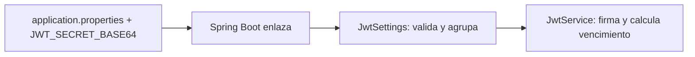
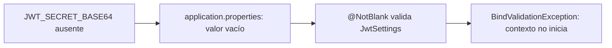
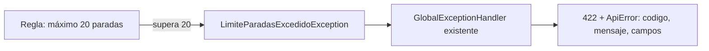

# Módulo 5: Configuración, perfiles y manejo de errores

Cada tema se practica por separado con su propia repetición progresiva y su propio reto de memoria, verificado con `ApplicationContextRunner` y `MockMvc` reales, para que "la aplicación falla al arranque" o "el formato de error es consistente" sean afirmaciones comprobables, no solo descritas.


**Referencia ejecutable al terminar los módulos 2–7:** en la raíz del repositorio, abre `examples/spring-tareas-rutaflow/README.md`. Incluye el estado final y pruebas; algunas clases incorporan cambios de módulos posteriores. Construye primero las prácticas de este módulo y usa la referencia para comparar y diagnosticar.

## Aprende construyendo

### Tema 1: @ConfigurationProperties tipado

**Meta:** agrupar la clave y el vencimiento de JWT que ya existen en el proyecto del Módulo 4, enlazarlos a un `record` validado y usarlos desde el mismo `JwtService`.

**¿Por qué es importante?** Ahora la clave se lee en un sitio y el vencimiento está escrito como número dentro de `JwtService`. Al agruparlos, es más fácil ver qué necesita JWT y detectar un valor mal formado al iniciar.



#### Subtema 4.16 · Agrupar la configuración JWT existente · 10 min

**Contexto:** continúa el proyecto `academia-spring` de Módulo 4. El secreto sigue llegando desde `JWT_SECRET_BASE64`; crea un tipo para reunirlo con los segundos de vencimiento.

**Hazlo tú:** verifica que `pom.xml` tenga `spring-boot-starter-validation`. Crea `src/main/java/com/example/demo/JwtSettings.java`:

```java
package com.example.demo;

import jakarta.validation.constraints.Min;
import jakarta.validation.constraints.NotBlank;
import org.springframework.boot.context.properties.ConfigurationProperties;
import org.springframework.validation.annotation.Validated;

@ConfigurationProperties("security.jwt")
@Validated
public record JwtSettings(
    @NotBlank String secretBase64,
    @Min(60) long expirationSeconds
) {}
```

En `src/main/java/com/example/demo/DemoApplication.java`, añade el escaneo para registrar el record:

```java
import org.springframework.boot.context.properties.ConfigurationPropertiesScan;

@SpringBootApplication
@ConfigurationPropertiesScan
public class DemoApplication { /* conserva aquí el main existente */ }
```

En `src/main/resources/application.properties`, deja la clave fuera del código y agrégale un vencimiento:

```properties
security.jwt.secret-base64=${JWT_SECRET_BASE64:}
security.jwt.expiration-seconds=900
```

El `:` deja el valor vacío si falta la variable; `@NotBlank` lo rechaza con un error de configuración legible, sin poner un secreto falso como valor por defecto. Actualiza también `src/test/resources/application.properties`: conserva la clave Base64 de prueba del Módulo 4 y añade `security.jwt.expiration-seconds=900`. Ese archivo de test sustituye el del entorno principal durante las pruebas; si falta la propiedad, `@Min(60)` hace fallar los contextos que construyen `JwtService`.

El nombre Java `secretBase64` corresponde a la propiedad `secret-base64`; ambas están bajo `security.jwt`.

**Resultado esperado:** el proyecto compila con Spring Boot `4.1.2` y JDK `25`. Spring Boot enlaza las propiedades al record al arrancar; la conversión y validación ocurren en ese momento, no en compilación.

**Fallo deliberado y diagnóstico:** cambia temporalmente `expiration-seconds=900` por `expiration-seconds=texto` en la prueba aislada del subtema siguiente. El contexto debe fallar al enlazar `long`; restaura `900`.

**Entiende:** el prefijo reúne propiedades relacionadas; cada componente del record recibe el valor correspondiente. `@ConfigurationPropertiesScan` busca estos tipos desde el paquete de la aplicación. Fuente: [Spring Boot 4.1.2 — ConfigurationPropertiesScan](https://docs.spring.io/spring-boot/api/java/org/springframework/boot/context/properties/ConfigurationPropertiesScan.html).

**Cierra:** identifica en el archivo de propiedades los dos valores y encuentra los campos que los reciben.

#### Subtema 4.17 · Probar enlace y límites con un contexto pequeño · 10 min

**Contexto:** no necesitas levantar web, base de datos ni filtros para revisar solo el enlace de configuración. `ApplicationContextRunner` crea un contexto mínimo con el tipo que quieres probar.

**Hazlo tú:** crea `src/test/java/com/example/demo/JwtSettingsTest.java`:

```java
package com.example.demo;

import org.junit.jupiter.api.Test;
import org.springframework.boot.context.properties.EnableConfigurationProperties;
import org.springframework.boot.test.context.runner.ApplicationContextRunner;
import org.springframework.context.annotation.Configuration;
import static org.assertj.core.api.Assertions.assertThat;

class JwtSettingsTest {
    private final ApplicationContextRunner runner = new ApplicationContextRunner()
        .withUserConfiguration(SettingsTestConfig.class);

    @Test
    void enlazaLaClaveYElVencimiento() {
        runner.withPropertyValues(
                "security.jwt.secret-base64=VVFRc3BzQVFzZXJ0T0xhbkt0ZUd4cHlsU21pSnhhOFM=",
                "security.jwt.expiration-seconds=900")
            .run(context -> {
                assertThat(context).hasNotFailed();
                JwtSettings settings = context.getBean(JwtSettings.class);
                assertThat(settings.secretBase64())
                    .isEqualTo("VVFRc3BzQVFzZXJ0T0xhbkt0ZUd4cHlsU21pSnhhOFM=");
                assertThat(settings.expirationSeconds()).isEqualTo(900);
            });
    }

    @Test
    void textoNoSePuedeEnlazarAUnLong() {
        runner.withPropertyValues(
                "security.jwt.secret-base64=test",
                "security.jwt.expiration-seconds=texto")
            .run(context -> assertThat(context).hasFailed());
    }

    @Test
    void vencimientoMenorAlMinimoEsRechazado() {
        runner.withPropertyValues(
                "security.jwt.secret-base64=test",
                "security.jwt.expiration-seconds=59")
            .run(context -> assertThat(context).hasFailed());
    }

    @Configuration(proxyBeanMethods = false)
    @EnableConfigurationProperties(JwtSettings.class)
    static class SettingsTestConfig {}
}
```

Ejecuta desde la raíz del proyecto:

```bash
./mvnw -q -Dtest=JwtSettingsTest test
```

**Resultado esperado:** pasan tres pruebas: los dos valores se enlazan, el texto no se convierte a `long`, y `59` no cumple `@Min(60)`. En los dos casos inválidos el contexto registra un fallo; el callback puede comprobarlo con `hasFailed()`.

**Fallo deliberado y diagnóstico:** quita temporalmente `@Validated` de `JwtSettings` y repite `JwtSettingsTest#vencimientoMenorAlMinimoEsRechazado`. Ese test falla porque `59` ahora se enlaza sin validación. Restaura la anotación.

**Entiende:** `@Min` y `@NotBlank` son restricciones aplicadas por Bean Validation al enlazar. Un tipo incorrecto es un error de conversión; un número debajo de `60` es un error de validación. Son fallos distintos y el test los separa.

**Cierra:** conserva la salida verde y explica cuál error viene de conversión y cuál de validación.

#### Subtema 4.18 · Inyectar el record en el JwtService · 10 min

**Contexto:** tener un record que nadie usa no centraliza la configuración del sistema. Cambia el constructor del servicio existente para que reciba ese tipo y usa su vencimiento al firmar.

**Hazlo tú:** en `src/main/java/com/example/demo/JwtService.java`, reemplaza la lectura con `@Value` por esta inyección:

```java
private final SecretKey key;
private final long expirationSeconds;

public JwtService(JwtSettings settings) {
    this.key = Keys.hmacShaKeyFor(Decoders.BASE64.decode(settings.secretBase64()));
    this.expirationSeconds = settings.expirationSeconds();
}
```

En el método `generar`, cambia el valor fijo `900` por la configuración:

```java
.expiration(Date.from(ahora.plusSeconds(expirationSeconds)))
```

Actualiza `src/test/java/com/example/demo/JwtServiceTest.java` para probar un vencimiento de 120 segundos:

```java
var service = new JwtService(new JwtSettings(CLAVE_DE_PRUEBA, 120));
var claims = service.validar(service.generar("ana-1", "ADMIN"));
assertEquals(120L, Duration.between(
    claims.getIssuedAt().toInstant(), claims.getExpiration().toInstant()).getSeconds());
```

Añade `import java.time.Duration;` y conserva las aserciones existentes de usuario y rol. Después ejecuta los tests relacionados y la suite:

```bash
./mvnw -q -Dtest=JwtSettingsTest,JwtServiceTest test
./mvnw -q clean test
```

**Resultado esperado:** los tests de firma siguen pasando y ahora `JwtService` obtiene tanto la clave como el tiempo de expiración del mismo objeto validado. Para ejecutar la aplicación, exporta una clave Base64 de 32 bytes fuera del repositorio: `export JWT_SECRET_BASE64="$(openssl rand -base64 32)"`.

**Fallo deliberado y diagnóstico:** cambia temporalmente `ahora.plusSeconds(expirationSeconds)` por `ahora.plusSeconds(900)` y ejecuta `./mvnw -q -Dtest=JwtServiceTest test`. La aserción esperaba `120` segundos y recibe `900`: el servicio volvió a ignorar la configuración. Restaura `expirationSeconds` y confirma el test verde.

**Entiende:** el record no guarda secretos ni crea una segunda clave; agrupa el valor que ya llegaba desde el entorno. Los records anidados se enlazan por estructura; `@NestedConfigurationProperty` es una pista para metadatos y no es necesaria para enlazar un objeto anidado en ejecución. Referencias: [Spring Boot — Type-safe Configuration Properties](https://docs.spring.io/spring-boot/reference/features/external-config.html#features.external-config.typesafe-configuration-properties), [API de ConfigurationPropertiesScan](https://docs.spring.io/spring-boot/api/java/org/springframework/boot/context/properties/ConfigurationPropertiesScan.html) y [API de NestedConfigurationProperty](https://docs.spring.io/spring-boot/api/java/org/springframework/boot/context/properties/NestedConfigurationProperty.html).

**Cierra:** deja en verde los tests y señala una clase que ahora recibe `JwtSettings` en vez de leer strings de configuración.

**Práctica independiente:** agrega `@Min(1) int refreshAfterMinutes` al record y `security.jwt.refresh-after-minutes=20` a los archivos principal y de test. Comprueba el valor con `ApplicationContextRunner`; cambia el test a `0`, confirma `hasFailed()` y restaura `20`.

**Proyecto integrador:** aplica este mismo tipo `JwtSettings` al backend de RutaFlow y conserva `JWT_SECRET_BASE64` como fuente externa. No crees otra propiedad para la misma clave ni otro `JwtService`.

---

### Tema 2: Fallar rápido al arranque

**Meta:** provocar y leer el fallo del contexto cuando falta el secreto JWT, y distinguirlo de un arranque correcto con una clave de prueba.

**¿Por qué es importante?** Si una app acepta una clave ausente o vacía, la falla puede aparecer después, al emitir o validar el primer token. Es más fácil corregirlo al arrancar, cuando Spring todavía puede señalar la propiedad.



#### Subtema 4.19 · Probar el valor obligatorio ausente · 10 min

**Contexto:** el subtema M5 T1 ya creó `JwtSettingsTest` con `ApplicationContextRunner` y `@EnableConfigurationProperties`. Reutiliza esa configuración de test y su clase `JwtSettings`; no crees `JwtConfig` ni un segundo prefijo.

**Hazlo tú:** en `src/test/java/com/example/demo/JwtSettingsTest.java`, agrega:

```java
@Test
void missingSecretHasValidationFailureAtStartup() {
    runner.withPropertyValues("security.jwt.expiration-seconds=900")
        .run(context -> {
            assertThat(context).hasFailed();
            assertThat(context.getStartupFailure())
                .hasRootCauseInstanceOf(BindValidationException.class);
        });
}
```

Añade el import:

```java
import org.springframework.boot.context.properties.bind.validation.BindValidationException;
```

La propiedad del vencimiento está presente; el secreto falta a propósito. Ejecuta el test:

```bash
./mvnw -q -Dtest=JwtSettingsTest#missingSecretHasValidationFailureAtStartup test
```

**Resultado esperado:** el test pasa porque Spring informa un contexto fallido y la causa raíz es `BindValidationException`, causada por `@NotBlank` sobre `secretBase64`.

**Fallo deliberado y diagnóstico:** reemplaza `hasFailed()` por `hasNotFailed()`. El test falla: el secreto ausente no debe permitir construir `JwtSettings`. Restaura `hasFailed()`.

**Entiende:** `ApplicationContextRunner` levanta un contexto pequeño y captura el fallo en `context`; no lanza la excepción fuera del callback. Por eso se inspecciona `getStartupFailure()`.

**Cierra:** conserva la aserción de causa raíz y explica en qué momento se rechaza el secreto.

#### Subtema 4.20 · Rechazar también un secreto vacío · 10 min

**Contexto:** una variable puede existir pero estar vacía. `@NotBlank` debe rechazar ambos casos: propiedad ausente y cadena vacía.

**Hazlo tú:** agrega esta prueba a `JwtSettingsTest.java`:

```java
@Test
void blankSecretIsRejectedAtStartup() {
    runner.withPropertyValues(
            "security.jwt.secret-base64=",
            "security.jwt.expiration-seconds=900")
        .run(context -> {
            assertThat(context).hasFailed();
            assertThat(context.getStartupFailure())
                .hasRootCauseInstanceOf(BindValidationException.class);
        });
}
```

Ejecuta ambos escenarios:

```bash
./mvnw -q -Dtest=JwtSettingsTest#missingSecretHasValidationFailureAtStartup+blankSecretIsRejectedAtStartup test
```

Para reproducir el entorno real sin secreto, desde la raíz del proyecto ejecuta:

```bash
env -u JWT_SECRET_BASE64 ./mvnw -q spring-boot:run
```

`src/main/resources/application.properties` usa `security.jwt.secret-base64=${JWT_SECRET_BASE64:}`: el sufijo `:` produce una cadena vacía si la variable no existe, y `@NotBlank` detiene el arranque con la propiedad señalada. No pongas un secreto de fallback en el archivo.

**Resultado esperado:** los tests pasan porque ambos contextos fallan con `BindValidationException`. El comando de la aplicación termina con error antes de atender HTTP y el log menciona `security.jwt`/`secretBase64` como propiedad inválida.

**Fallo deliberado y diagnóstico:** cambia `${JWT_SECRET_BASE64:}` por `${JWT_SECRET_BASE64}` y repite el comando con `env -u`. Comprueba el error real que reporta el entorno; restaura el `:` para que el tipo reciba vacío y Bean Validation dé el mensaje controlado.

**Entiende:** el test aislado demuestra el enlace y la validación. El comando ejecuta la app completa. Son comprobaciones relacionadas, pero no significan lo mismo.

**Cierra:** distingue en el log de arranque el nombre de propiedad del nombre de la clase que falló.

#### Subtema 4.21 · Quitar la validación y observar el riesgo · 10 min

**Contexto:** `@ConfigurationProperties` enlaza valores; `@Validated` hace que restricciones como `@NotBlank` y `@Min` se ejecuten durante ese enlace.

**Hazlo tú:** mantén también los tests existentes `vencimientoMenorAlMinimoEsRechazado` y `enlazaLaClaveYElVencimiento`. Ejecuta la clase completa:

```bash
./mvnw -q -Dtest=JwtSettingsTest test
```

Archivo concreto para esta comprobación: `src/main/java/com/example/demo/JwtSettings.java`.

**Resultado esperado:** los valores válidos arrancan; secreto ausente, vacío, texto que no cabe en `long` y vencimiento `59` fallan. Los callbacks comprueban `hasNotFailed()` o `hasFailed()` según el caso.

**Fallo deliberado y diagnóstico:** quita temporalmente `@Validated` de `JwtSettings` y repite `./mvnw -q -Dtest=JwtSettingsTest#missingSecretHasValidationFailureAtStartup+vencimientoMenorAlMinimoEsRechazado test`. Ambos tests fallan porque el contexto arranca sin aplicar las restricciones. Restaura `@Validated` y corre de nuevo la clase completa.

**Entiende:** una propiedad opcional puede tener un valor por defecto seguro; un secreto no debe tener una clave de fallback. La validación solo funciona si el tipo se registra con `@ConfigurationPropertiesScan` o `@EnableConfigurationProperties`.

**Cierra:** conserva la suite verde y la salida del proceso que falla sin `JWT_SECRET_BASE64`. Referencias: [Spring Boot — Type-safe Configuration Properties](https://docs.spring.io/spring-boot/reference/features/external-config.html#features.external-config.typesafe-configuration-properties), [API de BindValidationException](https://docs.spring.io/spring-boot/api/java/org/springframework/boot/context/properties/bind/validation/BindValidationException.html) y [Spring Boot — Testing auto-configuration](https://docs.spring.io/spring-boot/reference/testing/spring-boot-applications.html#testing.spring-boot-applications.testing-auto-configuration).

**Cuándo no exigirlo:** un valor opcional, como el tamaño de página, puede tener un valor predeterminado seguro. Reserva el fallo de arranque para entradas necesarias donde no hay un default válido, como la clave JWT.

**Práctica independiente:** repite los dos casos con `security.jwt.expiration-seconds=59` y con la propiedad ausente. En cada caso anota la propiedad indicada por el error y restaura `900`.

**Proyecto integrador:** conserva la validación en el backend RutaFlow y entrega configuración secreta desde el entorno del despliegue. La app no debe iniciar si la variable obligatoria está vacía.

---

### Tema 3: Manejo global de excepciones consistente entre entornos

**Meta:** añadir una regla de negocio al `GlobalExceptionHandler` del Módulo 2 y comprobar que reutiliza el `ApiError` que ya conoce el cliente.

**¿Por qué es importante?** Si un endpoint nuevo devuelve un JSON distinto para errores, el consumidor debe aprender otra forma de leerlos. Extender el manejador existente conserva los campos `codigo`, `mensaje` y `campos` para todos.



#### Subtema 4.22 · Lanzar una excepción del dominio · 10 min

**Contexto:** continúa `academia-spring`, paquete `com.example.demo`. La cadena JWT exige bearer en `/api/**`; los tests enviarán un token real de la `JwtService` del Módulo 4.

**Hazlo tú:** crea `src/main/java/com/example/demo/LimiteParadasExcedidoException.java`:

```java
package com.example.demo;

public class LimiteParadasExcedidoException extends RuntimeException {
    public LimiteParadasExcedidoException(int limite) {
        super("El límite de " + limite + " paradas por ruta fue excedido.");
    }
}
```

Crea `src/main/java/com/example/demo/RutasEntregaController.java`:

```java
package com.example.demo;

import java.util.Map;
import org.springframework.web.bind.annotation.PostMapping;
import org.springframework.web.bind.annotation.RequestParam;
import org.springframework.web.bind.annotation.RestController;

@RestController
public class RutasEntregaController {
    private static final int LIMITE_PARADAS = 20;

    @PostMapping("/api/rutas")
    public Map<String, Object> crear(@RequestParam int numeroDeParadas) {
        if (numeroDeParadas > LIMITE_PARADAS) {
            throw new LimiteParadasExcedidoException(LIMITE_PARADAS);
        }
        return Map.of("estado", "creada", "paradas", numeroDeParadas);
    }
}
```

**Resultado esperado:** 10 y 20 paradas siguen el camino de éxito; 21 lanza la excepción de negocio. El controller no construye JSON de error.

**Fallo deliberado y diagnóstico:** cambia `>` por `>=`. La prueba de límite exacto que agregarás en 4.24 recibirá error para 20; vuelve a `>` porque el límite máximo sí está permitido.

**Entiende:** la excepción describe una regla del dominio. El controller la lanza; el manejador compartido decide el estado y el cuerpo HTTP.

**Cierra:** localiza la condición y el `throw`; el controller no conoce el formato `ApiError`.

#### Subtema 4.23 · Extender el manejador sin cambiar el formato · 10 min

**Contexto:** en Módulo 2 `GlobalExceptionHandler` ya convierte validaciones y tareas inexistentes en `ApiError(codigo, mensaje, campos)`. Añade un método a esa misma clase.

**Hazlo tú:** en `src/main/java/com/example/demo/GlobalExceptionHandler.java`, agrega:

```java
@ExceptionHandler(LimiteParadasExcedidoException.class)
public ResponseEntity<ApiError> manejarLimiteParadas(LimiteParadasExcedidoException ex) {
    ApiError cuerpo = new ApiError("LIMITE_PARADAS", ex.getMessage(), Map.of());
    return ResponseEntity.unprocessableEntity().body(cuerpo);
}
```

`Map` y `ResponseEntity` ya se importaron en Módulo 2. Si no, añádelos junto con `ExceptionHandler` y no crees otro `@RestControllerAdvice`.

Crea `src/test/java/com/example/demo/RutasEntregaControllerTest.java`. Para estos endpoints protegidos, obtén un bearer con el servicio real:

```java
package com.example.demo;

import org.junit.jupiter.api.Test;
import org.springframework.beans.factory.annotation.Autowired;
import org.springframework.boot.test.context.SpringBootTest;
import org.springframework.boot.webmvc.test.autoconfigure.AutoConfigureMockMvc;
import org.springframework.http.MediaType;
import org.springframework.test.web.servlet.MockMvc;
import static org.springframework.test.web.servlet.request.MockMvcRequestBuilders.post;
import static org.springframework.test.web.servlet.result.MockMvcResultMatchers.content;
import static org.springframework.test.web.servlet.result.MockMvcResultMatchers.jsonPath;
import static org.springframework.test.web.servlet.result.MockMvcResultMatchers.status;

@SpringBootTest
@AutoConfigureMockMvc
class RutasEntregaControllerTest {
    @Autowired MockMvc mockMvc;
    @Autowired JwtService jwtService;

    private String bearer() {
        return "Bearer " + jwtService.generar("ana-1", "ADMIN");
    }

    @Test
    void sobreElLimiteDevuelveElApiErrorCompartido() throws Exception {
        mockMvc.perform(post("/api/rutas").param("numeroDeParadas", "21")
                .header("Authorization", bearer()))
            .andExpect(status().isUnprocessableEntity())
            .andExpect(content().contentTypeCompatibleWith(MediaType.APPLICATION_JSON))
            .andExpect(jsonPath("$.codigo").value("LIMITE_PARADAS"))
            .andExpect(jsonPath("$.mensaje")
                .value("El límite de 20 paradas por ruta fue excedido."))
            .andExpect(jsonPath("$.campos").isEmpty());
    }
}
```

**Resultado esperado:** la respuesta es `422` y tiene los mismos tres campos JSON del `ApiError` usado por los errores de Módulo 2. Su `Content-Type` es compatible con `application/json`; aquí no se usa `ProblemDetail` ni `application/problem+json`.

**Fallo deliberado y diagnóstico:** cambia `ResponseEntity.unprocessableEntity()` por `ResponseEntity.badRequest()`. El test recibe `400` en vez de `422`; restaura el estado que corresponde a la regla de negocio.

**Entiende:** status describe el resultado HTTP; `ApiError` mantiene el cuerpo estable. Si el proyecto decide migrar a RFC 9457 `ProblemDetail`, cambia todos los handlers como una decisión de contrato, no solo este.

**Cierra:** compara `codigo`, `mensaje` y `campos` con el record `ApiError`.

#### Subtema 4.24 · Comprobar el borde del límite con MockMvc · 10 min

**Contexto:** una condición `>` permite exactamente 20; `>=` la rechaza. Una prueba en el borde evita que una edición cambie esa regla sin que el equipo lo note.

**Hazlo tú:** agrega al mismo `RutasEntregaControllerTest.java`:

```java
@Test
void elLimiteExactoDeVeinteParadasEsAceptado() throws Exception {
    mockMvc.perform(post("/api/rutas").param("numeroDeParadas", "20")
            .header("Authorization", bearer()))
        .andExpect(status().isOk())
        .andExpect(jsonPath("$.estado").value("creada"))
        .andExpect(jsonPath("$.paradas").value(20));
}
```

Ejecuta desde la raíz:

```bash
./mvnw -q -Dtest=RutasEntregaControllerTest test
./mvnw -q clean test
```

**Resultado esperado:** 20 recibe `200`; 21 recibe `422` con `ApiError`; ambos usan un bearer válido del contexto de prueba.

**Fallo deliberado y diagnóstico:** cambia `>` por `>=` en `RutasEntregaController` y ejecuta `./mvnw -q -Dtest=RutasEntregaControllerTest#elLimiteExactoDeVeinteParadasEsAceptado test`. El test falla porque recibe `422`; restaura `>` y confirma los dos casos.

**Entiende:** el test comprueba el contrato HTTP completo en un contexto Spring real: seguridad, controller, handler y JSON. No prueba todos los perfiles de despliegue.

**Cierra:** conserva la suite verde y la prueba del valor exacto. Referencias: [Spring MVC — REST Exceptions](https://docs.spring.io/spring-framework/reference/web/webmvc/mvc-ann-rest-exceptions.html) y [Spring Boot — Testing Applications](https://docs.spring.io/spring-boot/reference/testing/spring-boot-applications.html).

**Práctica independiente:** agrega otra excepción de negocio al `GlobalExceptionHandler` y confirma que el status cambia pero el JSON conserva `codigo`, `mensaje` y `campos`.

**Proyecto integrador:** usa un handler central para el backend RutaFlow; conserva `ApiError` en todos sus fallos hasta que una migración coordinada defina un nuevo contrato.

---

## Laboratorio práctico

**Objetivo del laboratorio:** configurar propiedades tipadas y validadas al arranque, sin valores hardcodeados.

**Requisitos previos:** Módulos 0-4 completados.

| Paso | Acción | Código | Explicación |
|---|---|---|---|
| 1 | Crear una clase `@ConfigurationProperties` | Ver Tema 1 | Con valores tipados desde `application.yml` |
| 2 | Agregar `@Validated` | Ver Tema 2 | Falla al arranque si falta un valor obligatorio |
| 3 | Provocar la falla intencionalmente | Ver Tema 2 | Confirmado con `ApplicationContextRunner` real |
| 4 | Centralizar una excepción de negocio adicional | Ver Tema 3 | Mismo esquema `ApiError`: `codigo`, `mensaje`, `campos` |

**Verificación:** confirma el fallo de arranque ante una clave JWT vacía con `BindValidationException`, y comprueba que una infracción de negocio devuelve `422` con el esquema `ApiError` que ya usa el backend. El test cubre un contexto de prueba; no certifica todas las configuraciones del despliegue.

**Errores comunes y soluciones**

- **Usar `@Value` disperso en vez de `@ConfigurationProperties` agrupado.** Agrupa configuración relacionada en un único tipo tipado.
- **Omitir `@Validated` en la clase de configuración.** Sin ella, un valor faltante puede pasar desapercibido hasta usarse en producción.
- **Crear un nuevo `@ControllerAdvice` separado para cada nueva excepción.** Extiende el mismo `@ControllerAdvice` centralizado existente.

---
