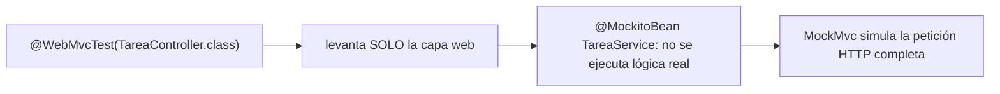
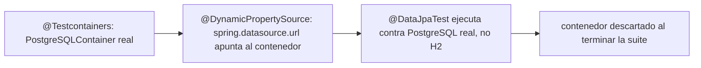

# Módulo 6: Testing en Spring Boot

Cada tema declara su nivel, su duración y una verificación reproducible. Los tres niveles de la pirámide se comprueban con `mvn test` real, para que "un slice es más rápido que el contexto completo" sea una afirmación medida, no solo descrita.

## Aprende construyendo

### Tema 1: Slices de testing — @WebMvcTest · Intermedio · 35 min

**Prerrequisito:** `@RestController` y `ResponseEntity` (Módulo 2); DTOs vs entities (Módulo 2).

**Al terminar podrás:** probar la capa web de un controller con `@WebMvcTest`, mockeando el servicio inyectado, y explicar por qué este slice arranca más rápido que el contexto completo de la aplicación.

#### Aprende

**¿Por qué es importante?** Una API de entregas necesita detectar rápido si el problema está en el controller (mapeo de rutas, serialización JSON, validación) sin necesitar que la base de datos real ni el servicio de negocio completo estén disponibles para esa prueba específica.

**Mapa de subtemas críticos**

| Subtema | Papel | Evidencia |
|---|---|---|
| `@WebMvcTest(TareaController.class)` | Núcleo | Levanta solo la capa web y arranca en una fracción del tiempo de `@SpringBootTest` |
| `@MockitoBean TareaService servicio` | Núcleo | Reemplaza el servicio real; sin él aparece `NoSuchBeanDefinitionException` |
| Inyección por constructor del controller | Prerrequisito | `TareaController(TareaService servicio)` recibe la dependencia a mockear |
| `MockMvc` y `post(...)` | Variante | `mockMvc.perform(post("/api/tareas"))` simula la petición HTTP completa |
| `NoSuchBeanDefinitionException` al quitar `@MockitoBean` | Diagnóstico | El fallo deliberado confirma que el slice no escanea `@Service` |
| Aserciones de código y cuerpo | Núcleo | `status().isCreated()` y `content().string("tarea-123")` |
| Slice vs contexto completo | Decisión | Para probar las tres capas juntas se necesita `@SpringBootTest` (Tema 3) |
| Serialización JSON del cuerpo | Error frecuente | El cuerpo `"\"Comprar leche\""` debe ir con `Content-Type` JSON |

Cada fila tiene su explicación individual a continuación.

**`@WebMvcTest(TareaController.class)` (Núcleo).** Esta anotación carga únicamente el contexto necesario para la capa web: el controller, sus filtros y la infraestructura de serialización JSON, dejando fuera persistencia y configuración real. Por eso el "slice" arranca considerablemente más rápido que el contexto completo, un factor que importa cuando la suite crece a cientos de pruebas. Su límite es que no verifica la coordinación real entre capas.

**`@MockitoBean TareaService servicio` (Núcleo).** El slice no instancia el `@Service` real, así que el controller necesita un sustituto para su dependencia; `@MockitoBean` provee ese doble y permite programar su comportamiento con `when(servicio.crear("Comprar leche")).thenReturn("tarea-123")`. Gracias a ese reemplazo, la implementación real (que lanza `UnsupportedOperationException`) nunca se ejecuta. Omitir la anotación rompe el arranque del contexto.

**Inyección por constructor del controller (Prerrequisito).** `TareaController` recibe `TareaService` por su constructor, lo que hace que la dependencia sea explícita y fácil de sustituir en pruebas. Sin esta forma de inyección, el slice no tendría un punto limpio donde insertar el mock. Es el fundamento del Módulo 2 que habilita el patrón de este tema.

**`MockMvc` y `post(...)` (Variante).** `mockMvc.perform(post("/api/tareas"))` ejercita el controller como si llegara una petición HTTP real, pasando por el mapeo de ruta y la deserialización, pero sin abrir un puerto de red. Es una variante de ejecución más ligera que un servidor embebido. Permite afirmar sobre la respuesta completa dentro del mismo proceso de test.

**`NoSuchBeanDefinitionException` al quitar `@MockitoBean` (Diagnóstico).** El fallo deliberado consiste en borrar la anotación y volver a correr el test: Spring no puede resolver `TareaService` dentro del contexto parcial, porque `@WebMvcTest` no escanea `@Service` por diseño. El error observable confirma que `@MockitoBean` no es una conveniencia sino el mecanismo que satisface las dependencias del controller en el slice. Revertir el cambio restaura la prueba en verde.

**Aserciones de código y cuerpo (Núcleo).** El test comprueba tanto el código de estado con `status().isCreated()` como el cuerpo con `content().string("tarea-123")`, cubriendo el contrato HTTP completo del endpoint. Verificar solo el código dejaría pasar errores de serialización o de tipo de retorno. La combinación de ambas aserciones es lo que hace confiable al slice.

**Slice vs contexto completo (Decisión).** Un slice de solo la capa web es insuficiente para verificar que controller, servicio, repositorio y base de datos funcionan juntos de principio a fin. Esa garantía es el propósito de `@SpringBootTest` (Tema 3), más lento pero completo. La decisión profesional es usar slices para rapidez y reservar el contexto total para los pocos flujos críticos.

**Serialización JSON del cuerpo (Error frecuente).** El cuerpo de la petición se envía como `"\"Comprar leche\""` con `contentType(MediaType.APPLICATION_JSON)`, porque el controller recibe un `String` JSON. Un error típico es que el cuerpo no coincida por un problema de serialización o de tipo de retorno del controller; cuando el código es correcto pero el cuerpo falla, ahí hay que mirar. El `Content-Type` adecuado es parte del contrato que se prueba.

**Conceptos clave:** contexto parcial, más rápido que el contexto completo.

`@WebMvcTest(TareaController.class)` levanta únicamente el contexto necesario para probar la capa web (el controller, sus filtros, la infraestructura de serialización JSON), mockeando automáticamente cualquier otra capa (`@MockitoBean TareaService servicio`), en vez de levantar la aplicación completa con persistencia y configuración real. Esta carga parcial ("slice", en la terminología de Spring Boot Test) arranca considerablemente más rápido que el contexto completo, un factor relevante cuando la suite crece a cientos de pruebas.

**Analogía:** `@WebMvcTest` es poner a prueba únicamente la recepción de un edificio, verificando que recibe correctamente a los visitantes y los dirige apropiadamente, sin necesidad de que el resto del edificio esté operativo, usando actores de reparto (mocks) en lugar del personal real de esos departamentos.

**Diagrama:**



#### Practica

**Demo paso a paso.** Desde una carpeta vacía (o continuando en `academia-spring`, o créala con `mkdir -p academia-spring` si es tu primera vez), genera el proyecto con Spring Initializr real (`web`) y crea el controller junto con su test de slice en `src/main/java` y `src/test/java`:

```bash
mkdir -p academia-spring/src/main/java/com/academia/tarea
cd academia-spring
curl -fsSL https://start.spring.io/starter.zip -d dependencies=web -d javaVersion=25 -d artifactId=academia-testing -o app.zip
unzip -o app.zip
```

```java
// src/main/java/com/academia/tarea/TareaController.java
package com.academia.tarea;

import org.springframework.http.HttpStatus;
import org.springframework.http.ResponseEntity;
import org.springframework.web.bind.annotation.*;

@RestController
@RequestMapping("/api/tareas")
public class TareaController {
    private final TareaService servicio;

    public TareaController(TareaService servicio) { this.servicio = servicio; }

    @PostMapping
    public ResponseEntity<String> crear(@RequestBody String titulo) {
        String id = servicio.crear(titulo);
        return ResponseEntity.status(HttpStatus.CREATED).body(id);
    }
}
```

```java
// src/main/java/com/academia/tarea/TareaService.java
package com.academia.tarea;

import org.springframework.stereotype.Service;

@Service
public class TareaService {
    public String crear(String titulo) {
        // en la app real, guardaría en la base de datos; el test de slice mockea esto por completo
        throw new UnsupportedOperationException("no implementado aún en este tema");
    }
}
```

**Explicación línea por línea:** `TareaController` depende de `TareaService` por inyección de constructor; en producción, `TareaService.crear` guardaría en la base de datos, pero el test de slice de este Tema jamás ejecuta esa implementación real, porque la reemplaza completamente con un mock.

Escribe el test de slice real que mockea `TareaService` y verifica únicamente el comportamiento de la capa web:

```java
// src/test/java/com/academia/tarea/TareaControllerTest.java
package com.academia.tarea;

import org.junit.jupiter.api.Test;
import org.springframework.beans.factory.annotation.Autowired;
import org.springframework.boot.test.autoconfigure.web.servlet.WebMvcTest;
import org.springframework.test.context.bean.override.mockito.MockitoBean;
import org.springframework.http.MediaType;
import org.springframework.test.web.servlet.MockMvc;

import static org.mockito.Mockito.when;
import static org.springframework.test.web.servlet.request.MockMvcRequestBuilders.post;
import static org.springframework.test.web.servlet.result.MockMvcResultMatchers.*;

@WebMvcTest(TareaController.class) // solo levanta la capa web, mockea el resto
class TareaControllerTest {

    @Autowired
    private MockMvc mockMvc;
    @MockitoBean
    private TareaService servicio;

    @Test
    void creaUnaTareaYDevuelve201() throws Exception {
        when(servicio.crear("Comprar leche")).thenReturn("tarea-123");

        mockMvc.perform(post("/api/tareas")
                .contentType(MediaType.APPLICATION_JSON)
                .content("\"Comprar leche\""))
            .andExpect(status().isCreated())
            .andExpect(content().string("tarea-123"));
    }
}
```

```bash
mvn test -Dtest=TareaControllerTest # Maven
./gradlew test --tests TareaControllerTest # Gradle (equivalente)
```

**Resultado esperado:** `BUILD SUCCESS` con el test en verde en una fracción del tiempo que tomaría un `@SpringBootTest` completo (arranca solo el controller y su infraestructura web), confirmando `201 Created` y el cuerpo esperado — sin que `TareaService.crear` real (que lanzaría `UnsupportedOperationException`) llegue a ejecutarse nunca, porque `@MockitoBean` la reemplazó completamente.

**Fallo deliberado:** elimina la anotación `@MockitoBean` de `servicio` (dejando el campo sin anotar) y ejecuta de nuevo `mvn test -Dtest=TareaControllerTest`. El test FALLA porque Spring no puede resolver la dependencia `TareaService` dentro del contexto parcial de `@WebMvcTest` (que no escanea `@Service` por diseño): `NoSuchBeanDefinitionException` — diagnostica confirmando que `@MockitoBean` no es solo una conveniencia, sino el mecanismo específico que hace posible que un slice de solo la capa web pueda satisfacer las dependencias del controller sin levantar la aplicación completa. Revierte el cambio antes de continuar.

**Ejercicios.**

1. Agrega un segundo test que confirme un `400 Bad Request` cuando el cuerpo de la petición está vacío, usando `when(servicio.crear("")).thenThrow(new IllegalArgumentException())` junto con un `@ExceptionHandler` que lo mapee.
2. Mide el tiempo real de ejecución de `TareaControllerTest` (`mvn test -Dtest=TareaControllerTest` reporta el tiempo) y compáralo mentalmente con lo que esperarías de un `@SpringBootTest` completo (Tema 3).
3. Agrega un segundo endpoint al controller y su test de slice correspondiente, confirmando que ambos tests siguen ejecutándose sin necesitar base de datos ni configuración adicional.
4. Escribe de memoria (sin mirar) un `@WebMvcTest` con `@MockitoBean` para un servicio, y un test que confirme un código de estado usando `when(...).thenReturn(...)`.

**Pista:** si un test de `@WebMvcTest` falla con `NoSuchBeanDefinitionException`, la causa casi siempre es una dependencia del controller que no está mockeada con `@MockitoBean`.

**Completa el código:** rellena el espacio para levantar únicamente el contexto de la capa web:

```java
@____(TareaController.class)
class TareaControllerTest {
    @Autowired MockMvc mockMvc;
    @MockitoBean TareaService servicio;
}
```

**Reto de memoria:** cierra este documento y escribe, solo de memoria, un test `@WebMvcTest` con un servicio mockeado y una aserción sobre el código de estado HTTP. Compara después contra el patrón del Paso 4.

#### Aplica

**Reto abierto.** Especifica y prueba el contrato HTTP completo de un controller real: códigos de éxito, validación fallida, recurso ausente y error de negocio. Mide el tiempo de la suite de slice y compáralo con el mismo contrato probado mediante `@SpringBootTest`; documenta la diferencia y qué garantiza cada nivel.

**Checklist de salida.**

- [ ] El slice prueba éxito, validación, ausencia y error de negocio.
- [ ] Cada dependencia del controller está mockeada explícitamente.
- [ ] Las aserciones cubren código, `Content-Type` y cuerpo.
- [ ] El tiempo del slice se midió y se comparó con el contexto completo.
- [ ] Ningún test de slice toca base de datos ni red.

**Si falla.** Si aparece `NoSuchBeanDefinitionException`, falta un `@MockitoBean`; si el código es correcto pero el cuerpo no coincide, revisa la serialización y el tipo de retorno del controller.

**Siguiente paso:** el Tema 2 aborda cómo probar la capa de persistencia contra una base de datos real, no aproximada.

**Errores comunes:** cargar el contexto completo (`@SpringBootTest`) para probar lógica que un slice más rápido cubriría igual de bien; olvidar `@MockitoBean` para una dependencia del controller, causando `NoSuchBeanDefinitionException`.

**Límites y decisión de uso:** para verificar que múltiples capas reales (controller, servicio, repositorio, base de datos) funcionan correctamente juntas de principio a fin, un slice de solo la capa web no es suficiente; ese es el propósito de `@SpringBootTest` (Tema 3).

**Fuente oficial:** [Spring Boot — Testing the Web Layer](https://docs.spring.io/spring-boot/reference/testing/spring-boot-applications.html#testing.spring-boot-applications.spring-mvc-tests).

**Transferencia al proyecto integrador:** los slices de testing con `@WebMvcTest` son los que probarán la capa web del proyecto integrador de este track (microservicio productivo, Módulo 12).

### Tema 2: @DataJpaTest con Testcontainers · Avanzado · 50 min

**Prerrequisito:** Tema 1 de este módulo; entidades y repositorios (Módulo 3).

**Al terminar podrás:** probar un repositorio contra una base de datos PostgreSQL real y desechable con Testcontainers, y explicar por qué es preferible a H2 en memoria para fidelidad de comportamiento.

#### Aprende

**¿Por qué es importante?** H2 puede comportarse de forma sutilmente distinta a PostgreSQL en aspectos específicos del dialecto SQL o tipos de datos particulares, produciendo pruebas que pasan contra H2 pero fallarían contra la base de datos real usada en producción.

**Mapa de subtemas críticos**

| Subtema | Papel | Evidencia |
|---|---|---|
| `@DataJpaTest` | Prerrequisito | Slice de persistencia que inyecta `TareaRepository` para probar el repositorio |
| `@Container static PostgreSQLContainer<?>` | Núcleo | Declara `new PostgreSQLContainer<>("postgres:16")` gestionado por Testcontainers |
| `@DynamicPropertySource` | Núcleo | `registry.add("spring.datasource.url", postgres::getJdbcUrl)` apunta Spring al contenedor |
| Campo `static` del contenedor | Error frecuente | La pista exige `static` para compartir el contenedor entre tests de la clase |
| `gen_random_uuid()` falla en H2 | Diagnóstico | El fallo deliberado muestra la función de PostgreSQL que H2 no reproduce |
| Cambio de imagen `postgres:16` → `postgres:15` | Variante | El ejercicio prueba el mismo test contra otra versión real |
| Requisito de Docker activo | Límite | El comando indica que requiere Docker corriendo localmente |
| H2 vs Testcontainers | Decisión | Para queries triviales H2 sigue siendo aceptable por su velocidad |

Cada fila tiene su explicación individual a continuación.

**`@DataJpaTest` (Prerrequisito).** Este slice configura solo la capa de persistencia JPA y permite inyectar el repositorio bajo prueba con `@Autowired TareaRepository tareaRepository`. Es el fundamento sobre el que se monta Testcontainers en este tema, basado en entidades y repositorios del Módulo 3. Sin él, no habría un contexto de persistencia acotado donde ejecutar el test.

**`@Container static PostgreSQLContainer<?>` (Núcleo).** La anotación `@Container` declara un contenedor Docker real de PostgreSQL que Testcontainers arranca antes de la suite y descarta al terminar. La imagen `postgres:16` fija el motor exacto a probar, idéntico al de producción. Este contenedor efímero es lo que elimina la discrepancia de comportamiento frente a una base simulada.

**`@DynamicPropertySource` (Núcleo).** Este método inyecta la URL, el usuario y la contraseña reales del contenedor recién levantado (asignados dinámicamente por Docker) en las propiedades de Spring antes de que el contexto arranque, con `registry.add("spring.datasource.url", postgres::getJdbcUrl)` y sus equivalentes. Debe ejecutarse antes del contexto; si existe una URL fija en `application.properties`, la conexión podría usar H2 por error. Es el puente entre el contenedor y la configuración de Spring.

**Campo `static` del contenedor (Error frecuente).** La pista del tema subraya que `@Container` debe ser `static` para que un único contenedor se comparta entre todos los tests de la clase. Si no se declara `static`, Testcontainers levanta un contenedor nuevo por cada método, incrementando innecesariamente el tiempo total de la suite. Es un error común que degrada el rendimiento sin cambiar el resultado.

**`gen_random_uuid()` falla en H2 (Diagnóstico).** El fallo deliberado fuerza una query nativa `SELECT gen_random_uuid()`, una función propia de PostgreSQL: contra H2 falla con un error de función desconocida, mientras que contra el contenedor real funciona. Ese contraste observable confirma exactamente el riesgo que Testcontainers elimina, un detalle del dialecto que H2 no reproduce. Diagnosticarlo justifica el costo del contenedor.

**Cambio de imagen `postgres:16` → `postgres:15` (Variante).** El ejercicio propone cambiar la versión de la imagen y comprobar que el mismo test sigue pasando, lo que ilustra que Testcontainers facilita probar contra distintas versiones reales del motor. Es una variante de bajo costo que da cobertura sobre compatibilidad de versiones. Permite anticipar regresiones al actualizar la base de datos.

**Requisito de Docker activo (Límite).** El comando del tema advierte que la prueba requiere Docker corriendo localmente, porque Testcontainers lo usa para levantar el contenedor real. Si Docker no está activo o el puerto está bloqueado, el contenedor no arranca. Es un límite de entorno que distingue a esta suite de los slices que no dependen de infraestructura externa.

**H2 vs Testcontainers (Decisión).** Para lógica de repositorio genuinamente independiente del motor (queries triviales sin funciones propietarias), H2 en memoria puede seguir siendo aceptable por su velocidad. La decisión profesional es reservar Testcontainers para cuando la fidelidad al motor real importa, asumiendo su mayor tiempo de arranque. Elegir mal el nivel cuesta velocidad o fidelidad.

**Conceptos clave:** base de datos real desechable, comportamiento fiel frente a H2 en memoria.

```java
@DataJpaTest
@Testcontainers
class TareaRepositoryTest {
    @Container
    static PostgreSQLContainer<?> postgres = new PostgreSQLContainer<>("postgres:16");

    @DynamicPropertySource
    static void propiedades(DynamicPropertyRegistry registry) {
        registry.add("spring.datasource.url", postgres::getJdbcUrl);
    }
}
```

Esta prueba levanta un contenedor Docker real de PostgreSQL específicamente para la suite, configurando dinámicamente la URL de conexión hacia ese contenedor efímero, descartado al finalizar. Esto elimina la discrepancia de comportamiento que H2 podría introducir, a costa de un tiempo de arranque algo mayor.

**Analogía:** usar H2 para probar código diseñado para PostgreSQL es ensayar una obra de teatro en un escenario con dimensiones y acústica distintas a las del teatro real; Testcontainers es ensayar directamente en una réplica exacta y desechable del teatro real.

**Diagrama:**



#### Practica

**Demo paso a paso.** Reutiliza `academia-spring` (o créalo desde una carpeta vacía con `mkdir -p academia-spring` si es tu primera vez), agrega las dependencias reales `org.testcontainers:postgresql` y `org.testcontainers:junit-jupiter`, y crea el test de repositorio en `src/test/java/com/academia/tarea/`:

```bash
mkdir -p academia-spring/src/test/java/com/academia/tarea
cd academia-spring
```

```java
// src/main/java/com/academia/tarea/Tarea.java
package com.academia.tarea;

import jakarta.persistence.Entity;
import jakarta.persistence.GeneratedValue;
import jakarta.persistence.Id;

@Entity
public class Tarea {
    @Id @GeneratedValue
    private Long id;
    private String titulo;

    protected Tarea() {}
    public Tarea(String titulo) { this.titulo = titulo; }
    public Long getId() { return id; }
    public String getTitulo() { return titulo; }
}
```

```java
// src/test/java/com/academia/tarea/TareaRepositoryTestcontainersTest.java
package com.academia.tarea;

import org.junit.jupiter.api.Test;
import org.springframework.beans.factory.annotation.Autowired;
import org.springframework.boot.test.autoconfigure.orm.jpa.DataJpaTest;
import org.springframework.test.context.DynamicPropertyRegistry;
import org.springframework.test.context.DynamicPropertySource;
import org.testcontainers.containers.PostgreSQLContainer;
import org.testcontainers.junit.jupiter.Container;
import org.testcontainers.junit.jupiter.Testcontainers;

import static org.assertj.core.api.Assertions.assertThat;

@DataJpaTest
@Testcontainers
class TareaRepositoryTestcontainersTest {

    @Container
    static PostgreSQLContainer<?> postgres = new PostgreSQLContainer<>("postgres:16");

    @DynamicPropertySource
    static void propiedades(DynamicPropertyRegistry registry) {
        registry.add("spring.datasource.url", postgres::getJdbcUrl);
        registry.add("spring.datasource.username", postgres::getUsername);
        registry.add("spring.datasource.password", postgres::getPassword);
    }

    @Autowired
    private TareaRepository tareaRepository;

    @Test
    void guardaYLeeUnaTareaContraPostgreSQLReal() {
        Tarea guardada = tareaRepository.save(new Tarea("Comprar leche"));

        Tarea leida = tareaRepository.findById(guardada.getId()).orElseThrow();

        assertThat(leida.getTitulo()).isEqualTo("Comprar leche");
    }
}
```

**Explicación línea por línea:** `@Container static PostgreSQLContainer<?> postgres` declara el contenedor real, gestionado automáticamente por Testcontainers (arranca antes de la suite, se descarta después); `@DynamicPropertySource` inyecta la URL, usuario y contraseña REALES del contenedor recién levantado (asignados dinámicamente por Docker) en las propiedades de Spring antes de que el contexto de la aplicación arranque; el test en sí (`guardaYLeeUnaTareaContraPostgreSQLReal`) es idéntico a como se vería contra cualquier otra base de datos, pero ahora ejecuta contra PostgreSQL genuino.

```bash
# requiere Docker corriendo localmente; Testcontainers lo usa para levantar el contenedor real
mvn test -Dtest=TareaRepositoryTestcontainersTest # Maven
./gradlew test --tests TareaRepositoryTestcontainersTest # Gradle (equivalente)
```

**Resultado esperado:** `BUILD SUCCESS` con el test en verde, confirmando que Testcontainers levantó un contenedor PostgreSQL real, Spring se conectó a él dinámicamente, y la fila guardada se lee correctamente — el mismo motor de base de datos que correría en producción, no una aproximación.

**Fallo deliberado:** agrega a `Tarea` un campo `private java.util.UUID identificadorExterno;` sin ninguna conversión, y fuerza una query nativa que use una función específica de PostgreSQL no soportada por H2 (`@Query(value = "SELECT gen_random_uuid()", nativeQuery = true)`). Ejecuta el mismo test contra H2 en memoria (cambiando temporalmente la dependencia a H2 sin Testcontainers) y compara: la función `gen_random_uuid()` falla contra H2 con un error de función desconocida, mientras que contra el contenedor PostgreSQL real de este Tema funciona correctamente — diagnostica confirmando exactamente el riesgo que Testcontainers elimina: una función específica del dialecto SQL real que H2 no reproduce fielmente. Revierte los cambios de prueba antes de continuar.

**Ejercicios.**

1. Agrega un segundo test en la misma clase que confirme un método derivado (`findByTituloContaining`) contra el mismo contenedor PostgreSQL, reutilizando el contenedor ya levantado (el campo `static` lo comparte entre tests de la misma clase).
2. Cambia la versión de la imagen (`postgres:16` a `postgres:15`) y confirma que el mismo test sigue pasando, ilustrando que Testcontainers facilita probar contra distintas versiones reales.
3. Agrega `@Sql("/datos-iniciales.sql")` para poblar datos antes del test y confirma que el repositorio los lee correctamente desde el contenedor real.
4. Escribe de memoria (sin mirar) un `@DataJpaTest @Testcontainers` con `@Container` y `@DynamicPropertySource`, y un test que confirme guardar y leer una entidad. Compara después contra el patrón del Paso 4.

**Pista:** el campo `@Container` debe ser `static` para que Testcontainers lo comparta entre todos los tests de la misma clase, evitando levantar un contenedor nuevo por cada método de test individual.

**Completa el código:** rellena el espacio para inyectar la URL real del contenedor en la configuración de Spring:

```java
@____
static void propiedades(DynamicPropertyRegistry registry) {
    registry.add("spring.datasource.url", postgres::getJdbcUrl);
}
```

**Reto de memoria:** cierra este documento y escribe, solo de memoria, un test `@DataJpaTest @Testcontainers` con un `PostgreSQLContainer` real y una aserción sobre una entidad guardada y leída. Compara después contra el patrón del Paso 4.

#### Aplica

**Reto abierto.** Migra las pruebas de persistencia del proyecto a PostgreSQL real y añade al menos una consulta que use una función del dialecto (tipo espacial, `gen_random_uuid()` o índice específico). Demuestra que la prueba falla contra H2 y pasa contra el contenedor, y documenta el costo de arranque que asume la suite.

**Checklist de salida.**

- [ ] Las pruebas de repositorio corren contra PostgreSQL real, no H2.
- [ ] Al menos una consulta específica del dialecto está cubierta.
- [ ] El contenedor es compartido por clase y se descarta al terminar.
- [ ] La prueba demuestra por qué H2 no era suficiente en ese caso.
- [ ] El README indica el requisito de Docker y cómo ejecutar solo esa suite.

**Si falla.** Si el contenedor no arranca, confirma que Docker está activo y que el puerto no está bloqueado; si la conexión usa H2, revisa que `@DynamicPropertySource` se ejecute antes del contexto y que no exista una URL fija en `application.properties`.

**Siguiente paso:** el Tema 3 aborda cuándo vale la pena pagar el costo del contexto completo.

**Errores comunes:** confiar en H2 en memoria para verificar comportamiento específico de PostgreSQL; no declarar el contenedor como `static`, levantando uno nuevo innecesariamente por cada método de test, incrementando el tiempo total de la suite.

**Límites y decisión de uso:** para lógica de repositorio genuinamente independiente del motor de base de datos específico (queries triviales sin funciones propietarias), H2 en memoria puede seguir siendo aceptable por su velocidad; reserva Testcontainers para cuando la fidelidad al motor real importa.

**Fuente oficial:** [Testcontainers — Spring Boot integration](https://java.testcontainers.org/modules/databases/postgres/).

**Transferencia al proyecto integrador:** `@DataJpaTest` con Testcontainers es como probarás la capa de persistencia del proyecto integrador de este track (microservicio productivo, Módulo 12) contra una base real.

### Tema 3: @SpringBootTest completo y estrategia de pirámide de tests · Avanzado · 45 min

**Prerrequisito:** Temas 1 y 2 de este módulo.

**Al terminar podrás:** escribir un test end-to-end con `@SpringBootTest` que ejercita controller, servicio y repositorio reales juntos, y explicar por qué debe reservarse para pocos flujos verdaderamente críticos.

#### Aprende

**¿Por qué es importante?** Un flujo crítico de negocio (crear una tarea y confirmar que aparece en la lista de pendientes) involucra el controller, el servicio y el repositorio trabajando juntos; los tests de slice de los Temas 1 y 2 verifican cada capa por separado, pero ninguno confirma que las tres funcionen correctamente coordinadas.

**Mapa de subtemas críticos**

| Subtema | Papel | Evidencia |
|---|---|---|
| `@SpringBootTest` | Núcleo | Levanta el contexto completo: controller, servicio y repositorio reales |
| `@AutoConfigureMockMvc` | Prerrequisito | Habilita inyectar `MockMvc` sin abrir un servidor real |
| Aserción directa contra el repositorio real | Núcleo | `assertThat(tareaRepository.findAll())` confirma persistencia, no solo el código HTTP |
| Bug que el mock oculta | Diagnóstico | Quitar `save(...)` deja `201` pero la lista queda vacía |
| Pirámide de tests | Decisión | Muchos unitarios, algunos slices, pocos `@SpringBootTest` |
| Costo de arranque del contexto completo | Límite | El tiempo de `CrearTareaEndToEndTest` es mayor que el del slice |
| `TareaService` real inyectando el repositorio | Variante | `save(new Tarea(titulo))` reemplaza la versión que lanzaba excepción |
| Unitario con Mockito puro | Decisión | Para lógica aislada se prefiere sin contexto de Spring |

Cada fila tiene su explicación individual a continuación.

**`@SpringBootTest` (Núcleo).** Sin especificar una clase concreta, esta anotación levanta absolutamente todo el contexto: el `TareaController` real, el `TareaService` real sin ningún mock y el `TareaRepository` real contra una base de datos H2 embebida. Es apropiado para tests end-to-end que verifican un flujo completo a través de múltiples capas reales. Su límite es ser el nivel más lento de arrancar de los tres disponibles.

**`@AutoConfigureMockMvc` (Prerrequisito).** Esta anotación acompaña a `@SpringBootTest` para configurar e inyectar `MockMvc` dentro del contexto completo, permitiendo ejercitar el controller sin abrir un puerto de red real. Es la pieza que habilita `mockMvc.perform(post(...))` en un test de contexto total. Sin ella, no habría un `MockMvc` disponible para la petición.

**Aserción directa contra el repositorio real (Núcleo).** Tras el POST, el test consulta `assertThat(tareaRepository.findAll()).extracting(Tarea::getTitulo).contains("Comprar leche")` contra el repositorio real, confirmando que la petición HTTP efectivamente persistió datos. Comprobar solo el `201` no demostraría que la fila existe. Esta verificación de punta a punta es lo que diferencia al end-to-end de un slice de la capa web.

**Bug que el mock oculta (Diagnóstico).** El fallo deliberado cambia `repositorio.save(new Tarea(titulo))` por `new Tarea(titulo)` sin persistir: el controller sigue respondiendo `201`, pero `tareaRepository.findAll()` queda vacío y la aserción falla. Esto demuestra por qué un slice con el servicio mockeado (Tema 1) nunca habría detectado el bug, ya que el mock "funciona" según lo configurado. Solo un test con servicio y repositorio reales expone el problema.

**Pirámide de tests (Decisión).** La estrategia recomendada balancea tres niveles: muchos tests unitarios rápidos, algunos de slice y pocos `@SpringBootTest` reservados para los flujos más críticos. El diagrama de texto del tema ordena esa distribución de abajo hacia arriba. La decisión profesional es no abusar del contexto completo ni prescindir de él por entero.

**Costo de arranque del contexto completo (Límite).** `CrearTareaEndToEndTest` arranca notablemente más lento que `TareaControllerTest`; el tema propone confirmarlo con `mvn test -Dtest=TareaControllerTest,CrearTareaEndToEndTest` y comparar los tiempos reportados. Ese costo medido es evidencia directa de por qué el contexto total se reserva para pocos flujos. Ignorar el límite lleva a suites lentas si se usa `@SpringBootTest` para todo.

**`TareaService` real inyectando el repositorio (Variante).** Esta versión del servicio reemplaza la del Tema 1 que lanzaba `UnsupportedOperationException`: ahora recibe `TareaRepository` por constructor y en `crear` ejecuta `repositorio.save(new Tarea(titulo))` devolviendo el id. Es la variante real necesaria para que el flujo end-to-end persista de verdad. Sin esta implementación, no habría nada que verificar contra el repositorio.

**Unitario con Mockito puro (Decisión).** Para verificar lógica de negocio aislada sin ninguna dependencia de infraestructura real (cálculos, validaciones puras), un test unitario con Mockito puro y sin contexto de Spring es preferible por su velocidad. Usar `@SpringBootTest` para esa lógica sería mucho más lento sin ganar garantía. La decisión correcta coloca cada caso en el nivel más barato que lo cubre.

**Conceptos clave:** contexto completo, muchos unitarios/pocos de integración completa.

`@SpringBootTest` levanta absolutamente todo el contexto de la aplicación, incluyendo todas las capas reales configuradas como en producción, apropiado para tests end-to-end que verifican un flujo completo a través de múltiples capas reales interactuando entre sí, pero siendo el nivel más lento de arrancar de los tres disponibles (unitarios con Mockito puro, slices como `@WebMvcTest`/`@DataJpaTest`, y `@SpringBootTest` completo). La estrategia recomendada balancea los tres niveles: muchos tests unitarios rápidos, algunos de slice, y pocos `@SpringBootTest` reservados para los flujos más críticos.

**Analogía:** esta estrategia de pirámide de tests es un proceso de control de calidad con muchas verificaciones rápidas de piezas sueltas (unitarios), algunas verificaciones de subsistemas completos (slices), y pocas pero exhaustivas pruebas del producto ensamblado completo (`@SpringBootTest`).

**Diagrama:**

```text
┌── pocos: @SpringBootTest completo ──────────────────────┐
│  contexto total, para flujos end-to-end críticos            │
└──────────────────┬───────────────────────────┘
┌── algunos: tests de slice (@WebMvcTest, @DataJpaTest) ─┐
│  contexto parcial, una capa a la vez                       │
└──────────────────┬───────────────────────────┘
┌── muchos: tests unitarios con Mockito puro ─────────────┐
│  sin contexto de Spring — los más rápidos de todos           │
└─────────────────────────────────────────────────┘
```

#### Practica

**Demo paso a paso.** Reutiliza `academia-spring` (o créalo desde una carpeta vacía con `mkdir -p academia-spring` si es tu primera vez) y completa `TareaService` real (sin mockear nada esta vez), creando el test end-to-end en `src/test/java/com/academia/tarea/`:

```bash
mkdir -p academia-spring/src/test/java/com/academia/tarea
cd academia-spring
```

```java
// src/main/java/com/academia/tarea/TareaService.java (reemplaza la versión del Tema 1)
package com.academia.tarea;

import org.springframework.stereotype.Service;

@Service
public class TareaService {
    private final TareaRepository repositorio;

    public TareaService(TareaRepository repositorio) { this.repositorio = repositorio; }

    public String crear(String titulo) {
        Tarea guardada = repositorio.save(new Tarea(titulo));
        return guardada.getId().toString();
    }
}
```

```java
// src/test/java/com/academia/tarea/CrearTareaEndToEndTest.java
package com.academia.tarea;

import org.junit.jupiter.api.Test;
import org.springframework.beans.factory.annotation.Autowired;
import org.springframework.boot.test.autoconfigure.web.servlet.AutoConfigureMockMvc;
import org.springframework.boot.test.context.SpringBootTest;
import org.springframework.http.MediaType;
import org.springframework.test.web.servlet.MockMvc;

import static org.assertj.core.api.Assertions.assertThat;
import static org.springframework.test.web.servlet.request.MockMvcRequestBuilders.post;
import static org.springframework.test.web.servlet.result.MockMvcResultMatchers.status;

@SpringBootTest // levanta el contexto completo real: controller + servicio + repositorio + base de datos H2 embebida
@AutoConfigureMockMvc
class CrearTareaEndToEndTest {

    @Autowired
    private MockMvc mockMvc;
    @Autowired
    private TareaRepository tareaRepository;

    @Test
    void crearUnaTareaPersisteRealmenteEnLaBaseDeDatos() throws Exception {
        mockMvc.perform(post("/api/tareas")
                .contentType(MediaType.APPLICATION_JSON)
                .content("\"Comprar leche\""))
            .andExpect(status().isCreated());

        // confirma directamente contra el repositorio REAL, no un mock, que la fila fue persistida
        assertThat(tareaRepository.findAll()).extracting(Tarea::getTitulo).contains("Comprar leche");
    }
}
```

**Explicación línea por línea:** `@SpringBootTest` (sin especificar una clase concreta como `@WebMvcTest`) levanta el contexto completo: el `TareaController` real, el `TareaService` real (sin ningún `@MockitoBean`) y el `TareaRepository` real contra una base de datos embebida; la aserción final consulta el repositorio REAL directamente, confirmando que la petición HTTP efectivamente persistió datos, no solo que el controller respondió el código esperado.

```bash
mvn test -Dtest=CrearTareaEndToEndTest # Maven
./gradlew test --tests CrearTareaEndToEndTest # Gradle (equivalente)
```

**Resultado esperado:** `BUILD SUCCESS` con el test en verde, pero notablemente más lento de arrancar que `TareaControllerTest` (Tema 1) — confirma con `mvn test -Dtest=TareaControllerTest,CrearTareaEndToEndTest` que el tiempo reportado para el segundo es mayor, evidencia directa del costo de levantar el contexto completo.

**Fallo deliberado:** en `TareaService.crear`, cambia `repositorio.save(new Tarea(titulo))` por simplemente `new Tarea(titulo)` (sin llamar a `save`, olvidando persistir). El test `mockMvc.perform(...)` seguiría respondiendo `201` (el controller no sabe que el servicio no persistió nada), pero `assertThat(tareaRepository.findAll())` FALLA porque la lista está vacía — diagnostica confirmando por qué un test de solo la capa web (Tema 1, con el servicio mockeado) NUNCA habría detectado este bug: el mock siempre "funciona" según lo que le configuraste, sin importar si la implementación real relacionada con la base de datos está rota. Solo un test end-to-end como este, que usa el servicio y el repositorio reales, expone el problema. Revierte el cambio antes de continuar.

**Ejercicios.**

1. Agrega un segundo test end-to-end que confirme un flujo de lectura completo: crear una tarea vía POST y luego consultarla vía GET, confirmando que ambos pasan por las tres capas reales.
2. Compara el tiempo reportado por Maven entre `TareaControllerTest` (Tema 1, slice), `TareaRepositoryTestcontainersTest` (Tema 2, slice con contenedor) y `CrearTareaEndToEndTest` (Tema 3, completo), documentando el orden de velocidad observado.
3. Identifica, en tu propio criterio, cuál de los tres flujos de tu dominio (por ejemplo: crear pedido, asignar responsable, marcar tarea completada) es el más crítico para tener como `@SpringBootTest` end-to-end, y justifica la elección en una frase.
4. Escribe de memoria (sin mirar) un `@SpringBootTest` con `MockMvc` que confirme, contra un repositorio real (no mockeado), que una petición HTTP persistió datos correctamente. Compara después contra el patrón del Paso 4.

**Pista:** un bug real donde el mock "esconde" el problema (como el fallo deliberado de este Tema) es la razón principal por la que la pirámide recomienda ALGUNOS `@SpringBootTest`, no CERO — un slice perfectamente verde puede coexistir con un flujo real completamente roto.

**Completa el código:** rellena el espacio para levantar el contexto completo de la aplicación:

```java
@____
@AutoConfigureMockMvc
class CrearTareaEndToEndTest { }
```

**Reto de memoria:** cierra este documento y escribe, solo de memoria, un test `@SpringBootTest` con `MockMvc` y una aserción directa contra un repositorio real confirmando persistencia. Compara después contra el patrón del Paso 4.

#### Aplica

**Reto abierto.** Define la pirámide de tests del proyecto por flujo de negocio: qué se prueba con unitarios, qué con slices y qué con un único `@SpringBootTest` por flujo crítico. Implementa un test end-to-end de un flujo completo (crear, leer y verificar persistencia) y publica en el README el tiempo de cada nivel y la razón de la distribución.

**Checklist de salida.**

- [ ] Hay unitarios, slices y al menos un end-to-end, cada uno con propósito declarado.
- [ ] El end-to-end verifica persistencia real contra el repositorio, no solo el código HTTP.
- [ ] El orden de velocidad entre los tres niveles está medido.
- [ ] El fallo que el mock oculta se reprodujo y se documentó.
- [ ] La suite completa corre con un único comando.

**Si falla.** Si el end-to-end responde `201` pero no persiste, revisa que el servicio real esté en el contexto y que no quede un `@MockitoBean` residual; si tarda demasiado, confirma que no haya varios `@SpringBootTest` cubriendo el mismo flujo.

**Siguiente paso:** el módulo 7 aborda cómo observar esta misma API en producción.

**Errores comunes:** usar `@SpringBootTest` para todo, incluso pruebas simples de lógica de negocio que un test unitario con Mockito cubriría igual de bien y mucho más rápido; no tener NINGÚN `@SpringBootTest`, confiando únicamente en slices que, como demuestra el fallo deliberado, pueden dejar pasar bugs de integración entre capas.

**Límites y decisión de uso:** para verificar lógica de negocio aislada sin ninguna dependencia de infraestructura real (cálculos, validaciones puras), un test unitario con Mockito puro, sin ningún contexto de Spring involucrado, es preferible por su velocidad.

**Fuente oficial:** [Spring Boot — Testing Spring Boot Applications](https://docs.spring.io/spring-boot/reference/testing/spring-boot-applications.html).

**Transferencia al proyecto integrador:** la pirámide de tests que diseñes aquí es la misma que aplicará el proyecto integrador de este track (microservicio productivo, Módulo 12).

## Laboratorio práctico

**Objetivo del laboratorio:** construir una suite de tests de integración con Testcontainers contra PostgreSQL real, balanceando los tres niveles de testing.

**Requisitos previos:** Módulos 0-5 completados.

| Paso | Acción | Código | Explicación |
|---|---|---|---|
| 1 | Escribir un test unitario con Mockito puro | Módulo 9 del track de Java | Sin contexto de Spring |
| 2 | Escribir un test de slice con `@WebMvcTest` | Ver Tema 1 | Mockea el servicio inyectado |
| 3 | Usar `MockMvc` para simular una petición completa | Ver Tema 1 | Verifica código de estado y JSON |
| 4 | Configurar Testcontainers con `@DataJpaTest` | Ver Tema 2 | Contra PostgreSQL real |
| 5 | Escribir un test con `@SpringBootTest` end-to-end | Ver Tema 3 | Para el flujo más crítico |

**Verificación:** el laboratorio se considera exitoso si la suite completa refleja la pirámide de tests (muchos unitarios, algunos slices, pocos `@SpringBootTest`), y si los tests de repositorio contra Testcontainers verifican comportamiento fiel a PostgreSQL real, no aproximado por H2.

**Errores comunes y soluciones**

- **Usar `@SpringBootTest` para todo, incluso pruebas simples de lógica de negocio.** Prefiere tests unitarios con Mockito puro para lógica aislada.
- **Confiar en H2 en memoria para verificar comportamiento específico de PostgreSQL.** Usa Testcontainers para fidelidad real con la base de datos de producción.
- **No mockear el servicio en un test de `@WebMvcTest`.** Sin `@MockitoBean`, Spring intentará resolver la dependencia real, fallando si no está disponible en ese contexto parcial.

## Proyecto de cierre del módulo

**Objetivo:** entregar una suite que demuestre, con tiempos medidos, qué garantiza cada nivel de la pirámide y que atrape un fallo de integración que un slice no detecta.

**Entregables.**

1. Controller de entregas con endpoints de creación y consulta, y su `@WebMvcTest` con éxito, validación y error de negocio.
2. Repositorio probado con `@DataJpaTest` y PostgreSQL real por Testcontainers, incluida al menos una consulta del dialecto.
3. Un `@SpringBootTest` end-to-end por flujo crítico, con aserción directa contra el repositorio real.
4. Un test unitario puro del servicio, sin contexto de Spring.
5. Tabla comparativa de tiempos por nivel, generada a partir de una ejecución real de `mvn test`.
6. `README.md` con requisitos (JDK, Docker), comandos y explicación de qué cubre cada nivel.

**Rúbrica (100 puntos).**

| Criterio | Puntos |
|---|---:|
| Slice web con todas las dependencias mockeadas y casos completos | 15 |
| Persistencia probada contra PostgreSQL real con consulta del dialecto | 20 |
| End-to-end con verificación de persistencia real | 20 |
| Test unitario sin contexto de Spring | 10 |
| Tiempos medidos y justificación de la distribución de la pirámide | 15 |
| Reproducibilidad: un comando desde un clon limpio | 10 |
| Diagnóstico escrito del fallo que el mock ocultaba | 10 |

**Criterio de aceptación:** si la suite depende de H2 para una consulta específica del motor real, o si ningún test verifica persistencia de punta a punta, el módulo no se considera cerrado aunque la rúbrica sume 100.
