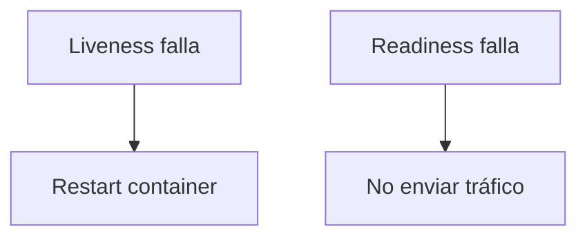

# Módulo 7: Configuración, observabilidad y operación

En producción, una app no solo debe funcionar: debe arrancar con config válida, exponer salud, emitir métricas/logs útiles y fallar con diagnósticos accionables. Este módulo cubre configuración tipada, fail-fast, error handling, Actuator, Micrometer, probes y logging.

**Entorno de referencia verificado (2026-05-22):** JDK 27.0.1.0.2, Maven 3.10.0, Spring Boot 3.5.0.

## Aprende construyendo

### Tema 1: @ConfigurationProperties tipado · Intermedio · 30 min

Caso guía: configurar timeout y URL de un servicio externo sin usar `@Value` disperso.

#### `@ConfigurationProperties`

**Definición formal.** Mecanismo de binding tipado que mapea propiedades con prefijo a una clase Java.

**Ejemplo mínimo.**

```java
@ConfigurationProperties(prefix = "academia.client")
public record ClientProps(String baseUrl, Duration timeout) {}
```

**Error común.** `@Value("${...}")` por todos lados. Corrección: propiedades agrupadas y tipadas, validables.

**Nota de verificación.** Requiere app Boot con `@EnableConfigurationProperties` o scan; boot 3.5.x estándar.

### Tema 2: Fallar rápido al arranque · Intermedio · 30 min

Caso guía: falta `ACADEMIA_DB_URL`; mejor fallar al iniciar que fallar en la primera request.

#### Fail-fast

**Definición formal.** Validar configuración crítica en arranque y abortar si es inválida.

**Ejemplo mínimo (Java puro ejecutable).**

```bash
mkdir -p java-sb7-fail
cd java-sb7-fail
```

Crea el archivo `DemoFail.java`:

```java
public class DemoFail {
  static String required(String v){ if(v==null||v.isBlank()) throw new IllegalStateException("missing"); return v; }
  public static void main(String[] args){ System.out.println(required("ok")); try{ required(""); } catch(Exception e){ System.out.println("fail-fast"); } }
}
```

```bash
javac DemoFail.java
java DemoFail
```

**Verificación (JDK 27, 2026-05-22).** `ok`, `fail-fast`.

### Tema 3: Manejo global de excepciones consistente entre entornos · Intermedio · 30 min

Caso guía: mismo error shape en dev/stage/prod, sin stack trace al cliente.

#### Consistencia de errores

**Definición formal.** Política uniforme de mapeo de excepciones a HTTP status + body estructurado.

**Error común.** Mensajes internos distintos por entorno o stack traces expuestos. Corrección: `ProblemDetail`/body propio, logs internos con correlation id.

### Tema 4: FailureAnalyzer: errores de arranque que explican la causa y la solución · Avanzado · 35 min

Caso guía: puerto ocupado; Boot muestra análisis legible en vez de stack trace críptico.

#### `FailureAnalyzer`

**Definición formal.** Componente de Spring Boot que traduce ciertos fallos de arranque en descripción, acción recomendada y causa.

**Error común.** Ignorar el “ACTION:” de Boot. Corrección: leer el analyzer; suele indicar la causa real.

**Nota de verificación.** Se observa al provocar fallo de arranque en app Boot.

### Tema 5: Actuator y health checks personalizados · Avanzado · 30 min

Caso guía: Kubernetes necesita saber si la app está viva y lista.

#### Actuator

**Definición formal.** Módulo de Spring Boot que expone endpoints operativos (`health`, `info`, `metrics`, etc.).

**Ejemplo mínimo.** Dependencia `spring-boot-starter-actuator`, exponer `management.endpoints.web.exposure.include=health,info`.

**Error común.** Exponer actuator sin seguridad en público. Corrección: exponer mínimo, asegurar, separar puerto/red en entornos sensibles.

### Tema 6: Contar operaciones de negocio con Micrometer · Avanzado · 30 min

Caso guía: contar guías creadas y medir latencia.

#### Micrometer

**Definición formal.** Fachada de métricas para Java; Spring Boot Actuator la integra para exponer contadores, timers, gauges.

**Ejemplo mínimo.**

```java
Counter.builder("guias.creadas").register(meterRegistry).increment();
```

**Error común.** Métricas con cardinalidad alta en tags (userId, orderId). Corrección: tags de baja cardinalidad.

### Tema 7: Liveness y readiness sin reinicios en cadena · Avanzado · 25 min

Caso guía: app viva pero DB no disponible; debe salir de readiness, no reiniciarse infinitamente.

#### Probes

**Definición formal.** Liveness: el proceso debe reiniciarse si está irrecuperable. Readiness: puede recibir tráfico.



**Error común.** Poner dependencia externa en liveness. Corrección: dependencias externas suelen afectar readiness.

### Tema 8: Logging en Spring Boot: niveles, grupos y logs estructurados en JSON · Avanzado · 40 min

Caso guía: en prod necesitas JSON parseable; en dev, texto legible.

#### Logging estructurado

**Definición formal.** Logs con campos consistentes (timestamp, level, logger, message, traceId, etc.), habitualmente JSON en producción.

**Ejemplo mínimo.** Configurar nivel: `logging.level.com.academia=DEBUG`. Estructurado: usar encoder/logback config o soporte Boot para structured logging según versión.

**Error común.** Loguear secretos/PII. Corrección: masking, campos seleccionados, revisión.

**Nota de verificación.** Boot 3.5.x soporta structured logging con configuración; verificar formato exacto por versión.

## Cierre

La operación es parte del diseño. Config tipada, fail-fast, métricas, probes y logs hacen el sistema observable y operable.

## Checklist

- Configuro con `@ConfigurationProperties`.
- Falla rápido ante config inválida.
- Expongo Actuator con seguridad.
- Uso métricas de baja cardinalidad.
- Distingo liveness/readiness.
