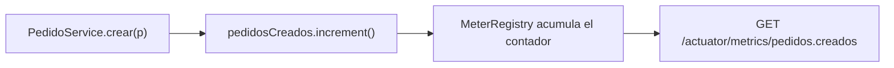

# Módulo 7: Observabilidad con Actuator

Actuator reúne señales técnicas y operativas. Cada práctica debe comprobar qué respuesta produce y qué información revela según el entorno.


## Aprende construyendo

### Tema 1: Actuator y health checks personalizados

**¿Por qué es importante?** Actuator permite distinguir la salud del proceso de una dependencia que dejó de responder. Este ejemplo continúa `com.example.demo`, con seguridad JWT y MockMvc de los módulos anteriores.

#### Subtema 7.1 · Registrar una dependencia y su indicador (10 min)

**Contexto.** La aplicación necesita reportar si la pasarela de pagos responde. Un `HealthIndicator` convierte esa comprobación en un estado que Actuator combina con los demás indicadores.

**Hazlo tú.** Agrega esta dependencia a `pom.xml`:

```xml
<dependency>
    <groupId>org.springframework.boot</groupId>
    <artifactId>spring-boot-starter-actuator</artifactId>
</dependency>
```

Crea `src/main/java/com/example/demo/ServicioExterno.java`:

```java
package com.example.demo;

import org.springframework.stereotype.Component;

@Component
public class ServicioExterno {
    private volatile boolean disponible = true;

    public boolean estaDisponible() { return disponible; }
    public void marcarComoNoDisponible() { disponible = false; }
    public void marcarComoDisponible() { disponible = true; }
}
```

Crea `src/main/java/com/example/demo/ServicioExternoHealthIndicator.java`:

```java
package com.example.demo;

import org.springframework.boot.health.contributor.Health;
import org.springframework.boot.health.contributor.HealthIndicator;
import org.springframework.stereotype.Component;

@Component("pasarelaPagos")
public class ServicioExternoHealthIndicator implements HealthIndicator {
    private final ServicioExterno servicioExterno;

    public ServicioExternoHealthIndicator(ServicioExterno servicioExterno) {
        this.servicioExterno = servicioExterno;
    }

    @Override
    public Health health() {
        return servicioExterno.estaDisponible()
            ? Health.up().build()
            : Health.down().withDetail("razon", "pasarela no responde").build();
    }
}
```

**Resultado esperado.** Spring registra un `ServicioExterno` y un indicador llamado `pasarelaPagos`. En Boot 4, `Health` y `HealthIndicator` se importan desde `org.springframework.boot.health.contributor`. La ruta `/actuator/health` ya está expuesta por defecto; no añadas `metrics`, `info` ni `*` para esta práctica.

#### Subtema 7.2 · Comprobar `UP`, `DOWN` y acceso protegido (10 min)

**Contexto.** Un estado falso puede esconder un incidente. Comprueba el componente, el estado general y la respuesta HTTP con la seguridad del proyecto activa.

**Hazlo tú.** En `src/test/resources/application.properties` agrega opciones solo para los tests; el valor productivo predeterminado no muestra detalles:

```properties
management.endpoint.health.show-details=always
management.endpoint.health.show-components=always
```

Crea `src/test/java/com/example/demo/ActuatorHealthTest.java`:

```java
package com.example.demo;

import org.junit.jupiter.api.BeforeEach;
import org.junit.jupiter.api.Test;
import org.springframework.beans.factory.annotation.Autowired;
import org.springframework.boot.test.context.SpringBootTest;
import org.springframework.boot.webmvc.test.autoconfigure.AutoConfigureMockMvc;
import org.springframework.test.web.servlet.MockMvc;

import static org.springframework.test.web.servlet.request.MockMvcRequestBuilders.get;
import static org.springframework.test.web.servlet.result.MockMvcResultMatchers.jsonPath;
import static org.springframework.test.web.servlet.result.MockMvcResultMatchers.status;

@SpringBootTest
@AutoConfigureMockMvc
class ActuatorHealthTest {
    @Autowired MockMvc mockMvc;
    @Autowired ServicioExterno servicioExterno;
    @Autowired JwtService jwtService;

    @BeforeEach
    void dejaLaDependenciaDisponible() {
        servicioExterno.marcarComoDisponible();
    }

    @Test
    void saludUpCuandoLaDependenciaResponde() throws Exception {
        mockMvc.perform(get("/actuator/health")
                .header("Authorization", bearer()))
            .andExpect(status().isOk())
            .andExpect(jsonPath("$.status").value("UP"))
            .andExpect(jsonPath("$.components.pasarelaPagos.status").value("UP"));
    }

    @Test
    void saludDownCuandoLaDependenciaFalla() throws Exception {
        servicioExterno.marcarComoNoDisponible();

        mockMvc.perform(get("/actuator/health")
                .header("Authorization", bearer()))
            .andExpect(status().isServiceUnavailable())
            .andExpect(jsonPath("$.status").value("DOWN"))
            .andExpect(jsonPath("$.components.pasarelaPagos.status").value("DOWN"));
    }

    @Test
    void saludNoEsPublicaEnEstaConfiguracion() throws Exception {
        mockMvc.perform(get("/actuator/health"))
            .andExpect(status().isUnauthorized());
    }

    private String bearer() {
        return "Bearer " + jwtService.generar("monitor@rutaflow.dev", "ADMIN");
    }
}
```

Ejecuta:

```bash
./mvnw -q -Dtest=ActuatorHealthTest test
```

**Resultado esperado.** Pasan tres métodos: la dependencia disponible produce `200/UP`, la caída produce `503/DOWN`, y esta cadena de seguridad responde `401` sin JWT. El token se firma con el `JwtService` real.

#### Subtema 7.3 · Diagnosticar un estado `UP` falso (10 min)

**Contexto.** El indicador se llama `pasarelaPagos` para no chocar con el bean `ServicioExterno`. El ID que aparece bajo `components` sale del nombre del bean.

**Hazlo tú.** En `ServicioExternoHealthIndicator`, cambia la rama caída para devolver `Health.up()`:

```java
: Health.up().withDetail("razon", "pasarela no responde").build();
```

Ejecuta solo el caso de caída:

```bash
./mvnw -q -Dtest=ActuatorHealthTest#saludDownCuandoLaDependenciaFalla test
```

**Fallo deliberado observado.** La prueba esperaba `503` y recibió `200`: el indicador ocultó la dependencia caída. Restaura `Health.down()` y ejecuta los tres métodos.

#### Entiende y cierra

`HealthIndicator.health()` devuelve una señal; Actuator agrega sus indicadores para formar `/actuator/health`. `DOWN` se mapea a HTTP `503`. El nombre explícito `pasarelaPagos` evita colisionar con `ServicioExterno` y fija el ID JSON. Este endpoint sigue protegido por el `SecurityConfig` de la academia, por eso el test usa JWT. En una plataforma real, configura por separado cómo lo consultará el orquestador, por ejemplo en un puerto de gestión y una red limitada.

En producción conserva `management.endpoint.health.show-details=never` o configura `when-authorized` con roles. `always` solo está en recursos de test porque puede revelar nombres y diagnósticos. Un fallo de una dependencia externa suele afectar **readiness**, no **liveness**: reiniciar todas las instancias no arregla una pasarela caída y puede agravar el incidente; el siguiente tema detalla esa diferencia.

**Evidencia para avanzar:** tres tests pasan, puedes explicar `200/UP`, `503/DOWN` y `401` sin token, y el fallo deliberado se detecta y revierte. El resultado cubre MockMvc con el contexto Spring; no prueba una red externa, TLS, el orquestador ni el navegador. Documentación primaria: [Spring Boot 4.1.2 — Health Information y `HealthIndicator`](https://docs.spring.io/spring-boot/reference/actuator/endpoints.html#actuator.endpoints.health), [API `HealthIndicator`](https://docs.spring.io/spring-boot/api/java/org/springframework/boot/health/contributor/HealthIndicator.html) y [Starter Actuator 4.1.2](https://docs.spring.io/spring-boot/appendix/dependency-versions/coordinates.html).

### Tema 2: Métricas de negocio con Micrometer

#### Paso 1 · Objetivo y preparación

Al finalizar podrás registrar una métrica de negocio custom con Micrometer, y confirmar con un test real que se incrementa correctamente y aparece en `/actuator/metrics`.

**Conocimiento previo:** Tema 1 de este módulo.

#### Paso 2 · Contexto y caso real

**¿Por qué es importante?** Las métricas técnicas genéricas que Actuator expone automáticamente (uso de CPU, latencia HTTP) no capturan tendencias de negocio; contar cuántos pedidos se crean por minuto le da valor directo al equipo de producto, no solo al de infraestructura.

#### Paso 3 · Teoría con analogía

**Conceptos clave:** métricas custom, valor para el equipo de producto, no solo infraestructura.

Micrometer, la fachada de métricas integrada en Spring Boot Actuator, permite definir métricas custom específicas del dominio:

```java
class PedidoService {
    private final Counter pedidosCreados;

    PedidoService(MeterRegistry registry) {
        this.pedidosCreados = registry.counter("pedidos.creados");
    }

    void crear(Pedido p) {
        pedidosCreados.increment();
    }
}
```

Este código registra un contador que se incrementa en cada creación, expuesto a través de `/actuator/metrics/pedidos.creados`, consumible por sistemas como Prometheus/Grafana.

**Analogía:** las métricas técnicas son los indicadores de funcionamiento interno de una fábrica (temperatura de las máquinas); las métricas de negocio custom son el conteo de productos efectivamente terminados y despachados, información que interesa directamente a quienes gestionan el negocio.

**Diagrama:**



#### Paso 4 · Demostración guiada desde cero

Reutiliza `academia-spring` (o créalo desde una carpeta vacía con `mkdir -p academia-spring` si es tu primera vez) y crea el servicio con la métrica en `src/main/java/com/academia/observabilidad/`:

```bash
mkdir -p academia-spring/src/main/java/com/academia/observabilidad
cd academia-spring
```

```java
// src/main/java/com/academia/observabilidad/PedidoService.java
package com.academia.observabilidad;

import io.micrometer.core.instrument.Counter;
import io.micrometer.core.instrument.MeterRegistry;
import org.springframework.stereotype.Service;

@Service
public class PedidoService {
    private final Counter pedidosCreados;

    public PedidoService(MeterRegistry registry) {
        this.pedidosCreados = registry.counter("pedidos.creados");
    }

    public void crear(String descripcion) {
        pedidosCreados.increment();
    }
}
```

**Explicación línea por línea:** `registry.counter("pedidos.creados")` obtiene (o crea, si no existe) un contador registrado bajo ese nombre en el `MeterRegistry`; `pedidosCreados.increment()` incrementa el contador en 1 cada vez que se llama, acumulando el total desde que la aplicación arrancó.

Confirma con `MockMvc` real que crear pedidos incrementa el contador visible en `/actuator/metrics/pedidos.creados`, usando el `MeterRegistry` real inyectado en el test para verificar el valor exacto además de la respuesta HTTP:

```java
// src/test/java/com/academia/observabilidad/PedidoServiceMetricaTest.java
package com.academia.observabilidad;

import io.micrometer.core.instrument.MeterRegistry;
import org.junit.jupiter.api.Test;
import org.springframework.beans.factory.annotation.Autowired;
import org.springframework.boot.test.autoconfigure.web.servlet.AutoConfigureMockMvc;
import org.springframework.boot.test.context.SpringBootTest;
import org.springframework.test.web.servlet.MockMvc;

import static org.assertj.core.api.Assertions.assertThat;
import static org.springframework.test.web.servlet.request.MockMvcRequestBuilders.get;
import static org.springframework.test.web.servlet.result.MockMvcResultMatchers.jsonPath;
import static org.springframework.test.web.servlet.result.MockMvcResultMatchers.status;

@SpringBootTest
@AutoConfigureMockMvc
class PedidoServiceMetricaTest {

    @Autowired
    private MockMvc mockMvc;
    @Autowired
    private PedidoService pedidoService;
    @Autowired
    private MeterRegistry meterRegistry;

    @Test
    void crearPedidosIncrementaElContadorRealYApareceEnActuator() throws Exception {
        double valorInicial = meterRegistry.counter("pedidos.creados").count();

        pedidoService.crear("Comprar leche");
        pedidoService.crear("Pagar factura");

        assertThat(meterRegistry.counter("pedidos.creados").count()).isEqualTo(valorInicial + 2);

        mockMvc.perform(get("/actuator/metrics/pedidos.creados"))
            .andExpect(status().isOk())
            .andExpect(jsonPath("$.measurements[0].value").value(valorInicial + 2));
    }
}
```

```bash
mvn test -Dtest=PedidoServiceMetricaTest # Maven
./gradlew test --tests PedidoServiceMetricaTest # Gradle (equivalente)
```

**Resultado esperado:** `BUILD SUCCESS` con el test en verde: el `MeterRegistry` real confirma que el contador se incrementó exactamente en 2 tras dos llamadas a `crear(...)`, y la misma cifra aparece expuesta en `/actuator/metrics/pedidos.creados`, la ruta real que un sistema de monitoreo consultaría en producción.

**Fallo deliberado:** en `PedidoService.crear`, elimina la línea `pedidosCreados.increment();` (dejando el método vacío, olvidando registrar la métrica). Ejecuta de nuevo el test — la aserción `assertThat(meterRegistry.counter("pedidos.creados").count()).isEqualTo(valorInicial + 2)` FALLA porque el contador nunca se incrementó — diagnostica confirmando un problema real y común: una métrica de negocio que existe en el código pero cuyo punto de incremento se olvida en un método específico, dejando el conteo silenciosamente incorrecto sin que ningún error visible lo señale hasta que alguien note que el dashboard "no se mueve". Revierte el cambio antes de continuar.

#### Paso 5 · Práctica guiada — repetición progresiva

1. Agrega una métrica de tipo `Timer` (`registry.timer("pedidos.tiempo.procesamiento")`) que mida cuánto tarda `crear(...)`, y confirma con un test que `count()` refleja el número de invocaciones.
2. Agrega una etiqueta (`tag`) a la métrica (`registry.counter("pedidos.creados", "region", "sur")`) y confirma con un test que dos regiones distintas se acumulan como series separadas, consultables independientemente.
3. Documenta en una frase, basándote en los errores comunes del laboratorio, por qué una etiqueta con el ID único de cada pedido (en vez de algo como la región) sería un error de alta cardinalidad.
4. Escribe de memoria (sin mirar) un servicio con un `Counter` de Micrometer, y un test que confirme su valor exacto tras varias invocaciones. Compara después contra el patrón del Paso 4.

**Pista:** `meterRegistry.counter("nombre")` sin etiquetas y `meterRegistry.counter("nombre", "tag", "valor")` con etiquetas son series de métricas DISTINTAS internamente, aunque compartan el mismo nombre base — ten cuidado de consultar la combinación exacta de nombre y etiquetas que registraste.

#### Paso 6 · Práctica independiente

**Completa el código:** rellena el espacio para incrementar el contador de negocio:

```java
public void crear(String descripcion) {
    pedidosCreados.____();
}
```

**Reto de memoria sin mirar:** cierra este documento y escribe, solo de memoria, un servicio con un `Counter` de Micrometer registrado en el constructor, y un test que confirme su incremento exacto tras dos llamadas. Compara después contra el patrón del Paso 4.

#### Paso 7 · Cierre y evidencia

Ya registras métricas de negocio custom con Micrometer, confirmando con un test real tanto el valor interno del `MeterRegistry` como su exposición en `/actuator/metrics`. El siguiente y último tema de este módulo distingue dos señales de salud con propósitos operativos distintos. **Evidencia:** entrega el resultado de `PedidoServiceMetricaTest` en verde, y el resultado del fallo deliberado mostrando el contador sin incrementar pese a las llamadas reales. Fuente oficial: [Micrometer — Application Metrics](https://docs.spring.io/spring-boot/reference/actuator/metrics.html).

**Errores comunes:** exponer solo métricas técnicas genéricas sin ninguna métrica de negocio custom; usar un valor de alta cardinalidad (como un ID de usuario único) como etiqueta, generando una explosión de series de métricas distintas que degrada el sistema de monitoreo.

**Cuándo no usarlo:** para un evento tan infrecuente o de tan bajo valor analítico que ninguna decisión de negocio dependería de observarlo (un caso extremadamente raro sin impacto operativo), agregar una métrica dedicada puede ser esfuerzo sin retorno; reserva las métricas custom para eventos con valor de negocio real.

Las métricas de negocio con Micrometer que definas aquí son las que monitoreará el proyecto integrador de este track (microservicio productivo, Módulo 12).

### Tema 3: Liveness vs readiness

#### Paso 1 · Objetivo y preparación

Al finalizar podrás configurar endpoints de liveness y readiness separados, y explicar con evidencia real por qué confundirlos causa reinicios innecesarios en un despliegue orquestado.

**Conocimiento previo:** Temas 1 y 2 de este módulo.

#### Paso 2 · Contexto y caso real

**¿Por qué es importante?** Una aplicación podría estar perfectamente viva (sin necesitar reiniciarse) pero temporalmente no lista para recibir tráfico —por ejemplo, durante el arranque mientras inicializa conexiones— un caso donde reiniciar el pod (liveness fallando) sería contraproducente, mientras sacarlo temporalmente de la rotación (readiness fallando) es el comportamiento correcto.

#### Paso 3 · Teoría con analogía

**Conceptos clave:** ¿debe reiniciarse el pod? vs ¿debe recibir tráfico ahora?

`management.endpoint.health.probes.enabled: true` habilita dos endpoints con propósito distinto: `/actuator/health/liveness` responde "¿está la aplicación en un estado tan roto que debería reiniciarse?" (un fallo dispara un reinicio del contenedor), mientras `/actuator/health/readiness` responde "¿está la aplicación actualmente en condiciones de recibir tráfico?" (un fallo simplemente saca temporalmente al pod de la rotación de balanceo, sin reiniciarlo).

**Analogía:** liveness es verificar si una persona sigue consciente y necesita atención médica de emergencia; readiness es verificar si esa misma persona, consciente y sana, está actualmente disponible para atender clientes en este momento específico.

**Diagrama:**

```
┌── liveness: ¿debe reiniciarse el pod? ──────────────┐
│  UP: el proceso está sano, no necesita reinicio          │
│  DOWN: algo irrecuperable, Kubernetes reinicia el pod    │
└──────────────────────────────────────────────┘
┌── readiness: ¿debe recibir tráfico ahora? ──────────┐
│  UP: listo, recibe tráfico normalmente                   │
│  DOWN: sacado temporalmente de la rotación, sin reinicio  │
└──────────────────────────────────────────────┘
```

#### Paso 4 · Demostración guiada desde cero

Reutiliza `academia-spring` (o créalo desde una carpeta vacía con `mkdir -p academia-spring` si es tu primera vez) y actualiza `src/main/resources/application.properties` para habilitar las sondas separadas:

```bash
mkdir -p academia-spring/src/main/java/com/academia/observabilidad
cd academia-spring
cat >> src/main/resources/application.properties <<'EOF'
management.endpoint.health.probes.enabled=true
management.health.livenessstate.enabled=true
management.health.readinessstate.enabled=true
EOF
```

```java
// src/main/java/com/academia/observabilidad/ControlDisponibilidad.java
package com.academia.observabilidad;

import org.springframework.boot.availability.AvailabilityChangeEvent;
import org.springframework.boot.availability.ReadinessState;
import org.springframework.context.ApplicationEventPublisher;
import org.springframework.web.bind.annotation.PostMapping;
import org.springframework.web.bind.annotation.RestController;

// endpoint de PRUEBA para forzar readiness a REFUSING_TRAFFIC sin afectar liveness
@RestController
public class ControlDisponibilidad {
    private final ApplicationEventPublisher publisher;

    public ControlDisponibilidad(ApplicationEventPublisher publisher) { this.publisher = publisher; }

    @PostMapping("/test/no-listo")
    public void marcarComoNoListo() {
        AvailabilityChangeEvent.publish(publisher, this, ReadinessState.REFUSING_TRAFFIC);
    }

    @PostMapping("/test/listo")
    public void marcarComoListo() {
        AvailabilityChangeEvent.publish(publisher, this, ReadinessState.ACCEPTING_TRAFFIC);
    }
}
```

**Explicación línea por línea:** `management.endpoint.health.probes.enabled=true` activa los grupos `liveness` y `readiness` como endpoints separados; `AvailabilityChangeEvent.publish(publisher, this, ReadinessState.REFUSING_TRAFFIC)` es el mecanismo REAL que Spring Boot expone para cambiar el estado de readiness sin afectar liveness — el mismo mecanismo que usarías internamente durante un apagado ordenado o una recuperación temporal de una dependencia.

Confirma con `MockMvc` real que cambiar readiness NO afecta liveness, la distinción central de este Tema:

```java
// src/test/java/com/academia/observabilidad/LivenessReadinessTest.java
package com.academia.observabilidad;

import org.junit.jupiter.api.Test;
import org.springframework.beans.factory.annotation.Autowired;
import org.springframework.boot.test.autoconfigure.web.servlet.AutoConfigureMockMvc;
import org.springframework.boot.test.context.SpringBootTest;
import org.springframework.test.web.servlet.MockMvc;

import static org.springframework.test.web.servlet.request.MockMvcRequestBuilders.get;
import static org.springframework.test.web.servlet.request.MockMvcRequestBuilders.post;
import static org.springframework.test.web.servlet.result.MockMvcResultMatchers.jsonPath;
import static org.springframework.test.web.servlet.result.MockMvcResultMatchers.status;

@SpringBootTest
@AutoConfigureMockMvc
class LivenessReadinessTest {

    @Autowired
    private MockMvc mockMvc;

    @Test
    void marcarNoListoAfectaSoloReadinessNoLiveness() throws Exception {
        mockMvc.perform(post("/test/no-listo"));

        mockMvc.perform(get("/actuator/health/readiness"))
            .andExpect(status().isServiceUnavailable())
            .andExpect(jsonPath("$.status").value("OUT_OF_SERVICE"));

        mockMvc.perform(get("/actuator/health/liveness"))
            .andExpect(status().isOk())
            .andExpect(jsonPath("$.status").value("UP")); // liveness NO se ve afectado

        mockMvc.perform(post("/test/listo")); // deja el estado limpio para otros tests
    }
}
```

```bash
mvn test -Dtest=LivenessReadinessTest # Maven
./gradlew test --tests LivenessReadinessTest # Gradle (equivalente)
```

**Resultado esperado:** el test pasa: tras marcar la aplicación como no lista, `/actuator/health/readiness` responde `503` con `OUT_OF_SERVICE`, mientras `/actuator/health/liveness` sigue respondiendo `200` con `UP` — la aplicación sigue perfectamente viva (no necesita reiniciarse), solo temporalmente fuera de la rotación de tráfico, exactamente el comportamiento que este Tema explica.

**Fallo deliberado:** en un despliegue mal configurado (documenta esto sin modificar código, es un error de configuración de infraestructura, no de la aplicación), apunta la sonda de liveness de Kubernetes hacia `/actuator/health/readiness` en vez de `/actuator/health/liveness`. Con esa configuración incorrecta, el mismo escenario de este test (readiness `DOWN` durante una recuperación temporal) haría que Kubernetes interprete la falla de READINESS como si fuera una falla de LIVENESS, reiniciando el pod innecesariamente en vez de simplemente esperar a que vuelva a estar listo — diagnostica confirmando por qué la distinción de este Tema no es solo conceptual: apuntar la sonda equivocada al endpoint equivocado en la configuración de despliegue produce reinicios reales e innecesarios en producción.

#### Paso 5 · Práctica guiada — repetición progresiva

1. Agrega un test que confirme que, tras `marcarComoListo()`, `/actuator/health/readiness` vuelve a responder `200` con `UP`.
2. Documenta en una frase, para un escenario de tu elección, cuándo publicarías `LivenessState.BROKEN` (el estado equivalente para liveness) en vez de solo afectar readiness.
3. Combina este Tema con el Tema 1: haz que `ServicioExternoHealthIndicator` publique automáticamente `REFUSING_TRAFFIC` cuando detecta la dependencia caída, y confirma con un test que readiness refleja ese cambio sin intervención manual.
4. Escribe de memoria (sin mirar) un test que confirme que cambiar readiness a `REFUSING_TRAFFIC` no afecta el estado de liveness. Compara después contra el patrón del Paso 4.

**Pista:** `AvailabilityChangeEvent` es el mecanismo idiomático de Spring Boot para este propósito; modificar directamente algún estado interno sin pasar por este evento no actualizaría los endpoints de Actuator correctamente.

#### Paso 6 · Práctica independiente

**Completa el código:** rellena el espacio para publicar el cambio de estado de readiness:

```java
AvailabilityChangeEvent.publish(publisher, this, ReadinessState.____);
```

**Reto de memoria sin mirar:** cierra este documento y escribe, solo de memoria, un test `MockMvc` que confirme que marcar la aplicación como no lista afecta `/actuator/health/readiness` pero no `/actuator/health/liveness`. Compara después contra el patrón del Paso 4.

#### Paso 7 · Cierre y evidencia

Ya distingues liveness de readiness con evidencia real, confirmando que un cambio de disponibilidad afecta la señal correcta sin disparar un reinicio innecesario. Esto cierra el módulo de observabilidad; el siguiente módulo aborda cómo documentar y versionar esta misma API. **Evidencia:** entrega el resultado de `LivenessReadinessTest` en verde, y la explicación de por qué apuntar la sonda de liveness al endpoint de readiness en la configuración de Kubernetes causaría reinicios innecesarios. Fuente oficial: [Spring Boot — Kubernetes Probes](https://docs.spring.io/spring-boot/reference/actuator/kubernetes-probes.html).

**Errores comunes:** usar un único endpoint de salud genérico en Kubernetes en vez de separar liveness de readiness, causando reinicios innecesarios; apuntar por error la sonda de liveness hacia el endpoint de readiness (o viceversa) en la configuración de despliegue.

**Cuándo no usarlo:** para un despliegue que no corre en un orquestador que distinga estas dos sondas (por ejemplo, un servidor tradicional sin Kubernetes ni un mecanismo equivalente), la distinción liveness/readiness no tiene ningún consumidor real que la aproveche; un único endpoint `/actuator/health` sigue siendo suficiente en ese contexto.

---

Distinguir liveness de readiness es lo que evitará que Kubernetes reinicie innecesariamente el proyecto integrador de este track (microservicio productivo, Módulo 12).

## Laboratorio práctico

**Objetivo del laboratorio:** exponer Actuator con al menos una métrica de negocio custom y health checks apropiados.

**Requisitos previos:** Módulos 0-6 completados.

| Paso | Acción | Código | Explicación |
|---|---|---|---|
| 1 | Agregar el starter de Actuator | Ver Tema 1 | Expón `/health` y `/metrics` |
| 2 | Crear un health indicator personalizado | Ver Tema 1 | Verifica un servicio externo real |
| 3 | Definir una métrica de negocio custom | Ver Tema 2 | Verifica que aparece en `/actuator/metrics` |
| 4 | Configurar liveness/readiness separados | Ver Tema 3 | Confirmado con `MockMvc`, no solo configurado |
| 5 | Configurar logging estructurado en JSON | — | Consumible por un sistema de logs centralizado |

**Verificación:** el laboratorio se considera exitoso si `/actuator/metrics` muestra la métrica de negocio custom incrementándose correctamente, y si liveness y readiness responden de forma independiente según el estado real de la aplicación, confirmado con tests reales.

**Errores comunes y soluciones**

- **Exponer todos los endpoints de Actuator públicamente sin restricción.** Configura explícitamente `exposure.include` con solo los endpoints necesarios.
- **Solo exponer métricas técnicas genéricas.** Agrega métricas de negocio custom con Micrometer para dar valor al equipo de producto.
- **Usar un único endpoint de salud genérico en Kubernetes.** Separa liveness de readiness para evitar reinicios innecesarios.

---
