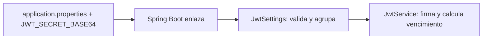
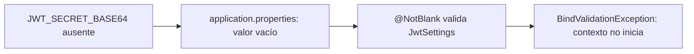
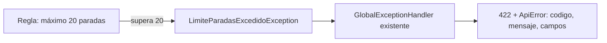
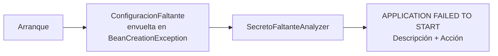
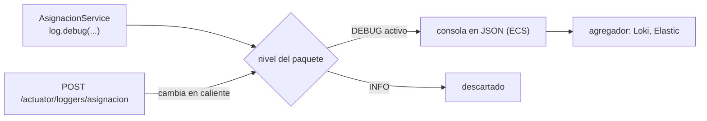

# Módulo 7: Configuración, errores y observabilidad

Cada tema se practica por separado con su propia repetición progresiva y su propio reto de memoria, verificado con `ApplicationContextRunner` y `MockMvc` reales, para que "la aplicación falla al arranque" o "el formato de error es consistente" sean afirmaciones comprobables, no solo descritas. Los Temas 1–4 tratan la configuración y los errores; los Temas 5–8 llevan esas mismas señales a Actuator: salud, métricas, sondas y logs.


**Referencia ejecutable al terminar los módulos 2 y 4–7:** en la raíz del repositorio, abre `examples/spring-tareas-rutaflow/README.md`. Incluye el estado final y pruebas; algunas clases incorporan cambios de módulos posteriores. Construye primero las prácticas de este módulo y usa la referencia para comparar y diagnosticar.

## Aprende construyendo

### Tema 1: @ConfigurationProperties tipado · Intermedio · 30 min

**Meta:** agrupar la clave y el vencimiento de JWT que ya existen en el proyecto del Módulo 5, enlazarlos a un `record` validado y usarlos desde el mismo `JwtService`.

**¿Por qué es importante?** Ahora la clave se lee en un sitio y el vencimiento está escrito como número dentro de `JwtService`. Al agruparlos, es más fácil ver qué necesita JWT y detectar un valor mal formado al iniciar.



#### Subtema 1.1 · Agrupar la configuración JWT existente · 10 min

**Contexto:** continúa el proyecto `academia-spring` de Módulo 5. El secreto sigue llegando desde `JWT_SECRET_BASE64`; crea un tipo para reunirlo con los segundos de vencimiento.

**Hazlo tú:** verifica que `pom.xml` tenga `spring-boot-starter-validation`. Crea `src/main/java/com/example/demo/JwtSettings.java`:

```java
package com.example.demo;

import jakarta.validation.constraints.Min;
import jakarta.validation.constraints.NotBlank;
import org.springframework.boot.context.properties.ConfigurationProperties;
import org.springframework.validation.annotation.Validated;

@ConfigurationProperties("security.jwt")
@Validated
public record JwtSettings(
    @NotBlank String secretBase64,
    @Min(60) long expirationSeconds
) {}
```

En `src/main/java/com/example/demo/DemoApplication.java`, añade el escaneo para registrar el record:

```java
import org.springframework.boot.context.properties.ConfigurationPropertiesScan;

@SpringBootApplication
@ConfigurationPropertiesScan
public class DemoApplication { /* conserva aquí el main existente */ }
```

En `src/main/resources/application.properties`, deja la clave fuera del código y agrégale un vencimiento:

```properties
security.jwt.secret-base64=${JWT_SECRET_BASE64:}
security.jwt.expiration-seconds=900
```

El `:` deja el valor vacío si falta la variable; `@NotBlank` lo rechaza con un error de configuración legible, sin poner un secreto falso como valor por defecto. Actualiza también `src/test/resources/application.properties`: conserva la clave Base64 de prueba del Módulo 5 y añade `security.jwt.expiration-seconds=900`. Ese archivo de test sustituye el del entorno principal durante las pruebas; si falta la propiedad, `@Min(60)` hace fallar los contextos que construyen `JwtService`.

El nombre Java `secretBase64` corresponde a la propiedad `secret-base64`; ambas están bajo `security.jwt`.

**Resultado esperado:** el proyecto compila con Spring Boot `4.1.2` y JDK `25`. Spring Boot enlaza las propiedades al record al arrancar; la conversión y validación ocurren en ese momento, no en compilación.

**Fallo deliberado y diagnóstico:** cambia temporalmente `expiration-seconds=900` por `expiration-seconds=texto` en la prueba aislada del subtema siguiente. El contexto debe fallar al enlazar `long`; restaura `900`.

**Entiende:** el prefijo reúne propiedades relacionadas; cada componente del record recibe el valor correspondiente. `@ConfigurationPropertiesScan` busca estos tipos desde el paquete de la aplicación. Fuente: [Spring Boot 4.1.2 — ConfigurationPropertiesScan](https://docs.spring.io/spring-boot/api/java/org/springframework/boot/context/properties/ConfigurationPropertiesScan.html).

**Cierra:** identifica en el archivo de propiedades los dos valores y encuentra los campos que los reciben.

#### Subtema 1.2 · Probar enlace y límites con un contexto pequeño · 10 min

**Contexto:** no necesitas levantar web, base de datos ni filtros para revisar solo el enlace de configuración. `ApplicationContextRunner` crea un contexto mínimo con el tipo que quieres probar.

**Hazlo tú:** crea `src/test/java/com/example/demo/JwtSettingsTest.java`:

```java
package com.example.demo;

import org.junit.jupiter.api.Test;
import org.springframework.boot.context.properties.EnableConfigurationProperties;
import org.springframework.boot.test.context.runner.ApplicationContextRunner;
import org.springframework.context.annotation.Configuration;
import static org.assertj.core.api.Assertions.assertThat;

class JwtSettingsTest {
    private final ApplicationContextRunner runner = new ApplicationContextRunner()
        .withUserConfiguration(SettingsTestConfig.class);

    @Test
    void enlazaLaClaveYElVencimiento() {
        runner.withPropertyValues(
                "security.jwt.secret-base64=VVFRc3BzQVFzZXJ0T0xhbkt0ZUd4cHlsU21pSnhhOFM=",
                "security.jwt.expiration-seconds=900")
            .run(context -> {
                assertThat(context).hasNotFailed();
                JwtSettings settings = context.getBean(JwtSettings.class);
                assertThat(settings.secretBase64())
                    .isEqualTo("VVFRc3BzQVFzZXJ0T0xhbkt0ZUd4cHlsU21pSnhhOFM=");
                assertThat(settings.expirationSeconds()).isEqualTo(900);
            });
    }

    @Test
    void textoNoSePuedeEnlazarAUnLong() {
        runner.withPropertyValues(
                "security.jwt.secret-base64=test",
                "security.jwt.expiration-seconds=texto")
            .run(context -> assertThat(context).hasFailed());
    }

    @Test
    void vencimientoMenorAlMinimoEsRechazado() {
        runner.withPropertyValues(
                "security.jwt.secret-base64=test",
                "security.jwt.expiration-seconds=59")
            .run(context -> assertThat(context).hasFailed());
    }

    @Configuration(proxyBeanMethods = false)
    @EnableConfigurationProperties(JwtSettings.class)
    static class SettingsTestConfig {}
}
```

Ejecuta desde la raíz del proyecto:

```bash
./mvnw -q -Dtest=JwtSettingsTest test
```

**Resultado esperado:** pasan tres pruebas: los dos valores se enlazan, el texto no se convierte a `long`, y `59` no cumple `@Min(60)`. En los dos casos inválidos el contexto registra un fallo; el callback puede comprobarlo con `hasFailed()`.

**Fallo deliberado y diagnóstico:** quita temporalmente `@Validated` de `JwtSettings` y repite `JwtSettingsTest#vencimientoMenorAlMinimoEsRechazado`. Ese test falla porque `59` ahora se enlaza sin validación. Restaura la anotación.

**Entiende:** `@Min` y `@NotBlank` son restricciones aplicadas por Bean Validation al enlazar. Un tipo incorrecto es un error de conversión; un número debajo de `60` es un error de validación. Son fallos distintos y el test los separa.

**Cierra:** conserva la salida verde y explica cuál error viene de conversión y cuál de validación.

#### Subtema 1.3 · Inyectar el record en el JwtService · 10 min

**Contexto:** tener un record que nadie usa no centraliza la configuración del sistema. Cambia el constructor del servicio existente para que reciba ese tipo y usa su vencimiento al firmar.

**Hazlo tú:** en `src/main/java/com/example/demo/JwtService.java`, reemplaza la lectura con `@Value` por esta inyección:

```java
private final JwtEncoder encoder;
private final JwtDecoder decoder;
private final long expirationSeconds;

public JwtService(JwtSettings settings) {
    SecretKey key = new SecretKeySpec(Base64.getDecoder().decode(settings.secretBase64()), "HmacSHA256");
    this.encoder = NimbusJwtEncoder.withSecretKey(key).algorithm(MacAlgorithm.HS256).build();
    this.decoder = NimbusJwtDecoder.withSecretKey(key).macAlgorithm(MacAlgorithm.HS256).build();
    this.expirationSeconds = settings.expirationSeconds();
}
```

En el método `generar`, cambia el valor fijo `900` por la configuración:

```java
.expiresAt(ahora.plusSeconds(expirationSeconds))
```

Actualiza `src/test/java/com/example/demo/JwtServiceTest.java` para probar un vencimiento de 120 segundos:

```java
var service = new JwtService(new JwtSettings(CLAVE_DE_PRUEBA, 120));
var jwt = service.validar(service.generar("ana-1", "ADMIN"));
assertEquals(120L, Duration.between(jwt.getIssuedAt(), jwt.getExpiresAt()).getSeconds());
```

Añade `import java.time.Duration;` y conserva las aserciones existentes de usuario y rol. Después ejecuta los tests relacionados y la suite:

```bash
./mvnw -q -Dtest=JwtSettingsTest,JwtServiceTest test
./mvnw -q clean test
```

**Resultado esperado:** los tests de firma siguen pasando y ahora `JwtService` obtiene tanto la clave como el tiempo de expiración del mismo objeto validado. Para ejecutar la aplicación, exporta una clave Base64 de 32 bytes fuera del repositorio: `export JWT_SECRET_BASE64="$(openssl rand -base64 32)"`.

**Fallo deliberado y diagnóstico:** cambia temporalmente `ahora.plusSeconds(expirationSeconds)` por `ahora.plusSeconds(900)` y ejecuta `./mvnw -q -Dtest=JwtServiceTest test`. La aserción esperaba `120` segundos y recibe `900`: el servicio volvió a ignorar la configuración. Restaura `expirationSeconds` y confirma el test verde.

**Entiende:** el record no guarda secretos ni crea una segunda clave; agrupa el valor que ya llegaba desde el entorno. Los records anidados se enlazan por estructura; `@NestedConfigurationProperty` es una pista para metadatos y no es necesaria para enlazar un objeto anidado en ejecución. Referencias: [Spring Boot — Type-safe Configuration Properties](https://docs.spring.io/spring-boot/reference/features/external-config.html#features.external-config.typesafe-configuration-properties), [API de ConfigurationPropertiesScan](https://docs.spring.io/spring-boot/api/java/org/springframework/boot/context/properties/ConfigurationPropertiesScan.html) y [API de NestedConfigurationProperty](https://docs.spring.io/spring-boot/api/java/org/springframework/boot/context/properties/NestedConfigurationProperty.html).

**Cierra:** deja en verde los tests y señala una clase que ahora recibe `JwtSettings` en vez de leer strings de configuración.

**Práctica independiente:** agrega `@Min(1) int refreshAfterMinutes` al record y `security.jwt.refresh-after-minutes=20` a los archivos principal y de test. Comprueba el valor con `ApplicationContextRunner`; cambia el test a `0`, confirma `hasFailed()` y restaura `20`.

**Proyecto integrador:** aplica este mismo tipo `JwtSettings` al backend de RutaFlow y conserva `JWT_SECRET_BASE64` como fuente externa. No crees otra propiedad para la misma clave ni otro `JwtService`.

---

### Tema 2: Fallar rápido al arranque · Intermedio · 30 min

**Meta:** provocar y leer el fallo del contexto cuando falta el secreto JWT, y distinguirlo de un arranque correcto con una clave de prueba.

**¿Por qué es importante?** Si una app acepta una clave ausente o vacía, la falla puede aparecer después, al emitir o validar el primer token. Es más fácil corregirlo al arrancar, cuando Spring todavía puede señalar la propiedad.



#### Subtema 2.1 · Probar el valor obligatorio ausente · 10 min

**Contexto:** el subtema M7 T1 ya creó `JwtSettingsTest` con `ApplicationContextRunner` y `@EnableConfigurationProperties`. Reutiliza esa configuración de test y su clase `JwtSettings`; no crees `JwtConfig` ni un segundo prefijo.

**Hazlo tú:** en `src/test/java/com/example/demo/JwtSettingsTest.java`, agrega:

```java
@Test
void missingSecretHasValidationFailureAtStartup() {
    runner.withPropertyValues("security.jwt.expiration-seconds=900")
        .run(context -> {
            assertThat(context).hasFailed();
            assertThat(context.getStartupFailure())
                .hasRootCauseInstanceOf(BindValidationException.class);
        });
}
```

Añade el import:

```java
import org.springframework.boot.context.properties.bind.validation.BindValidationException;
```

La propiedad del vencimiento está presente; el secreto falta a propósito. Ejecuta el test:

```bash
./mvnw -q -Dtest=JwtSettingsTest#missingSecretHasValidationFailureAtStartup test
```

**Resultado esperado:** el test pasa porque Spring informa un contexto fallido y la causa raíz es `BindValidationException`, causada por `@NotBlank` sobre `secretBase64`.

**Fallo deliberado y diagnóstico:** reemplaza `hasFailed()` por `hasNotFailed()`. El test falla: el secreto ausente no debe permitir construir `JwtSettings`. Restaura `hasFailed()`.

**Entiende:** `ApplicationContextRunner` levanta un contexto pequeño y captura el fallo en `context`; no lanza la excepción fuera del callback. Por eso se inspecciona `getStartupFailure()`.

**Cierra:** conserva la aserción de causa raíz y explica en qué momento se rechaza el secreto.

#### Subtema 2.2 · Rechazar también un secreto vacío · 10 min

**Contexto:** una variable puede existir pero estar vacía. `@NotBlank` debe rechazar ambos casos: propiedad ausente y cadena vacía.

**Hazlo tú:** agrega esta prueba a `JwtSettingsTest.java`:

```java
@Test
void blankSecretIsRejectedAtStartup() {
    runner.withPropertyValues(
            "security.jwt.secret-base64=",
            "security.jwt.expiration-seconds=900")
        .run(context -> {
            assertThat(context).hasFailed();
            assertThat(context.getStartupFailure())
                .hasRootCauseInstanceOf(BindValidationException.class);
        });
}
```

Ejecuta ambos escenarios:

```bash
./mvnw -q -Dtest=JwtSettingsTest#missingSecretHasValidationFailureAtStartup+blankSecretIsRejectedAtStartup test
```

Para reproducir el entorno real sin secreto, desde la raíz del proyecto ejecuta:

```bash
env -u JWT_SECRET_BASE64 ./mvnw -q spring-boot:run
```

`src/main/resources/application.properties` usa `security.jwt.secret-base64=${JWT_SECRET_BASE64:}`: el sufijo `:` produce una cadena vacía si la variable no existe, y `@NotBlank` detiene el arranque con la propiedad señalada. No pongas un secreto de fallback en el archivo.

**Resultado esperado:** los tests pasan porque ambos contextos fallan con `BindValidationException`. El comando de la aplicación termina con error antes de atender HTTP y el log menciona `security.jwt`/`secretBase64` como propiedad inválida.

**Fallo deliberado y diagnóstico:** cambia `${JWT_SECRET_BASE64:}` por `${JWT_SECRET_BASE64}` y repite el comando con `env -u`. Comprueba el error real que reporta el entorno; restaura el `:` para que el tipo reciba vacío y Bean Validation dé el mensaje controlado.

**Entiende:** el test aislado demuestra el enlace y la validación. El comando ejecuta la app completa. Son comprobaciones relacionadas, pero no significan lo mismo.

**Cierra:** distingue en el log de arranque el nombre de propiedad del nombre de la clase que falló.

#### Subtema 2.3 · Quitar la validación y observar el riesgo · 10 min

**Contexto:** `@ConfigurationProperties` enlaza valores; `@Validated` hace que restricciones como `@NotBlank` y `@Min` se ejecuten durante ese enlace.

**Hazlo tú:** mantén también los tests existentes `vencimientoMenorAlMinimoEsRechazado` y `enlazaLaClaveYElVencimiento`. Ejecuta la clase completa:

```bash
./mvnw -q -Dtest=JwtSettingsTest test
```

Archivo concreto para esta comprobación: `src/main/java/com/example/demo/JwtSettings.java`.

**Resultado esperado:** los valores válidos arrancan; secreto ausente, vacío, texto que no cabe en `long` y vencimiento `59` fallan. Los callbacks comprueban `hasNotFailed()` o `hasFailed()` según el caso.

**Fallo deliberado y diagnóstico:** quita temporalmente `@Validated` de `JwtSettings` y repite `./mvnw -q -Dtest=JwtSettingsTest#missingSecretHasValidationFailureAtStartup+vencimientoMenorAlMinimoEsRechazado test`. Ambos tests fallan porque el contexto arranca sin aplicar las restricciones. Restaura `@Validated` y corre de nuevo la clase completa.

**Entiende:** una propiedad opcional puede tener un valor por defecto seguro; un secreto no debe tener una clave de fallback. La validación solo funciona si el tipo se registra con `@ConfigurationPropertiesScan` o `@EnableConfigurationProperties`.

**Cierra:** conserva la suite verde y la salida del proceso que falla sin `JWT_SECRET_BASE64`. Referencias: [Spring Boot — Type-safe Configuration Properties](https://docs.spring.io/spring-boot/reference/features/external-config.html#features.external-config.typesafe-configuration-properties), [API de BindValidationException](https://docs.spring.io/spring-boot/api/java/org/springframework/boot/context/properties/bind/validation/BindValidationException.html) y [Spring Boot — Testing auto-configuration](https://docs.spring.io/spring-boot/reference/testing/spring-boot-applications.html#testing.spring-boot-applications.testing-auto-configuration).

**Cuándo no exigirlo:** un valor opcional, como el tamaño de página, puede tener un valor predeterminado seguro. Reserva el fallo de arranque para entradas necesarias donde no hay un default válido, como la clave JWT.

**Práctica independiente:** repite los dos casos con `security.jwt.expiration-seconds=59` y con la propiedad ausente. En cada caso anota la propiedad indicada por el error y restaura `900`.

**Proyecto integrador:** conserva la validación en el backend RutaFlow y entrega configuración secreta desde el entorno del despliegue. La app no debe iniciar si la variable obligatoria está vacía.

---

### Tema 3: Manejo global de excepciones consistente entre entornos · Intermedio · 30 min

**Meta:** añadir una regla de negocio al `GlobalExceptionHandler` del Módulo 2 y comprobar que reutiliza el `ApiError` que ya conoce el cliente.

**¿Por qué es importante?** Si un endpoint nuevo devuelve un JSON distinto para errores, el consumidor debe aprender otra forma de leerlos. Extender el manejador existente conserva los campos `codigo`, `mensaje` y `campos` para todos.



#### Subtema 3.1 · Lanzar una excepción del dominio · 10 min

**Contexto:** continúa `academia-spring`, paquete `com.example.demo`. La cadena JWT exige bearer en `/api/**`; los tests enviarán un token real de la `JwtService` del Módulo 5.

**Hazlo tú:** crea `src/main/java/com/example/demo/LimiteParadasExcedidoException.java`:

```java
package com.example.demo;

public class LimiteParadasExcedidoException extends RuntimeException {
    public LimiteParadasExcedidoException(int limite) {
        super("El límite de " + limite + " paradas por ruta fue excedido.");
    }
}
```

Crea `src/main/java/com/example/demo/RutasEntregaController.java`:

```java
package com.example.demo;

import java.util.Map;
import org.springframework.web.bind.annotation.PostMapping;
import org.springframework.web.bind.annotation.RequestParam;
import org.springframework.web.bind.annotation.RestController;

@RestController
public class RutasEntregaController {
    private static final int LIMITE_PARADAS = 20;

    @PostMapping("/api/rutas")
    public Map<String, Object> crear(@RequestParam int numeroDeParadas) {
        if (numeroDeParadas > LIMITE_PARADAS) {
            throw new LimiteParadasExcedidoException(LIMITE_PARADAS);
        }
        return Map.of("estado", "creada", "paradas", numeroDeParadas);
    }
}
```

**Resultado esperado:** 10 y 20 paradas siguen el camino de éxito; 21 lanza la excepción de negocio. El controller no construye JSON de error.

**Fallo deliberado y diagnóstico:** cambia `>` por `>=`. La prueba de límite exacto que agregarás en 4.24 recibirá error para 20; vuelve a `>` porque el límite máximo sí está permitido.

**Entiende:** la excepción describe una regla del dominio. El controller la lanza; el manejador compartido decide el estado y el cuerpo HTTP.

**Cierra:** localiza la condición y el `throw`; el controller no conoce el formato `ApiError`.

#### Subtema 3.2 · Extender el manejador sin cambiar el formato · 10 min

**Contexto:** en Módulo 2 `GlobalExceptionHandler` ya convierte validaciones y tareas inexistentes en `ApiError(codigo, mensaje, campos)`. Añade un método a esa misma clase.

**Hazlo tú:** en `src/main/java/com/example/demo/GlobalExceptionHandler.java`, agrega:

```java
@ExceptionHandler(LimiteParadasExcedidoException.class)
public ResponseEntity<ApiError> manejarLimiteParadas(LimiteParadasExcedidoException ex) {
    ApiError cuerpo = new ApiError("LIMITE_PARADAS", ex.getMessage(), Map.of());
    return ResponseEntity.unprocessableEntity().body(cuerpo);
}
```

`Map` y `ResponseEntity` ya se importaron en Módulo 2. Si no, añádelos junto con `ExceptionHandler` y no crees otro `@RestControllerAdvice`.

Crea `src/test/java/com/example/demo/RutasEntregaControllerTest.java`. Para estos endpoints protegidos, obtén un bearer con el servicio real:

```java
package com.example.demo;

import org.junit.jupiter.api.Test;
import org.springframework.beans.factory.annotation.Autowired;
import org.springframework.boot.test.context.SpringBootTest;
import org.springframework.boot.webmvc.test.autoconfigure.AutoConfigureMockMvc;
import org.springframework.http.MediaType;
import org.springframework.test.web.servlet.MockMvc;
import static org.springframework.test.web.servlet.request.MockMvcRequestBuilders.post;
import static org.springframework.test.web.servlet.result.MockMvcResultMatchers.content;
import static org.springframework.test.web.servlet.result.MockMvcResultMatchers.jsonPath;
import static org.springframework.test.web.servlet.result.MockMvcResultMatchers.status;

@SpringBootTest
@AutoConfigureMockMvc
class RutasEntregaControllerTest {
    @Autowired MockMvc mockMvc;
    @Autowired JwtService jwtService;

    private String bearer() {
        return "Bearer " + jwtService.generar("ana-1", "ADMIN");
    }

    @Test
    void sobreElLimiteDevuelveElApiErrorCompartido() throws Exception {
        mockMvc.perform(post("/api/rutas").param("numeroDeParadas", "21")
                .header("Authorization", bearer()))
            .andExpect(status().isUnprocessableEntity())
            .andExpect(content().contentTypeCompatibleWith(MediaType.APPLICATION_JSON))
            .andExpect(jsonPath("$.codigo").value("LIMITE_PARADAS"))
            .andExpect(jsonPath("$.mensaje")
                .value("El límite de 20 paradas por ruta fue excedido."))
            .andExpect(jsonPath("$.campos").isEmpty());
    }
}
```

**Resultado esperado:** la respuesta es `422` y tiene los mismos tres campos JSON del `ApiError` usado por los errores de Módulo 2. Su `Content-Type` es compatible con `application/json`; aquí no se usa `ProblemDetail` ni `application/problem+json`.

**Fallo deliberado y diagnóstico:** cambia `ResponseEntity.unprocessableEntity()` por `ResponseEntity.badRequest()`. El test recibe `400` en vez de `422`; restaura el estado que corresponde a la regla de negocio.

**Entiende:** status describe el resultado HTTP; `ApiError` mantiene el cuerpo estable. Si el proyecto decide migrar a RFC 9457 `ProblemDetail`, cambia todos los handlers como una decisión de contrato, no solo este.

**Cierra:** compara `codigo`, `mensaje` y `campos` con el record `ApiError`.

#### Subtema 3.3 · Comprobar el borde del límite con MockMvc · 10 min

**Contexto:** una condición `>` permite exactamente 20; `>=` la rechaza. Una prueba en el borde evita que una edición cambie esa regla sin que el equipo lo note.

**Hazlo tú:** agrega al mismo `RutasEntregaControllerTest.java`:

```java
@Test
void elLimiteExactoDeVeinteParadasEsAceptado() throws Exception {
    mockMvc.perform(post("/api/rutas").param("numeroDeParadas", "20")
            .header("Authorization", bearer()))
        .andExpect(status().isOk())
        .andExpect(jsonPath("$.estado").value("creada"))
        .andExpect(jsonPath("$.paradas").value(20));
}
```

Ejecuta desde la raíz:

```bash
./mvnw -q -Dtest=RutasEntregaControllerTest test
./mvnw -q clean test
```

**Resultado esperado:** 20 recibe `200`; 21 recibe `422` con `ApiError`; ambos usan un bearer válido del contexto de prueba.

**Fallo deliberado y diagnóstico:** cambia `>` por `>=` en `RutasEntregaController` y ejecuta `./mvnw -q -Dtest=RutasEntregaControllerTest#elLimiteExactoDeVeinteParadasEsAceptado test`. El test falla porque recibe `422`; restaura `>` y confirma los dos casos.

**Entiende:** el test comprueba el contrato HTTP completo en un contexto Spring real: seguridad, controller, handler y JSON. No prueba todos los perfiles de despliegue.

**Cierra:** conserva la suite verde y la prueba del valor exacto. Referencias: [Spring MVC — REST Exceptions](https://docs.spring.io/spring-framework/reference/web/webmvc/mvc-ann-rest-exceptions.html) y [Spring Boot — Testing Applications](https://docs.spring.io/spring-boot/reference/testing/spring-boot-applications.html).

**Práctica independiente:** agrega otra excepción de negocio al `GlobalExceptionHandler` y confirma que el status cambia pero el JSON conserva `codigo`, `mensaje` y `campos`.

**Proyecto integrador:** usa un handler central para el backend RutaFlow; conserva `ApiError` en todos sus fallos hasta que una migración coordinada defina un nuevo contrato.

---

### Tema 4: FailureAnalyzer: errores de arranque que explican la causa y la solución · Avanzado · 35 min

**Prerrequisito:** tema «Fallar rápido al arranque» de este módulo.

**Al finalizar podrás:** escribir un `FailureAnalyzer` propio que convierta una excepción de arranque en un mensaje con la causa y la acción a tomar, y registrarlo en `spring.factories`.

**¿Por qué es importante?** Cuando una aplicación no arranca, la pila de excepciones puede tener cien líneas. Spring Boot ya traduce los errores comunes (puerto ocupado, bean faltante) a un mensaje claro. Con un analizador propio, tus errores de configuración también se explican solos.

#### Paso 1 · Objetivo y preparación

Usa Spring Boot 4.1.2 con JDK 25. Continúa el proyecto `academia-spring` del tema anterior, que valida la configuración del secreto JWT al arrancar; las clases nuevas van en `com.example.demo.config`, dentro del paquete que escanea `@SpringBootApplication`.

#### Paso 2 · Contexto y caso real

Cada persona nueva en RutaFlow perdía media hora el primer día: la aplicación no arrancaba porque faltaba `JWT_SECRET_BASE64`, y el error aparecía enterrado en una pila de excepciones de validación.

#### Paso 3 · Teoría, modelo mental y analogía

**Conceptos clave:** `FailureAnalyzer`, `AbstractFailureAnalyzer`, `FailureAnalysis` (descripción y acción), `spring.factories`, excepción de arranque.

Si el arranque falla, Spring Boot recorre los **analizadores** registrados. El primero que reconoce la excepción devuelve un `FailureAnalysis` con dos textos: **descripción** (qué pasó) y **acción** (qué hacer). Spring Boot los imprime en un recuadro claro en lugar de la pila completa.

`AbstractFailureAnalyzer<T>` busca en la cadena de causas una excepción del tipo `T`, aunque venga envuelta en otras. Los analizadores se registran en `META-INF/spring.factories`, no como beans, porque corren cuando el contexto ya falló.

**Analogía:** un analizador es un mecánico que, en lugar de entregarte el manual entero del motor, te dice «falta aceite: agrega un litro». La analogía falla en que solo reconoce las averías para las que lo entrenaste.

**Límite de uso:** no ocultes la causa original: la pila completa sigue disponible con `--debug`. Escribe analizadores solo para errores frecuentes con una solución conocida.



#### Paso 4 · Demostración guiada desde cero

Archivo `academia-spring/src/main/java/com/example/demo/config/ConfiguracionFaltante.java`:

```java
package com.example.demo.config;

public class ConfiguracionFaltante extends RuntimeException {
    private final String propiedad;
    public ConfiguracionFaltante(String propiedad) {
        super("Falta la propiedad " + propiedad);
        this.propiedad = propiedad;
    }
    public String propiedad() { return propiedad; }
}
```

Archivo `academia-spring/src/main/java/com/example/demo/config/SecretoFaltanteAnalyzer.java`:

```java
package com.example.demo.config;

import org.springframework.boot.diagnostics.AbstractFailureAnalyzer;
import org.springframework.boot.diagnostics.FailureAnalysis;

class SecretoFaltanteAnalyzer extends AbstractFailureAnalyzer<ConfiguracionFaltante> {
    @Override
    protected FailureAnalysis analyze(Throwable raiz, ConfiguracionFaltante causa) {
        return new FailureAnalysis(
            "La aplicación necesita '" + causa.propiedad() + "' y no la encontró.",
            "Exporta la variable de entorno JWT_SECRET_BASE64 con 32 bytes en Base64, por ejemplo:\n"
                + "    export JWT_SECRET_BASE64=$(openssl rand -base64 32)",
            causa);
    }
}
```

Archivo `academia-spring/src/main/resources/META-INF/spring.factories`:

```properties
org.springframework.boot.diagnostics.FailureAnalyzer=\
com.example.demo.config.SecretoFaltanteAnalyzer
```

Archivo `academia-spring/src/main/java/com/example/demo/config/SeguridadConfig.java`:

```java
package com.example.demo.config;

import org.springframework.beans.factory.annotation.Value;
import org.springframework.context.annotation.Bean;
import org.springframework.context.annotation.Configuration;

@Configuration
class SeguridadConfig {
    @Bean
    byte[] secretoJwt(@Value("${security.jwt.secret-base64:}") String base64) {
        if (base64.isBlank()) throw new ConfiguracionFaltante("security.jwt.secret-base64");
        return java.util.Base64.getDecoder().decode(base64);
    }
}
```

Ejecútalo:

```bash
unset JWT_SECRET_BASE64
./mvnw spring-boot:run
```

**Explicación por bloques:** `SeguridadConfig` lanza `ConfiguracionFaltante` si el secreto está vacío. Spring la envuelve en varias excepciones de creación de beans. `SecretoFaltanteAnalyzer` extiende `AbstractFailureAnalyzer`, que encuentra la causa en la cadena y le pasa el objeto ya tipado. La descripción dice qué falta y la acción da el comando exacto. `spring.factories` registra el analizador para que Spring Boot lo use incluso sin contexto.

**Resultado esperado:**

```text
***************************
APPLICATION FAILED TO START
***************************

Description:

La aplicación necesita 'security.jwt.secret-base64' y no la encontró.

Action:

Exporta la variable de entorno JWT_SECRET_BASE64 con 32 bytes en Base64, por ejemplo:
    export JWT_SECRET_BASE64=$(openssl rand -base64 32)
```

**Fallo deliberado:** anota `SecretoFaltanteAnalyzer` con `@Component` y borra `spring.factories`. **Error esperado:** vuelve a aparecer la pila larga sin el recuadro. **Diagnóstico:** el analizador corre cuando el contexto ya falló, así que no puede ser un bean. Regístralo en `spring.factories`.

#### Paso 5 · Práctica guiada

1. **Reproducción:** arranca sin la variable y lee el recuadro.
2. **Variación:** arranca con `--debug` y compara con la pila completa.
3. **Diagnóstico:** reproduce el fallo deliberado con `@Component`.
4. **Integración:** escribe un segundo analizador para una URL de base de datos sin `jdbc:` al inicio.
5. **Diseño:** lista los tres errores de arranque más comunes de RutaFlow y decide cuáles merecen analizador.

**Pista:** si tu analizador no aparece, revisa la ruta exacta `META-INF/spring.factories` y el nombre completo de la clase.

#### Paso 6 · Práctica independiente

Escribe una prueba con `SpringApplication` que arranque sin la propiedad, capture la salida con `OutputCaptureExtension` y compruebe que contiene «Action:».

#### Paso 7 · Cierre

- [ ] Explicas qué devuelve un `FailureAnalysis`.
- [ ] Sin el secreto, el arranque muestra tu descripción y tu acción.
- [ ] Reprodujiste el analizador ignorado por ser bean.
- [ ] Sabes ver la pila completa con `--debug`.

Si fallas dos o más, vuelve al Paso 3. **Errores comunes:** registrar el analizador como bean, ocultar la causa original y escribir acciones vagas como «revisa la configuración». **Siguiente paso:** el tema «Manejo global de excepciones consistente» aplica la misma idea a los errores de las peticiones.

**Transferencia al proyecto integrador «RutaFlow»:** agrega a RutaFlow analizadores para el secreto JWT y la URL de la base, y prueba que el recuadro aparece en el CI.

**Fuente oficial:** [Spring Boot — Create Your Own FailureAnalyzer](https://docs.spring.io/spring-boot/how-to/application.html#howto.application.failure-analyzer).

### Tema 5: Actuator y health checks personalizados · Avanzado · 30 min

**¿Por qué es importante?** Actuator permite distinguir la salud del proceso de una dependencia que dejó de responder. Este ejemplo continúa `com.example.demo`, con seguridad JWT y MockMvc de los módulos anteriores.

#### Subtema 5.1 · Registrar una dependencia y su indicador · 10 min

**Contexto:** La aplicación necesita reportar si la pasarela de pagos responde. Un `HealthIndicator` convierte esa comprobación en un estado que Actuator combina con los demás indicadores.

**Hazlo tú:** Agrega esta dependencia a `pom.xml`:

```xml
<dependency>
    <groupId>org.springframework.boot</groupId>
    <artifactId>spring-boot-starter-actuator</artifactId>
</dependency>
```

Crea `src/main/java/com/example/demo/ServicioExterno.java`:

```java
package com.example.demo;

import org.springframework.stereotype.Component;

@Component
public class ServicioExterno {
    private volatile boolean disponible = true;

    public boolean estaDisponible() { return disponible; }
    public void marcarComoNoDisponible() { disponible = false; }
    public void marcarComoDisponible() { disponible = true; }
}
```

Crea `src/main/java/com/example/demo/ServicioExternoHealthIndicator.java`:

```java
package com.example.demo;

import org.springframework.boot.health.contributor.Health;
import org.springframework.boot.health.contributor.HealthIndicator;
import org.springframework.stereotype.Component;

@Component("pasarelaPagos")
public class ServicioExternoHealthIndicator implements HealthIndicator {
    private final ServicioExterno servicioExterno;

    public ServicioExternoHealthIndicator(ServicioExterno servicioExterno) {
        this.servicioExterno = servicioExterno;
    }

    @Override
    public Health health() {
        return servicioExterno.estaDisponible()
            ? Health.up().build()
            : Health.down().withDetail("razon", "pasarela no responde").build();
    }
}
```

**Resultado esperado:** Spring registra un `ServicioExterno` y un indicador llamado `pasarelaPagos`. En Boot 4, `Health` y `HealthIndicator` se importan desde `org.springframework.boot.health.contributor`. La ruta `/actuator/health` ya está expuesta por defecto; no añadas `metrics`, `info` ni `*` para esta práctica.


**Fallo deliberado:** Cambia HealthIndicator por HealthIndicador en el import y compila el proyecto. **Diagnóstico:** el tipo no existe; corrige el import de Boot 4 antes de analizar la ruta HTTP.

**Entiende:** El indicador devuelve una señal y Actuator la agrega. El componente no realiza una llamada de red a una pasarela real.

**Cierra:** Señala el bean pasarelaPagos y distingue su bandera local de una dependencia externa medida.

#### Subtema 5.2 · Comprobar `UP`, `DOWN` y acceso protegido · 10 min

**Contexto:** Un estado falso puede esconder un incidente. Comprueba el componente, el estado general y la respuesta HTTP con la seguridad del proyecto activa.

**Hazlo tú:** En `src/test/resources/application.properties` agrega opciones solo para los tests; el valor productivo predeterminado no muestra detalles:

```properties
management.endpoint.health.show-details=always
management.endpoint.health.show-components=always
```

Crea `src/test/java/com/example/demo/ActuatorHealthTest.java`:

```java
package com.example.demo;

import org.junit.jupiter.api.BeforeEach;
import org.junit.jupiter.api.Test;
import org.springframework.beans.factory.annotation.Autowired;
import org.springframework.boot.test.context.SpringBootTest;
import org.springframework.boot.webmvc.test.autoconfigure.AutoConfigureMockMvc;
import org.springframework.test.web.servlet.MockMvc;

import static org.springframework.test.web.servlet.request.MockMvcRequestBuilders.get;
import static org.springframework.test.web.servlet.result.MockMvcResultMatchers.jsonPath;
import static org.springframework.test.web.servlet.result.MockMvcResultMatchers.status;

@SpringBootTest
@AutoConfigureMockMvc
class ActuatorHealthTest {
    @Autowired MockMvc mockMvc;
    @Autowired ServicioExterno servicioExterno;
    @Autowired JwtService jwtService;

    @BeforeEach
    void dejaLaDependenciaDisponible() {
        servicioExterno.marcarComoDisponible();
    }

    @Test
    void saludUpCuandoLaDependenciaResponde() throws Exception {
        mockMvc.perform(get("/actuator/health")
                .header("Authorization", bearer()))
            .andExpect(status().isOk())
            .andExpect(jsonPath("$.status").value("UP"))
            .andExpect(jsonPath("$.components.pasarelaPagos.status").value("UP"));
    }

    @Test
    void saludDownCuandoLaDependenciaFalla() throws Exception {
        servicioExterno.marcarComoNoDisponible();

        mockMvc.perform(get("/actuator/health")
                .header("Authorization", bearer()))
            .andExpect(status().isServiceUnavailable())
            .andExpect(jsonPath("$.status").value("DOWN"))
            .andExpect(jsonPath("$.components.pasarelaPagos.status").value("DOWN"));
    }

    @Test
    void saludNoEsPublicaEnEstaConfiguracion() throws Exception {
        mockMvc.perform(get("/actuator/health"))
            .andExpect(status().isUnauthorized());
    }

    private String bearer() {
        return "Bearer " + jwtService.generar("monitor@rutaflow.dev", "ADMIN");
    }
}
```

Ejecuta:

```bash
./mvnw -q -Dtest=ActuatorHealthTest test
```

**Resultado esperado:** Pasan tres métodos: la dependencia disponible produce `200/UP`, la caída produce `503/DOWN`, y esta cadena de seguridad responde `401` sin JWT. El token se firma con el `JwtService` real.


**Fallo deliberado:** Invierte marcarComoNoDisponible por marcarComoDisponible en el caso DOWN y ejecuta ActuatorHealthTest. **Diagnóstico:** la dependencia sigue disponible y devuelve UP/200, no DOWN/503; restaura la preparación del fallo.

**Entiende:** El test controla el estado de la dependencia para comprobar la respuesta operativa y mantiene la seguridad del proyecto.

**Cierra:** Guarda UP, DOWN y rechazo sin credencial con sus códigos HTTP.

#### Subtema 5.3 · Diagnosticar un estado `UP` falso · 10 min

**Contexto:** El indicador se llama `pasarelaPagos` para no chocar con el bean `ServicioExterno`. El ID que aparece bajo `components` sale del nombre del bean.

**Hazlo tú:** En `ServicioExternoHealthIndicator`, cambia la rama caída para devolver `Health.up()`:

```java
: Health.up().withDetail("razon", "pasarela no responde").build();
```

Ejecuta solo el caso de caída:

```bash
./mvnw -q -Dtest=ActuatorHealthTest#saludDownCuandoLaDependenciaFalla test
```

**Fallo deliberado:** La prueba esperaba `503` y recibió `200`: el indicador ocultó la dependencia caída. Restaura `Health.down()` y ejecuta los tres métodos.


**Resultado esperado:** la mutación produce el fallo descrito; restaurado el código, la clase de pruebas vuelve a pasar. Conserva ambas salidas.

**Entiende:** Un detalle textual de error no fuerza DOWN: el estado elegido por Health es lo que cambia la agregación y el status HTTP.

**Cierra:** Restaura Health.down y explica por qué UP con detalle de fallo ocultaba el incidente.

Archivo de trabajo: `src/main/java/com/example/demo/ServicioExternoHealthIndicator.java`.

#### Entiende y cierra

`HealthIndicator.health()` devuelve una señal; Actuator agrega sus indicadores para formar `/actuator/health`. `DOWN` se mapea a HTTP `503`. El nombre explícito `pasarelaPagos` evita colisionar con `ServicioExterno` y fija el ID JSON. Este endpoint sigue protegido por el `SecurityConfig` de la academia, por eso el test usa JWT. En una plataforma real, configura por separado cómo lo consultará el orquestador, por ejemplo en un puerto de gestión y una red limitada.

En producción conserva `management.endpoint.health.show-details=never` o configura `when-authorized` con roles. `always` solo está en recursos de test porque puede revelar nombres y diagnósticos. Un fallo de una dependencia externa suele afectar **readiness**, no **liveness**: reiniciar todas las instancias no arregla una pasarela caída y puede agravar el incidente; el siguiente tema detalla esa diferencia.

**Evidencia para avanzar:** tres tests pasan, puedes explicar `200/UP`, `503/DOWN` y `401` sin token, y el fallo deliberado se detecta y revierte. El resultado cubre MockMvc con el contexto Spring; no prueba una red externa, TLS, el orquestador ni el navegador. Documentación primaria: [Spring Boot 4.1.2 — Health Information y `HealthIndicator`](https://docs.spring.io/spring-boot/reference/actuator/endpoints.html#actuator.endpoints.health), [API `HealthIndicator`](https://docs.spring.io/spring-boot/api/java/org/springframework/boot/health/contributor/HealthIndicator.html) y [Starter Actuator 4.1.2](https://docs.spring.io/spring-boot/appendix/dependency-versions/coordinates.html).


Archivo concreto: `src/main/java/com/example/demo/ServicioExternoHealthIndicator.java`.

**Aplicación y decisión:** En el proyecto integrador, define qué dependencia afecta readiness y qué indicador informa solo diagnóstico. Prueba la caída sin reiniciar el proceso; una bandera de test no mide la latencia de un proveedor real.

### Tema 6: Contar operaciones de negocio con Micrometer · Avanzado · 30 min

**¿Por qué es importante?** La cantidad de tareas creadas responde una pregunta del negocio. Sin un contador visible, el equipo solo ve detalles técnicos y no puede seguir esa actividad durante una ventana de tiempo.

#### Subtema 6.1 · Registrar un contador en el servicio real · 10 min

**Contexto:** Actuator ya agrega Micrometer. El contador se incrementará después de guardar una tarea y llevará un tag fijo `origen=api`. No uses ID de pedido, usuario o texto libre como tag: cada valor nuevo crea otra serie de métricas y puede agotar memoria.

**Hazlo tú:** Modifica `src/main/java/com/example/demo/ServicioTareas.java`. Agrega los imports y el campo:

```java
import io.micrometer.core.instrument.Counter;
import io.micrometer.core.instrument.MeterRegistry;

private final Counter tareasCreadas;
```

Añade `MeterRegistry` al constructor y registra el contador una sola vez:

```java
public ServicioTareas(
        TareaRepository repository,
        TareaMapper mapper,
        MeterRegistry registry) {
    this.repository = repository;
    this.mapper = mapper;
    this.tareasCreadas = Counter.builder("rutaflow.tareas.creadas")
        .description("Tareas creadas correctamente")
        .tag("origen", "api")
        .register(registry);
}
```

En `crear`, incrementa solo cuando el guardado regresó correctamente:

```java
public TareaDTO crear(CrearTareaRequest request) {
    Tarea tarea = new Tarea(request.titulo(), request.prioridad(), "BODEGA-A");
    TareaDTO creada = mapper.toDto(repository.save(tarea));
    tareasCreadas.increment();
    return creada;
}
```

**Resultado esperado:** Spring inyecta el `MeterRegistry` y `rutaflow.tareas.creadas` arranca en `0`. El tag es fijo y acotado. La métrica describe actividad del proceso; la base de datos conserva los registros de negocio.


**Fallo deliberado:** Elimina tareasCreadas.increment() de crear y ejecuta MetricasTareasTest después de incorporar el test del siguiente subtema. **Diagnóstico:** el contador queda registrado pero no sube al crear; restaura el incremento.

**Entiende:** Registrar un Counter y sumar una unidad son operaciones distintas. La métrica no constituye un registro contable durable.

**Cierra:** Identifica nombre, tag fijo y punto del servicio donde se incrementa.

#### Subtema 6.2 · Verificar valor y tag en el endpoint · 10 min

**Contexto:** El registry puede tener datos aunque el endpoint no esté expuesto. En pruebas habilita solo `health,metrics`; en producción la exposición HTTP de `metrics` requiere una decisión y seguridad explícitas.

**Hazlo tú:** En `src/test/resources/application.properties` añade:

```properties
management.endpoints.web.exposure.include=health,metrics
```

Crea `src/test/java/com/example/demo/MetricasTareasTest.java`:

```java
package com.example.demo;

import io.micrometer.core.instrument.MeterRegistry;
import org.junit.jupiter.api.Test;
import org.springframework.beans.factory.annotation.Autowired;
import org.springframework.boot.test.context.SpringBootTest;
import org.springframework.boot.webmvc.test.autoconfigure.AutoConfigureMockMvc;
import org.springframework.http.MediaType;
import org.springframework.test.web.servlet.MockMvc;

import static org.assertj.core.api.Assertions.assertThat;
import static org.springframework.test.web.servlet.request.MockMvcRequestBuilders.get;
import static org.springframework.test.web.servlet.request.MockMvcRequestBuilders.post;
import static org.springframework.test.web.servlet.result.MockMvcResultMatchers.jsonPath;
import static org.springframework.test.web.servlet.result.MockMvcResultMatchers.status;

@SpringBootTest
@AutoConfigureMockMvc
class MetricasTareasTest {
    @Autowired MockMvc mockMvc;
    @Autowired MeterRegistry registry;
    @Autowired JwtService jwtService;

    @Test
    void crearTareaIncrementaContadorYSePublicaEnActuator() throws Exception {
        double antes = registry.find("rutaflow.tareas.creadas")
            .tag("origen", "api").counter().count();
        String token = "Bearer " + jwtService.generar("metricas@rutaflow.dev", "ADMIN");

        mockMvc.perform(post("/api/tareas")
                .header("Authorization", token)
                .contentType(MediaType.APPLICATION_JSON)
                .content("{\"titulo\":\"Paquete frágil\",\"prioridad\":2}"))
            .andExpect(status().isCreated());

        assertThat(registry.find("rutaflow.tareas.creadas")
            .tag("origen", "api").counter().count()).isEqualTo(antes + 1);

        mockMvc.perform(get("/actuator/metrics/rutaflow.tareas.creadas")
                .header("Authorization", token))
            .andExpect(status().isOk())
            .andExpect(jsonPath("$.name").value("rutaflow.tareas.creadas"))
            .andExpect(jsonPath("$.availableTags[0].tag").value("origen"))
            .andExpect(jsonPath("$.availableTags[0].values[0]").value("api"))
            .andExpect(jsonPath("$.measurements[0].value").value(antes + 1));
    }

    @Test
    void endpointMetricsRequiereAutenticacion() throws Exception {
        mockMvc.perform(get("/actuator/metrics/rutaflow.tareas.creadas"))
            .andExpect(status().isUnauthorized());
    }
}
```

Ejecuta:

```bash
./mvnw -q -Dtest=MetricasTareasTest test
```

**Resultado esperado:** El primer test crea una tarea real, observa `antes + 1` en `MeterRegistry` y recibe del endpoint el nombre, tag `origen=api` y valor. El segundo confirma `401` sin token. En esta configuración, el endpoint no se expone a usuarios anónimos.


**Fallo deliberado:** Quita metrics de management.endpoints.web.exposure.include en la configuración de test. **Diagnóstico:** el endpoint deja de estar expuesto aunque el registry tenga el contador; restaura la exposición solo para el alcance indicado.

**Entiende:** La exposición HTTP y el registro de métrica son fronteras distintas. El test también exige JWT y no prueba un exporter.

**Cierra:** Conserva valor antes/después y nombre/tag/valor leídos desde Actuator.

#### Subtema 6.3 · Detectar un contador que nunca sube · 10 min

**Contexto:** Un contador registrado pero nunca incrementado puede parecer válido en el tablero mientras pierde todos los eventos.

**Hazlo tú:** Elimina temporalmente esta línea de `ServicioTareas.crear`:

```java
tareasCreadas.increment();
```

Ejecuta solo el test funcional:

```bash
./mvnw -q -Dtest=MetricasTareasTest#crearTareaIncrementaContadorYSePublicaEnActuator test
```

**Fallo deliberado:** El test esperaba que el contador subiera de `0.0` a `1.0`, pero siguió en `0.0`. **Diagnóstico:** Restaura el incremento y vuelve a ejecutar ambos métodos.


**Resultado esperado:** la mutación produce el fallo descrito; restaurado el código, la clase de pruebas vuelve a pasar. Conserva ambas salidas.

**Entiende:** El incremento está después del guardado del servicio. Eso no garantiza atomicidad entre transacción y métrica: un rollback posterior puede dejar una unidad contada.

**Cierra:** Restaura el incremento y explica por qué la tabla persistida sigue siendo la fuente de verdad.

Archivo de trabajo: `src/main/java/com/example/demo/ServicioTareas.java`.

#### Entiende y cierra

`Counter.builder(...)` registra una métrica en el registry; `increment()` suma una unidad. `ServicioTareas` solo lo hace después del guardado, así que un error antes de guardar no cuenta como éxito. `MeterRegistry` muestra el valor dentro del proceso y `/actuator/metrics/{nombre}` lo consulta; un exporter conecta esa métrica a un sistema que la recoge y conserva fuera del proceso.

Usa tags pequeños y previsibles, como `origen=api`. No pongas IDs únicos en tags ni trates el contador como libro contable: la métrica en memoria no es transaccional ni durable, y el registro persistido sigue siendo la fuente de verdad. Mantén `metrics` fuera de la exposición pública por defecto o protégelo con autenticación/red de gestión.

**Evidencia para avanzar:** un POST real eleva el contador en uno, Actuator devuelve nombre/tag/valor, el endpoint anónimo responde `401` y al retirar `increment()` la prueba falla. Este test comprueba una instancia local; no verifica un exporter ni la recepción por Prometheus. Documentación primaria: [Micrometer — Counters](https://docs.micrometer.io/micrometer/reference/concepts/counters.html), [Spring Boot 4.1.2 — Métricas](https://docs.spring.io/spring-boot/reference/actuator/metrics.html) y [Actuator — Exposición y seguridad de endpoints](https://docs.spring.io/spring-boot/reference/actuator/endpoints.html#actuator.endpoints.exposing).


Archivo concreto: `src/main/java/com/example/demo/ServicioExternoHealthIndicator.java`.

**Aplicación y decisión:** En el proyecto integrador, usa el contador para observar creaciones y conserva la tabla como fuente de verdad. Límite: la métrica en memoria no se revierte necesariamente con un rollback y no es un libro contable durable.

### Tema 7: Liveness y readiness sin reinicios en cadena · Avanzado · 25 min

**¿Por qué es importante?** Si falla un servicio externo, una sonda de liveness mal configurada puede reiniciar todas las instancias al mismo tiempo. Primero separa las dos preguntas: «¿el proceso puede seguir vivo?» y «¿esta instancia debe recibir tráfico ahora?». Al terminar, configurarás ambas señales y demostrarás su independencia con pruebas.

#### Subtema 7.1 · Habilitar las sondas de Spring Boot · 5 min

**Contexto:** Actuator publica `/actuator/health/liveness` y `/actuator/health/readiness` como grupos distintos. Liveness observa si Spring Boot considera que el proceso está funcionando; readiness observa si ya puede recibir tráfico. En Kubernetes, este último estado se usa para retirar temporalmente la instancia del servicio.

**Hazlo tú:** En el proyecto acumulado, agrega a `src/main/resources/application.properties`:

```properties
management.endpoint.health.probes.enabled=true
```

La propiedad habilita los grupos de sondas. Arranca la aplicación y consulta cada ruta desde una terminal. En este proyecto las rutas requieren el JWT de administrador que ya creaste en el Módulo 5. Define `TOKEN` con ese token de prueba en la misma terminal; no lo guardes en `application.properties`:

```bash
export TOKEN='<pega-aqui-tu-jwt-de-prueba>'
curl -i -H "Authorization: Bearer $TOKEN" http://localhost:8080/actuator/health/liveness
curl -i -H "Authorization: Bearer $TOKEN" http://localhost:8080/actuator/health/readiness
```

**Resultado esperado:** Con la aplicación iniciada normalmente, ambas rutas responden `200` y su cuerpo muestra `"status":"UP"`. Si recibes `404`, comprueba primero la propiedad y que `spring-boot-starter-actuator` esté instalado. Si recibes `401`, la ruta está protegida: usa un JWT válido; no abras todos los endpoints para resolverlo.

**Fallo deliberado:** comenta temporalmente `management.endpoint.health.probes.enabled=true`, reinicia y consulta la ruta de liveness. **Diagnóstico:** si devuelve `404`, el grupo de sondas no está activo; restaura la propiedad y reinicia.

**Entiende:** El nombre de una sonda no reinicia ni retira nada por sí solo. El orquestador consulta la ruta y decide qué hacer con el resultado. Actuator también publica estados de disponibilidad de la aplicación; en el subtema 7.3 cambiarás uno para observar el efecto.

**Cierra:** Anota las dos URLs y el estado HTTP inicial. No avances hasta poder distinguir qué estado representa cada una.

#### Subtema 7.2 · Revisar la dependencia solo en readiness · 10 min

**Contexto:** El `HealthIndicator` `pasarelaPagos` del subtema 5.2 detecta una caída externa. Spring Boot no la añade automáticamente a readiness: el equipo decide si esa dependencia es necesaria para atender solicitudes.

**Hazlo tú:** Como en esta práctica la API necesita la pasarela para aceptar nuevas operaciones, agrega a `src/main/resources/application.properties`:

```properties
management.endpoint.health.group.readiness.include=readinessState,pasarelaPagos
```

La sonda de liveness queda con su indicador de estado de vida; la pasarela aparece solo en readiness. Reinicia la app para cargar la configuración. No incluyas `pasarelaPagos` en `group.liveness.include`.

**Resultado esperado:** Cuando la pasarela funciona, readiness sigue `UP`. Si el `HealthIndicator` informa `DOWN`, readiness pasa a estado no saludable y responde `503`; liveness continúa `UP` porque el proceso puede recuperarse sin reinicio. En Kubernetes, la primera señal retira la instancia de los nuevos destinos del Service; la segunda hace que el kubelet reinicie el contenedor.

**Prueba en el despliegue.** En el `Deployment` de Kubernetes, dentro de `spec.template.spec.containers[0]`, configura cada ruta por separado:

```yaml
livenessProbe:
  httpGet:
    path: /actuator/health/liveness
    port: 8080
  periodSeconds: 10
  failureThreshold: 3
readinessProbe:
  httpGet:
    path: /actuator/health/readiness
    port: 8080
  periodSeconds: 5
  failureThreshold: 2
```

El kubelet no hereda el JWT del usuario de la API. En un despliegue real, permite estas dos rutas de sonda con una regla de seguridad limitada o una interfaz de gestión y restringe su acceso desde la red; no expongas los detalles de salud ni los demás endpoints de Actuator. El bloque es una configuración para insertar en el contenedor del Deployment, no un manifiesto completo; esta lección no ejecuta un clúster de Kubernetes.

**Ojo con la decisión.** Si todas las instancias dependen de una pasarela compartida, ponerla en readiness puede retirar todas del servicio a la vez. Si existen alternativas o circuit breakers, quizá convenga mantenerlas listas y gestionar el error en la solicitud. Readiness expresa una decisión de producto y operación, no una regla universal.

**Fallo deliberado:** agrega temporalmente `management.endpoint.health.group.liveness.include=livenessState,pasarelaPagos` y ejecuta `DisponibilidadProbesTest#unaPasarelaCaidaSoloRetiraLaInstanciaDeReadiness`. **Diagnóstico:** la prueba recibe `503` al consultar liveness porque ahora la dependencia externa decide la señal de reinicio. Quita esa propiedad y repite el test.

**Entiende:** Liveness responde «¿reinicio esta instancia?»; readiness responde «¿le envío tráfico nuevo?». Una caída de red o de un servicio compartido suele ser externa al proceso. Reiniciar instancias que dependen de ese mismo servicio no lo recupera y puede crear una cadena de fallos.

**Cierra:** Escribe qué hace tu API cuando cae la pasarela: ¿puede responder con una alternativa?, ¿debe dejar de recibir operaciones nuevas?, ¿la dependencia es propia de una instancia o compartida? Esa decisión justifica incluirla o no en readiness.

#### Subtema 7.3 · Probar estados distintos y diagnosticar el error · 10 min

**Contexto:** Una configuración que compila aún puede conectar mal los grupos. Prueba tres cambios reales con `MockMvc`: dependencia caída, readiness que deja de aceptar tráfico y liveness rota. `AvailabilityChangeEvent` cambia el estado de disponibilidad administrado por Spring; un `HealthIndicator` informa la salud de una dependencia. Son señales diferentes.

**Hazlo tú:** Crea `src/test/java/com/example/demo/DisponibilidadProbesTest.java`. La prueba reutiliza el `ServicioExterno`, `JwtService` y seguridad del backend acumulado:

```java
package com.example.demo;

import org.junit.jupiter.api.AfterEach;
import org.junit.jupiter.api.BeforeEach;
import org.junit.jupiter.api.Test;
import org.springframework.beans.factory.annotation.Autowired;
import org.springframework.boot.availability.AvailabilityChangeEvent;
import org.springframework.boot.availability.LivenessState;
import org.springframework.boot.availability.ReadinessState;
import org.springframework.boot.test.context.SpringBootTest;
import org.springframework.boot.webmvc.test.autoconfigure.AutoConfigureMockMvc;
import org.springframework.context.ApplicationContext;
import org.springframework.test.web.servlet.MockMvc;

import static org.springframework.test.web.servlet.request.MockMvcRequestBuilders.get;
import static org.springframework.test.web.servlet.result.MockMvcResultMatchers.jsonPath;
import static org.springframework.test.web.servlet.result.MockMvcResultMatchers.status;

@SpringBootTest
@AutoConfigureMockMvc
class DisponibilidadProbesTest {
    @Autowired MockMvc mockMvc;
    @Autowired ApplicationContext context;
    @Autowired ServicioExterno servicioExterno;
    @Autowired JwtService jwtService;

    @BeforeEach
    @AfterEach
    void restableceEstados() {
        servicioExterno.marcarComoDisponible();
        AvailabilityChangeEvent.publish(context, ReadinessState.ACCEPTING_TRAFFIC);
        AvailabilityChangeEvent.publish(context, LivenessState.CORRECT);
    }

    @Test
    void unaPasarelaCaidaSoloRetiraLaInstanciaDeReadiness() throws Exception {
        servicioExterno.marcarComoNoDisponible();
        mockMvc.perform(get("/actuator/health/readiness").header("Authorization", bearer()))
            .andExpect(status().isServiceUnavailable())
            .andExpect(jsonPath("$.components.pasarelaPagos.status").value("DOWN"));
        mockMvc.perform(get("/actuator/health/liveness").header("Authorization", bearer()))
            .andExpect(status().isOk()).andExpect(jsonPath("$.status").value("UP"));
    }

    @Test
    void rechazarTraficoNoRompeLiveness() throws Exception {
        AvailabilityChangeEvent.publish(context, ReadinessState.REFUSING_TRAFFIC);
        mockMvc.perform(get("/actuator/health/readiness").header("Authorization", bearer()))
            .andExpect(status().isServiceUnavailable());
        mockMvc.perform(get("/actuator/health/liveness").header("Authorization", bearer()))
            .andExpect(status().isOk()).andExpect(jsonPath("$.status").value("UP"));
    }

    @Test
    void procesoRotoAfectaLivenessPeroNoElEstadoReadiness() throws Exception {
        AvailabilityChangeEvent.publish(context, LivenessState.BROKEN);
        mockMvc.perform(get("/actuator/health/liveness").header("Authorization", bearer()))
            .andExpect(status().isServiceUnavailable());
        mockMvc.perform(get("/actuator/health/readiness").header("Authorization", bearer()))
            .andExpect(status().isOk());
    }

    @Test
    void lasDosRutasSiguenProtegidas() throws Exception {
        mockMvc.perform(get("/actuator/health/readiness")).andExpect(status().isUnauthorized());
        mockMvc.perform(get("/actuator/health/liveness")).andExpect(status().isUnauthorized());
    }

    private String bearer() {
        return "Bearer " + jwtService.generar("monitor@rutaflow.dev", "ADMIN");
    }
}
```

Ejecuta solo esta prueba:

```bash
./mvnw -q -Dtest=DisponibilidadProbesTest test
```

**Resultado esperado:** Cuatro pruebas pasan: una avería de la pasarela produce readiness `503` y liveness `200`; `REFUSING_TRAFFIC` solo afecta readiness; `BROKEN` solo afecta liveness; sin JWT ambas rutas devuelven `401`. El mismo método restablece ambos estados antes y después de cada caso para que el contexto Spring compartido no contamine otras pruebas. `MockMvc` valida configuración y seguridad HTTP dentro del contexto; no lanza Kubernetes ni prueba una red o un contenedor real.

**Fallo deliberado:** quita temporalmente `@AfterEach` del método `restableceEstados` y ejecuta `./mvnw -q clean test`. **Diagnóstico:** si `BROKEN` queda en el contexto, otro test de health puede recibir `503` aun con la pasarela sana. Restaura `@AfterEach` y repite la suite.

**Entiende:** usa `AvailabilityChangeEvent` para comunicar estados del ciclo de vida de la aplicación —por ejemplo, dejar de aceptar tráfico durante un apagado ordenado—. No lo publiques desde un endpoint público ni cambies liveness al detectar una avería remota. La prueba aisló cada estado y conservó la autenticación. Documentación primaria: [Spring Boot 4.1.2 — Kubernetes Probes](https://docs.spring.io/spring-boot/reference/actuator/endpoints.html#actuator.endpoints.kubernetes-probes), [AvailabilityChangeEvent API](https://docs.spring.io/spring-boot/api/java/org/springframework/boot/availability/AvailabilityChangeEvent.html) y [ApplicationAvailability API](https://docs.spring.io/spring-boot/api/java/org/springframework/boot/availability/ApplicationAvailability.html).

**Cierra:** explica con tus palabras qué estado retira una instancia del tráfico y cuál le pide al orquestador reiniciarla; usa como evidencia los códigos `503` y `200` de las pruebas.

---


**Aplicación y decisión:** En el proyecto integrador, conserva liveness independiente de la pasarela externa y prueba readiness con esa dependencia caída. Este límite evita reinicios en cadena, pero el test no acredita comportamiento del kubelet ni balanceo del clúster.

### Tema 8: Logging en Spring Boot: niveles, grupos y logs estructurados en JSON · Avanzado · 40 min

**Prerrequisito:** tema «Actuator y health checks personalizados» de este módulo.

**Al finalizar podrás:** configurar niveles de log por paquete y por grupo, cambiar un nivel en caliente con Actuator y emitir logs estructurados en formato JSON listos para un agregador.

**¿Por qué es importante?** Los logs son lo primero que miras en un incidente. Si todo está en `DEBUG`, no encuentras nada; si todo está en `WARN`, falta información. Y si son texto libre, el agregador no puede filtrar por envío o por petición.

#### Paso 1 · Objetivo y preparación

Usa Spring Boot 4.1.2 con JDK 25 (los logs estructurados existen desde Spring Boot 3.4) en `academia-spring`, con las dependencias Spring Web y `spring-boot-starter-actuator`. Las clases de este tema van en `com.example.demo.asignacion`, dentro del paquete que escanea `@SpringBootApplication`; si las pones fuera, el endpoint responde 404.

#### Paso 2 · Contexto y caso real

Durante un incidente en RutaFlow, alguien activó `DEBUG` en todo el servicio y el disco se llenó en una hora. Con niveles por paquete y cambios en caliente, el equipo puede subir el detalle solo del paquete de asignación y bajarlo al terminar.

#### Paso 3 · Teoría, modelo mental y analogía

**Conceptos clave:** nivel (TRACE, DEBUG, INFO, WARN, ERROR), logger por paquete, grupo de logs, endpoint `/actuator/loggers`, log estructurado, formato ECS, MDC.

Cada clase tiene un **logger** con el nombre de su paquete. El **nivel** decide qué mensajes se escriben: con `INFO`, se escriben INFO, WARN y ERROR, pero no DEBUG.

- En `application.properties`: `logging.level.com.example.demo.asignacion=DEBUG`.
- Un **grupo** junta varios paquetes bajo un nombre: `logging.group.asignacion=com.example.demo.asignacion,com.example.demo.rutas`.
- Actuator expone `/actuator/loggers` para **leer y cambiar niveles sin reiniciar**.

Los **logs estructurados** escriben cada línea como un objeto JSON con campos fijos. Spring Boot trae formatos listos: `ecs` (Elastic), `gelf` y `logstash`. Los valores del **MDC** (por ejemplo, el id de la petición) aparecen como campos propios.

**Analogía:** los niveles son el volumen de una radio por emisora: subes solo la que necesitas escuchar. El log estructurado es una planilla en lugar de una carta: cada dato va en su columna. La analogía falla en que el volumen alto también cuesta disco y dinero.

**Límite de uso:** no actives `DEBUG` global en producción. No escribas datos personales ni tokens en los logs, ni siquiera en `DEBUG`. Protege `/actuator/loggers`: cambiar niveles es una operación sensible.



#### Paso 4 · Demostración guiada desde cero

Archivo `academia-spring/src/main/resources/application.properties`:

```properties
logging.level.root=INFO
logging.group.asignacion=com.example.demo.asignacion,com.example.demo.rutas
logging.level.asignacion=INFO
logging.structured.format.console=ecs
management.endpoints.web.exposure.include=health,loggers
```

Archivo `academia-spring/src/main/java/com/example/demo/asignacion/AsignacionController.java`:

```java
package com.example.demo.asignacion;

import org.slf4j.Logger;
import org.slf4j.LoggerFactory;
import org.slf4j.MDC;
import org.springframework.web.bind.annotation.PostMapping;
import org.springframework.web.bind.annotation.PathVariable;
import org.springframework.web.bind.annotation.RestController;

@RestController
public class AsignacionController {
    private static final Logger log = LoggerFactory.getLogger(AsignacionController.class);

    @PostMapping("/envios/{codigo}/asignar")
    public String asignar(@PathVariable String codigo) {
        MDC.put("envio", codigo); // aparece como campo propio en el JSON
        try {
            log.debug("calculando candidatos para {}", codigo);
            log.info("envío asignado");
            return "asignado";
        } finally {
            MDC.remove("envio");
        }
    }
}
```

Ejecútalo:

```bash
./mvnw spring-boot:run
curl -X POST localhost:8080/envios/ENV-42/asignar
curl -X POST localhost:8080/actuator/loggers/asignacion \
     -H 'Content-Type: application/json' -d '{"configuredLevel":"DEBUG"}'
curl -X POST localhost:8080/envios/ENV-42/asignar
```

**Explicación por bloques:** `logging.group.asignacion` agrupa dos paquetes bajo un nombre, y su nivel empieza en `INFO`. `logging.structured.format.console=ecs` hace que cada línea de consola sea JSON con el formato de Elastic. El controlador pone el código del envío en el MDC antes de registrar y lo quita en el `finally`, porque los hilos se reutilizan. La primera petición solo registra `envío asignado`; después de cambiar el grupo a `DEBUG` con Actuator, la segunda también registra el cálculo de candidatos, sin reiniciar.

**Resultado esperado:**

```text
Primera petición: una línea JSON con "log.level":"INFO", "message":"envío asignado" y "envio":"ENV-42".
Tras el POST a /actuator/loggers/asignacion: respuesta 204 sin cuerpo.
Segunda petición: además aparece una línea con "log.level":"DEBUG" y "message":"calculando candidatos para ENV-42".
```

**Fallo deliberado:** quita el `finally` y deja `MDC.put` sin `MDC.remove`. **Error esperado:** después de varias peticiones, logs de otras operaciones aparecen con un `envio` que no les corresponde. **Diagnóstico:** el MDC vive en el hilo, y el servidor reutiliza los hilos. Limpia siempre lo que pones.

#### Paso 5 · Práctica guiada

1. **Reproducción:** haz la primera petición y localiza el campo `envio` en el JSON.
2. **Variación:** cambia el formato a `logstash` y compara los nombres de los campos.
3. **Diagnóstico:** reproduce el fallo deliberado del MDC con diez peticiones a dos endpoints distintos.
4. **Integración:** consulta `GET /actuator/loggers/asignacion` y explica `configuredLevel` y `effectiveLevel`.
5. **Diseño:** escribe la política de niveles de RutaFlow: qué va en INFO, qué en DEBUG y qué nunca se registra.

**Pista:** si un log no aparece, consulta el `effectiveLevel` de su logger en Actuator.

#### Paso 6 · Práctica independiente

Deja la consola en texto para desarrollo y JSON solo en el perfil `prod` (`application-prod.properties`), y comprueba los dos con `--spring.profiles.active`.

#### Paso 7 · Cierre

- [ ] Configuras niveles por paquete y por grupo.
- [ ] Cambiaste un nivel en caliente con Actuator.
- [ ] Los logs salen en JSON con el campo del MDC.
- [ ] Limpias el MDC en un `finally`.

Si fallas dos o más, vuelve al Paso 3. **Errores comunes:** activar DEBUG global en producción, registrar datos personales y no limpiar el MDC. **Siguiente paso:** el tema «Contar operaciones de negocio con Micrometer» complementa los logs con métricas.

**Transferencia al proyecto integrador «RutaFlow»:** en el servicio de asignación de RutaFlow, emite logs ECS con el código del envío y el correlation id en el MDC, y documenta cómo subir el nivel del grupo `asignacion` durante un incidente.

**Fuente oficial:** [Spring Boot — Logging](https://docs.spring.io/spring-boot/reference/features/logging.html) y [Spring Boot — Loggers endpoint](https://docs.spring.io/spring-boot/api/rest/actuator/loggers.html).

## Laboratorio práctico

**Objetivo del laboratorio:** configurar propiedades tipadas y validadas al arranque, sin valores hardcodeados.

**Requisitos previos:** Módulos 0-4 completados.

| Paso | Acción | Código | Explicación |
|---|---|---|---|
| 1 | Crear una clase `@ConfigurationProperties` | Ver Tema 1 | Con valores tipados desde `application.yml` |
| 2 | Agregar `@Validated` | Ver Tema 2 | Falla al arranque si falta un valor obligatorio |
| 3 | Provocar la falla intencionalmente | Ver Tema 2 | Confirmado con `ApplicationContextRunner` real |
| 4 | Centralizar una excepción de negocio adicional | Ver Tema 3 | Mismo esquema `ApiError`: `codigo`, `mensaje`, `campos` |

**Verificación:** confirma el fallo de arranque ante una clave JWT vacía con `BindValidationException`, y comprueba que una infracción de negocio devuelve `422` con el esquema `ApiError` que ya usa el backend. El test cubre un contexto de prueba; no certifica todas las configuraciones del despliegue.

**Errores comunes y soluciones**

- **Usar `@Value` disperso en vez de `@ConfigurationProperties` agrupado.** Agrupa configuración relacionada en un único tipo tipado.
- **Omitir `@Validated` en la clase de configuración.** Sin ella, un valor faltante puede pasar desapercibido hasta usarse en producción.
- **Crear un nuevo `@ControllerAdvice` separado para cada nueva excepción.** Extiende el mismo `@ControllerAdvice` centralizado existente.

---

## Laboratorio práctico — Observabilidad con Actuator

**Objetivo del laboratorio:** exponer Actuator con al menos una métrica de negocio custom y health checks apropiados.

**Requisitos previos:** Módulos 0-6 completados.

| Paso | Acción | Código | Explicación |
|---|---|---|---|
| 1 | Agregar el starter de Actuator | Ver Tema 5 | Expón `/health` y `/metrics` |
| 2 | Crear un health indicator personalizado | Ver Tema 5 | Verifica un servicio externo real |
| 3 | Definir una métrica de negocio custom | Ver Tema 6 | Verifica que aparece en `/actuator/metrics` |
| 4 | Configurar liveness/readiness separados | Ver Tema 7 | Confirmado con `MockMvc`, no solo configurado |
| 5 | Configurar logging estructurado en JSON | — | Consumible por un sistema de logs centralizado |

**Verificación:** el laboratorio se considera exitoso si `/actuator/metrics` muestra la métrica de negocio custom incrementándose correctamente, y si liveness y readiness responden de forma independiente según el estado real de la aplicación, confirmado con tests reales.

**Errores comunes y soluciones**

- **Exponer todos los endpoints de Actuator públicamente sin restricción.** Configura explícitamente `exposure.include` con solo los endpoints necesarios.
- **Solo exponer métricas técnicas genéricas.** Agrega métricas de negocio custom con Micrometer para dar valor al equipo de producto.
- **Usar un único endpoint de salud genérico en Kubernetes.** Separa liveness de readiness para evitar reinicios innecesarios.

---
