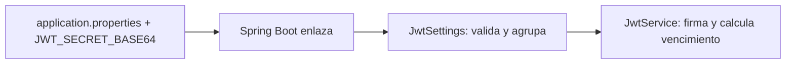
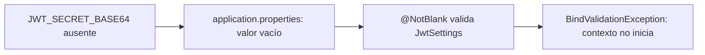
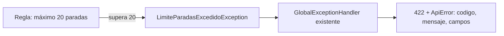
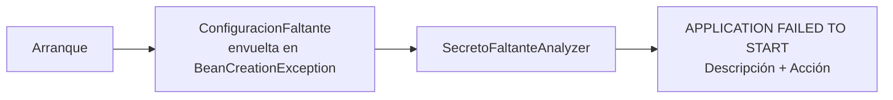
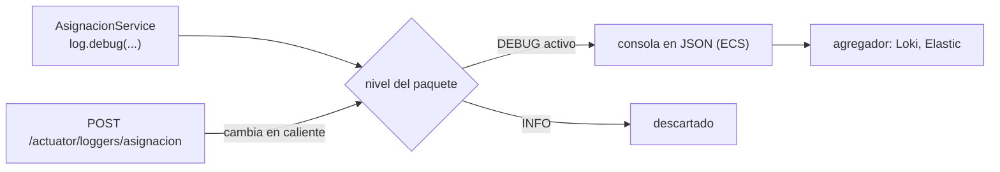

# Módulo 7: Configuración, errores y observabilidad

Cada tema se practica por separado con su propia repetición progresiva y su propio reto de memoria, verificado con `ApplicationContextRunner` y `MockMvc` reales, para que "la aplicación falla al arranque" o "el formato de error es consistente" sean afirmaciones comprobables, no solo descritas. Los Temas 1–4 tratan la configuración y los errores; los Temas 5–8 llevan esas mismas señales a Actuator: salud, métricas, sondas y logs.

**Referencia ejecutable al terminar los módulos 2 y 4–7:** en la raíz del repositorio, abre `README.md`. Incluye el estado final y pruebas; algunas clases incorporan cambios de módulos posteriores. Construye primero las prácticas de este módulo y usa la referencia para comparar y diagnosticar.

## Aprende construyendo


### Tema 1: @ConfigurationProperties tipado · Intermedio · 30 min

<details open>
<summary><strong>Capa 1 — Lectura</strong></summary>

#### ► DE QUÉ TRATA
Este tema te guía por @configurationproperties tipado con foco en comprensión antes de implementación.

#### ► LA IDEA EN UNA FRASE
**Entender @configurationproperties tipado te permite tomar mejores decisiones técnicas.**

#### ► POR QUÉ EXISTE ESTO
Resuelve un problema real de diseño o implementación y evita decisiones a ciegas.

#### ► LA ANALOGÍA
Piensa en @configurationproperties tipado como una herramienta de taller: útil cuando conoces su propósito y sus límites.
**Dónde se rompe la analogía:** en software, los efectos dependen del contexto, la escala y los trade-offs.

#### ► CÓMO FUNCIONA


#### ► LO QUE PUEDE SALIR MAL
| Síntoma | Causa probable | Arreglo |
|---|---|---|
| @ConfigurationProperties tipado se aplica pero el resultado no mejora | Se usó sin medir el problema real | Mide antes y compara contra la alternativa simple |
| Aparece complejidad inesperada | Se adoptó la técnica sin comprender sus trade-offs | Vuelve a la sección de trade-offs y reduce el alcance |
| Falla en un caso límite | Se asumió un contexto que no se cumple | Prueba el caso límite y documenta cuándo NO usarlo |

#### ► TRADE-OFFS
| Opción | Cuándo usarla | Cuándo NO usarla |
|---|---|---|
| Usar @ConfigurationProperties tipado | Cuando el problema coincide con su propósito y el beneficio es observable | Cuando agrega complejidad sin resolver un problema real |
| Alternativa más simple | Cuando el contexto es pequeño, estable o fácil de razonar | Cuando ya demostró no escalar o no cumplir el requisito |
| Postergar la decisión | Cuando falta evidencia del problema | Cuando el costo de esperar es mayor que el costo de probar |

#### ► CUÁNDO NO USAR ESTO
No uses @configurationproperties tipado por defecto. Aplícalo cuando el problema lo justifique y puedas verificar el beneficio; si una alternativa más simple resuelve igual, prefiérela.

#### ► DE VUELTA A LA ANALOGÍA
Volviendo a la analogía: @configurationproperties tipado funciona como el modelo inicial, pero recuerda dónde se rompe: en producción importan la evidencia, la escala y el costo de equivocarte.

#### ► LO QUE DEBES RECORDAR
- @ConfigurationProperties tipado existe para resolver un problema específico.
- Mide antes de adoptar complejidad.
- Conoce el caso donde NO usarlo.
- Verifica con evidencia observable.

#### ► PREGUNTAS PARA PENSAR
1. ¿Qué problema concreto resuelve @configurationproperties tipado en tu contexto?
2. ¿Cómo sabrías que @configurationproperties tipado no está funcionando bien?
3. ¿Qué alternativa más simple considerarías antes de usar @configurationproperties tipado?

</details>

<details>
<summary><strong>Capa 2 — Construcción</strong></summary>

#### Código y verificación


```java
package com.example.demo;

import jakarta.validation.constraints.Min;
import jakarta.validation.constraints.NotBlank;
import org.springframework.boot.context.properties.ConfigurationProperties;
import org.springframework.validation.annotation.Validated;

@ConfigurationProperties("security.jwt")
@Validated
public record JwtSettings(
    @NotBlank String secretBase64,
    @Min(60) long expirationSeconds
) {}
```

```java
import org.springframework.boot.context.properties.ConfigurationPropertiesScan;

@SpringBootApplication
@ConfigurationPropertiesScan
public class DemoApplication { /* conserva aquí el main existente */ }
```

```properties
security.jwt.secret-base64=${JWT_SECRET_BASE64:}
security.jwt.expiration-seconds=900
```

```java
package com.example.demo;

import org.junit.jupiter.api.Test;
import org.springframework.boot.context.properties.EnableConfigurationProperties;
import org.springframework.boot.test.context.runner.ApplicationContextRunner;
import org.springframework.context.annotation.Configuration;
import static org.assertj.core.api.Assertions.assertThat;

class JwtSettingsTest {
    private final ApplicationContextRunner runner = new ApplicationContextRunner()
        .withUserConfiguration(SettingsTestConfig.class);

    @Test
    void enlazaLaClaveYElVencimiento() {
        runner.withPropertyValues(
                "security.jwt.secret-base64=VVFRc3BzQVFzZXJ0T0xhbkt0ZUd4cHlsU21pSnhhOFM=",
                "security.jwt.expiration-seconds=900")
            .run(context -> {
                assertThat(context).hasNotFailed();
                JwtSettings settings = context.getBean(JwtSettings.class);
                assertThat(settings.secretBase64())
                    .isEqualTo("VVFRc3BzQVFzZXJ0T0xhbkt0ZUd4cHlsU21pSnhhOFM=");
                assertThat(settings.expirationSeconds()).isEqualTo(900);
            });
    }

    @Test
    void textoNoSePuedeEnlazarAUnLong() {
        runner.withPropertyValues(
                "security.jwt.secret-base64=test",
                "security.jwt.expiration-seconds=texto")
            .run(context -> assertThat(context).hasFailed());
    }

    @Test
    void vencimientoMenorAlMinimoEsRechazado() {
        runner.withPropertyValues(
                "security.jwt.secret-base64=test",
                "security.jwt.expiration-seconds=59")
            .run(context -> assertThat(context).hasFailed());
    }

    @Configuration(proxyBeanMethods = false)
    @EnableConfigurationProperties(JwtSettings.class)
    static class SettingsTestConfig {}
}
```

```bash
./mvnw -q -Dtest=JwtSettingsTest test
```

</details>

### Tema 2: Fallar rápido al arranque · Intermedio · 30 min

<details open>
<summary><strong>Capa 1 — Lectura</strong></summary>

#### ► DE QUÉ TRATA
Este tema te guía por fallar rápido al arranque con foco en comprensión antes de implementación.

#### ► LA IDEA EN UNA FRASE
**Entender fallar rápido al arranque te permite tomar mejores decisiones técnicas.**

#### ► POR QUÉ EXISTE ESTO
Resuelve un problema real de diseño o implementación y evita decisiones a ciegas.

#### ► LA ANALOGÍA
Piensa en fallar rápido al arranque como una herramienta de taller: útil cuando conoces su propósito y sus límites.
**Dónde se rompe la analogía:** en software, los efectos dependen del contexto, la escala y los trade-offs.

#### ► CÓMO FUNCIONA


#### ► LO QUE PUEDE SALIR MAL
| Síntoma | Causa probable | Arreglo |
|---|---|---|
| Fallar rápido al arranque se aplica pero el resultado no mejora | Se usó sin medir el problema real | Mide antes y compara contra la alternativa simple |
| Aparece complejidad inesperada | Se adoptó la técnica sin comprender sus trade-offs | Vuelve a la sección de trade-offs y reduce el alcance |
| Falla en un caso límite | Se asumió un contexto que no se cumple | Prueba el caso límite y documenta cuándo NO usarlo |

#### ► TRADE-OFFS
| Opción | Cuándo usarla | Cuándo NO usarla |
|---|---|---|
| Usar Fallar rápido al arranque | Cuando el problema coincide con su propósito y el beneficio es observable | Cuando agrega complejidad sin resolver un problema real |
| Alternativa más simple | Cuando el contexto es pequeño, estable o fácil de razonar | Cuando ya demostró no escalar o no cumplir el requisito |
| Postergar la decisión | Cuando falta evidencia del problema | Cuando el costo de esperar es mayor que el costo de probar |

#### ► CUÁNDO NO USAR ESTO
No uses fallar rápido al arranque por defecto. Aplícalo cuando el problema lo justifique y puedas verificar el beneficio; si una alternativa más simple resuelve igual, prefiérela.

#### ► DE VUELTA A LA ANALOGÍA
Volviendo a la analogía: fallar rápido al arranque funciona como el modelo inicial, pero recuerda dónde se rompe: en producción importan la evidencia, la escala y el costo de equivocarte.

#### ► LO QUE DEBES RECORDAR
- Fallar rápido al arranque existe para resolver un problema específico.
- Mide antes de adoptar complejidad.
- Conoce el caso donde NO usarlo.
- Verifica con evidencia observable.

#### ► PREGUNTAS PARA PENSAR
1. ¿Qué problema concreto resuelve fallar rápido al arranque en tu contexto?
2. ¿Cómo sabrías que fallar rápido al arranque no está funcionando bien?
3. ¿Qué alternativa más simple considerarías antes de usar fallar rápido al arranque?

</details>

<details>
<summary><strong>Capa 2 — Construcción</strong></summary>

#### Código y verificación


```java
@Test
void missingSecretHasValidationFailureAtStartup() {
    runner.withPropertyValues("security.jwt.expiration-seconds=900")
        .run(context -> {
            assertThat(context).hasFailed();
            assertThat(context.getStartupFailure())
                .hasRootCauseInstanceOf(BindValidationException.class);
        });
}
```

```java
import org.springframework.boot.context.properties.bind.validation.BindValidationException;
```

```bash
./mvnw -q -Dtest=JwtSettingsTest#missingSecretHasValidationFailureAtStartup test
```

```java
@Test
void blankSecretIsRejectedAtStartup() {
    runner.withPropertyValues(
            "security.jwt.secret-base64=",
            "security.jwt.expiration-seconds=900")
        .run(context -> {
            assertThat(context).hasFailed();
            assertThat(context.getStartupFailure())
                .hasRootCauseInstanceOf(BindValidationException.class);
        });
}
```

```bash
./mvnw -q -Dtest=JwtSettingsTest#missingSecretHasValidationFailureAtStartup+blankSecretIsRejectedAtStartup test
```

</details>

### Tema 3: Manejo global de excepciones consistente entre entornos · Intermedio · 30 min

<details open>
<summary><strong>Capa 1 — Lectura</strong></summary>

#### ► DE QUÉ TRATA
Este tema te guía por manejo global de excepciones consistente entre entornos con foco en comprensión antes de implementación.

#### ► LA IDEA EN UNA FRASE
**Entender manejo global de excepciones consistente entre entornos te permite tomar mejores decisiones técnicas.**

#### ► POR QUÉ EXISTE ESTO
Resuelve un problema real de diseño o implementación y evita decisiones a ciegas.

#### ► LA ANALOGÍA
Piensa en manejo global de excepciones consistente entre entornos como una herramienta de taller: útil cuando conoces su propósito y sus límites.
**Dónde se rompe la analogía:** en software, los efectos dependen del contexto, la escala y los trade-offs.

#### ► CÓMO FUNCIONA


#### ► LO QUE PUEDE SALIR MAL
| Síntoma | Causa probable | Arreglo |
|---|---|---|
| Manejo global de excepciones consistente entre entornos se aplica pero el resultado no mejora | Se usó sin medir el problema real | Mide antes y compara contra la alternativa simple |
| Aparece complejidad inesperada | Se adoptó la técnica sin comprender sus trade-offs | Vuelve a la sección de trade-offs y reduce el alcance |
| Falla en un caso límite | Se asumió un contexto que no se cumple | Prueba el caso límite y documenta cuándo NO usarlo |

#### ► TRADE-OFFS
| Opción | Cuándo usarla | Cuándo NO usarla |
|---|---|---|
| Usar Manejo global de excepciones consistente entre entornos | Cuando el problema coincide con su propósito y el beneficio es observable | Cuando agrega complejidad sin resolver un problema real |
| Alternativa más simple | Cuando el contexto es pequeño, estable o fácil de razonar | Cuando ya demostró no escalar o no cumplir el requisito |
| Postergar la decisión | Cuando falta evidencia del problema | Cuando el costo de esperar es mayor que el costo de probar |

#### ► CUÁNDO NO USAR ESTO
No uses manejo global de excepciones consistente entre entornos por defecto. Aplícalo cuando el problema lo justifique y puedas verificar el beneficio; si una alternativa más simple resuelve igual, prefiérela.

#### ► DE VUELTA A LA ANALOGÍA
Volviendo a la analogía: manejo global de excepciones consistente entre entornos funciona como el modelo inicial, pero recuerda dónde se rompe: en producción importan la evidencia, la escala y el costo de equivocarte.

#### ► LO QUE DEBES RECORDAR
- Manejo global de excepciones consistente entre entornos existe para resolver un problema específico.
- Mide antes de adoptar complejidad.
- Conoce el caso donde NO usarlo.
- Verifica con evidencia observable.

#### ► PREGUNTAS PARA PENSAR
1. ¿Qué problema concreto resuelve manejo global de excepciones consistente entre entornos en tu contexto?
2. ¿Cómo sabrías que manejo global de excepciones consistente entre entornos no está funcionando bien?
3. ¿Qué alternativa más simple considerarías antes de usar manejo global de excepciones consistente entre entornos?

</details>

<details>
<summary><strong>Capa 2 — Construcción</strong></summary>

#### Código y verificación


```java
package com.example.demo;

public class LimiteParadasExcedidoException extends RuntimeException {
    public LimiteParadasExcedidoException(int limite) {
        super("El límite de " + limite + " paradas por ruta fue excedido.");
    }
}
```

```java
package com.example.demo;

import java.util.Map;
import org.springframework.web.bind.annotation.PostMapping;
import org.springframework.web.bind.annotation.RequestParam;
import org.springframework.web.bind.annotation.RestController;

@RestController
public class RutasEntregaController {
    private static final int LIMITE_PARADAS = 20;

    @PostMapping("/api/rutas")
    public Map<String, Object> crear(@RequestParam int numeroDeParadas) {
        if (numeroDeParadas > LIMITE_PARADAS) {
            throw new LimiteParadasExcedidoException(LIMITE_PARADAS);
        }
        return Map.of("estado", "creada", "paradas", numeroDeParadas);
    }
}
```

```java
@ExceptionHandler(LimiteParadasExcedidoException.class)
public ResponseEntity<ApiError> manejarLimiteParadas(LimiteParadasExcedidoException ex) {
    ApiError cuerpo = new ApiError("LIMITE_PARADAS", ex.getMessage(), Map.of());
    return ResponseEntity.unprocessableEntity().body(cuerpo);
}
```

```java
package com.example.demo;

import org.junit.jupiter.api.Test;
import org.springframework.beans.factory.annotation.Autowired;
import org.springframework.boot.test.context.SpringBootTest;
import org.springframework.boot.webmvc.test.autoconfigure.AutoConfigureMockMvc;
import org.springframework.http.MediaType;
import org.springframework.test.web.servlet.MockMvc;
import static org.springframework.test.web.servlet.request.MockMvcRequestBuilders.post;
import static org.springframework.test.web.servlet.result.MockMvcResultMatchers.content;
import static org.springframework.test.web.servlet.result.MockMvcResultMatchers.jsonPath;
import static org.springframework.test.web.servlet.result.MockMvcResultMatchers.status;

@SpringBootTest
@AutoConfigureMockMvc
class RutasEntregaControllerTest {
    @Autowired MockMvc mockMvc;
    @Autowired JwtService jwtService;

    private String bearer() {
        return "Bearer " + jwtService.generar("ana-1", "ADMIN");
    }

    @Test
    void sobreElLimiteDevuelveElApiErrorCompartido() throws Exception {
        mockMvc.perform(post("/api/rutas").param("numeroDeParadas", "21")
                .header("Authorization", bearer()))
            .andExpect(status().isUnprocessableEntity())
            .andExpect(content().contentTypeCompatibleWith(MediaType.APPLICATION_JSON))
            .andExpect(jsonPath("$.codigo").value("LIMITE_PARADAS"))
            .andExpect(jsonPath("$.mensaje")
                .value("El límite de 20 paradas por ruta fue excedido."))
            .andExpect(jsonPath("$.campos").isEmpty());
    }
}
```

```java
@Test
void elLimiteExactoDeVeinteParadasEsAceptado() throws Exception {
    mockMvc.perform(post("/api/rutas").param("numeroDeParadas", "20")
            .header("Authorization", bearer()))
        .andExpect(status().isOk())
        .andExpect(jsonPath("$.estado").value("creada"))
        .andExpect(jsonPath("$.paradas").value(20));
}
```

</details>

### Tema 4: FailureAnalyzer: errores de arranque que explican la causa y la solución · Avanzado · 35 min

<details open>
<summary><strong>Capa 1 — Lectura</strong></summary>

#### ► DE QUÉ TRATA
Usa Spring Boot 4.1.2 con JDK 25. Continúa el proyecto academia-spring del tema anterior, que valida la configuración del secreto JWT al arrancar; las clases nuevas van en com.example.demo.config, dentro del paquete que escanea @SpringBootApplication.

#### ► LA IDEA EN UNA FRASE
**Usa Spring Boot 4.1.2 con JDK 25.**

#### ► POR QUÉ EXISTE ESTO
Resuelve un problema real de diseño o implementación y evita decisiones a ciegas.

#### ► LA ANALOGÍA
**Conceptos clave:** `FailureAnalyzer`, `AbstractFailureAnalyzer`, `FailureAnalysis` (descripción y acción), `spring.factories`, excepción de arranque.

Si el arranque falla, Spring Boot recorre los **analizadores** registrados. El primero que reconoce la excepción devuelve un `FailureAnalysis` con dos textos: **descripción** (qué pasó) y **acción** (qué hacer). Spring Boot los imprime en un recuadro claro en lugar de la pila completa.

`AbstractFailureAnalyzer<T>` busca en la cadena de causas una excepción del tipo `T`, aunque venga envuelta en otras. Los analizadores se registran en `META-INF/spring.factories`, no como beans, porque corren cuando el contexto ya falló.

**Analogía:** un analizador es un mecánico que, en lugar de entregarte el manual entero del motor, te dice «falta aceite: agrega un litro». La analogía falla en que solo reconoce las averías para las que lo entrenaste.

**Límite de uso:** no ocultes la causa original: la pila completa sigue disponible con `--debug`. Escribe analizadores solo para errores frecuentes con una solución conocida.



**Dónde se rompe la analogía:** el modelo simplifica la realidad; en producción influyen escala, fallos, costo y contexto.

#### ► CÓMO FUNCIONA


#### ► LO QUE PUEDE SALIR MAL
| Síntoma | Causa probable | Arreglo |
|---|---|---|
| FailureAnalyzer: errores de arranque que explican la causa y la solución se aplica pero el resultado no mejora | Se usó sin medir el problema real | Mide antes y compara contra la alternativa simple |
| Aparece complejidad inesperada | Se adoptó la técnica sin comprender sus trade-offs | Vuelve a la sección de trade-offs y reduce el alcance |
| Falla en un caso límite | Se asumió un contexto que no se cumple | Prueba el caso límite y documenta cuándo NO usarlo |

#### ► TRADE-OFFS
| Opción | Cuándo usarla | Cuándo NO usarla |
|---|---|---|
| Usar FailureAnalyzer: errores de arranque que explican la causa y la solución | Cuando el problema coincide con su propósito y el beneficio es observable | Cuando agrega complejidad sin resolver un problema real |
| Alternativa más simple | Cuando el contexto es pequeño, estable o fácil de razonar | Cuando ya demostró no escalar o no cumplir el requisito |
| Postergar la decisión | Cuando falta evidencia del problema | Cuando el costo de esperar es mayor que el costo de probar |

#### ► CUÁNDO NO USAR ESTO
No uses failureanalyzer: errores de arranque que explican la causa y la solución por defecto. Aplícalo cuando el problema lo justifique y puedas verificar el beneficio; si una alternativa más simple resuelve igual, prefiérela.

#### ► DE VUELTA A LA ANALOGÍA
Volviendo a la analogía: failureanalyzer: errores de arranque que explican la causa y la solución funciona como el modelo inicial, pero recuerda dónde se rompe: en producción importan la evidencia, la escala y el costo de equivocarte.

#### ► LO QUE DEBES RECORDAR
- FailureAnalyzer: errores de arranque que explican la causa y la solución existe para resolver un problema específico.
- Mide antes de adoptar complejidad.
- Conoce el caso donde NO usarlo.
- Verifica con evidencia observable.

#### ► PREGUNTAS PARA PENSAR
1. ¿Qué problema concreto resuelve failureanalyzer: errores de arranque que explican la causa y la solución en tu contexto?
2. ¿Cómo sabrías que failureanalyzer: errores de arranque que explican la causa y la solución no está funcionando bien?
3. ¿Qué alternativa más simple considerarías antes de usar failureanalyzer: errores de arranque que explican la causa y la solución?

</details>

<details>
<summary><strong>Capa 2 — Construcción</strong></summary>

#### Objetivo observable
Usa Spring Boot 4.1.2 con JDK 25. Continúa el proyecto `academia-spring` del tema anterior, que valida la configuración del secreto JWT al arrancar; las clases nuevas van en `com.example.demo.config`, dentro del paquete que escanea `@SpringBootApplication`.

</details>

### Tema 5: Actuator y health checks personalizados · Avanzado · 30 min

<details open>
<summary><strong>Capa 1 — Lectura</strong></summary>

#### ► DE QUÉ TRATA
Este tema te guía por actuator y health checks personalizados con foco en comprensión antes de implementación.

#### ► LA IDEA EN UNA FRASE
**Entender actuator y health checks personalizados te permite tomar mejores decisiones técnicas.**

#### ► POR QUÉ EXISTE ESTO
Resuelve un problema real de diseño o implementación y evita decisiones a ciegas.

#### ► LA ANALOGÍA
Piensa en actuator y health checks personalizados como una herramienta de taller: útil cuando conoces su propósito y sus límites.
**Dónde se rompe la analogía:** en software, los efectos dependen del contexto, la escala y los trade-offs.

#### ► CÓMO FUNCIONA
1. Identifica el problema que actuator y health checks personalizados resuelve.
2. Observa sus componentes y relaciones.
3. Aplica la opción más simple que funcione.
4. Verifica el resultado y los límites.

#### ► LO QUE PUEDE SALIR MAL
| Síntoma | Causa probable | Arreglo |
|---|---|---|
| Actuator y health checks personalizados se aplica pero el resultado no mejora | Se usó sin medir el problema real | Mide antes y compara contra la alternativa simple |
| Aparece complejidad inesperada | Se adoptó la técnica sin comprender sus trade-offs | Vuelve a la sección de trade-offs y reduce el alcance |
| Falla en un caso límite | Se asumió un contexto que no se cumple | Prueba el caso límite y documenta cuándo NO usarlo |

#### ► TRADE-OFFS
| Opción | Cuándo usarla | Cuándo NO usarla |
|---|---|---|
| Usar Actuator y health checks personalizados | Cuando el problema coincide con su propósito y el beneficio es observable | Cuando agrega complejidad sin resolver un problema real |
| Alternativa más simple | Cuando el contexto es pequeño, estable o fácil de razonar | Cuando ya demostró no escalar o no cumplir el requisito |
| Postergar la decisión | Cuando falta evidencia del problema | Cuando el costo de esperar es mayor que el costo de probar |

#### ► CUÁNDO NO USAR ESTO
No uses actuator y health checks personalizados por defecto. Aplícalo cuando el problema lo justifique y puedas verificar el beneficio; si una alternativa más simple resuelve igual, prefiérela.

#### ► DE VUELTA A LA ANALOGÍA
Volviendo a la analogía: actuator y health checks personalizados funciona como el modelo inicial, pero recuerda dónde se rompe: en producción importan la evidencia, la escala y el costo de equivocarte.

#### ► LO QUE DEBES RECORDAR
- Actuator y health checks personalizados existe para resolver un problema específico.
- Mide antes de adoptar complejidad.
- Conoce el caso donde NO usarlo.
- Verifica con evidencia observable.

#### ► PREGUNTAS PARA PENSAR
1. ¿Qué problema concreto resuelve actuator y health checks personalizados en tu contexto?
2. ¿Cómo sabrías que actuator y health checks personalizados no está funcionando bien?
3. ¿Qué alternativa más simple considerarías antes de usar actuator y health checks personalizados?

</details>

<details>
<summary><strong>Capa 2 — Construcción</strong></summary>

#### Código y verificación
```xml
<dependency>
    <groupId>org.springframework.boot</groupId>
    <artifactId>spring-boot-starter-actuator</artifactId>
</dependency>
```

```java
package com.example.demo;

import org.springframework.stereotype.Component;

@Component
public class ServicioExterno {
    private volatile boolean disponible = true;

    public boolean estaDisponible() { return disponible; }
    public void marcarComoNoDisponible() { disponible = false; }
    public void marcarComoDisponible() { disponible = true; }
}
```

```java
package com.example.demo;

import org.springframework.boot.health.contributor.Health;
import org.springframework.boot.health.contributor.HealthIndicator;
import org.springframework.stereotype.Component;

@Component("pasarelaPagos")
public class ServicioExternoHealthIndicator implements HealthIndicator {
    private final ServicioExterno servicioExterno;

    public ServicioExternoHealthIndicator(ServicioExterno servicioExterno) {
        this.servicioExterno = servicioExterno;
    }

    @Override
    public Health health() {
        return servicioExterno.estaDisponible()
            ? Health.up().build()
            : Health.down().withDetail("razon", "pasarela no responde").build();
    }
}
```

```properties
management.endpoint.health.show-details=always
management.endpoint.health.show-components=always
```

```java
package com.example.demo;

import org.junit.jupiter.api.BeforeEach;
import org.junit.jupiter.api.Test;
import org.springframework.beans.factory.annotation.Autowired;
import org.springframework.boot.test.context.SpringBootTest;
import org.springframework.boot.webmvc.test.autoconfigure.AutoConfigureMockMvc;
import org.springframework.test.web.servlet.MockMvc;

import static org.springframework.test.web.servlet.request.MockMvcRequestBuilders.get;
import static org.springframework.test.web.servlet.result.MockMvcResultMatchers.jsonPath;
import static org.springframework.test.web.servlet.result.MockMvcResultMatchers.status;

@SpringBootTest
@AutoConfigureMockMvc
class ActuatorHealthTest {
    @Autowired MockMvc mockMvc;
    @Autowired ServicioExterno servicioExterno;
    @Autowired JwtService jwtService;

    @BeforeEach
    void dejaLaDependenciaDisponible() {
        servicioExterno.marcarComoDisponible();
    }

    @Test
    void saludUpCuandoLaDependenciaResponde() throws Exception {
        mockMvc.perform(get("/actuator/health")
                .header("Authorization", bearer()))
            .andExpect(status().isOk())
            .andExpect(jsonPath("$.status").value("UP"))
            .andExpect(jsonPath("$.components.pasarelaPagos.status").value("UP"));
    }

    @Test
    void saludDownCuandoLaDependenciaFalla() throws Exception {
        servicioExterno.marcarComoNoDisponible();

        mockMvc.perform(get("/actuator/health")
                .header("Authorization", bearer()))
            .andExpect(status().isServiceUnavailable())
            .andExpect(jsonPath("$.status").value("DOWN"))
            .andExpect(jsonPath("$.components.pasarelaPagos.status").value("DOWN"));
    }

    @Test
    void saludNoEsPublicaEnEstaConfiguracion() throws Exception {
        mockMvc.perform(get("/actuator/health"))
            .andExpect(status().isUnauthorized());
    }

    private String bearer() {
        return "Bearer " + jwtService.generar("monitor@rutaflow.dev", "ADMIN");
    }
}
```

```bash
./mvnw -q -Dtest=ActuatorHealthTest test
```

</details>

### Tema 6: Contar operaciones de negocio con Micrometer · Avanzado · 30 min

<details open>
<summary><strong>Capa 1 — Lectura</strong></summary>

#### ► DE QUÉ TRATA
Este tema te guía por contar operaciones de negocio con micrometer con foco en comprensión antes de implementación.

#### ► LA IDEA EN UNA FRASE
**Entender contar operaciones de negocio con micrometer te permite tomar mejores decisiones técnicas.**

#### ► POR QUÉ EXISTE ESTO
Resuelve un problema real de diseño o implementación y evita decisiones a ciegas.

#### ► LA ANALOGÍA
Piensa en contar operaciones de negocio con micrometer como una herramienta de taller: útil cuando conoces su propósito y sus límites.
**Dónde se rompe la analogía:** en software, los efectos dependen del contexto, la escala y los trade-offs.

#### ► CÓMO FUNCIONA
1. Identifica el problema que contar operaciones de negocio con micrometer resuelve.
2. Observa sus componentes y relaciones.
3. Aplica la opción más simple que funcione.
4. Verifica el resultado y los límites.

#### ► LO QUE PUEDE SALIR MAL
| Síntoma | Causa probable | Arreglo |
|---|---|---|
| Contar operaciones de negocio con Micrometer se aplica pero el resultado no mejora | Se usó sin medir el problema real | Mide antes y compara contra la alternativa simple |
| Aparece complejidad inesperada | Se adoptó la técnica sin comprender sus trade-offs | Vuelve a la sección de trade-offs y reduce el alcance |
| Falla en un caso límite | Se asumió un contexto que no se cumple | Prueba el caso límite y documenta cuándo NO usarlo |

#### ► TRADE-OFFS
| Opción | Cuándo usarla | Cuándo NO usarla |
|---|---|---|
| Usar Contar operaciones de negocio con Micrometer | Cuando el problema coincide con su propósito y el beneficio es observable | Cuando agrega complejidad sin resolver un problema real |
| Alternativa más simple | Cuando el contexto es pequeño, estable o fácil de razonar | Cuando ya demostró no escalar o no cumplir el requisito |
| Postergar la decisión | Cuando falta evidencia del problema | Cuando el costo de esperar es mayor que el costo de probar |

#### ► CUÁNDO NO USAR ESTO
No uses contar operaciones de negocio con micrometer por defecto. Aplícalo cuando el problema lo justifique y puedas verificar el beneficio; si una alternativa más simple resuelve igual, prefiérela.

#### ► DE VUELTA A LA ANALOGÍA
Volviendo a la analogía: contar operaciones de negocio con micrometer funciona como el modelo inicial, pero recuerda dónde se rompe: en producción importan la evidencia, la escala y el costo de equivocarte.

#### ► LO QUE DEBES RECORDAR
- Contar operaciones de negocio con Micrometer existe para resolver un problema específico.
- Mide antes de adoptar complejidad.
- Conoce el caso donde NO usarlo.
- Verifica con evidencia observable.

#### ► PREGUNTAS PARA PENSAR
1. ¿Qué problema concreto resuelve contar operaciones de negocio con micrometer en tu contexto?
2. ¿Cómo sabrías que contar operaciones de negocio con micrometer no está funcionando bien?
3. ¿Qué alternativa más simple considerarías antes de usar contar operaciones de negocio con micrometer?

</details>

<details>
<summary><strong>Capa 2 — Construcción</strong></summary>

#### Código y verificación
```java
import io.micrometer.core.instrument.Counter;
import io.micrometer.core.instrument.MeterRegistry;

private final Counter tareasCreadas;
```

```java
public ServicioTareas(
        TareaRepository repository,
        TareaMapper mapper,
        MeterRegistry registry) {
    this.repository = repository;
    this.mapper = mapper;
    this.tareasCreadas = Counter.builder("rutaflow.tareas.creadas")
        .description("Tareas creadas correctamente")
        .tag("origen", "api")
        .register(registry);
}
```

```java
public TareaDTO crear(CrearTareaRequest request) {
    Tarea tarea = new Tarea(request.titulo(), request.prioridad(), "BODEGA-A");
    TareaDTO creada = mapper.toDto(repository.save(tarea));
    tareasCreadas.increment();
    return creada;
}
```

```properties
management.endpoints.web.exposure.include=health,metrics
```

```java
package com.example.demo;

import io.micrometer.core.instrument.MeterRegistry;
import org.junit.jupiter.api.Test;
import org.springframework.beans.factory.annotation.Autowired;
import org.springframework.boot.test.context.SpringBootTest;
import org.springframework.boot.webmvc.test.autoconfigure.AutoConfigureMockMvc;
import org.springframework.http.MediaType;
import org.springframework.test.web.servlet.MockMvc;

import static org.assertj.core.api.Assertions.assertThat;
import static org.springframework.test.web.servlet.request.MockMvcRequestBuilders.get;
import static org.springframework.test.web.servlet.request.MockMvcRequestBuilders.post;
import static org.springframework.test.web.servlet.result.MockMvcResultMatchers.jsonPath;
import static org.springframework.test.web.servlet.result.MockMvcResultMatchers.status;

@SpringBootTest
@AutoConfigureMockMvc
class MetricasTareasTest {
    @Autowired MockMvc mockMvc;
    @Autowired MeterRegistry registry;
    @Autowired JwtService jwtService;

    @Test
    void crearTareaIncrementaContadorYSePublicaEnActuator() throws Exception {
        double antes = registry.find("rutaflow.tareas.creadas")
            .tag("origen", "api").counter().count();
        String token = "Bearer " + jwtService.generar("metricas@rutaflow.dev", "ADMIN");

        mockMvc.perform(post("/api/tareas")
                .header("Authorization", token)
                .contentType(MediaType.APPLICATION_JSON)
                .content("{\"titulo\":\"Paquete frágil\",\"prioridad\":2}"))
            .andExpect(status().isCreated());

        assertThat(registry.find("rutaflow.tareas.creadas")
            .tag("origen", "api").counter().count()).isEqualTo(antes + 1);

        mockMvc.perform(get("/actuator/metrics/rutaflow.tareas.creadas")
                .header("Authorization", token))
            .andExpect(status().isOk())
            .andExpect(jsonPath("$.name").value("rutaflow.tareas.creadas"))
            .andExpect(jsonPath("$.availableTags[0].tag").value("origen"))
            .andExpect(jsonPath("$.availableTags[0].values[0]").value("api"))
            .andExpect(jsonPath("$.measurements[0].value").value(antes + 1));
    }

    @Test
    void endpointMetricsRequiereAutenticacion() throws Exception {
        mockMvc.perform(get("/actuator/metrics/rutaflow.tareas.creadas"))
            .andExpect(status().isUnauthorized());
    }
}
```

```bash
./mvnw -q -Dtest=MetricasTareasTest test
```

</details>

### Tema 7: Liveness y readiness sin reinicios en cadena · Avanzado · 25 min

<details open>
<summary><strong>Capa 1 — Lectura</strong></summary>

#### ► DE QUÉ TRATA
Este tema te guía por liveness y readiness sin reinicios en cadena con foco en comprensión antes de implementación.

#### ► LA IDEA EN UNA FRASE
**Entender liveness y readiness sin reinicios en cadena te permite tomar mejores decisiones técnicas.**

#### ► POR QUÉ EXISTE ESTO
Resuelve un problema real de diseño o implementación y evita decisiones a ciegas.

#### ► LA ANALOGÍA
Piensa en liveness y readiness sin reinicios en cadena como una herramienta de taller: útil cuando conoces su propósito y sus límites.
**Dónde se rompe la analogía:** en software, los efectos dependen del contexto, la escala y los trade-offs.

#### ► CÓMO FUNCIONA
1. Identifica el problema que liveness y readiness sin reinicios en cadena resuelve.
2. Observa sus componentes y relaciones.
3. Aplica la opción más simple que funcione.
4. Verifica el resultado y los límites.

#### ► LO QUE PUEDE SALIR MAL
| Síntoma | Causa probable | Arreglo |
|---|---|---|
| Liveness y readiness sin reinicios en cadena se aplica pero el resultado no mejora | Se usó sin medir el problema real | Mide antes y compara contra la alternativa simple |
| Aparece complejidad inesperada | Se adoptó la técnica sin comprender sus trade-offs | Vuelve a la sección de trade-offs y reduce el alcance |
| Falla en un caso límite | Se asumió un contexto que no se cumple | Prueba el caso límite y documenta cuándo NO usarlo |

#### ► TRADE-OFFS
| Opción | Cuándo usarla | Cuándo NO usarla |
|---|---|---|
| Usar Liveness y readiness sin reinicios en cadena | Cuando el problema coincide con su propósito y el beneficio es observable | Cuando agrega complejidad sin resolver un problema real |
| Alternativa más simple | Cuando el contexto es pequeño, estable o fácil de razonar | Cuando ya demostró no escalar o no cumplir el requisito |
| Postergar la decisión | Cuando falta evidencia del problema | Cuando el costo de esperar es mayor que el costo de probar |

#### ► CUÁNDO NO USAR ESTO
No uses liveness y readiness sin reinicios en cadena por defecto. Aplícalo cuando el problema lo justifique y puedas verificar el beneficio; si una alternativa más simple resuelve igual, prefiérela.

#### ► DE VUELTA A LA ANALOGÍA
Volviendo a la analogía: liveness y readiness sin reinicios en cadena funciona como el modelo inicial, pero recuerda dónde se rompe: en producción importan la evidencia, la escala y el costo de equivocarte.

#### ► LO QUE DEBES RECORDAR
- Liveness y readiness sin reinicios en cadena existe para resolver un problema específico.
- Mide antes de adoptar complejidad.
- Conoce el caso donde NO usarlo.
- Verifica con evidencia observable.

#### ► PREGUNTAS PARA PENSAR
1. ¿Qué problema concreto resuelve liveness y readiness sin reinicios en cadena en tu contexto?
2. ¿Cómo sabrías que liveness y readiness sin reinicios en cadena no está funcionando bien?
3. ¿Qué alternativa más simple considerarías antes de usar liveness y readiness sin reinicios en cadena?

</details>

<details>
<summary><strong>Capa 2 — Construcción</strong></summary>

#### Código y verificación
```properties
management.endpoint.health.probes.enabled=true
```

```bash
export TOKEN='<pega-aqui-tu-jwt-de-prueba>'
curl -i -H "Authorization: Bearer $TOKEN" http://localhost:8080/actuator/health/liveness
curl -i -H "Authorization: Bearer $TOKEN" http://localhost:8080/actuator/health/readiness
```

```properties
management.endpoint.health.group.readiness.include=readinessState,pasarelaPagos
```

```yaml
livenessProbe:
  httpGet:
    path: /actuator/health/liveness
    port: 8080
  periodSeconds: 10
  failureThreshold: 3
readinessProbe:
  httpGet:
    path: /actuator/health/readiness
    port: 8080
  periodSeconds: 5
  failureThreshold: 2
```

```java
package com.example.demo;

import org.junit.jupiter.api.AfterEach;
import org.junit.jupiter.api.BeforeEach;
import org.junit.jupiter.api.Test;
import org.springframework.beans.factory.annotation.Autowired;
import org.springframework.boot.availability.AvailabilityChangeEvent;
import org.springframework.boot.availability.LivenessState;
import org.springframework.boot.availability.ReadinessState;
import org.springframework.boot.test.context.SpringBootTest;
import org.springframework.boot.webmvc.test.autoconfigure.AutoConfigureMockMvc;
import org.springframework.context.ApplicationContext;
import org.springframework.test.web.servlet.MockMvc;

import static org.springframework.test.web.servlet.request.MockMvcRequestBuilders.get;
import static org.springframework.test.web.servlet.result.MockMvcResultMatchers.jsonPath;
import static org.springframework.test.web.servlet.result.MockMvcResultMatchers.status;

@SpringBootTest
@AutoConfigureMockMvc
class DisponibilidadProbesTest {
    @Autowired MockMvc mockMvc;
    @Autowired ApplicationContext context;
    @Autowired ServicioExterno servicioExterno;
    @Autowired JwtService jwtService;

    @BeforeEach
    @AfterEach
    void restableceEstados() {
        servicioExterno.marcarComoDisponible();
        AvailabilityChangeEvent.publish(context, ReadinessState.ACCEPTING_TRAFFIC);
        AvailabilityChangeEvent.publish(context, LivenessState.CORRECT);
    }

    @Test
    void unaPasarelaCaidaSoloRetiraLaInstanciaDeReadiness() throws Exception {
        servicioExterno.marcarComoNoDisponible();
        mockMvc.perform(get("/actuator/health/readiness").header("Authorization", bearer()))
            .andExpect(status().isServiceUnavailable())
            .andExpect(jsonPath("$.components.pasarelaPagos.status").value("DOWN"));
        mockMvc.perform(get("/actuator/health/liveness").header("Authorization", bearer()))
            .andExpect(status().isOk()).andExpect(jsonPath("$.status").value("UP"));
    }

    @Test
    void rechazarTraficoNoRompeLiveness() throws Exception {
        AvailabilityChangeEvent.publish(context, ReadinessState.REFUSING_TRAFFIC);
        mockMvc.perform(get("/actuator/health/readiness").header("Authorization", bearer()))
            .andExpect(status().isServiceUnavailable());
        mockMvc.perform(get("/actuator/health/liveness").header("Authorization", bearer()))
            .andExpect(status().isOk()).andExpect(jsonPath("$.status").value("UP"));
    }

    @Test
    void procesoRotoAfectaLivenessPeroNoElEstadoReadiness() throws Exception {
        AvailabilityChangeEvent.publish(context, LivenessState.BROKEN);
        mockMvc.perform(get("/actuator/health/liveness").header("Authorization", bearer()))
            .andExpect(status().isServiceUnavailable());
        mockMvc.perform(get("/actuator/health/readiness").header("Authorization", bearer()))
            .andExpect(status().isOk());
    }

    @Test
    void lasDosRutasSiguenProtegidas() throws Exception {
        mockMvc.perform(get("/actuator/health/readiness")).andExpect(status().isUnauthorized());
        mockMvc.perform(get("/actuator/health/liveness")).andExpect(status().isUnauthorized());
    }

    private String bearer() {
        return "Bearer " + jwtService.generar("monitor@rutaflow.dev", "ADMIN");
    }
}
```

```bash
./mvnw -q -Dtest=DisponibilidadProbesTest test
```

</details>

### Tema 8: Logging en Spring Boot: niveles, grupos y logs estructurados en JSON · Avanzado · 40 min

<details open>
<summary><strong>Capa 1 — Lectura</strong></summary>

#### ► DE QUÉ TRATA
Usa Spring Boot 4.1.2 con JDK 25 (los logs estructurados existen desde Spring Boot 3.4) en academia-spring, con las dependencias Spring Web y spring-boot-starter-actuator. Las clases de este tema van en com.example.demo.asignacion, dentro del paquete que escanea @SpringBootApplic…

#### ► LA IDEA EN UNA FRASE
**Usa Spring Boot 4.1.2 con JDK 25 (los logs estructurados existen desde Spring Boot 3.4) en academia-spring, con las dependencias Spring Web y spring-boot-starter-actuator.**

#### ► POR QUÉ EXISTE ESTO
Resuelve un problema real de diseño o implementación y evita decisiones a ciegas.

#### ► LA ANALOGÍA
Piensa en logging en spring boot: niveles, grupos y logs estructurados en json como una herramienta de taller: útil cuando conoces su propósito y sus límites.
**Dónde se rompe la analogía:** en software, los efectos dependen del contexto, la escala y los trade-offs.

#### ► CÓMO FUNCIONA


#### ► LO QUE PUEDE SALIR MAL
| Síntoma | Causa probable | Arreglo |
|---|---|---|
| Logging en Spring Boot: niveles, grupos y logs estructurados en JSON se aplica pero el resultado no mejora | Se usó sin medir el problema real | Mide antes y compara contra la alternativa simple |
| Aparece complejidad inesperada | Se adoptó la técnica sin comprender sus trade-offs | Vuelve a la sección de trade-offs y reduce el alcance |
| Falla en un caso límite | Se asumió un contexto que no se cumple | Prueba el caso límite y documenta cuándo NO usarlo |

#### ► TRADE-OFFS
| Opción | Cuándo usarla | Cuándo NO usarla |
|---|---|---|
| Usar Logging en Spring Boot: niveles, grupos y logs estructurados en JSON | Cuando el problema coincide con su propósito y el beneficio es observable | Cuando agrega complejidad sin resolver un problema real |
| Alternativa más simple | Cuando el contexto es pequeño, estable o fácil de razonar | Cuando ya demostró no escalar o no cumplir el requisito |
| Postergar la decisión | Cuando falta evidencia del problema | Cuando el costo de esperar es mayor que el costo de probar |

#### ► CUÁNDO NO USAR ESTO
No uses logging en spring boot: niveles, grupos y logs estructurados en json por defecto. Aplícalo cuando el problema lo justifique y puedas verificar el beneficio; si una alternativa más simple resuelve igual, prefiérela.

#### ► DE VUELTA A LA ANALOGÍA
Volviendo a la analogía: logging en spring boot: niveles, grupos y logs estructurados en json funciona como el modelo inicial, pero recuerda dónde se rompe: en producción importan la evidencia, la escala y el costo de equivocarte.

#### ► LO QUE DEBES RECORDAR
- Logging en Spring Boot: niveles, grupos y logs estructurados en JSON existe para resolver un problema específico.
- Mide antes de adoptar complejidad.
- Conoce el caso donde NO usarlo.
- Verifica con evidencia observable.

#### ► PREGUNTAS PARA PENSAR
1. ¿Qué problema concreto resuelve logging en spring boot: niveles, grupos y logs estructurados en json en tu contexto?
2. ¿Cómo sabrías que logging en spring boot: niveles, grupos y logs estructurados en json no está funcionando bien?
3. ¿Qué alternativa más simple considerarías antes de usar logging en spring boot: niveles, grupos y logs estructurados en json?

</details>

<details>
<summary><strong>Capa 2 — Construcción</strong></summary>

#### Objetivo observable
Usa Spring Boot 4.1.2 con JDK 25 (los logs estructurados existen desde Spring Boot 3.4) en `academia-spring`, con las dependencias Spring Web y `spring-boot-starter-actuator`. Las clases de este tema van en `com.example.demo.asignacion`, dentro del paquete que escanea `@SpringBootApplication`; si las pones fuera, el endpoint responde 404.

</details>
