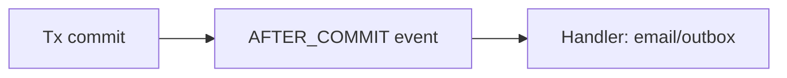
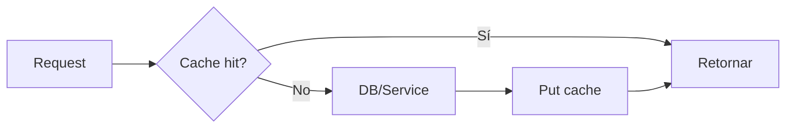
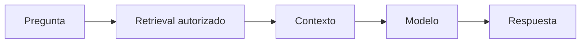

# Módulo 8: Spring Boot en producción

Producción implica más que HTTP CRUD: tareas programadas, eventos, mensajería, correo, caché, integraciones, y ahora capacidades AI/MCP con límites de seguridad claros. Este módulo cubre estos bordes operativos.

**Entorno de referencia verificado (2026-05-22):** JDK 27.0.1.0.2, Maven 3.10.0, Spring Boot 3.5.0. Módulos AI/MCP evolucionan rápido; se marcan notas de versión.

## Aprende construyendo

### Tema 1: Scheduling y tareas periódicas · Intermedio · 35 min

Caso guía: reintentar guías pendientes cada 5 minutos.

#### `@Scheduled`

**Definición formal.** Mecanismo de Spring para ejecutar métodos en intervalos/fixedRate/fixedDelay/cron.

**Ejemplo mínimo.**

```java
@Scheduled(fixedDelay = 60_000)
void reintentar() { /* ... */ }
```

**Error común.** Tarea larga bloqueando el scheduler por defecto. Corrección: pool adecuado, idempotencia, locking distribuido si hay múltiples instancias.

### Tema 2: Eventos locales, eventos transaccionales y mensajería · Intermedio · 40 min

Caso guía: al confirmar pedido, publicar evento; solo si la transacción commit.

#### `ApplicationEvent` y `@TransactionalEventListener`

**Definición formal.** Eventos locales del contexto Spring. `@TransactionalEventListener` puede ejecutarse en fase `AFTER_COMMIT`, evitando efectos secundarios antes de commit.



**Error común.** Enviar mensaje externo dentro de transacción antes de commit. Corrección: AFTER_COMMIT u outbox pattern.

### Tema 3: Correo con Spring Mail y entrega recuperable · Avanzado · 40 min

Caso guía: email de confirmación puede fallar por SMTP temporal.

#### Spring Mail

**Definición formal.** Abstracción para envío de correos (JavaMail/Jakarta Mail).

**Regla.** No hacer del envío SMTP síncrono el punto único de falla de la request crítica. Usa cola/outbox/reintentos.

**Error común.** SMTP down tumba el flujo de negocio. Corrección: desacoplar con outbox/job.

### Tema 4: Caché con Spring Cache, Caffeine y Redis · Avanzado · 45 min

Caso guía: catálogo leído frecuentemente.

#### Spring Cache

**Definición formal.** Abstracción de caché con anotaciones (`@Cacheable`, `@CacheEvict`, `@CachePut`).



**Error común.** Cachear sin estrategia de invalidación. Corrección: TTL, eviction por evento, claves claras.

**Nota.** Caffeine es local; Redis es distribuida. Elige por consistencia/escala.

### Tema 5: Integraciones empresariales, SOAP y fronteras de protocolo · Avanzado · 30 min

Caso guía: integrar con proveedor legacy SOAP.

#### Fronteras de protocolo

**Definición formal.** Adaptadores que aíslan el protocolo externo (SOAP, FTP, EDI) del dominio interno.

**Error común.** Filtrar DTOs SOAP al dominio. Corrección: anti-corruption layer/adapter.

### Tema 6: Spring AI: ChatClient y herramientas con autorización fuera del modelo · Avanzado · 35 min

Caso guía: LLM puede sugerir acción, pero no debe ejecutar sin autorización.

#### Spring AI `ChatClient`

**Definición formal.** Abstracción de Spring AI para interactuar con modelos de chat. Tool calling permite al modelo solicitar herramientas; la ejecución debe estar controlada por la app.

**Regla de seguridad.** El modelo no es autoridad de autorización. Valida permisos en la herramienta/servicio, no en el prompt.

**Nota de versión.** Spring AI evoluciona rápido; verifica versión y APIs exactas.

### Tema 7: RAG desde la frontera de datos: recuperar evidencia autorizada antes de generar · Avanzado · 40 min

Caso guía: responder con documentos internos sin filtrar datos no autorizados.

#### RAG

**Definición formal.** Retrieval-Augmented Generation: recuperar contexto relevante y pasarlo al modelo para generar respuesta fundamentada.



**Error común.** Recuperar por similitud sin filtro de autorización. Corrección: filtrar por tenant/rol antes de pasar contexto al modelo.

### Tema 8: Model Context Protocol (MCP) con Spring AI: exponer y consumir herramientas · Avanzado · 40 min

Caso guía: exponer herramientas internas a un cliente MCP con control.

#### MCP

**Definición formal.** Protocolo para exponer herramientas/recursos/contexto a clientes AI de forma estandarizada.

**Regla.** Tratar herramientas MCP como frontera de seguridad: autenticación, autorización, validación de input, auditoría.

**Nota de verificación.** Requiere stack MCP/Spring AI compatible; verificar versión y configuración exacta. No asumir disponibilidad en Boot 3.5.0 sin dependencia.

## Cierre

Producción es composición de bordes: tiempo, eventos, mensajería, caché, protocolos y AI. Cada borde necesita idempotencia, observabilidad y control de seguridad.

## Checklist

- Uso scheduling con idempotencia/locking cuando aplica.
- Uso AFTER_COMMIT/outbox para efectos externos.
- Cacheo con invalidación clara.
- Aíslo protocolos legacy con adapters.
- En AI/MCP, autorizo en servidor, no en prompt.
