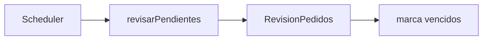
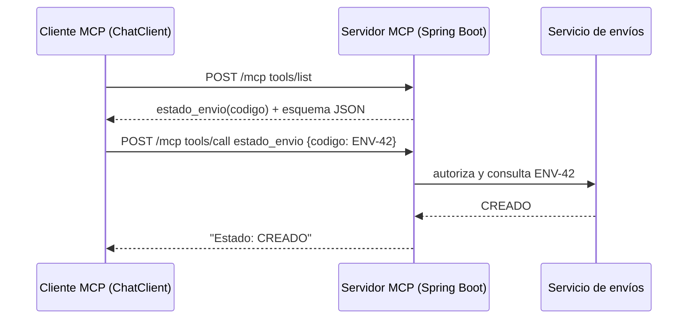

# Módulo 8: Integraciones Spring: scheduling, eventos, correo, caché e IA

## Aprende construyendo

Este módulo completa el mapa de integraciones de Spring identificado en las capturas. Cada capacidad se introduce con una prueba observable y un límite importante: el scheduler local no coordina instancias, los eventos en memoria no son durables, SMTP puede fallar y las cachés necesitan invalidación.


### Dos ejemplos: primero visible, luego real

<details open>
<summary><strong>Capa 1 — Lectura</strong></summary>

#### ► DE QUÉ TRATA
Este tema te guía por dos ejemplos: primero visible, luego real con foco en comprensión antes de implementación.

#### ► LA IDEA EN UNA FRASE
**Entender dos ejemplos: primero visible, luego real te permite tomar mejores decisiones técnicas.**

#### ► POR QUÉ EXISTE ESTO
Resuelve un problema real de diseño o implementación y evita decisiones a ciegas.

#### ► LA ANALOGÍA
Piensa en dos ejemplos: primero visible, luego real como una herramienta de taller: útil cuando conoces su propósito y sus límites.
**Dónde se rompe la analogía:** en software, los efectos dependen del contexto, la escala y los trade-offs.

#### ► CÓMO FUNCIONA
1. Identifica el problema que dos ejemplos: primero visible, luego real resuelve.
2. Observa sus componentes y relaciones.
3. Aplica la opción más simple que funcione.
4. Verifica el resultado y los límites.

#### ► LO QUE PUEDE SALIR MAL
| Síntoma | Causa probable | Arreglo |
|---|---|---|
| Dos ejemplos: primero visible, luego real se aplica pero el resultado no mejora | Se usó sin medir el problema real | Mide antes y compara contra la alternativa simple |
| Aparece complejidad inesperada | Se adoptó la técnica sin comprender sus trade-offs | Vuelve a la sección de trade-offs y reduce el alcance |
| Falla en un caso límite | Se asumió un contexto que no se cumple | Prueba el caso límite y documenta cuándo NO usarlo |

#### ► TRADE-OFFS
| Opción | Cuándo usarla | Cuándo NO usarla |
|---|---|---|
| Usar Dos ejemplos: primero visible, luego real | Cuando el problema coincide con su propósito y el beneficio es observable | Cuando agrega complejidad sin resolver un problema real |
| Alternativa más simple | Cuando el contexto es pequeño, estable o fácil de razonar | Cuando ya demostró no escalar o no cumplir el requisito |
| Postergar la decisión | Cuando falta evidencia del problema | Cuando el costo de esperar es mayor que el costo de probar |

#### ► CUÁNDO NO USAR ESTO
No uses dos ejemplos: primero visible, luego real por defecto. Aplícalo cuando el problema lo justifique y puedas verificar el beneficio; si una alternativa más simple resuelve igual, prefiérela.

#### ► DE VUELTA A LA ANALOGÍA
Volviendo a la analogía: dos ejemplos: primero visible, luego real funciona como el modelo inicial, pero recuerda dónde se rompe: en producción importan la evidencia, la escala y el costo de equivocarte.

#### ► LO QUE DEBES RECORDAR
- Dos ejemplos: primero visible, luego real existe para resolver un problema específico.
- Mide antes de adoptar complejidad.
- Conoce el caso donde NO usarlo.
- Verifica con evidencia observable.

#### ► PREGUNTAS PARA PENSAR
1. ¿Qué problema concreto resuelve dos ejemplos: primero visible, luego real en tu contexto?
2. ¿Cómo sabrías que dos ejemplos: primero visible, luego real no está funcionando bien?
3. ¿Qué alternativa más simple considerarías antes de usar dos ejemplos: primero visible, luego real?

</details>

<details>
<summary><strong>Capa 2 — Construcción</strong></summary>

#### Nota de construcción
Este tema es principalmente conceptual en esta versión. La verificación se realiza con las preguntas de comprensión y el criterio de cuándo NO usar dos ejemplos: primero visible, luego real.

</details>

### Tema 1: Scheduling y tareas periódicas · Intermedio · 35 min

<details open>
<summary><strong>Capa 1 — Lectura</strong></summary>

#### ► DE QUÉ TRATA
Este tema te guía por scheduling y tareas periódicas con foco en comprensión antes de implementación.

#### ► LA IDEA EN UNA FRASE
**Entender scheduling y tareas periódicas te permite tomar mejores decisiones técnicas.**

#### ► POR QUÉ EXISTE ESTO
Resuelve un problema real de diseño o implementación y evita decisiones a ciegas.

#### ► LA ANALOGÍA
Piensa en scheduling y tareas periódicas como una herramienta de taller: útil cuando conoces su propósito y sus límites.
**Dónde se rompe la analogía:** en software, los efectos dependen del contexto, la escala y los trade-offs.

#### ► CÓMO FUNCIONA


#### ► LO QUE PUEDE SALIR MAL
| Síntoma | Causa probable | Arreglo |
|---|---|---|
| Scheduling y tareas periódicas se aplica pero el resultado no mejora | Se usó sin medir el problema real | Mide antes y compara contra la alternativa simple |
| Aparece complejidad inesperada | Se adoptó la técnica sin comprender sus trade-offs | Vuelve a la sección de trade-offs y reduce el alcance |
| Falla en un caso límite | Se asumió un contexto que no se cumple | Prueba el caso límite y documenta cuándo NO usarlo |

#### ► TRADE-OFFS
| Opción | Cuándo usarla | Cuándo NO usarla |
|---|---|---|
| Usar Scheduling y tareas periódicas | Cuando el problema coincide con su propósito y el beneficio es observable | Cuando agrega complejidad sin resolver un problema real |
| Alternativa más simple | Cuando el contexto es pequeño, estable o fácil de razonar | Cuando ya demostró no escalar o no cumplir el requisito |
| Postergar la decisión | Cuando falta evidencia del problema | Cuando el costo de esperar es mayor que el costo de probar |

#### ► CUÁNDO NO USAR ESTO
No uses scheduling y tareas periódicas por defecto. Aplícalo cuando el problema lo justifique y puedas verificar el beneficio; si una alternativa más simple resuelve igual, prefiérela.

#### ► DE VUELTA A LA ANALOGÍA
Volviendo a la analogía: scheduling y tareas periódicas funciona como el modelo inicial, pero recuerda dónde se rompe: en producción importan la evidencia, la escala y el costo de equivocarte.

#### ► LO QUE DEBES RECORDAR
- Scheduling y tareas periódicas existe para resolver un problema específico.
- Mide antes de adoptar complejidad.
- Conoce el caso donde NO usarlo.
- Verifica con evidencia observable.

#### ► PREGUNTAS PARA PENSAR
1. ¿Qué problema concreto resuelve scheduling y tareas periódicas en tu contexto?
2. ¿Cómo sabrías que scheduling y tareas periódicas no está funcionando bien?
3. ¿Qué alternativa más simple considerarías antes de usar scheduling y tareas periódicas?

</details>

<details>
<summary><strong>Capa 2 — Construcción</strong></summary>

#### Código y verificación


```java
@Scheduled(fixedDelayString = "${app.revision.delay-ms}",
           initialDelayString = "${app.revision.initial-delay-ms}")
```

```java
public void revisarPendientes() {
    revision.marcarVencidos();
}
```

```bash
./mvnw -q test
```

```bash
./mvnw -q -Dtest=PedidosSchedulerTest test
```

</details>

### Tema 2: Eventos locales, eventos transaccionales y mensajería · Intermedio · 40 min

<details open>
<summary><strong>Capa 1 — Lectura</strong></summary>

#### ► DE QUÉ TRATA
Este tema te guía por eventos locales, eventos transaccionales y mensajería con foco en comprensión antes de implementación.

#### ► LA IDEA EN UNA FRASE
**Entender eventos locales, eventos transaccionales y mensajería te permite tomar mejores decisiones técnicas.**

#### ► POR QUÉ EXISTE ESTO
Resuelve un problema real de diseño o implementación y evita decisiones a ciegas.

#### ► LA ANALOGÍA
Piensa en eventos locales, eventos transaccionales y mensajería como una herramienta de taller: útil cuando conoces su propósito y sus límites.
**Dónde se rompe la analogía:** en software, los efectos dependen del contexto, la escala y los trade-offs.

#### ► CÓMO FUNCIONA
1. Identifica el problema que eventos locales, eventos transaccionales y mensajería resuelve.
2. Observa sus componentes y relaciones.
3. Aplica la opción más simple que funcione.
4. Verifica el resultado y los límites.

#### ► LO QUE PUEDE SALIR MAL
| Síntoma | Causa probable | Arreglo |
|---|---|---|
| Eventos locales, eventos transaccionales y mensajería se aplica pero el resultado no mejora | Se usó sin medir el problema real | Mide antes y compara contra la alternativa simple |
| Aparece complejidad inesperada | Se adoptó la técnica sin comprender sus trade-offs | Vuelve a la sección de trade-offs y reduce el alcance |
| Falla en un caso límite | Se asumió un contexto que no se cumple | Prueba el caso límite y documenta cuándo NO usarlo |

#### ► TRADE-OFFS
| Opción | Cuándo usarla | Cuándo NO usarla |
|---|---|---|
| Usar Eventos locales, eventos transaccionales y mensajería | Cuando el problema coincide con su propósito y el beneficio es observable | Cuando agrega complejidad sin resolver un problema real |
| Alternativa más simple | Cuando el contexto es pequeño, estable o fácil de razonar | Cuando ya demostró no escalar o no cumplir el requisito |
| Postergar la decisión | Cuando falta evidencia del problema | Cuando el costo de esperar es mayor que el costo de probar |

#### ► CUÁNDO NO USAR ESTO
No uses eventos locales, eventos transaccionales y mensajería por defecto. Aplícalo cuando el problema lo justifique y puedas verificar el beneficio; si una alternativa más simple resuelve igual, prefiérela.

#### ► DE VUELTA A LA ANALOGÍA
Volviendo a la analogía: eventos locales, eventos transaccionales y mensajería funciona como el modelo inicial, pero recuerda dónde se rompe: en producción importan la evidencia, la escala y el costo de equivocarte.

#### ► LO QUE DEBES RECORDAR
- Eventos locales, eventos transaccionales y mensajería existe para resolver un problema específico.
- Mide antes de adoptar complejidad.
- Conoce el caso donde NO usarlo.
- Verifica con evidencia observable.

#### ► PREGUNTAS PARA PENSAR
1. ¿Qué problema concreto resuelve eventos locales, eventos transaccionales y mensajería en tu contexto?
2. ¿Cómo sabrías que eventos locales, eventos transaccionales y mensajería no está funcionando bien?
3. ¿Qué alternativa más simple considerarías antes de usar eventos locales, eventos transaccionales y mensajería?

</details>

<details>
<summary><strong>Capa 2 — Construcción</strong></summary>

#### Código y verificación
```java
@TransactionalEventListener(phase = TransactionPhase.AFTER_COMMIT)
public void afterCommit(UploadAccepted event) { gateway.send(event); }
```

```bash
./mvnw -q -Dtest=UploadPushIntegrationTest#imagenValidaSeGuardaYNotificaDespuesDelCommit test
```

```bash
./mvnw -q -Dtest=UploadPushIntegrationTest#rollbackNoDejaArchivoMetadataNiPush test
```

```java
@Transactional
public EnvioCreado crear(String referencia) {
    // ...
    jdbc.update("INSERT INTO envio (envio_id, referencia) VALUES (?, ?)", envioId, referencia);
    jdbc.update("""
            INSERT INTO outbox_event
                (event_id, aggregate_id, event_type, payload, created_at)
            VALUES (?, ?, ?, ?, ?)
            """, evento.eventId(), envioId, "EnvioCreado", payload, evento.occurredAt());
    return evento;
}
```

```bash
./mvnw -q -Dtest=EnvioEventPublisherTest#guardaEnvioYOutboxEnLaMismaTransaccion test
```

```java
if (existente != null && existente > 0) return false;
jdbc.update("INSERT INTO evento_procesado (event_id, processed_at) VALUES (?, ?)",
        evento.eventId(), clock.instant());
```

</details>

### Tema 3: Correo con Spring Mail y entrega recuperable · Avanzado · 40 min

<details open>
<summary><strong>Capa 1 — Lectura</strong></summary>

#### ► DE QUÉ TRATA
Este tema te guía por correo con spring mail y entrega recuperable con foco en comprensión antes de implementación.

#### ► LA IDEA EN UNA FRASE
**Entender correo con spring mail y entrega recuperable te permite tomar mejores decisiones técnicas.**

#### ► POR QUÉ EXISTE ESTO
Resuelve un problema real de diseño o implementación y evita decisiones a ciegas.

#### ► LA ANALOGÍA
Piensa en correo con spring mail y entrega recuperable como una herramienta de taller: útil cuando conoces su propósito y sus límites.
**Dónde se rompe la analogía:** en software, los efectos dependen del contexto, la escala y los trade-offs.

#### ► CÓMO FUNCIONA
1. Identifica el problema que correo con spring mail y entrega recuperable resuelve.
2. Observa sus componentes y relaciones.
3. Aplica la opción más simple que funcione.
4. Verifica el resultado y los límites.

#### ► LO QUE PUEDE SALIR MAL
| Síntoma | Causa probable | Arreglo |
|---|---|---|
| Correo con Spring Mail y entrega recuperable se aplica pero el resultado no mejora | Se usó sin medir el problema real | Mide antes y compara contra la alternativa simple |
| Aparece complejidad inesperada | Se adoptó la técnica sin comprender sus trade-offs | Vuelve a la sección de trade-offs y reduce el alcance |
| Falla en un caso límite | Se asumió un contexto que no se cumple | Prueba el caso límite y documenta cuándo NO usarlo |

#### ► TRADE-OFFS
| Opción | Cuándo usarla | Cuándo NO usarla |
|---|---|---|
| Usar Correo con Spring Mail y entrega recuperable | Cuando el problema coincide con su propósito y el beneficio es observable | Cuando agrega complejidad sin resolver un problema real |
| Alternativa más simple | Cuando el contexto es pequeño, estable o fácil de razonar | Cuando ya demostró no escalar o no cumplir el requisito |
| Postergar la decisión | Cuando falta evidencia del problema | Cuando el costo de esperar es mayor que el costo de probar |

#### ► CUÁNDO NO USAR ESTO
No uses correo con spring mail y entrega recuperable por defecto. Aplícalo cuando el problema lo justifique y puedas verificar el beneficio; si una alternativa más simple resuelve igual, prefiérela.

#### ► DE VUELTA A LA ANALOGÍA
Volviendo a la analogía: correo con spring mail y entrega recuperable funciona como el modelo inicial, pero recuerda dónde se rompe: en producción importan la evidencia, la escala y el costo de equivocarte.

#### ► LO QUE DEBES RECORDAR
- Correo con Spring Mail y entrega recuperable existe para resolver un problema específico.
- Mide antes de adoptar complejidad.
- Conoce el caso donde NO usarlo.
- Verifica con evidencia observable.

#### ► PREGUNTAS PARA PENSAR
1. ¿Qué problema concreto resuelve correo con spring mail y entrega recuperable en tu contexto?
2. ¿Cómo sabrías que correo con spring mail y entrega recuperable no está funcionando bien?
3. ¿Qué alternativa más simple considerarías antes de usar correo con spring mail y entrega recuperable?

</details>

<details>
<summary><strong>Capa 2 — Construcción</strong></summary>

#### Código de referencia / ejecutable
**Contexto:** el servidor de salida (SMTP) y sus credenciales cambian entre tu equipo, pruebas y producción; el código debe poder moverse sin editarlo.

**Hazlo tú:** abre `application.yml`:

```yaml
spring:
  mail:
    host: ${MAIL_HOST:localhost}
    username: ${MAIL_USERNAME:}
    password: ${MAIL_PASSWORD:}
    properties:
      "[mail.smtp.connectiontimeout]": 5000
      "[mail.smtp.timeout]": 3000
      "[mail.smtp.writetimeout]": 5000
```

Ejecuta la prueba sin servidor:

```bash
./mvnw -q -Dtest=JavaMailCorreoGatewayTest test
```

**Resultado esperado:** las pruebas no necesitan credenciales; el adaptador queda separado de la conexión real. Los límites de tiempo evitan esperar sin fin a un servidor SMTP.

**Fallo deliberado:** escribe una contraseña de prueba literal en `application.yml` y busca claves en el archivo con `rg -n 'password|secret|token' src/main/resources`. **Diagnóstico:** el valor quedaría versionado; quítalo y léelo desde el entorno o el gestor de secretos.

**Entiende:** variables como `MAIL_PASSWORD` son el puente entre el entorno y `spring.mail.password`. No imprimas esas variables ni contraseñas en logs.

**Cierra:** anota qué tres valores configurarías en el servicio de despliegue sin guardarlos en Git.

</details>

### Tema 4: Caché con Spring Cache, Caffeine y Redis · Avanzado · 45 min

<details open>
<summary><strong>Capa 1 — Lectura</strong></summary>

#### ► DE QUÉ TRATA
Este tema te guía por caché con spring cache, caffeine y redis con foco en comprensión antes de implementación.

#### ► LA IDEA EN UNA FRASE
**Entender caché con spring cache, caffeine y redis te permite tomar mejores decisiones técnicas.**

#### ► POR QUÉ EXISTE ESTO
Resuelve un problema real de diseño o implementación y evita decisiones a ciegas.

#### ► LA ANALOGÍA
Piensa en caché con spring cache, caffeine y redis como una herramienta de taller: útil cuando conoces su propósito y sus límites.
**Dónde se rompe la analogía:** en software, los efectos dependen del contexto, la escala y los trade-offs.

#### ► CÓMO FUNCIONA
1. Identifica el problema que caché con spring cache, caffeine y redis resuelve.
2. Observa sus componentes y relaciones.
3. Aplica la opción más simple que funcione.
4. Verifica el resultado y los límites.

#### ► LO QUE PUEDE SALIR MAL
| Síntoma | Causa probable | Arreglo |
|---|---|---|
| Caché con Spring Cache, Caffeine y Redis se aplica pero el resultado no mejora | Se usó sin medir el problema real | Mide antes y compara contra la alternativa simple |
| Aparece complejidad inesperada | Se adoptó la técnica sin comprender sus trade-offs | Vuelve a la sección de trade-offs y reduce el alcance |
| Falla en un caso límite | Se asumió un contexto que no se cumple | Prueba el caso límite y documenta cuándo NO usarlo |

#### ► TRADE-OFFS
| Opción | Cuándo usarla | Cuándo NO usarla |
|---|---|---|
| Usar Caché con Spring Cache, Caffeine y Redis | Cuando el problema coincide con su propósito y el beneficio es observable | Cuando agrega complejidad sin resolver un problema real |
| Alternativa más simple | Cuando el contexto es pequeño, estable o fácil de razonar | Cuando ya demostró no escalar o no cumplir el requisito |
| Postergar la decisión | Cuando falta evidencia del problema | Cuando el costo de esperar es mayor que el costo de probar |

#### ► CUÁNDO NO USAR ESTO
No uses caché con spring cache, caffeine y redis por defecto. Aplícalo cuando el problema lo justifique y puedas verificar el beneficio; si una alternativa más simple resuelve igual, prefiérela.

#### ► DE VUELTA A LA ANALOGÍA
Volviendo a la analogía: caché con spring cache, caffeine y redis funciona como el modelo inicial, pero recuerda dónde se rompe: en producción importan la evidencia, la escala y el costo de equivocarte.

#### ► LO QUE DEBES RECORDAR
- Caché con Spring Cache, Caffeine y Redis existe para resolver un problema específico.
- Mide antes de adoptar complejidad.
- Conoce el caso donde NO usarlo.
- Verifica con evidencia observable.

#### ► PREGUNTAS PARA PENSAR
1. ¿Qué problema concreto resuelve caché con spring cache, caffeine y redis en tu contexto?
2. ¿Cómo sabrías que caché con spring cache, caffeine y redis no está funcionando bien?
3. ¿Qué alternativa más simple considerarías antes de usar caché con spring cache, caffeine y redis?

</details>

<details>
<summary><strong>Capa 2 — Construcción</strong></summary>

#### Código y verificación
```java
@Cacheable(cacheNames = "tarifas", key = "#zona")
public Tarifa buscar(String zona) {
    return repository.buscarPorZona(zona)
            .orElseThrow(() -> new IllegalArgumentException("Zona desconocida: " + zona));
}
```

```bash
./mvnw -q -Dtest=TarifaServiceTest#segundaConsultaReutilizaLaTarifaCacheada test
```

```java
@CacheEvict(cacheNames = "tarifas", key = "#tarifa.zona")
public Tarifa actualizar(Tarifa tarifa) {
    return repository.guardar(tarifa);
}

@CachePut(cacheNames = "tarifas", key = "#result.zona")
public Tarifa actualizarYCachear(Tarifa tarifa) {
    return repository.guardar(tarifa);
}
```

```bash
./mvnw -q -Dtest=TarifaServiceTest#cadaZonaTieneSuPropiaEntrada test
./mvnw -q -Dtest=TarifaServiceTest#actualizarInvalidaLaClaveDeEsaZona test
./mvnw -q -Dtest=TarifaServiceTest#cachePutActualizaLaCopiaSinOtraLecturaDelRepositorio test
```

```yaml
spring:
  cache:
    type: caffeine
    cache-names: tarifas
    caffeine:
      spec: maximumSize=1000,expireAfterWrite=5m,recordStats
```

```bash
./mvnw -q -Dtest=TarifaServiceTest#proveedorTieneLimiteDeEntradasYExpiracionConfigurados test
```

</details>

### Tema 5: Integraciones empresariales, SOAP y fronteras de protocolo · Avanzado · 30 min

<details open>
<summary><strong>Capa 1 — Lectura</strong></summary>

#### ► DE QUÉ TRATA
Este tema te guía por integraciones empresariales, soap y fronteras de protocolo con foco en comprensión antes de implementación.

#### ► LA IDEA EN UNA FRASE
**Entender integraciones empresariales, soap y fronteras de protocolo te permite tomar mejores decisiones técnicas.**

#### ► POR QUÉ EXISTE ESTO
Resuelve un problema real de diseño o implementación y evita decisiones a ciegas.

#### ► LA ANALOGÍA
Piensa en integraciones empresariales, soap y fronteras de protocolo como una herramienta de taller: útil cuando conoces su propósito y sus límites.
**Dónde se rompe la analogía:** en software, los efectos dependen del contexto, la escala y los trade-offs.

#### ► CÓMO FUNCIONA
1. Identifica el problema que integraciones empresariales, soap y fronteras de protocolo resuelve.
2. Observa sus componentes y relaciones.
3. Aplica la opción más simple que funcione.
4. Verifica el resultado y los límites.

#### ► LO QUE PUEDE SALIR MAL
| Síntoma | Causa probable | Arreglo |
|---|---|---|
| Integraciones empresariales, SOAP y fronteras de protocolo se aplica pero el resultado no mejora | Se usó sin medir el problema real | Mide antes y compara contra la alternativa simple |
| Aparece complejidad inesperada | Se adoptó la técnica sin comprender sus trade-offs | Vuelve a la sección de trade-offs y reduce el alcance |
| Falla en un caso límite | Se asumió un contexto que no se cumple | Prueba el caso límite y documenta cuándo NO usarlo |

#### ► TRADE-OFFS
| Opción | Cuándo usarla | Cuándo NO usarla |
|---|---|---|
| Usar Integraciones empresariales, SOAP y fronteras de protocolo | Cuando el problema coincide con su propósito y el beneficio es observable | Cuando agrega complejidad sin resolver un problema real |
| Alternativa más simple | Cuando el contexto es pequeño, estable o fácil de razonar | Cuando ya demostró no escalar o no cumplir el requisito |
| Postergar la decisión | Cuando falta evidencia del problema | Cuando el costo de esperar es mayor que el costo de probar |

#### ► CUÁNDO NO USAR ESTO
No uses integraciones empresariales, soap y fronteras de protocolo por defecto. Aplícalo cuando el problema lo justifique y puedas verificar el beneficio; si una alternativa más simple resuelve igual, prefiérela.

#### ► DE VUELTA A LA ANALOGÍA
Volviendo a la analogía: integraciones empresariales, soap y fronteras de protocolo funciona como el modelo inicial, pero recuerda dónde se rompe: en producción importan la evidencia, la escala y el costo de equivocarte.

#### ► LO QUE DEBES RECORDAR
- Integraciones empresariales, SOAP y fronteras de protocolo existe para resolver un problema específico.
- Mide antes de adoptar complejidad.
- Conoce el caso donde NO usarlo.
- Verifica con evidencia observable.

#### ► PREGUNTAS PARA PENSAR
1. ¿Qué problema concreto resuelve integraciones empresariales, soap y fronteras de protocolo en tu contexto?
2. ¿Cómo sabrías que integraciones empresariales, soap y fronteras de protocolo no está funcionando bien?
3. ¿Qué alternativa más simple considerarías antes de usar integraciones empresariales, soap y fronteras de protocolo?

</details>

<details>
<summary><strong>Capa 2 — Construcción</strong></summary>

#### Código y verificación
```bash
cp -R soap-contract-rutaflow practica-soap
cd practica-soap
python3 -m unittest -v
```

```bash
python3 soap_contrato.py
python3 -m unittest test_soap_contrato.ContratoTest.test_extrae_identificador -v
```

```bash
python3 -m unittest test_soap_contrato.ContratoTest.test_prefijo_no_cambia_identidad -v
```

```bash
python3 -m unittest test_soap_contrato.ContratoTest.test_rechaza_version_y_id_vacio test_soap_contrato.ContratoTest.test_fault_no_se_convierte_en_exito -v
```

```markdown
| Canal | Evidencia mínima | Lo que falta comprobar |
| REST | Estado HTTP y contrato del recurso | Autorización y resultado de negocio |
| SOAP | Versión, operación y Fault | WSDL, esquema y servicio real |
| SFTP | Transferencia sobre SSH | Host key, archivo completo y procesamiento |
| SMTP | Aceptación por servidor | Entrega final al destinatario |

Socio: transporte por confirmar con su contrato.
Identidad del envío: campo id, obligatorio y no vacío.
Correlación: conservar un identificador en petición, resultado y diagnóstico.
Reintentos: definir errores transitorios y evitar duplicar efectos.
```

```bash
python3 -m unittest -v
```

</details>

### Tema 6: Spring AI: ChatClient y herramientas con autorización fuera del modelo · Avanzado · 35 min

<details open>
<summary><strong>Capa 1 — Lectura</strong></summary>

#### ► DE QUÉ TRATA
Este tema te guía por spring ai: chatclient y herramientas con autorización fuera del modelo con foco en comprensión antes de implementación.

#### ► LA IDEA EN UNA FRASE
**Entender spring ai: chatclient y herramientas con autorización fuera del modelo te permite tomar mejores decisiones técnicas.**

#### ► POR QUÉ EXISTE ESTO
Resuelve un problema real de diseño o implementación y evita decisiones a ciegas.

#### ► LA ANALOGÍA
Piensa en spring ai: chatclient y herramientas con autorización fuera del modelo como una herramienta de taller: útil cuando conoces su propósito y sus límites.
**Dónde se rompe la analogía:** en software, los efectos dependen del contexto, la escala y los trade-offs.

#### ► CÓMO FUNCIONA
1. Identifica el problema que spring ai: chatclient y herramientas con autorización fuera del modelo resuelve.
2. Observa sus componentes y relaciones.
3. Aplica la opción más simple que funcione.
4. Verifica el resultado y los límites.

#### ► LO QUE PUEDE SALIR MAL
| Síntoma | Causa probable | Arreglo |
|---|---|---|
| Spring AI: ChatClient y herramientas con autorización fuera del modelo se aplica pero el resultado no mejora | Se usó sin medir el problema real | Mide antes y compara contra la alternativa simple |
| Aparece complejidad inesperada | Se adoptó la técnica sin comprender sus trade-offs | Vuelve a la sección de trade-offs y reduce el alcance |
| Falla en un caso límite | Se asumió un contexto que no se cumple | Prueba el caso límite y documenta cuándo NO usarlo |

#### ► TRADE-OFFS
| Opción | Cuándo usarla | Cuándo NO usarla |
|---|---|---|
| Usar Spring AI: ChatClient y herramientas con autorización fuera del modelo | Cuando el problema coincide con su propósito y el beneficio es observable | Cuando agrega complejidad sin resolver un problema real |
| Alternativa más simple | Cuando el contexto es pequeño, estable o fácil de razonar | Cuando ya demostró no escalar o no cumplir el requisito |
| Postergar la decisión | Cuando falta evidencia del problema | Cuando el costo de esperar es mayor que el costo de probar |

#### ► CUÁNDO NO USAR ESTO
No uses spring ai: chatclient y herramientas con autorización fuera del modelo por defecto. Aplícalo cuando el problema lo justifique y puedas verificar el beneficio; si una alternativa más simple resuelve igual, prefiérela.

#### ► DE VUELTA A LA ANALOGÍA
Volviendo a la analogía: spring ai: chatclient y herramientas con autorización fuera del modelo funciona como el modelo inicial, pero recuerda dónde se rompe: en producción importan la evidencia, la escala y el costo de equivocarte.

#### ► LO QUE DEBES RECORDAR
- Spring AI: ChatClient y herramientas con autorización fuera del modelo existe para resolver un problema específico.
- Mide antes de adoptar complejidad.
- Conoce el caso donde NO usarlo.
- Verifica con evidencia observable.

#### ► PREGUNTAS PARA PENSAR
1. ¿Qué problema concreto resuelve spring ai: chatclient y herramientas con autorización fuera del modelo en tu contexto?
2. ¿Cómo sabrías que spring ai: chatclient y herramientas con autorización fuera del modelo no está funcionando bien?
3. ¿Qué alternativa más simple considerarías antes de usar spring ai: chatclient y herramientas con autorización fuera del modelo?

</details>

<details>
<summary><strong>Capa 2 — Construcción</strong></summary>

#### Código y verificación
```bash
cp -R spring-ai practica-spring-ai
cd practica-spring-ai
./mvnw -q clean test
```

```bash
./mvnw -q -Dtest=ChatToolsTest#chatClientUsaElModeloSustituible test
```

```xml
<project xmlns="http://maven.apache.org/POM/4.0.0"><modelVersion>4.0.0</modelVersion>
  <parent><groupId>org.springframework.boot</groupId><artifactId>spring-boot-starter-parent</artifactId><version>4.0.9</version><relativePath/></parent>
  <groupId>academia</groupId><artifactId>spring-ai-lab</artifactId><version>1</version>
  <properties><java.version>27</java.version></properties>
  <dependencyManagement><dependencies><dependency><groupId>org.springframework.ai</groupId><artifactId>spring-ai-bom</artifactId><version>2.0.2</version><type>pom</type><scope>import</scope></dependency></dependencies></dependencyManagement>
  <dependencies><dependency><groupId>org.springframework.ai</groupId><artifactId>spring-ai-client-chat</artifactId></dependency><dependency><groupId>org.springframework.boot</groupId><artifactId>spring-boot-starter-test</artifactId><scope>test</scope></dependency></dependencies>
</project>
```

```java
package academia;
import org.junit.jupiter.api.Test;
import org.springframework.ai.chat.client.ChatClient;
import org.springframework.ai.chat.messages.AssistantMessage;
import org.springframework.ai.chat.model.ChatModel;
import org.springframework.ai.chat.model.ChatResponse;
import org.springframework.ai.chat.model.Generation;
import org.springframework.ai.tool.annotation.Tool;
import org.springframework.ai.tool.method.MethodToolCallbackProvider;
import java.util.List;
import java.util.Set;
import static org.junit.jupiter.api.Assertions.*;

class ChatToolsTest {
    static class Consulta {
        // En producción, estos permisos vienen de la sesión verificada del servidor.
        private final Set<String> enviosPermitidos;
        Consulta() { this(Set.of("ENV-42")); }
        Consulta(Set<String> enviosPermitidos) { this.enviosPermitidos = Set.copyOf(enviosPermitidos); }
        @Tool(description = "Consulta el estado del envío autorizado de esta sesión")
        public String estado(String envioId) {
            if (!enviosPermitidos.contains(envioId)) throw new IllegalArgumentException("Sin permiso");
            return "creado";
        }
    }
    @Test void chatClientUsaElModeloSustituible() {
        ChatModel modeloControlado = prompt -> {
            assertTrue(prompt.getInstructions().stream().anyMatch(m -> m.getText().contains("ENV-42")));
            return new ChatResponse(List.of(new Generation(new AssistantMessage("Estado: creado"))));
        };
        var client = ChatClient.builder(modeloControlado).build();
        assertEquals("Estado: creado", client.prompt().user("Consulta ENV-42").call().content());
    }
    @Test void callbackRealRespetaLaFronteraDeAutorizacion() {
        var callbacks = MethodToolCallbackProvider.builder().toolObjects(new Consulta()).build().getToolCallbacks();
        assertEquals(1, callbacks.length);
        assertTrue(callbacks[0].call("{\"envioId\":\"ENV-42\"}").contains("creado"));
        assertThrows(RuntimeException.class, () -> callbacks[0].call("{\"envioId\":\"ENV-ajeno\"}"));
    }
    @Test void dosSesionesNoCompartenPermisos() {
        var ana = MethodToolCallbackProvider.builder()
            .toolObjects(new Consulta(Set.of("ENV-42"))).build().getToolCallbacks()[0];
        var bruno = MethodToolCallbackProvider.builder()
            .toolObjects(new Consulta(Set.of("ENV-99"))).build().getToolCallbacks()[0];
        assertTrue(ana.call("{\"envioId\":\"ENV-42\"}").contains("creado"));
        assertTrue(bruno.call("{\"envioId\":\"ENV-99\"}").contains("creado"));
        assertThrows(RuntimeException.class, () -> ana.call("{\"envioId\":\"ENV-99\"}"));
        assertThrows(RuntimeException.class, () -> bruno.call("{\"envioId\":\"ENV-42\"}"));
    }
    @Test void contratoNoSolicitaIdentidadAlModelo() {
        var callback = MethodToolCallbackProvider.builder()
            .toolObjects(new Consulta()).build().getToolCallbacks()[0];
        String schema = callback.getToolDefinition().inputSchema();
        assertTrue(schema.contains("envioId"));
        assertFalse(schema.contains("usuario"));
        assertFalse(schema.contains("empresa"));
    }
}
```

```bash
./mvnw -q -Dtest=ChatToolsTest#callbackRealRespetaLaFronteraDeAutorizacion test
```

```bash
./mvnw -q -Dtest=ChatToolsTest#dosSesionesNoCompartenPermisos test
```

</details>

### Tema 7: RAG desde la frontera de datos: recuperar evidencia autorizada antes de generar · Avanzado · 40 min

<details open>
<summary><strong>Capa 1 — Lectura</strong></summary>

#### ► DE QUÉ TRATA
Este tema te guía por rag desde la frontera de datos: recuperar evidencia autorizada antes de generar con foco en comprensión antes de implementación.

#### ► LA IDEA EN UNA FRASE
**Entender rag desde la frontera de datos: recuperar evidencia autorizada antes de generar te permite tomar mejores decisiones técnicas.**

#### ► POR QUÉ EXISTE ESTO
Resuelve un problema real de diseño o implementación y evita decisiones a ciegas.

#### ► LA ANALOGÍA
Piensa en rag desde la frontera de datos: recuperar evidencia autorizada antes de generar como una herramienta de taller: útil cuando conoces su propósito y sus límites.
**Dónde se rompe la analogía:** en software, los efectos dependen del contexto, la escala y los trade-offs.

#### ► CÓMO FUNCIONA
1. Identifica el problema que rag desde la frontera de datos: recuperar evidencia autorizada antes de generar resuelve.
2. Observa sus componentes y relaciones.
3. Aplica la opción más simple que funcione.
4. Verifica el resultado y los límites.

#### ► LO QUE PUEDE SALIR MAL
| Síntoma | Causa probable | Arreglo |
|---|---|---|
| RAG desde la frontera de datos: recuperar evidencia autorizada antes de generar se aplica pero el resultado no mejora | Se usó sin medir el problema real | Mide antes y compara contra la alternativa simple |
| Aparece complejidad inesperada | Se adoptó la técnica sin comprender sus trade-offs | Vuelve a la sección de trade-offs y reduce el alcance |
| Falla en un caso límite | Se asumió un contexto que no se cumple | Prueba el caso límite y documenta cuándo NO usarlo |

#### ► TRADE-OFFS
| Opción | Cuándo usarla | Cuándo NO usarla |
|---|---|---|
| Usar RAG desde la frontera de datos: recuperar evidencia autorizada antes de generar | Cuando el problema coincide con su propósito y el beneficio es observable | Cuando agrega complejidad sin resolver un problema real |
| Alternativa más simple | Cuando el contexto es pequeño, estable o fácil de razonar | Cuando ya demostró no escalar o no cumplir el requisito |
| Postergar la decisión | Cuando falta evidencia del problema | Cuando el costo de esperar es mayor que el costo de probar |

#### ► CUÁNDO NO USAR ESTO
Contexto: no todas las preguntas tienen respuesta en el corpus. Generar texto sin reconocer esa ausencia puede convertir una suposición en una afirmación sobre la empresa.

#### ► DE VUELTA A LA ANALOGÍA
Volviendo a la analogía: rag desde la frontera de datos: recuperar evidencia autorizada antes de generar funciona como el modelo inicial, pero recuerda dónde se rompe: en producción importan la evidencia, la escala y el costo de equivocarte.

#### ► LO QUE DEBES RECORDAR
- RAG desde la frontera de datos: recuperar evidencia autorizada antes de generar existe para resolver un problema específico.
- Mide antes de adoptar complejidad.
- Conoce el caso donde NO usarlo.
- Verifica con evidencia observable.

#### ► PREGUNTAS PARA PENSAR
1. ¿Qué problema concreto resuelve rag desde la frontera de datos: recuperar evidencia autorizada antes de generar en tu contexto?
2. ¿Cómo sabrías que rag desde la frontera de datos: recuperar evidencia autorizada antes de generar no está funcionando bien?
3. ¿Qué alternativa más simple considerarías antes de usar rag desde la frontera de datos: recuperar evidencia autorizada antes de generar?

</details>

<details>
<summary><strong>Capa 2 — Construcción</strong></summary>

#### Código y verificación
```bash
./mvnw -q -Dtest=RagScopeTest#filtraAntesDeConstruirContexto test
```

```java
package academia;
import org.junit.jupiter.api.Test;
import org.springframework.ai.document.Document;
import java.util.List;
import java.util.Map;
import static org.junit.jupiter.api.Assertions.*;

class RagScopeTest {
    // Recuperador léxico didáctico: no simula embeddings ni búsqueda vectorial.
    List<Document> recuperar(String empresaAutorizada, String termino, List<Document> corpus) {
        if (termino.isBlank()) return List.of();
        return corpus.stream()
            .filter(d -> empresaAutorizada.equals(d.getMetadata().get("empresa")))
            .filter(d -> d.getText().toLowerCase(java.util.Locale.ROOT)
                .contains(termino.toLowerCase(java.util.Locale.ROOT)))
            .limit(2).toList();
    }
    @Test void filtraAntesDeConstruirContexto() {
        var corpus = List.of(
            new Document("Reembolso: revisar comprobante", Map.of("empresa", "A")),
            new Document("Reembolso secreto de B", Map.of("empresa", "B")));
        var docs = recuperar("A", "reembolso", corpus);
        assertEquals(1, docs.size());
        assertFalse(docs.getFirst().getText().contains("secreto"));
        assertEquals("A", docs.getFirst().getMetadata().get("empresa"));
    }
    @Test void sinEvidenciaNoSeInventaContexto() {
        assertTrue(recuperar("A", "", List.of(new Document("Reembolso", Map.of("empresa", "A")))).isEmpty());
        assertTrue(recuperar("A", "factura", List.of(new Document("GPS", Map.of("empresa", "A")))).isEmpty());
    }
    @Test void filtraAntesDeLimitarYConservaReferencias() {
        var corpus = List.of(
            new Document("b-1", "Reembolso ajeno 1", Map.of("empresa", "B")),
            new Document("b-2", "Reembolso ajeno 2", Map.of("empresa", "B")),
            new Document("a-1", "Reembolso autorizado 1", Map.of("empresa", "A")),
            new Document("a-2", "Reembolso autorizado 2", Map.of("empresa", "A")),
            new Document("a-3", "Reembolso autorizado 3", Map.of("empresa", "A")));
        var docs = recuperar("A", "REEMBOLSO", corpus);
        assertEquals(List.of("a-1", "a-2"), docs.stream().map(Document::getId).toList());
        assertTrue(docs.stream().allMatch(d -> "A".equals(d.getMetadata().get("empresa"))));
    }
    @Test void documentoSinEmpresaNoSeCompartePorDefecto() {
        var corpus = List.of(new Document("Reembolso sin propietario", Map.of()));
        assertTrue(recuperar("A", "reembolso", corpus).isEmpty());
    }
}
```

```bash
./mvnw -q -Dtest=RagScopeTest#sinEvidenciaNoSeInventaContexto test
```

```bash
./mvnw -q -Dtest=RagScopeTest#filtraAntesDeLimitarYConservaReferencias test
```

```bash
./mvnw -q -Dtest=RagScopeTest#documentoSinEmpresaNoSeCompartePorDefecto test
```

</details>

### Tema 8: Model Context Protocol (MCP) con Spring AI: exponer y consumir herramientas · Avanzado · 40 min

<details open>
<summary><strong>Capa 1 — Lectura</strong></summary>

#### ► DE QUÉ TRATA
Al finalizar vas a publicar una herramienta de RutaFlow como servidor MCP con Spring AI, listarla desde un cliente y entregársela a un ChatClient sin copiar su código. Prerrequisitos: el Tema 6 de este módulo (ChatClient y herramientas con @Tool), REST con Spring MVC y JDK 25 o s…

#### ► LA IDEA EN UNA FRASE
**Al finalizar vas a publicar una herramienta de RutaFlow como servidor MCP con Spring AI, listarla desde un cliente y entregársela a un ChatClient sin copiar su código.**

#### ► POR QUÉ EXISTE ESTO
Resuelve un problema real de diseño o implementación y evita decisiones a ciegas.

#### ► LA ANALOGÍA
Piensa en model context protocol (mcp) con spring ai: exponer y consumir herramientas como una herramienta de taller: útil cuando conoces su propósito y sus límites.
**Dónde se rompe la analogía:** en software, los efectos dependen del contexto, la escala y los trade-offs.

#### ► CÓMO FUNCIONA


#### ► LO QUE PUEDE SALIR MAL
| Síntoma | Causa probable | Arreglo |
|---|---|---|
| Model Context Protocol (MCP) con Spring AI: exponer y consumir herramientas se aplica pero el resultado no mejora | Se usó sin medir el problema real | Mide antes y compara contra la alternativa simple |
| Aparece complejidad inesperada | Se adoptó la técnica sin comprender sus trade-offs | Vuelve a la sección de trade-offs y reduce el alcance |
| Falla en un caso límite | Se asumió un contexto que no se cumple | Prueba el caso límite y documenta cuándo NO usarlo |

#### ► TRADE-OFFS
| Opción | Cuándo usarla | Cuándo NO usarla |
|---|---|---|
| Usar Model Context Protocol (MCP) con Spring AI: exponer y consumir herramientas | Cuando el problema coincide con su propósito y el beneficio es observable | Cuando agrega complejidad sin resolver un problema real |
| Alternativa más simple | Cuando el contexto es pequeño, estable o fácil de razonar | Cuando ya demostró no escalar o no cumplir el requisito |
| Postergar la decisión | Cuando falta evidencia del problema | Cuando el costo de esperar es mayor que el costo de probar |

#### ► CUÁNDO NO USAR ESTO
No uses model context protocol (mcp) con spring ai: exponer y consumir herramientas por defecto. Aplícalo cuando el problema lo justifique y puedas verificar el beneficio; si una alternativa más simple resuelve igual, prefiérela.

#### ► DE VUELTA A LA ANALOGÍA
Volviendo a la analogía: model context protocol (mcp) con spring ai: exponer y consumir herramientas funciona como el modelo inicial, pero recuerda dónde se rompe: en producción importan la evidencia, la escala y el costo de equivocarte.

#### ► LO QUE DEBES RECORDAR
- Model Context Protocol (MCP) con Spring AI: exponer y consumir herramientas existe para resolver un problema específico.
- Mide antes de adoptar complejidad.
- Conoce el caso donde NO usarlo.
- Verifica con evidencia observable.

#### ► PREGUNTAS PARA PENSAR
1. ¿Qué problema concreto resuelve model context protocol (mcp) con spring ai: exponer y consumir herramientas en tu contexto?
2. ¿Cómo sabrías que model context protocol (mcp) con spring ai: exponer y consumir herramientas no está funcionando bien?
3. ¿Qué alternativa más simple considerarías antes de usar model context protocol (mcp) con spring ai: exponer y consumir herramientas?

</details>

<details>
<summary><strong>Capa 2 — Construcción</strong></summary>

#### Código y verificación


```xml
<dependency>
  <groupId>org.springframework.ai</groupId>
  <artifactId>spring-ai-starter-mcp-server-webmvc</artifactId>
</dependency>
```

```yaml
spring:
  ai:
    mcp:
      server:
        name: rutaflow-envios
        version: 1.0.0
        protocol: STREAMABLE   # SSE quedó obsoleto en Spring AI 2.0
        type: SYNC
        annotation-scanner:
          enabled: true
```

```java
package academia;

import java.util.Map;
import org.springframework.ai.mcp.annotation.McpTool;
import org.springframework.ai.mcp.annotation.McpToolParam;
import org.springframework.stereotype.Component;

@Component
class EnvioTools {

    // Fuente de datos de ejemplo; en RutaFlow sería el repositorio de envíos.
    private final Map<String, String> estados = Map.of("ENV-42", "CREADO", "ENV-43", "ENTREGADO");

    @McpTool(name = "estado_envio", description = "Devuelve el estado actual de un envío por su código")
    String estadoEnvio(@McpToolParam(description = "Código del envío, por ejemplo ENV-42", required = true) String codigo) {
        // La regla vive en el servidor: un código desconocido es un error explícito, no un texto inventado.
        String estado = estados.get(codigo);
        if (estado == null) {
            throw new IllegalArgumentException("Envío no encontrado: " + codigo);
        }
        return "Estado: " + estado;
    }
}
```

```bash
cd rutaflow-mcp-server && ./mvnw spring-boot:run
npx @modelcontextprotocol/inspector
```

```yaml
server:
  port: 8081
spring:
  ai:
    mcp:
      client:
        type: SYNC
        streamable-http:
          connections:
            rutaflow:
              url: http://localhost:8080   # el endpoint /mcp es el valor por defecto
```

</details>
