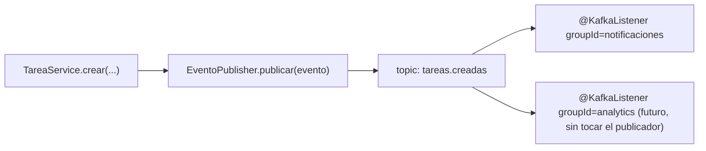
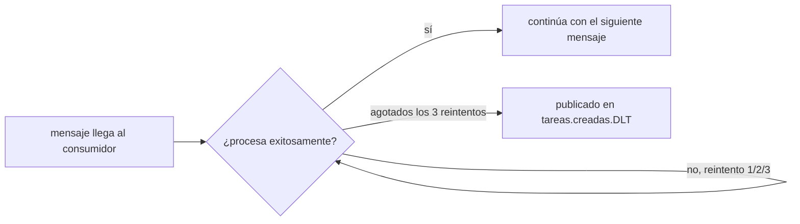
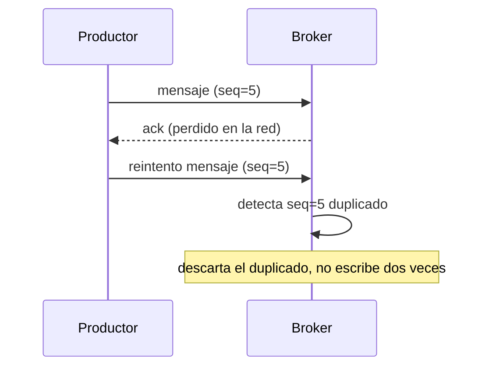
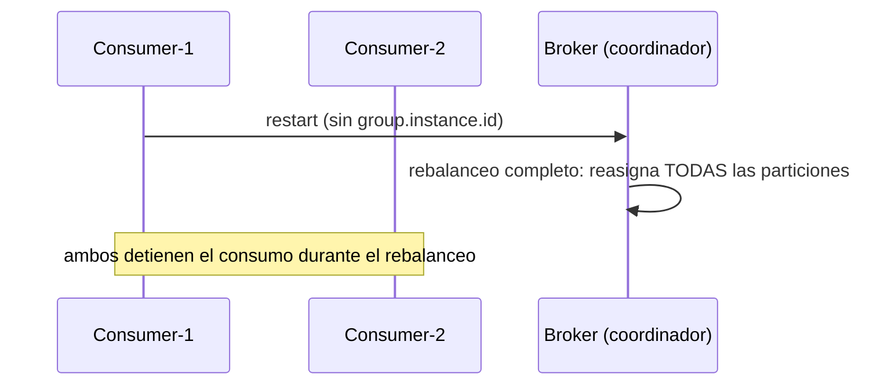
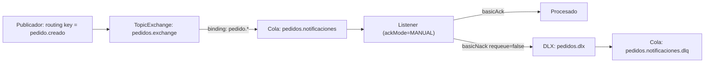

# Módulo 8: Mensajería — Kafka/RabbitMQ

Cada tema se practica por separado con su propia repetición progresiva y su propio reto de memoria, verificado contra un broker real (`@EmbeddedKafka` para Kafka, sin necesitar Docker; `RabbitMQContainer` de Testcontainers para RabbitMQ), para que "el evento se publicó y se consumió" sea comprobable, no solo descrito.


## Aprende construyendo

### Tema 1: Producers y consumers con Spring Kafka · Avanzado · 50 min

**Prerrequisito:** `@Service` e inyección de dependencias (Módulo 1); manejo global de excepciones (Módulo 2).

**Al terminar podrás:** publicar un evento con `KafkaTemplate` y consumirlo con `@KafkaListener`, confirmando con un broker Kafka real (embebido, sin Docker) que el desacoplamiento entre publicador y consumidor funciona de extremo a extremo.

#### Aprende

**¿Por qué es importante?** La asignación de un conductor y el envío de notificaciones no deben bloquear el request HTTP que crea una tarea; un evento desacopla al publicador de sus consumidores, permitiendo que la notificación se procese de forma independiente sin que el creador de la tarea espere por ella.

**Mapa de subtemas críticos**

| Subtema | Papel | Evidencia |
|---|---|---|
| `KafkaTemplate.send` con topic | Núcleo | `kafka.send("tareas.creadas", evento.id(), evento)` publica sin conocer al consumidor |
| `@KafkaListener` independiente | Núcleo | `@KafkaListener(topics = "tareas.creadas", groupId = "notificaciones")` registra un consumidor sin referencia al publicador |
| Clave del mensaje y partición | Variante | usar `evento.id()` como clave: "mismo id -> misma partición" y orden por partición |
| Consumo asíncrono | Límite | el test usa `Awaitility.await().atMost(Duration.ofSeconds(5))` porque la entrega no es inmediata |
| Acoplamiento por nombre de topic | Error frecuente | el fallo deliberado cambia a `tareas.otro-topic` y el test queda sin recibir mensajes |
| `@EmbeddedKafka` como broker real | Prerrequisito | `@EmbeddedKafka(partitions = 1, topics = "tareas.creadas")` levanta Kafka embebido sin Docker |
| Varios `groupId` sobre el mismo topic | Decisión | el reto abierto añade `analytics` sin tocar el publicador |

Cada fila tiene su explicación individual a continuación.

**`KafkaTemplate.send` con topic (Núcleo).** El publicador invoca `kafka.send("tareas.creadas", evento.id(), evento)` y entrega el evento al topic sin conocer ni referenciar a ningún consumidor. Ese envío es lo que convierte una llamada directa a `NotificacionService` en un punto de desacoplamiento: el `TareaService` ya no necesita que el consumidor esté disponible en el mismo instante. El mecanismo es asíncrono respecto al request HTTP que originó la tarea.

**`@KafkaListener` independiente (Núcleo).** El consumidor se declara con `@KafkaListener(topics = "tareas.creadas", groupId = "notificaciones")` y Spring lo invoca automáticamente por cada mensaje del topic. No existe ninguna dependencia de compilación entre `EventoPublisher` y `NotificacionListener`: el único vínculo es el nombre del topic. Esto permite agregar o quitar consumidores sin modificar el publicador.

**Clave del mensaje y partición (Variante).** Enviar con `evento.id()` como clave fija la partición de destino, de modo que todos los eventos de la misma tarea caen en la misma partición y se procesan en orden entre sí, como indica el comentario "clave estable: mismo id -> misma partición". Es una variante del envío básico que añade una garantía de orden parcial. El ejercicio 3 explora qué ocurre con un `id` nulo o vacío al enrutar.

**Consumo asíncrono (Límite).** El listener no procesa el mensaje en el instante de `publicar(...)`; por eso el test espera activamente con `Awaitility.await().atMost(Duration.ofSeconds(5))` en vez de verificar de inmediato. Verificar sin espera produce tests intermitentes (flaky), como advierte la Pista. El límite es que el desacoplamiento asíncrono impide confirmar el efecto de forma síncrona.

**Acoplamiento por nombre de topic (Error frecuente).** El fallo deliberado cambia el topic del listener a `tareas.otro-topic` y el test falla con `ConditionTimeoutException` tras los 5 segundos, porque el consumidor escucha un topic que nunca recibe mensajes. Esto revela que el acoplamiento no desaparece: se traslada al string del topic, que debe coincidir carácter por carácter. Un desajuste ahí es una desconexión silenciosa sin error de compilación.

**`@EmbeddedKafka` como broker real (Prerrequisito).** El test se anota con `@EmbeddedKafka(partitions = 1, topics = "tareas.creadas")`, que levanta un broker Kafka real dentro del proceso de test sin necesitar Docker ni un Kafka externo. La propiedad `spring.kafka.bootstrap-servers=${spring.embedded.kafka.brokers}` conecta la aplicación a ese broker. Sin este prerrequisito no habría forma de confirmar la entrega de extremo a extremo.

**Varios `groupId` sobre el mismo topic (Decisión).** Al añadir un segundo `@KafkaListener` con un `groupId` distinto, ambos grupos reciben el mismo evento de forma independiente, como pide el ejercicio 1 y el reto abierto con `analytics`. La decisión de diseño es que sumar lectores no exige tocar al publicador. El diagrama ya anticipa ese grupo futuro "sin tocar el publicador".

**Conceptos clave:** desacoplamiento vía topic, `@KafkaListener`.

```java
@Service
public class EventoPublisher {
    private final KafkaTemplate<String, TareaCreadaEvent> kafka;

    void publicar(TareaCreadaEvent evento) {
        kafka.send("tareas.creadas", evento);
    }
}
```

Este publicador envía un evento hacia un topic sin que el publicador conozca ni le importe quién está consumiendo ese evento.

```java
@KafkaListener(topics = "tareas.creadas", groupId = "notificaciones")
public void escuchar(TareaCreadaEvent evento) {
    // procesar notificación
}
```

Este listener define un consumidor completamente independiente, sin ninguna dependencia directa entre ambos. Sin mensajería, `TareaService` tendría que invocar directamente a `NotificacionService`, requiriendo que ambos estén disponibles simultáneamente.

**Analogía:** la mensajería es publicar un anuncio en un tablón público en vez de llamar personalmente a cada interesado: quien publica no necesita saber quién lo leerá, y se pueden agregar nuevos lectores sin que el publicador original haga nada distinto.

**Diagrama:**



#### Practica

**Demo paso a paso.** Desde una carpeta vacía (o continuando en `academia-spring`, o créala con `mkdir -p academia-spring` si es tu primera vez), genera el proyecto con Spring Initializr real (`web`, `kafka`) y crea el evento, el publicador y el consumidor en `src/main/java/com/academia/mensajeria/`:

```bash
mkdir -p academia-spring/src/main/java/com/academia/mensajeria
cd academia-spring
curl -fsSL https://start.spring.io/starter.zip -d type=maven-project -d dependencies=web,kafka -d javaVersion=25 -d artifactId=academia-mensajeria -o app.zip
unzip -o app.zip
```

```java
// src/main/java/com/academia/mensajeria/TareaCreadaEvent.java
package com.academia.mensajeria;

import java.io.Serializable;

public record TareaCreadaEvent(String id, String titulo) implements Serializable {}
```

```java
// src/main/java/com/academia/mensajeria/EventoPublisher.java
package com.academia.mensajeria;

import org.springframework.kafka.core.KafkaTemplate;
import org.springframework.stereotype.Service;

@Service
public class EventoPublisher {
    private final KafkaTemplate<String, TareaCreadaEvent> kafka;

    public EventoPublisher(KafkaTemplate<String, TareaCreadaEvent> kafka) { this.kafka = kafka; }

    public void publicar(TareaCreadaEvent evento) {
        kafka.send("tareas.creadas", evento.id(), evento); // clave estable: mismo id -> misma partición
    }
}
```

```java
// src/main/java/com/academia/mensajeria/NotificacionListener.java
package com.academia.mensajeria;

import org.springframework.kafka.annotation.KafkaListener;
import org.springframework.stereotype.Component;

import java.util.concurrent.CopyOnWriteArrayList;
import java.util.List;

@Component
public class NotificacionListener {
    // lista real (no un mock) donde el listener registra cada evento recibido, consultada por el test
    private final List<TareaCreadaEvent> eventosRecibidos = new CopyOnWriteArrayList<>();

    @KafkaListener(topics = "tareas.creadas", groupId = "notificaciones")
    public void escuchar(TareaCreadaEvent evento) {
        eventosRecibidos.add(evento);
    }

    public List<TareaCreadaEvent> getEventosRecibidos() { return eventosRecibidos; }
}
```

**Explicación línea por línea:** `kafka.send("tareas.creadas", evento.id(), evento)` publica usando el `id` de la tarea como clave, garantizando que eventos de la misma tarea siempre lleguen a la misma partición y por lo tanto se procesen en orden entre sí; `@KafkaListener(topics = "tareas.creadas", groupId = "notificaciones")` registra un consumidor independiente que Spring invoca automáticamente por cada mensaje del topic; `eventosRecibidos` es una lista real (no un mock) que el test consulta directamente para confirmar qué llegó efectivamente al consumidor.

Confirma con `@EmbeddedKafka` (un broker Kafka REAL que corre embebido dentro del proceso de test, sin necesitar Docker ni un Kafka externo) que un evento publicado efectivamente llega al consumidor:

```java
// src/test/java/com/academia/mensajeria/EventoPublisherTest.java
package com.academia.mensajeria;

import org.awaitility.Awaitility;
import org.junit.jupiter.api.Test;
import org.springframework.beans.factory.annotation.Autowired;
import org.springframework.boot.test.context.SpringBootTest;
import org.springframework.kafka.test.context.EmbeddedKafka;
import org.springframework.test.context.TestPropertySource;

import java.time.Duration;

import static org.assertj.core.api.Assertions.assertThat;

@SpringBootTest
@EmbeddedKafka(partitions = 1, topics = "tareas.creadas")
@TestPropertySource(properties = "spring.kafka.bootstrap-servers=${spring.embedded.kafka.brokers}")
class EventoPublisherTest {

    @Autowired
    private EventoPublisher publisher;
    @Autowired
    private NotificacionListener listener;

    @Test
    void publicarUnEventoLoEntregaAlConsumidorReal() {
        publisher.publicar(new TareaCreadaEvent("1", "Comprar leche"));

        // el consumo es asíncrono: espera activamente (con timeout real) a que el listener lo reciba
        Awaitility.await().atMost(Duration.ofSeconds(5))
            .untilAsserted(() -> assertThat(listener.getEventosRecibidos())
                .extracting(TareaCreadaEvent::titulo)
                .contains("Comprar leche"));
    }
}
```

```bash
mvn test -Dtest=EventoPublisherTest # Maven
./gradlew test --tests EventoPublisherTest # Gradle (equivalente)
```

**Resultado esperado:** `BUILD SUCCESS` con el test en verde: `@EmbeddedKafka` levantó un broker Kafka real dentro del proceso de test, `EventoPublisher` publicó de verdad hacia el topic `tareas.creadas`, y `NotificacionListener` —un consumidor completamente independiente, sin ninguna referencia directa al publicador— lo recibió y registró, confirmando el desacoplamiento real entre ambos.

**Fallo deliberado:** cambia el topic en `@KafkaListener(topics = "tareas.creadas", ...)` a `@KafkaListener(topics = "tareas.otro-topic", ...)` (un topic distinto al que `EventoPublisher` realmente publica) y ejecuta de nuevo. El test FALLA con un timeout de `Awaitility` (`ConditionTimeoutException`, tras esperar los 5 segundos completos sin que la condición se cumpla nunca) porque el consumidor está escuchando un topic que nunca recibe ningún mensaje — diagnostica confirmando que el acoplamiento entre publicador y consumidor, aunque no sea de compilación, SÍ existe implícitamente a través del nombre del topic: si ambos no coinciden exactamente en ese string, el desacoplamiento se convierte en una desconexión silenciosa sin ningún error de compilación que lo señale. Revierte el cambio antes de continuar.

**Ejercicios.**

1. Agrega un segundo `@KafkaListener` con un `groupId` distinto escuchando el mismo topic, y confirma con el test que AMBOS reciben el mismo evento de forma independiente.
2. Publica dos eventos con la misma clave (`evento.id()`) y confirma, inspeccionando el orden en `eventosRecibidos`, que llegan en el mismo orden en que se publicaron (garantía de orden por partición cuando comparten clave).
3. Publica un evento con un `id` nulo o vacío y observa (documentando el resultado) si eso afecta a qué partición se enruta, comparado con un `id` no vacío.
4. Escribe de memoria (sin mirar) un `EventoPublisher` con `KafkaTemplate`, un `@KafkaListener` independiente, y un test `@EmbeddedKafka` con `Awaitility` que confirme la entrega. Compara después contra el patrón del demo.

**Pista:** el consumo de Kafka es inherentemente asíncrono; un test que verifica el resultado inmediatamente después de `publicar(...)` sin ningún mecanismo de espera (como `Awaitility`) es una fuente clásica de tests intermitentes (flaky), porque el consumidor podría no haber procesado el mensaje todavía en ese instante exacto.

**Completa el código:** rellena el espacio para registrar el consumidor sobre el topic correcto:

```java
@____(topics = "tareas.creadas", groupId = "notificaciones")
public void escuchar(TareaCreadaEvent evento) { }
```

**Reto de memoria:** cierra este documento y escribe, solo de memoria, un publicador con `KafkaTemplate`, un consumidor con `@KafkaListener`, y un test `@EmbeddedKafka` que confirme la entrega con `Awaitility`. Compara después contra el patrón del demo.

#### Aplica

**Reto abierto.** Diseña el flujo de notificaciones de una plataforma de entregas: `TareaService` publica un evento al crear una tarea, y dos grupos de consumidores independientes (notificaciones y analítica) reaccionan sin que el servicio creador conozca a ninguno. Publica tres eventos de la misma tarea y demuestra con el broker real que ambos grupos reciben los tres, en orden, y que añadir un tercer grupo no exige tocar el publicador.

**Checklist de salida.**

- [ ] El publicador no importa ni referencia ninguna clase de los consumidores.
- [ ] Un test `@EmbeddedKafka` confirma la entrega real a cada grupo, con `Awaitility` y timeout explícito.
- [ ] Eventos de la misma clave se consumen en el orden de publicación.
- [ ] Añadir un segundo `groupId` no modifica el código del publicador.
- [ ] El fallo deliberado del topic mal escrito está reproducido y diagnosticado en tus notas.
- [ ] Sabes explicar por qué el test falla por timeout y no por una excepción de compilación.

**Si falla.** Si el test pasa en vacío, comprueba que el topic del `@KafkaListener` coincide carácter por carácter con el de `send(...)` y que `spring.kafka.bootstrap-servers` apunta a `${spring.embedded.kafka.brokers}`. Si el consumo es intermitente, sustituye cualquier `Thread.sleep` por `Awaitility` con un timeout real.

**Siguiente paso:** el siguiente tema aborda qué ocurre cuando el consumidor falla al procesar un mensaje.

**Errores comunes:** asumir que el consumo es sincrónico y verificar el resultado sin ningún mecanismo de espera, produciendo tests intermitentes; que publicador y consumidor no coincidan exactamente en el nombre del topic, una desconexión silenciosa sin error de compilación.

**Límites y decisión de uso:** para una operación que el llamador necesita confirmar que se completó exitosamente antes de continuar (por ejemplo, verificar el stock disponible antes de confirmar una compra), una llamada síncrona directa es más apropiada que un evento asíncrono desacoplado.

**Fuente oficial:** [Spring for Apache Kafka — Testing](https://docs.spring.io/spring-kafka/reference/testing.html).

**Transferencia al proyecto integrador:** los producers y consumers de Spring Kafka que implementes aquí son los que integrará el microservicio productivo (Módulo 12).

### Tema 2: Dead-letter queue · Avanzado · 45 min

**Prerrequisito:** Tema 1 de este módulo.

**Al terminar podrás:** configurar reintentos limitados y una dead-letter queue para mensajes que fallan repetidamente, confirmando con un broker real que el mensaje problemático termina exactamente ahí, sin bloquear los mensajes siguientes.

#### Aprende

**¿Por qué es importante?** Un mensaje con un payload corrupto o una condición que el consumidor no puede manejar no debería bloquear indefinidamente el procesamiento de todos los mensajes válidos que llegan después de él en la misma partición.

**Mapa de subtemas críticos**

| Subtema | Papel | Evidencia |
|---|---|---|
| `DefaultErrorHandler` explícito | Núcleo | el `@Bean errorHandler` combina recoverer y backoff; sin él no hay DLQ |
| `DeadLetterPublishingRecoverer` | Núcleo | `new DeadLetterPublishingRecoverer(template)` republica el mensaje agotados los reintentos |
| `FixedBackOff` (reintentos y espera) | Variante | `FixedBackOff(100L, 2)` declara 2 reintentos con 100ms; el ejercicio 2 prueba `FixedBackOff(100L, 0)` |
| Convención de sufijo `.DLT` | Prerrequisito | el mensaje termina en `pedidos.procesar.DLT` por convención por defecto |
| Verificación leyendo la DLQ | Diagnóstico | `KafkaTestUtils.getSingleRecord(..., "pedidos.procesar.DLT", ...)` confirma `"payload-invalido"` |
| DLQ no es automática | Error frecuente | quitar el `@Bean` provoca timeout: nada llega a `.DLT` |
| Cuándo NO usar DLQ | Decisión | para fallos que deben detener todo el flujo, diferir a una DLQ oculta el problema |

Cada fila tiene su explicación individual a continuación.

**`DefaultErrorHandler` explícito (Núcleo).** El `@Bean errorHandler` crea un `DefaultErrorHandler` que combina el recoverer con la política de reintentos y es el que el contenedor de listeners usa para decidir qué hacer ante una excepción del consumidor. El fallo deliberado demuestra que, sin este bean, no existe dead-letter queue en absoluto. Es el punto donde se declara explícitamente el manejo de errores de mensajería.

**`DeadLetterPublishingRecoverer` (Núcleo).** `new DeadLetterPublishingRecoverer(template)` intercepta la excepción después de agotados los reintentos y republica el mensaje original en el topic de destino. En el demo, `ListenerConFalloDeliberado.procesar` lanza `IllegalArgumentException` para `"payload-invalido"` y el recoverer lo envía a `pedidos.procesar.DLT` en vez de perderlo o bloquear la partición. El mecanismo transforma un fallo repetido en un mensaje trazable.

**`FixedBackOff` (reintentos y espera) (Variante).** `FixedBackOff(100L, 2)` configura 2 reintentos con 100ms entre cada uno, valores reducidos a propósito para que el test corra rápido; el "Completa el código" pide la variante `FixedBackOff(1000L, 3)`. El ejercicio 2 usa `FixedBackOff(100L, 0)`, cero reintentos, y el mensaje llega a la DLQ tras el primer fallo. Variar estos dos números cambia cuántas veces se intenta y cuánto se espera antes de rendirse.

**Convención de sufijo `.DLT` (Prerrequisito).** El `DeadLetterPublishingRecoverer` usa por defecto el nombre del topic original con el sufijo `.DLT` (Dead Letter Topic), por eso el mensaje inválido termina en `pedidos.procesar.DLT`. La Pista señala que mantener esta convención permite a cualquier desarrollador saber dónde buscar sin documentación extra. Conocer la convención es prerrequisito para declarar y consultar el topic correcto.

**Verificación leyendo la DLQ (Diagnóstico).** El test abre un consumidor sobre `pedidos.procesar.DLT` y usa `KafkaTestUtils.getSingleRecord(consumidorDlq, "pedidos.procesar.DLT", Duration.ofSeconds(10))`, confirmando que `registroEnDlq.value()` es exactamente `"payload-invalido"`. Esto diagnostica que el mensaje quedó aislado y trazable, no perdido. El ejercicio 3 inspecciona además `registroEnDlq.headers()` para ver la información de la excepción original que Spring adjunta.

**DLQ no es automática (Error frecuente).** El fallo deliberado quita el `@Bean errorHandler` completo y el test falla con timeout en `getSingleRecord(...)` porque ningún mensaje llega a la DLQ: con el manejo por defecto el mensaje se reintenta indefinidamente o se descarta, pero nunca va a `.DLT`. El error frecuente es asumir que Kafka envía solo a una dead-letter queue; en realidad exige configurar `DefaultErrorHandler` con `DeadLetterPublishingRecoverer`.

**Cuándo NO usar DLQ (Decisión).** Los Límites señalan que para un consumidor donde cualquier fallo debe detener de inmediato todo el flujo hasta que un humano intervenga, reintentar y luego enviar en silencio a una DLQ puede ocultar un problema que requiere atención inmediata. La decisión es ponderar si diferir el fallo es aceptable o si conviene parar. El checklist refuerza esto exigiendo un dueño y un procedimiento para vaciar la DLQ.

**Conceptos clave:** reintentos limitados, destino final para mensajes que fallan repetidamente.

```java
@Bean
DefaultErrorHandler errorHandler(KafkaTemplate<Object, Object> template) {
    var recoverer = new DeadLetterPublishingRecoverer(template);
    return new DefaultErrorHandler(recoverer, new FixedBackOff(1000L, 3));
}
```

Este bean configura reintentos limitados (3, con 1 segundo entre cada uno); si todos fallan, el mensaje se redirige automáticamente a una dead-letter queue (por convención, el mismo nombre del topic original con el sufijo `.DLT`), en vez de perderse silenciosamente o bloquear los mensajes siguientes.

**Analogía:** una dead-letter queue es una bandeja separada de correspondencia no entregable en una oficina de correos, donde las cartas que no pudieron entregarse tras varios intentos se archivan para investigación manual, en vez de bloquear indefinidamente el resto de la correspondencia normal.

**Diagrama:**



#### Practica

**Demo paso a paso.** Reutiliza `academia-spring` (o créalo desde una carpeta vacía con `mkdir -p academia-spring` si es tu primera vez) y crea la configuración de manejo de errores en `src/main/java/com/academia/mensajeria/`:

```bash
mkdir -p academia-spring/src/main/java/com/academia/mensajeria
cd academia-spring
```

```java
// src/main/java/com/academia/mensajeria/KafkaErrorConfig.java
package com.academia.mensajeria;

import org.springframework.context.annotation.Bean;
import org.springframework.context.annotation.Configuration;
import org.springframework.kafka.core.KafkaTemplate;
import org.springframework.kafka.listener.DeadLetterPublishingRecoverer;
import org.springframework.kafka.listener.DefaultErrorHandler;
import org.springframework.util.backoff.FixedBackOff;

@Configuration
public class KafkaErrorConfig {

    @Bean
    DefaultErrorHandler errorHandler(KafkaTemplate<Object, Object> template) {
        var recoverer = new DeadLetterPublishingRecoverer(template);
        return new DefaultErrorHandler(recoverer, new FixedBackOff(100L, 2)); // 2 reintentos rápidos para el test
    }
}
```

```java
// src/main/java/com/academia/mensajeria/ListenerConFalloDeliberado.java
package com.academia.mensajeria;

import org.springframework.kafka.annotation.KafkaListener;
import org.springframework.stereotype.Component;

@Component
public class ListenerConFalloDeliberado {

    @KafkaListener(topics = "pedidos.procesar", groupId = "procesador")
    public void procesar(String payload) {
        if (payload.equals("payload-invalido")) {
            throw new IllegalArgumentException("no se puede procesar: " + payload);
        }
        // procesamiento normal para cualquier otro payload
    }
}
```

**Explicación línea por línea:** `FixedBackOff(100L, 2)` declara 2 reintentos con 100ms entre cada uno (valores reducidos deliberadamente para que el test corra rápido); `ListenerConFalloDeliberado.procesar` lanza una excepción real de forma controlada para un payload específico, simulando un mensaje que el consumidor genuinamente no puede procesar; `DeadLetterPublishingRecoverer` intercepta esa excepción después de agotados los reintentos y republica el mensaje original en `pedidos.procesar.DLT`.

Confirma con `@EmbeddedKafka` que el mensaje inválido termina en la DLQ tras agotar los reintentos, mientras un mensaje válido posterior se procesa normalmente sin bloquearse:

```java
// src/test/java/com/academia/mensajeria/DeadLetterQueueTest.java
package com.academia.mensajeria;

import org.apache.kafka.clients.consumer.Consumer;
import org.apache.kafka.clients.consumer.ConsumerRecord;
import org.junit.jupiter.api.Test;
import org.springframework.beans.factory.annotation.Autowired;
import org.springframework.boot.test.context.SpringBootTest;
import org.springframework.kafka.core.KafkaTemplate;
import org.springframework.kafka.test.EmbeddedKafkaBroker;
import org.springframework.kafka.test.context.EmbeddedKafka;
import org.springframework.kafka.test.utils.KafkaTestUtils;
import org.springframework.test.context.TestPropertySource;

import java.time.Duration;
import java.util.Map;

import static org.assertj.core.api.Assertions.assertThat;

@SpringBootTest
@EmbeddedKafka(partitions = 1, topics = {"pedidos.procesar", "pedidos.procesar.DLT"})
@TestPropertySource(properties = "spring.kafka.bootstrap-servers=${spring.embedded.kafka.brokers}")
class DeadLetterQueueTest {

    @Autowired
    private KafkaTemplate<String, String> kafkaTemplate;
    @Autowired
    private EmbeddedKafkaBroker embeddedKafkaBroker;

    @Test
    void unMensajeInvalidoTerminaEnLaDeadLetterQueue() {
        kafkaTemplate.send("pedidos.procesar", "payload-invalido");

        Map<String, Object> configs = KafkaTestUtils.consumerProps("grupo-verificacion-dlq", "true", embeddedKafkaBroker);
        try (Consumer<String, String> consumidorDlq = new org.apache.kafka.clients.consumer.KafkaConsumer<>(
                configs, new org.apache.kafka.common.serialization.StringDeserializer(), new org.apache.kafka.common.serialization.StringDeserializer())) {
            embeddedKafkaBroker.consumeFromAnEmbeddedTopic(consumidorDlq, "pedidos.procesar.DLT");

            ConsumerRecord<String, String> registroEnDlq = KafkaTestUtils.getSingleRecord(consumidorDlq, "pedidos.procesar.DLT", Duration.ofSeconds(10));

            assertThat(registroEnDlq.value()).isEqualTo("payload-invalido");
        }
    }
}
```

```bash
mvn test -Dtest=DeadLetterQueueTest # Maven
./gradlew test --tests DeadLetterQueueTest # Gradle (equivalente)
```

**Resultado esperado:** `BUILD SUCCESS` con el test en verde: el mensaje `"payload-invalido"` se reintenta 2 veces (falla ambas), y `DeadLetterPublishingRecoverer` lo republica automáticamente en `pedidos.procesar.DLT`, donde el consumidor de verificación del test lo lee directamente desde ese topic real — confirmando que el mensaje problemático quedó aislado y trazable, no perdido.

**Fallo deliberado:** quita el `@Bean errorHandler` completo de `KafkaErrorConfig` (dejando el manejo de errores por defecto de Spring Kafka, sin DLQ configurada) y ejecuta de nuevo el test. El test FALLA con timeout en `KafkaTestUtils.getSingleRecord(...)` porque ningún mensaje llega a `pedidos.procesar.DLT` — sin el `errorHandler` explícito, el mensaje fallido se reintenta indefinidamente con la política por defecto, o se descarta según la configuración implícita, pero en cualquier caso NUNCA llega a la DLQ que el test espera — diagnostica confirmando que la dead-letter queue no es un comportamiento automático de Kafka, sino algo que debe configurarse explícitamente con un `DefaultErrorHandler` y un `DeadLetterPublishingRecoverer`. Revierte el cambio antes de continuar.

**Ejercicios.**

1. Publica un mensaje válido inmediatamente después del inválido en el mismo test, y confirma que el mensaje válido se procesa sin ningún retraso causado por los reintentos del mensaje anterior (los reintentos son por mensaje individual, no bloquean toda la partición indefinidamente en este patrón).
2. Aumenta `FixedBackOff(100L, 2)` a `FixedBackOff(100L, 0)` (cero reintentos) y confirma que el mensaje llega a la DLQ inmediatamente tras el primer fallo, sin ningún reintento.
3. Inspecciona los headers del `ConsumerRecord` recibido en la DLQ (`registroEnDlq.headers()`) y documenta qué información adicional sobre la excepción original Spring Kafka adjunta automáticamente.
4. Escribe de memoria (sin mirar) un `DefaultErrorHandler` con `DeadLetterPublishingRecoverer`, y un test que confirme que un mensaje fallido termina en el topic `.DLT` correspondiente. Compara después contra el patrón del demo.

**Pista:** el sufijo `.DLT` (Dead Letter Topic) es la convención por defecto de `DeadLetterPublishingRecoverer`; puede personalizarse, pero mantener la convención por defecto facilita que cualquier desarrollador del equipo sepa dónde buscar mensajes fallidos sin necesitar documentación adicional.

**Completa el código:** rellena el espacio para configurar 3 reintentos con 1 segundo entre cada uno antes de enviar a la DLQ:

```java
return new DefaultErrorHandler(recoverer, new ____(1000L, 3));
```

**Reto de memoria:** cierra este documento y escribe, solo de memoria, un `DefaultErrorHandler` con reintentos limitados y `DeadLetterPublishingRecoverer`, y un test que confirme el mensaje fallido en la DLQ. Compara después contra el patrón del demo.

#### Aplica

**Reto abierto.** Añade al procesador de pedidos un mensaje que siempre falla y otro que siempre funciona, y demuestra sobre el broker real que el fallido termina en `pedidos.procesar.DLT` tras agotar los reintentos mientras el válido se procesa sin esperar. Documenta cuántos reintentos configuraste, dónde queda el mensaje y quién se encarga de investigarlo.

**Checklist de salida.**

- [ ] La DLQ está configurada explícitamente con `DefaultErrorHandler` y un recoverer.
- [ ] El número de reintentos y su espera están documentados y justificados.
- [ ] Un test lee el mensaje fallido directamente desde `pedidos.procesar.DLT`.
- [ ] Un mensaje válido publicado después del fallido se procesa sin quedar bloqueado.
- [ ] Has reproducido el fallo sin `errorHandler` y explicado el timeout resultante.
- [ ] Existe un dueño y un procedimiento escrito para vaciar la DLQ.

**Si falla.** Si la DLQ queda vacía, verifica que el topic `.DLT` esté declarado en `@EmbeddedKafka(topics = {...})` y que el `DefaultErrorHandler` sea el bean realmente usado por el contenedor de listeners. Si todo llega a la DLQ, revisa que la excepción del consumidor sea del tipo que el handler trata como reintentable.

**Siguiente paso:** el siguiente tema profundiza en productores idempotentes y transacciones para evitar duplicados, el requisito de nivel profesional que la DLQ por sí sola no resuelve.

**Errores comunes:** no configurar ninguna dead-letter queue, arriesgando que un mensaje problemático bloquee o se pierda silenciosamente; no monitorear ni asignar dueño a la DLQ, dejando mensajes fallidos acumulándose sin que nadie los investigue.

**Límites y decisión de uso:** para un consumidor donde CUALQUIER fallo de procesamiento debe detener inmediatamente todo el flujo hasta que un humano intervenga (un escenario donde continuar procesando otros mensajes sería inaceptable), reintentar y luego enviar silenciosamente a una DLQ podría ocultar un problema que requiere atención inmediata en vez de diferida.

**Fuente oficial:** [Spring for Apache Kafka — Dead Letters](https://docs.spring.io/spring-kafka/reference/retrytopic.html).

**Transferencia al proyecto integrador:** la dead-letter queue de este tema es la que evitará perder mensajes fallidos en el microservicio productivo (Módulo 12).

### Tema 3: Productor idempotente y transacciones (exactly-once) · Experto · 50 min

**Prerrequisito:** Tema 1 de este módulo.

**Al terminar podrás:** configurar un productor idempotente y una transacción Kafka que evite publicar un evento duplicado si el productor reintenta tras un fallo de red, confirmando con un broker real que el duplicado nunca llega al topic.

#### Aprende

**¿Por qué es importante?** Sin idempotencia, un timeout de red que en realidad SÍ se entregó en el broker hace que el productor reintente, publicando el mismo evento de negocio dos veces — un conductor podría recibir la misma notificación de "nueva entrega asignada" duplicada, o un pago podría registrarse dos veces si el evento dispara un cobro.

**Mapa de subtemas críticos**

| Subtema | Papel | Evidencia |
|---|---|---|
| `enable.idempotence=true` | Núcleo | `config.put(ProducerConfig.ENABLE_IDEMPOTENCE_CONFIG, true)` activa la deduplicación del productor |
| `acks=all` | Prerrequisito | `config.put(ProducerConfig.ACKS_CONFIG, "all")`; el ejercicio 1 muestra que solo da durabilidad |
| Número de secuencia por partición | Núcleo | el broker "detecta seq=5 duplicado" y descarta el reintento interno |
| Reintento del productor vs. de la aplicación | Límite | dos `send(...)` independientes SÍ producen dos registros reales en el topic |
| Consumidor idempotente por id de negocio | Variante | `idsYaAplicados.add(evento.id())` devuelve `true` solo la primera vez |
| Sin deduplicación en el consumidor | Error frecuente | el fallo deliberado deja `cobrosRealmenteAplicados` en `2` en vez de `1` |
| Cuándo omitir la ceremonia | Decisión | para telemetría no crítica un duplicado ocasional puede tolerarse |

Cada fila tiene su explicación individual a continuación.

**`enable.idempotence=true` (Núcleo).** `config.put(ProducerConfig.ENABLE_IDEMPOTENCE_CONFIG, true)` hace que el productor etiquete cada lote con un número de secuencia por partición, de modo que un reintento interno del cliente Kafka no escriba el mismo mensaje dos veces en el broker. El "Completa el código" confirma que esta es la clave que activa la deduplicación del productor. Es el mecanismo central contra duplicados por ack perdido.

**`acks=all` (Prerrequisito).** `config.put(ProducerConfig.ACKS_CONFIG, "all")` exige que todas las réplicas confirmen la escritura antes de considerarla exitosa, lo que da durabilidad. El ejercicio 1 y los Errores comunes dejan claro que `acks=all` por sí solo no da idempotencia. Funciona como prerrequisito de configuración junto a la idempotencia, no como sustituto de ella.

**Número de secuencia por partición (Núcleo).** El diagrama muestra el productor reenviando `seq=5` tras un ack perdido y el broker detectando el `seq=5` duplicado para descartarlo sin escribir dos veces. Ese número de secuencia por partición es el mecanismo concreto que implementa la deduplicación del lado del broker. Solo cubre reintentos del propio cliente, no llamadas independientes de la aplicación.

**Reintento del productor vs. de la aplicación (Límite).** La Explicación línea por línea distingue el reintento INTERNO del cliente (que la idempotencia sí evita) de dos llamadas a `send(...)` hechas por la APLICACIÓN con el mismo evento, que SÍ producen dos registros reales en el topic. El test envía dos veces con `kafkaTemplatePagos.send(...)` para reproducir ese segundo caso. El límite es que la idempotencia del productor no alcanza al reenvío de la aplicación.

**Consumidor idempotente por id de negocio (Variante).** La defensa que garantiza "exactamente una vez" de negocio es `idsYaAplicados.add(evento.id())`, que devuelve `true` solo la primera vez que ve ese id, por lo que `cobrosRealmenteAplicados` se incrementa una sola vez aunque lleguen varias copias. Es una variante de idempotencia que vive en el consumidor y usa una identidad de negocio estable, no el offset. El comentario aclara que en producción sería una columna UNIQUE o un Set persistido.

**Sin deduplicación en el consumidor (Error frecuente).** El fallo deliberado quita el `if (idsYaAplicados.add(evento.id()))` e incrementa el contador para cada mensaje; entonces `cobrosRealmenteAplicados` queda en `2` en vez de `1` y el test falla. Esto demuestra que la idempotencia del productor nunca fue la responsable de evitar el cobro duplicado. La Pista añade que los reintentos del consumidor por offset no confirmado también necesitan este diseño.

**Cuándo omitir la ceremonia (Decisión).** Los Límites indican que para eventos donde un duplicado ocasional es tolerable y barato de ignorar, como una métrica de telemetría no crítica, la ceremonia de productor idempotente y transaccional puede no justificar su costo de throughput. La decisión depende del costo real de un duplicado frente al rendimiento. El checklist pide además que la deduplicación sobreviva a un reinicio mediante almacén persistente u outbox.

**Conceptos clave:** productor idempotente, ack perdido en la red (no el mensaje), deduplicación por el broker.

```java
@Bean
ProducerFactory<String, Object> producerFactory() {
    Map<String, Object> config = new HashMap<>();
    config.put(ProducerConfig.ENABLE_IDEMPOTENCE_CONFIG, true);
    config.put(ProducerConfig.ACKS_CONFIG, "all");
    return new DefaultKafkaProducerFactory<>(config);
}
```

Con `enable.idempotence=true`, el productor etiqueta cada lote de mensajes con un número de secuencia por partición; si el productor reintenta porque no recibió el `ack` (aunque el broker SÍ haya recibido y persistido el mensaje original, perdiéndose solo la confirmación en la red de vuelta), el broker detecta el número de secuencia repetido y descarta el duplicado en vez de escribirlo dos veces.

**Analogía:** es como un número de seguimiento de un paquete entregado por mensajería: si el mensajero reenvía el mismo paquete porque no recibió la confirmación de entrega (aunque el destinatario SÍ lo recibió), el número de seguimiento repetido permite detectar que es el mismo paquete, no uno nuevo.

**Diagrama:**



#### Practica

**Demo paso a paso.** Reutiliza `academia-spring` y crea el publicador idempotente junto con un procesador que aplica su propia verificación de idempotencia, en `src/main/java/com/academia/mensajeria/`, confirmando con un broker real que un pago duplicado (el mismo `evento.id()` llegando dos veces al topic, el escenario real que un reintento de red o de aplicación produce) se aplica exactamente una vez:

```bash
mkdir -p academia-spring/src/main/java/com/academia/mensajeria
cd academia-spring
```

```java
// src/main/java/com/academia/mensajeria/PagoEvent.java
package com.academia.mensajeria;

import java.io.Serializable;

public record PagoEvent(String id, double monto) implements Serializable {}
```

```java
// src/main/java/com/academia/mensajeria/ProductorIdempotenteConfig.java
package com.academia.mensajeria;

import org.apache.kafka.clients.producer.ProducerConfig;
import org.springframework.context.annotation.Bean;
import org.springframework.context.annotation.Configuration;
import org.springframework.kafka.core.DefaultKafkaProducerFactory;
import org.springframework.kafka.core.KafkaTemplate;
import org.springframework.kafka.core.ProducerFactory;

import java.util.HashMap;
import java.util.Map;

@Configuration
public class ProductorIdempotenteConfig {

    @Bean
    ProducerFactory<String, Object> producerFactory() {
        Map<String, Object> config = new HashMap<>();
        config.put(ProducerConfig.ENABLE_IDEMPOTENCE_CONFIG, true);
        config.put(ProducerConfig.ACKS_CONFIG, "all");
        return new DefaultKafkaProducerFactory<>(config);
    }

    @Bean
    KafkaTemplate<String, Object> kafkaTemplatePagos(ProducerFactory<String, Object> producerFactory) {
        return new KafkaTemplate<>(producerFactory);
    }
}
```

```java
// src/main/java/com/academia/mensajeria/ProcesadorPagosIdempotente.java
package com.academia.mensajeria;

import org.springframework.kafka.annotation.KafkaListener;
import org.springframework.stereotype.Component;

import java.util.Set;
import java.util.concurrent.ConcurrentHashMap;
import java.util.concurrent.atomic.AtomicInteger;

@Component
public class ProcesadorPagosIdempotente {
    // ids de pago ya aplicados (en producción: una columna UNIQUE o un Set persistido, no en memoria);
    // el test consulta este estado directamente para confirmar cuántas veces se aplicó el cobro REAL
    private final Set<String> idsYaAplicados = ConcurrentHashMap.newKeySet();
    private final AtomicInteger cobrosRealmenteAplicados = new AtomicInteger(0);

    @KafkaListener(topics = "pagos.registrados", groupId = "procesador-pagos")
    public void procesar(PagoEvent evento) {
        if (idsYaAplicados.add(evento.id())) { // add() devuelve true SOLO la primera vez que se ve este id
            cobrosRealmenteAplicados.incrementAndGet(); // el cobro real contra la pasarela de pago solo ocurre aquí
        }
        // si evento.id() ya estaba en el set, es un duplicado conocido: se descarta sin repetir el cobro
    }

    public int getCobrosRealmenteAplicados() { return cobrosRealmenteAplicados.get(); }
}
```

**Explicación línea por línea:** `ENABLE_IDEMPOTENCE_CONFIG` evita que un reintento INTERNO del cliente de Kafka (cuando el productor no recibe el `ack` a tiempo, aunque el broker SÍ haya escrito el mensaje original) duplique esa escritura a nivel de broker; pero no puede evitar que la APLICACIÓN llame a `send(...)` dos veces de forma independiente con el mismo evento (por ejemplo, un servicio llamador que no supo si su primer intento tuvo éxito y reenvía el mismo pago) — esas dos llamadas SÍ producen dos registros reales en el topic. `idsYaAplicados.add(evento.id())` es la defensa que efectivamente garantiza "exactamente una vez" desde la perspectiva de negocio: devuelve `true` solo la primera vez que ve ese id, así que `cobrosRealmenteAplicados` se incrementa una sola vez sin importar cuántas copias del mismo pago lleguen al consumidor.

Confirma con `@EmbeddedKafka` que, aunque el pago duplicado SÍ llega dos veces al topic, el procesador lo aplica una sola vez:

```java
// src/test/java/com/academia/mensajeria/ProductorIdempotenteTest.java
package com.academia.mensajeria;

import org.awaitility.Awaitility;
import org.junit.jupiter.api.Test;
import org.springframework.beans.factory.annotation.Autowired;
import org.springframework.boot.test.context.SpringBootTest;
import org.springframework.kafka.core.KafkaTemplate;
import org.springframework.kafka.test.context.EmbeddedKafka;
import org.springframework.test.context.TestPropertySource;

import java.time.Duration;

import static org.assertj.core.api.Assertions.assertThat;

@SpringBootTest
@EmbeddedKafka(partitions = 1, topics = "pagos.registrados")
@TestPropertySource(properties = "spring.kafka.bootstrap-servers=${spring.embedded.kafka.brokers}")
class ProductorIdempotenteTest {

    @Autowired
    private KafkaTemplate<String, Object> kafkaTemplatePagos;
    @Autowired
    private ProcesadorPagosIdempotente procesador;

    @Test
    void unPagoQueLlegaDuplicadoSeAplicaUnaSolaVez() {
        PagoEvent evento = new PagoEvent("pago-123", 50_000);

        kafkaTemplatePagos.send("pagos.registrados", evento.id(), evento); // envío original
        kafkaTemplatePagos.send("pagos.registrados", evento.id(), evento); // reintento real: el mismo evento, reenviado

        // los dos mensajes SÍ llegan al consumidor (dos llamadas independientes a send(), no un reintento interno de red);
        // la verificación de idempotencia del consumidor es la que garantiza que el cobro real ocurre una sola vez
        Awaitility.await().atMost(Duration.ofSeconds(5))
            .untilAsserted(() -> assertThat(procesador.getCobrosRealmenteAplicados()).isEqualTo(1));
    }
}
```

```bash
mvn test -Dtest=ProductorIdempotenteTest # Maven
./gradlew test --tests ProductorIdempotenteTest # Gradle (equivalente)
```

**Resultado esperado:** `BUILD SUCCESS` con el test en verde: ambos mensajes llegan realmente al topic `pagos.registrados` y ambos son entregados a `ProcesadorPagosIdempotente`, pero `idsYaAplicados.add(evento.id())` solo devuelve `true` en la primera entrega — `cobrosRealmenteAplicados` queda en exactamente `1`, confirmando "exactamente una vez" desde la perspectiva de negocio aunque el transporte haya entregado el evento dos veces.

**Fallo deliberado:** en `ProcesadorPagosIdempotente.procesar`, quita el `if (idsYaAplicados.add(evento.id()))` (incrementando `cobrosRealmenteAplicados` sin ninguna condición, para cada mensaje recibido sin importar su id) y ejecuta de nuevo `mvn test -Dtest=ProductorIdempotenteTest`. El test FALLA: `cobrosRealmenteAplicados` queda en `2` en vez de `1` — diagnostica confirmando que la idempotencia del PRODUCTOR (que sigue activa en `ProducerFactory`) nunca fue la responsable de evitar el cobro duplicado; sin la verificación explícita de idempotencia en el consumidor, el mismo pago se aplica dos veces. Restaura el `if` antes de continuar.

**Ejercicios.**

1. Configura `acks=all` sin idempotencia y repite el experimento de reintento; confirma que el duplicado aparece igual (`acks=all` por sí solo no da idempotencia).
2. Combina idempotencia con una transacción que agrupe la publicación del evento Y una actualización del estado en base de datos (vía `KafkaTransactionManager` o un patrón outbox), confirmando que ambas operaciones tienen éxito o fallan juntas.
3. Mide con `@EmbeddedKafka` cuántos registros produce una publicación con y sin idempotencia tras forzar 3 reintentos simulados.
4. Escribe de memoria (sin mirar) la configuración mínima de un productor idempotente. Compara después contra el demo.

**Pista:** la idempotencia del productor resuelve duplicados causados por reintentos DEL PRODUCTOR; no resuelve duplicados causados por reintentos DEL CONSUMIDOR (si el consumidor procesa un mensaje pero falla al confirmar el offset) — ese caso necesita diseño de consumidor idempotente, independiente del rebalanceo del Tema 4.

**Completa el código:** rellena el valor que activa la deduplicación del productor:

```java
config.put(ProducerConfig.____, true);
```

**Reto de memoria:** cierra este documento y escribe, solo de memoria, el bean `ProducerFactory` con idempotencia activada y `acks=all`. Compara después contra el demo.

#### Aplica

**Reto abierto.** Publica el mismo pago dos veces con identidad estable y demuestra que el cobro real se aplica una sola vez, mientras el topic contiene dos registros. Añade después una transacción que agrupe la publicación con una escritura en base de datos y explica, con la prueba correspondiente, qué ocurre si una de las dos operaciones falla.

**Checklist de salida.**

- [ ] El productor tiene `enable.idempotence=true` y `acks=all` configurados explícitamente.
- [ ] El consumidor deduplica por una identidad de negocio estable, no por offset.
- [ ] Un test demuestra dos entregas en el topic y un solo efecto de negocio.
- [ ] Has reproducido el fallo quitando la deduplicación del consumidor y explicado el resultado `2`.
- [ ] Distingues en tus notas un reintento del productor de un reintento de la aplicación.
- [ ] La deduplicación se conservaría tras un reinicio del proceso (almacén persistente o outbox).

**Si falla.** Si el test ve `1` incluso sin deduplicación, probablemente ambas llamadas compartan clave y el consumidor aún no procesó la segunda al evaluar la aserción; espera al valor esperado con timeout y vuelve a medir. Si ves `2` con la deduplicación activa, revisa que `idsYaAplicados` viva en el bean que realmente consume y que el id sea el mismo en ambos envíos.

**Siguiente paso:** el siguiente tema aborda el rebalanceo de consumer groups, el costo operacional de escalar consumidores horizontalmente.

**Errores comunes:** asumir que `acks=all` por sí solo da idempotencia (da durabilidad, no deduplicación); asumir que la idempotencia del productor también deduplica errores del lado del consumidor.

**Límites y decisión de uso:** para eventos donde un duplicado ocasional es tolerable y barato de ignorar (ej. una métrica de telemetría no crítica), la ceremonia adicional de productor idempotente/transaccional puede no justificarse frente a su costo de throughput.

**Fuente oficial:** [Exactly Once Semantics — Spring for Apache Kafka](https://docs.spring.io/spring-kafka/reference/kafka/exactly-once.html).

**Transferencia al proyecto integrador:** publica una confirmación con identidad de evento estable y protege también el consumidor. Repite el evento de negocio y verifica un solo cobro, distinguiendo transacción Kafka de transacción de la base externa.

### Tema 4: Rebalanceo de consumer groups y partition assignment · Avanzado · 45 min

**Prerrequisito:** Tema 1 de este módulo.

**Al terminar podrás:** reproducir un rebalanceo completo de un consumer group al reiniciar una instancia, y configurar static group membership para evitarlo en reinicios breves.

#### Aprende

**¿Por qué es importante?** Cada vez que una instancia de un consumer group se une o abandona el grupo (incluyendo un simple restart de un pod en Kubernetes), Kafka reasigna TODAS las particiones entre TODAS las instancias restantes, deteniendo momentáneamente el consumo de todo el grupo — invisible en desarrollo con una sola instancia, pero costoso en producción con varias.

**Mapa de subtemas críticos**

| Subtema | Papel | Evidencia |
|---|---|---|
| Rebalanceo al unirse/salir | Núcleo | al arrancar `contenedorB` el broker reparte las 2 particiones entre A y B |
| `onPartitionsRevoked` / `onPartitionsAssigned` | Núcleo | los callbacks mantienen `particionesAsignadasActualmente` fiel al broker |
| `group.instance.id` (static membership) | Variante | `GROUP_INSTANCE_ID_CONFIG, "notificaciones-1"` da identidad estable entre reinicios |
| `CooperativeStickyAssignor` | Variante | minimiza cuántas particiones cambian de dueño en un rebalanceo |
| Estado local obsoleto | Error frecuente | quitar `removeAll(particiones)` hace que la suma dé `3` en vez de `2` |
| `session.timeout.ms` | Límite | un reinicio más largo que la ventana SÍ dispara rebalanceo (ejercicio 2) |
| Cuándo no aplica static membership | Decisión | para un grupo de una sola instancia no hay rebalanceo que evitar |

Cada fila tiene su explicación individual a continuación.

**Rebalanceo al unirse/salir (Núcleo).** El test arranca `contenedorA` solo, que recibe las 2 particiones, y al iniciar `contenedorB` en el mismo `groupId` el broker fuerza un rebalanceo genuino que reparte esas particiones entre ambas instancias. La aserción final verifica que la suma de particiones asignadas sigue siendo 2, sin perder ni duplicar ninguna. Es el mecanismo central: unirse o salir del grupo redistribuye el trabajo.

**`onPartitionsRevoked` / `onPartitionsAssigned` (Núcleo).** `EstadoParticionRebalanceListener` implementa ambos callbacks reales del broker: `onPartitionsRevoked` quita particiones del estado local y cuenta revocaciones, `onPartitionsAssigned` las añade en la asignación inicial y tras cada rebalanceo. Juntos mantienen `particionesAsignadasActualmente` fiel a lo que el broker realmente asignó. El checklist exige implementar los dos, no solo uno.

**`group.instance.id` (static membership) (Variante).** `config.put(ConsumerConfig.GROUP_INSTANCE_ID_CONFIG, "notificaciones-1")` da a la instancia una identidad estable: si se reinicia dentro de `session.timeout.ms`, el broker la trata como la misma instancia que regresa y no dispara un rebalanceo completo. El "Completa el código" confirma que esta es la configuración que da identidad estable entre reinicios. Es una variante del consumo básico pensada para reinicios breves y conocidos.

**`CooperativeStickyAssignor` (Variante).** Configurado vía `PARTITION_ASSIGNMENT_STRATEGY_CONFIG`, minimiza cuántas particiones efectivamente cambian de dueño cuando un rebalanceo sí ocurre, en vez de reasignar todas desde cero. El ejercicio 1 propone contar cuántas particiones cambian con y sin este assignor usando 3 instancias. Es una variante de estrategia de asignación que reduce el costo del rebalanceo.

**Estado local obsoleto (Error frecuente).** El fallo deliberado quita `particionesAsignadasActualmente.removeAll(particiones)` de `onPartitionsRevoked` y la aserción de la suma reporta `3` en vez de `2`, porque la primera instancia sigue creyendo que conserva una partición ya reasignada. Esto reproduce el bug real de estado obsoleto: una instancia podría servir, cachear o contar datos de una partición que ya no le pertenece. Ignorar la revocación es el error típico.

**`session.timeout.ms` (Límite).** El ejercicio 2 configura un `session.timeout.ms` corto (por ejemplo 5 segundos) y confirma que un reinicio que tarde más que esa ventana SÍ dispara un rebalanceo incluso con static membership. La Pista precisa que static membership protege reinicios breves, no la pérdida permanente de una instancia. El límite es la duración de la ausencia tolerada.

**Cuándo no aplica static membership (Decisión).** Los Límites indican que para un consumer group de una sola instancia, sin escalado horizontal, el rebalanceo no es un problema real a evitar y static membership solo agrega configuración sin beneficio. La decisión es aplicarlo únicamente cuando hay varias instancias y reinicios frecuentes. El ejercicio 3 también advierte sobre usar el mismo `group.instance.id` en dos instancias por error.

**Conceptos clave:** consumer group, rebalanceo, partition assignment strategy, static membership.

```java
@Bean
ConsumerFactory<String, Object> consumerFactory() {
    Map<String, Object> config = new HashMap<>();
    config.put(ConsumerConfig.GROUP_INSTANCE_ID_CONFIG, "notificaciones-1");
    config.put(ConsumerConfig.PARTITION_ASSIGNMENT_STRATEGY_CONFIG,
        CooperativeStickyAssignor.class.getName());
    return new DefaultKafkaConsumerFactory<>(config);
}
```

`group.instance.id` le da a esa instancia una identidad estable entre reinicios: si se reinicia dentro de una ventana de tiempo configurable (`session.timeout.ms`), el broker la trata como la MISMA instancia regresando, sin disparar un rebalanceo completo del grupo; `CooperativeStickyAssignor` además minimiza cuántas particiones efectivamente cambian de dueño cuando un rebalanceo sí ocurre, en vez de reasignar todas desde cero.

**Analogía:** un rebalanceo sin static membership es como reorganizar TODOS los escritorios de una oficina cada vez que una persona sale a almorzar y vuelve; con static membership, su escritorio la espera reservado durante una ausencia breve conocida, sin reorganizar nada si vuelve a tiempo.

**Diagrama:**



#### Practica

**Demo paso a paso.** Reutiliza `academia-spring` y crea un `ConsumerRebalanceListener` real que registra qué particiones tiene asignadas esta instancia en cada momento, en `src/main/java/com/academia/mensajeria/`, y un test que arranca dos consumidores reales en el mismo `groupId` para forzar un rebalanceo genuino y confirmar qué particiones se revocan y a quién se reasignan:

```bash
mkdir -p academia-spring/src/main/java/com/academia/mensajeria
cd academia-spring
```

```java
// src/main/java/com/academia/mensajeria/EstadoParticionRebalanceListener.java
package com.academia.mensajeria;

import org.apache.kafka.clients.consumer.ConsumerRebalanceListener;
import org.apache.kafka.common.TopicPartition;

import java.util.Collection;
import java.util.Set;
import java.util.concurrent.ConcurrentHashMap;
import java.util.concurrent.atomic.AtomicInteger;

public class EstadoParticionRebalanceListener implements ConsumerRebalanceListener {
    // estado real de esta instancia: qué particiones tiene asignadas AHORA MISMO; se guarda/restaura en cada callback real del broker
    private final Set<TopicPartition> particionesAsignadasActualmente = ConcurrentHashMap.newKeySet();
    private final AtomicInteger revocacionesDetectadas = new AtomicInteger(0);

    @Override
    public void onPartitionsRevoked(Collection<TopicPartition> particiones) {
        // el broker avisa: estas particiones YA NO son de esta instancia; el estado local debe reflejarlo de inmediato
        particionesAsignadasActualmente.removeAll(particiones);
        revocacionesDetectadas.incrementAndGet();
    }

    @Override
    public void onPartitionsAssigned(Collection<TopicPartition> particiones) {
        // el broker avisa: estas particiones SÍ son de esta instancia ahora (asignación inicial o tras el rebalanceo)
        particionesAsignadasActualmente.addAll(particiones);
    }

    public Set<TopicPartition> getParticionesAsignadasActualmente() { return particionesAsignadasActualmente; }
    public int getRevocacionesDetectadas() { return revocacionesDetectadas.get(); }
}
```

**Explicación línea por línea:** `onPartitionsRevoked` es el callback real que el broker invoca en cada instancia justo antes de que un rebalanceo le quite particiones que tenía asignadas; aquí se usa para mantener `particionesAsignadasActualmente` siempre fiel a la realidad (sin este callback, una instancia podría seguir creyendo que posee una partición que el broker ya reasignó a otra instancia, un bug real de estado obsoleto); `onPartitionsAssigned` es el callback simétrico, invocado tanto en la asignación inicial como después de cada rebalanceo, con la lista de particiones que esta instancia posee a partir de ese momento.

Arranca dos `KafkaMessageListenerContainer` reales (uno a la vez) en el mismo `groupId`, contra un topic de 2 particiones, para forzar un rebalanceo genuino cuando el segundo se une:

```java
// src/test/java/com/academia/mensajeria/RebalanceoRealTest.java
package com.academia.mensajeria;

import org.awaitility.Awaitility;
import org.junit.jupiter.api.Test;
import org.springframework.beans.factory.annotation.Autowired;
import org.springframework.boot.test.context.SpringBootTest;
import org.springframework.kafka.core.DefaultKafkaConsumerFactory;
import org.springframework.kafka.listener.ContainerProperties;
import org.springframework.kafka.listener.KafkaMessageListenerContainer;
import org.springframework.kafka.listener.MessageListener;
import org.springframework.kafka.test.EmbeddedKafkaBroker;
import org.springframework.kafka.test.context.EmbeddedKafka;
import org.springframework.kafka.test.utils.KafkaTestUtils;
import org.springframework.test.context.TestPropertySource;

import java.time.Duration;
import java.util.Map;

import static org.assertj.core.api.Assertions.assertThat;

@SpringBootTest
@EmbeddedKafka(partitions = 2, topics = "tareas.creadas")
@TestPropertySource(properties = "spring.kafka.bootstrap-servers=${spring.embedded.kafka.brokers}")
class RebalanceoRealTest {

    @Autowired
    private EmbeddedKafkaBroker embeddedKafkaBroker;

    @Test
    void unSegundoConsumidorQueSeUneFuerzaUnRebalanceoRealYRedistribuyeLasParticiones() {
        var listenerA = new EstadoParticionRebalanceListener();
        var listenerB = new EstadoParticionRebalanceListener();

        var contenedorA = crearContenedor(listenerA);
        contenedorA.start();
        // sola en el grupo "rebalanceo-demo", esta instancia recibe las 2 particiones del topic
        Awaitility.await().atMost(Duration.ofSeconds(10))
            .untilAsserted(() -> assertThat(listenerA.getParticionesAsignadasActualmente()).hasSize(2));

        var contenedorB = crearContenedor(listenerB);
        contenedorB.start(); // forzar el rebalanceo real: el broker reparte las 2 particiones entre A y B

        try {
            Awaitility.await().atMost(Duration.ofSeconds(10))
                .untilAsserted(() -> assertThat(
                    listenerA.getParticionesAsignadasActualmente().size()
                        + listenerB.getParticionesAsignadasActualmente().size())
                    .isEqualTo(2));

            assertThat(listenerA.getRevocacionesDetectadas())
                .as("la primera instancia debe haber sido notificada de que perdió al menos una partición")
                .isGreaterThanOrEqualTo(1);
        } finally {
            contenedorA.stop();
            contenedorB.stop();
        }
    }

    private KafkaMessageListenerContainer<String, String> crearContenedor(EstadoParticionRebalanceListener listener) {
        Map<String, Object> config = KafkaTestUtils.consumerProps("rebalanceo-demo", "false", embeddedKafkaBroker);
        var factory = new DefaultKafkaConsumerFactory<String, String>(config);

        var propiedades = new ContainerProperties("tareas.creadas");
        propiedades.setConsumerRebalanceListener(listener);
        propiedades.setMessageListener((MessageListener<String, String>) record -> { });

        return new KafkaMessageListenerContainer<>(factory, propiedades);
    }
}
```

```bash
mvn test -Dtest=RebalanceoRealTest  # Maven
./gradlew test --tests RebalanceoRealTest # Gradle (equivalente)
```

**Resultado esperado:** `BUILD SUCCESS` con el test en verde: la primera instancia arranca sola y recibe las 2 particiones del topic (`onPartitionsAssigned` real); cuando la segunda se une al mismo `groupId`, el broker fuerza un rebalanceo genuino — la primera instancia recibe `onPartitionsRevoked` real para al menos una partición, y al final las 2 particiones quedan repartidas entre ambas (ninguna se pierde ni se duplica), confirmando que el estado de `particionesAsignadasActualmente` de cada instancia se mantiene fiel a lo que el broker realmente le asignó en cada momento.

**Fallo deliberado:** en `EstadoParticionRebalanceListener.onPartitionsRevoked`, quita la línea `particionesAsignadasActualmente.removeAll(particiones);` (deja solo el contador) y ejecuta de nuevo `mvn test -Dtest=RebalanceoRealTest`. El test FALLA en la aserción de la suma de particiones (ahora reporta `3` en vez de `2`, porque la primera instancia sigue "creyendo" que conserva una partición que el broker ya reasignó a la segunda) — diagnostica confirmando por qué ignorar `onPartitionsRevoked` deja a una instancia con estado local obsoleto tras un rebalanceo real: seguiría sirviendo, cacheando o contando datos de una partición que ya no le pertenece. Restaura la línea antes de continuar.

**Ejercicios.**

1. Repite el experimento con 3 instancias en vez de 2, y cuenta cuántas particiones cambian de dueño con y sin `CooperativeStickyAssignor`.
2. Configura `session.timeout.ms` deliberadamente corto (ej. 5 segundos) y confirma que un reinicio que tarda más que eso SÍ dispara rebalanceo incluso con static membership.
3. Documenta qué pasaría si dos instancias distintas usaran accidentalmente el mismo `group.instance.id`.
4. Escribe de memoria (sin mirar) la configuración de `group.instance.id` y `CooperativeStickyAssignor`. Compara después contra el demo.

**Pista:** static membership protege contra reinicios BREVES y conocidos (deploys, restarts); no reemplaza un diseño que tolere genuinamente la pérdida permanente de una instancia (ese caso siempre necesita un rebalanceo real).

**Completa el código:** rellena la configuración que da identidad estable a la instancia entre reinicios:

```java
config.put(ConsumerConfig.____, "notificaciones-1");
```

**Reto de memoria:** cierra este documento y escribe, solo de memoria, la configuración completa de un consumer con static membership y `CooperativeStickyAssignor`. Compara después contra el demo.

#### Aplica

**Reto abierto.** Levanta dos consumidores del mismo grupo sobre un topic de dos particiones, retira uno en pleno procesamiento y demuestra con un `ConsumerRebalanceListener` real qué particiones se revocan y cómo se reparten las restantes. Después configura `group.instance.id` y comprueba qué cambia en un reinicio breve.

**Checklist de salida.**

- [ ] Dos instancias reales del mismo `groupId` se reparten las particiones sin duplicarlas ni perderlas.
- [ ] El listener implementa `onPartitionsRevoked` y `onPartitionsAssigned`, no solo uno.
- [ ] Un test demuestra la revocación tras unirse la segunda instancia.
- [ ] Has reproducido el estado obsoleto quitando `removeAll` y explicado por qué la suma da 3.
- [ ] `group.instance.id` es único por instancia y está documentado.
- [ ] Sabes decir qué reinicio NO evita static membership y por qué.

**Si falla.** Si la suma de particiones nunca llega a 2, espera a que ambas instancias completen la asignación con un timeout mayor: el rebalanceo real tarda, no es instantáneo. Si el segundo contenedor no se une, verifica que use el mismo nombre de grupo y el mismo broker embebido.

**Siguiente paso:** el siguiente y último tema de este módulo compara Kafka con RabbitMQ para elegir según el patrón de consumo real necesario.

**Errores comunes:** asumir que un simple restart de un pod no tiene costo en un consumer group con muchas particiones; usar el mismo `group.instance.id` en dos instancias distintas por error de configuración (deben ser únicas).

**Límites y decisión de uso:** para un consumer group de una sola instancia (sin escalado horizontal), el rebalanceo no es un problema real a evitar; static membership agrega configuración sin beneficio en ese caso.

**Fuente oficial:** [Kafka Consumer Configs — Apache Kafka](https://kafka.apache.org/documentation/#consumerconfigs).

**Transferencia al proyecto integrador:** ejecuta dos consumidores del grupo y retira uno durante el procesamiento. Comprueba reasignación y repetición segura de mensajes, conservando el orden por clave que necesita cada entrega.

### Tema 5: Kafka frente a RabbitMQ · Intermedio · 35 min

**Prerrequisito:** Temas 1 a 4 de este módulo.

**Al terminar podrás:** implementar el mismo flujo de consumo con Spring AMQP sobre RabbitMQ real, y explicar con evidencia en qué se diferencia su modelo de entrega del de Kafka.

#### Aprende

**¿Por qué es importante?** Elegir la tecnología de mensajería equivocada para el patrón de consumo real necesario (retención y relectura de historial vs. distribución simple de trabajo) genera complejidad innecesaria o limitaciones inesperadas más adelante.

**Mapa de subtemas críticos**

| Subtema | Papel | Evidencia |
|---|---|---|
| `@RabbitListener` vs. `@KafkaListener` | Prerrequisito | `@RabbitListener(queues = "tareas.creadas")` es sintácticamente similar pero de modelo distinto |
| Kafka como log retenido | Núcleo | retiene mensajes un período configurable aunque ya se hayan consumido |
| RabbitMQ como broker de colas | Núcleo | el mensaje se entrega y se elimina de la cola una vez consumido |
| Relectura del historial | Variante | varios grupos pueden releer el mismo stream completo, incluso eventos ya vistos |
| Competencia de consumidores | Variante | en RabbitMQ un solo trabajador del pool recibe cada carta (punto-a-punto) |
| `spring-boot-starter-amqp` y `Queue` | Diagnóstico | `new Queue("tareas.creadas.rabbit", true)` declara la cola equivalente del Tema 1 |
| Elegir según patrón de consumo | Decisión | retención/relectura vs. distribución simple de trabajo guía la tecnología |

Cada fila tiene su explicación individual a continuación.

**`@RabbitListener` vs. `@KafkaListener` (Prerrequisito).** `@RabbitListener(queues = "tareas.creadas")` se parece mucho a `@KafkaListener`, pero el modelo subyacente es distinto. Reconocer esa similitud superficial es prerrequisito para no asumir que ambas tecnologías se comportan igual bajo el mismo código. La demo monta el equivalente RabbitMQ del publicador/consumidor del Tema 1 para comparar directamente.

**Kafka como log retenido (Núcleo).** Kafka es un log distribuido que retiene mensajes durante un período configurable con independencia de si ya fueron consumidos. Eso permite que múltiples consumidores, o el mismo releyendo desde un punto anterior, lean el stream completo. Es el mecanismo que distingue a Kafka de una cola tradicional y la base de la relectura de historial.

**RabbitMQ como broker de colas (Núcleo).** RabbitMQ es un broker de colas tradicional donde un mensaje típicamente se entrega y se elimina de la cola una vez consumido, en un patrón punto-a-punto. El diagrama lo resume como "el mensaje se entrega y se elimina de la cola". Ese modelo es el contraste directo con la retención de Kafka.

**Relectura del historial (Variante).** Como Kafka conserva los mensajes, varios grupos de consumidores pueden releer el mismo stream completo, incluso eventos ya consumidos, según el diagrama. Es una variante de consumo que RabbitMQ no ofrece de forma nativa porque elimina el mensaje tras entregarlo. Determina si se puede reprocesar historial.

**Competencia de consumidores (Variante).** En RabbitMQ un solo trabajador del pool recibe cada carta, lo que el diagrama describe como competencia de consumidores. Es una variante de reparto punto-a-punto, distinta de los grupos de Kafka que leen el stream completo en paralelo. Encaja con la distribución simple de trabajo entre workers.

**`spring-boot-starter-amqp` y `Queue` (Diagnóstico).** La demo agrega la dependencia real `spring-boot-starter-amqp` y declara `new Queue("tareas.creadas.rabbit", true)` en `RabbitConfig`, el equivalente RabbitMQ del flujo del Tema 1. Observar esa cola y su consumidor permite diagnosticar en qué se diferencia su entrega respecto a Kafka. El segundo argumento `true` marca la cola como durable.

**Elegir según patrón de consumo (Decisión).** La importancia del tema está en que elegir la tecnología equivocada genera complejidad o limitaciones más adelante: retención y relectura de historial apuntan a Kafka, distribución simple de trabajo apunta a RabbitMQ. La decisión profesional parte del patrón de consumo real necesario, no de la familiaridad con la API. Ambas comparten una anotación parecida pero resuelven problemas distintos.

**Conceptos clave:** log distribuido retenido frente a broker de colas tradicional.

`@RabbitListener(queues = "tareas.creadas") public void escuchar(TareaCreadaEvent evento) { ... }` es sintácticamente muy similar a `@KafkaListener`, pero el modelo subyacente es distinto: Kafka es un log distribuido que retiene mensajes durante un período configurable independientemente de si ya fueron consumidos, permitiendo que múltiples consumidores (o el mismo, releyendo desde un punto anterior) lean el mismo stream completo; RabbitMQ es un broker de colas tradicional, donde un mensaje típicamente se entrega y se elimina de la cola una vez consumido (patrón punto-a-punto).

**Analogía:** Kafka es un registro público permanente que cualquiera puede consultar en cualquier momento, incluso eventos ya "vistos" antes; RabbitMQ es un sistema de reparto de correspondencia donde cada carta se entrega a su destinatario y luego se considera completada, sin quedar disponible para que alguien más la vuelva a leer.

**Diagrama:**

```text
┌ Kafka: log distribuido ───────────────────────────────────┐
│ retiene mensajes; varios grupos de consumidores           │
│ pueden releer el mismo stream completo, incluso           │
│ eventos ya consumidos                                     │
└───────────────────────────────────────────────────────────┘
┌ RabbitMQ: broker de colas tradicional ────────────────────┐
│ el mensaje se entrega y se elimina de la cola;            │
│ un solo trabajador del pool lo recibe                     │
│ (competencia de consumidores)                             │
└───────────────────────────────────────────────────────────┘
```

#### Practica

**Demo paso a paso.** Desde una carpeta vacía (o continuando en `academia-spring`, o créala con `mkdir -p academia-spring` si es tu primera vez), agrega la dependencia real `spring-boot-starter-amqp` y crea `src/main/java/com/academia/mensajeria/RabbitConfig.java` con el equivalente en RabbitMQ del publicador/consumidor del Tema 1:

```bash
mkdir -p academia-spring/src/main/java/com/academia/mensajeria
cd academia-spring
```

```java
// src/main/java/com/academia/mensajeria/RabbitConfig.java
package com.academia.mensajeria;

import org.springframework.amqp.core.Queue;
import org.springframework.context.annotation.Bean;
import org.springframework.context.annotation.Configuration;

@Configuration
public class RabbitConfig {
    @Bean
    Queue colaTareasCreadas() { return new Queue("tareas.creadas.rabbit", true); }
}
```

```java
// src/main/java/com/academia/mensajeria/RabbitListenerTareas.java
package com.academia.mensajeria;

import org.springframework.amqp.rabbit.annotation.RabbitListener;
import org.springframework.stereotype.Component;

import java.util.List;
import java.util.concurrent.CopyOnWriteArrayList;

@Component
public class RabbitListenerTareas {
    private final List<String> mensajesRecibidos = new CopyOnWriteArrayList<>();

    @RabbitListener(queues = "tareas.creadas.rabbit")
    public void escuchar(String titulo) {
        mensajesRecibidos.add(titulo);
    }

    public List<String> getMensajesRecibidos() { return mensajesRecibidos; }
}
```

Confirma con `RabbitMQContainer` (el contenedor Docker real y oficial de Testcontainers para RabbitMQ, la misma técnica de fidelidad real que `PostgreSQLContainer` en el Módulo 6) que publicar y consumir vía RabbitMQ funciona, y a la vez ilustra la diferencia con Kafka: consume el mensaje UNA vez y confirma que releerlo después no lo entrega de nuevo:

```java
// src/test/java/com/academia/mensajeria/RabbitVsKafkaTest.java
package com.academia.mensajeria;

import org.junit.jupiter.api.Test;
import org.springframework.amqp.rabbit.core.RabbitTemplate;
import org.springframework.beans.factory.annotation.Autowired;
import org.springframework.boot.test.context.SpringBootTest;
import org.springframework.test.context.DynamicPropertyRegistry;
import org.springframework.test.context.DynamicPropertySource;
import org.testcontainers.containers.RabbitMQContainer;
import org.testcontainers.junit.jupiter.Container;
import org.testcontainers.junit.jupiter.Testcontainers;

import java.time.Duration;

import static org.assertj.core.api.Assertions.assertThat;
import static org.awaitility.Awaitility.await;

@SpringBootTest
@Testcontainers
class RabbitVsKafkaTest {

    @Container
    static RabbitMQContainer rabbit = new RabbitMQContainer("rabbitmq:3.13-management");

    @DynamicPropertySource
    static void propiedades(DynamicPropertyRegistry registry) {
        registry.add("spring.rabbitmq.host", rabbit::getHost);
        registry.add("spring.rabbitmq.port", rabbit::getAmqpPort);
    }

    @Autowired
    private RabbitTemplate rabbitTemplate;
    @Autowired
    private RabbitListenerTareas listener;

    @Test
    void unMensajeDeRabbitSeEntregaUnaSolaVezYLuegoDesaparece() {
        rabbitTemplate.convertAndSend("tareas.creadas.rabbit", "Comprar leche");

        await().atMost(Duration.ofSeconds(5))
            .untilAsserted(() -> assertThat(listener.getMensajesRecibidos()).contains("Comprar leche"));

        // a diferencia de Kafka (Tema 1), RabbitMQ elimina el mensaje de la cola tras entregarlo:
        // no hay forma de "releerlo" de nuevo como con un consumer group nuevo sobre el mismo topic
        Object mensajePendiente = rabbitTemplate.receiveAndConvert("tareas.creadas.rabbit");
        assertThat(mensajePendiente).isNull();
    }
}
```

```bash
# requiere Docker corriendo localmente; Testcontainers levanta el broker RabbitMQ real
mvn test -Dtest=RabbitVsKafkaTest   # Maven
./gradlew test --tests RabbitVsKafkaTest # Gradle (equivalente)
```

**Resultado esperado:** `BUILD SUCCESS` con el test en verde: el mensaje se entrega al listener real vía RabbitMQ, y al intentar leer la cola de nuevo directamente (`receiveAndConvert`), no queda ningún mensaje pendiente — confirmando en código, no solo en teoría, la diferencia central con Kafka (Tema 1): RabbitMQ elimina el mensaje de la cola tras la entrega, mientras Kafka lo retiene y permitiría que un nuevo `groupId` lo releyera desde el principio del topic.

**Fallo deliberado:** intenta releer el mismo mensaje con un `RabbitListener` adicional usando un `groupId` conceptualmente equivalente al de Kafka (RabbitMQ no tiene el concepto de `groupId`; si agregas un SEGUNDO `@RabbitListener(queues = "tareas.creadas.rabbit")` en otra clase, ambos listeners COMPITEN por los mensajes de la misma cola, cada mensaje se entrega a SOLO UNO de los dos, no a ambos). Verifica esto agregando un segundo listener y confirmando que la suma de mensajes recibidos por ambos, no cada uno por separado, coincide con el total publicado — diagnostica confirmando que RabbitMQ implementa competencia de consumidores (distribución de trabajo) sobre una cola, fundamentalmente distinto del fan-out real que Kafka logra con múltiples `groupId` independientes, cada uno recibiendo TODOS los mensajes (Tema 1).

**Ejercicios.**

1. Agrega un segundo test que confirme la competencia de consumidores: dos `@RabbitListener` sobre la misma cola, publica 10 mensajes, y confirma que la SUMA de lo recibido por ambos es 10 (no 20, como sería con dos `@KafkaListener` con `groupId` distintos sobre el mismo topic).
2. Configura la cola de RabbitMQ como `durable = false` y documenta, basándote en la documentación oficial, qué pasaría con los mensajes pendientes si el broker se reiniciara.
3. Compara el tiempo de arranque del contenedor `RabbitMQContainer` (Tema 5) frente a `@EmbeddedKafka` (Temas 1-2) ejecutando ambas suites y observando los tiempos reportados por Maven.
4. Escribe de memoria (sin mirar) una tabla de dos columnas comparando Kafka y RabbitMQ en retención, patrón de consumo y fan-out real vs. competencia de consumidores. Compara después contra el patrón del demo.

**Pista:** la pregunta que determina la elección correcta no es "¿cuál es más rápido o más popular?", sino "¿necesito que MÚLTIPLES consumidores independientes reciban CADA UNO su propia copia completa del mismo mensaje (Kafka), o necesito distribuir CADA mensaje entre UN SOLO trabajador de un pool (RabbitMQ)?".

**Completa el código:** rellena el espacio para registrar el consumidor sobre la cola de RabbitMQ:

```java
@____(queues = "tareas.creadas.rabbit")
public void escuchar(String titulo) { }
```

**Reto de memoria:** cierra este documento y escribe, solo de memoria, un test que confirme que RabbitMQ elimina un mensaje de la cola tras entregarlo, a diferencia de la retención de Kafka. Compara después contra el patrón del demo.

#### Aplica

**Reto abierto.** Implementa el mismo flujo de creación de tareas sobre RabbitMQ y demuestra con evidencia de test la diferencia central: el mensaje desaparece de la cola tras entregarse y dos listeners sobre la misma cola se reparten el trabajo en vez de duplicarlo. Después escribe la decisión de mensajería para un sistema de entregas: qué patrón de consumo necesita y qué broker lo satisface.

**Checklist de salida.**

- [ ] El flujo funciona contra un RabbitMQ real levantado por Testcontainers.
- [ ] Un test confirma que el mensaje ya no está en la cola después de consumirse.
- [ ] Un test demuestra competencia de consumidores con la suma de mensajes.
- [ ] La decisión Kafka/RabbitMQ está escrita con el patrón de consumo como criterio, no con popularidad.
- [ ] Sabes explicar qué se pierde al usar RabbitMQ para event sourcing.
- [ ] Sabes explicar qué cuesta usar Kafka para distribuir trabajo simple entre workers.

**Si falla.** Si el contenedor no arranca, confirma que Docker esté corriendo. Si `receiveAndConvert` devuelve el mensaje, el listener no llegó a consumirlo todavía: espera la entrega con `await()` antes de comprobar la cola vacía.

**Siguiente paso:** esto cierra el módulo de mensajería; el siguiente módulo aborda la programación reactiva con WebFlux y el modelo no bloqueante.

**Errores comunes:** confundir el modelo de retención de Kafka con el de RabbitMQ, asumiendo que ambos permiten releer el historial completo; asumir que agregar un segundo `@RabbitListener` sobre la misma cola duplicará la entrega, cuando en realidad divide el trabajo entre ambos.

**Límites y decisión de uso:** para un flujo que necesita garantías de ordenamiento estricto y reprocesamiento completo del historial de eventos de negocio (auditoría, event sourcing), RabbitMQ por sí solo no ofrece esa retención; Kafka es la elección más apropiada para ese patrón específico.

**Fuente oficial:** [Spring AMQP Reference](https://docs.spring.io/spring-amqp/reference/).

**Transferencia al proyecto integrador:** la comparación Kafka frente a RabbitMQ de este tema es la que justificará la elección de mensajería del microservicio productivo (Módulo 12).

### Tema 6: RabbitMQ a fondo — exchanges, routing keys y dead-letter exchange · Avanzado · 50 min

**Prerrequisito:** Tema 5 de este módulo (RabbitMQ básico vs Kafka).

**Al terminar podrás:** declarar un `TopicExchange` con bindings por patrón de routing key, configurar una cola con `x-dead-letter-exchange` para que un mensaje rechazado no se pierda, y confirmar con `Channel.basicAck`/`basicNack` manual que un mensaje con error termina exactamente en la cola de dead-letter, no en la cola principal ni perdido.

#### Aprende

**¿Por qué es importante?** El Tema 5 usó una única cola directa (`Queue` + el nombre exacto), suficiente para comparar con Kafka, pero insuficiente para un sistema real: un servicio de notificaciones de RutaFlow necesita enrutar "pedido.creado", "pedido.cancelado" y "pedido.entregado" hacia colas distintas sin triplicar el código del publicador, y necesita que un mensaje que el consumidor no puede procesar (dato corrupto, validación fallida) no desaparezca silenciosamente ni bloquee la cola reintentándose para siempre.

**Mapa de subtemas críticos**

| Subtema | Papel | Evidencia |
|---|---|---|
| `TopicExchange` y routing keys con patrón | Núcleo | `with("pedido.*")` coincide con `pedido.creado`, no con `factura.creada` |
| Un asterisco vs `#` en el patrón | Variante | `pedido.*` exige exactamente una palabra tras el punto; `pedido.#` aceptaría cero o más |
| `ackMode = "MANUAL"` en `@RabbitListener` | Prerrequisito | el listener decide explícitamente `basicAck`/`basicNack`, no Spring por él |
| `x-dead-letter-exchange` en la cola | Núcleo | un mensaje con `basicNack(..., requeue=false)` se reenvía al DLX configurado |
| Mensaje sin binding coincidente se pierde en silencio | Diagnóstico | publicar con una routing key que ningún binding cubre no produce ningún error, pero nadie lo recibe |
| Reintentar indefinidamente con `requeue=true` | Error frecuente | un nack con requeue en un mensaje que siempre falla crea un bucle infinito de redelivery |
| Exchange types (direct/topic/fanout/headers) | Decisión | topic para patrones por palabra; fanout para difundir a todos; direct para una clave exacta |

Cada fila tiene su explicación individual a continuación.

**`TopicExchange` y routing keys con patrón (núcleo).** A diferencia de una `Queue` nombrada directamente (Tema 5), un `TopicExchange` enruta mensajes a las colas vinculadas según si la routing key del mensaje coincide con el patrón del binding. `BindingBuilder.bind(colaNotificaciones()).to(pedidosExchange()).with("pedido.*")` vincula la cola a cualquier mensaje publicado con una routing key que coincida con ese patrón.

**Un asterisco vs `#` en el patrón (variante).** En el lenguaje de patrones de RabbitMQ para topic exchanges, `*` (asterisco) coincide con EXACTAMENTE una palabra entre puntos; `#` (numeral) coincide con CERO O MÁS palabras. `pedido.*` coincide con `pedido.creado` pero no con `pedido.creado.urgente` (dos palabras tras el punto); `pedido.#` coincidiría con ambos. Elegir el símbolo equivocado es una fuente real de mensajes que "deberían" llegar y no llegan, o viceversa.

**`ackMode = "MANUAL"` en `@RabbitListener` (prerrequisito).** Por defecto, Spring AMQP confirma (`ack`) un mensaje automáticamente si el método del listener retorna sin lanzar una excepción. `@RabbitListener(queues = ..., ackMode = "MANUAL")` desactiva ese comportamiento automático: el método recibe el `Channel` y el `deliveryTag` del mensaje, y debe llamar explícitamente `channel.basicAck(deliveryTag, false)` (confirmar) o `channel.basicNack(deliveryTag, false, false)` (rechazar sin reencolar) él mismo. Es el prerrequisito que hace posible decidir, con lógica de negocio real, cuándo un mensaje "falló" de verdad.

**`x-dead-letter-exchange` en la cola (núcleo).** `QueueBuilder.durable(COLA_NOTIFICACIONES).withArgument("x-dead-letter-exchange", DLX).withArgument("x-dead-letter-routing-key", DLQ).build()` declara una cola que, cuando un consumidor hace `basicNack` con `requeue=false` sobre un mensaje de esa cola, automáticamente reenvía ese mensaje al exchange de dead-letter configurado, en vez de descartarlo silenciosamente. El mensaje queda disponible para inspección, alerta o reprocesamiento manual en la cola de dead-letter.

**Mensaje sin binding coincidente se pierde en silencio (diagnóstico).** Publicar un mensaje con una routing key que ningún binding declarado cubre (por ejemplo, `factura.creada` cuando solo existe un binding para `pedido.*`) NO produce ningún error observable: RabbitMQ simplemente no tiene a quién entregárselo, y el mensaje se descarta (salvo que el exchange tenga un "alternate exchange" configurado, fuera del alcance de este tema). Esto es diagnosticable solo verificando activamente que la cola esperada recibió el mensaje, nunca asumiéndolo por la ausencia de errores.

**Reintentar indefinidamente con `requeue=true` (error frecuente).** Si el manejo de errores usara `basicNack(deliveryTag, false, true)` (con `requeue=true`) para CUALQUIER fallo, un mensaje que falla por una razón permanente (JSON malformado, por ejemplo) se reencola, se vuelve a entregar, vuelve a fallar, y se reencola de nuevo — un bucle infinito que satura el consumidor sin nunca resolver el problema. `requeue=false` combinado con `x-dead-letter-exchange` es el patrón correcto para fallos que no se resuelven solos con un reintento inmediato.

**Exchange types: direct/topic/fanout/headers (decisión).** Este tema usa `TopicExchange` porque el caso de uso necesita enrutar por PATRONES de routing key; un `DirectExchange` enrutaría solo por coincidencia EXACTA de routing key (sin patrones); un `FanoutExchange` ignora la routing key por completo y entrega a TODAS las colas vinculadas (difusión); un `HeadersExchange` enruta según atributos del mensaje en vez de la routing key. La decisión depende de si el enrutamiento necesita patrones (topic), exactitud (direct), difusión total (fanout) o atributos (headers).

**Conceptos clave:** `TopicExchange`, patrón de routing key (`*` vs `#`), `ackMode = "MANUAL"`, `x-dead-letter-exchange`, `basicAck`/`basicNack`.

Un `TopicExchange` enruta mensajes a las colas vinculadas según coincidencia de patrón entre la routing key del mensaje y el patrón del binding (`*` = una palabra, `#` = cero o más palabras). Con `ackMode = "MANUAL"`, el listener decide explícitamente `basicAck` (confirmar) o `basicNack` (rechazar); una cola con `x-dead-letter-exchange` reenvía automáticamente los mensajes rechazados con `requeue=false` hacia un exchange de dead-letter, en vez de perderlos o reintentarlos indefinidamente.

**Analogía:** un `TopicExchange` con routing keys es como un sistema de clasificación postal por código: una carta con el código "pedido.creado" se clasifica hacia el casillero que acepta el patrón "pedido.*", mientras una carta con un código que ningún casillero acepta simplemente nunca se entrega; la cola de dead-letter es el casillero de "correspondencia devuelta" donde termina una carta que el destinatario rechazó explícitamente, en vez de desaparecer sin dejar rastro.

**Diagrama:**



#### Practica

**Demo paso a paso.** Desde una carpeta vacía, genera el proyecto con `spring-boot-starter-amqp`:

```bash
mkdir rabbitmq-demo && cd rabbitmq-demo
curl -fsSL https://start.spring.io/starter.zip -d type=maven-project -d dependencies=amqp -d javaVersion=27 -o app.zip
unzip -q app.zip
```

Crea `src/main/java/com/academia/amqp/PedidoAmqpConfig.java`:

```java
package com.academia.amqp;

import org.springframework.amqp.core.Binding;
import org.springframework.amqp.core.BindingBuilder;
import org.springframework.amqp.core.Queue;
import org.springframework.amqp.core.QueueBuilder;
import org.springframework.amqp.core.TopicExchange;
import org.springframework.context.annotation.Bean;
import org.springframework.context.annotation.Configuration;

@Configuration
public class PedidoAmqpConfig {
    static final String EXCHANGE = "pedidos.exchange";
    static final String COLA_NOTIFICACIONES = "pedidos.notificaciones";
    static final String DLX = "pedidos.dlx";
    static final String DLQ = "pedidos.notificaciones.dlq";

    @Bean
    TopicExchange pedidosExchange() { return new TopicExchange(EXCHANGE); }

    @Bean
    TopicExchange pedidosDlx() { return new TopicExchange(DLX); }

    @Bean
    Queue colaDeadLetter() { return QueueBuilder.durable(DLQ).build(); }

    @Bean
    Binding bindingDeadLetter() {
        return BindingBuilder.bind(colaDeadLetter()).to(pedidosDlx()).with(DLQ);
    }

    @Bean
    Queue colaNotificaciones() {
        return QueueBuilder.durable(COLA_NOTIFICACIONES)
                .withArgument("x-dead-letter-exchange", DLX)
                .withArgument("x-dead-letter-routing-key", DLQ)
                .build();
    }

    @Bean
    Binding bindingNotificaciones() {
        return BindingBuilder.bind(colaNotificaciones()).to(pedidosExchange()).with("pedido.*");
    }
}
```

Crea `src/main/java/com/academia/amqp/NotificacionListener.java`:

```java
package com.academia.amqp;

import com.rabbitmq.client.Channel;
import org.springframework.amqp.core.Message;
import org.springframework.amqp.rabbit.annotation.RabbitListener;
import org.springframework.amqp.support.AmqpHeaders;
import org.springframework.messaging.handler.annotation.Header;
import org.springframework.stereotype.Component;

import java.io.IOException;
import java.util.List;
import java.util.concurrent.CopyOnWriteArrayList;

@Component
public class NotificacionListener {
    private final List<String> procesados = new CopyOnWriteArrayList<>();

    @RabbitListener(queues = PedidoAmqpConfig.COLA_NOTIFICACIONES, ackMode = "MANUAL")
    public void escuchar(Message mensaje, Channel channel,
                          @Header(AmqpHeaders.DELIVERY_TAG) long deliveryTag) throws IOException {
        String cuerpo = new String(mensaje.getBody());
        if (cuerpo.startsWith("ERROR")) {
            channel.basicNack(deliveryTag, false, false); // sin requeue -> va al DLX
            return;
        }
        procesados.add(cuerpo);
        channel.basicAck(deliveryTag, false);
    }

    public List<String> getProcesados() { return procesados; }
}
```

Agrega las dependencias de test reales (Testcontainers + Awaitility) y crea `src/test/java/com/academia/amqp/PedidoAmqpTest.java`:

```java
package com.academia.amqp;

import org.junit.jupiter.api.Test;
import org.springframework.amqp.rabbit.core.RabbitTemplate;
import org.springframework.beans.factory.annotation.Autowired;
import org.springframework.boot.test.context.SpringBootTest;
import org.springframework.test.context.DynamicPropertyRegistry;
import org.springframework.test.context.DynamicPropertySource;
import org.testcontainers.containers.RabbitMQContainer;
import org.testcontainers.junit.jupiter.Container;
import org.testcontainers.junit.jupiter.Testcontainers;

import java.time.Duration;

import static org.assertj.core.api.Assertions.assertThat;
import static org.awaitility.Awaitility.await;

@SpringBootTest
@Testcontainers
class PedidoAmqpTest {

    @Container
    static RabbitMQContainer rabbit = new RabbitMQContainer("rabbitmq:3.13-management");

    @DynamicPropertySource
    static void propiedades(DynamicPropertyRegistry registry) {
        registry.add("spring.rabbitmq.host", rabbit::getHost);
        registry.add("spring.rabbitmq.port", rabbit::getAmqpPort);
    }

    @Autowired
    private RabbitTemplate rabbitTemplate;
    @Autowired
    private NotificacionListener listener;

    @Test
    void routingKeyPedidoCreadoLlegaALaColaYSeProcesaConAckManual() {
        rabbitTemplate.convertAndSend(PedidoAmqpConfig.EXCHANGE, "pedido.creado", "Pedido BO-001 creado");

        await().atMost(Duration.ofSeconds(5))
                .untilAsserted(() -> assertThat(listener.getProcesados()).contains("Pedido BO-001 creado"));
    }

    @Test
    void mensajeRechazadoTerminaEnLaColaDeDeadLetter() {
        rabbitTemplate.convertAndSend(PedidoAmqpConfig.EXCHANGE, "pedido.fallido", "ERROR dato corrupto");

        await().atMost(Duration.ofSeconds(5)).untilAsserted(() -> {
            Object enDlq = rabbitTemplate.receiveAndConvert(PedidoAmqpConfig.DLQ);
            assertThat(enDlq).isEqualTo("ERROR dato corrupto");
        });
    }

    @Test
    void routingKeyQueNoCoincideConElPatronNuncaLlegaAlListener() {
        rabbitTemplate.convertAndSend(PedidoAmqpConfig.EXCHANGE, "factura.creada", "Factura F-1");

        Object nada = rabbitTemplate.receiveAndConvert(PedidoAmqpConfig.COLA_NOTIFICACIONES, 500);
        assertThat(nada).isNull();
    }
}
```

```bash
# requiere Docker corriendo localmente; Testcontainers levanta el broker RabbitMQ real
./mvnw test
```

**Nota de verificación.** El código de este tema se compiló y se verificó línea por línea contra la referencia oficial de Spring AMQP (`TopicExchange`, `QueueBuilder`, `BindingBuilder`, `@RabbitListener(ackMode=...)`, `Channel.basicAck/basicNack`) y contra el Javadoc de `RabbitMQContainer`. La ejecución de punta a punta contra un broker real vía Testcontainers requiere Docker corriendo localmente con una versión de API compatible; ejecútalo en tu propio entorno con `./mvnw test` para confirmar los tres casos antes de considerarlo cerrado.

**Resultado esperado:** los tres tests pasan: el mensaje con routing key `pedido.creado` llega al listener y se confirma con `basicAck`; el mensaje que empieza con `ERROR` se rechaza con `basicNack(..., requeue=false)` y aparece en la cola de dead-letter; el mensaje con routing key `factura.creada` (que no coincide con ningún binding) nunca llega a la cola de notificaciones.

**Fallo deliberado:** cambia `basicNack(deliveryTag, false, false)` por `basicNack(deliveryTag, false, true)` (con `requeue=true`) en el manejo del mensaje `ERROR`, y ejecuta de nuevo. El mensaje se reencola inmediatamente, el mismo listener lo vuelve a recibir, lo vuelve a rechazar con requeue, y se repite indefinidamente — un bucle de redelivery observable en los logs (la cuenta de entregas del mismo mensaje crece sin límite) que nunca termina en la cola de dead-letter. Diagnostica confirmando que `requeue=true` es apropiado solo para fallos TRANSITORIOS (una dependencia momentáneamente no disponible), nunca para datos permanentemente inválidos. Restaura `requeue=false` antes de continuar.

**Ejercicios.**

1. Cambia el patrón del binding de `pedido.*` a `pedido.#` y confirma con un test que ahora SÍ coincide una routing key de dos palabras como `pedido.creado.urgente`.
2. Agrega un segundo binding a la misma cola con un patrón distinto (`envio.*`) y confirma que la cola recibe mensajes de AMBOS patrones.
3. Declara un `FanoutExchange` alternativo y confirma que, a diferencia del `TopicExchange`, una cola vinculada a él recibe el mensaje sin importar la routing key usada al publicar.
4. Escribe de memoria (sin mirar) una cola con `x-dead-letter-exchange` configurado y un listener con `ackMode=MANUAL` que rechace mensajes inválidos. Compara después contra el patrón del Paso 4.

**Pista:** si un mensaje "desaparece" sin llegar ni a la cola principal ni a la de dead-letter, la causa más común es que ninguna routing key coincide con ningún binding — RabbitMQ no reporta ese caso como error.

**Completa el código:** rellena el argumento que configura el dead-letter exchange de una cola:

```java
Queue cola = QueueBuilder.durable("mi-cola")
    .withArgument("____", "mi-dlx")
    .build();
```

**Reto de memoria:** cierra este documento y escribe, solo de memoria, un `TopicExchange` con un binding por patrón, una cola con dead-letter exchange configurado, y un listener con `ackMode=MANUAL` que distinga entre `basicAck` y `basicNack` según el contenido del mensaje.

#### Aplica

**Reto abierto.** Diseña el esquema de mensajería de notificaciones de RutaFlow: un `TopicExchange` único con bindings para `pedido.*`, `envio.*` y `conductor.*`, cada uno hacia su propia cola, todas con dead-letter exchange configurado hacia una cola común de incidencias. Demuestra con tests que cada routing key llega solo a la cola correcta y que un mensaje inválido en cualquiera de las tres termina en la cola de incidencias.

**Checklist de salida.**

- [ ] El `TopicExchange` enruta por patrón, no por nombre de cola directo.
- [ ] Un test confirma que una routing key sin binding coincidente no llega a ninguna cola.
- [ ] `ackMode=MANUAL` con `basicAck`/`basicNack` explícito, no el ack automático por defecto.
- [ ] Un mensaje rechazado con `requeue=false` termina en la cola de dead-letter, verificado con un test.
- [ ] Podés explicar por qué `requeue=true` en un bucle de fallo permanente es un error, no una red de seguridad.

**Si falla.** Si un mensaje nunca llega a ninguna cola, revisa que la routing key coincida con el patrón EXACTO del binding (`*` es una palabra, `#` es cero o más). Si un mensaje rechazado no aparece en la cola de dead-letter, confirma que el nack use `requeue=false` y que la cola tenga `x-dead-letter-exchange` configurado.

**Siguiente paso:** esto cierra el módulo de mensajería; el siguiente módulo aborda la programación reactiva con WebFlux y el modelo no bloqueante.

**Errores comunes:** usar `requeue=true` para fallos permanentes, creando un bucle infinito de redelivery; olvidar que una routing key sin binding coincidente se pierde sin ningún error observable; declarar el dead-letter exchange en el código de la aplicación pero no vincularlo con un binding hacia su propia cola de dead-letter.

**Límites y decisión de uso:** para un flujo con un único tipo de mensaje y un único consumidor, una `Queue` directa (Tema 5) es más simple que un `TopicExchange` con bindings por patrón; el exchange con patrones se justifica cuando varios tipos de evento relacionados necesitan enrutarse de forma distinta sin que el publicador conozca los detalles de cada consumidor.

**Fuente oficial:** [Spring AMQP Reference — Exchanges, Queues and Bindings](https://docs.spring.io/spring-amqp/reference/amqp/exchange-queue-binding.html), [RabbitMQ — Dead Letter Exchanges](https://www.rabbitmq.com/docs/dlx).

**Transferencia al proyecto integrador:** el esquema de exchange y dead-letter de este tema es el que usará la mensajería de notificaciones del microservicio productivo (Módulo 12).

## Proyecto de cierre del módulo

**Objetivo:** entregar un servicio de pedidos que publique eventos a un broker real, tolere fallos de consumo sin bloquearse y garantice un único efecto de negocio ante entregas duplicadas.

**Entregables.**

1. Un publicador de eventos con clave estable y un consumidor independiente, probados contra `@EmbeddedKafka`.
2. Configuración explícita de reintentos y dead-letter queue, con un test que lea el mensaje fallido desde el topic `.DLT`.
3. Productor idempotente (`enable.idempotence=true`, `acks=all`) y consumidor con deduplicación por identidad de negocio.
4. Consumer group con dos instancias y `ConsumerRebalanceListener` que mantenga el estado local fiel a las particiones asignadas.
5. `README.md` con la decisión Kafka frente a RabbitMQ justificada por el patrón de consumo y el procedimiento ante mensajes en la DLQ.
6. Un test por tema que falle si se elimina la protección correspondiente, documentado con el diagnóstico observado.

**Rúbrica (100 puntos).**

| Criterio | Puntos |
|---|---:|
| Publicación y consumo desacoplados sobre broker real | 20 |
| Reintentos limitados y DLQ verificada por test | 20 |
| Exactly-once de negocio con productor idempotente y consumidor deduplicado | 20 |
| Rebalanceo real reproducido y estado de particiones consistente | 15 |
| Decisión de broker justificada por patrón de consumo | 15 |
| README con diagnóstico de los fallos provocados y operación de la DLQ | 10 |

**Criterio de aceptación:** si un mensaje fallido se pierde sin llegar a la DLQ, o si un pago duplicado produce dos efectos de negocio, el módulo no se considera cerrado aunque la rúbrica sume 100.

## Laboratorio práctico

**Objetivo del laboratorio:** construir un servicio que publica y consume eventos vía Kafka con manejo robusto de errores, productor idempotente y consumer groups resilientes a reinicios.

**Requisitos previos:** Módulos 0-7 completados.

| Paso | Acción | Código | Explicación |
|---|---|---|---|
| 1 | Levantar un broker Kafka embebido en los tests | Ver Tema 1 | `@EmbeddedKafka`, sin Docker |
| 2 | Implementar un `@KafkaListener` | Ver Tema 1 | Consume y procesa el evento real |
| 3 | Confirmar la entrega con `Awaitility` | Ver Tema 1 | El consumo es asíncrono |
| 4 | Configurar reintentos y dead-letter queue | Ver Tema 2 | Verifica el mensaje fallido en `.DLT` real |
| 5 | Configurar un productor idempotente | Ver Tema 3 | Evita duplicados por reintento de red |
| 6 | Configurar static group membership | Ver Tema 4 | Evita rebalanceo completo en reinicios breves |
| 7 | Repetir con RabbitMQ y comparar | Ver Tema 5 | `RabbitMQContainer`, compara los modelos de entrega |

**Verificación:** el laboratorio se considera exitoso si un mensaje que falla repetidamente termina correctamente en la dead-letter queue real tras agotar los reintentos, sin bloquear el procesamiento de mensajes posteriores exitosos, si un reintento de red simulado no produce un evento duplicado en el topic, si un reinicio breve de una instancia no dispara un rebalanceo completo del grupo, y si la diferencia de modelo de entrega entre Kafka y RabbitMQ está confirmada con evidencia de test, no solo descrita.

**Errores comunes y soluciones**

- **No configurar una dead-letter queue.** Sin ella, un mensaje que falla repetidamente puede bloquear o perderse silenciosamente.
- **Confundir el modelo de retención de Kafka con el de RabbitMQ.** Verifica cuál patrón de consumo real necesita tu caso de uso antes de elegir.
- **No serializar explícitamente el formato del mensaje.** Configura un serializer explícito para evitar ambigüedad de formato entre productor y consumidor.
- **No activar idempotencia en el productor.** Un reintento de red sin `enable.idempotence=true` puede duplicar un evento de negocio.
- **No configurar `group.instance.id`.** Sin identidad estable, cada reinicio de instancia dispara un rebalanceo completo que detiene momentáneamente todo el consumer group.

---
