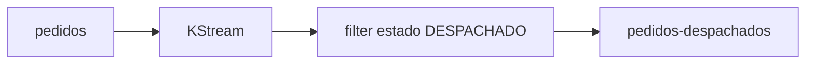
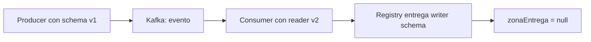
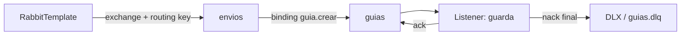

# Módulo 8: Mensajería — Kafka/RabbitMQ

Cada tema se practica por separado con su propia repetición progresiva y su propio reto de memoria, verificado contra un broker real (`@EmbeddedKafka` para Kafka, sin necesitar Docker; `RabbitMQContainer` de Testcontainers para RabbitMQ), para que "el evento se publicó y se consumió" sea comprobable, no solo descrito.


## Aprende construyendo

### Tema 1: Producers y consumers con Spring Kafka

**Duración estimada:** 35 min.
**¿Por qué es importante?** Un evento permite que quien registra un envío continúe sin llamar directamente a cada sistema que lo usa. Kafka conserva los mensajes y varios grupos pueden procesarlos por separado.
**Prerrequisitos:** Spring Boot M1 T1 y M2 T1. Proyecto continuo: enviar un evento de creación y permitir ruteo y notificaciones independientes.
**Laboratorio:** `examples/spring-kafka-rutaflow/`. Usa JDK 25, Spring Boot 4.1.2 y el Maven Wrapper incluido. El mismo proyecto contiene patrones de los temas posteriores (reintentos/DLT y outbox/inbox); en este Tema 1 practica solo los tres subtemas y sus pruebas dirigidas. Si quieres provocar los fallos, copia el directorio a `spring-kafka-practice` y cambia allí las líneas indicadas.

#### Subtema 1.1: Publica el evento con la clave del envío · 10 min

**1. Contexto**
El identificador del envío sirve de clave para mantener sus eventos relacionados en una misma partición de Kafka.

**2. Hazlo tú**
Abre el archivo completo examples/spring-kafka-rutaflow/src/main/java/academia/rutaflow/event/EnvioEventPublisher.java. Confirma que publicar envía topic, clave y evento:

```java
public CompletableFuture<SendResult<String, EnvioCreado>> publicar(EnvioCreado evento) {
    return kafka.send(TOPIC, evento.envioId().toString(), evento);
}
```

El mensaje contiene dos identificadores distintos: `eventId` identifica este hecho; `envioId` agrupa todos los cambios del envío. El record real vive en `examples/spring-kafka-rutaflow/src/main/java/academia/rutaflow/event/EnvioCreado.java`:

```java
public record EnvioCreado(
        UUID eventId, UUID envioId, int version, Instant occurredAt, String referencia) {}
```

En `examples/spring-kafka-rutaflow/src/main/resources/application.yml`, revisa los serializers y deserializers JSON que permiten escribir y leer EnvioCreado:

```yaml
spring:
  kafka:
    producer:
      key-serializer: org.apache.kafka.common.serialization.StringSerializer
      value-serializer: org.springframework.kafka.support.serializer.JsonSerializer
      acks: all
      properties:
        enable.idempotence: true
    consumer:
      group-id: rutaflow-ruteo
      key-deserializer: org.apache.kafka.common.serialization.StringDeserializer
      value-deserializer: org.springframework.kafka.support.serializer.JsonDeserializer
      properties:
        spring.json.value.default.type: academia.rutaflow.event.EnvioCreado
        spring.json.trusted.packages: academia.rutaflow.event
```

Desde examples/spring-kafka-rutaflow/, ejecuta la prueba de integración:

```bash
./mvnw -Dtest=EnvioEventPublisherTest#publicaConKeyDelEnvioYElListenerLaRecibe test
```

**Resultado esperado:** la prueba confirma topic, clave, partición, offset y el mismo evento recibido por el consumidor.

**Fallo deliberado:** cambia la clave por el identificador del evento. **Error esperado:** la prueba informa que la clave recibida no coincide con el identificador del envío. **Diagnóstico:** el envío y sus eventos deben compartir una clave estable si el negocio requiere procesarlos en el mismo orden.

**3. Entiende**
KafkaTemplate devuelve un CompletableFuture<SendResult<...>>; publicar inicia una operación asíncrona. La clave no es el valor del evento: Kafka la usa para decidir la partición.

**4. Cierra**
Anota topic, clave y partición que devolvió la prueba. Verifica qué campo elegirías para conservar juntos los cambios de un mismo envío.

#### Subtema 1.2: Conecta dos grupos consumidores · 10 min

**1. Contexto**
Ruteo y notificaciones deben procesar el mismo hecho, cada grupo con su propio avance. `groupId` nombra al lector lógico; el `@KafkaListener` se suscribe al topic y recibe cada registro asignado a su grupo.

**2. Hazlo tú**
Lee los archivos completos:

- examples/spring-kafka-rutaflow/src/main/java/academia/rutaflow/event/RuteoListener.java
- examples/spring-kafka-rutaflow/src/main/java/academia/rutaflow/event/NotificacionListener.java

Compara el valor de `groupId` en ambos listeners. Este extracto real de `RuteoListener.java` muestra la suscripción y la key que llega en la cabecera:

```java
@KafkaListener(topics = EnvioEventPublisher.TOPIC, groupId = "rutaflow-ruteo")
public void alCrear(
        EnvioCreado evento,
        @Header(KafkaHeaders.RECEIVED_KEY) String key,
        @Header(KafkaHeaders.RECEIVED_PARTITION) int partition,
        @Header(KafkaHeaders.OFFSET) long offset) {
    inbox.procesar(evento);
    recibidos.add(new Recibido(key, partition, offset, evento));
}
```

`NotificacionListener.java` usa el mismo topic y `groupId = "rutaflow-notificaciones"`. Ejecuta:

```bash
./mvnw -Dtest=EnvioEventPublisherTest#publicaConKeyDelEnvioYElListenerLaRecibe test
```

**Resultado esperado:** ambos grupos reciben el mismo registro y cada listener pone su copia en una cola de prueba independiente. La prueba compara key, partición, offset y contenido; esas colas solo sincronizan el test, no son colas de Kafka.

**Fallo deliberado:** cambia el groupId de notificaciones por el de ruteo. **Error esperado:** la comprobación de la segunda cola queda sin mensaje y vence el timeout. **Diagnóstico:** dos consumidores en el mismo grupo reparten trabajo; dos grupos distintos reciben cada uno una copia lógica del registro.

**3. Entiende**
Un consumer group representa un lector lógico. Kafka distribuye cada partición entre los consumidores de un grupo; los offsets de grupos distintos son independientes. Un evento no llama un método Java del otro servicio.

**4. Cierra**
Escribe qué grupo atiende cada listener y por qué el publicador no tiene que conocer esos nombres.

#### Subtema 1.3: Comprueba orden y entrega con un broker · 15 min

**1. Contexto**
El envío al topic no implica que el listener ya haya terminado. Comprueba el recorrido con un broker embebido y espera a que el consumidor procese el evento.

**2. Hazlo tú**
Abre `examples/spring-kafka-rutaflow/src/test/java/academia/rutaflow/event/EnvioEventPublisherTest.java`. La prueba dirige el broker embebido a tres particiones y compara la metadata de Kafka con lo que recibió el consumidor:

```java
var primero = publisher.publicar(primerEvento).get(10, TimeUnit.SECONDS).getRecordMetadata();
var segundo = publisher.publicar(segundoEvento).get(10, TimeUnit.SECONDS).getRecordMetadata();

assertThat(primero.partition()).isEqualTo(segundo.partition());
assertThat(segundo.offset()).isGreaterThan(primero.offset());
assertThat(recibidoPrimero.evento()).isEqualTo(primerEvento);
assertThat(recibidoSegundo.evento()).isEqualTo(segundoEvento);
```

Ejecuta:

```bash
./mvnw -Dtest=EnvioEventPublisherTest#conservaParticionYOrdenParaDosEventosDelMismoEnvio test
```

**Resultado esperado:** los dos eventos comparten partición, el segundo tiene un offset mayor y el listener los recibe en el mismo orden.

**Fallo deliberado:** en el publicador usa un UUID aleatorio como clave en vez de envioId. **Error esperado:** la prueba ya no puede confirmar una partición común para los dos eventos. **Diagnóstico:** el particionador recibe claves diferentes; genera la clave a partir del envío que define el orden del negocio.

**3. Entiende**
El orden está garantizado dentro de una partición, no entre todas las particiones del topic. Kafka aplica el particionador a la key; para el mismo topic y número de particiones, una key estable coloca los registros de ese envío juntos. `acks: all` e idempotencia ayudan al productor frente a fallos y reintentos; no hacen que el efecto de negocio del consumidor se ejecute una sola vez. Eso requiere diseño adicional y se estudia después.

**4. Cierra**
Entrega los resultados de ambas pruebas y describe qué esperarías si publicaras dos eventos del mismo envío con claves distintas.

**Hito del tema:**

- [ ] Publiqué un evento con KafkaTemplate y clave estable.
- [ ] Identifiqué los grupos independientes de ruteo y notificaciones.
- [ ] Verifiqué partición, offset y orden mediante un broker embebido.
- [ ] Reproduje un fallo por usar una clave incorrecta y lo diagnostiqué.

**Nota del laboratorio:** `@DirtiesContext` cierra el contexto Spring antes que el broker embebido; en la suite de 8 pruebas ya no aparece el error de `KafkaStorageException` al borrar el directorio temporal. Kafka 4.2.2 aún registra un `WARN` interno al cerrar un cliente que ya se había cerrado. La prueba de la DLT usa la sobrecarga vigente `KafkaTestUtils.consumerProps(broker, "verificador-dlt", false)`, disponible desde Spring Kafka 4.0.

**Fuentes oficiales:** [envío con KafkaTemplate](https://docs.spring.io/spring-kafka/reference/kafka/sending-messages.html), [recepción con listeners](https://docs.spring.io/spring-kafka/reference/kafka/receiving-messages.html), [pruebas con broker embebido](https://docs.spring.io/spring-kafka/reference/4.0/testing.html) y [KafkaTestUtils 4.0](https://docs.spring.io/spring-kafka/docs/4.0.x/api/org/springframework/kafka/test/utils/KafkaTestUtils.html).

**Transferencia al proyecto integrador:** conecta el evento de envío con consumidores independientes y conserva el identificador del envío como clave para el procesamiento ordenado por partición.

### Tema 2: Dead-letter queue

**Duración estimada:** 35 min.
**¿Por qué es importante?** Si el consumidor rechaza un mensaje cada vez, los reintentos deben tener un límite y el mensaje requiere un destino donde el equipo pueda investigarlo.
**Prerrequisitos:** M8 T1. Proyecto continuo: apartar eventos de envío que no pasan la validación del listener.
**Laboratorio:** `examples/spring-kafka-rutaflow/`. Continúa en `spring-kafka-practice`, la copia que preparaste en el Tema 1; allí prueba cambios deliberados sin alterar la versión base.

#### Subtema 2.1: Configura reintentos limitados y DLT · 10 min

**1. Contexto**
Kafka no crea un DLT de aplicación automáticamente. El listener informa el fallo; un manejador decide si vuelve a ejecutar el listener y dónde deja el registro que sigue fallando.

**2. Hazlo tú**
Abre examples/spring-kafka-rutaflow/src/main/java/academia/rutaflow/KafkaLabConfiguration.java y estudia el bean completo errorHandler:

```java
@Bean
DefaultErrorHandler errorHandler(KafkaTemplate<Object, Object> kafka) {
    var recoverer = new DeadLetterPublishingRecoverer(kafka);
    return new DefaultErrorHandler(recoverer, new FixedBackOff(100L, 2));
}
```

En la misma clase confirma que se crean `rutaflow.envio.creado` y `rutaflow.envio.creado-dlt`, ambos con tres particiones. `FixedBackOff(100L, 2)` define 100 ms entre reintentos y dos reintentos adicionales después del primer intento. Desde la raíz de la copia ejecuta:

```bash
./mvnw -Dtest=EnvioEventPublisherTest#reintentaYPublicaEnDltCuandoLaKeyNoCoincide test
```

**Resultado esperado:** Maven termina con BUILD SUCCESS y la prueba encuentra el evento fallido en rutaflow.envio.creado-dlt.

**Fallo deliberado:** comenta el bean errorHandler en la copia del laboratorio y vuelve a ejecutar. **Error esperado:** la prueba no encuentra el registro en la DLT y vence su espera. **Diagnóstico:** sin recoverer configurado no hay una regla que publique el registro fallido en el destino esperado.

**3. Entiende**
`DefaultErrorHandler` coordina los fallos del listener; `FixedBackOff` define el intervalo y el máximo de reintentos. `DeadLetterPublishingRecoverer` publica en otro topic cuando se agota la política. Sin un DLT configurado, la aplicación necesita otra estrategia explícita para los mensajes irrecuperables.

**4. Cierra**
Señala dónde se crea el topic original, dónde se crea el DLT y qué bean conecta el fallo con la recuperación.

#### Subtema 2.2: Provoca un mensaje inválido y comprueba los intentos · 10 min

**1. Contexto**
Una clave que no coincide con el envío hace que el listener falle siempre. Ese error repetible permite observar cada reintento y comprobar que el mensaje no desaparece.

**2. Hazlo tú**
Abre examples/spring-kafka-rutaflow/src/test/java/academia/rutaflow/event/EnvioEventPublisherTest.java y ejecuta el test reintentaYPublicaEnDltCuandoLaKeyNoCoincide:

```bash
./mvnw -Dtest=EnvioEventPublisherTest#reintentaYPublicaEnDltCuandoLaKeyNoCoincide test
```

Localiza en la prueba el envío con key incorrecta, la espera por tres intentos y la lectura desde el topic DLT. Este fragmento toma la metadata del topic original y comprueba la key, partición y contenido que recuperó el consumer:

```java
var origen = kafka.send(EnvioEventPublisher.TOPIC, "key-incorrecta", evento)
        .get(10, TimeUnit.SECONDS).getRecordMetadata();
await().atMost(Duration.ofSeconds(5))
        .untilAsserted(() -> assertThat(ruteoListener.intentos()).isEqualTo(3));
ConsumerRecord<String, String> deadLetter = KafkaTestUtils.getSingleRecord(
        consumer, EnvioEventPublisher.TOPIC + "-dlt", Duration.ofSeconds(10));

assertThat(deadLetter.key()).isEqualTo("key-incorrecta");
assertThat(deadLetter.partition()).isEqualTo(origen.partition());
assertThat(deadLetter.value()).contains("RT-DLT");
```

**Resultado esperado:** el test confirma tres entregas fallidas del listener y encuentra el JSON del envío en `rutaflow.envio.creado-dlt`, con la key y partición originales.

**Fallo deliberado:** cambia la key incorrecta del test por envioId.toString(). **Resultado esperado:** la ruta de ruteo acepta el mensaje y la condición de tres fallos vence. **Diagnóstico:** el caso deja de ser inválido; restaura una key que no coincida para que el test ejercite el error y la recuperación.

**3. Entiende**
FixedBackOff(100L, 2) significa un intento inicial y hasta dos reintentos adicionales: tres entregas al listener en total. El evento que llega al DLT queda disponible para inspección y reproceso controlado.

**4. Cierra**
Anota el total de intentos, el topic de origen y el DLT donde quedó el registro.

#### Subtema 2.3: Ajusta la política y atiende los mensajes recuperados · 15 min

**1. Contexto**
El número de reintentos y el tiempo de espera dependen del fallo. Un dato definitivamente inválido no mejora por esperar; un problema temporal sí podría resolverse con otro intento.

**2. Hazlo tú**
En `spring-kafka-practice/src/main/java/academia/rutaflow/KafkaLabConfiguration.java`, cambia `FixedBackOff(100L, 2)` por `FixedBackOff(100L, 0)`. En `spring-kafka-practice/src/test/java/academia/rutaflow/event/EnvioEventPublisherTest.java`, cambia la expectativa de `intentos()` de `3` a `1`; vuelve a ejecutar el test:

```bash
./mvnw -Dtest=EnvioEventPublisherTest#reintentaYPublicaEnDltCuandoLaKeyNoCoincide test
```

**Resultado esperado:** con cero reintentos adicionales, el primer fallo se recupera y el mensaje llega a rutaflow.envio.creado-dlt.

**Fallo deliberado:** en esa prueba cambia las dos lecturas de `EnvioEventPublisher.TOPIC + "-dlt"` por `EnvioEventPublisher.TOPIC + "-dlt-mal"`. **Error esperado:** el consumidor agota los diez segundos y la prueba falla porque el topic alternativo no recibió el mensaje. **Diagnóstico:** el recoverer usa el sufijo `-dlt`; restaura la misma ruta en la escucha y en la lectura.

**3. Entiende**
El recoverer de esta práctica usa por defecto el topic original más el sufijo `-dlt`, y conserva key y partición si el topic destino tiene esa partición. El test lo comprueba comparando la metadata del envío original y el registro recuperado. El DLT requiere monitoreo y responsable; acumular mensajes sin revisarlos solo traslada el problema.

**4. Cierra**
Restaura la configuración del proyecto a FixedBackOff(100L, 2), conserva la salida correcta y explica cuándo dejarías de reintentar un error de validación.

**Hito del tema:**

- [ ] Configuré DefaultErrorHandler y DeadLetterPublishingRecoverer.
- [ ] Comprobé el intento inicial y los dos reintentos configurados.
- [ ] Encontré el registro fallido en el topic terminado en -dlt.
- [ ] Cambié temporalmente a cero reintentos y restauré el laboratorio.

**Fuentes oficiales:** [manejo de excepciones y reintentos en Spring Kafka](https://docs.spring.io/spring-kafka/reference/kafka/annotation-error-handling.html) y [publicación en dead-letter topics](https://docs.spring.io/spring-kafka/reference/kafka/annotation-error-handling.html#publishing-dead-letter-records).

**Transferencia al proyecto integrador:** define reintentos según el tipo de fallo y envía los eventos irrecuperables a un DLT monitoreado con un procedimiento de revisión.

### Tema 3: Transacciones Kafka y SQL: idempotencia y límites de exactly-once

**Duración estimada:** 50 min.
**¿Por qué es importante?** Un productor puede repetir un envío y un consumidor puede volver a recibir un evento. Evita duplicar el efecto y distingue la transacción del broker de la transacción de la base de datos.
**Prerrequisitos:** M8 T1 y M8 T2. Proyecto continuo: guardar un envío, publicar su evento y procesarlo sin duplicar la proyección.
**Laboratorio:** `examples/spring-kafka-rutaflow/`. Usa la copia de M8 T1. El test usa Kafka embebido y H2; comprueba estas fronteras en una sola máquina, no sustituye pruebas con PostgreSQL ni con un clúster Kafka de producción.

#### Subtema 3.1 · Reintentar el productor sin duplicar registros de Kafka · 10 min

**1. Contexto**
Si el productor pierde una confirmación, puede repetir el envío. La idempotencia permite que Kafka reconozca ese reintento de la misma sesión del productor. No deduplica dos llamadas de negocio que crean dos envíos.

**2. Hazlo tú**
Revisa `spring.kafka.producer` en `examples/spring-kafka-rutaflow/src/main/resources/application.yml`:

```yaml
spring:
  kafka:
    producer:
      acks: all
      properties:
        enable.idempotence: true
```

Ejecuta la prueba de publicación:

```bash
./mvnw -Dtest=EnvioEventPublisherTest#publicaConKeyDelEnvioYElListenerLaRecibe test
```

**Resultado esperado.** La prueba verifica envío, partición, key y recepción. La suite completa también pasa si cambias temporalmente `enable.idempotence` a `false`; no simula perder el ACK del productor y reintentar el mismo envío.

**Fallo deliberado:** en la copia apaga la idempotencia y ejecuta la suite. **Diagnóstico:** que la suite siga pasando significa que este test no mide reintentos internos del cliente. Restaura `true`; no presentes esta prueba como evidencia directa de la garantía.

**3. Entiende**
Idempotencia de productor reduce duplicados que Kafka recibiría por retries de una misma sesión. Dos llamadas separadas siguen siendo dos registros posibles; el efecto de negocio requiere su propia clave idempotente.

**4. Cierra**
Separa en dos frases qué duplicado resuelve Kafka y cuál debe resolver la aplicación.

#### Subtema 3.2 · Guardar envío y evento en la misma transacción SQL · 15 min

**1. Contexto**
PostgreSQL y Kafka no comparten una transacción local. Si guardas primero el envío y falla el proceso antes de publicar, el evento se perdería sin un registro pendiente durable.

**2. Hazlo tú**
Abre `examples/spring-kafka-rutaflow/src/main/java/academia/rutaflow/outbox/CrearEnvioService.java`. En `crear`, la transacción cubre ambas escrituras:

```java
@Transactional
public EnvioCreado crear(String referencia) {
    UUID envioId = UUID.randomUUID();
    EnvioCreado evento = new EnvioCreado(
            UUID.randomUUID(), envioId, 1, clock.instant(), referencia);
    try {
        String payload = json.writeValueAsString(evento);
        jdbc.update("INSERT INTO envio (envio_id, referencia) VALUES (?, ?)", envioId, referencia);
        jdbc.update("""
                INSERT INTO outbox_event
                    (event_id, aggregate_id, event_type, payload, created_at)
                VALUES (?, ?, ?, ?, ?)
                """, evento.eventId(), envioId, "EnvioCreado", payload, evento.occurredAt());
        return evento;
    } catch (JsonProcessingException error) {
        throw new IllegalStateException("No se pudo serializar EnvioCreado", error);
    }
}
```

Este es el flujo real: serializa el evento, inserta el envío y luego outbox dentro de la misma transacción. Ejecuta:

```bash
./mvnw -Dtest=EnvioEventPublisherTest#guardaEnvioYOutboxEnLaMismaTransaccion test
```

**Resultado esperado.** El test hace fallar el `INSERT` de outbox con una restricción SQL. Al salir de `crear`, no queda ni el envío ni el evento parcial.

**Fallo deliberado:** en la copia quita `@Transactional` de `crear` y repite el test. **Diagnóstico:** con autocommit, la primera escritura SQL ya se confirmó y queda una fila `envio` aunque falle outbox. Restaura la anotación.

**3. Entiende**
La outbox guarda el evento pendiente junto con el cambio de negocio en una transacción de la base de datos. Un dispatcher publica después y marca la fila solo tras recibir el ACK; entre el ACK y esa marca puede haber replay. Este dispatcher de laboratorio no reclama filas con lease: no lo ejecutes en varias instancias.

**4. Cierra**
Describe qué dato pendiente permite al dispatcher recuperar la publicación si Kafka está temporalmente fuera de servicio.

#### Subtema 3.3 · Procesar un `eventId` repetido sin duplicar el efecto · 15 min

**1. Contexto**
El dispatcher puede publicar dos veces el mismo evento si Kafka confirmó, pero el proceso no alcanzó a guardar `published_at`. El consumidor registra `eventId` en inbox junto a la proyección, dentro de una transacción.

**2. Hazlo tú**
Abre `examples/spring-kafka-rutaflow/src/main/java/academia/rutaflow/inbox/InboxProcessor.java`. Fíjate en el retorno temprano y en la transacción que contiene el registro y el efecto:

```java
@Transactional
public boolean procesar(EnvioCreado evento) {
    Integer existente = jdbc.queryForObject(
            "SELECT COUNT(*) FROM evento_procesado WHERE event_id = ?",
            Integer.class, evento.eventId());
    if (existente != null && existente > 0) {
        return false;
    }
    jdbc.update("INSERT INTO evento_procesado (event_id, processed_at) VALUES (?, ?)",
            evento.eventId(), clock.instant());
    int actualizados = jdbc.update("""
            UPDATE route_projection
            SET referencia = ?, updated_at = ?
            WHERE envio_id = ?
            """, evento.referencia(), clock.instant(), evento.envioId());
    if (actualizados == 0) {
        jdbc.update("""
                INSERT INTO route_projection (envio_id, referencia, updated_at)
                VALUES (?, ?, ?)
                """, evento.envioId(), evento.referencia(), clock.instant());
    }
    return true;
}
```

Ejecuta las pruebas de duplicado y de replay tras fallar la marca SQL después del ACK:

```bash
./mvnw -Dtest=EnvioEventPublisherTest#inboxHaceIdempotenteElEfectoDeNegocio test
./mvnw -Dtest=EnvioEventPublisherTest#replayTrasFallarLaMarcaDespuesDelAckConservaUnaSolaProyeccion test
```

La segunda prueba agrega una restricción temporal que impide marcar una fila concreta como publicada; Kafka ya confirmó el primer registro. Al quitar la restricción, el dispatcher lo reenvía y el listener recibe dos mensajes con el mismo `eventId`.

**Resultado esperado.** El primer `procesar` devuelve `true`, el duplicado `false`; tras los dos mensajes hay una fila inbox y una sola proyección. La fila de outbox queda pendiente si falla la marca y se cierra después del replay correcto.

**Fallo deliberado:** en la copia quita el `SELECT`/retorno temprano que evita procesar un `eventId` existente. **Diagnóstico:** la segunda inserción choca con la clave primaria de inbox en vez de devolver `false`; restaura la comprobación.

**3. Entiende**
Outbox evita perder el evento entre el commit SQL y la publicación; inbox hace seguro repetir su efecto SQL. La consulta seguida del insert de este ejemplo se prueba secuencialmente; con consumidores concurrentes hay que manejar el conflicto de unicidad de forma explícita.

**4. Cierra**
Explica por qué el dispatcher puede publicar al menos una vez y cómo inbox evita que eso duplique la proyección.

#### Subtema 3.4 · Leer solo registros confirmados de una transacción Kafka · 10 min

**1. Contexto**
Una transacción de Kafka agrupa registros del broker. El consumidor `read_committed` oculta los registros abortados; `read_uncommitted` también puede observarlos. Esto no hace que una base SQL forme parte de la transacción Kafka.

**2. Hazlo tú**
En `examples/spring-kafka-rutaflow/src/test/java/academia/rutaflow/event/EnvioEventPublisherTest.java`, estudia `transaccionKafkaAbortadaSoloEsVisibleConReadUncommitted`. El test crea un topic único, un `KafkaTemplate` transaccional y dos consumidores con distinto `isolation.level`. `DefaultKafkaProducerFactory` necesita un prefijo transaccional único:

```java
producerFactory.setTransactionIdPrefix("rutaflow-tx-" + UUID.randomUUID() + "-");
var transactionalTemplate = new KafkaTemplate<>(producerFactory);
```

El envío se confirma dentro de la transacción local y luego se provoca el rollback:

```java
transactionalTemplate.executeInTransaction(template -> {
    try {
        template.send(topic, "envio-1", "registro-abortado").get(10, TimeUnit.SECONDS);
    } catch (Exception error) {
        throw new IllegalStateException("falló el envío de prueba", error);
    }
    throw new IllegalStateException("aborto intencional de la transacción");
});
```

Ejecuta:

```bash
./mvnw -Dtest=EnvioEventPublisherTest#transaccionKafkaAbortadaSoloEsVisibleConReadUncommitted test
```

**Resultado esperado.** El consumer `read_committed` no recibe el registro; `read_uncommitted` sí observa el valor `registro-abortado`. Ver ambas salidas evita que el test pase solo porque el productor no hubiera enviado nada.

**Fallo deliberado:** en el test cambia temporalmente la configuración del consumidor `committedProps` a `read_uncommitted`. **Diagnóstico:** su aserción de vacío falla porque ahora ve el registro abortado. Restaura `read_committed` y repite el método.

**3. Entiende**
Esta prueba verifica visibilidad de una transacción de productor abortada; no comprueba por sí sola el flujo completo de lectura, procesamiento y offsets. En Spring Kafka, EOS para ese flujo requiere una transacción de listener que incluya los mensajes producidos y offsets consumidos. Ninguna de estas transacciones incorpora automáticamente PostgreSQL; outbox e inbox cubren esa otra frontera.

**4. Cierra**
Identifica qué fila ve cada nivel de aislamiento y di qué parte de la garantía de exactly-once no prueba este laboratorio.

**Hito del tema:**

- [ ] Diferencié reintentos internos del productor de otra llamada de negocio.
- [ ] Comprobé el rollback conjunto de envío y outbox.
- [ ] Reproduje un fallo de marca posterior al ACK y una sola proyección tras replay.
- [ ] Comparé `read_committed` y `read_uncommitted` ante un registro abortado.
- [ ] Expliqué por qué Kafka EOS no hace partícipe a la base de datos SQL.

**Fuentes oficiales:** [idempotencia del productor Kafka](https://kafka.apache.org/41/configuration/producer-configs/), [Exactly Once Semantics en Spring Kafka 4.0](https://docs.spring.io/spring-kafka/reference/4.0/kafka/exactly-once.html), [transacciones con `KafkaTemplate`](https://docs.spring.io/spring-kafka/reference/4.0/kafka/transactions.html) y [diseño y semántica de Kafka](https://kafka.apache.org/28/design/design/).

**Transferencia al proyecto integrador:** conserva eventos pendientes en outbox, publica con clave estable y protege cada `eventId` en inbox. Describe la garantía y sus límites por cada frontera; no llames exactly-once a la operación total sin una transacción que cubra su entrada y salida.

### Tema 4: Rebalanceo de consumer groups y asignación de particiones

**Duración estimada:** 45 min.

**Resultado:** observa cómo cambia la propiedad de las particiones cuando entra otro consumer, mantiene correcto el estado local con los callbacks y decide cuándo sirve la membresía estática.
**¿Por qué es importante?** Un estado local desactualizado puede hacer que una instancia procese datos de una partición que ya pertenece a otro miembro.

**Necesitas:** M8 T1 y un clon del laboratorio `examples/spring-kafka-rutaflow/`. Prueba el comando desde esa carpeta.

#### Subtema 4.1 · Una partición pertenece a un consumer del grupo · 10 min

**1. Contexto**

Kafka reparte las particiones suscritas entre los miembros de un mismo grupo. Dos grupos distintos pueden leer el mismo tópico; dentro de un grupo, una partición se asigna a un solo miembro a la vez. El resultado exacto depende del protocolo y del asignador.

**2. Hazlo tú**

Abre `src/test/java/academia/rutaflow/event/EnvioEventPublisherTest.java`. El laboratorio crea un tópico de prueba con dos particiones y consumer group identificable. Ejecuta:

```bash
./mvnw -Dtest=EnvioEventPublisherTest#unSegundoConsumidorProvocaRebalanceoYActualizaAsignaciones test
```

Al inicio solo está activo el consumer A. El test espera a que su callback registre dos particiones antes de arrancar B.

**Resultado esperado.** Antes de arrancar B, A tiene dos asignaciones. Tras unirse B, el test espera hasta que cada uno tenga una partición.

**Fallo deliberado.** Cambia la creación del tópico de dos particiones a una. **Observa:** el test deja de poder afirmar una partición por consumer; con una partición no se pueden mantener ocupados dos consumers del mismo grupo.

**3. Entiende**

El número de consumers útiles de un grupo no puede superar el número de particiones del tópico que consumen. Tener más consumers puede ayudar con varios tópicos o asignaciones, pero uno de ellos puede quedarse sin particiones.

**4. Cierra**

Explica por qué el segundo consumer recibe trabajo al unirse y qué cambia si el tópico solo tiene una partición.

#### Subtema 4.2 · Mantener el estado local con callbacks reales · 10 min

**1. Contexto**

Cuando una partición deja de pertenecer a esta instancia, una caché o un contador local deben dejar de tratarla como propia. Kafka llama al listener antes de retirar asignaciones y después de asignar las nuevas.

**2. Hazlo tú**

En la clase de prueba `SeguimientoAsignaciones`, localiza los dos callbacks. El listener usa un conjunto concurrente porque los callbacks ocurren en el hilo del consumer:

```java
@Override
public void onPartitionsRevoked(Collection<TopicPartition> partitions) {
    asignadas.removeAll(partitions);
    revocaciones.incrementAndGet();
}

@Override
public void onPartitionsAssigned(Collection<TopicPartition> partitions) {
    asignadas.addAll(partitions);
}
```

Busca `containerProps.setConsumerRebalanceListener(rebalanceListener)`: ahí Spring entrega el listener al contenedor. Ejecuta el mismo test focalizado de 4.1.

**Resultado esperado.** Al entrar B, A recibe revocación; ambos reciben callbacks de asignación con la distribución final.

**Fallo deliberado.** En una copia, elimina `asignadas.removeAll(partitions)` y repite la prueba. **Observa:** el conjunto de A conserva la partición revocada y la suma temporal/final de asignaciones deja de coincidir con las dos particiones reales.

**3. Entiende**

El callback actualiza conocimiento local; no cambia la propiedad en el broker. La asignación del broker es la autoridad. En aplicaciones reales, usa la revocación para guardar progreso o limpiar estado que dependa de esas particiones.

**4. Cierra**

Di qué debe limpiarse en `onPartitionsRevoked` y qué error aparece si la instancia conserva una partición que ya perdió.

#### Subtema 4.3 · Ver el rebalanceo al entrar el segundo consumer · 15 min

**1. Contexto**

Un rebalanceo redistribuye asignaciones cuando cambia el grupo o su suscripción. No significa siempre que todas las particiones se quiten y vuelvan a asignarse: el alcance depende del protocolo de grupo y del asignador. La prueba usa dos particiones y consumers dinámicos para observar una redistribución concreta.

**2. Hazlo tú**

Lee `unSegundoConsumidorProvocaRebalanceoYActualizaAsignaciones` en el mismo archivo. El test crea un tópico único, espera la asignación inicial de A, arranca B y comprueba callback de revocación y una partición final por instancia.

```bash
./mvnw -Dtest=EnvioEventPublisherTest#unSegundoConsumidorProvocaRebalanceoYActualizaAsignaciones test
```

**Resultado esperado.** El broker procesa el nuevo miembro, A recibe una revocación y al estabilizarse el grupo la asignación es una partición para A y una para B. Es una prueba de integración con Kafka embebido, no una medición de pausas, latencia o disponibilidad de producción.

**Fallo deliberado.** En una copia, elimina la limpieza de particiones revocadas o cambia la aserción a esperar dos particiones en A después del rebalanceo. **Observa:** la prueba falla porque el estado local o la expectativa ya no coincide con la asignación final.

**3. Entiende**

El rebalanceo puede pausar consumo mientras se estabiliza el grupo, y su impacto depende del tamaño del grupo, el protocolo, el asignador y la carga de trabajo. Mide esos tiempos con métricas y pruebas de carga del despliegue; este test solo demuestra callbacks y propiedad final.

**4. Cierra**

Describe la secuencia observada: asignación inicial, entrada de B, revocación y nueva asignación.

#### Subtema 4.4 · Usar membresía estática solo para reinicios breves · 10 min

**1. Contexto**

`group.instance.id` identifica de forma estable un miembro estático. Kafka permite que una indisponibilidad transitoria no desencadene la misma respuesta inmediata que la salida de un miembro dinámico; el broker espera el timeout de sesión antes de recuperar sus particiones. No elimina rebalanceos ni debe compartirse entre dos instancias activas.

**2. Hazlo tú**

En un perfil de despliegue, revisa esta propiedad y compárala con la guía oficial de Consumer Configs:

```yaml
spring:
  kafka:
    consumer:
      properties:
        group.instance.id: rutaflow-consumer-0
```

Define un ID estable y único por réplica (por ejemplo, ordinal de StatefulSet). No uses el mismo literal fijo para todas las réplicas de un Deployment. Este laboratorio no simula reinicios ni mide el timeout; no cambies la configuración general de pruebas.

**Resultado esperado.** Puedes explicar cuándo el ID reduce cambios por una interrupción corta y por qué la sesión todavía puede expirar y reasignar particiones.

**Fallo deliberado.** Escribe el mismo `group.instance.id` en dos réplicas activas en una copia de configuración. **Diagnóstico esperado:** la identidad no es única; Kafka puede cercar una de las instancias y el despliegue deja de representar dos miembros independientes. Restaura IDs distintos.

**3. Entiende**

Membresía estática y asignación cooperativa son mecanismos diferentes: la primera conserva identidad entre reinicios; un asignador cooperativo puede reducir cuántas particiones cambian de dueño durante un rebalanceo. Ninguno sustituye idempotencia, manejo de revocaciones ni pruebas operativas.

**4. Cierra**

Anota una situación apropiada para membresía estática, el costo de un timeout más largo y una señal que vigilarías en producción.

**Transferencia al proyecto integrador:** ejecuta el test con dos consumers y explica quién es dueño de cada partición tras el rebalanceo. Para producción, verifica unicidad de `group.instance.id`, duración del rebalanceo, mensajes repetidos y limpieza de recursos por partición.

**Fuentes oficiales:** [Rebalance listeners en Spring Kafka 4.0](https://docs.spring.io/spring-kafka/reference/4.0/kafka/receiving-messages/rebalance-listeners.html), [configuración de consumidores Apache Kafka 4.2](https://kafka.apache.org/42/generated/consumer_config.html) y [protocolo de rebalanceo Apache Kafka 4.3](https://kafka.apache.org/43/operations/consumer-rebalance-protocol/).

### Tema 5: Kafka frente a RabbitMQ

**Duración estimada:** 45 min.

**Resultado:** eliges el broker según quién debe recibir cada mensaje, cuánto tiempo necesitas conservarlo y cómo confirmas su procesamiento.

**¿Por qué es importante?** Kafka y RabbitMQ pueden transportar eventos, pero sus grupos, colas, retención y confirmaciones no significan lo mismo.

**Prerrequisitos:** M8 T1 y el laboratorio `examples/spring-stream-rutaflow/`.

#### Subtema 5.1 · Repartir mensajes o dar una copia a cada grupo · 10 min

**1. Contexto**

En Kafka, cada consumer group lleva su propio avance; dos grupos independientes pueden leer el mismo tópico. En RabbitMQ, consumers sobre una misma cola compiten por las entregas. Para que dos aplicaciones reciban sus propias copias, se crean dos colas y se enruta el mensaje a ambas; no se agrega un `groupId` a la cola.

**2. Hazlo tú**

En `examples/spring-kafka-rutaflow/src/main/java/academia/rutaflow/event/`, compara los `groupId` `rutaflow-ruteo` y `rutaflow-notificaciones`. Ejecuta la prueba que envía un evento y espera a ambos listeners:

```bash
cd examples/spring-kafka-rutaflow
./mvnw -Dtest=EnvioEventPublisherTest#publicaConKeyDelEnvioYElListenerLaRecibe test
```

Después abre `examples/node-messaging/rabbit/topology.mjs`: hoy declara una cola `envios` y la vincula a un exchange. Un segundo worker que consuma `envios` competiría por las entregas. Para fan-out, necesitarías otra cola durable enlazada al exchange.

**Resultado esperado.** La prueba de Kafka recibe el evento en ambos grupos. Puedes dibujar las dos topologías y señalar que dos consumers de una sola cola Rabbit se reparten mensajes, mientras dos colas enlazadas pueden recibir copias.

**Fallo deliberado.** En una copia, pon ambos `@KafkaListener` en el mismo `groupId`. **Observa:** dejan de ser dos suscripciones independientes y compiten por las particiones; la prueba que espera ambos listeners puede fallar.

**3. Entiende**

Kafka replica la lectura por grupo; RabbitMQ replica por rutas a colas. RabbitMQ puede hacer fan-out con exchange y varias colas. La comparación correcta es topología completa, no “Kafka tiene fan-out y RabbitMQ no”.

**4. Cierra**

Dibuja el destino necesario para que dos servicios procesen cada uno una copia, primero en Kafka y luego en RabbitMQ.

#### Subtema 5.2 · Releer historial o conservar mensajes pendientes · 10 min

**1. Contexto**

Kafka conserva registros según las políticas de retención del tópico, aunque un consumer ya los haya leído; un consumer group nuevo puede empezar desde el inicio si el dato sigue retenido y se configura `auto.offset.reset=earliest`. RabbitMQ conserva un mensaje en una cola mientras esté pendiente; después de una confirmación de consumo, el broker puede eliminar esa entrega. Una cola nueva no recibe automáticamente el historial de una cola distinta.

**2. Hazlo tú**

Compara el log de Kafka en [M8 T1](#tema-1-producers-y-consumers-con-spring-kafka) y la cola `envios` de `examples/node-messaging/rabbit/topology.mjs`. En RabbitMQ abre `examples/node-messaging/rabbit/worker.mjs` y localiza `channel.ack(message)`. Para ver la persistencia por broker, inicia cada ejemplo desde sus carpetas según sus README:

```bash
cd examples/spring-stream-rutaflow
./mvnw test
```

El test binder comprueba la función, no retención ni broker. La práctica de broker real se describe en `examples/spring-stream-rutaflow/README.md` y requiere Docker Compose.

**Resultado esperado.** Explicas la diferencia entre “ya consumido” y “ya no retenido”: Kafka puede expirar registros por política; RabbitMQ elimina una entrega confirmada de su cola, pero puede retener mensajes aún no confirmados y reenviarlos tras un fallo.

**Fallo deliberado.** Cambia mentalmente el `ack` a antes del procesamiento: si el proceso cae luego, RabbitMQ ya puede tratar la entrega como terminada. En el laboratorio Node no cambies ni ejecutes esa mutación; escribe qué dato de negocio podrías perder.

**3. Entiende**

No prometas que Kafka guarda el historial para siempre: depende de `retention.ms`, bytes, compactación y configuración. Tampoco afirmes que RabbitMQ borra siempre al primer intento: con ack manual un mensaje sin confirmar puede reencolarse.

**4. Cierra**

Completa dos frases: “Kafka permite releer mientras…” y “RabbitMQ conserva un mensaje hasta…”.

#### Subtema 5.3 · Distinguir confirmación de publicación y confirmación de consumo · 10 min

**1. Contexto**

Que el broker acepte una publicación no significa que la aplicación destino haya procesado el mensaje. RabbitMQ tiene publisher confirms para el lado productor y acknowledgements del consumer para el procesamiento; son señales separadas. Kafka confirma la escritura del productor y administra offsets de lectura por grupo como otro estado.

**2. Hazlo tú**

Lee `examples/node-messaging/rabbit/producer.mjs`: crea un confirm channel, publica y espera `waitForConfirms()`. Luego lee `examples/node-messaging/rabbit/worker.mjs`: usa `prefetch(5)` y confirma cada entrega con `channel.ack(message)` tras procesarla. Compara con `EnvioEventPublisherTest` de M8 T1, que espera el ACK del productor y verifica la recepción de listeners por separado.

```bash
cd examples/node-messaging
npm ci
npm test
```

`npm test` verifica topología y flujo local definido por el test; no demuestra conexión con broker real. El README incluye el comando Docker para practicar la entrega real.

**Resultado esperado.** Identificas dos confirmaciones de RabbitMQ y dos etapas de Kafka sin llamarlas “exactly once”. Si el consumer procesa y cae antes de confirmar, puede aparecer una redelivery; el efecto debe ser idempotente.

**Fallo deliberado.** En una hoja, intercambia las etiquetas “publisher confirm” y “consumer ack”. **Diagnóstico:** una confirma la recepción por el broker; la otra confirma el manejo de una entrega. No prueban mutuamente el trabajo opuesto.

**3. Entiende**

Las confirmaciones ayudan a detectar fallos, pero entre persistir el efecto y confirmar puede ocurrir una caída. Outbox, inbox e idempotencia siguen siendo necesarios para cubrir esa frontera.

**4. Cierra**

Describe qué confirma `waitForConfirms()` y qué confirma `channel.ack()` en estos archivos.

#### Subtema 5.4 · Elegir por el flujo y comprobar ambos binders · 15 min

**1. Contexto**

Kafka suele encajar cuando varias aplicaciones necesitan leer el mismo log a su ritmo o reprocesar offsets retenidos. RabbitMQ suele encajar cuando el exchange enruta trabajo a colas y los workers compiten por cada entrega. Ambos pueden conservar datos, reintentar y enrutar; la topología, los límites operativos y el requisito definen la decisión.

**2. Hazlo tú**

Abre `examples/spring-stream-rutaflow/README.md`. Ejecuta primero el test binder:

```bash
cd examples/spring-stream-rutaflow
./mvnw test
```

El binder prueba la función y el mapping dentro de Spring. Después, si Docker está disponible, levanta los brokers y ejecuta un perfil a la vez:

```bash
docker compose up -d
./mvnw spring-boot:run -Dspring-boot.run.profiles=kafka
```

Prueba el mensaje válido y el código postal `XX` según el README; observa el destino de error en Kafka. Detén la aplicación y repite con `-Dspring-boot.run.profiles=rabbit`; revisa la cola y dead-letter queue en la consola de RabbitMQ. La configuración es real, pero el test binder por sí solo no certifica integración con los brokers.

**Resultado esperado.** La función de negocio se mantiene igual; cada perfil configura su binder y su política de error. Escribe para cada caso si necesitas repetición por offset, distribución entre workers o copias en varias colas, y elige con esa necesidad.

**Fallo deliberado.** Intenta afirmar que el test binder prueba publisher confirms, offsets Kafka y acknowledgements Rabbit. **Diagnóstico:** el test no se conecta a ninguno de los brokers; esa evidencia requiere ejecutar los perfiles reales y observar sus destinos.

**3. Entiende**

La abstracción de Spring Cloud Stream reduce código de integración, pero no convierte garantías diferentes en una garantía común. Mantén visible el binder, el grupo/cola, la retención, el manejo de error y la forma de confirmar.

**4. Cierra**

Entrega una decisión breve para un flujo de reprocesamiento histórico y otra para una cola de trabajo, nombrando evidencia y configuración que revisarías.

**Fuentes oficiales:** [log y retención de Kafka 4.2](https://kafka.apache.org/42/implementation/log/), [retención de tópicos Kafka](https://kafka.apache.org/42/configuration/topic-configs/), [consumers RabbitMQ](https://www.rabbitmq.com/docs/consumers), [acks y confirms RabbitMQ](https://www.rabbitmq.com/docs/confirms), [ack mode de Spring AMQP](https://docs.spring.io/spring-amqp/reference/amqp/containerAttributes.html) y [publisher confirms en Spring AMQP](https://docs.spring.io/spring-amqp/reference/amqp/connections.html), [binder abstraction de Spring Cloud Stream](https://docs.spring.io/spring-cloud-stream/reference/spring-cloud-stream/overview-binder-abstraction.html) y [testing binder](https://docs.spring.io/spring-cloud-stream/reference/spring-cloud-stream/spring_integration_test_binder.html).

**Transferencia al proyecto integrador:** documenta por evento quién lo necesita, si necesita copia independiente o competencia por trabajo, cuánto retenerlo, qué confirma publicación y qué confirma procesamiento, cómo reintenta y qué efecto idempotente protege una redelivery.

### Tema 6: Spring Cloud Stream y binders de Kafka/RabbitMQ

**Duración estimada:** 45 min.

**Resultado:** sigues una función de negocio desde el binding de entrada hasta su salida y explicas qué cambia al elegir el binder.

**¿Por qué es importante?** Una función común puede conectarse a más de un broker, pero las garantías y las propiedades de cada broker siguen siendo específicas.

**Laboratorio:** `examples/spring-stream-rutaflow/`. Usa las versiones declaradas por su `pom.xml` y no cambies el BOM para seguir el ejemplo.

#### Subtema 6.1 · Recorrer la función y los destinos reales · 10 min

**1. Contexto**

Spring Cloud Stream conecta una función con bindings de entrada/salida. En el laboratorio la función recibe `ShipmentCreated` y devuelve `RoutePlanningRequested`; los nombres de destino están en YAML, no en la clase Java.

**2. Hazlo tú**

Abre `src/main/java/academia/rutaflow/stream/RouteFunctions.java` y sigue este código:

```java
@Bean
public Function<ShipmentCreated, RoutePlanningRequested> planRoute() {
    return shipment -> {
        if (shipment.postalCode() == null || shipment.postalCode().length() < 2) {
            throw new IllegalArgumentException("El código postal debe tener dos caracteres");
        }
        if (shipment.postalCode().startsWith("XX")) {
            throw new IllegalArgumentException("La zona XX requiere revisión manual");
        }
        return new RoutePlanningRequested(
                shipment.shipmentId(), shipment.postalCode().substring(0, 2));
    };
}
```

En `src/main/resources/application.yml`, localiza `spring.cloud.function.definition`, `planRoute-in-0`, `planRoute-out-0` y `group: route-planner`. Ejecuta las pruebas del mapping:

```bash
cd examples/spring-stream-rutaflow
./mvnw -Dtest=RouteFunctionsTest test
```

**Resultado esperado.** El test envía `ShipmentCreated("sh-42", "10ABC")` y recibe en `routes.requested` una salida con `sh-42` y región `10`.

**Fallo deliberado.** Cambia en una copia el destino de salida a `routes.wrong`, pero deja la prueba leyendo `routes.requested`. **Observa:** `OutputDestination` no recibe el mensaje en el destino esperado. Restaura el YAML.

**3. Entiende**

La función transforma datos; el binding conecta esa función con una dirección. Un error en destino puede dejar correcta la función Java y aun así enviar el mensaje al lugar incorrecto.

**4. Cierra**

Nombra la clase, el binding de entrada y el destino donde aparece la salida.

#### Subtema 6.2 · Cambiar el binder sin cambiar la función · 10 min

**1. Contexto**

La clase de dominio y la función no conocen si el mensaje viaja por Kafka o RabbitMQ. Los perfiles declaran ese detalle de despliegue: `application-kafka.yml` selecciona Kafka y `application-rabbit.yml` selecciona Rabbit.

**2. Hazlo tú**

Compara los perfiles del laboratorio:

```yaml
# application-kafka.yml
spring:
  cloud:
    stream:
      default-binder: kafka
```

```yaml
# application-rabbit.yml
spring:
  cloud:
    stream:
      default-binder: rabbit
```

En ambos perfiles sigue `planRoute-in-0`; después abre la configuración base para comprobar que la función usa el destino `shipments.created` y el grupo `route-planner`. Ejecuta el test binder:

```bash
./mvnw test
```

**Resultado esperado.** La misma función y sus pruebas de mapping funcionan sin especificar un broker. La prueba valida el código y el binding de prueba en memoria; no demuestra que Kafka ni RabbitMQ estén conectados.

**Fallo deliberado.** Selecciona mentalmente el perfil Kafka pero describe el broker como RabbitMQ. **Diagnóstico:** el nombre de perfil y `default-binder` deben coincidir con el broker que levantaste; confirma la propiedad efectiva antes de atribuir un error a la función.

**3. Entiende**

El binder reemplaza integración y configuración de transporte. No hace equivalentes los offsets Kafka, las colas Rabbit, las confirmaciones o las políticas de reintento.

**4. Cierra**

Explica qué archivo cambiarías para mover el servicio a RabbitMQ y cuál clase de negocio se mantiene igual.

#### Subtema 6.3 · Rechazar una entrada y ubicar la política de reintento · 10 min

**1. Contexto**

Un código postal inválido o una zona que requiere revisión lanza una excepción. Los perfiles fijan tres intentos y un destino de mensajes fallidos con opciones propias de cada binder.

**2. Hazlo tú**

Lee `RouteFunctionsTest.zonaXXSeRechazaParaRevisionManual` y ejecuta:

```bash
./mvnw -Dtest=RouteFunctionsTest#zonaXXSeRechazaParaRevisionManual test
```

Luego compara las propiedades en `application-kafka.yml` (`enable-dlq: true`) y `application-rabbit.yml` (`auto-bind-dlq: true`). El test prueba que la función rechaza la zona; no prueba reintentos ni DLQ del broker.

**Resultado esperado.** La prueba recibe la excepción `La zona XX requiere revisión manual`; encuentras `max-attempts: 3` y la propiedad DLQ de cada perfil.

**Fallo deliberado.** Cambia en una copia la entrada de prueba de `XX101` a `10101`. **Observa:** la prueba deja de recibir la excepción porque la zona es aceptada. Restaura el caso `XX`.

**3. Entiende**

`max-attempts` y dead lettering describen manejo del binder, no la regla de negocio. Kafka DLQ y Rabbit dead-letter queue tienen destinos y configuración distintos. Para confirmar redelivery y destino necesitas broker real; el test binder no es esa evidencia.

**4. Cierra**

Separa en una frase el rechazo del dominio y en otra la política que decide qué hace el binder con el fallo.

#### Subtema 6.4 · Probar en memoria y después contra el broker · 15 min

**1. Contexto**

El test binder ejecuta la aplicación dentro del proceso sin hablar con un broker. Sirve para verificar transformación y mapping; la disponibilidad, la topología y la política del broker requieren una prueba separada.

**2. Hazlo tú**

Desde `examples/spring-stream-rutaflow/`, corre primero `./mvnw test`. Cuando tengas Docker, sigue el README para levantar ambos brokers:

```bash
docker compose up -d
./mvnw spring-boot:run -Dspring-boot.run.profiles=kafka
```

Envía un evento JSON válido a `shipments.created` como indica el README y observa `routes.requested`. Detén esa aplicación y repite con el perfil Rabbit:

```bash
./mvnw spring-boot:run -Dspring-boot.run.profiles=rabbit
```

Usa el README para publicar desde la consola RabbitMQ y observar la cola; envía después el caso `XX` y examina el destino de error. La suite de test binder no reemplaza estos pasos.

**Resultado esperado.** Puedes mostrar la salida del test binder y, cuando ejecutas brokers, registrar por separado el mensaje, el destino y el fallo para cada perfil.

**Fallo deliberado.** Afirma que el test binder demuestra que la cola Rabbit existe o que el tópico Kafka recibió bytes. **Diagnóstico:** esas afirmaciones requieren el broker y una observación de su destino; separa ambas evidencias.

**3. Entiende**

La abstracción permite compartir función y modelo de mensaje. El routing, la retención, la DLQ y las confirmaciones requieren decisiones específicas por broker y perfil.

**4. Cierra**

Entrega la prueba de función y una lista breve de lo que todavía debes observar con broker real.

**Fuentes oficiales:** [abstracción Binder de Spring Cloud Stream](https://docs.spring.io/spring-cloud-stream/reference/spring-cloud-stream/overview-binder-abstraction.html), [testing binder](https://docs.spring.io/spring-cloud-stream/reference/spring-cloud-stream/spring_integration_test_binder.html), [Kafka binder](https://docs.spring.io/spring-cloud-stream/reference/kafka/kafka-binder/), [RabbitMQ binder](https://docs.spring.io/spring-cloud-stream/reference/rabbit/spring-cloud-stream-binder-rabbit.html) y [manejo de mensajes en Spring Cloud Stream](https://docs.spring.io/spring-cloud-stream/reference/spring-cloud-stream/overview-error-handling.html).

**Transferencia al proyecto integrador:** deja cada binding con destino, grupo, binder, reintentos y destino de error explícitos; conserva una función de negocio testeable sin broker y añade evidencia de integración separada para los brokers desplegados.

### Tema 7: Kafka Streams con Spring para transformar eventos

#### Paso 1 · Objetivo y preparación

Al finalizar construirás una topología que filtra eventos, transforma valores y escribe a otro tópico. **Prerrequisitos:** productor/consumidor del Tema 1, clave y partición. Añade Kafka Streams al proyecto y un cluster de desarrollo.

#### Paso 2 · Contexto y caso real

El panel de operaciones necesita un flujo limpio de pedidos despachados. Hacer un consumidor manual que escriba al tópico resultante requiere coordinar lectura, offsets, reintentos y estado local; Kafka Streams ofrece una DSL para describir ese procesamiento.

#### Paso 3 · Teoría y analogía

Kafka Streams forma una topología de procesadores que lee tópicos, transforma registros y escribe resultados. `KStream` representa registros como hechos nuevos; `KTable` representa el estado más reciente por clave. Transformaciones con estado, agregados y ventanas usan estado local y tópicos de changelog; el tamaño y la restauración del estado importan en despliegue. Imagina una cinta transportadora: cada registro recorre las estaciones de filtro y cambio, y la clave determina qué estación conserva el historial del mismo pedido.

#### Paso 4 · Demostración guiada

Crea `src/main/java/academia/pedidos/FlujoDespachados.java` como bean de `StreamsBuilder`:

```java
import org.apache.kafka.common.serialization.Serdes;
import org.apache.kafka.streams.kstream.Consumed;
import org.apache.kafka.streams.kstream.Produced;

@Bean
KStream<String, String> soloDespachados(StreamsBuilder builder) {
    KStream<String, String> entrada = builder.stream("pedidos",
        Consumed.with(Serdes.String(), Serdes.String()));
    entrada.filter((id, estado) -> "DESPACHADO".equals(estado))
           .to("pedidos-despachados", Produced.with(Serdes.String(), Serdes.String()));
    return entrada;
}
```

Configura `spring.kafka.streams.application-id=proyeccion-despachos` y bootstrap servers en `application.yml`. Para probar, escribe a `pedidos` un par de valores (`PENDIENTE`, `DESPACHADO`) con claves `p-1`, `p-2` y consume `pedidos-despachados`. Ejemplo independiente desde cero: genera un proyecto con `spring-kafka` y `kafka-streams`, crea `FlujoDespachados.java` y la prueba. Ejecuta:

```bash
mkdir -p ejemplo-kstreams
./mvnw test
```

Con ambos tópicos creados ejecuta la app. **Resultado esperado:** solo se escribe el evento `DESPACHADO`; la clave del pedido se conserva.



#### Paso 5 · Práctica guiada

**Fallo deliberado:** cambia el filtro para aceptar todos los registros. **Pista:** comprueba la salida del tópico, no solo que la app esté conectada. La prueba debe fallar porque `PENDIENTE` aparece donde el contrato prohíbe ese estado; restaura el filtro y diagnostica el registro que se coló.

#### Paso 6 · Práctica independiente

Agrega un conteo por estado con `groupByKey` y `count`, usando un `Materialized` con nombre estable. Reinicia la app y observa cómo restaura el estado. Después cambia nombre de operador o particiones en un entorno aislado y escribe qué migración/reset de estado requiere el despliegue. No confundas esta aplicación de streams con un `@KafkaListener` que solo reenvía mensajes.

#### Paso 7 · Cierre y evidencia

Entrega topología, comandos de producción/consumo y prueba que demuestra la exclusión del estado incorrecto. **Proyecto integrador RutaFlow:** usa Streams para una proyección agregada o transformación continua; reserva el listener simple para efectos discretos. Errores comunes: usar claves inconsistentes, olvidar el `application-id`, cambiar operadores con estado sin plan de upgrade y asumir que los datos locales son la única copia. Siguiente paso: acordar el formato del evento entre equipos. Fuentes oficiales: [Kafka Streams DSL](https://kafka.apache.org/documentation/streams/developer-guide/dsl-api/), [Kafka Streams](https://kafka.apache.org/documentation/streams/) y [Spring Kafka Streams](https://docs.spring.io/spring-kafka/reference/streams.html).

**¿Por qué es importante?** Una topología expresa procesamiento continuo y estado derivado, no solo recibir mensajes.
**Evidencia de aprendizaje:** prueba de filtro, tópico de salida y recuperación del agregado tras reiniciar.
**Cuándo no usarlo:** para un flujo corto de trabajos con una acción por mensaje, una cola de tareas suele ser más directa.

### Tema 8: Avro y Schema Registry para contratos de eventos

#### Paso 1 · Objetivo y preparación

Al finalizar registrarás un esquema Avro, serializarás un evento y evaluarás si una modificación es compatible con consumidores anteriores. **Prerrequisitos:** JSON, tópicos Kafka y serialización. Usa el Schema Registry disponible en el entorno de desarrollo y no publiques esquemas reales con datos personales.

#### Paso 2 · Contexto y caso real

Un productor añade `zonaEntrega` al evento de pedido; un consumidor viejo sigue desplegado durante horas. Sin una regla de compatibilidad, el productor puede enviar mensajes que rompan el lector en producción.

#### Paso 3 · Teoría y analogía

Avro describe campos y tipos en un esquema; Schema Registry asigna una versión y comprueba reglas de evolución configuradas. El serializador guarda una referencia para que el lector obtenga el esquema escritor y lo reconcilie con su esquema lector. Un campo nuevo suele necesitar ser opcional con valor predeterminado para ser compatible hacia atrás. Es como cambiar un formulario compartido: agregar una casilla opcional con valor conocido no obliga a los lectores anteriores a responderla.

#### Paso 4 · Demostración guiada

Crea `src/main/avro/PedidoDespachado.avsc`:

```json
{
  "type": "record", "name": "PedidoDespachado", "namespace": "academia.eventos",
  "fields": [
    {"name": "pedidoId", "type": "string"},
    {"name": "estado", "type": "string"},
    {"name": "zonaEntrega", "type": ["null", "string"], "default": null}
  ]
}
```

Configura serializers/deserializers Avro y URL del registry en el perfil de desarrollo. Publica un evento v1, registra v2 con el campo opcional, y consulta la compatibilidad antes de publicar. Ejemplo independiente desde cero: crea un proyecto Spring con dependencia Avro/Registry, agrega el esquema y `src/test/java/academia/pedidos/PedidoSchemaTest.java`. Ejecuta:

```bash
mkdir -p ejemplo-avro
./mvnw test -Dtest=PedidoSchemaTest
```

**Resultado esperado:** el lector v2 puede leer un registro v1 y obtiene `zonaEntrega=null`; una regla incompatible se rechaza al registrar.



#### Paso 5 · Práctica guiada

**Fallo deliberado:** agrega `zonaEntrega` como string requerido sin default. **Pista:** los registros existentes no contienen ese campo y el lector nuevo no sabe qué valor dar. Cambia el esquema a unión nullable con default, vuelve a probar y guarda la respuesta de compatibilidad del Registry.

#### Paso 6 · Práctica independiente

Simula despliegue gradual: productor viejo/consumidor nuevo y productor nuevo/consumidor viejo. Anota compatibilidad backward, forward y full según cuál lado debe leer datos del otro. Prueba quitar un campo opcional y renombrar uno; usa alias solo si el formato y la política de tu registry lo soportan. Versiona `.avsc` junto al código y no edites mensajes históricos.

#### Paso 7 · Cierre y evidencia

Entrega esquemas v1/v2, respuesta de compatibilidad y test leyendo datos viejos con el consumidor nuevo. **Proyecto integrador RutaFlow:** versiona los eventos de pedido y acuerda una regla de compatibilidad con los equipos consumidores. Errores comunes: pensar que JSON más una clase Java equivale a validación de esquema en el broker, añadir campos requeridos sin default y cambiar el schema subject por accidente. Siguiente paso: integrar el contrato al CI. Fuentes oficiales: [Spring Cloud Stream Schema Registry](https://docs.spring.io/spring-cloud-stream/reference/schema-registry/spring-cloud-stream-schema-registry.html), [Confluent: evolución de esquemas](https://docs.confluent.io/platform/current/schema-registry/fundamentals/schema-evolution.html) y [Avro](https://avro.apache.org/docs/).

**¿Por qué es importante?** Un evento puede seguir almacenado mucho después de que su productor original cambie de versión.
**Evidencia de aprendizaje:** demuestra lectura cruzada de dos versiones y rechazo de un cambio incompatible.
**Cuándo no usarlo:** un formato auto-descriptivo simple puede bastar en un prototipo local sin consumidores independientes; no omitas contrato en eventos duraderos.

### Tema 9: RabbitMQ con Spring AMQP: routing, ack y prefetch

#### Paso 1 · Objetivo y preparación

Al finalizar configurarás exchange, binding y cola durable, confirmarás una publicación y procesarás mensajes con ack manual y prefetch limitado. **Prerrequisitos:** Spring Boot, AMQP básico y RabbitMQ local. Levanta el broker con Docker y usa un perfil de laboratorio.

#### Paso 2 · Contexto y caso real

Un servicio genera guías de envío. Si los trabajadores terminan a ritmos distintos, el broker debe enrutar la tarea a la cola correcta y evitar que una instancia lenta acumule trabajo sin límite.

#### Paso 3 · Teoría y analogía

El exchange enruta mensajes a colas con bindings y routing keys. El consumidor informa éxito con ack; si el proceso cae antes del ack, el broker puede entregar de nuevo. `prefetch` limita mensajes en vuelo. Publisher confirm confirma aceptación del lado del broker y `returns` permite detectar un mensaje sin ruta; ninguno garantiza que la lógica de negocio se haya completado. Son dos recibos distintos: uno de la oficina que acepta el paquete y otro del trabajador que terminó la tarea.

#### Paso 4 · Demostración guiada

Crea `src/main/java/academia/envios/ConfiguracionRabbit.java`:

```java
@Bean DirectExchange enviosExchange() { return new DirectExchange("envios", true, false); }
@Bean Queue guiasQueue() { return QueueBuilder.durable("guias").build(); }
@Bean Binding guiasBinding(Queue guiasQueue, DirectExchange enviosExchange) {
    return BindingBuilder.bind(guiasQueue).to(enviosExchange).with("guia.crear");
}
```

Publica con `rabbitTemplate.convertAndSend("envios", "guia.crear", evento)` y consume con `@RabbitListener(queues="guias")`. Configura listener con ack manual, confirma el mensaje solo después de guardar, y define `prefetch=5` para la prueba. Habilita publisher confirms correlated y returns en `CachingConnectionFactory`. Ejemplo independiente desde cero: crea un proyecto Spring con AMQP y Testcontainers RabbitMQ; agrega `src/test/java/academia/envios/CrearGuiaRabbitTest.java`. Ejecuta:

```bash
mkdir -p ejemplo-rabbit-spring
./mvnw test -Dtest=CrearGuiaRabbitTest
```

**Resultado esperado:** el mensaje con `guia.crear` llega a `guias`, se procesa y se confirma.

Configura en `application.yml` el ack manual y el límite en vuelo:

```yaml
spring:
  rabbitmq:
    publisher-confirm-type: correlated
    publisher-returns: true
    listener:
      simple:
        acknowledge-mode: manual
        prefetch: 5
```

El listener recibe `Channel` y `Message`; llama `basicAck(deliveryTag, false)` después de escribir. Para error final usa `basicNack(deliveryTag, false, false)` con DLX configurado; para un fallo transitorio, reintenta con espera y límite. Con ack manual, si no se confirma antes de cerrar canal, el broker puede reenviar.

```java
@RabbitListener(queues = "guias")
void recibir(GuiaEvento evento, Channel channel, Message message) throws IOException {
    long tag = message.getMessageProperties().getDeliveryTag();
    try {
        guiaService.crearUnaVez(evento.eventId(), evento);
        channel.basicAck(tag, false);
    } catch (ErrorPermanente ex) {
        channel.basicNack(tag, false, false); // DLX; sin requeue inmediato.
    }
}
```

La cola de práctica puede declararse con `QueueBuilder.durable("guias").deadLetterExchange("envios.dlx").deadLetterRoutingKey("guia.error").build()` y enlazarse a ese exchange con la misma routing key.



#### Paso 5 · Práctica guiada

**Fallo deliberado:** publica con routing key `guia.generar` sin binding. **Pista:** el mensaje puede no encontrar cola; habilita returns/mandatory y registra el retorno. Luego configura binding correcto. Fuerza además un fallo del listener y comprueba redelivery/DLQ; evita reencolar un error permanente en ciclo inmediato.

#### Paso 6 · Práctica independiente

Usa `RabbitMQContainer` para probar el exchange y el binding. Configura dead-letter exchange, cola DLQ y `x-dead-letter-routing-key`; comprueba que el error final llega a la DLQ. Detén el listener después de guardar pero antes del ack y verifica que la redelivery no duplica la guía gracias a `eventId` con restricción única. Compara prefetch 1 y 5; conserva métricas de pendientes y tiempo por tarea.

#### Paso 7 · Cierre y evidencia

Entrega prueba con broker real, ruta no encontrada, ack/redelivery y DLQ. **Proyecto integrador RutaFlow:** usa RabbitMQ para trabajos acotados como generar documentos y define idempotencia antes del ack. Errores comunes: auto-ack antes de guardar, confundir publisher confirms con consumer ack, ignorar routing returns y usar prefetch ilimitado. Siguiente paso: compara la operación de RabbitMQ con la retención y offsets de Kafka. Fuentes oficiales: [Spring AMQP](https://docs.spring.io/spring-amqp/reference/), [publisher confirms y returns](https://docs.spring.io/spring-amqp/reference/amqp/connections.html), [RabbitMQ confirms](https://www.rabbitmq.com/docs/confirms) y [RabbitMQ tutorial](https://www.rabbitmq.com/tutorials/tutorial-one-java).

**¿Por qué es importante?** El contrato de un mensaje incluye su destino, cuándo se considera procesado y qué ocurre al fallar.
**Evidencia de aprendizaje:** entrega pruebas del binding, confirm, ack, DLQ y deduplicación.
**Cuándo no elegir RabbitMQ:** si necesitas conservar y volver a leer un log por offsets independientes, compara el modelo de Kafka.
