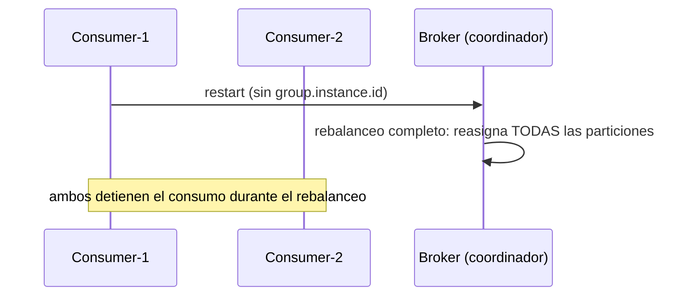
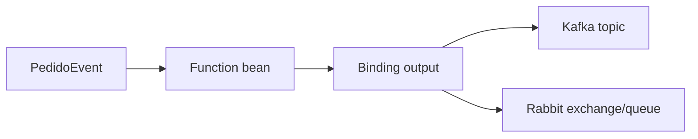
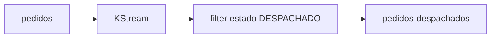
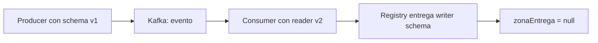
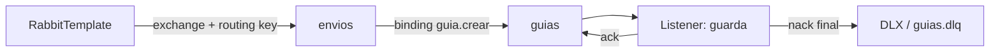

# Módulo 8: Mensajería — Kafka/RabbitMQ

Cada tema se practica por separado con su propia repetición progresiva y su propio reto de memoria, verificado contra un broker real (`@EmbeddedKafka` para Kafka, sin necesitar Docker; `RabbitMQContainer` de Testcontainers para RabbitMQ), para que "el evento se publicó y se consumió" sea comprobable, no solo descrito.


## Aprende construyendo

### Tema 1: Producers y consumers con Spring Kafka

**Duración estimada:** 35 min.
**¿Por qué es importante?** Un evento permite que quien registra un envío continúe sin llamar directamente a cada sistema que lo usa. Kafka conserva los mensajes y varios grupos pueden procesarlos por separado.
**Prerrequisitos:** Spring Boot M1 T1 y M2 T1. Proyecto continuo: enviar un evento de creación y permitir ruteo y notificaciones independientes.
**Laboratorio:** `examples/spring-kafka-rutaflow/`. Usa JDK 25, Spring Boot 4.1.2 y el Maven Wrapper incluido. El mismo proyecto contiene patrones de los temas posteriores (reintentos/DLT y outbox/inbox); en este Tema 1 practica solo los tres subtemas y sus pruebas dirigidas. Si quieres provocar los fallos, copia el directorio a `spring-kafka-practice` y cambia allí las líneas indicadas.

#### Subtema 1.1: Publica el evento con la clave del envío · 10 min

**1. Contexto**
El identificador del envío sirve de clave para mantener sus eventos relacionados en una misma partición de Kafka.

**2. Hazlo tú**
Abre el archivo completo examples/spring-kafka-rutaflow/src/main/java/academia/rutaflow/event/EnvioEventPublisher.java. Confirma que publicar envía topic, clave y evento:

```java
public CompletableFuture<SendResult<String, EnvioCreado>> publicar(EnvioCreado evento) {
    return kafka.send(TOPIC, evento.envioId().toString(), evento);
}
```

El mensaje contiene dos identificadores distintos: `eventId` identifica este hecho; `envioId` agrupa todos los cambios del envío. El record real vive en `examples/spring-kafka-rutaflow/src/main/java/academia/rutaflow/event/EnvioCreado.java`:

```java
public record EnvioCreado(
        UUID eventId, UUID envioId, int version, Instant occurredAt, String referencia) {}
```

En `examples/spring-kafka-rutaflow/src/main/resources/application.yml`, revisa los serializers y deserializers JSON que permiten escribir y leer EnvioCreado:

```yaml
spring:
  kafka:
    producer:
      key-serializer: org.apache.kafka.common.serialization.StringSerializer
      value-serializer: org.springframework.kafka.support.serializer.JsonSerializer
      acks: all
      properties:
        enable.idempotence: true
    consumer:
      group-id: rutaflow-ruteo
      key-deserializer: org.apache.kafka.common.serialization.StringDeserializer
      value-deserializer: org.springframework.kafka.support.serializer.JsonDeserializer
      properties:
        spring.json.value.default.type: academia.rutaflow.event.EnvioCreado
        spring.json.trusted.packages: academia.rutaflow.event
```

Desde examples/spring-kafka-rutaflow/, ejecuta la prueba de integración:

```bash
./mvnw -Dtest=EnvioEventPublisherTest#publicaConKeyDelEnvioYElListenerLaRecibe test
```

**Resultado esperado:** la prueba confirma topic, clave, partición, offset y el mismo evento recibido por el consumidor.

**Fallo deliberado:** cambia la clave por el identificador del evento. **Error esperado:** la prueba informa que la clave recibida no coincide con el identificador del envío. **Diagnóstico:** el envío y sus eventos deben compartir una clave estable si el negocio requiere procesarlos en el mismo orden.

**3. Entiende**
KafkaTemplate devuelve un CompletableFuture<SendResult<...>>; publicar inicia una operación asíncrona. La clave no es el valor del evento: Kafka la usa para decidir la partición.

**4. Cierra**
Anota topic, clave y partición que devolvió la prueba. Verifica qué campo elegirías para conservar juntos los cambios de un mismo envío.

#### Subtema 1.2: Conecta dos grupos consumidores · 10 min

**1. Contexto**
Ruteo y notificaciones deben procesar el mismo hecho, cada grupo con su propio avance. `groupId` nombra al lector lógico; el `@KafkaListener` se suscribe al topic y recibe cada registro asignado a su grupo.

**2. Hazlo tú**
Lee los archivos completos:

- examples/spring-kafka-rutaflow/src/main/java/academia/rutaflow/event/RuteoListener.java
- examples/spring-kafka-rutaflow/src/main/java/academia/rutaflow/event/NotificacionListener.java

Compara el valor de `groupId` en ambos listeners. Este extracto real de `RuteoListener.java` muestra la suscripción y la key que llega en la cabecera:

```java
@KafkaListener(topics = EnvioEventPublisher.TOPIC, groupId = "rutaflow-ruteo")
public void alCrear(
        EnvioCreado evento,
        @Header(KafkaHeaders.RECEIVED_KEY) String key,
        @Header(KafkaHeaders.RECEIVED_PARTITION) int partition,
        @Header(KafkaHeaders.OFFSET) long offset) {
    inbox.procesar(evento);
    recibidos.add(new Recibido(key, partition, offset, evento));
}
```

`NotificacionListener.java` usa el mismo topic y `groupId = "rutaflow-notificaciones"`. Ejecuta:

```bash
./mvnw -Dtest=EnvioEventPublisherTest#publicaConKeyDelEnvioYElListenerLaRecibe test
```

**Resultado esperado:** ambos grupos reciben el mismo registro y cada listener pone su copia en una cola de prueba independiente. La prueba compara key, partición, offset y contenido; esas colas solo sincronizan el test, no son colas de Kafka.

**Fallo deliberado:** cambia el groupId de notificaciones por el de ruteo. **Error esperado:** la comprobación de la segunda cola queda sin mensaje y vence el timeout. **Diagnóstico:** dos consumidores en el mismo grupo reparten trabajo; dos grupos distintos reciben cada uno una copia lógica del registro.

**3. Entiende**
Un consumer group representa un lector lógico. Kafka distribuye cada partición entre los consumidores de un grupo; los offsets de grupos distintos son independientes. Un evento no llama un método Java del otro servicio.

**4. Cierra**
Escribe qué grupo atiende cada listener y por qué el publicador no tiene que conocer esos nombres.

#### Subtema 1.3: Comprueba orden y entrega con un broker · 15 min

**1. Contexto**
El envío al topic no implica que el listener ya haya terminado. Comprueba el recorrido con un broker embebido y espera a que el consumidor procese el evento.

**2. Hazlo tú**
Abre `examples/spring-kafka-rutaflow/src/test/java/academia/rutaflow/event/EnvioEventPublisherTest.java`. La prueba dirige el broker embebido a tres particiones y compara la metadata de Kafka con lo que recibió el consumidor:

```java
var primero = publisher.publicar(primerEvento).get(10, TimeUnit.SECONDS).getRecordMetadata();
var segundo = publisher.publicar(segundoEvento).get(10, TimeUnit.SECONDS).getRecordMetadata();

assertThat(primero.partition()).isEqualTo(segundo.partition());
assertThat(segundo.offset()).isGreaterThan(primero.offset());
assertThat(recibidoPrimero.evento()).isEqualTo(primerEvento);
assertThat(recibidoSegundo.evento()).isEqualTo(segundoEvento);
```

Ejecuta:

```bash
./mvnw -Dtest=EnvioEventPublisherTest#conservaParticionYOrdenParaDosEventosDelMismoEnvio test
```

**Resultado esperado:** los dos eventos comparten partición, el segundo tiene un offset mayor y el listener los recibe en el mismo orden.

**Fallo deliberado:** en el publicador usa un UUID aleatorio como clave en vez de envioId. **Error esperado:** la prueba ya no puede confirmar una partición común para los dos eventos. **Diagnóstico:** el particionador recibe claves diferentes; genera la clave a partir del envío que define el orden del negocio.

**3. Entiende**
El orden está garantizado dentro de una partición, no entre todas las particiones del topic. Kafka aplica el particionador a la key; para el mismo topic y número de particiones, una key estable coloca los registros de ese envío juntos. `acks: all` e idempotencia ayudan al productor frente a fallos y reintentos; no hacen que el efecto de negocio del consumidor se ejecute una sola vez. Eso requiere diseño adicional y se estudia después.

**4. Cierra**
Entrega los resultados de ambas pruebas y describe qué esperarías si publicaras dos eventos del mismo envío con claves distintas.

**Hito del tema:**

- [ ] Publiqué un evento con KafkaTemplate y clave estable.
- [ ] Identifiqué los grupos independientes de ruteo y notificaciones.
- [ ] Verifiqué partición, offset y orden mediante un broker embebido.
- [ ] Reproduje un fallo por usar una clave incorrecta y lo diagnostiqué.

**Nota del laboratorio:** `@DirtiesContext` cierra el contexto Spring antes que el broker embebido; en la suite de 8 pruebas ya no aparece el error de `KafkaStorageException` al borrar el directorio temporal. Kafka 4.2.2 aún registra un `WARN` interno al cerrar un cliente que ya se había cerrado. La prueba de la DLT usa la sobrecarga vigente `KafkaTestUtils.consumerProps(broker, "verificador-dlt", false)`, disponible desde Spring Kafka 4.0.

**Fuentes oficiales:** [envío con KafkaTemplate](https://docs.spring.io/spring-kafka/reference/kafka/sending-messages.html), [recepción con listeners](https://docs.spring.io/spring-kafka/reference/kafka/receiving-messages.html), [pruebas con broker embebido](https://docs.spring.io/spring-kafka/reference/4.0/testing.html) y [KafkaTestUtils 4.0](https://docs.spring.io/spring-kafka/docs/4.0.x/api/org/springframework/kafka/test/utils/KafkaTestUtils.html).

**Transferencia al proyecto integrador:** conecta el evento de envío con consumidores independientes y conserva el identificador del envío como clave para el procesamiento ordenado por partición.

### Tema 2: Dead-letter queue

**Duración estimada:** 35 min.
**¿Por qué es importante?** Si el consumidor rechaza un mensaje cada vez, los reintentos deben tener un límite y el mensaje requiere un destino donde el equipo pueda investigarlo.
**Prerrequisitos:** M8 T1. Proyecto continuo: apartar eventos de envío que no pasan la validación del listener.
**Laboratorio:** `examples/spring-kafka-rutaflow/`. Continúa en `spring-kafka-practice`, la copia que preparaste en el Tema 1; allí prueba cambios deliberados sin alterar la versión base.

#### Subtema 2.1: Configura reintentos limitados y DLT · 10 min

**1. Contexto**
Kafka no crea un DLT de aplicación automáticamente. El listener informa el fallo; un manejador decide si vuelve a ejecutar el listener y dónde deja el registro que sigue fallando.

**2. Hazlo tú**
Abre examples/spring-kafka-rutaflow/src/main/java/academia/rutaflow/KafkaLabConfiguration.java y estudia el bean completo errorHandler:

```java
@Bean
DefaultErrorHandler errorHandler(KafkaTemplate<Object, Object> kafka) {
    var recoverer = new DeadLetterPublishingRecoverer(kafka);
    return new DefaultErrorHandler(recoverer, new FixedBackOff(100L, 2));
}
```

En la misma clase confirma que se crean `rutaflow.envio.creado` y `rutaflow.envio.creado-dlt`, ambos con tres particiones. `FixedBackOff(100L, 2)` define 100 ms entre reintentos y dos reintentos adicionales después del primer intento. Desde la raíz de la copia ejecuta:

```bash
./mvnw -Dtest=EnvioEventPublisherTest#reintentaYPublicaEnDltCuandoLaKeyNoCoincide test
```

**Resultado esperado:** Maven termina con BUILD SUCCESS y la prueba encuentra el evento fallido en rutaflow.envio.creado-dlt.

**Fallo deliberado:** comenta el bean errorHandler en la copia del laboratorio y vuelve a ejecutar. **Error esperado:** la prueba no encuentra el registro en la DLT y vence su espera. **Diagnóstico:** sin recoverer configurado no hay una regla que publique el registro fallido en el destino esperado.

**3. Entiende**
`DefaultErrorHandler` coordina los fallos del listener; `FixedBackOff` define el intervalo y el máximo de reintentos. `DeadLetterPublishingRecoverer` publica en otro topic cuando se agota la política. Sin un DLT configurado, la aplicación necesita otra estrategia explícita para los mensajes irrecuperables.

**4. Cierra**
Señala dónde se crea el topic original, dónde se crea el DLT y qué bean conecta el fallo con la recuperación.

#### Subtema 2.2: Provoca un mensaje inválido y comprueba los intentos · 10 min

**1. Contexto**
Una clave que no coincide con el envío hace que el listener falle siempre. Ese error repetible permite observar cada reintento y comprobar que el mensaje no desaparece.

**2. Hazlo tú**
Abre examples/spring-kafka-rutaflow/src/test/java/academia/rutaflow/event/EnvioEventPublisherTest.java y ejecuta el test reintentaYPublicaEnDltCuandoLaKeyNoCoincide:

```bash
./mvnw -Dtest=EnvioEventPublisherTest#reintentaYPublicaEnDltCuandoLaKeyNoCoincide test
```

Localiza en la prueba el envío con key incorrecta, la espera por tres intentos y la lectura desde el topic DLT. Este fragmento toma la metadata del topic original y comprueba la key, partición y contenido que recuperó el consumer:

```java
var origen = kafka.send(EnvioEventPublisher.TOPIC, "key-incorrecta", evento)
        .get(10, TimeUnit.SECONDS).getRecordMetadata();
await().atMost(Duration.ofSeconds(5))
        .untilAsserted(() -> assertThat(ruteoListener.intentos()).isEqualTo(3));
ConsumerRecord<String, String> deadLetter = KafkaTestUtils.getSingleRecord(
        consumer, EnvioEventPublisher.TOPIC + "-dlt", Duration.ofSeconds(10));

assertThat(deadLetter.key()).isEqualTo("key-incorrecta");
assertThat(deadLetter.partition()).isEqualTo(origen.partition());
assertThat(deadLetter.value()).contains("RT-DLT");
```

**Resultado esperado:** el test confirma tres entregas fallidas del listener y encuentra el JSON del envío en `rutaflow.envio.creado-dlt`, con la key y partición originales.

**Fallo deliberado:** cambia la key incorrecta del test por envioId.toString(). **Resultado esperado:** la ruta de ruteo acepta el mensaje y la condición de tres fallos vence. **Diagnóstico:** el caso deja de ser inválido; restaura una key que no coincida para que el test ejercite el error y la recuperación.

**3. Entiende**
FixedBackOff(100L, 2) significa un intento inicial y hasta dos reintentos adicionales: tres entregas al listener en total. El evento que llega al DLT queda disponible para inspección y reproceso controlado.

**4. Cierra**
Anota el total de intentos, el topic de origen y el DLT donde quedó el registro.

#### Subtema 2.3: Ajusta la política y atiende los mensajes recuperados · 15 min

**1. Contexto**
El número de reintentos y el tiempo de espera dependen del fallo. Un dato definitivamente inválido no mejora por esperar; un problema temporal sí podría resolverse con otro intento.

**2. Hazlo tú**
En `spring-kafka-practice/src/main/java/academia/rutaflow/KafkaLabConfiguration.java`, cambia `FixedBackOff(100L, 2)` por `FixedBackOff(100L, 0)`. En `spring-kafka-practice/src/test/java/academia/rutaflow/event/EnvioEventPublisherTest.java`, cambia la expectativa de `intentos()` de `3` a `1`; vuelve a ejecutar el test:

```bash
./mvnw -Dtest=EnvioEventPublisherTest#reintentaYPublicaEnDltCuandoLaKeyNoCoincide test
```

**Resultado esperado:** con cero reintentos adicionales, el primer fallo se recupera y el mensaje llega a rutaflow.envio.creado-dlt.

**Fallo deliberado:** en esa prueba cambia las dos lecturas de `EnvioEventPublisher.TOPIC + "-dlt"` por `EnvioEventPublisher.TOPIC + "-dlt-mal"`. **Error esperado:** el consumidor agota los diez segundos y la prueba falla porque el topic alternativo no recibió el mensaje. **Diagnóstico:** el recoverer usa el sufijo `-dlt`; restaura la misma ruta en la escucha y en la lectura.

**3. Entiende**
El recoverer de esta práctica usa por defecto el topic original más el sufijo `-dlt`, y conserva key y partición si el topic destino tiene esa partición. El test lo comprueba comparando la metadata del envío original y el registro recuperado. El DLT requiere monitoreo y responsable; acumular mensajes sin revisarlos solo traslada el problema.

**4. Cierra**
Restaura la configuración del proyecto a FixedBackOff(100L, 2), conserva la salida correcta y explica cuándo dejarías de reintentar un error de validación.

**Hito del tema:**

- [ ] Configuré DefaultErrorHandler y DeadLetterPublishingRecoverer.
- [ ] Comprobé el intento inicial y los dos reintentos configurados.
- [ ] Encontré el registro fallido en el topic terminado en -dlt.
- [ ] Cambié temporalmente a cero reintentos y restauré el laboratorio.

**Fuentes oficiales:** [manejo de excepciones y reintentos en Spring Kafka](https://docs.spring.io/spring-kafka/reference/kafka/annotation-error-handling.html) y [publicación en dead-letter topics](https://docs.spring.io/spring-kafka/reference/kafka/annotation-error-handling.html#publishing-dead-letter-records).

**Transferencia al proyecto integrador:** define reintentos según el tipo de fallo y envía los eventos irrecuperables a un DLT monitoreado con un procedimiento de revisión.

### Tema 3: Productor idempotente y transacciones (exactly-once)

**Duración estimada:** 40 min.
**¿Por qué es importante?** Reintentar una publicación o recibir dos veces un mensaje no debe duplicar un envío o un cobro. El productor de Kafka, la base de datos y el consumidor tienen garantías distintas.
**Prerrequisitos:** M8 T1 y M8 T2. Proyecto continuo: registrar un envío y aplicar su evento de forma segura aunque se repita.
**Laboratorio:** examples/spring-kafka-rutaflow/. Ejecuta los cambios en tu copia para conservar el ejemplo original.

#### Subtema 3.1: Configura idempotencia del productor · 10 min

**1. Contexto**
El cliente de Kafka puede reintentar internamente después de perder una confirmación. La idempotencia del productor evita duplicados causados por ese reintento del mismo productor.

**2. Hazlo tú**
Abre examples/spring-kafka-rutaflow/src/main/resources/application.yml y revisa esta configuración completa del productor:

```yaml
spring:
  kafka:
    producer:
      key-serializer: org.apache.kafka.common.serialization.StringSerializer
      value-serializer: org.springframework.kafka.support.serializer.JsonSerializer
      acks: all
      properties:
        enable.idempotence: true
```

Desde examples/spring-kafka-rutaflow/, ejecuta la suite:

```bash
./mvnw test
```

**Resultado esperado:** Maven termina con BUILD SUCCESS. La configuración usa confirmación all e idempotencia; la prueba publica y verifica metadatos y recepción del evento.

**Fallo deliberado:** en la copia cambia enable.idempotence a false y repite la suite. **Resultado esperado:** la suite sigue pasando. **Diagnóstico:** los tests actuales no fuerzan una pérdida de ack y reintento interno del productor; su resultado no demuestra ni refuta esa garantía. Restaura true después de la comparación.

**3. Entiende**
Idempotencia del productor cubre reintentos internos del cliente con los identificadores de secuencia de Kafka. No deduplica dos llamadas separadas de la aplicación que vuelven a publicar el mismo evento.

**4. Cierra**
Describe qué duplicado cubre esta opción y qué duplicado debe resolver el consumidor.

#### Subtema 3.2: Guarda el envío y el evento con outbox · 15 min

**1. Contexto**
La base de datos y Kafka no comparten una transacción local automática. Si el servicio guarda el envío y después falla al publicar, el sistema debe conservar el evento pendiente.

**2. Hazlo tú**
Abre el archivo completo examples/spring-kafka-rutaflow/src/main/java/academia/rutaflow/outbox/CrearEnvioService.java. Sigue crear: la transacción guarda envío y outbox_event juntos. Ejecuta la prueba que provoca un fallo al insertar el evento:

```bash
./mvnw -Dtest=EnvioEventPublisherTest#guardaEnvioYOutboxEnLaMismaTransaccion test
```

**Resultado esperado:** la prueba induce una violación de integridad y verifica que no quedan ni la fila de envio ni la de outbox_event con referencia RT-ROLLBACK.

**Fallo deliberado:** en la copia quita @Transactional de crear y repite la prueba. **Error esperado:** queda guardada una de las dos filas cuando falla la inserción en outbox_event. **Diagnóstico:** ambas escrituras SQL necesitan la misma transacción de base de datos.

**3. Entiende**
Outbox hace atómica la persistencia del negocio y del evento pendiente dentro de la base de datos. Un dispatcher publica después; si no consigue marcar la fila como publicada, puede volver a publicarla. Por eso el consumidor también debe ser idempotente.

**4. Cierra**
Guarda la salida del test y explica qué estado persistente permite recuperar el evento si Kafka no está disponible.

#### Subtema 3.3: Deduplica el efecto con inbox y delimita exactly-once · 15 min

**1. Contexto**
Un dispatcher puede publicar de nuevo tras perder la confirmación. El consumidor debe reconocer el mismo eventId antes de aplicar por segunda vez la actualización de negocio.

**2. Hazlo tú**
Abre examples/spring-kafka-rutaflow/src/main/java/academia/rutaflow/inbox/InboxProcessor.java y revisa cómo registra event_id y actualiza route_projection en una transacción. Ejecuta:

```bash
./mvnw -Dtest=EnvioEventPublisherTest#inboxHaceIdempotenteElEfectoDeNegocio test
./mvnw -Dtest=EnvioEventPublisherTest#replayTrasAckConservaUnaSolaProyeccion test
```

**Resultado esperado:** la primera aplicación devuelve true, repetir el mismo evento devuelve false y queda una sola fila de evento_procesado y una sola proyección. En el replay, el broker recibe dos mensajes y la proyección sigue siendo una.

**Fallo deliberado:** en la copia elimina la comprobación de event_id existente y vuelve a ejecutar inboxHaceIdempotenteElEfectoDeNegocio. **Error esperado:** la segunda llamada viola la clave primaria de evento_procesado y no devuelve false. **Diagnóstico:** la identidad del evento y la actualización de negocio deben protegerse en la misma transacción; el esquema usa event_id como clave única.

**3. Entiende**
La transacción inbox protege juntas la marca de evento procesado y la proyección SQL. Exactly-once de Kafka se refiere al flujo read-process-write dentro de Kafka y sus offsets; no incorpora automáticamente una base de datos externa. Outbox e inbox protegen aquí la frontera SQL y asumen entregas que pueden repetirse.

**4. Cierra**
Entrega los dos resultados de prueba y di explícitamente qué parte garantiza Kafka, cuál la base de datos y cuál el código consumidor. La prueba de este ejemplo es secuencial; el esquema tiene clave primaria, pero concurrencia de consumidores requiere probar el conflicto de inserción y la estrategia de recuperación.

**Hito del tema:**

- [ ] Distinguí reintento interno del productor de una segunda llamada de negocio.
- [ ] Comprobé rollback de envío y outbox en una misma transacción SQL.
- [ ] Reproduje el replay de un evento y una sola proyección.
- [ ] Expliqué por qué Kafka EOS no convierte una base de datos externa en parte de su transacción.

**Fuentes oficiales:** [idempotencia y productor de Kafka en Spring](https://docs.spring.io/spring-kafka/reference/kafka/transactions.html), [Exactly Once Semantics](https://docs.spring.io/spring-kafka/reference/kafka/exactly-once.html) y [transacciones de KafkaTemplate](https://docs.spring.io/spring-kafka/reference/kafka/transactions.html#using-kafkatemplate-local-transactions).

**Transferencia al proyecto integrador:** conserva eventos pendientes en outbox, publica con una clave estable y protege el efecto de cada eventId en inbox. No llames exactly-once a una operación que no cubre sus fronteras de persistencia.

### Tema 4: Rebalanceo de consumer groups y partition assignment

#### Paso 1 · Objetivo y preparación

Al finalizar podrás reproducir un rebalanceo completo de un consumer group al reiniciar una instancia, y configurar static group membership para evitarlo en reinicios breves.

**Conocimiento previo:** Tema 1 de este módulo.

#### Paso 2 · Contexto y caso real

**¿Por qué es importante?** Cada vez que una instancia de un consumer group se une o abandona el grupo (incluyendo un simple restart de un pod en Kubernetes), Kafka reasigna TODAS las particiones entre TODAS las instancias restantes, deteniendo momentáneamente el consumo de todo el grupo — invisible en desarrollo con una sola instancia, pero costoso en producción con varias.

#### Paso 3 · Teoría con analogía

**Conceptos clave:** consumer group, rebalanceo, partition assignment strategy, static membership.

```java
@Bean
ConsumerFactory<String, Object> consumerFactory() {
    Map<String, Object> config = new HashMap<>();
    config.put(ConsumerConfig.GROUP_INSTANCE_ID_CONFIG, "notificaciones-1");
    config.put(ConsumerConfig.PARTITION_ASSIGNMENT_STRATEGY_CONFIG,
        CooperativeStickyAssignor.class.getName());
    return new DefaultKafkaConsumerFactory<>(config);
}
```

`group.instance.id` le da a esa instancia una identidad estable entre reinicios: si se reinicia dentro de una ventana de tiempo configurable (`session.timeout.ms`), el broker la trata como la MISMA instancia regresando, sin disparar un rebalanceo completo del grupo; `CooperativeStickyAssignor` además minimiza cuántas particiones efectivamente cambian de dueño cuando un rebalanceo sí ocurre, en vez de reasignar todas desde cero.

**Analogía:** un rebalanceo sin static membership es como reorganizar TODOS los escritorios de una oficina cada vez que una persona sale a almorzar y vuelve; con static membership, su escritorio la espera reservado durante una ausencia breve conocida, sin reorganizar nada si vuelve a tiempo.

**Diagrama:**



#### Paso 4 · Demostración guiada desde cero

Reutiliza `academia-spring` y crea un `ConsumerRebalanceListener` real que registra qué particiones tiene asignadas esta instancia en cada momento, en `src/main/java/com/academia/mensajeria/`, y un test que arranca dos consumidores reales en el mismo `groupId` para forzar un rebalanceo genuino y confirmar qué particiones se revocan y a quién se reasignan:

```bash
mkdir -p academia-spring/src/main/java/com/academia/mensajeria
cd academia-spring
```

```java
// src/main/java/com/academia/mensajeria/EstadoParticionRebalanceListener.java
package com.academia.mensajeria;

import org.apache.kafka.clients.consumer.ConsumerRebalanceListener;
import org.apache.kafka.common.TopicPartition;

import java.util.Collection;
import java.util.Set;
import java.util.concurrent.ConcurrentHashMap;
import java.util.concurrent.atomic.AtomicInteger;

public class EstadoParticionRebalanceListener implements ConsumerRebalanceListener {
    // estado real de esta instancia: qué particiones tiene asignadas AHORA MISMO; se guarda/restaura en cada callback real del broker
    private final Set<TopicPartition> particionesAsignadasActualmente = ConcurrentHashMap.newKeySet();
    private final AtomicInteger revocacionesDetectadas = new AtomicInteger(0);

    @Override
    public void onPartitionsRevoked(Collection<TopicPartition> particiones) {
        // el broker avisa: estas particiones YA NO son de esta instancia; el estado local debe reflejarlo de inmediato
        particionesAsignadasActualmente.removeAll(particiones);
        revocacionesDetectadas.incrementAndGet();
    }

    @Override
    public void onPartitionsAssigned(Collection<TopicPartition> particiones) {
        // el broker avisa: estas particiones SÍ son de esta instancia ahora (asignación inicial o tras el rebalanceo)
        particionesAsignadasActualmente.addAll(particiones);
    }

    public Set<TopicPartition> getParticionesAsignadasActualmente() { return particionesAsignadasActualmente; }
    public int getRevocacionesDetectadas() { return revocacionesDetectadas.get(); }
}
```

**Explicación línea por línea:** `onPartitionsRevoked` es el callback real que el broker invoca en cada instancia justo antes de que un rebalanceo le quite particiones que tenía asignadas; aquí se usa para mantener `particionesAsignadasActualmente` siempre fiel a la realidad (sin este callback, una instancia podría seguir creyendo que posee una partición que el broker ya reasignó a otra instancia, un bug real de estado obsoleto); `onPartitionsAssigned` es el callback simétrico, invocado tanto en la asignación inicial como después de cada rebalanceo, con la lista de particiones que esta instancia posee a partir de ese momento.

Arranca dos `KafkaMessageListenerContainer` reales (uno a la vez) en el mismo `groupId`, contra un topic de 2 particiones, para forzar un rebalanceo genuino cuando el segundo se une:

```java
// src/test/java/com/academia/mensajeria/RebalanceoRealTest.java
package com.academia.mensajeria;

import org.awaitility.Awaitility;
import org.junit.jupiter.api.Test;
import org.springframework.beans.factory.annotation.Autowired;
import org.springframework.boot.test.context.SpringBootTest;
import org.springframework.kafka.core.DefaultKafkaConsumerFactory;
import org.springframework.kafka.listener.ContainerProperties;
import org.springframework.kafka.listener.KafkaMessageListenerContainer;
import org.springframework.kafka.listener.MessageListener;
import org.springframework.kafka.test.EmbeddedKafkaBroker;
import org.springframework.kafka.test.context.EmbeddedKafka;
import org.springframework.kafka.test.utils.KafkaTestUtils;
import org.springframework.test.context.TestPropertySource;

import java.time.Duration;
import java.util.Map;

import static org.assertj.core.api.Assertions.assertThat;

@SpringBootTest
@EmbeddedKafka(partitions = 2, topics = "tareas.creadas")
@TestPropertySource(properties = "spring.kafka.bootstrap-servers=${spring.embedded.kafka.brokers}")
class RebalanceoRealTest {

    @Autowired
    private EmbeddedKafkaBroker embeddedKafkaBroker;

    @Test
    void unSegundoConsumidorQueSeUneFuerzaUnRebalanceoRealYRedistribuyeLasParticiones() {
        var listenerA = new EstadoParticionRebalanceListener();
        var listenerB = new EstadoParticionRebalanceListener();

        var contenedorA = crearContenedor(listenerA);
        contenedorA.start();
        // sola en el grupo "rebalanceo-demo", esta instancia recibe las 2 particiones del topic
        Awaitility.await().atMost(Duration.ofSeconds(10))
            .untilAsserted(() -> assertThat(listenerA.getParticionesAsignadasActualmente()).hasSize(2));

        var contenedorB = crearContenedor(listenerB);
        contenedorB.start(); // forzar el rebalanceo real: el broker reparte las 2 particiones entre A y B

        try {
            Awaitility.await().atMost(Duration.ofSeconds(10))
                .untilAsserted(() -> assertThat(
                    listenerA.getParticionesAsignadasActualmente().size()
                        + listenerB.getParticionesAsignadasActualmente().size())
                    .isEqualTo(2));

            assertThat(listenerA.getRevocacionesDetectadas())
                .as("la primera instancia debe haber sido notificada de que perdió al menos una partición")
                .isGreaterThanOrEqualTo(1);
        } finally {
            contenedorA.stop();
            contenedorB.stop();
        }
    }

    private KafkaMessageListenerContainer<String, String> crearContenedor(EstadoParticionRebalanceListener listener) {
        Map<String, Object> config = KafkaTestUtils.consumerProps("rebalanceo-demo", "false", embeddedKafkaBroker);
        var factory = new DefaultKafkaConsumerFactory<String, String>(config);

        var propiedades = new ContainerProperties("tareas.creadas");
        propiedades.setConsumerRebalanceListener(listener);
        propiedades.setMessageListener((MessageListener<String, String>) record -> { });

        return new KafkaMessageListenerContainer<>(factory, propiedades);
    }
}
```

```bash
mvn test -Dtest=RebalanceoRealTest  # Maven
./gradlew test --tests RebalanceoRealTest # Gradle (equivalente)
```

**Resultado esperado:** `BUILD SUCCESS` con el test en verde: la primera instancia arranca sola y recibe las 2 particiones del topic (`onPartitionsAssigned` real); cuando la segunda se une al mismo `groupId`, el broker fuerza un rebalanceo genuino — la primera instancia recibe `onPartitionsRevoked` real para al menos una partición, y al final las 2 particiones quedan repartidas entre ambas (ninguna se pierde ni se duplica), confirmando que el estado de `particionesAsignadasActualmente` de cada instancia se mantiene fiel a lo que el broker realmente le asignó en cada momento.

**Fallo deliberado:** en `EstadoParticionRebalanceListener.onPartitionsRevoked`, quita la línea `particionesAsignadasActualmente.removeAll(particiones);` (deja solo el contador) y ejecuta de nuevo `mvn test -Dtest=RebalanceoRealTest`. El test FALLA en la aserción de la suma de particiones (ahora reporta `3` en vez de `2`, porque la primera instancia sigue "creyendo" que conserva una partición que el broker ya reasignó a la segunda) — diagnostica confirmando por qué ignorar `onPartitionsRevoked` deja a una instancia con estado local obsoleto tras un rebalanceo real: seguiría sirviendo, cacheando o contando datos de una partición que ya no le pertenece. Restaura la línea antes de continuar.

#### Paso 5 · Práctica guiada — repetición progresiva

1. Repite el experimento con 3 instancias en vez de 2, y cuenta cuántas particiones cambian de dueño con y sin `CooperativeStickyAssignor`.
2. Configura `session.timeout.ms` deliberadamente corto (ej. 5 segundos) y confirma que un reinicio que tarda más que eso SÍ dispara rebalanceo incluso con static membership.
3. Documenta qué pasaría si dos instancias distintas usaran accidentalmente el mismo `group.instance.id`.
4. Escribe de memoria (sin mirar) la configuración de `group.instance.id` y `CooperativeStickyAssignor`. Compara después contra el Paso 4.

**Pista:** static membership protege contra reinicios BREVES y conocidos (deploys, restarts); no reemplaza un diseño que tolere genuinamente la pérdida permanente de una instancia (ese caso siempre necesita un rebalanceo real).

#### Paso 6 · Práctica independiente

**Completa el código:** rellena la configuración que da identidad estable a la instancia entre reinicios:

```java
config.put(ConsumerConfig.____, "notificaciones-1");
```

**Reto de memoria sin mirar:** cierra este documento y escribe, solo de memoria, la configuración completa de un consumer con static membership y `CooperativeStickyAssignor`. Compara después contra el Paso 4.

#### Paso 7 · Cierre y evidencia

Ya reproducís un rebalanceo real con dos consumidores del mismo grupo y confirmás, con un `ConsumerRebalanceListener` real, que las particiones se revocan y reasignan correctamente entre ambos. El siguiente y último tema de este módulo compara Kafka con RabbitMQ para elegir según el patrón de consumo real necesario. **Evidencia:** entrega el resultado de `RebalanceoRealTest` en verde confirmando que las 2 particiones quedan repartidas entre ambas instancias tras el rebalanceo, y el fallo real (`3` particiones contadas en vez de `2`) que produce ignorar `onPartitionsRevoked`. Fuente oficial: [Kafka Consumer Configs — Apache Kafka](https://kafka.apache.org/documentation/#consumerconfigs).

**Errores comunes:** asumir que un simple restart de un pod no tiene costo en un consumer group con muchas particiones; usar el mismo `group.instance.id` en dos instancias distintas por error de configuración (deben ser únicas).

**Cuándo no usarlo:** para un consumer group de una sola instancia (sin escalado horizontal), el rebalanceo no es un problema real a evitar; static membership agrega configuración sin beneficio en ese caso.

**Transferencia al proyecto integrador «Backend profesional de entregas»:** Ejecuta dos consumidores del grupo y retira uno durante el procesamiento. Comprueba reasignación y repetición segura de mensajes, conservando el orden por clave que necesita cada entrega.

### Tema 5: Kafka frente a RabbitMQ

#### Paso 1 · Objetivo y preparación

Al finalizar podrás implementar el mismo flujo de consumo con Spring AMQP sobre RabbitMQ real, y explicar con evidencia en qué se diferencia su modelo de entrega del de Kafka.

**Conocimiento previo:** Temas 1 a 4 de este módulo.

#### Paso 2 · Contexto y caso real

**¿Por qué es importante?** Elegir la tecnología de mensajería equivocada para el patrón de consumo real necesario (retención y relectura de historial vs. distribución simple de trabajo) genera complejidad innecesaria o limitaciones inesperadas más adelante.

#### Paso 3 · Teoría con analogía

**Conceptos clave:** log distribuido retenido frente a broker de colas tradicional.

`@RabbitListener(queues = "tareas.creadas") public void escuchar(TareaCreadaEvent evento) { ... }` es sintácticamente muy similar a `@KafkaListener`, pero el modelo subyacente es distinto: Kafka es un log distribuido que retiene mensajes durante un período configurable independientemente de si ya fueron consumidos, permitiendo que múltiples consumidores (o el mismo, releyendo desde un punto anterior) lean el mismo stream completo; RabbitMQ es un broker de colas tradicional, donde un mensaje típicamente se entrega y se elimina de la cola una vez consumido (patrón punto-a-punto).

**Analogía:** Kafka es un registro público permanente que cualquiera puede consultar en cualquier momento, incluso eventos ya "vistos" antes; RabbitMQ es un sistema de reparto de correspondencia donde cada carta se entrega a su destinatario y luego se considera completada, sin quedar disponible para que alguien más la vuelva a leer.

**Diagrama:**

```
┌── Kafka: log distribuido ────────────────────────┐
│  retiene mensajes; múltiples consumidores leen el      │
│  mismo stream completo, incluso ya "consumido" antes    │
└──────────────────────────────────────────────┘
┌── RabbitMQ: broker de colas tradicional ─────────┐
│  mensaje entregado y eliminado de la cola;              │
│  más simple para distribución punto-a-punto             │
└──────────────────────────────────────────────┘
```

#### Paso 4 · Demostración guiada desde cero

Desde una carpeta vacía (o continuando en `academia-spring`, o créala con `mkdir -p academia-spring` si es tu primera vez), agrega la dependencia real `spring-boot-starter-amqp` y crea `src/main/java/com/academia/mensajeria/RabbitConfig.java` con el equivalente en RabbitMQ del publicador/consumidor del Tema 1:

```bash
mkdir -p academia-spring/src/main/java/com/academia/mensajeria
cd academia-spring
```

```java
// src/main/java/com/academia/mensajeria/RabbitConfig.java
package com.academia.mensajeria;

import org.springframework.amqp.core.Queue;
import org.springframework.context.annotation.Bean;
import org.springframework.context.annotation.Configuration;

@Configuration
public class RabbitConfig {
    @Bean
    Queue colaTareasCreadas() { return new Queue("tareas.creadas.rabbit", true); }
}
```

```java
// src/main/java/com/academia/mensajeria/RabbitListenerTareas.java
package com.academia.mensajeria;

import org.springframework.amqp.rabbit.annotation.RabbitListener;
import org.springframework.stereotype.Component;

import java.util.List;
import java.util.concurrent.CopyOnWriteArrayList;

@Component
public class RabbitListenerTareas {
    private final List<String> mensajesRecibidos = new CopyOnWriteArrayList<>();

    @RabbitListener(queues = "tareas.creadas.rabbit")
    public void escuchar(String titulo) {
        mensajesRecibidos.add(titulo);
    }

    public List<String> getMensajesRecibidos() { return mensajesRecibidos; }
}
```

Confirma con `RabbitMQContainer` (el contenedor Docker real y oficial de Testcontainers para RabbitMQ, la misma técnica de fidelidad real que `PostgreSQLContainer` en el Módulo 6) que publicar y consumir vía RabbitMQ funciona, y a la vez ilustra la diferencia con Kafka: consume el mensaje UNA vez y confirma que releerlo después no lo entrega de nuevo:

```java
// src/test/java/com/academia/mensajeria/RabbitVsKafkaTest.java
package com.academia.mensajeria;

import org.junit.jupiter.api.Test;
import org.springframework.amqp.rabbit.core.RabbitTemplate;
import org.springframework.beans.factory.annotation.Autowired;
import org.springframework.boot.test.context.SpringBootTest;
import org.springframework.test.context.DynamicPropertyRegistry;
import org.springframework.test.context.DynamicPropertySource;
import org.testcontainers.containers.RabbitMQContainer;
import org.testcontainers.junit.jupiter.Container;
import org.testcontainers.junit.jupiter.Testcontainers;

import java.time.Duration;

import static org.assertj.core.api.Assertions.assertThat;
import static org.awaitility.Awaitility.await;

@SpringBootTest
@Testcontainers
class RabbitVsKafkaTest {

    @Container
    static RabbitMQContainer rabbit = new RabbitMQContainer("rabbitmq:3.13-management");

    @DynamicPropertySource
    static void propiedades(DynamicPropertyRegistry registry) {
        registry.add("spring.rabbitmq.host", rabbit::getHost);
        registry.add("spring.rabbitmq.port", rabbit::getAmqpPort);
    }

    @Autowired
    private RabbitTemplate rabbitTemplate;
    @Autowired
    private RabbitListenerTareas listener;

    @Test
    void unMensajeDeRabbitSeEntregaUnaSolaVezYLuegoDesaparece() {
        rabbitTemplate.convertAndSend("tareas.creadas.rabbit", "Comprar leche");

        await().atMost(Duration.ofSeconds(5))
            .untilAsserted(() -> assertThat(listener.getMensajesRecibidos()).contains("Comprar leche"));

        // a diferencia de Kafka (Tema 1), RabbitMQ elimina el mensaje de la cola tras entregarlo:
        // no hay forma de "releerlo" de nuevo como con un consumer group nuevo sobre el mismo topic
        Object mensajePendiente = rabbitTemplate.receiveAndConvert("tareas.creadas.rabbit");
        assertThat(mensajePendiente).isNull();
    }
}
```

```bash
# requiere Docker corriendo localmente; Testcontainers levanta el broker RabbitMQ real
mvn test -Dtest=RabbitVsKafkaTest   # Maven
./gradlew test --tests RabbitVsKafkaTest # Gradle (equivalente)
```

**Resultado esperado:** `BUILD SUCCESS` con el test en verde: el mensaje se entrega al listener real vía RabbitMQ, y al intentar leer la cola de nuevo directamente (`receiveAndConvert`), no queda ningún mensaje pendiente — confirmando en código, no solo en teoría, la diferencia central con Kafka (Tema 1): RabbitMQ elimina el mensaje de la cola tras la entrega, mientras Kafka lo retiene y permitiría que un nuevo `groupId` lo releyera desde el principio del topic.

**Fallo deliberado:** intenta releer el mismo mensaje con un `RabbitListener` adicional usando un `groupId` conceptualmente equivalente al de Kafka (RabbitMQ no tiene el concepto de `groupId`; si agregas un SEGUNDO `@RabbitListener(queues = "tareas.creadas.rabbit")` en otra clase, ambos listeners COMPITEN por los mensajes de la misma cola, cada mensaje se entrega a SOLO UNO de los dos, no a ambos). Verifica esto agregando un segundo listener y confirmando que la suma de mensajes recibidos por ambos, no cada uno por separado, coincide con el total publicado — diagnostica confirmando que RabbitMQ implementa competencia de consumidores (distribución de trabajo) sobre una cola, fundamentalmente distinto del fan-out real que Kafka logra con múltiples `groupId` independientes, cada uno recibiendo TODOS los mensajes (Tema 1, Paso 5, punto 1).

#### Paso 5 · Práctica guiada — repetición progresiva

1. Agrega un segundo test que confirme la competencia de consumidores: dos `@RabbitListener` sobre la misma cola, publica 10 mensajes, y confirma que la SUMA de lo recibido por ambos es 10 (no 20, como sería con dos `@KafkaListener` con `groupId` distintos sobre el mismo topic).
2. Configura la cola de RabbitMQ como `durable = false` y documenta, basándote en la documentación oficial, qué pasaría con los mensajes pendientes si el broker se reiniciara.
3. Compara el tiempo de arranque del contenedor `RabbitMQContainer` (Tema 5) frente a `@EmbeddedKafka` (Temas 1-2) ejecutando ambas suites y observando los tiempos reportados por Maven.
4. Escribe de memoria (sin mirar) una tabla de dos columnas comparando Kafka y RabbitMQ en retención, patrón de consumo y fan-out real vs. competencia de consumidores. Compara después contra el patrón del Paso 4.

**Pista:** la pregunta que determina la elección correcta no es "¿cuál es más rápido o más popular?", sino "¿necesito que MÚLTIPLES consumidores independientes reciban CADA UNO su propia copia completa del mismo mensaje (Kafka), o necesito distribuir CADA mensaje entre UN SOLO trabajador de un pool (RabbitMQ)?".

#### Paso 6 · Práctica independiente

**Completa el código:** rellena el espacio para registrar el consumidor sobre la cola de RabbitMQ:

```java
@____(queues = "tareas.creadas.rabbit")
public void escuchar(String titulo) { }
```

**Reto de memoria sin mirar:** cierra este documento y escribe, solo de memoria, un test que confirme que RabbitMQ elimina un mensaje de la cola tras entregarlo, a diferencia de la retención de Kafka. Compara después contra el patrón del Paso 4.

#### Paso 7 · Cierre y evidencia

Ya implementas el mismo patrón de consumo desacoplado sobre RabbitMQ real, confirmando con evidencia de código la diferencia central de modelo de entrega frente a Kafka. Esto cierra el módulo de mensajería; el siguiente módulo aborda cómo estructurar el código de dominio con principios de arquitectura hexagonal. **Evidencia:** entrega el resultado de `RabbitVsKafkaTest` en verde, y la confirmación de que dos listeners sobre la misma cola de RabbitMQ compiten por los mensajes en vez de recibir cada uno una copia completa. Fuente oficial: [Spring AMQP Reference](https://docs.spring.io/spring-amqp/reference/).

**Errores comunes:** confundir el modelo de retención de Kafka con el de RabbitMQ, asumiendo que ambos permiten releer el historial completo; asumir que agregar un segundo `@RabbitListener` sobre la misma cola duplicará la entrega, cuando en realidad divide el trabajo entre ambos.

**Cuándo no usarlo:** para un flujo que necesita garantías de ordenamiento estricto y reprocesamiento completo del historial de eventos de negocio (auditoría, event sourcing), RabbitMQ por sí solo no ofrece esa retención; Kafka es la elección más apropiada para ese patrón específico.

---

La comparación Kafka frente a RabbitMQ de este tema es la que justificará la elección de mensajería del proyecto integrador de este track (microservicio productivo, Módulo 12).

## Laboratorio práctico

**Objetivo del laboratorio:** construir un servicio que publica y consume eventos vía Kafka con manejo robusto de errores, productor idempotente y consumer groups resilientes a reinicios.

**Requisitos previos:** Módulos 0-7 completados.

| Paso | Acción | Código | Explicación |
|---|---|---|---|
| 1 | Levantar un broker Kafka embebido en los tests | Ver Tema 1 | `@EmbeddedKafka`, sin Docker |
| 2 | Implementar un `@KafkaListener` | Ver Tema 1 | Consume y procesa el evento real |
| 3 | Confirmar la entrega con `Awaitility` | Ver Tema 1 | El consumo es asíncrono |
| 4 | Configurar reintentos y dead-letter queue | Ver Tema 2 | Verifica el mensaje fallido en `.DLT` real |
| 5 | Configurar un productor idempotente | Ver Tema 3 | Evita duplicados por reintento de red |
| 6 | Configurar static group membership | Ver Tema 4 | Evita rebalanceo completo en reinicios breves |
| 7 | Repetir con RabbitMQ y comparar | Ver Tema 5 | `RabbitMQContainer`, compara los modelos de entrega |

**Verificación:** el laboratorio se considera exitoso si un mensaje que falla repetidamente termina correctamente en la dead-letter queue real tras agotar los reintentos, sin bloquear el procesamiento de mensajes posteriores exitosos, si un reintento de red simulado no produce un evento duplicado en el topic, si un reinicio breve de una instancia no dispara un rebalanceo completo del grupo, y si la diferencia de modelo de entrega entre Kafka y RabbitMQ está confirmada con evidencia de test, no solo descrita.

**Errores comunes y soluciones**

- **No configurar una dead-letter queue.** Sin ella, un mensaje que falla repetidamente puede bloquear o perderse silenciosamente.
- **Confundir el modelo de retención de Kafka con el de RabbitMQ.** Verifica cuál patrón de consumo real necesita tu caso de uso antes de elegir.
- **No serializar explícitamente el formato del mensaje.** Configura un serializer explícito para evitar ambigüedad de formato entre productor y consumidor.
- **No activar idempotencia en el productor.** Un reintento de red sin `enable.idempotence=true` puede duplicar un evento de negocio.
- **No configurar `group.instance.id`.** Sin identidad estable, cada reinicio de instancia dispara un rebalanceo completo que detiene momentáneamente todo el consumer group.

---

### Tema 6: Spring Cloud Stream y binders de Kafka/RabbitMQ

#### Paso 1 · Objetivo y preparación

Al finalizar crearás una función consumidora y una productora con Spring Cloud Stream, y explicarás qué parte del código queda igual y qué depende del binder. **Prerrequisitos:** una cola Kafka o RabbitMQ, funciones Java y conceptos del Tema 5. Usa el mismo BOM de Spring Cloud y Spring Boot declarado por el proyecto de laboratorio.

#### Paso 2 · Contexto y caso real

Un servicio de pedidos envía actualizaciones a un tópico Kafka hoy, pero un worker de documentos consume una cola RabbitMQ. El equipo quiere mantener clara la lógica de negocio sin ocultar que cada broker tiene configuración y garantías distintas.

#### Paso 3 · Teoría y analogía

Spring Cloud Stream presenta bindings de entrada/salida y un binder que conecta esos bindings con middleware. Hay binders para Kafka y RabbitMQ; al cambiar binder pueden cambiar semánticas, garantías y propiedades. El binder es como un adaptador entre el vocabulario de la función Java y el mecanismo concreto del broker: reduce código de transporte, no vuelve idénticos a los brokers ni resuelve transacciones entre broker y base de datos.



#### Paso 4 · Demostración guiada

Crea `src/main/java/academia/pedidos/EventosPedido.java` con la función y el binding de entrada:

```java
@Bean
public Function<PedidoEvento, PedidoEvento> normalizarPedido() {
    return evento -> new PedidoEvento(evento.id(), evento.estado().trim());
}
```

En `src/main/resources/application.yml`, configura:

```yaml
spring:
  cloud:
    function:
      definition: normalizarPedido
    stream:
      bindings:
        normalizarPedido-in-0:
          destination: pedidos-entrada
        normalizarPedido-out-0:
          destination: pedidos-normalizados
```

Añade el binder de Kafka y luego, en una configuración de prueba separada, el binder de RabbitMQ. Ejemplo independiente desde cero: crea una aplicación Spring Boot con Spring Cloud Stream y el binder deseado. Ejecuta:

```bash
./mvnw test
```

El Test Binder prueba la función sin broker; luego ejecuta una prueba de integración contra el broker elegido. **Resultado esperado:** la función produce el estado normalizado; cada binder publica en su destino configurado.

#### Paso 5 · Práctica guiada

**Fallo deliberado:** elimina la propiedad de destino de salida. **Pista:** el proceso puede arrancar, pero el mensaje no va a la ubicación que espera el consumidor. Diagnostica binding, destino, binder activo y configuración por ambiente; no cambies la función de dominio para reparar una propiedad de despliegue.

#### Paso 6 · Práctica independiente

Configura la función para ejecutarse como consumidor independiente con `spring.cloud.function.definition`; añade un test para datos inválidos y una política de errores específica del binder. Compara el resultado con `KafkaTemplate` y `RabbitTemplate`: anota qué opción deja más visibles las propiedades del broker que necesitas controlar. La abstracción no debe ocultar acknowledgements, grupos, ruteo ni dead lettering cuando son parte del requisito.

#### Paso 7 · Cierre y evidencia

Entrega el bean, su prueba con binder de test, el archivo de configuración y una ejecución contra el broker real. **Proyecto integrador RutaFlow:** decide para cada flujo si conviene Kafka, RabbitMQ o solo una función local; registra destino y garantías en el contrato del evento. Errores comunes: creer que cambiar una dependencia cambia el modelo de entrega, mantener dos binders activos sin decir cuál usa cada binding y probar solo con el binder simulado. Siguiente paso: procesar una secuencia con estado. Fuentes oficiales: [Spring Cloud Stream](https://docs.spring.io/spring-cloud-stream/reference/), [abstracción Binder](https://docs.spring.io/spring-cloud-stream/reference/spring-cloud-stream/overview-binder-abstraction.html) y [Testing](https://docs.spring.io/spring-cloud-stream/reference/spring-cloud-stream/testing.html).

**¿Por qué es importante?** El código de negocio puede ser portable, pero particiones, ack, ruteo y retención siguen perteneciendo al broker.
**Evidencia de aprendizaje:** entrega test, configuración y resultado real para al menos un binder; registra las diferencias del segundo.
**Cuándo no usarlo:** si necesitas una función exclusiva y crítica de un broker, la API directa puede comunicar mejor esa decisión.

### Tema 7: Kafka Streams con Spring para transformar eventos

#### Paso 1 · Objetivo y preparación

Al finalizar construirás una topología que filtra eventos, transforma valores y escribe a otro tópico. **Prerrequisitos:** productor/consumidor del Tema 1, clave y partición. Añade Kafka Streams al proyecto y un cluster de desarrollo.

#### Paso 2 · Contexto y caso real

El panel de operaciones necesita un flujo limpio de pedidos despachados. Hacer un consumidor manual que escriba al tópico resultante requiere coordinar lectura, offsets, reintentos y estado local; Kafka Streams ofrece una DSL para describir ese procesamiento.

#### Paso 3 · Teoría y analogía

Kafka Streams forma una topología de procesadores que lee tópicos, transforma registros y escribe resultados. `KStream` representa registros como hechos nuevos; `KTable` representa el estado más reciente por clave. Transformaciones con estado, agregados y ventanas usan estado local y tópicos de changelog; el tamaño y la restauración del estado importan en despliegue. Imagina una cinta transportadora: cada registro recorre las estaciones de filtro y cambio, y la clave determina qué estación conserva el historial del mismo pedido.

#### Paso 4 · Demostración guiada

Crea `src/main/java/academia/pedidos/FlujoDespachados.java` como bean de `StreamsBuilder`:

```java
import org.apache.kafka.common.serialization.Serdes;
import org.apache.kafka.streams.kstream.Consumed;
import org.apache.kafka.streams.kstream.Produced;

@Bean
KStream<String, String> soloDespachados(StreamsBuilder builder) {
    KStream<String, String> entrada = builder.stream("pedidos",
        Consumed.with(Serdes.String(), Serdes.String()));
    entrada.filter((id, estado) -> "DESPACHADO".equals(estado))
           .to("pedidos-despachados", Produced.with(Serdes.String(), Serdes.String()));
    return entrada;
}
```

Configura `spring.kafka.streams.application-id=proyeccion-despachos` y bootstrap servers en `application.yml`. Para probar, escribe a `pedidos` un par de valores (`PENDIENTE`, `DESPACHADO`) con claves `p-1`, `p-2` y consume `pedidos-despachados`. Ejemplo independiente desde cero: genera un proyecto con `spring-kafka` y `kafka-streams`, crea `FlujoDespachados.java` y la prueba. Ejecuta:

```bash
mkdir -p ejemplo-kstreams
./mvnw test
```

Con ambos tópicos creados ejecuta la app. **Resultado esperado:** solo se escribe el evento `DESPACHADO`; la clave del pedido se conserva.



#### Paso 5 · Práctica guiada

**Fallo deliberado:** cambia el filtro para aceptar todos los registros. **Pista:** comprueba la salida del tópico, no solo que la app esté conectada. La prueba debe fallar porque `PENDIENTE` aparece donde el contrato prohíbe ese estado; restaura el filtro y diagnostica el registro que se coló.

#### Paso 6 · Práctica independiente

Agrega un conteo por estado con `groupByKey` y `count`, usando un `Materialized` con nombre estable. Reinicia la app y observa cómo restaura el estado. Después cambia nombre de operador o particiones en un entorno aislado y escribe qué migración/reset de estado requiere el despliegue. No confundas esta aplicación de streams con un `@KafkaListener` que solo reenvía mensajes.

#### Paso 7 · Cierre y evidencia

Entrega topología, comandos de producción/consumo y prueba que demuestra la exclusión del estado incorrecto. **Proyecto integrador RutaFlow:** usa Streams para una proyección agregada o transformación continua; reserva el listener simple para efectos discretos. Errores comunes: usar claves inconsistentes, olvidar el `application-id`, cambiar operadores con estado sin plan de upgrade y asumir que los datos locales son la única copia. Siguiente paso: acordar el formato del evento entre equipos. Fuentes oficiales: [Kafka Streams DSL](https://kafka.apache.org/documentation/streams/developer-guide/dsl-api/), [Kafka Streams](https://kafka.apache.org/documentation/streams/) y [Spring Kafka Streams](https://docs.spring.io/spring-kafka/reference/streams.html).

**¿Por qué es importante?** Una topología expresa procesamiento continuo y estado derivado, no solo recibir mensajes.
**Evidencia de aprendizaje:** prueba de filtro, tópico de salida y recuperación del agregado tras reiniciar.
**Cuándo no usarlo:** para un flujo corto de trabajos con una acción por mensaje, una cola de tareas suele ser más directa.

### Tema 8: Avro y Schema Registry para contratos de eventos

#### Paso 1 · Objetivo y preparación

Al finalizar registrarás un esquema Avro, serializarás un evento y evaluarás si una modificación es compatible con consumidores anteriores. **Prerrequisitos:** JSON, tópicos Kafka y serialización. Usa el Schema Registry disponible en el entorno de desarrollo y no publiques esquemas reales con datos personales.

#### Paso 2 · Contexto y caso real

Un productor añade `zonaEntrega` al evento de pedido; un consumidor viejo sigue desplegado durante horas. Sin una regla de compatibilidad, el productor puede enviar mensajes que rompan el lector en producción.

#### Paso 3 · Teoría y analogía

Avro describe campos y tipos en un esquema; Schema Registry asigna una versión y comprueba reglas de evolución configuradas. El serializador guarda una referencia para que el lector obtenga el esquema escritor y lo reconcilie con su esquema lector. Un campo nuevo suele necesitar ser opcional con valor predeterminado para ser compatible hacia atrás. Es como cambiar un formulario compartido: agregar una casilla opcional con valor conocido no obliga a los lectores anteriores a responderla.

#### Paso 4 · Demostración guiada

Crea `src/main/avro/PedidoDespachado.avsc`:

```json
{
  "type": "record", "name": "PedidoDespachado", "namespace": "academia.eventos",
  "fields": [
    {"name": "pedidoId", "type": "string"},
    {"name": "estado", "type": "string"},
    {"name": "zonaEntrega", "type": ["null", "string"], "default": null}
  ]
}
```

Configura serializers/deserializers Avro y URL del registry en el perfil de desarrollo. Publica un evento v1, registra v2 con el campo opcional, y consulta la compatibilidad antes de publicar. Ejemplo independiente desde cero: crea un proyecto Spring con dependencia Avro/Registry, agrega el esquema y `src/test/java/academia/pedidos/PedidoSchemaTest.java`. Ejecuta:

```bash
mkdir -p ejemplo-avro
./mvnw test -Dtest=PedidoSchemaTest
```

**Resultado esperado:** el lector v2 puede leer un registro v1 y obtiene `zonaEntrega=null`; una regla incompatible se rechaza al registrar.



#### Paso 5 · Práctica guiada

**Fallo deliberado:** agrega `zonaEntrega` como string requerido sin default. **Pista:** los registros existentes no contienen ese campo y el lector nuevo no sabe qué valor dar. Cambia el esquema a unión nullable con default, vuelve a probar y guarda la respuesta de compatibilidad del Registry.

#### Paso 6 · Práctica independiente

Simula despliegue gradual: productor viejo/consumidor nuevo y productor nuevo/consumidor viejo. Anota compatibilidad backward, forward y full según cuál lado debe leer datos del otro. Prueba quitar un campo opcional y renombrar uno; usa alias solo si el formato y la política de tu registry lo soportan. Versiona `.avsc` junto al código y no edites mensajes históricos.

#### Paso 7 · Cierre y evidencia

Entrega esquemas v1/v2, respuesta de compatibilidad y test leyendo datos viejos con el consumidor nuevo. **Proyecto integrador RutaFlow:** versiona los eventos de pedido y acuerda una regla de compatibilidad con los equipos consumidores. Errores comunes: pensar que JSON más una clase Java equivale a validación de esquema en el broker, añadir campos requeridos sin default y cambiar el schema subject por accidente. Siguiente paso: integrar el contrato al CI. Fuentes oficiales: [Spring Cloud Stream Schema Registry](https://docs.spring.io/spring-cloud-stream/reference/schema-registry/spring-cloud-stream-schema-registry.html), [Confluent: evolución de esquemas](https://docs.confluent.io/platform/current/schema-registry/fundamentals/schema-evolution.html) y [Avro](https://avro.apache.org/docs/).

**¿Por qué es importante?** Un evento puede seguir almacenado mucho después de que su productor original cambie de versión.
**Evidencia de aprendizaje:** demuestra lectura cruzada de dos versiones y rechazo de un cambio incompatible.
**Cuándo no usarlo:** un formato auto-descriptivo simple puede bastar en un prototipo local sin consumidores independientes; no omitas contrato en eventos duraderos.

### Tema 9: RabbitMQ con Spring AMQP: routing, ack y prefetch

#### Paso 1 · Objetivo y preparación

Al finalizar configurarás exchange, binding y cola durable, confirmarás una publicación y procesarás mensajes con ack manual y prefetch limitado. **Prerrequisitos:** Spring Boot, AMQP básico y RabbitMQ local. Levanta el broker con Docker y usa un perfil de laboratorio.

#### Paso 2 · Contexto y caso real

Un servicio genera guías de envío. Si los trabajadores terminan a ritmos distintos, el broker debe enrutar la tarea a la cola correcta y evitar que una instancia lenta acumule trabajo sin límite.

#### Paso 3 · Teoría y analogía

El exchange enruta mensajes a colas con bindings y routing keys. El consumidor informa éxito con ack; si el proceso cae antes del ack, el broker puede entregar de nuevo. `prefetch` limita mensajes en vuelo. Publisher confirm confirma aceptación del lado del broker y `returns` permite detectar un mensaje sin ruta; ninguno garantiza que la lógica de negocio se haya completado. Son dos recibos distintos: uno de la oficina que acepta el paquete y otro del trabajador que terminó la tarea.

#### Paso 4 · Demostración guiada

Crea `src/main/java/academia/envios/ConfiguracionRabbit.java`:

```java
@Bean DirectExchange enviosExchange() { return new DirectExchange("envios", true, false); }
@Bean Queue guiasQueue() { return QueueBuilder.durable("guias").build(); }
@Bean Binding guiasBinding(Queue guiasQueue, DirectExchange enviosExchange) {
    return BindingBuilder.bind(guiasQueue).to(enviosExchange).with("guia.crear");
}
```

Publica con `rabbitTemplate.convertAndSend("envios", "guia.crear", evento)` y consume con `@RabbitListener(queues="guias")`. Configura listener con ack manual, confirma el mensaje solo después de guardar, y define `prefetch=5` para la prueba. Habilita publisher confirms correlated y returns en `CachingConnectionFactory`. Ejemplo independiente desde cero: crea un proyecto Spring con AMQP y Testcontainers RabbitMQ; agrega `src/test/java/academia/envios/CrearGuiaRabbitTest.java`. Ejecuta:

```bash
mkdir -p ejemplo-rabbit-spring
./mvnw test -Dtest=CrearGuiaRabbitTest
```

**Resultado esperado:** el mensaje con `guia.crear` llega a `guias`, se procesa y se confirma.

Configura en `application.yml` el ack manual y el límite en vuelo:

```yaml
spring:
  rabbitmq:
    publisher-confirm-type: correlated
    publisher-returns: true
    listener:
      simple:
        acknowledge-mode: manual
        prefetch: 5
```

El listener recibe `Channel` y `Message`; llama `basicAck(deliveryTag, false)` después de escribir. Para error final usa `basicNack(deliveryTag, false, false)` con DLX configurado; para un fallo transitorio, reintenta con espera y límite. Con ack manual, si no se confirma antes de cerrar canal, el broker puede reenviar.

```java
@RabbitListener(queues = "guias")
void recibir(GuiaEvento evento, Channel channel, Message message) throws IOException {
    long tag = message.getMessageProperties().getDeliveryTag();
    try {
        guiaService.crearUnaVez(evento.eventId(), evento);
        channel.basicAck(tag, false);
    } catch (ErrorPermanente ex) {
        channel.basicNack(tag, false, false); // DLX; sin requeue inmediato.
    }
}
```

La cola de práctica puede declararse con `QueueBuilder.durable("guias").deadLetterExchange("envios.dlx").deadLetterRoutingKey("guia.error").build()` y enlazarse a ese exchange con la misma routing key.



#### Paso 5 · Práctica guiada

**Fallo deliberado:** publica con routing key `guia.generar` sin binding. **Pista:** el mensaje puede no encontrar cola; habilita returns/mandatory y registra el retorno. Luego configura binding correcto. Fuerza además un fallo del listener y comprueba redelivery/DLQ; evita reencolar un error permanente en ciclo inmediato.

#### Paso 6 · Práctica independiente

Usa `RabbitMQContainer` para probar el exchange y el binding. Configura dead-letter exchange, cola DLQ y `x-dead-letter-routing-key`; comprueba que el error final llega a la DLQ. Detén el listener después de guardar pero antes del ack y verifica que la redelivery no duplica la guía gracias a `eventId` con restricción única. Compara prefetch 1 y 5; conserva métricas de pendientes y tiempo por tarea.

#### Paso 7 · Cierre y evidencia

Entrega prueba con broker real, ruta no encontrada, ack/redelivery y DLQ. **Proyecto integrador RutaFlow:** usa RabbitMQ para trabajos acotados como generar documentos y define idempotencia antes del ack. Errores comunes: auto-ack antes de guardar, confundir publisher confirms con consumer ack, ignorar routing returns y usar prefetch ilimitado. Siguiente paso: compara la operación de RabbitMQ con la retención y offsets de Kafka. Fuentes oficiales: [Spring AMQP](https://docs.spring.io/spring-amqp/reference/), [publisher confirms y returns](https://docs.spring.io/spring-amqp/reference/amqp/connections.html), [RabbitMQ confirms](https://www.rabbitmq.com/docs/confirms) y [RabbitMQ tutorial](https://www.rabbitmq.com/tutorials/tutorial-one-java).

**¿Por qué es importante?** El contrato de un mensaje incluye su destino, cuándo se considera procesado y qué ocurre al fallar.
**Evidencia de aprendizaje:** entrega pruebas del binding, confirm, ack, DLQ y deduplicación.
**Cuándo no elegir RabbitMQ:** si necesitas conservar y volver a leer un log por offsets independientes, compara el modelo de Kafka.
