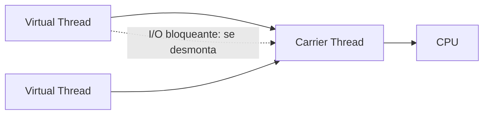

# Módulo 0 · Java moderno y Spring Boot para microservicios

Antes de hablar de gateways, sagas o Kubernetes, un microservicio Spring necesita una base sólida: Java moderno, concurrencia, contenedor de dependencias, configuración y opciones de runtime. Este módulo va de cero a experto en esa base, con ejemplos mínimos ejecutables y notas honestas cuando una feature requiere infraestructura específica.

**Entorno de referencia verificado (2026-05-22):** JDK 27.0.1.0.2, Maven 3.10.0, Gradle 9.8.2. Los ejemplos Java puros se ejecutaron localmente. Las partes específicas de Spring/CRaC/GraalVM incluyen **Nota de verificación** cuando no se ejecutaron en este entorno.

## Aprende construyendo

### Tema 1: Java 21: streams, lambdas, Optional, records y pattern matching · Intermedio · 360 min

Caso guía: normalizar pedidos entrantes, filtrar inválidos y producir DTOs inmutables.

#### Modelo mental

Java moderno reduce boilerplate y hace más explícito el contrato de datos. Streams/lambdas expresan transformaciones; Optional expresa ausencia; records modelan datos inmutables; pattern matching reduce casting y ramificación frágil.

#### Ejemplo mínimo enfocado: lambdas y streams

**Definición formal.** Una lambda implementa una interfaz funcional. Un `Stream` es un pipeline lazy: operaciones intermedias no ejecutan hasta una operación terminal.

**Cuándo usarlo / cuándo no.** Úsalo para transformar/filtrar colecciones con claridad. No lo uses cuando un bucle simple sea más legible o cuando la depuración sea crítica.

```bash
mkdir -p sm0-stream
cd sm0-stream
```

Crea el archivo `DemoStream.java`:

```java
import java.util.*;
import java.util.stream.*;
public class DemoStream {
  public static void main(String[] args) {
    var r = List.of(1, 2, 3, 4).stream()
      .filter(x -> x % 2 == 0)
      .map(x -> x * 10)
      .toList();
    System.out.println(r);
  }
}
```

```bash
javac DemoStream.java
java DemoStream
```

**Contrato / internals.** Stream: fuente + intermedias lazy + terminal eager; no reutilizable. `Optional`: 0/1 valor, evitar en campos/params. Record: inmutable superficial, accessors `x()`. Pattern matching/switch: exhaustivo con sealed/guardas (JDK 21+).

**Caso de uso real.** Filtrar pedidos válidos y mapearlos a DTOs antes de responder una API.

**Error común.** Usar streams con efectos secundarios ocultos.

**Síntoma.** resultados difíciles de depurar o dependientes del orden de ejecución. **Causa.** mutar estado externo desde `map/filter`. **Corrección.** mantener funciones puras; usar bucle o collector explícito si hay mutación necesaria. **Señal observable.** tests flaky o distintos resultados al paralelizar.

**Verificación (JDK 27.0.1.0.2, 2026-05-22).** Salida: `[20, 40]`.

#### Ejemplo mínimo enfocado: Optional

**Definición formal.** `Optional<T>` representa presencia o ausencia de valor, evitando `null` como contrato implícito.

**Cuándo usarlo / cuándo no.** Úsalo en retornos donde la ausencia es normal. No lo uses en campos de entidades JPA ni como parámetro de todos los métodos.

```bash
mkdir -p sm0-opt
cd sm0-opt
```

Crea el archivo `DemoOpt.java`:

```java
import java.util.*;
public class DemoOpt {
  static Optional<String> find(boolean ok) { return ok ? Optional.of("A") : Optional.empty(); }
  public static void main(String[] args) {
    System.out.println(find(true).orElse("X"));
    System.out.println(find(false).orElse("X"));
  }
}
```

```bash
javac DemoOpt.java
java DemoOpt
```

**Caso de uso real.** Buscar cliente por id y devolver 404 si no existe.

**Error común.** Llamar `Optional.get()` sin comprobar.

**Síntoma.** `NoSuchElementException` en producción. **Causa.** asumir presencia. **Corrección.** `orElseThrow`, `map`, `orElse`. **Señal observable.** stack trace con `Optional.get`.

**Verificación (JDK 27.0.1.0.2, 2026-05-22).** Salida: `A`, `X`.

#### Ejemplo mínimo enfocado: records y pattern matching

**Definición formal.** Un record es una clase de datos inmutable con constructor, accesores, `equals`, `hashCode` y `toString`. Pattern matching de `switch` permite desestructurar y aplicar guardas.

**Cuándo usarlo / cuándo no.** Úsalo para DTOs/value objects. No lo uses para entidades JPA mutables o con identidad gestionada por ORM.

```bash
mkdir -p sm0-rec
cd sm0-rec
```

Crea el archivo `DemoRec.java`:

```java
record User(String name, int age) {}
public class DemoRec {
  static String label(Object o) {
    return switch (o) {
      case User(String n, int a) when a >= 18 -> n + ":adult";
      case User(String n, int a) -> n + ":minor";
      default -> "other";
    };
  }
  public static void main(String[] args) {
    System.out.println(label(new User("Ana", 20)));
    System.out.println(label(new User("Ben", 10)));
  }
}
```

```bash
javac DemoRec.java
java DemoRec
```

**Caso de uso real.** DTOs de request/response en Spring MVC.

**Error común.** Usar records como entidades JPA.

**Síntoma.** problemas con proxies, mutabilidad y setters esperados por JPA. **Causa.** JPA espera entidades mutables/no-final en muchos casos. **Corrección.** records para DTO; clases controladas para entidades. **Señal observable.** errores de Hibernate/proxy o diseño forzado.

**Verificación (JDK 27.0.1.0.2, 2026-05-22).** Salida: `Ana:adult`, `Ben:minor`.

### Tema 2: Virtual Threads (Project Loom) · Avanzado · 240 min

Caso guía: endpoint I/O-bound que espera llamadas a DB/HTTP sin bloquear hilos de plataforma caros.

#### Virtual threads

**Definición formal.** Los virtual threads son hilos ligeros gestionados por la JVM. Permiten escribir código bloqueante con alta concurrencia en I/O, porque la JVM desmonta el virtual thread del carrier thread cuando bloquea.

**Cuándo usarlo / cuándo no.** Úsalo para mucha concurrencia I/O-bound. No lo uses como acelerador mágico de CPU-bound; evita pinning en secciones críticas largas.



**Ejemplo mínimo enfocado (ejecutable).**

```bash
mkdir -p sm0-vt
cd sm0-vt
```

Crea el archivo `DemoVT.java`:

```java
import java.util.concurrent.*;
public class DemoVT {
  public static void main(String[] args) throws Exception {
    try (var ex = Executors.newVirtualThreadPerTaskExecutor()) {
      Future<String> f = ex.submit(() -> "ok-vt");
      System.out.println(f.get());
    }
  }
}
```

```bash
javac DemoVT.java
java DemoVT
```

**Contrato / internals.** Virtual threads: manejados por JVM, se desmontan del carrier en bloqueos; no aceleran CPU-bound. Evitar pinning (`synchronized` largo/código nativo); limitar recursos externos con semáforos/bulkheads.

**Caso de uso real.** Servicio que hace muchas llamadas HTTP/DB bloqueantes.

**Error común.** Usar virtual threads para CPU-bound o con secciones `synchronized` largas.

**Síntoma.** no mejora throughput o hay pinning/degradación. **Causa.** CPU-bound no se beneficia; locking contencioso puede fijar carrier thread. **Corrección.** medir, usar pools CPU para cálculo, revisar locks. **Señal observable.** CPU alta sin mejora de latencia, profiling muestra contención.

**Verificación (JDK 27.0.1.0.2, 2026-05-22).** Salida: `ok-vt`.

### Tema 3: Spring IoC, DI, bean lifecycle y ApplicationContext · Intermedio · 360 min

Caso guía: `OrderService` depende de `OrderRepository`; el contenedor arma el grafo.

#### IoC y DI

**Definición formal.** Inversión de Control delega al contenedor la creación/cableado de objetos. Dependency Injection provee dependencias a través de constructor, setter o campo (constructor preferido).

**Cuándo usarlo / cuándo no.** Usa DI por constructor para dependencias obligatorias. No uses field injection en código de producción testeable.

**Ejemplo mínimo enfocado (ejecutable con Java puro, contrato equivalente).**

```bash
mkdir -p sm0-di
cd sm0-di
```

Crea el archivo `DemoDI.java`:

```java
interface Repo { String get(); }
class RepoImpl implements Repo { public String get() { return "order-1"; } }
class Service {
  private final Repo repo;
  Service(Repo repo) { this.repo = repo; }
  String run() { return repo.get(); }
}
public class DemoDI {
  public static void main(String[] args) {
    Service s = new Service(new RepoImpl());
    System.out.println(s.run());
  }
}
```

```bash
javac DemoDI.java
java DemoDI
```

**Contrato / internals.** Contenedor crea beans, resuelve dependencias y aplica ciclo de vida (`@PostConstruct`, `@PreDestroy`). Constructor injection hace dependencias explícitas e inmutables; scopes: singleton/prototype/request.

**Caso de uso real.** `@Service` con dependencia `@Repository` inyectada por constructor.

**Error común.** Field injection.

**Síntoma.** tests difíciles, dependencias ocultas, NPE en uso manual. **Causa.** dependencia no visible en constructor. **Corrección.** constructor injection, final fields. **Señal observable.** `@Autowired` en campos y tests con reflection.

**Verificación (JDK 27.0.1.0.2, 2026-05-22).** Salida: `order-1`. **Nota de verificación:** `ApplicationContext`/bean lifecycle reales requieren app Spring Boot; el contrato de DI por constructor es equivalente y ejecutado aquí.

### Tema 4: Auto-configuración condicional, @Conditional y starters · Intermedio · 240 min

Caso guía: habilitar una feature solo si existe propiedad o clase.

#### Auto-configuración

**Definición formal.** Spring Boot autoconfigura beans según classpath, propiedades, entorno y beans existentes. `@Conditional*` controla activación. Starters agregan dependencias coherentes.

**Cuándo usarlo / cuándo no.** Úsalo para defaults productivos. No asumas magia: inspecciona conditions.

**Ejemplo mínimo enfocado (ejecutable: evaluación de condición).**

```bash
mkdir -p sm0-cond
cd sm0-cond
```

Crea el archivo `Cond.java`:

```java
public class Cond {
  static boolean enabled(String value) { return "true".equalsIgnoreCase(value); }
  public static void main(String[] args) {
    System.out.println(enabled("true"));
    System.out.println(enabled("false"));
  }
}
```

```bash
javac Cond.java
java Cond
```

**Contrato / internals.** Auto-config se evalúa por condiciones de classpath/beans/propiedades. `@ConditionalOnClass/OnMissingBean/OnProperty` controlan activación. Orden y overrides visibles con `--debug`/Actuator conditions.

**Caso de uso real.** `@ConditionalOnProperty(name="feature.x.enabled", havingValue="true")`.

**Error común.** No entender por qué un bean existe/no existe.

**Síntoma.** comportamiento inesperado al arrancar. **Causa.** autoconfig condición no inspeccionada. **Corrección.** usar `--debug`, Actuator conditions, leer auto-config. **Señal observable.** bean ausente o bean duplicado.

**Verificación (JDK 27.0.1.0.2, 2026-05-22).** Salida: `true`, `false`. **Nota de verificación:** auto-config Spring real no ejecutada en este smoke Java.

### Tema 5: Multi-module Spring Boot projects · Intermedio · 180 min

Caso guía: separar `api`, `application`, `domain`, `infra`.

#### Multi-módulo

**Definición formal.** Un proyecto multi-módulo divide código en módulos con dependencias explícitas y build coordinado. En microservicios también ayuda como paso intermedio antes de extraer servicios.

**Cuándo usarlo / cuándo no.** Úsalo cuando hay límites claros. No lo uses para crear capas artificiales con ciclos.

**Ejemplo mínimo enfocado (ejecutable: grafo de dependencias).**

```bash
mkdir -p sm0-mod
cd sm0-mod
```

Crea el archivo `Modules.java`:

```java
import java.util.*;
public class Modules {
  static boolean hasCycle(Map<String,List<String>> g) {
    return g.getOrDefault("domain", List.of()).contains("api");
  }
  public static void main(String[] args) {
    var g = Map.of("api", List.of("application"), "application", List.of("domain"), "domain", List.<String>of());
    System.out.println(g.get("api"));
    System.out.println(hasCycle(g));
  }
}
```

```bash
javac Modules.java
java Modules
```

**Contrato / internals.** Multi-módulo: límites por dependencias Gradle/Maven; módulos `api/domain/infra/app`; dependencias acíclicas. Contratos estables evitan recompilación/cascada.

**Caso de uso real.** Maven multi-module con `domain` sin dependencia de Spring.

**Error común.** Ciclos entre módulos.

**Síntoma.** builds frágiles, cambios en cascada. **Causa.** dependencia bidireccional. **Corrección.** grafo acíclico, dependencias hacia dentro. **Señal observable.** fallo de compilación por ciclo o cambios cruzados.

**Verificación (JDK 27.0.1.0.2, 2026-05-22).** Salida: `[application]`, `false`.

### Tema 6: Perfiles y configuración externalizada · Intermedio · 180 min

Caso guía: `dev` usa H2, `prod` usa Postgres; secretos fuera del repo.

#### Profiles y configuración

**Definición formal.** Profiles activan configuración por entorno. Configuración externalizada mueve valores a env vars, archivos externos o config server.

**Cuándo usarlo / cuándo no.** Úsalo para diferencias de entorno. No uses perfiles para esconder comportamiento de negocio incompatible.

**Ejemplo mínimo enfocado (ejecutable).**

```bash
mkdir -p sm0-prof
cd sm0-prof
```

Crea el archivo `Profile.java`:

```java
public class Profile {
  static String db(String profile) { return "prod".equals(profile) ? "postgres" : "h2"; }
  public static void main(String[] args) {
    System.out.println(db("dev"));
    System.out.println(db("prod"));
  }
}
```

```bash
javac Profile.java
java Profile
```

**Contrato / internals.** Precedencia: defaults < `application.yml` < profile < env vars < args. `spring.profiles.active`/`SPRING_PROFILES_ACTIVE` activan perfil. Secretos fuera de git (Vault/env/secret manager).

**Caso de uso real.** `SPRING_PROFILES_ACTIVE=prod`, secretos en Vault/AWS Secrets Manager.

**Error común.** Secretos en `application-prod.yml`.

**Síntoma.** credenciales filtradas en git. **Causa.** configuración sensible versionada. **Corrección.** env vars/secret manager, `.env.example`. **Señal observable.** secret scanners o incidentes.

**Verificación (JDK 27.0.1.0.2, 2026-05-22).** Salida: `h2`, `postgres`.

### Tema 7: CRaC (Coordinated Restore at Checkpoint) · Avanzado · 180 min

Caso guía: reducir tiempo de arranque restaurando snapshot JVM.

#### CRaC

**Definición formal.** Coordinated Restore at Checkpoint es una API/flujo donde la JVM hace checkpoint de un proceso en ejecución y lo restaura después, coordinando recursos para evitar estado inválido.

**Cuándo usarlo / cuándo no.** Úsalo cuando el tiempo de arranque es crítico y puedes controlar el entorno. No lo uses sin validar sockets, archivos, secretos, tiempo y conexiones.

**Ejemplo mínimo enfocado (ejecutable: modelo de lifecycle).**

```bash
mkdir -p sm0-crac
cd sm0-crac
```

Crea el archivo `Crac.java`:

```java
public class Crac {
  static String lifecycle(boolean checkpointed) { return checkpointed ? "restore" : "cold-start"; }
  public static void main(String[] args) {
    System.out.println(lifecycle(false));
    System.out.println(lifecycle(true));
  }
}
```

```bash
javac Crac.java
java Crac
```

**Contrato / internals.** CRaC coordina `checkpoint`/`restore`; requiere librerías compatibles y manejo de sockets/archivos/secretos. Validar estado externo tras restore; no es magia universal.

**Caso de uso real.** Servicios serverless/scale-to-zero donde cold start importa.

**Error común.** Restaurar con recursos stale.

**Síntoma.** conexiones rotas, secretos viejos, tiempo incorrecto. **Causa.** no coordinar recursos en checkpoint/restore. **Corrección.** implementar hooks de recurso, validar entorno. **Señal observable.** errores tras restore que no ocurren en cold start.

**Verificación (JDK 27.0.1.0.2, 2026-05-22).** Salida: `cold-start`, `restore`. **Nota de verificación:** CRaC real requiere JDK/runtime con soporte CRaC y configuración de sistema; no se ejecutó checkpoint/restore real en este entorno.

### Tema 8: GraalVM Native Image · Avanzado · 240 min

Caso guía: binario nativo con arranque rápido y menor memoria.

#### Native Image

**Definición formal.** GraalVM Native Image compila AOT una app Java a ejecutable nativo, incluyendo solo lo necesario según análisis de alcanzabilidad.

**Cuándo usarlo / cuándo no.** Úsalo para arranque/memoria críticos. No lo uses si dependes fuertemente de reflexión dinámica no declarada o si el costo de build/compatibilidad es mayor.

**Trade-offs.** Mejor arranque/memoria; builds más lentos; requiere metadata para reflexión/recursos/proxies.

**Ejemplo mínimo enfocado (ejecutable: decisión por trade-off).**

```bash
mkdir -p sm0-native
cd sm0-native
```

Crea el archivo `NativeDecision.java`:

```java
public class NativeDecision {
  static String choose(boolean fastStartupCritical, boolean heavyReflection) {
    if (fastStartupCritical && !heavyReflection) return "consider-native";
    return "stay-jvm";
  }
  public static void main(String[] args) {
    System.out.println(choose(true, false));
    System.out.println(choose(true, true));
  }
}
```

```bash
javac NativeDecision.java
java NativeDecision
```

**Contrato / internals.** Native image usa AOT closed-world; menor reflexión dinámica por defecto. Requiere reachability metadata/hints; trade-off arranque/memoria vs throughput/observabilidad/dinamismo.

**Caso de uso real.** CLI o función serverless con arranque crítico.

**Error común.** Asumir que toda app Spring funciona igual en native.

**Síntoma.** fallos en runtime por reflexión/recursos faltantes. **Causa.** metadata de reachability incompleta. **Corrección.** pruebas nativas, tracing agent, configuración de hints. **Señal observable.** `ClassNotFoundException`/recursos faltantes solo en native.

**Verificación (JDK 27.0.1.0.2, 2026-05-22).** Salida: `consider-native`, `stay-jvm`. **Nota de verificación:** build native real requiere GraalVM/toolchain nativa; comando típico `./mvnw -Pnative native:compile`, no ejecutado aquí.

## Cierre

La base Java/Spring no es “tema preliminar”: define cómo el microservicio modela datos, maneja concurrencia, se configura y arranca. Virtual threads, CRaC y Native Image son opciones con trade-offs, no upgrades automáticos.

## Checklist

- Uso streams/Optional/records con criterio.
- Sé cuándo virtual threads ayudan y cuándo no.
- Aplico DI por constructor y entiendo autoconfig.
- Mantengo config/secretos fuera del código.
- Evalúo CRaC/Native con evidencia, no por moda.
