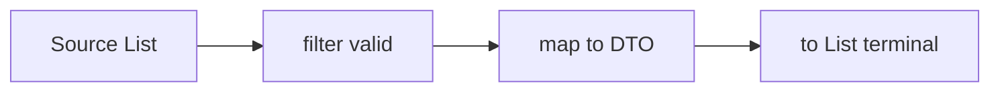
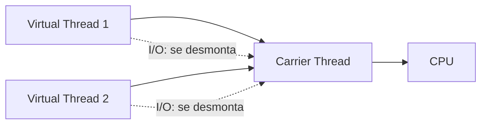
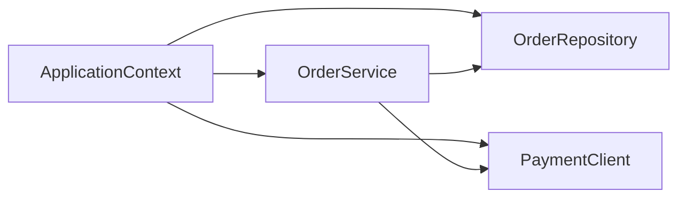
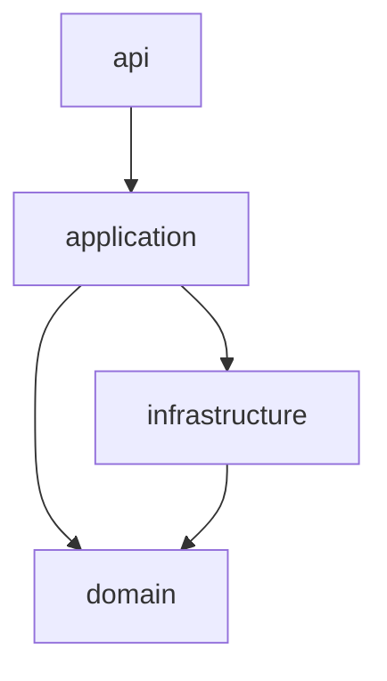
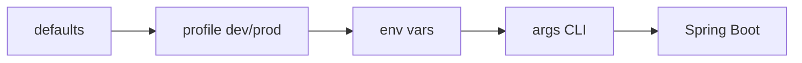
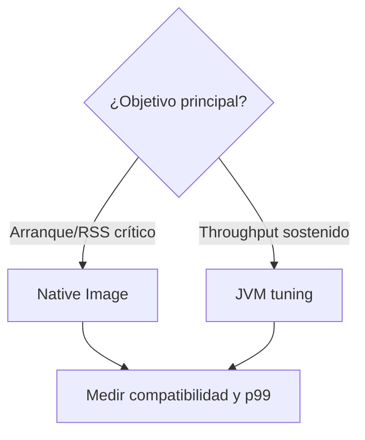

# Módulo 0 · Java moderno y Spring Boot para microservicios

Antes de hablar de gateways, sagas o Kubernetes, un microservicio Spring necesita una base sólida: Java moderno, concurrencia, contenedor de dependencias, configuración y opciones de runtime. Este módulo va de cero a experto en esa base, con ejemplos mínimos ejecutables y notas honestas cuando una feature requiere infraestructura específica.

**Entorno de referencia verificado (2026-05-22):** JDK 27.0.1.0.2. Los smokes Java se ejecutaron localmente. CRaC/GraalVM reales requieren toolchain específico; se incluyen **Notas de verificación**.

## Aprende construyendo

### Tema 1: Java 21+: streams, lambdas, Optional, records y pattern matching · Intermedio · 360 min

## El dolor

El equipo procesa pedidos entrantes con bucles anidados, mutación de listas compartidas y null checks dispersos. Un pedido inválido (qty ≤ 0) pasa el filtro y corrompe downstream. El código “funciona”, pero es difícil de leer, probar y paralelizar. La intención está enterrada en detalles imperativos.

## La intuición

Un stream es como una cinta transportadora: cada estación (filter, map) transforma lo que pasa, y nada se ejecuta hasta que alguien recoge el resultado al final (terminal). Optional es una caja que puede estar vacía: te obliga a decidir qué hacer si no hay valor. Un record es una ficha de datos: inmutable, con todos los campos visibles. Pattern matching es como un clasificador automático: examina la forma y actúa.



## La construcción

**Archivo:** `StreamSmoke.java` → pipeline lazy y puro.

```java
import java.util.*;
import java.util.stream.*;

public class StreamSmoke {
  record Order(String sku, int qty) {}

  public static void main(String[] args) {
    var result = List.of(
            new Order("A1", 2), new Order("", 1), new Order("B2", 0), new Order("C3", 5))
        .stream()
        .filter(o -> !o.sku().isBlank() && o.qty() > 0)
        .map(o -> o.sku() + ":" + o.qty())
        .toList();
    System.out.println(result);
  }
}
```

**Archivo:** `OptionalSmoke.java` → ausencia explícita.

```java
import java.util.*;

public class OptionalSmoke {
  static Optional<String> find(boolean ok) { return ok ? Optional.of("A") : Optional.empty(); }
  public static void main(String[] args) {
    System.out.println(find(true).orElse("X"));
    System.out.println(find(false).orElse("X"));
    System.out.println(find(true).map(s -> s.toLowerCase()).orElse("none"));
  }
}
```

**Archivo:** `RecordPatternSmoke.java` → records y pattern matching.

```java
record User(String name, int age) {}

public class RecordPatternSmoke {
  static String label(Object o) {
    return switch (o) {
      case User(String n, int a) when a >= 18 -> n + ":adult";
      case User(String n, int a) -> n + ":minor";
      default -> "other";
    };
  }
  public static void main(String[] args) {
    System.out.println(label(new User("Ana", 20)));
    System.out.println(label(new User("Ben", 10)));
    System.out.println(label("x"));
  }
}
```

**Lectura:** los streams son lazy: `filter` y `map` no ejecutan hasta `toList()`. Optional obliga a manejar ausencia. Records generan constructor, accesores, equals/hashCode/toString. Pattern matching de switch desestructura y aplica guardas.

## El experimento

1. Ejecuta el stream. Esperas `[A1:2, C3:5]`.
2. Agrega un filtro que mute una lista externa dentro de `map`. Observa resultados no deterministas si paralelizas.
3. Llama `Optional.get()` sin comprobar. Observa `NoSuchElementException`.

Salida esperada:

```text
[A1:2, C3:5]
A
X
a
Ana:adult
Ben:minor
other
```

## El cierre

Java moderno reduce boilerplate y hace contratos más explícitos. El costo es aprender las reglas: streams no reutilizables, Optional no para campos/params, records no para entidades mutables.

**Cuándo usarlo / cuándo no.** Usa streams para transformar/filtrar colecciones con claridad. Usa Optional en retornos donde la ausencia es normal. Usa records para DTOs/value objects. Usa pattern matching para desestructurar sealed types. No uses streams con efectos secundarios. No uses Optional en campos JPA ni como parámetro general. No uses records como entidades mutables.

| Feature | Cuándo | Cuándo NO |
|---|---|---|
| Stream | Transformar/filtrar colecciones | Bucle simple más legible o debug crítico |
| Optional (retorno) | Ausencia normal | Campo de entidad o parámetro |
| Record | DTO/value object inmutable | Entidad JPA mutable |
| Pattern matching | Desestructurar sealed types | Ramificación simple con if |

**Error común.** Efectos secundarios en streams. **Síntoma.** resultados difíciles de depurar o dependientes del orden. **Causa.** mutar estado externo en `map/filter`. **Arreglo.** funciones puras; bucle explícito si hay mutación. **Señal observable.** tests flaky o resultados distintos al paralelizar.

**Error común.** `Optional.get()` sin comprobar. **Síntoma.** `NoSuchElementException` en prod. **Causa.** asumir presencia. **Arreglo.** `orElseThrow`, `map`, `orElse`. **Señal observable.** stack trace con `Optional.get`.

**Pregunta de entrevista.** ¿Por qué un stream no es reutilizable?  
**Respuesta modelo.** Porque un stream consume su fuente al ejecutar la operación terminal. Una vez consumido, el pipeline se cierra. Si necesitas procesar de nuevo, debes crear un nuevo stream desde la fuente. Esta inmutabilidad evita estados compartidos y efectos secundarios.

**Transferencia.**

1. **[NO-USAR-X]** Usar `Optional` como campo de entidad JPA. Respuesta: **No usar Optional en campos/params**; usar en retornos.
2. Un DTO de respuesta necesita 5 campos inmutables. ¿Record o clase?
3. ¿Cuándo usarías `switch` con pattern matching en vez de `if/else`?

#### Definición formal

Lambda implementa interfaz funcional. Stream es pipeline lazy con operaciones intermedias y terminal. Optional representa 0/1 valor. Record es clase de datos inmutable. Pattern matching desestructura y aplica guardas.

#### Contrato / internals

- **Stream:** fuente + intermedias lazy + terminal eager; no reutilizable.
- **Optional:** `of`/`empty`/`ofNullable`; no usar en campos.
- **Record:** constructor canónico, accesores, equals/hashCode/toString.
- **Pattern matching:** exhaustivo con sealed types + guardas.
- **Límite:** no mutar estado en pipelines paralelos.

#### Ejemplo mínimo ejecutable

```bash
javac StreamSmoke.java OptionalSmoke.java RecordPatternSmoke.java
java StreamSmoke
java OptionalSmoke
java RecordPatternSmoke
```

Salida esperada:

```text
[A1:2, C3:5]
A
X
a
Ana:adult
Ben:minor
other
```

#### Caso real

`OrderService` filtra pedidos válidos con stream, mapea a `OrderResponse` record y devuelve `Optional<OrderResponse>` para el endpoint de búsqueda por id.

#### Verificación

Smokes Java ejecutados localmente (2026-05-22, JDK 27.0.1.0.2): `[A1:2, C3:5]`, `A`, `X`, `ana`, `Ana:adult`, `Ben:minor`, `other`.

### Tema 2: Virtual Threads (Project Loom) · Avanzado · 240 min

## El dolor

`catalog-service` atiende 200 requests concurrentes. Cada request espera 200ms de DB. Con platform threads (pool de 50), las requests se encolan y la latencia sube a 1s. Agregar más threads consume memoria (1MB/stack). El sistema no escala en I/O.

## La intuición

Un virtual thread es como un ticket de atención: en vez de tener 50 cajeros (platform threads) ocupados esperando, tienes miles de tickets que se atienden cuando el recurso está listo. La JVM monta/desmonta el virtual thread del carrier thread cuando bloquea en I/O. El código sigue siendo bloqueante y simple, pero la concurrencia es masiva.



## La construcción

**Archivo:** `VirtualThreadSmoke.java` → concurrencia masiva.

```java
import java.util.concurrent.*;

public class VirtualThreadSmoke {
  public static void main(String[] args) throws Exception {
    try (var ex = Executors.newVirtualThreadPerTaskExecutor()) {
      Future<String> f1 = ex.submit(() -> { Thread.sleep(50); return "vt-1"; });
      Future<String> f2 = ex.submit(() -> { Thread.sleep(50); return "vt-2"; });
      System.out.println(f1.get());
      System.out.println(f2.get());
    }
    System.out.println(Thread.currentThread().isVirtual());
  }
}
```

**Archivo:** Spring Boot 3.2+ (conceptual).

```yaml
spring:
  threads:
    virtual:
      enabled: true
```

**Lectura:** el smoke crea virtual threads que bloquean con `sleep` (simula I/O). La JVM desmonta del carrier. `Thread.currentThread().isVirtual()` en el main thread es `false` (main es platform thread).

## El experimento

1. Crea 2 virtual threads que duermen 50ms. Esperas `vt-1`, `vt-2`.
2. Verifica que el main thread no es virtual. Esperas `false`.
3. Usa `synchronized` largo en virtual thread. Observa pinning: el carrier thread queda bloqueado. Mide con profiling.

Salida esperada:

```text
vt-1
vt-2
false
```

## El cierre

Virtual threads escalan I/O-bound con código simple, pero no aceleran CPU-bound ni eliminan contención. El pinning en `synchronized` largo es el riesgo principal.

**Cuándo usarlo / cuándo no.** Úsalo para alta concurrencia I/O-bound (HTTP, DB, archivos). No lo uses para CPU-bound. Evita `synchronized` largos y código nativo que fija el carrier thread. Limita recursos externos con semáforos/bulkheads.

| Aspecto | Virtual Threads | Platform Threads |
|---|---|---|
| Concurrencia | Millones posibles | Miles (memoria) |
| I/O bloqueante | Eficiente (desmontaje) | Bloquea carrier |
| CPU-bound | No mejora | Igual |
| Pinning | Riesgo con synchronized largo | No aplica |

**Error común.** Virtual threads para CPU-bound o `synchronized` largo. **Síntoma.** no mejora throughput o hay pinning. **Causa.** CPU no se beneficia; lock contencioso fija carrier. **Arreglo.** pools CPU para cálculo; revisar locks; medir. **Señal observable.** CPU alta sin mejora, profiling muestra contención.

**Pregunta de entrevista.** ¿Por qué virtual threads no aceleran CPU-bound?  
**Respuesta modelo.** Porque virtual threads mejoran la concurrencia de I/O al desmontar del carrier thread cuando bloquea, pero CPU-bound consume el carrier continuamente. No hay desmontaje posible si el thread está calculando. Para CPU-bound se usan pools de tamaño fijo con número de cores.

**Transferencia.**

1. **[NO-USAR-X]** Usar virtual threads para un endpoint de cálculo intensivo de hash. Respuesta: **No usar virtual threads para CPU-bound**; usar pool de tamaño cores.
2. Un servicio hace 100 llamadas HTTP paralelas por request. ¿Virtual threads?
3. ¿Cómo detectas pinning en producción?

#### Definición formal

Virtual threads son hilos ligeros de la JVM que se desmontan del carrier thread al bloquear en I/O, permitiendo alta concurrencia con código bloqueante simple.

#### Contrato / internals

- **Carrier thread:** platform thread que ejecuta el virtual thread.
- **Desmontaje:** al bloquear en I/O, el virtual thread se desmonta.
- **Pinning:** `synchronized` largo o código nativo puede fijar el carrier.
- **No acelera CPU-bound.**
- **Límite:** recursos externos (DB connections, file descriptors) siguen siendo el cuello.

#### Ejemplo mínimo ejecutable

```bash
javac VirtualThreadSmoke.java
java VirtualThreadSmoke
```

Salida esperada:

```text
vt-1
vt-2
false
```

#### Caso real

`catalog-service` habilita virtual threads en Spring Boot. Endpoints I/O-bound escalan a miles de requests. El equipo mide pinning y limita conexiones DB con pool.

#### Verificación

Smoke Java ejecutado localmente (2026-05-22, JDK 27.0.1.0.2): `vt-1`, `vt-2`, `false`.

**Nota de verificación:** no se ejecutó Spring Boot con virtual threads real. Verificación propuesta: app Boot con `spring.threads.virtual.enabled=true` + load test.

### Tema 3: Spring IoC, DI, bean lifecycle y ApplicationContext · Intermedio · 360 min

## El dolor

`OrderService` crea `new OrderRepository()` internamente. Para testearlo, hay que modificar código o usar reflection. Las dependencias están ocultas, el grafo es invisible y el ciclo de vida (inicialización, cierre) nadie lo gestiona.

## La intuición

IoC es como contratar un gerente de oficina: tú dices “necesito un servicio de pedidos con repositorio y cliente de pago”, y el gerente (contenedor) contrata, conecta y gestiona el ciclo de vida de cada empleado. DI es cómo el gerente entrega las herramientas a cada empleado. Constructor injection es el empleado diciendo “estas son mis herramientas obligatorias; sin ellas no trabajo”.



## La construcción

**Archivo:** `DiSmoke.java` → inyección por constructor.

```java
public class DiSmoke {
  interface Repo { String get(); }
  static class RepoImpl implements Repo { public String get() { return "order-1"; } }

  static class Service {
    private final Repo repo;
    Service(Repo repo) { this.repo = repo; } // constructor injection
    String run() { return repo.get(); }
  }

  public static void main(String[] args) {
    Service s = new Service(new RepoImpl());
    System.out.println(s.run());
  }
}
```

**Archivo:** Spring (conceptual).

```java
@Service
public class OrderService {
  private final OrderRepository repo;
  private final PaymentClient payment;

  public OrderService(OrderRepository repo, PaymentClient payment) {
    this.repo = repo;
    this.payment = payment;
  }

  @PostConstruct
  void init() { /* validación post-wiring */ }

  @PreDestroy
  void close() { /* cleanup */ }
}
```

**Lectura:** el smoke muestra el principio: dependencias por constructor, inmutables (final). Spring gestiona el grafo y lifecycle hooks.

## El experimento

1. Inyecta `RepoImpl`. Esperas `order-1`.
2. Intenta crear `Service` sin repo. El compilador lo impide (constructor obligatorio).
3. Usa field injection (`@Autowired` en campo). Observa que el test necesita reflection o Spring context.

Salida esperada:

```text
order-1
```

## El cierre

IoC/DI hacen las dependencias explícitas y testeables. Constructor injection es la opción más segura para dependencias obligatorias.

**Cuándo usarlo / cuándo no.** Usa constructor injection para dependencias obligatorias. Usa setter injection solo para opcionales. No uses field injection en producción.

| Inyección | Cuándo | Cuándo NO |
|---|---|---|
| Constructor | Dependencias obligatorias | Demasiados params (smell de SRP) |
| Setter | Dependencias opcionales | Dependencias obligatorias |
| Field | Nunca en prod | Código testeable |

**Error común.** Field injection. **Síntoma.** tests difíciles, dependencias ocultas, NPE. **Causa.** dependencia no visible. **Arreglo.** constructor injection, final fields. **Señal observable.** `@Autowired` en campos y tests con reflection.

**Pregunta de entrevista.** ¿Por qué constructor injection es preferido sobre field injection?  
**Respuesta modelo.** Porque hace las dependencias explícitas e inmutables, facilita tests sin Spring context, detecta ciclos en tiempo de arranque y evita NPE por dependencias no inyectadas. Field injection oculta dependencias y dificulta la instanciación manual.

**Transferencia.**

1. **[NO-USAR-X]** Usar `@Autowired` en campos para “menos código”. Respuesta: **No usar field injection** en producción.
2. Un bean tiene 8 dependencias por constructor. ¿Qué smell es?
3. ¿Cómo detectas un ciclo de dependencias en Spring?

#### Definición formal

IoC delega creación/cableado al contenedor. DI provee dependencias por constructor/setter/field. `@PostConstruct`/`@PreDestroy` gestionan lifecycle.

#### Contrato / internals

- **Scopes:** singleton (default), prototype, request, session.
- **Lifecycle:** `@PostConstruct` post-wiring, `@PreDestroy` pre-shutdown.
- **ApplicationContext:** contenedor central.
- **Límite:** constructor con demasiados params indica SRP violado.

#### Ejemplo mínimo ejecutable

```bash
javac DiSmoke.java
java DiSmoke
```

Salida esperada:

```text
order-1
```

#### Caso real

`OrderService` recibe `OrderRepository` y `PaymentClient` por constructor. Tests instancian con dobles sin Spring context.

#### Verificación

Smoke Java ejecutado localmente (2026-05-22, JDK 27.0.1.0.2): `order-1`.

**Nota de verificación:** `ApplicationContext` y lifecycle reales requieren app Spring Boot. Verificación propuesta: app Boot con `@PostConstruct`/`@PreDestroy` y actuator.

### Tema 4: Auto-configuración condicional, @Conditional y starters · Intermedio · 240 min

## El dolor

El equipo agrega una dependencia y “mágicamente” aparece un bean. Nadie sabe por qué. Cuando falta, nadie sabe cómo activarlo. La auto-configuración parece magia hasta que falla.

## La intuición

La auto-configuración es como un electricista inteligente: si detecta que hay cable de red, instala el router; si no, no. Las condiciones (`@ConditionalOnClass`, `@ConditionalOnProperty`, `@ConditionalOnMissingBean`) son los sensores. Starters son los kits que traen todas las piezas compatibles.

```mermaid
flowchart LR
  CP[Classpath] --> C{@ConditionalOnClass?}
  P[Properties] --> P2{@ConditionalOnProperty?}
  B[Beans existentes] --> B2{@ConditionalOnMissingBean?}
  C -->|sí| Auto[Auto-config bean]
  P2 -->|sí| Auto
  B2 -->|sí| Auto
```

## La construcción

**Archivo:** `ConditionalSmoke.java` → evaluación de condición.

```java
public class ConditionalSmoke {
  static boolean enabled(String propertyValue, boolean classPresent, boolean beanMissing) {
    return "true".equalsIgnoreCase(propertyValue) && classPresent && beanMissing;
  }
  public static void main(String[] args) {
    System.out.println(enabled("true", true, true));
    System.out.println(enabled("false", true, true));
    System.out.println(enabled("true", false, true));
  }
}
```

**Archivo:** Spring auto-config (conceptual).

```java
@AutoConfiguration
@ConditionalOnClass(RedisTemplate.class)
@ConditionalOnProperty(name = "cache.redis.enabled", havingValue = "true")
public class RedisCacheAutoConfiguration {
  @Bean
  @ConditionalOnMissingBean
  public CacheManager cacheManager(RedisConnectionFactory cf) {
    return new RedisCacheManager(cf);
  }
}
```

**Lectura:** el smoke modela la lógica: propiedad true + clase presente + bean ausente → activar. En Spring, `--debug` y Actuator `/conditions` muestran qué se activó y por qué.

## El experimento

1. Propiedad true, clase presente, bean ausente. Esperas `true`.
2. Propiedad false. Esperas `false`.
3. Clase ausente (sin dependencia). Esperas `false`.
4. Agrega tu propio bean del mismo tipo. `@ConditionalOnMissingBean` no activa el auto-config.

Salida esperada:

```text
true
false
false
```

## El cierre

La auto-configuración es poderosa pero no mágica. Entender las condiciones te permite diagnosticar y sobrescribir defaults con control.

**Cuándo usarlo / cuándo no.** Usa auto-config para defaults productivos. Usa `@Conditional*` para features opcionales. No asumas magia; inspecciona conditions.

| Herramienta | Cuándo | Cuándo NO |
|---|---|---|
| Starter | Agregar capacidad coherente | Dependencia innecesaria |
| `@ConditionalOnProperty` | Feature flag por entorno | Esconder comportamiento de negocio |
| `@ConditionalOnMissingBean` | Permitir override | Sorprender con bean ausente |

**Error común.** No entender por qué un bean existe/no existe. **Síntoma.** comportamiento inesperado al arrancar. **Causa.** condición no inspeccionada. **Arreglo.** `--debug`, Actuator conditions, leer auto-config. **Señal observable.** bean ausente o duplicado.

**Pregunta de entrevista.** ¿Cómo diagnosticas por qué un auto-config no se aplicó?  
**Respuesta modelo.** Ejecuto con `--debug` o consulto `/actuator/conditions` para ver la lista de auto-configuraciones y si cada condición (`@ConditionalOnClass`, `@ConditionalOnProperty`, `@ConditionalOnMissingBean`) se cumplió o no. También reviso si un bean propio ya existe y bloqueó la activación.

**Transferencia.**

1. **[NO-USAR-X]** Agregar un starter “por si acaso” sin entender qué auto-configura. Respuesta: **No agregar dependencias innecesarias**.
2. Tu bean custom no se está usando porque el auto-config lo sobrescribe. ¿Qué revisas?
3. ¿Cómo deshabilitas una auto-config específica sin quitar la dependencia?

#### Definición formal

Spring Boot autoconfigura beans según classpath, propiedades, entorno y beans existentes. `@Conditional*` controla activación. Starters agregan dependencias coherentes.

#### Contrato / internals

- `@ConditionalOnClass`: clase presente en classpath.
- `@ConditionalOnProperty`: propiedad con valor esperado.
- `@ConditionalOnMissingBean`: no existe bean del tipo.
- `@AutoConfiguration`: orden y registro.
- **Límite:** la magia se diagnostica con `--debug`.

#### Ejemplo mínimo ejecutable

```bash
javac ConditionalSmoke.java
java ConditionalSmoke
```

Salida esperada:

```text
true
false
false
```

#### Caso real

`RedisCacheAutoConfiguration` se activa solo si `RedisTemplate` está en classpath, `cache.redis.enabled=true` y no existe `CacheManager` propio.

#### Verificación

Smoke Java ejecutado localmente (2026-05-22, JDK 27.0.1.0.2): `true`, `false`, `false`.

**Nota de verificación:** auto-config Spring real no ejecutada. Verificación propuesta: app Boot con `--debug` y consulta `/actuator/conditions`.

### Tema 5: Multi-module Spring Boot projects · Intermedio · 180 min

## El dolor

El proyecto tiene un solo módulo con 500 clases. Cualquier cambio recompila todo. El dominio depende de Spring Web, la infraestructura importa controllers. No hay límites reales, solo paquetes.

## La intuición

Un proyecto multi-módulo es como un edificio con pisos separados: cada piso tiene su función y solo se comunica por las escaleras (dependencias declaradas). Si el piso de dominio puede importar el de web, la separación es ilusoria.



## La construcción

**Archivo:** `ModuleGraphSmoke.java` → grafo de dependencias.

```java
import java.util.*;

public class ModuleGraphSmoke {
  static boolean hasCycle(Map<String, List<String>> g) {
    return g.getOrDefault("domain", List.of()).contains("api")
        || g.getOrDefault("domain", List.of()).contains("web");
  }

  static boolean acyclic(Map<String, List<String>> g) {
    // Simplificación: domain no debe apuntar hacia arriba.
    return !hasCycle(g);
  }

  public static void main(String[] args) {
    var g = Map.of(
        "api", List.of("application"),
        "application", List.of("domain"),
        "domain", List.<String>of(),
        "infrastructure", List.of("domain")
    );
    System.out.println(acyclic(g));
    System.out.println(g.get("api"));
  }
}
```

**Archivo:** estructura Maven (conceptual).

```text
pom.xml (parent)
├── api/          (controllers, DTOs)
├── application/  (use cases, orchestration)
├── domain/       (entities, rules, NO Spring)
└── infrastructure/ (JPA, clients, config)
```

**Lectura:** el smoke verifica que `domain` no dependa de `api` ni `web`. En Maven/Gradle, el grafo de módulos se declara en el POM/build y se valida en CI.

## El experimento

1. Grafo acíclico (domain no apunta arriba). Esperas `true`.
2. Agrega `domain → api`. Esperas `false` (ciclo detectado).
3. En proyecto real, ejecuta `mvn dependency:analyze` o ArchUnit para validar.

Salida esperada:

```text
true
[application]
```

## El cierre

Multi-módulo fuerza límites visibles en el build. El costo es configuración inicial, pero el beneficio es independencia y builds incrementales.

**Cuándo usarlo / cuándo no.** Úsalo cuando hay límites claros y equipos múltiples. No lo uses para crear capas artificiales con ciclos.

| Práctica | Cuándo | Cuándo NO |
|---|---|---|
| Multi-módulo | Límites claros, equipos múltiples | Proyecto pequeño, un equipo |
| `domain` sin Spring | Dominio puro, testeable | Dominio anémico sin reglas |
| Grafo acíclico | Siempre | Nunca permitir ciclos |

**Error común.** Ciclos entre módulos. **Síntoma.** builds frágiles, cambios en cascada. **Causa.** dependencia bidireccional. **Arreglo.** grafo acíclico, dependencias hacia adentro. **Señal observable.** fallo de compilación por ciclo o cambios cruzados.

**Pregunta de entrevista.** ¿Por qué `domain` no debería depender de Spring?  
**Respuesta modelo.** Porque el dominio contiene reglas de negocio que deben ser testeables sin framework y portables. Si domain depende de Spring, no puedes testear reglas sin levantar contexto, y migrar o reutilizar el dominio se vuelve costoso. La dependencia debe apuntar hacia adentro: infraestructura depende de domain, no al revés.

**Transferencia.**

1. **[NO-USAR-X]** Permitir que `domain` importe `spring-web` “porque es más fácil”. Respuesta: **No permitir dependencias hacia arriba** en el grafo.
2. ¿Cómo validas el grafo de módulos en CI?
3. ¿Cuándo extraerías un módulo a un microservicio independiente?

#### Definición formal

Un proyecto multi-módulo divide código en módulos con dependencias explícitas y build coordinado, forzando límites arquitectónicos.

#### Contrato / internals

- **Parent POM/build:** coordina versiones.
- **Módulos:** api, application, domain, infrastructure.
- **Dependencias acíclicas:** domain no depende de web/infra.
- **Límite:** ciclos destruyen la separación.

#### Ejemplo mínimo ejecutable

```bash
javac ModuleGraphSmoke.java
java ModuleGraphSmoke
```

Salida esperada:

```text
true
[application]
```

#### Caso real

`domain` module no tiene dependencia de Spring. `infrastructure` depende de `domain`. ArchUnit valida el grafo en CI.

#### Verificación

Smoke Java ejecutado localmente (2026-05-22, JDK 27.0.1.0.2): `true`, `[application]`.

**Nota de verificación:** Maven/Gradle multi-module real requiere proyecto con POM parent. Verificación propuesta: `mvn -pl domain test` sin Spring en classpath.

### Tema 6: Perfiles y configuración externalizada · Intermedio · 180 min

## El dolor

El equipo commitea `application-prod.yml` con password de DB. Un fork accidental expone la credencial. Además, `dev` y `prod` tienen comportamientos distintos no documentados porque los perfiles esconden lógica de negocio.

## La intuición

Los perfiles son como los trajes de un actor: el mismo actor (app) se viste distinto según la obra (entorno). Pero el actor no cambia de personalidad: la lógica de negocio es la misma. La configuración externalizada es como el guion fuera del escenario: los valores viven fuera del código, en variables de entorno o secret managers.



## La construcción

**Archivo:** `ProfileSmoke.java` → selección por entorno.

```java
public class ProfileSmoke {
  static String db(String profile) { return "prod".equals(profile) ? "postgres" : "h2"; }
  static String secretSource(boolean prod) { return prod ? "vault" : "local-dev"; }
  public static void main(String[] args) {
    System.out.println(db("dev"));
    System.out.println(db("prod"));
    System.out.println(secretSource(true));
  }
}
```

**Archivo:** configuración Spring (conceptual).

```yaml
# application.yml (defaults)
spring:
  datasource:
    url: ${DB_URL:jdbc:h2:mem:test}

# application-prod.yml (solo diferencias de entorno)
spring:
  datasource:
    url: ${DB_URL}

# Secretos NUNCA en git
```

**Lectura:** el smoke muestra que `dev` usa h2 y `prod` usa postgres. Los secretos se inyectan por env var o Vault, nunca en el repo.

## El experimento

1. Perfil dev. Esperas `h2`.
2. Perfil prod. Esperas `postgres`.
3. Secreto en prod. Esperas `vault`.
4. Commitea password en `application-prod.yml`. Observa el riesgo: secret scanner lo detecta.

Salida esperada:

```text
h2
postgres
vault
```

## El cierre

Perfiles y configuración externalizada separan entorno de código. El secreto debe vivir fuera del repo siempre.

**Cuándo usarlo / cuándo no.** Usa perfiles para diferencias de entorno (DB, logging, features). Usa env vars/secret manager para secretos. No uses perfiles para esconder lógica de negocio incompatible. No commitees secretos.

| Práctica | Cuándo | Cuándo NO |
|---|---|---|
| Perfiles (dev/test/prod) | Diferencias de infraestructura | Lógica de negocio distinta por entorno |
| Env vars | Secretos y config por entorno | Valores hardcodeados en código |
| Secret manager (Vault) | Producción, rotación, auditoría | Archivos planos en git |

**Error común.** Secretos en `application-prod.yml`. **Síntoma.** credenciales filtradas. **Causa.** configuración sensible versionada. **Arreglo.** env vars/secret manager, `.env.example`, secret scanning. **Señal observable.** alerta de secret scanner o uso desde IP desconocida.

**Pregunta de entrevista.** ¿Cuál es el orden de precedencia de configuración en Spring Boot?  
**Respuesta modelo.** De menor a mayor: defaults de Spring Boot, `application.yml`, profile-specific (`application-prod.yml`), variables de entorno, argumentos de línea de comandos (`--server.port=...`), y propiedades de test. El valor de mayor precedencia gana. Los secretos deben venir de env vars o secret manager, nunca del repo.

**Transferencia.**

1. **[NO-USAR-X]** Commitear `DB_PASSWORD=secret123` en `application.yml`. Respuesta: **No commitear secretos**; usar env var/secret manager.
2. ¿Cómo manejas un feature flag que difiere entre dev y prod?
3. ¿Qué diferencia hay entre `spring.profiles.active` y `spring.config.import`?

#### Definición formal

Profiles activan configuración por entorno. Configuración externalizada mueve valores fuera del código a env vars, archivos externos o config server. La precedencia determina qué valor gana.

#### Contrato / internals

- **Precedencia:** defaults < application.yml < profile < env vars < args.
- **Activación:** `spring.profiles.active` o `SPRING_PROFILES_ACTIVE`.
- **Secretos:** Vault/env/secret manager.
- **Límite:** no usar perfiles para lógica de negocio.

#### Ejemplo mínimo ejecutable

```bash
javac ProfileSmoke.java
java ProfileSmoke
```

Salida esperada:

```text
h2
postgres
vault
```

#### Caso real

`SPRING_PROFILES_ACTIVE=prod` activa PostgreSQL. Secretos vienen de Vault. `.env.example` documenta variables necesarias sin valores reales.

#### Verificación

Smoke Java ejecutado localmente (2026-05-22, JDK 27.0.1.0.2): `h2`, `postgres`, `vault`.

**Nota de verificación:** Spring Boot config real no ejecutada. Verificación propuesta: app Boot con perfiles y env vars.

### Tema 7: CRaC (Coordinated Restore at Checkpoint) · Avanzado · 180 min

## El dolor

Un servicio serverless tarda 4 segundos en arrancar. En scale-to-zero, cada invocación paga ese costo. El equipo oye “usa CRaC” y lo activa sin validar sockets, conexiones DB y secretos. El restore falla porque el estado no fue coordinado.

## La intuición

CRaC es como congelar un plato de comida y recalentarlo: el plato (JVM) se guarda con todo su estado, y al recalentar (restore) vuelve a estar listo rápido. Pero si el plato tenía hielo (conexiones abiertas, sockets) que se derritió al congelar, al recalentar está podrido. Por eso hay que coordinar: cerrar recursos antes del checkpoint y reabrirlos después del restore.


## La construcción

**Archivo:** `CracSmoke.java` → lifecycle model.

```java
public class CracSmoke {
  static String lifecycle(boolean checkpointed, boolean resourcesValid) {
    if (!checkpointed) return "cold-start";
    return resourcesValid ? "restore-ok" : "restore-failed";
  }
  public static void main(String[] args) {
    System.out.println(lifecycle(false, false));
    System.out.println(lifecycle(true, true));
    System.out.println(lifecycle(true, false));
  }
}
```

**Archivo:** CRaC hooks (conceptual).

```java
public class DbResource implements Resource {
  public void beforeCheckpoint(Context<? extends Resource> context) {
    connection.close(); // cerrar antes de checkpoint
  }
  public void afterRestore(Context<? extends Resource> context) {
    connection = reconnect(); // reabrir después de restore
    validate(); // verificar estado
  }
}
```

**Lectura:** el smoke modela los tres estados: cold-start, restore-ok, restore-failed. En CRaC real, los hooks coordinan recursos.

## El experimento

1. Sin checkpoint. Esperas `cold-start`.
2. Checkpoint + recursos válidos. Esperas `restore-ok`.
3. Checkpoint + recursos inválidos. Esperas `restore-failed`.
4. Restaura sin reabrir conexiones DB. Observa errores de conexión.

Salida esperada:

```text
cold-start
restore-ok
restore-failed
```

## El cierre

CRaC reduce arranque cuando se coordina correctamente. El costo es implementar y testear hooks de recurso, validar entorno post-restore.

**Cuándo usarlo / cuándo no.** Úsalo cuando el arranque es crítico y controlas el entorno. No lo uses sin validar sockets, archivos, secretos, tiempo y conexiones. No asumas que restore es transparente.

| Aspecto | CRaC | Cold start |
|---|---|---|
| Arranque | Muy rápido (restore) | Lento (JVM init) |
| Complejidad | Hooks de recurso | Baja |
| Portabilidad | Requiere soporte CRaC | Universal |
| Riesgo | Estado stale si no coordina | Bajo |

**Error común.** Restaurar con recursos stale. **Síntoma.** conexiones rotas, secretos viejos, tiempo incorrecto. **Causa.** no coordinar recursos en checkpoint/restore. **Arreglo.** implementar hooks, validar entorno post-restore. **Señal observable.** errores tras restore que no ocurren en cold start.

**Pregunta de entrevista.** ¿Qué debe coordinarse en un checkpoint CRaC?  
**Respuesta modelo.** Sockets, conexiones DB, archivos, threads, secretos y reloj del sistema. Antes del checkpoint se cierran recursos; después del restore se reabren y validan. Si no se coordina, el proceso restaurado opera con estado inválido.

**Transferencia.**

1. **[NO-USAR-X]** Activar CRaC sin hooks de recurso y asumir que “funciona”. Respuesta: **No usar CRaC sin coordinación**; implementar y testear hooks.
2. Un servicio con 50 conexiones DB activas. ¿Cómo haces checkpoint seguro?
3. ¿Cuándo CRaC es mejor que Native Image para arranque?

#### Definición formal

CRaC (Coordinated Restore at Checkpoint) es una API/flujo donde la JVM hace checkpoint de un proceso en ejecución y lo restaura después, coordinando recursos para evitar estado inválido.

#### Contrato / internals

- **Checkpoint:** captura estado JVM.
- **Restore:** restaura proceso.
- **Resource hooks:** beforeCheckpoint/afterRestore.
- **Coordinación:** sockets, archivos, DB, secretos, tiempo.
- **Límite:** requiere JDK/runtime con soporte CRaC.

#### Ejemplo mínimo ejecutable

```bash
javac CracSmoke.java
java CracSmoke
```

Salida esperada:

```text
cold-start
restore-ok
restore-failed
```

#### Caso real

Servicio serverless usa CRaC con hooks para cerrar/reabrir conexiones DB. Restore valida conexión antes de aceptar tráfico.

#### Verificación

Smoke Java ejecutado localmente (2026-05-22, JDK 27.0.1.0.2): `cold-start`, `restore-ok`, `restore-failed`.

**Nota de verificación:** CRaC real requiere JDK con soporte CRaC y configuración de sistema; no se ejecutó checkpoint/restore real.

### Tema 8: GraalVM Native Image · Avanzado · 240 min

## El dolor

El equipo compila a native para “ser más rápido”. El binario arranca en 50ms, pero un endpoint falla en producción por reflexión no registrada. El throughput en carga sostenida es peor que JVM. El build tarda 8 minutos y el debugging es difícil. Native no fue una mejora; fue una apuesta sin medición.

## La intuición

Native Image es como traducir un libro a otro idioma de forma anticipada: el resultado es rápido de leer (arranque), pero si el libro tiene páginas que se escriben en tiempo real (reflexión dinámica), la traducción no las incluye. La JVM es como leer el original con un intérprete: más lento de arrancar, pero puede manejar páginas nuevas en tiempo real.



## La construcción

**Archivo:** `NativeDecisionSmoke.java` → decisión por trade-off.

```java
public class NativeDecisionSmoke {
  static String choose(boolean fastStartupCritical, boolean heavyReflection, boolean measured) {
    if (!measured) return "stay-jvm-measure-first";
    if (fastStartupCritical && !heavyReflection) return "consider-native";
    return "stay-jvm";
  }
  public static void main(String[] args) {
    System.out.println(choose(true, false, true));
    System.out.println(choose(true, true, true));
    System.out.println(choose(true, false, false));
  }
}
```

**Archivo:** build native (conceptual).

```bash
./mvnw -Pnative -DskipTests native:compile
./target/app
```

**Lectura:** el smoke muestra que sin medición, la respuesta es “medir primero”. Native es una opción, no un upgrade automático.

## El experimento

1. Arranque crítico, sin reflexión pesada, medido. Esperas `consider-native`.
2. Arranque crítico, reflexión pesada. Esperas `stay-jvm`.
3. Sin medición. Esperas `stay-jvm-measure-first`.

Salida esperada:

```text
consider-native
stay-jvm
stay-jvm-measure-first
```

## El cierre

Native Image es una opción con trade-offs claros. La decisión debe basarse en medición real, no en moda.

**Cuándo usarlo / cuándo no.** Úsalo para arranque/memoria críticos con stack compatible. No lo uses si dependes de reflexión dinámica no declarada o si el costo de build/compatibilidad es mayor. No asumas que toda app Spring funciona igual en native.

| Aspecto | Native Image | JVM |
|---|---|---|
| Arranque | Muy rápido | Lento (init) |
| Memoria RSS | Menor | Mayor |
| Throughput sostenido | Puede ser menor | Mejor (JIT) |
| Reflexión dinámica | Requiere metadata | Funciona |
| Build time | Largo (minutos) | Rápido (segundos) |

**Error común.** Asumir que toda app Spring funciona igual en native. **Síntoma.** fallos en runtime por reflexión/recursos. **Causa.** metadata de reachability incompleta. **Arreglo.** pruebas nativas, tracing agent, hints. **Señal observable.** `ClassNotFoundException`/recursos faltantes solo en native.

**Pregunta de entrevista.** ¿Cuándo NO elegirías GraalVM Native Image?  
**Respuesta modelo.** Cuando el beneficio de arranque no compensa: reflexión dinámica difícil de controlar, throughput sostenido peor, incompatibilidad de herramientas/librerías, o costo de build/operación superior a la ganancia. Lo decido con benchmarks representativos que incluyen arranque, RSS, p99 y throughput.

**Transferencia.**

1. **[NO-USAR-X]** Activar native en todos los servicios porque “es más rápido”. Respuesta: **No usar native por defecto**; medir primero.
2. Un CLI que se ejecuta 1000 veces al día por 50ms. ¿Native o JVM?
3. ¿Qué métricas compararías antes de migrar a native?

#### Definición formal

GraalVM Native Image compila AOT una app Java a ejecutable nativo, incluyendo solo lo necesario según análisis de alcanzabilidad (closed-world).

#### Contrato / internals

- **AOT:** compilación anticipada.
- **Closed-world:** solo clases alcanzables.
- **Metadata:** reflexión, recursos, proxies, JNI.
- **Build:** minutos; requiere GraalVM.
- **Límite:** no es “JVM más rápida”; es otro artefacto.

#### Ejemplo mínimo ejecutable

```bash
javac NativeDecisionSmoke.java
java NativeDecisionSmoke
```

Salida esperada:

```text
consider-native
stay-jvm
stay-jvm-measure-first
```

#### Caso real

El equipo evalúa native para un servicio serverless. Primero mide JVM con tuning; luego compila native y compara arranque, RSS, p99 y throughput antes de decidir.

#### Verificación

Smoke Java ejecutado localmente (2026-05-22, JDK 27.0.1.0.2): `consider-native`, `stay-jvm`, `stay-jvm-measure-first`.

**Nota de verificación:** build native real requiere GraalVM/toolchain. Verificación propuesta: `./mvnw -Pnative -DskipTests native:compile` y benchmark comparativo.

## Cierre

La base Java/Spring no es “tema preliminar”: define cómo el microservicio modela datos, maneja concurrencia, se configura y arranca. Virtual threads, CRaC y Native Image son opciones con trade-offs medibles, no upgrades automáticos.

## Checklist

- Uso streams/Optional/records con criterio y reglas claras.
- Sé cuándo virtual threads ayudan y cuándo no (I/O vs CPU).
- Aplico DI por constructor y entiendo autoconfig/conditions.
- Mantengo config y secretos fuera del código.
- Evalúo CRaC/Native con evidencia, no por moda.
